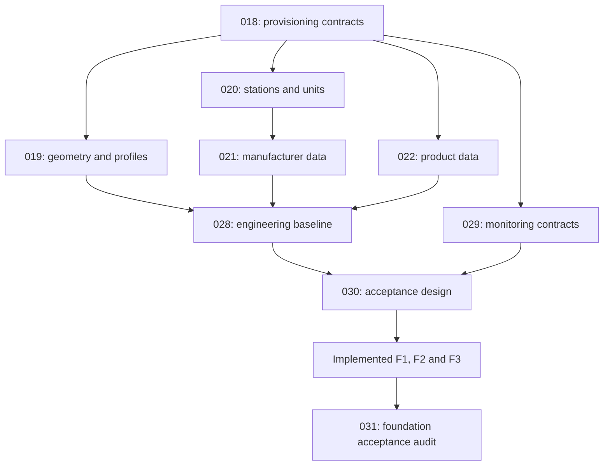

# HidraAPI Semantic Remediation Reconciliation

## Status

CURRENT — all 57 reconciled HMR implementations COMPLETED; permanent 123-subject semantic transfer complete. HPR-P2-005/006 corrections are COMPLETED; renewed P2 audit PASS with 12/12 VERIFIED at 7be1c9cb47ed9b6f73a7692d0a328ad870e2b4d4. HPR-P2-013 is COMPLETED and P2 VERIFIED/CLOSED after exact-head Documentation Validation #136 and production CI #609 PASSED at a8905e32289a583f47b831e0381783e556ae0c8d. Phase P2.5 is PLANNED/OPEN; HPR-P25-000 registration CI #142 PASSED and HPR-P25-001 source/requirements preflight is COMPLETED following owner decisions: GZ2 gas, both modes, own engine and dynamic versioned inputs; field qualification remains pending; operational twin runtime remains NOT ESTABLISHED. P3 remains DEFERRED; prior 9/12 FAIL and #127/#606 retain historical applicability.

## Historical HPR-P2-007 Verification Baseline

Repository: `CHOUABBIA-AMINE/HidraAPI`

Exact baseline: `aae829778d610b2912869844babfdcef82068138`

Legacy source register: `docs/roadmap/model-semantic-remediation.md`

The legacy register is preserved as execution history. This canonical reconciliation controls P2 execution disposition together with `doc/roadmap/ULTIMATE_ROADMAP.md`.

## Reconciliation Rules

HPR-P2-007 does not execute semantic remediation. It revalidates whether legacy HMR/HMSR obligations still require execution.

A legacy item is marked:

- **COMPLETED** only when current source/migration/test evidence demonstrates the registered obligation has already been implemented;
- **STILL REQUIRED** when no current evidence proves completion and the underlying source subject still exists;
- **BLOCKED** when a required owner-controlled contract/decision is still absent;
- **SUPERSEDED** only when current architecture/source makes the recorded obligation inapplicable. No HMR-050..106 item met that bar at this baseline.

Absence of the originally registered migration alone is not enough to prove an obligation is unresolved when no migration was required. For that reason the reconciliation also checks the registered dedicated semantic test and exact current architecture/contracts.

## Corrected Legacy Dispositions

### HMR-005 — telemetry.TelemetryPoint

**COMPLETED — legacy status is stale.**

Current evidence includes:

- `src/main/resources/db/migration/V20261004_005__hmr_005_telemetry_telemetry_point.sql`;
- `src/test/java/dz/sh/hidra/modules/telemetry/semantic/TelemetryPointSemanticRemediationTest.java`;
- `TelemetryPoint` rejects blank French names;
- application uniqueness pre-check exists for device + code;
- database unique index exists for `(device_id, code)`;
- persistence adapter validates active catalog families;
- optional unit reference resolves to an active TelemetryUnit;
- SIGNAL_TYPE `valueShape` and POINT_TYPE `numericUnitExempt` drive numeric/text/boolean and unit compatibility.

Therefore HMR-005 must not be re-executed absent concrete regression evidence.

### HMR-009 — simulation.SimulationModel

**COMPLETED — legacy carry-over blocker note is stale.**

The HMR-009 record itself is already `Completed`, with registered migration/test/application/Topology-contract evidence. The later legacy sentence saying “HMR-009 remains unresolved” contradicts the record and is not execution authority.

HMR-009 must not be reopened absent concrete regression evidence.

### HMR-054 — topology.Equipment

**COMPLETED — HMR-054 implementation and repaired CI #575 supersede the historical baseline below.**

The exact current tree contains:

`src/main/java/dz/sh/hidra/modules/party/application/contract/topology/TopologyPartyReferenceContract.java`

That Party-owned contract is deliberately exported to Topology and is already architecture-allowlisted. The historical “no suitable exported owner lookup” prerequisite is therefore no longer a blocker.

Current Equipment source, dedicated semantic test and V20261006_009 implement the
registered remediation. The former implementation-required sentence is superseded
by repaired CI #575 and cumulative current-tree CI #604; do not reopen HMR-054.

### HMR-080 — planning.Nomination

**COMPLETED — exact-head production CI #604 PASSED.**

The accepted standalone execution exports Party, Custody product and Telemetry unit
contracts, validates direct saves and installs forward 025/026. The previous absent
owner-contract blocker is superseded. Implementation 41904baff2becbdd03e19d3b2da005a28ad8d8a0
and fixture repair 617c2eec812e3a5734957ee9fa0360f6f5613032 are confirmed by CI #604.
The owner-authorized HPR-P2-008 closure is recorded below; P2 remains open.

## Reconciled Outstanding Register

| HMR | HMSR | Subject | Canonical disposition | Exact-current evidence |
|---|---|---|---|---|
| HMR-050 | HMSR-059 | integrity.IntegrityProgram | COMPLETED — HPR-P2-008 | legacy migration not required after current-schema revalidation; dedicated semantic test added; active `INTEGRITY_PROGRAM_TYPE` family enforced; Organization-owned Integrity contract validates populated owner unit; no cross-module FK |
| HMR-051 | HMSR-060 | leakdetection.LeakDetectionCase | COMPLETED — HPR-P2-008 | Topology and optional Organization references validated on every case save; snapshot preserved; no migration because primary-candidate FK already exists; owner contract and architecture export added. |
| HMR-052 | HMSR-061 | notification.NotificationMessage | COMPLETED — HPR-P2-008 | Recipient/request composite FK; exact-version/template FK and pre-dispatch composition guard; required-input schema checked for sendable states; inputs/version frozen; active NOTIFICATION_PRIORITY eligibility; V20261006_005; dedicated unit and PostgreSQL tests added. |
| HMR-053 | HMSR-062 | telemetry.TrustedTelemetryReading | COMPLETED — HPR-P2-008 | Telemetry trust application use case derives values/provenance/binding from locked source evidence; PASSED plus MEDIUM/HIGH/CERTIFIED, ACTIVE point and active QUALITY_CODE required; composite assessment/reading identity and optional unit/batch FKs; snapshot preservation; V20261006_008; focused unit and PostgreSQL tests added; CI #604 passed. |
| HMR-054 | HMSR-063 | topology.Equipment | COMPLETED — HPR-P2-008 | EquipmentType identity/code is sole active classification; EquipmentKind deleted from domain/JPA; forward V20261006_009 preserves legacy strings, rejects conflicting classification/orphan attachments and adds nullable same-module FKs; manufacturer checked by existing Party contract; snapshots preserved; focused tests added; CI #604 passed. |
| HMR-055 | HMSR-064 | workflow.WorkflowInstance | COMPLETED — CI #581 GREEN | Owner-bound starts enforce active definition/version and exact binding, governed purpose/type, current-step coherence and owner target/actor snapshots; nonterminal uniqueness and same-definition/version database guards. Planning target registry denies unsupported/ambiguous owners. Eight focused behavior checks passed with temporary stubs; local Maven blocked by uncached parent, not a JUnit/PostgreSQL pass. |
| HMR-056 | HMSR-067 | integration.IntegrationExchangeMessage | COMPLETED — CI #585 PASSED | Optional run/endpoint existence, correlated endpoint/system ownership and active exact existing MESSAGE_TYPE/PAYLOAD_FORMAT catalogs enforced on saves. Forward V20261007_010 adds nullable/composite FKs and catalog guards without rewriting legacy evidence. Five dedicated and five PostgreSQL cases prepared. Local compile/focused Maven blocked before execution by uncached Boot parent; CI #604 passed. |
| HMR-057 | HMSR-068 | reporting.ReportRun | COMPLETED — CI #588 GREEN | Queue eligibility/access/approval, exact template lineage, concrete required parameters and terminal evidence enforced. Forward 012 corrects run/parameter request FKs and guards lineage/history. Eight Run, four QueueEvidence and nine PostgreSQL cases prepared; local runtime validation follows; Full production CI #588 passed. |
| HMR-058 | HMSR-069 | risk.RiskAssessment | COMPLETED — CI #593 GREEN | Atomic structured scopes, matrix provenance, authenticated Workflow/Audit approval and approved immutability; Java 21 clean verify and OpenAPI compatibility passed at cfc7798477c70d10e1c3e0afd4dd7e1b42676898. |
| HMR-059 | HMSR-071 | leakdetection.LeakEscalationReference | COMPLETED — HPR-P2-008 | Optional candidate validated before save and protected by V20261006_001 nullable same-module FK with fail-closed orphan preflight; no case-primary equality rule. |
| HMR-060 | HMSR-072 | notification.NotificationDeliveryAttempt | COMPLETED — HPR-P2-008 | Channel/message composite FK; create-only EntityManager.persist plus PK race protection; update/delete/truncate rejected; permanent/cancelled automatic retry rejected; V20261006_006; dedicated unit and PostgreSQL tests added. |
| HMR-061 | HMSR-073 | workflow.WorkflowTransition | COMPLETED — CI #581 GREEN | Distinct same-definition steps and unique source decisions are protected in configuration persistence and PostgreSQL. Unsupported conditions/callbacks/COMMENT cannot attach to ACTIVE definitions or survive activation; runtime remains fail closed. Three focused behavior checks passed with temporary stubs; PostgreSQL validation confirmed by CI #604. |
| HMR-062 | HMSR-074 | incident.Incident | COMPLETED — CI #595 GREEN | Batch 15 and inventory repair passed full Java 21/PostgreSQL/OpenAPI CI at e2e92bae7d69c54a46fa92702b539858404bf7ce. |
| HMR-063 | HMSR-075 | identity.User | COMPLETED — HPR-P2-008 | Nonblank username enforced in domain; PostgreSQL named username/email uniqueness, nullable-email semantics and fail-closed legacy preflight; optional Employee resolved through Organization-owned contract; no cross-module FK. V20261006_010 and focused tests added; final CI #604 passed. |
| HMR-064 | HMSR-076 | planning.PlanRevision | COMPLETED — CI #582 GREEN | Positive per-plan revision numbers, nullable validated base lineage, active REVISION_REASON and approved metadata/persistence/database immutability enforced. Forward V20261007_001; four focused checks passed using temporary API/assertion stubs, not Maven/JUnit. Five PostgreSQL cases registered; local compile/focused Maven blocked by uncached Boot 4.1.1 parent. Full database validation confirmed by CI #604. |
| HMR-065 | HMSR-077 | planning.OperationalPlan | COMPLETED — CI #582 GREEN | Required French name/scope type, unique plan code, active PLAN_TYPE, owner-controlled Topology/Identity/Organization references and same-plan nullable revision pointers enforced. Creation binds authenticated eligible actor and snapshots owner display values; unsupported REGION/NETWORK denied. Forward V20261007_002; twelve focused HMR-065/owner/catalog checks passed with temporary API stubs. Nine combined PostgreSQL cases registered; Maven compile/focused/full test/clean verify blocked before compilation by uncached Boot 4.1.1/Maven Central DNS. Full CI #604 passed. |
| HMR-066 | HMSR-078 | workflow.WorkflowTask | COMPLETED — CI #581 GREEN | Actionable assignment, live actor/unit membership, catalog eligibility, actor/time pairs and chronology are enforced. Terminal task evidence is immutable; generic creation is starter-bound, missing next-step rules fail closed, and execution/query paths no longer authorize by username snapshots. Seven focused behavior checks passed with temporary stubs; existing transition fixtures updated for new owner dependencies. |
| HMR-067 | HMSR-079 | documents.Document | COMPLETED — CI #583 GREEN | Required title/creator display, active exact document catalogs, code uniqueness and same-document current-version pointers enforced. Registration binds authenticated eligible Identity actor and canonical owner snapshots; neutral registry supports Topology/Planning and denies missing/ambiguous owners. Forward V20261007_003; 11 focused methods passed with temporary APIs, four PostgreSQL cases added. Compile/focused Maven blocked before compilation by uncached Boot 4.1.1 parent; full CI #583 passed. |
| HMR-068 | HMSR-080 | documents.DocumentVersion | COMPLETED — CI #583 GREEN | Required upload metadata, positive per-document unique numbers, nullable existing supersession and owner-controlled Identity/Workflow references enforced. Generic upload derives authenticated uploader display. Binary prevalidates metadata and registers known-rollback new-blob cleanup; failed cleanup preserves original error, unknown commit outcome preserves content and logs reconciliation. Forward V20261007_004; 10 focused owner/version/cleanup methods passed with temporary APIs; nine combined PostgreSQL cases include transactional storage rollback and confirmed commit failure. Local focused Maven blocked by uncached Boot 4.1.1 parent; full CI #583 passed. |
| HMR-069 | HMSR-081 | assets.MaintenanceWorkOrder | COMPLETED — CI #596 GREEN | Batch 16 passed full Java 21/PostgreSQL/OpenAPI verification at 68e330562b03cf92c5500b99ffceca1fd024d083. |
| HMR-070 | HMSR-082 | custody.CustodyTransferTicket | COMPLETED — CI #596 GREEN | Batch 16 passed full Java 21/PostgreSQL/OpenAPI verification at 68e330562b03cf92c5500b99ffceca1fd024d083. |
| HMR-071 | HMSR-084 | integration.IntegrationDeadLetterRecord | COMPLETED — CI #585 PASSED | Required failure evidence, all-or-none manual trio and optional local references enforced. New manual evidence requires authenticated eligible Identity actor; recorded provenance is immutable without historical actor revalidation. Forward V20261007_011 supplies nullable FKs/checks and concurrent provenance guard. Eight focused methods, one Identity owner method and five added PostgreSQL cases prepared. Temporary API type compilation passed; local focused Maven blocked by uncached Boot parent; CI #604 passed. |
| HMR-072 | HMSR-085 | integrity.IntegrityAssessment | COMPLETED — CI #596 GREEN | Batch 16 passed full Java 21/PostgreSQL/OpenAPI verification at 68e330562b03cf92c5500b99ffceca1fd024d083. |
| HMR-073 | HMSR-087 | organization.EmployeeAssignment | COMPLETED — HPR-P2-008 | Assignment service resolves same-module OrganizationUnit and rejects missing or non-ACTIVE units before save; existing employee/unit/position FKs retained; no migration. |
| HMR-074 | HMSR-088 | organization.OrganizationDelegation | COMPLETED — HPR-P2-008 | JPA responsibility_assignment_id is mandatory; V20261006_002 aborts on legacy null rows before SET NOT NULL; existing same-module FK preserved; real PostgreSQL focused tests added. |
| HMR-075 | HMSR-089 | organization.OrganizationHierarchySnapshot | COMPLETED — HPR-P2-008 | JPA captured_by_employee_id is mandatory; V20261006_003 aborts on legacy null rows before SET NOT NULL; existing same-module FK preserved; real PostgreSQL focused tests added. |
| HMR-076 | HMSR-090 | organization.ShiftAssignment | COMPLETED — HPR-P2-008 | JPA organization_unit_id is mandatory; V20261006_004 aborts on legacy null rows before SET NOT NULL; existing same-module FK preserved; real PostgreSQL focused tests added. |
| HMR-077 | HMSR-091 | risk.RiskEvidenceLink | COMPLETED — CI #593 GREEN | Typed owner evidence validation and named provider beans verified by Java 21 clean verify and OpenAPI compatibility at cfc7798477c70d10e1c3e0afd4dd7e1b42676898. |
| HMR-078 | HMSR-092 | simulation.SimulationCandidateChange | COMPLETED — CI #590 GREEN | Accepted SIM-PREREQ-01; required change values, active exact catalog and Topology target lookup; forward 001. |
| HMR-079 | HMSR-093 | simulation.SimulationRecommendation | COMPLETED — CI #590 GREEN | Required content, exact catalogs, nullable local references and transactional Audit-owned publication; forward 002/003. |
| HMR-080 | HMSR-094 | planning.Nomination | COMPLETED — CI #604 PASSED | NOM-OWNER-01/NOM-EXEC-01 accepted; implementation 41904baff2becbdd03e19d3b2da005a28ad8d8a0 and fixture repair 617c2eec812e3a5734957ee9fa0360f6f5613032; full Java 21 verification, PostgreSQL/Spring-JPA tests and OpenAPI compatibility passed; forward 025/026. |
| HMR-081 | HMSR-095 | workflow.WorkflowAction | COMPLETED — CI #581 GREEN | Generic recording permits comments only; configured transitions exclusively produce decisions using live Identity authority. Optional task ownership and conditional evidence are enforced; canonical actor snapshots and server-owned locked sequences replace caller evidence. Action persistence is insert-only with unique monotonic sequence and immutable database guards. Five focused behavior checks passed with temporary stubs; existing permission regression fixture updated. |
| HMR-082 | HMSR-096 | hse.HseCase | COMPLETED — CI #597 GREEN | Accepted Batch 17 implementation passed full Java 21/PostgreSQL/OpenAPI CI on cfb3681ef1c79b4416336a3533cbc0599b4fd6b2. |
| HMR-083 | HMSR-097 | audit.AuditExportRequest | COMPLETED — CI #584 GREEN | Required export metadata, active EXPORT_PURPOSE, owner-controlled optional Workflow/Documents references, bounded sanitized filters and one transactional EXPORT access record implemented. Generic writes admit REQUESTED only and persist/flush without merge. Forward V20261007_006; eight focused tests, two owner tests and four PostgreSQL/Spring/JPA tests prepared. Local Maven compile/focused blocked before compilation by uncached Boot 4.1.1 parent; production CI #584 passed. |
| HMR-084 | HMSR-098 | documents.DocumentTargetLink | COMPLETED — CI #583 GREEN | Required target module, active exact DOCUMENT_LINK_ROLE and owner-controlled target resolution enforced. Authenticated linking actor and canonical owner snapshots replace caller identity/display claims; optional version must belong to linked document, protected by composite FK. Forward V20261007_005; four focused methods passed with temporary APIs and three PostgreSQL cases added (12 combined). Both public export registries match 34 exact packages; all five forensic scans passed with temporary APIs. Focused Maven blocked by uncached parent; full CI #583 passed. |
| HMR-085 | HMSR-100 | identity.AuthorizationDecision | COMPLETED — CI #579 PASSED | Transactional graph, bounded ABAC, verified mappings, deterministic evidence and configurable persistence; Batch 6 implementation below. |
| HMR-086 | HMSR-101 | identity.AuthorizationDelegationGrant | COMPLETED — HPR-P2-008 | Required nonblank delegation reason and validTo carried through domain/JPA/mapper; DelegationStatus narrowed to ACTIVE/REVOKED/EXPIRED; optional Role and Permission validated with nullable same-module FKs; no XOR rule; V20261006_011 fails closed on legacy evidence; focused tests added; final CI #604 passed. |
| HMR-087 | HMSR-104 | identity.LoginSession | COMPLETED — HPR-P2-008 | AuthenticationProtocol sessionType and independent endedAt carried through domain/JPA/mapper; exact ExternalIdentity propagated from LDAP/OIDC through principal/input/completion; terminal lifecycle preserves lastSeenAt and prior termination; V20261006_012 requires explicit legacy protocol evidence; no inferred historical termination; focused tests added; final CI #604 passed. |
| HMR-088 | HMSR-105 | identity.UserPermissionGrant | COMPLETED — HPR-P2-008 | Domain and PostgreSQL enforce nonblank grantReason, bounded validTo and ACTIVE/REVOKED/EXPIRED for direct permission grants including emergency records; shared GrantStatus and optional role-grant reason/end remain unchanged; V20261006_013 and focused tests added; final CI #604 passed. |
| HMR-089 | HMSR-106 | identity.UserRoleGrant | COMPLETED — HPR-P2-008 | Authoritative ordinary role-grant application flow requires ACTIVE User before Role lookup/save; inactive states reject without implicit emergency bypass; optional reason/end and shared SUSPENDED role status preserved; focused tests added; no migration required; final CI #604 passed. |
| HMR-090 | HMSR-107 | incident.IncidentClosure | COMPLETED — CI #595 GREEN | Batch 15 and inventory repair passed full Java 21/PostgreSQL/OpenAPI CI at e2e92bae7d69c54a46fa92702b539858404bf7ce. |
| HMR-091 | HMSR-108 | incident.IncidentRelatedIncident | COMPLETED — CI #595 GREEN | Batch 15 and inventory repair passed full Java 21/PostgreSQL/OpenAPI CI at e2e92bae7d69c54a46fa92702b539858404bf7ce. |
| HMR-092 | HMSR-109 | incident.IncidentResponseAction | COMPLETED — CI #595 GREEN | Batch 15 and inventory repair passed full Java 21/PostgreSQL/OpenAPI CI at e2e92bae7d69c54a46fa92702b539858404bf7ce. |
| HMR-093 | HMSR-110 | reporting.ReportOutputArtifact | COMPLETED — CI #588 GREEN | Existing run and nonblank Documents reference evidence required; every supplied reference is independently owner-validated. Forward 013 corrects artifact/run FK without Documents FK. Six focused methods, one Documents owner method and five additional PostgreSQL cases prepared; Full production CI #588 passed. |
| HMR-094 | HMSR-111 | planning.PlanTarget | COMPLETED — CI #600 PASSED | Independent semantic commit 3845b7d30637ec9fc7306a527a0ae569b501fa89 plus narrow repair 0cc3e5c6c4b675880a634b3a073905f4119a36b7; Java 21 clean verify and OpenAPI green on repaired Batch 19 final tree. |
| HMR-095 | HMSR-112 | audit.AuditEvent | COMPLETED — CI #584 GREEN | Required source/target module and target type, active exact event/category/optional severity/reason families, bounded sanitized payload/free text and persist/flush insertion enforced. Forward V20261007_007 adds optional catalog FKs, family guards and immutable event UPDATE/DELETE denial. Five focused and four added PostgreSQL/JPA/concurrency checks prepared; local focused Maven blocked by uncached Boot parent; CI #584 passed. |
| HMR-096 | HMSR-113 | hse.HseClosure | COMPLETED — CI #597 GREEN | Accepted Batch 17 implementation passed full Java 21/PostgreSQL/OpenAPI CI on cfb3681ef1c79b4416336a3533cbc0599b4fd6b2. |
| HMR-097 | HMSR-114 | hse.HseCorrectivePreventiveAction | COMPLETED — CI #597 GREEN | Accepted Batch 17 implementation passed full Java 21/PostgreSQL/OpenAPI CI on cfb3681ef1c79b4416336a3533cbc0599b4fd6b2. |
| HMR-098 | HMSR-115 | integrity.IntegrityCase | COMPLETED — CI #598 GREEN | Accepted IC-PREREQ-01 implementation passed full production CI on 863d113fbee88f71ff7e2c3b593b415e5b70d07a. |
| HMR-099 | HMSR-116 | workflow.WorkflowStateHistory | COMPLETED — CI #581 GREEN | Mandatory status/actor display evidence fails fast. History persistence inserts and flushes without upsert; optional task/step/action/reason references are checked for instance/definition and action evidence coherence. Database guards prohibit update/delete/truncate. Four focused behavior checks passed with temporary stubs; ten PostgreSQL/Hibernate cases added for CI, not locally executed. |
| HMR-100 | HMSR-117 | alarm.Alarm | COMPLETED — CI #602 GREEN | Accepted ALRM-PREREQ-01; independent Batch 20 lifecycle commit with focused and PostgreSQL/Spring-JPA sources; Java 21 clean verify and OpenAPI compatibility passed at repaired head 74ef372c82a790cdad63a77038fd60afb0de9c44. |
| HMR-101 | HMSR-118 | audit.AuditAccessRecord | COMPLETED — CI #584 GREEN | Access records use persist/flush without merge; populated optional AuditEvent/export IDs must exist. Forward V20261007_008 supplies nullable local FKs and UPDATE/DELETE denial. Three focused and four added PostgreSQL/JPA/concurrency/orphan checks prepared; local focused Maven blocked by uncached Boot parent; CI #584 passed. |
| HMR-102 | HMSR-119 | audit.AuditBeforeAfterValue | COMPLETED — CI #584 GREEN | Required fieldPath, masked/sensitive raw-text exclusion, optional exact active MASK_REASON and existing parent event enforced. Hash-only evidence and changed=false remain legal. Persist/flush insertion plus V20261007_009 local FKs/checks/UPDATE/DELETE denial preserve immutable rows. Six focused and five added PostgreSQL/JPA/concurrency/legacy checks prepared. Temporary API type compilation passed; local focused Maven blocked by uncached Boot parent; CI #584 passed. |
| HMR-103 | HMSR-120 | monitoring.PlanActualDeviation | COMPLETED — CI #600 PASSED | Independent semantic commit 74ea302432eff8434466d7162134b99923ce3161; live/direct-save owner/evaluation validation and forward 021 verified by final repaired-head CI. |
| HMR-104 | HMSR-121 | alarm.AlarmAcknowledgement | COMPLETED — CI #602 GREEN | Accepted ALRM-PREREQ-01; independent Batch 20 lifecycle commit with focused and PostgreSQL/Spring-JPA sources; Java 21 clean verify and OpenAPI compatibility passed at repaired head 74ef372c82a790cdad63a77038fd60afb0de9c44. |
| HMR-105 | HMSR-122 | alarm.AlarmClosure | COMPLETED — CI #602 GREEN | Accepted ALRM-PREREQ-01; independent Batch 20 lifecycle commit with focused and PostgreSQL/Spring-JPA sources; Java 21 clean verify and OpenAPI compatibility passed at repaired head 74ef372c82a790cdad63a77038fd60afb0de9c44. |
| HMR-106 | HMSR-123 | alarm.AlarmShelving | COMPLETED — CI #602 GREEN | Accepted ALRM-PREREQ-01; independent Batch 20 lifecycle commit with focused and PostgreSQL/Spring-JPA sources; Java 21 clean verify and OpenAPI compatibility passed at repaired head 74ef372c82a790cdad63a77038fd60afb0de9c44. |

## Reconciliation Totals

- legacy HMR records parsed: **104**;
- HMR-005 corrected from stale planned status to **COMPLETED**;
- HMR-009 confirmed **COMPLETED** and removed as a carry-over blocker;
- HMR-050..106 evaluated: **57**;
- HMR-050..106 **STILL REQUIRED**: **0**;
- HMR-050..106 **BLOCKED**: **0**;
- HMR-050..106 **IMPLEMENTED during HPR-P2-008**: **57**, all CI-confirmed through #604, zero pending;
- HMR-050..106 **SUPERSEDED**: **0**;
- HMR-054 completed; repaired CI #575 is green;
- HMR-080 completed with repaired-head CI #604 passed; HMR-055 prerequisite resolved and implemented in Batch 7.

## HPR-P2-008 Progress

- HMR-050 — **COMPLETED** at the first HPR-P2-008 execution step.
- Batch 7 **COMPLETED — CI #581 GREEN**: HMR-055, 061, 066, 081, 099; exact repaired head ec63af0414d7fa85b9200d4bd181ac799bd072ed. Batch 8 preflight split below; no Planning implementation claimed.
- Current remaining: **0 STILL REQUIRED, 0 BLOCKED, 0 pending CI**; all 57 implementations are CI-confirmed through #604 on 617c2eec812e3a5734957ee9fa0360f6f5613032. NOM-OWNER-01/NOM-EXEC-01 and HMR-080 are resolved. HPR-P2-008 is COMPLETED following the owner's closure authorization; HPR-P2-009 has transferred the lasting decisions into canonical domain/module docs. HPR-P2-010 remains PENDING.

- HMR-051 — **COMPLETED**: Topology and optional Organization references validated on every case save; snapshot preserved; no migration because primary-candidate FK already exists; owner contract and architecture export added.

- HMR-059 — **COMPLETED**: Optional candidate validated before save and protected by V20261006_001 nullable same-module FK with fail-closed orphan preflight; no case-primary equality rule.

- HMR-073 — **COMPLETED**: Assignment service resolves same-module OrganizationUnit and rejects missing or non-ACTIVE units before save; existing employee/unit/position FKs retained; no migration.

- HMR-074 — **COMPLETED**: JPA responsibility_assignment_id is mandatory; V20261006_002 aborts on legacy null rows before SET NOT NULL; existing same-module FK preserved; real PostgreSQL focused tests added.

- HMR-075 — **COMPLETED**: JPA captured_by_employee_id is mandatory; V20261006_003 aborts on legacy null rows before SET NOT NULL; existing same-module FK preserved; real PostgreSQL focused tests added.

- HMR-076 — **COMPLETED**: JPA organization_unit_id is mandatory; V20261006_004 aborts on legacy null rows before SET NOT NULL; existing same-module FK preserved; real PostgreSQL focused tests added.

## HPR-P2-008 Execution Rule

HPR-P2-008 may execute only the `STILL REQUIRED` items, in dependency-safe order, with a fresh preflight before each mutation or registered batch.

Before each HMR:

1. re-read its HMSR obligations;
2. verify exact current source and architecture contracts;
3. verify the registered write scope still fits;
4. decide whether a migration is actually required from current schema;
5. verify SCC/dependency ordering;
6. verify owner-controlled contracts exist;
7. preserve one HMR semantic test/commit boundary;
8. do not restart HMR-005, HMR-009 or any other completed HMR without concrete regression evidence.

HMR-080's owner-contract prerequisite and accepted solo execution are resolved by
NOM-OWNER-01/NOM-EXEC-01 and CI #604. No remaining HMR in this register may be
restarted without concrete regression evidence. HPR-P2-008 closure is owner-authorized
and recorded below; HPR-P2-009 permanent transfer is recorded in its accepted execution section. No completed HMR is reopened.

## Legacy Preservation

`docs/roadmap/model-semantic-remediation.md` is intentionally not rewritten by HPR-P2-007. Its historical statuses, batches and execution notes remain provenance. Where it conflicts with this exact-source reconciliation, this canonical document and the Ultimate Roadmap govern P2 execution.

## Batch 1 validation disposition

User-authorized Batch 1 implements HMR-051, HMR-059 and HMR-073..076 in six
independent semantic commits. Baseline full CI #568 passed at `7068b44`.
The six focused semantic test classes plus PostgreSQL migration regression tests
are present. Local Maven execution cannot resolve Spring Boot 4.1.1 from Maven
Central (DNS failure); local Java is 17, not the required 21, and Docker is absent.
No local Java/PostgreSQL test success is claimed. The final batch full CI on Java 21
is the integration and migration gate; if red, repair this batch before proceeding.
Four new migrations follow V20261005_001 and preserve all pre-existing migrations.

## Batch 1 repaired exact-head gate

Full CI #570 / run `37476746534` succeeded on
`201e21b16a6bef5c2a346d4107c912c0ed237531`. CI #569 exposed one missing export
in ForensicRemediationClosureTest; the narrow repair added the same approved
Organization LeakDetection contract export already present in ArchitectureGuardrailTest.
This green head is the Batch 2 baseline.

## Batch 2 execution and validation disposition

HMR-052 and HMR-060 implemented in independent semantic commits. The final
Batch 2 CI is pending; task completion here records implementation, not a passed CI run.
No existing migration was edited. V20261006_005 and V20261006_006 follow the
Batch 1 migrations and fail closed on incompatible legacy rows without rewriting evidence.

Validation performed locally:

- `git diff --check`: passed.
- Java compiler syntax parsing: all eight changed/new Java files passed; no dependency/type-check claim.
- Standalone compilation/execution of the actual NotificationDeliveryAttempt domain:
  all seven statuses enforce the permanent-failure automatic-retry rule.
- Maven compile, focused four-class test run, full test and clean verify attempted
  using `bash ./mvnw -o -q ...`: all stopped before build/test execution because
  Spring Boot 4.1.1 parent POM is absent from the local cache. The available Java is 17;
  required Java 21 and PostgreSQL/Testcontainers verification remain for GitHub CI.

Rendering-variable contract: the selected version's JSON object may contain a
`required` array of nonblank variable names. Each requires a matching, nonblank
message-owned value snapshot before READY/SCHEDULED/dispatch progression.
Malformed required contracts fail closed. This checks required input presence;
it is not a general JSON Schema type validator or a template renderer.
The current create API has no variable payload: templates with required inputs
need DRAFT staging and persisted variables before promotion. The create path
rejects them rather than sending incomplete messages. Template-free messages
remain supported. No new rendering endpoint, retry workflow, attempt-number,
provider, cross-module or OT-control policy is introduced.

Next registered proposed scope: HMR-053 alone, only after the final Batch 2 head is green.
Per owner instruction, stop once final-head CI has started; resume on `next` or `fail`.

## Batch 2 CI #571 corrective follow-up

CI #571 / run `37479293974` on `657d5d7cf7803e62f820ea9dfde5cf308ecb7640`
ran 639 tests: 0 assertion failures, 1 error, 0 skipped. PostgreSQL reported
SQLSTATE `42702` in NotificationMessageIntegrityMigrationTest: the required-variable
lookup used ambiguous `message_id` instead of the function-qualified parameter.

V20261006_007 replaces only hmr052_message_valid with the qualified parameter;
all previously published migrations and signatures remain unchanged. The PostgreSQL
regression reproduces the original error, installs the forward repair, proves promotion
with the matching input succeeds, and proves another message's inputs cannot satisfy it.
Existing message integrity tests now apply both the original and corrective migrations.

Local Java syntax and migration-preservation checks passed. Focused Maven execution
was attempted but stopped at the uncached Spring Boot 4.1.1 parent POM; no local
PostgreSQL or full-suite success is claimed. Replacement exact-head CI remains pending.
Stop once replacement CI starts, as instructed by the owner.

## HMR-053 execution — 2026-10-06

Baseline main `d61bec9eeee6b2c3c3a9d5ea887b28b664355753` passed full CI #572 /
run `37480926311`, closing the Batch 2 regression gate. The owner resumed with `next`.
HMSR-062 was re-read against current Java/JPA/schema before this solo execution.

Implemented TrustTelemetryReadingUseCase and TelemetryTrustEvidencePort with a
Telemetry-owned application service and infrastructure evidence loader. Trust policy
accepts MEDIUM, HIGH and CERTIFIED (the DDD's trusted-level examples), always retains
the assessment's level, and requires PASSED, ACTIVE point and active QUALITY_CODE.
The catalog currently exposes active as its lifecycle eligibility flag.
The effective unit comes from the point; ingestion batch and raw values/timestamp
come from the source reading. Optional populated unit/batch references must exist.

Applicable bindings use active=true and [validFrom, validTo) at the operation's trust
instant. A single applicable binding is selected automatically; multiple roles require
an explicit applicable binding ID; no binding preserves an empty topology snapshot.
Source/assessment/point/catalog locks plus point-based binding mutation serialization
protect capture. The downstream record preserves captured snapshots on later rebind
or point retirement. New code introduces no Topology FK or arbitrary topology tuple.
V20261006_008 adds composite provenance and optional same-module FKs, a direct-write
creation guard, and rejects rewriting captured trusted evidence. Preflight validates
historical identity/trust/quality family; it does not pretend current point lifecycle or
current bindings prove a historical capture. Inconsistent provenance aborts migration.

Validation:

- Java syntax: all eight new/changed Java files passed compiler parsing.
- Actual application/domain trust operation compiled and executed in a standalone
  Java 17 harness with annotation stubs and in-memory ports: every trust level,
  assessment status, point lifecycle and explicit binding selection passed.
  This does not validate Spring transactions or JPA/PostgreSQL behavior.
- `git diff --check`, published migration preservation and unique version ordering passed.
- Maven compile, focused two-class tests, full tests and clean verify attempted via
  `bash ./mvnw -o -q ...`; all stopped at uncached Spring Boot 4.1.1 parent POM.
  PostgreSQL migration tests are present but await Java 21/Testcontainers CI.

Implementation recorded as completed; exact-head CI remains pending. Confirm CI
started, then stop until the owner sends `next` or `fail`. Next proposed solo task
is HMR-054 after green CI, with live Party-owner-contract revalidation first.

## HMR-054 execution — 2026-10-06

Baseline main `f676e278357ac7bcf2bc8bf55830b16cb324bd73` passed full CI #573 /
run `37483724317`. Owner resumed with `next`. Source HMSR-063 was re-read;
existing TopologyPartyReferenceContract/query service and both architecture export
allowlists resolve the legacy Party-owner-contract blocker.

Equipment.equipmentTypeId and the Topology-owned EquipmentType identity/code now
provide the single active classification source. EquipmentKind and both mapped kind
properties were removed; lifecycle enums remain. V20261006_009 renames the two
legacy kind columns to legacy_equipment_kind, preserves every stored string, and
allows null for new catalog-backed rows. These columns are unmapped historical
metadata. The migration aborts on conflicting equipment/type classification rather
than choosing a new classification; owner reconciliation is required for such data.
Existing type references remain protected, and nullable facility/node/pipeline-segment
attachments gain same-module FKs with DELETE RESTRICT. No attachment cardinality
rule is introduced. Manufacturer identities are checked through Party's existing
existence contract on every Equipment save; code/name snapshots are preserved.
No cross-module FK, Party lifecycle rule or equipment lifecycle matrix is added.

Validation:

- Compiler syntax parsing: eight changed/new Java files passed.
- Actual Equipment domain compiled/executed in a standalone Java 17 harness:
  catalog type identity works without EquipmentKind; snapshots remain intact.
- `git diff --check`, cross-module export scan, migration preservation and version ordering passed.
- Maven compile, focused three-class tests, full tests and clean verify attempted via
  `bash ./mvnw -o -q ...`; stopped at uncached Spring Boot 4.1.1 parent POM.
  Real PostgreSQL regression tests are added; Java 21 integration remains for CI.

Implementation is recorded as completed; final exact-head CI is pending. Confirm CI
started and stop until `next` or `fail`. Next proposed scope is HMR-063 plus HMR-086..089,
subject to fresh admission/dependency checks; HMR-080 remains blocked.

### HMR-054 CI #574 guardrail inventory correction

CI #574 / run `37485895694` on `674914cccf97aa4903df2f6f0e69562e9ce074da`
ran 656 tests with one failure and no errors. DomainInvariantGuardrailTest retained
its pre-HMR-054 required-marker count despite deliberate removal of the duplicated
Equipment.equipmentKind field/guard. Admit a narrow correction to that existing
architecture test plus these canonical records: 583 -> 582 required markers and
610 -> 609 total markers. Ordering (24), self-reference (3), touched records (114)
and the mandatory equipmentTypeId guard remain unchanged. No production or migration
change is required. Standalone execution of the actual inventory test passed;
focused Maven was blocked by the uncached Spring Boot 4.1.1 parent POM.
Replacement exact-head CI is pending; confirm it started and await `next` or `fail`.

## Batch 5 implementation and validation disposition — 2026-10-06

HMR-063, HMR-086, HMR-087, HMR-088 and HMR-089 implemented in five independent
semantic commits, preceded by the explicit Batch 5 admission. Shared final CI pending.
Current totals: 16 completed, 40 still required, one blocked (HMR-080) in HMR-050..106.
The attached sequence now has 5/20 batches and 15/55 HMR implementations complete.

Validation actually performed:

- `git diff 89a7c3b --check`: passed.
- Java compiler syntax parsing: 34 changed Java sources passed.
- Actual Identity domain plus AuthenticationSessionLifecycleApplicationService compiled
  with Java 17's compiler module and temporary Spring annotation stubs; actual-domain
  invalid-value and session external-identity/protocol/logout/expiry/activity/idempotency
  behavior checks passed. This is not full Java 21/Spring validation.
- Actual Identity JPA entities and mapper compiled with temporary Jakarta annotation
  stubs; delegation reason and session protocol/end mapper round trips passed. This does
  not establish Hibernate or PostgreSQL correctness.
- `bash ./mvnw -q -DskipTests compile`: blocked before compilation by Maven Central DNS
  failure resolving the uncached Spring Boot 4.1.1 parent POM.
- Focused nine-class tests, full test and clean verify attempted with offline Maven:
  blocked before execution by the same uncached parent. Java 21 and Docker are absent.
  No JUnit/PostgreSQL/full-build pass is claimed locally.

Nine dedicated semantic/migration test classes are present for the final GitHub gate.
All four migrations are forward additions after V20261006_009; published migrations
are unchanged. V20261006_011 and V20261006_012 permit operator-supplied columns for
explicit legacy reconciliation before replay; they never fabricate delegation reasons,
end dates, session protocol or historical endedAt. Incompatible existing delegation,
session and direct-permission rows will intentionally block rollout until reconciled.

Next: HMR-085, matching Batch 6 of the supplied plan, only on owner `next` after the
Batch 5 gate. Observe final-head CI started, then stop; await `next` or `fail`.

## Batch 6 / HMR-085 preflight — 2026-10-06

Baseline main: `925feec7c022a3603afbb4c2fcff47010a64323e`.
CI #576 (run 37498438487) and documentation validation #67 both succeeded.
Owner `next` selected HMR-085 / HMSR-100. No production mutation performed.

### Disposition: BLOCKED — authorization evaluation contract prerequisite

This is a new preflight finding, not a reopened completed task. Current source proves:

- `IdentityAuthorizationApplicationService.evaluate` unconditionally denies with
  NO_GRANT_MATCHED and unconditionally saves the resulting decision.
- `AuthorizationPolicyEvaluator` constructs permit/deny records but performs no
  policy-expression or graph evaluation.
- `EvaluatePermissionQuery` and `EvaluatePermissionRequest` expose user, permission,
  resource identity and neutral scope only. They have no verified assertion/context input.
- The OIDC converter validates issuer/subject and resolves an ExternalIdentity, but
  creates its principal from internally calculated permissions and does not preserve
  the verified group/role/permission claims needed for assertion-only mappings.
- Identity DDD sections 6.12 and 7.3 define JSON policy expressions and evaluation order,
  but do not define a JSON grammar, attribute resolution, CONSTRAIN/obligation execution
  contract, or policy conflict handling. Current production source has no expression evaluator.
- `IdentityModuleConfiguration.authorizationDecisionPersistenceEnabled` exists in a
  framework-neutral record but is not bound into this evaluation path.

The registered legacy HMR-085 write list omits the actual defective application
service, evidence-query adapter, trusted-assertion transport, expression evaluator,
configuration binding and their regression tests. Merely rewriting the decision
record cannot discharge HMSR-100's three obligations. AGENTS.md section 3.2 rule 9
requires splitting an unregistered prerequisite before mutating the HMR.

### Proposed concrete prerequisite contract — TARGET, not implemented

Recommended implementation is an Identity-owned, constrained JSON evaluator, with no
SpEL, scripts, SQL expressions or dynamic class access. This is a proposal and grants
no runtime authority until admitted/implemented.

1. Resolve an ACTIVE, unlocked User and ACTIVE requested Permission from Identity.
   Unknown/disabled subjects or permissions fail closed with truthful reason codes.
2. Introduce an application-owned authorization evidence port. A transactional JPA
   adapter resolves direct permission grants, direct roles, group memberships/roles,
   role-permission grants, active policy versions/rules and required subject attributes.
   Capture one evaluation instant; use `[validFrom, validTo)` and exact neutral scope
   identity. Null/GLOBAL grant scope covers operations; a scoped grant cannot authorize
   a different scope/reference. Snapshot labels never establish identity.
3. Direct explicit DENY overrides every permit path. Evaluate direct permissions,
   direct roles and inherited group roles in DDD order, preserving every participating
   grant/link ID. Require ACTIVE role/group/membership/grant state and valid intervals.
4. External assertions may participate only when authenticated/validated infrastructure
   supplies their provider, exact ExternalIdentity, subject and allowlisted claim values,
   bound to the evaluated user. Never accept claim authority from EvaluatePermissionRequest
   or treat stored external attribute snapshots as current login assertions.
   Require ACTIVE provider, LINKED external identity and eligible mapping mode.
   SYNC_MEMBERSHIP uses actual synchronized local membership; ASSERTION_ONLY and
   DIRECT_GRANT use verified assertions. MANUAL_APPROVAL and REQUIRES_LOCAL_APPROVAL
   do not confer authority without explicit approval evidence; DISABLED never confers it.
5. JSON expression version 1 uses bounded operators: `eq`, `in`, `exists`, `all`, `any`,
   `not`. Each predicate identifies a permitted namespace/attribute and a typed literal;
   compound expressions contain child predicates. Reject unknown fields/operators,
   excessive depth/size, missing required attributes and type mismatch. Do not execute
   arbitrary expressions. Only repository-owned subject attributes and explicitly
   trusted resource/context evidence are eligible; absent evidence is INDETERMINATE.
6. Evaluate eligible policy rules in deterministic priority/ID order. Explicit policy
   DENY overrides permits; unknown/unsupported conditions or unresolved obligations
   produce INDETERMINATE rather than silently permitting. CONSTRAIN can restrict an
   existing grant; its obligation cannot be declared satisfied without executor evidence.
   Policy-only PERMIT requires all relevant constraints/obligations to be resolved.
7. Construct a decision with reasonCode/reasonMessage and deterministic JSON evidence
   for matched grant IDs, policy-rule IDs and external mapping/claim provenance.
   Preserve neutral resource references and omit bearer tokens/secrets/raw sensitive claims.
8. Expose the existing persistence flag through an infrastructure configuration adapter,
   retaining its current default `true`. Evaluation is identical with persistence off;
   only the save is skipped. No new high-risk-operation taxonomy is invented.

Required scope admission: IdentityAuthorizationApplicationService, application evidence
and settings ports, JPA evidence adapter, constrained expression evaluator, trusted
assertion model and authentication adapters, runtime configuration binding, focused
AuthorizationDecisionSemanticRemediationTest plus graph/mapping/policy PostgreSQL and
assertion-spoofing regression tests. No cross-module FK or destructive migration.

Validation of this preflight: source/DDD/allowlist inspection and `git diff --check`.
No application tests or production-implementation success claimed. HMR-085 remains
blocked and selected; do not automatically advance to Batch 7. The prerequisite
contract must be settled before implementing the complete HMR-085 scope.

## Batch 6 / HMR-085 implementation — 2026-10-06

Owner `Next` accepted the concrete prerequisite contract. Baseline docs-only main
341a79a passed docs CI #68; unchanged production source passed full CI #576
at 925feec7. Previous preflight block is resolved, with scope admitted before mutation.

HMSR-100 closure:
- Replaced unconditional denial with ACTIVE/unlocked user and permission eligibility,
  direct permissions/roles, group-role inheritance, verified external group/role/permission
  mapping paths, exact scope identity, half-open validity windows and ABAC rules.
- Explicit DENY dominates grants and policies. Ineligible approval-dependent mappings
  do not grant authority. SYNC_MEMBERSHIP requires an actual eligible local membership
  and active provider/mapping; stored EXTERNAL_ASSERTION memberships never stand in
  for current claims. LDAP supports synchronized local evidence; its existing verifier
  supplies no live group claims, so assertion-only LDAP authority is not manufactured.
- Added a self-bound OIDC evaluation endpoint on the existing decoder/converter chain.
  Only configured claim paths are captured; the user/provider/external identity/subject
  and assertion expiry are rechecked against current Identity state. Claims in request
  details, ordinary tokens or stored snapshots never confer mapped authority.
- Recorded sorted JSON grant-chain and policy-rule IDs, external mapping provenance
  and value hashes. No bearer credentials or raw sensitive claim values are persisted.
  JPA evidence columns use Hibernate JSON binding; no schema change required.
- Bound `hidra.identity.authorization-decision-persistence-enabled` (default true).
  Disabling it skips saving while retaining identical evaluation semantics.

JSON grammar and policy behavior are specified in Identity DDD below. Rule priority
then ID determines evaluation order; deny precedence is independent of that order.
CONSTRAIN uses subject/resource/action selectors and a required matching context
condition to restrict existing authority. Unsupported obligations remain INDETERMINATE;
no obligation executor or high-risk-operation taxonomy is invented. Repository-owned
subject attributes and neutral requested identifiers are available; absent live resource
state/context evidence cannot be supplied by callers and remains INDETERMINATE.

Validation:
- `bash ./mvnw -q -DskipTests compile`: blocked before source compilation, Maven Central
  DNS failure resolving Spring Boot parent 4.1.1.
- Focused semantic/PostgreSQL/trust commands, complete `test`, and `clean verify`
  attempted with `-o`: blocked by the same uncached parent. JDK is 17, Docker absent.
- All changed Java files parsed with the JDK compiler. Selected actual production
  classes compiled with temporary framework API stubs; 10 semantic behavior checks
  executed successfully using temporary annotation/assertion stubs. These are not
  Maven/JUnit, framework integration or PostgreSQL success claims.
- Added 10 semantic cases, 9 PostgreSQL graph/JSON cases, 3 assertion-trust cases,
  2 OIDC API cases and existing constructor/OpenAPI regression updates for CI.
- `git diff --check`: passed. Final-head GitHub CI pending at commit preparation.

Current totals: **17 implemented, 39 still required, one blocked (HMR-080)**.
Next owner-selected scope is attached Batch 7 workflow execution; it requires green
Batch 6 CI and a fresh scope/dependency admission. Do not execute automatically.

### HMR-085 CI #577 repair — 2026-10-06

Run 37518264529 at 03db23c4 failed in Maven testCompile. Production
compilation succeeded, but tests were not executed. The OIDC fixture constructor
update also passed SpringAuthorizationContextAdapter into the unchanged LDAP
provider constructor in HidraAuthorizationOwnershipTest. Removed that extra
LDAP argument, retaining the required OIDC adapter. Production semantics unchanged.

All test sources parsed with the JDK compiler; four LDAP/OIDC constructor calls
checked against actual production declaration arities. git diff --check passed.
Focused ownership/OIDC Maven tests and clean verify attempted with -o; blocked
by uncached Spring Boot parent 4.1.1 (local Maven Central DNS remains unavailable).
These syntax/arity checks are not JUnit success claims. Replacement final-head CI
pending at preparation; Batch 7 remains gated on green Batch 6 verification.

### HMR-085 CI #578 historical OpenAPI build repair — 2026-10-06

At fb47ae27, CI run 37518717960 passed Repository verification
(`./mvnw -B -q clean verify`) and published the current-head OpenAPI document.
It failed generating the comparison base at previous commit 03db23c4 because
`-DskipTests package` still compiled the known broken historical LDAP test fixture.
This is a base-build failure, not a failure of the repaired head's tests.

Changed only isolated historical packaging to `-Dmaven.test.skip=true package`.
Current-head clean verify still runs all tests; exact previous-SHA worktree
selection and OpenAPI compatibility enforcement remain required. No model changes.
Workflow YAML/bash syntax and preserved-gate checks passed; git diff --check passed.
Local Maven packaging was attempted with -o and remains blocked by uncached
Boot parent 4.1.1. Replacement exact-head CI pending at preparation. Batch 7
remains gated until the complete CI workflow succeeds.


## Batch 7 preflight — workflow execution / 2026-10-06

Owner `Next` selects attached Batch 7: HMR-055, HMR-061, HMR-066, HMR-081,
HMR-099, in that order. Baseline main b6cdb1e2640be5e1990161f2b4d8e61bf2fd1156
is green: full CI #579 / run 37520044638 and documentation CI #71 /
run 37520044656 succeeded. The five HMSR source reviews and corresponding HMR
obligations were recovered independently against current code. No task is implemented
by this preflight; 061, 066, 081 and 099 remain STILL REQUIRED.

### WF-PREREQ-01 — PROPOSED, NOT ADMITTED

HMR-055 / HMSR-064 is blocked before production mutation. The Workflow DDD lists
nine catalog families, none for workflow purpose, while DefinitionTargetBinding
requires workflowPurposeId. HMSR-064 explicitly prohibits inventing its family.
WorkflowApplicationService.startWorkflowInstance currently copies caller-supplied
configuration, target and actor data without binding/version/owner validation.
WorkflowEligibilityLookupPort, WorkflowIdentitySnapshotPort and
WorkflowOrganizationSnapshotPort are availability placeholders, not authoritative
owner lookups. NoopWorkflowExternalReferenceResolver returns true and is not wired
into starts. Identity exports no Workflow actor eligibility contract; Organization's
existing consumer-specific reference contracts do not define Workflow assignment
or pool membership authority. Cross-module approval mutation contracts do not supply
a generic owner-controlled target lookup. A username/display/role snapshot cannot
stand in for live authority.

AGENTS.md section 3.2 rule 9 requires an owner-contract gap to be split out and the
HMR stopped before mutation. HMR-055's legacy file allowlist also omits the actual
WorkflowApplicationService and required owner contracts. This is a semantic contract
and admission prerequisite, not a Maven or CI failure.

Proposed resolution, requiring explicit roadmap admission before implementation:

1. Define WORKFLOW_PURPOSE as the controlled catalog family and require an active
   purpose for new starts and active bindings. This is a proposal, not an existing
   taxonomy. Reconcile legacy null/wrong-family purposes with an explicit data plan;
   do not silently retag generic catalog rows or seed invented business values.
2. Define a fail-closed target resolver registry keyed by module and governed target
   type code. Each supported target owner must export an explicit lookup contract
   returning existence/eligibility and neutral snapshots. Missing or ambiguous
   resolvers deny starts; no cross-module FK, private entity import or no-op success.
   Inventory supported owner/type combinations before admitting their exact files.
3. Define an Identity-owned Workflow actor contract resolving current active,
   unlocked actors and canonical snapshots, binding execution to the authenticated
   actor. Use existing governed permission policies; snapshots and caller actor IDs
   must not grant authority. Define an Organization-owned assignment contract for
   current unit availability and eligible pool membership. Specify claim/delegation
   policy explicitly; do not invent permission names or infer authority from labels.
4. HMR-055 must validate ACTIVE definition/version, exact active target/purpose
   binding, active WORKFLOW_TARGET_TYPE, and a current step in that definition.
   Preserve neutral external target IDs. Enforce one nonterminal instance per
   target/module/type/purpose tuple with a database uniqueness guard, including
   concurrent starts. Do not invent an initial-step selection rule.
5. HMR-061 must enforce same-definition distinct steps and unique configured
   (definition, from-step, decision). Unsupported expressions/callbacks must not
   become executable configuration; preserve fail-closed runtime behavior without
   adding an ungoverned interpreter or callback mechanism.
6. HMR-066 must validate actionable assignment through live owner contracts,
   active WORKFLOW_PRIORITY/WORKFLOW_ASSIGNMENT_MODE families, paired actor/time
   fields and chronology, plus terminal immutability. Remove username-snapshot
   authority from both transition execution and available-action queries. Explicit
   pooled assignment policy must govern any unassigned task creation.
7. HMR-081 must route decision actions through configured transitions; generic
   recording must not bypass decision authority. Validate optional supplied task
   ownership, required reason/comment evidence and actor display snapshots. Allocate
   action sequence under the instance lock with database uniqueness, never from a
   caller. Resolve actors/units through their owners without cross-module FKs.
8. HMR-099 must reject blank mandatory evidence and insert history without upsert.
   Enforce append-only persistence and validate supplied optional task/step/action/
   reason coherence; keep optional references optional. Do not introduce a new
   mandatory history producer or fabricated lifecycle events.

Scope admission must include actual application/transition/query services, catalog
and binding repository interfaces/adapters, explicit public owner contracts and
adapters, architecture exports/guardrails, model/API/mapping changes and focused
semantic/PostgreSQL concurrency/immutability tests. New migrations must follow the
current maximum V20261006_013; never edit published migrations or use legacy
backdated filenames. Any HMR-099 database trigger migration needs explicit added
scope because its legacy allowlist authorizes no migration. Preserve one exact-message
semantic commit per HMR and the owner's selected five-task batch exception.

The prerequisite remains PROPOSED. No production scope, taxonomy, resolver support
or migration is admitted by this documentation commit. Next selected work remains
WF-PREREQ-01/HMR-055; do not skip to 061 or Batch 8. After contract resolution,
perform fresh dependency/file admission and exact-head green CI verification.

Validation: documentation workflow's UTF-8/nonempty/conflict checks and
`git diff --check` passed. No Java, database or workflow behavior changed, so no new
Maven test result is claimed. Documentation-only CI trigger pending at preparation.
Current totals: **17 implemented, 38 still required, two blocked (080 and 055)**.

### Batch 7 HMR-055 implementation

Owner-bound starts enforce active definition/version and exact binding, governed purpose/type, current-step coherence and owner target/actor snapshots; nonterminal uniqueness and same-definition/version database guards. Planning target registry denies unsupported/ambiguous owners. Eight focused behavior checks passed with temporary stubs; local Maven blocked by uncached parent, not a JUnit/PostgreSQL pass.
Validation is recorded at the final Batch 7 disposition; CI pending.

### Batch 7 HMR-061 implementation

Distinct same-definition steps and unique source decisions are protected in configuration persistence and PostgreSQL. Unsupported conditions/callbacks/COMMENT cannot attach to ACTIVE definitions or survive activation; runtime remains fail closed. Three focused behavior checks passed with temporary stubs; PostgreSQL validation pending CI.
Validation is recorded at the final Batch 7 disposition; CI pending.

### Batch 7 HMR-066 implementation

Actionable assignment, live actor/unit membership, catalog eligibility, actor/time pairs and chronology are enforced. Terminal task evidence is immutable; generic creation is starter-bound, missing next-step rules fail closed, and execution/query paths no longer authorize by username snapshots. Seven focused behavior checks passed with temporary stubs; existing transition fixtures updated for new owner dependencies.
Validation is recorded at the final Batch 7 disposition; CI pending.

### Batch 7 HMR-081 implementation

Generic recording permits comments only; configured transitions exclusively produce decisions using live Identity authority. Optional task ownership and conditional evidence are enforced; canonical actor snapshots and server-owned locked sequences replace caller evidence. Action persistence is insert-only with unique monotonic sequence and immutable database guards. Five focused behavior checks passed with temporary stubs; existing permission regression fixture updated.
Validation is recorded at the final Batch 7 disposition; CI pending.

### Batch 7 HMR-099 implementation

Mandatory status/actor display evidence fails fast. History persistence inserts and flushes without upsert; optional task/step/action/reason references are checked for instance/definition and action evidence coherence. Database guards prohibit update/delete/truncate. Four focused behavior checks passed with temporary stubs; ten PostgreSQL/Hibernate cases added for CI, not locally executed.
Validation is recorded at the final Batch 7 disposition; CI pending.


## Batch 7 final implementation and validation — 2026-10-06

Owner `Go ahead` accepts the preflight proposal. Canonical admission resolves
WF-PREREQ-01 with explicit WORKFLOW_PURPOSE, live Identity/Organization contracts,
a fail-closed owner target registry and exact added file/migration scopes. Unsupported
operation-reference targets remain denied; no owners, taxonomies or legacy evidence
are fabricated. Five semantic commits independently complete 055, 061, 066, 081, 099
in owner-selected order. Their implementation notes above are current disposition;
prior preflight BLOCKED/PROPOSED statements remain historical evidence.

Forward migrations 014..018 are additive and ordered after the previous maximum.
Legacy invalid purposes, duplicate nonterminal instances/decisions/sequences, missing
assignments, incoherent references or evidence cause migration failure for owner
reconciliation. No published migration was changed. No external FK was introduced.

Validation performed:
- `bash ./mvnw -q -DskipTests compile`: failed resolving Spring Boot parent 4.1.1;
  Maven Central DNS `Temporary failure in name resolution`, before source compilation.
- Offline focused tests (five semantic classes, WorkflowExecutionPostgresTest,
  WorkflowTransitionApplicationServiceTest, ArchitectureGuardrailTest), complete `test`
  and `clean verify`: attempted, blocked by the same uncached parent.
- Host Java 17, no javac executable, no Docker or PostgreSQL server. JDK source-launch
  compiler compiled 273 actual source/temporary API units, including owner implementations,
  persistence adapters, changed transition fixture and new PostgreSQL test sources.
  Java 21 List.getFirst was substituted only in scratch copies for host compilation.
- 27 dedicated behavior checks executed successfully with temporary annotation/assertion
  APIs. These are not Maven/JUnit, framework integration or PostgreSQL success claims.
- Ten PostgreSQL/Hibernate cases registered for CI: competing nonterminal starts,
  contiguous concurrent action sequences, action immutability, transition composition/
  decision uniqueness, unsupported activation, task pairs/catalogs/terminal immutability,
  optional immutable history, incoherent history, JPA history overwrite denial, and
  legacy purpose reconciliation failure without retagging.
- Canonical documentation UTF-8/nonempty/conflict checks, Java source syntax parsing,
  exact admitted file-scope checks and `git diff --check`: passed.

Final-head GitHub production/documentation CI trigger pending at preparation. Publish
all chained commits atomically and stop after observing trigger; do not wait for CI
completion or execute Batch 8 automatically. Current totals: **22 implemented,
34 still required, one blocked (HMR-080)**.


### Batch 7 CI #580 forensic export repair — 2026-10-07

Run 37525353444 at f6d833c failed Repository verification with **736 tests,
one failure, zero errors, zero skipped**. The sole failure is the source-scanning
ForensicRemediationClosureTest.crossModulePrivateImportsRemainClosed. Its export
registry omitted the three admitted public packages:
- `workflow.application.contract.target`
- `identity.application.contract.workflow`
- `organization.application.contract.workflow`

ArchitectureGuardrailTest already registers these explicit HMR-055 boundaries.
Added the same exact packages to the forensic registry. Its import scanner,
private-package denial and assertions remain intact. Production code and migrations
are unchanged. All other tests, including the new Workflow semantic/PostgreSQL
cases, reported no failures in CI #580; complete verification is still not green.
OpenAPI publication and compatibility gates were skipped after the test failure.

All five actual forensic source-scanning methods compiled and passed using the JDK
source-launch compiler with temporary JUnit annotation/assertion APIs. Both export
registries now match at 28 exact packages. This is not a Maven/JUnit pass claim.
Focused ForensicRemediationClosureTest/ArchitectureGuardrailTest and clean verify
attempted with `bash ./mvnw -o -q`; both blocked before compilation by the uncached
Spring Boot 4.1.1 parent. Documentation UTF-8/nonempty/conflict and git diff checks
passed. Exact replacement CI trigger pending at commit preparation; stop after
observing the trigger. Batch 8 remains gated on successful complete replacement CI.

## Batch 8 preflight and concrete owner-contract proposal — 2026-10-07

Selected scope: attached Batch 8, HMR-064/HMSR-076 and HMR-065/HMSR-077,
SCC-04. Exact production baseline ec63af0414d7fa85b9200d4bd181ac799bd072ed:
CI #581 (run 37570918095) and Documentation #74 (37570918094) completed
successfully. This closes Batch 7's CI-pending disposition; preceding entries are
historical preparation/repair records.

### Live evidence and split

HMR-064 remains required: PlanRevision does not require a positive revision number;
its repository save lacks reason-family/base-lineage enforcement; metadata update can
change an APPROVED revision. Published schema has no per-plan revision-number uniqueness
or nullable base-lineage FK. Its four registered obligations remain valid.

HMR-065 remains required: OperationalPlan normalizes required nameFr/scope type to
null; creation trusts incoming scope, creator and responsible-unit IDs. Existing owner
contracts are consumer-specific: Topology organization/risk contracts, Identity Workflow
actor contract, Organization Workflow unit contract. The registered Organization scope
query returns an Organization scope registry ID, not the native Topology scope ID required
by Planning, so substituting it would change identity meaning.

Planning DDD lists PIPELINE_SYSTEM, PIPELINE, FACILITY, REGION, NETWORK. Topology has
owner repositories/resolvers for the first three; no REGION/NETWORK owner entity/resolver
is evidenced. Existing ACTIVE responsibility assignability is not evidence that Planning
must require ACTIVE topology. A Planning-facing owner boundary and unsupported-scope
policy must be explicitly admitted. Catalog PLAN_TYPE and REVISION_REASON families are
already defined; no new taxonomy is needed.

PL-PREREQ-01 blocks HMR-065. AGENTS.md §3.2.9 and HMRB-030 require splitting before
mutation. HMR-064 stays STILL REQUIRED, held with the coordinated pair until a fresh
SCC-safe scope admission. No Java, SQL, tests, catalog rows or release version changed.
Current register totals: **22 implemented, 33 still required, two blocked (065, 080)**.

### Proposed decision for the next execution

1. Export `topology.application.contract.planning.PlanningTopologyScopeContract`:
   `Optional<Scope> resolve(String scopeType, String scopeId)`, with Scope containing
   canonical id/code/name. Topology-owned `PlanningTopologyScopeQueryService` reads its
   own repositories. Accept existing PIPELINE_SYSTEM, PIPELINE, FACILITY identities;
   deny missing/unknown scopes and REGION/NETWORK until their owners are implemented.
   Do not alias them to other objects or seed invented data. Validate existence without
   imposing a new ACTIVE-only Planning lifecycle rule. Planning stores owner display
   snapshots; snapshots never grant identity or eligibility.
2. Export `identity.application.contract.planning.PlanningCreatorContract`:
   `Optional<Creator> eligibleCreator(String actorId, Instant at)`, canonical Creator ID.
   Identity-owned `PlanningCreatorQueryService` delegates internally to the existing
   live ACTIVE/unlocked actor eligibility policy. Creation additionally binds creator
   to CurrentSecurityContext's authenticated principal; reject caller impersonation.
   No new Workflow permission/role requirement or Identity database FK.
3. Export `organization.application.contract.planning.PlanningResponsibleUnitContract`:
   `Optional<Unit> availableUnit(String unitId, Instant at)`, canonical Unit ID/name.
   Organization-owned `PlanningResponsibleUnitQueryAdapter` delegates internally to
   its existing ACTIVE, half-open validity policy. Validate only populated responsible
   units; do not require membership or promote the optional reference to mandatory.
4. HMR-064: positive revision number; concurrency-safe UNIQUE(plan_id, revision_number);
   nullable self FK for base_revision_id and normalized no-self-reference check; exact
   active REVISION_REASON family on writes. Deny metadata updates of persisted APPROVED
   revisions under the existing lock, backed by a database guard against approved-row
   mutation/deletion. Do not invent additional editable-state transitions or require
   base lineage to be same-plan where the governing review does not specify it.
5. HMR-065: require nameFr/scope type; unique plan code; active PLAN_TYPE on writes;
   owner checks above. Introduce UNIQUE(plan_id,id) on revisions before composite nullable
   current/approved FKs `(id,current_revision_id)` / `(id,approved_revision_id)` referencing
   revision `(plan_id,id)`. Existing parent revision->plan FK remains. Create plan with
   null pointers, create revision, then assign pointer; no circular insert or external FK.
   No new product owner, closed-period policy or approval lifecycle orchestration.
6. Additive forward migrations proposed:
   `V20261007_001__hmr_064_planning_plan_revision.sql`, then
   `V20261007_002__hmr_065_planning_operational_plan.sql`, subject to fresh maximum-version
   check. Fail on invalid legacy numbers, duplicates, orphan lineage, wrong families or
   cross-plan pointers; no silent renumbering, retagging or fabricated owner data.

### Proposed exact scope extension and validation

Retain each legacy HMR allowlist and exact commit message. Before implementation,
admit canonical roadmap/reconciliation updates to each HMR, replace unused backdated
migration registrations with the forward names above, and register these additional
exact paths (prefix src/main/java/dz/sh/hidra/modules/):

| HMR | Additional production path |
|---|---|
| 064 | planning/application/port/out/PlanningCatalogEligibilityPort.java |
| 064 | planning/infrastructure/persistence/adapter/JpaPlanningCatalogEligibilityAdapter.java |
| 065 | topology/application/contract/planning/PlanningTopologyScopeContract.java |
| 065 | topology/application/service/PlanningTopologyScopeQueryService.java |
| 065 | identity/application/contract/planning/PlanningCreatorContract.java |
| 065 | identity/application/service/PlanningCreatorQueryService.java |
| 065 | organization/application/contract/planning/PlanningResponsibleUnitContract.java |
| 065 | organization/infrastructure/query/PlanningResponsibleUnitQueryAdapter.java |

HMR-064 additionally admits its existing application-service/controller fixture tests;
HMR-065 must admit `src/test/java/dz/sh/hidra/ArchitectureGuardrailTest.java` and
`src/test/java/dz/sh/hidra/ForensicRemediationClosureTest.java` for the same three exact
public package exports in both registries. Add
`src/test/java/dz/sh/hidra/modules/planning/infrastructure/persistence/PlanningSemanticPostgresTest.java`
to both HMRs for additive schema, competing uniqueness, approved immutability, catalog
families and correlated-pointer cases. HMR-065 admits dedicated owner query tests at
`src/test/java/dz/sh/hidra/modules/topology/application/service/PlanningTopologyScopeQueryServiceTest.java`,
`src/test/java/dz/sh/hidra/modules/identity/application/service/PlanningCreatorQueryServiceTest.java`,
and `src/test/java/dz/sh/hidra/modules/organization/infrastructure/query/PlanningResponsibleUnitQueryAdapterTest.java`.
No private cross-module imports or broad architecture exceptions.

Validation after admission: Maven compile; registered PlanRevision and OperationalPlan
semantic tests; existing PlanRevision update/controller tests; new owner and PostgreSQL
tests; both architecture/forensic guards; full test and clean verify including OpenAPI CI.
Local environment blocks remain reportable; temporary API checks are not Maven or DB passes.

This is a concrete proposal, not production authorization or implementation. Next owner
decision is acceptance or amendment of PL-PREREQ-01, followed by fresh exact-head baseline
verification and canonical scope admission. Do not advance to Batch 9. For this docs-only
preflight, publish once and stop after documentation CI is observed triggered.
### Batch 8 HMR-064 implementation — 2026-10-07

Positive per-plan revision numbers, nullable validated base lineage, active REVISION_REASON and approved metadata/persistence/database immutability enforced. Forward V20261007_001; four focused checks passed using temporary API/assertion stubs, not Maven/JUnit. Five PostgreSQL cases registered; local compile/focused Maven blocked by uncached Boot 4.1.1 parent. Full database validation pending CI.
### Batch 8 HMR-065 implementation — 2026-10-07

Required French name/scope type, unique plan code, active PLAN_TYPE, owner-controlled Topology/Identity/Organization references and same-plan nullable revision pointers enforced. Creation binds authenticated eligible actor and snapshots owner display values; unsupported REGION/NETWORK denied. Forward V20261007_002; twelve focused HMR-065/owner/catalog checks passed with temporary API stubs. Nine combined PostgreSQL cases registered; Maven compile/focused/full test/clean verify blocked before compilation by uncached Boot 4.1.1/Maven Central DNS. Full CI pending.

## Batch 8 final implementation and validation disposition — 2026-10-07

PL-PREREQ-01 accepted by owner Next; HMR-064 and HMR-065 each retain an independent
exact semantic commit. Two forward migrations 20261007_001/002 preserve published
history and establish revision guards before correlated plan pointers. Three new public
owner contract packages appear in both architecture/forensic registries (31 exact exports).
Unsupported REGION/NETWORK remain denied. No external FK, invented taxonomy, product
owner or approval lifecycle orchestration. Invalid legacy rows require owner reconciliation.
Current totals: **24 implemented, 32 still required, one blocked (HMR-080)**.

Validation performed:
- `bash ./mvnw -q -DskipTests compile`: Maven Central DNS failure resolving uncached
  Spring Boot parent 4.1.1; blocked before source compilation.
- `bash ./mvnw -o -q -Dtest=PlanRevisionSemanticRemediationTest,PlanRevisionUpdateApplicationServiceTest,PlanRevisionCommandControllerTest,PlanningSemanticPostgresTest test`:
  blocked by the same uncached parent.
- `bash ./mvnw -o -q -Dtest=OperationalPlanSemanticRemediationTest,PlanningTopologyScopeQueryServiceTest,PlanningCreatorQueryServiceTest,PlanningResponsibleUnitQueryAdapterTest,PlanningSemanticPostgresTest,ArchitectureGuardrailTest,ForensicRemediationClosureTest test`:
  blocked by the same uncached parent.
- Complete `bash ./mvnw -o -q test` and `bash ./mvnw -o -q clean verify`: same parent block.
- Host JDK17; no Docker/PostgreSQL. JDK source compiler compiled 150 actual source/
  temporary API units. Sixteen dedicated behavior methods and all five actual forensic
  source-scanning methods passed with temporary annotation/assertion APIs. These are
  not Maven/JUnit/framework integration/PostgreSQL pass claims.
- Nine PostgreSQL cases added for CI: positive/unique revision number plus nullable
  lineage; approved update/delete/truncate guards; exact active reason family; competing
  revision uniqueness; legacy-number abort without renumbering; current/approved same-plan
  pointers; required name/scope and active plan-type family; competing plan-code uniqueness;
  legacy cross-plan pointer abort without reassignment.
- Changed Java syntax/header checks, exact per-HMR path scope and both export registries
  passed. Canonical Markdown UTF-8/nonempty/conflict checks and git diff --check passed.

Publish chained admission/HMR/validation commits once, observe final-head CI trigger,
and stop. Final CI pending at preparation. Next owner-selected scope is attached Batch 9,
Documents aggregate HMR-067, 068, 084, only after complete Batch 8 CI is green and fresh
preflight/admission. Do not execute it automatically.

## Batch 9 preflight and concrete contract/storage proposal — 2026-10-07

Owner Next selects attached Batch 9: HMR-067/HMSR-079, HMR-068/HMSR-080 and
HMR-084/HMSR-098. Exact main/production head f56d55c0247875c5640ed61375da6b0896db9da6
confirmed by git fetch. CI #582/run 37643327683: the single verification job
112867542873 completed successfully, including Repository verification, deterministic
OpenAPI publication, base generation and backward compatibility. Documentation #76 was
already observed successful. Generic GitHub fetch calls timed out; purpose-built jobs
retrieval supplied the complete successful job evidence. Batch 8 CI-pending entries above
are historical preparation records; HMR-064/065 are now completed.

### Live evidence and split

All three HMSR obligation sets remain required. Document and DocumentVersion are SCC-05;
DocumentTargetLink depends on both. Legacy HMRB-032 pairs 067/068, while HMRB-045 keeps
084 solo; the attached three-task scope needs explicit canonical combined admission.

DocumentsApplicationService accepts caller creator/uploader/display/target values and
saves them without owner lookups. DocumentTargetLookupPort named by the DDD is absent;
DocumentTargetReferencePort only accepts one untyped string. Identity/Workflow outbound
ports similarly expose a boolean without owner implementations. No Documents-facing
Identity/Workflow owner contracts or typed target providers are evidenced.
NoopDocumentsExternalReferenceResolver returns true for all targets/actors/workflows but
is not wired into these writes. Its existence is not proof of owner validation; no
production entry path may acquire an accept-all fallback.

DocumentContentTransferService stores the physical blob and storage metadata before
UploadDocumentVersionUseCase is invoked. New uploader/catalog/parent/version-uniqueness
failures therefore need prevalidation and rollback cleanup to avoid orphan content.
These are DOC-PREREQ-01 owner-contract and storage-order prerequisites, not resolved
by assuming foreign domain/repository access or a cross-module FK.

AGENTS.md §3.2.9 and the SCC conditional envelope require stopping before mutation.
HMR-067, 068 and 084 are BLOCKED pending the concrete decision below. No production,
SQL, test, catalog or release-version mutation is claimed. Current register totals:
**24 implemented, 29 still required, four blocked (067, 068, 080, 084)**.

### Concrete proposed decision

1. Identity exports `identity.application.contract.documents.DocumentsActorContract`:
   `Optional<Actor> eligibleActor(String actorId, Instant at)`, Actor containing canonical
   id/displayName. Identity-owned DocumentsActorQueryService delegates internally to
   existing ACTIVE/unlocked actor eligibility; no new role/permission requirement.
   Register/upload/link operations require the supplied actor to match authenticated
   CurrentSecurityContext, with server-derived display snapshots at creation. Existing
   historical snapshots remain evidence and must not be silently refreshed on reads.
2. Documents exports neutral `documents.application.contract.target.DocumentsOwnedTargetLookup`:
   module(), targetTypeCodes(), resolve(typeCode,targetId), returning optional canonical
   target id/code/label. Owner implementations read only their own repositories.
   Documents' outbound DocumentTargetLookupPort/DocumentTargetLookupService require exactly
   one matching owner provider, canonical ID equality and existence. Missing, unsupported
   or ambiguous providers fail closed; caller code/label cannot stand in for identity.
   Optional owner tuple is all absent or complete module/type/id; blank normalization must
   not bypass a partially populated tuple. New snapshots use owner display data.
3. Initial approved target registry proposal: module `topology` with PIPELINE_SYSTEM,
   PIPELINE, FACILITY, EQUIPMENT; module `planning` with OPERATIONAL_PLAN, PLAN_REVISION.
   Providers are Topology-/Planning-owned; validate existence across historical/lifecycle
   states without inventing an ACTIVE-only attachment rule. Other modules/types, including
   unregistered `incidents`/`hse` aliases, deny new writes until explicitly owned providers
   are registered. This is a proposed support subset, not a global closed taxonomy.
4. Workflow exports `workflow.application.contract.documents.DocumentsApprovalReferenceContract`:
   boolean exists(String instanceId), implemented by DocumentsApprovalReferenceQueryService
   reading Workflow's own instance repository. Validate populated approval instance IDs
   without external FK. Do not invent completed-state, decision, purpose or target-equality
   requirements absent from these reviews. Routing/approval remains Workflow-owned.
5. HMR-067 enforces required titleFr/creator display, unique Document.code and exact active
   DOCUMENT_TYPE/DOCUMENT_CLASSIFICATION/optional DOCUMENT_CATEGORY. Add same-module catalog
   FKs/guards; existing invalid legacy rows abort. Protect populated currentVersionId with
   UNIQUE(document_id,id) on versions plus FK(document.id,current_version_id) to version
   (document_id,id). Tables already exist: introduce this composite target before the
   nullable pointer. Create document with null pointer, insert version, then assign pointer.
6. HMR-068 enforces required MIME/filename/checksum algorithm/value/uploader display, positive
   versionNumber and UNIQUE(document_id,version_number). Nullable supersededByVersionId
   references an existing local version with normalized no-self-reference; do not invent
   same-document supersession or full approval state-machine rules not required by HMSR.
   Keep existing document/storage FKs and date ordering; do not reject zero-byte files.
7. HMR-084 enforces targetModule, exact active DOCUMENT_LINK_ROLE and owner target resolution.
   Nullable version uses composite FK(document_id,document_version_id) to version
   (document_id,id), preserving document-wide links when null. No external target FK,
   primary-link uniqueness or new unlink-state matrix.
8. Binary transfer validates actor, document identity and version metadata before writing
   physical content; the transactional orchestration retains database uniqueness as the
   race arbiter. Register rollback cleanup for the newly created blob, including transaction
   commit failures, and clean it on pre-transaction/write failure. Only this upload's new
   blob may be deleted; preserve the original error if cleanup itself fails. Roll back new
   storage metadata when version creation fails. Do not silently delete existing objects or
   claim object storage and PostgreSQL have one physical transaction.

### Exact additional scope proposed for admission

Retain each HMR's legacy allowlist and exact semantic commit message. All three admit
canonical roadmap/reconciliation and Documents DDD status updates. Forward additive
migrations, subject to fresh maximum-version check:
- `src/main/resources/db/migration/V20261007_003__hmr_067_documents_document.sql`
- `src/main/resources/db/migration/V20261007_004__hmr_068_documents_document_version.sql`
- `src/main/resources/db/migration/V20261007_005__hmr_084_documents_document_target_link.sql`

Replace unused backdated registrations; never edit published migrations. Before mutation,
register exact extra production paths (prefix src/main/java/dz/sh/hidra/modules/):

| HMR | Additional production path |
|---|---|
| 067 | identity/application/contract/documents/DocumentsActorContract.java |
| 067 | identity/application/service/DocumentsActorQueryService.java |
| 067 | documents/application/contract/target/DocumentsOwnedTargetLookup.java |
| 067 | documents/application/port/out/DocumentTargetLookupPort.java |
| 067 | documents/application/service/DocumentTargetLookupService.java |
| 067 | documents/application/port/out/DocumentsCatalogEligibilityPort.java |
| 067 | documents/infrastructure/persistence/adapter/JpaDocumentsCatalogEligibilityAdapter.java |
| 067 | topology/application/service/DocumentsTopologyTargetLookup.java |
| 067 | planning/application/service/DocumentsPlanningTargetLookup.java |
| 068 | workflow/application/contract/documents/DocumentsApprovalReferenceContract.java |
| 068 | workflow/application/service/DocumentsApprovalReferenceQueryService.java |
| 068 | documents/application/service/DocumentsApplicationService.java |
| 068 | documents/application/service/DocumentContentTransferService.java |
| 084 | documents/application/service/DocumentsApplicationService.java |

HMR-067 additionally admits both exact guard files:
`src/test/java/dz/sh/hidra/ArchitectureGuardrailTest.java` and
`src/test/java/dz/sh/hidra/ForensicRemediationClosureTest.java`, mirroring three exact
exports (Identity documents, Workflow documents, Documents target) in both registries.
Workflow documents export addition belongs to HMR-068; therefore admit both guard files
there as well, without broad/private-package exceptions. Register new owner/lookup tests:
- `src/test/java/dz/sh/hidra/modules/identity/application/service/DocumentsActorQueryServiceTest.java` (067)
- `src/test/java/dz/sh/hidra/modules/topology/application/service/DocumentsTopologyTargetLookupTest.java` (067)
- `src/test/java/dz/sh/hidra/modules/planning/application/service/DocumentsPlanningTargetLookupTest.java` (067)
- `src/test/java/dz/sh/hidra/modules/documents/application/service/DocumentTargetLookupServiceTest.java` (067)
- `src/test/java/dz/sh/hidra/modules/workflow/application/service/DocumentsApprovalReferenceQueryServiceTest.java` (068)
- `src/test/java/dz/sh/hidra/modules/documents/application/service/DocumentContentTransferServiceTest.java` (068)
- `src/test/java/dz/sh/hidra/modules/documents/infrastructure/persistence/DocumentsSemanticPostgresTest.java` (all three)

HMR-068 admits the existing exact
`src/test/java/dz/sh/hidra/modules/documents/api/rest/controller/SpringDocumentsControllerContentTransferTest.java`
for new dependencies/rollback fixtures, if required. Preserve each registered dedicated
semantic test and message: Document, DocumentVersion, DocumentTargetLink. Apply 067,
then 068, then 084; supporting admission/status commits allowed, no semantic squash.

Validation after acceptance: compile; three dedicated semantic tests; owner registry
missing/ambiguous targets, actor impersonation and optional Workflow checks; existing
binary API/storage tests plus rollback/commit-failure cleanup; PostgreSQL competing code/
version uniqueness, current/link composition and nullable lineage; both guards; full test
and clean verify/OpenAPI CI. Local environment blocks must be reported accurately.

This is a reviewable proposal, not implementation. Accept or amend DOC-PREREQ-01,
then recheck baseline and explicitly admit the combined SCC-05 three-task scope before
production edits. For this docs-only preflight, stop after documentation CI trigger;
do not execute Batch 10 automatically.
### Batch 9 HMR-067 — IMPLEMENTED, CI PENDING

Required title/creator display, active exact document catalogs, code uniqueness and same-document current-version pointers enforced. Registration binds authenticated eligible Identity actor and canonical owner snapshots; neutral registry supports Topology/Planning and denies missing/ambiguous owners. Forward V20261007_003; 11 focused methods passed with temporary APIs, four PostgreSQL cases added. Compile/focused Maven blocked before compilation by uncached Boot 4.1.1 parent; full CI pending.
### Batch 9 HMR-068 — IMPLEMENTED, CI PENDING

Required upload metadata, positive per-document unique numbers, nullable existing supersession and owner-controlled Identity/Workflow references enforced. Generic upload derives authenticated uploader display. Binary prevalidates metadata and registers known-rollback new-blob cleanup; failed cleanup preserves original error, unknown commit outcome preserves content and logs reconciliation. Forward V20261007_004; 10 focused owner/version/cleanup methods passed with temporary APIs; nine combined PostgreSQL cases include transactional storage rollback and confirmed commit failure. Local focused Maven blocked by uncached Boot 4.1.1 parent; full CI pending.
### Batch 9 HMR-084 — IMPLEMENTED, CI PENDING

Required target module, active exact DOCUMENT_LINK_ROLE and owner-controlled target resolution enforced. Authenticated linking actor and canonical owner snapshots replace caller identity/display claims; optional version must belong to linked document, protected by composite FK. Forward V20261007_005; four focused methods passed with temporary APIs and three PostgreSQL cases added (12 combined). Both public export registries match 34 exact packages; all five forensic scans passed with temporary APIs. Focused Maven blocked by uncached parent; full CI pending.

## Batch 9 final implementation and validation disposition — 2026-10-07

Owner Next accepted DOC-PREREQ-01. HMR-067, HMR-068 and HMR-084 retain independent
exact semantic commits under the admitted combined SCC-05 scope. Three forward
migrations 003/004/005 preserve published schema history. Identity actors, neutral owner
targets and optional Workflow references are owner-controlled; unregistered/missing/
ambiguous targets deny. Existing snapshots remain historical evidence; new writes derive
canonical actor/target display values. Catalog families and local version composition are
protected without foreign module FKs or invented approval/unlink lifecycle rules.

Storage rollback cleanup targets only the newly generated blob ID. Known rollback cleans
content, including confirmed commit-failure rollback; metadata joins the same database
transaction. Cleanup errors remain logged and preserve the original error. Unknown commit
outcomes preserve possibly referenced content and log owner reconciliation. Binary and
PostgreSQL storage are not one atomic physical transaction. No release version change.
Current totals: **27 implemented, 29 still required, one blocked (HMR-080)**.

Validation performed:
- `bash ./mvnw -q -DskipTests compile`: failed before source compilation resolving
  uncached Boot parent 4.1.1; Maven Central DNS Temporary failure in name resolution.
- Offline compile and focused Maven sets attempted for each HMR:
  DocumentSemanticRemediationTest plus actor/owner/registry/PostgreSQL tests;
  DocumentVersionSemanticRemediationTest, DocumentContentTransferServiceTest, existing
  binary controller/storage tests, Workflow reference and PostgreSQL tests;
  DocumentTargetLinkSemanticRemediationTest and PostgreSQL tests. All blocked by the
  same uncached parent before compilation, not semantic test failures.
- `bash ./mvnw -o -q test` and `bash ./mvnw -o -q clean verify`: same parent block.
- JDK source compiler compiled 219 actual source/temporary API units. Eleven HMR-067
  owner/document/registry methods, ten HMR-068 Workflow/version/cleanup methods and four
  HMR-084 link methods passed with temporary annotation/assertion APIs (25 total).
  All five actual forensic source-scanning methods passed with temporary JUnit APIs.
  This is not Maven/JUnit/framework integration/PostgreSQL verification.
- Twelve PostgreSQL cases registered: current-version parent correlation; required
  document display/title/owner tuple and catalog families; competing document-code
  uniqueness; legacy wrong-current-version abort; version metadata/number/nullable
  supersession; competing version numbers; legacy-number abort; duplicate-version
  storage-metadata rollback/new-blob cleanup; confirmed commit failure rollback/cleanup;
  optional link-version correlation; target module/role family; legacy wrong-link abort.
  Real Spring/JDBC transaction cases await Docker CI. Host JDK17; Docker/PostgreSQL absent.
- Both architecture/forensic export registries match at 34 exact public packages;
  31 changed Java syntax/header checks and all independent HMR write-scope checks passed.
  Canonical Markdown UTF-8/nonempty/conflict and git diff checks passed.

Publish chained scope/HMR/validation commits once, observe final-head CI trigger and
stop. Full CI pending at preparation. Next proposed owner scope is attached Batch 10
Audit evidence (HMR-083, HMR-095, HMR-101, HMR-102), only after green Batch 9 CI and
fresh source/owner/scope admission. Do not execute it automatically.

## Batch 10 preflight and concrete audit evidence proposal — 2026-10-07

Owner Next selects attached Batch 10 HMR-083/HMSR-097, HMR-095/HMSR-112,
HMR-101/HMSR-118 and HMR-102/HMSR-119. Exact main is
6f147586583e61c0ac8212bb8dd0db14d635dabd, tree
327d8888d35b031423fa52753a697d9f36e32fba. Production CI #583/run 37656134940
completed successfully: job 112911441374 passed repository verification,
deterministic OpenAPI publication, base generation and backward compatibility.
Documentation #78 was previously observed successful. Batch 9 CI-pending entries
above are historical preparation records; all three Document HMRs are now completed.

### Fresh evidence and required split

- HMR-083: AuditExportRequest normalizes filterJson/format without required checks;
  AuditApplicationService passes filter JSON straight through and saves only the request.
  purposeId has no active EXPORT_PURPOSE family guard. Optional Workflow/Documents
  references are unchecked. AuditWorkflowReferencePort/AuditDocumentReferencePort have
  no implementation; NoopAuditExternalReferenceResolver returns true and is not proof
  of authoritative owner validation. Export creation emits neither AuditEvent nor
  AuditAccessRecord. Legacy HMRB-044 keeps this lifecycle/policy work solo.
- HMR-095: required module/type fields remain only normalized; catalog FKs prove
  existence, not EVENT_TYPE/EVENT_CATEGORY/SEVERITY/DECISION_REASON family membership.
  JpaAuditEventRepositoryAdapter uses generic save (merge capable), with no insert-only
  or DB immutability guard. reasonText/payloadJson pass through unchanged. The DDD
  requires a payload limit but supplies no number; AuditModuleConfiguration is an
  unwired record of booleans, not an enforceable approval or sensitive-data policy.
- HMR-101: generic save can replace an existing access ID; supplied optional event/export
  IDs lack existence checks. Optionality must remain unchanged.
- HMR-102: fieldPath is only normalized; masked/MASKED records may keep raw text;
  AuditSensitiveDataGuard checks a flag but does not remove raw text. MASK_REASON family
  validation and insert-only protection are absent. No current before/after producer was
  found; do not invent one.

These obligations need AUD-PREREQ-01: owner contracts, a concrete approved sanitation
budget, shared boundary scope, and database-backed append-only enforcement. Old
V20261004_083 would sort before already published migrations; forward filenames need
new canonical admission. Under AGENTS.md §3.2.9, stop before any semantic mutation.
All four selected HMRs remain blocked pending the decision below. No production, test,
SQL, taxonomy, version or API-contract mutation is included in this preflight.
Current totals: **27 implemented, 25 still required, five blocked** (including HMR-080).

### Proposed owner decision — AUD-PREREQ-01

1. **Combined scope and order.** Admit the attached four-task envelope in order
   083 → 095 → 101 → 102, with one exact semantic commit per HMR. This explicitly
   supersedes legacy solo HMRB-044/HMRB-053 only for this approved scope. HMR-083 adds
   common sanitation/catalog support and the request transaction; subsequent HMRs
   extend it within separately registered paths. Publish one final branch advancement;
   observe CI triggering and stop. No Batch 11 execution or release-version change.
2. **Owner references.** Documents exports
   `documents.application.contract.audit.AuditDocumentReferenceContract` with
   `boolean exists(String documentId)`, implemented by AuditDocumentReferenceQueryService
   using Documents' own repository. Workflow exports
   `workflow.application.contract.audit.AuditWorkflowReferenceContract` with
   `boolean exists(String instanceId)`, implemented by AuditWorkflowReferenceQueryService
   using Workflow's own repository. Audit adapter implements its existing outbound
   AuditDocumentReferencePort and AuditWorkflowReferencePort by delegation. Blank optional
   references normalize to null; populated references must resolve. No private imports,
   cross-module FKs, reuse of a Documents-specific contract for Audit, or accept-all fallback.
   Historical reads retain snapshots; validation applies to new writes.
3. **Request versus approval.** The present use case creates REQUESTED only. Existing
   optional Workflow reference proves existence, not approval. No purpose-to-approval
   mapping exists in governing source: do not infer one from an enum or configuration
   boolean. This scope grants no export execution, unmasking, approval, completion or
   result-document creation. Non-REQUESTED writes through this generic boundary fail
   closed until a separately admitted lifecycle/approval policy supplies owner-proven
   authorization and target correlation. Optional result document, if supplied on an
   admitted write, must exist through its owner; no invented artifact-type requirement.
4. **Explicit data budget and sanitation.** Propose a fixed **65,536 UTF-8 byte** ceiling
   for payloadJson and filterJson, including bounded parsing depth **32**. These numbers
   are a proposed owner decision, not a claim about existing DDD evidence. Reject
   oversized or invalid JSON and duplicate keys before storage, never silently truncate.
   Parse with the repository's existing Jackson dependency; recursively remove values
   of credential-sensitive keys after case/separator normalization (password, token,
   secret, private key, credential, API key, session, authorization, cookie).
   Replace sensitive-key values with a fixed redaction marker; handle nested objects
   and arrays. Reject recognizable credential material such as private-key blocks,
   bearer/basic authorization and labelled credential assignments in unstructured
   strings/free text. The supported detection patterns must be explicit and tested;
   arbitrary unlabelled secrets cannot be inferred. Keep raw inputs out of errors/logs.
   Apply policy to filter/payload and audit free-text before the authoritative write;
   enforce existing DDD field lengths, not a new smaller free-text budget. Apply the
   same guard to repository writes so callers cannot bypass the application service.
   SQL can enforce structure/size/required fields but is not a general secret classifier.
5. **Self-auditing without new taxonomy.** In one Spring transaction, persist a fresh
   REQUESTED export and exactly one AuditAccessRecord with existing accessType EXPORT,
   its exportRequestId, requesting actor snapshot, requestedAt and SHA-256 of the
   sanitized filter. It proves a request, not successful data export; resultCount remains
   null. Save directly through Audit-owned ports without recursive record/export calls.
   If evidence persistence fails, roll back the request. This uses an existing enum and
   DDD reference; no catalog seed or AUDIT_EXPORT_REQUESTED event is necessary. Actual
   export processing must create separate outcome evidence when explicitly implemented.
6. **Catalog eligibility.** Audit-owned shared eligibility port/adapter validates active,
   exact EXPORT_PURPOSE, EVENT_TYPE, EVENT_CATEGORY, optional SEVERITY, DECISION_REASON
   and MASK_REASON as used by each HMR. Do not retag rows or seed invented IDs.
   Add nullable same-module FKs where absent and insertion family guards. Deactivation
   preserves historical evidence; no retroactive rewrite. Invalid legacy rows abort
   migrations for explicit reconciliation.
7. **Append-only mechanism.** Keep existing save signatures for compatibility but
   document insert-only semantics for AuditEvent/AuditAccessRecord/AuditBeforeAfterValue.
   Use EntityManager.persist plus flush inside a transaction, never merge; primary-key
   uniqueness protects concurrent duplicate IDs. DB UPDATE/DELETE triggers protect
   all three evidence tables. No generic status/hash/timestamp update exemption is
   admitted; future seals/redaction/retention use appended evidence until a separate
   governed transition exists. Do not freeze mutable search projections/catalogs or
   invent a before/after producer. Preserve same-module mandatory parent FKs.
8. **Before/after evidence.** Reject blank fieldPath. Normalize sensitive field-path
   segments using the shared sensitive classifier. If masked=true, valueType=MASKED,
   or fieldPath is sensitive, prohibit beforeValueText/afterValueText; preserve supplied
   hashes/reference-only metadata. Prefer rejecting raw masked evidence over silently
   destroying evidence. Also guard unmasked free text against recognizable credentials.
   Validate optional MASK_REASON; changed=false remains legal. Add DB checks for
   required fieldPath and explicitly masked raw-text prohibition.
9. **Forward migrations.** Proposed filenames, all after current V20261007_005:
   - HMR-083: V20261007_006__hmr_083_audit_export_request.sql
   - HMR-095: V20261007_007__hmr_095_audit_event.sql
   - HMR-101: V20261007_008__hmr_101_audit_access_record.sql
   - HMR-102: V20261007_009__hmr_102_audit_before_after_value.sql
   Published migrations remain immutable. Preflight invalid existing required values,
   JSON budgets, catalog families, optional orphan references and masked raw evidence;
   abort without deleting or rewriting historical audit data.

### Proposed scope additions and validation admission

Preserve each HMR's legacy exact commit, full HMSR obligations and existing allowlist,
except replace stale migration filenames with the four forward names above. On
acceptance, register exhaustive paths before mutation. Proposed additions:

- HMR-083 owns AuditApplicationService, AuditSensitiveDataGuard, AuditBoundaryPolicy;
  new AuditCatalogEligibilityPort/JpaAuditCatalogEligibilityAdapter, AuditInputPolicy;
  new AuditOwnerReferenceAdapter; the two owner contracts and query services named
  above; package-info.java for their public packages; both architecture public-export
  registries; AuditExportRequestSemanticRemediationTest and shared
  AuditSemanticPostgresIntegrationTest. Existing Audit document/workflow outbound
  ports may gain explicit reference semantics. Register common sanitation tests here.
- HMR-095 also owns AuditApplicationService, shared input/catalog policy as needed,
  event adapter/entity/repository/domain/contract paths already allowed, dedicated
  AuditEventSemanticRemediationTest and shared PostgreSQL integration test.
- HMR-101 also owns AuditApplicationService if access prevalidation is required,
  dedicated AuditAccessRecordSemanticRemediationTest and shared PostgreSQL integration
  test; its existing repository/adapter/domain paths remain independently scoped.
- HMR-102 also owns shared AuditSensitiveDataGuard/AuditBoundaryPolicy/AuditInputPolicy
  if required, dedicated AuditBeforeAfterValueSemanticRemediationTest and shared
  PostgreSQL integration test; no producer/application API is introduced.
- Each semantic commit updates its own status in canonical Ultimate Roadmap,
  reconciliation and legacy remediation, plus Audit DDD where it defines policy.
  Supporting scope/validation documentation commits are separately identified.

Run compile, each dedicated focused test, shared PostgreSQL integration tests, relevant
owner/architecture tests, full test and clean verify. Cover malformed/duplicate/nested
JSON, multibyte byte boundaries and depth, credential redaction, optional reference
unknowns, active exact catalogs, atomic export/evidence rollback, concurrent duplicate
IDs, DB direct UPDATE/DELETE rejection, masked raw-text denial and legacy migration
abort. Verify adapters with actual JPA/PostgreSQL behavior, not only mocked existence
checks. Preserve existing Risk/Organization/Alarm audit contract compatibility.

This is a concrete reviewable proposal, not implementation or completed validation.
Accept or amend AUD-PREREQ-01, then register exact exhaustive paths, recheck green
production head and prepare the four independent commits. Do not advance automatically.

### Batch 10 HMR-083 — IMPLEMENTED, CI PENDING

Required export metadata, active EXPORT_PURPOSE, owner-controlled optional Workflow/Documents references, bounded sanitized filters and one transactional EXPORT access record implemented. Generic writes admit REQUESTED only and persist/flush without merge. Forward V20261007_006; eight focused tests, two owner tests and four PostgreSQL/Spring/JPA tests prepared. Local Maven compile/focused blocked before compilation by uncached Boot 4.1.1 parent; production CI pending.

### Batch 10 HMR-095 — IMPLEMENTED, CI PENDING

Required source/target module and target type, active exact event/category/optional severity/reason families, bounded sanitized payload/free text and persist/flush insertion enforced. Forward V20261007_007 adds optional catalog FKs, family guards and immutable event UPDATE/DELETE denial. Five focused and four added PostgreSQL/JPA/concurrency checks prepared; local focused Maven blocked by uncached Boot parent; CI pending.

### Batch 10 HMR-101 — IMPLEMENTED, CI PENDING

Access records use persist/flush without merge; populated optional AuditEvent/export IDs must exist. Forward V20261007_008 supplies nullable local FKs and UPDATE/DELETE denial. Three focused and four added PostgreSQL/JPA/concurrency/orphan checks prepared; local focused Maven blocked by uncached Boot parent; CI pending.

### Batch 10 HMR-102 — IMPLEMENTED, CI PENDING

Required fieldPath, masked/sensitive raw-text exclusion, optional exact active MASK_REASON and existing parent event enforced. Hash-only evidence and changed=false remain legal. Persist/flush insertion plus V20261007_009 local FKs/checks/UPDATE/DELETE denial preserve immutable rows. Six focused and five added PostgreSQL/JPA/concurrency/legacy checks prepared. Temporary API type compilation passed; local focused Maven blocked by uncached Boot parent; CI pending.


## Batch 10 final implementation and validation disposition — 2026-10-07

Owner Next accepted AUD-PREREQ-01. Four independent exact semantic commits preserve
HMR-083/HMSR-097, HMR-095/HMSR-112, HMR-101/HMSR-118 and HMR-102/HMSR-119. All are
IMPLEMENTED — CI PENDING; previous 27 implementations have green production CI through
#583. Current totals: **31 implemented, 25 still required, one blocked (HMR-080)**.

Export creation requires filter/format, active EXPORT_PURPOSE and owner-proven optional
Workflow/Documents references. The present generic boundary admits REQUESTED only;
no approval/execution/unmasking claim follows from existence. One EXPORT access row
with sanitized-filter SHA-256 joins the request transaction; evidence failure rolls
back the request. Export inserts also use persist/flush, preventing ID replacement.
Event/access/before-after evidence has insert-only JPA and SQL UPDATE/DELETE denial.
Exact active catalog families, nullable local references, required module/type/path,
JSON budgets/depth and masked raw-text exclusion are enforced. Technical actorId,
optional reason/reference values and changed=false retain their documented optionality.

The accepted 65,536-byte/depth-32 policy parses JSON strictly, rejecting duplicate
keys and trailing tokens, redacts nested credential-key values and rejects supported
credential patterns even in JSON property names. Basic authorization is recognized
by decoded user:password structure so ordinary text such as "Basic station inspection"
remains legal. Arbitrary unlabelled secrets cannot be inferred. PostgreSQL limits the
stored jsonb textual representation; its added whitespace can reject a near-limit input
whose compact application representation was within budget. Both boundaries fail
without truncation. No historical evidence or published migration is rewritten.

### Validation actually performed

- `bash ./mvnw -o -q -DskipTests compile`: blocked before compilation by uncached
  Spring Boot 4.1.1 parent. Online compile also failed: repo.maven.apache.org temporary
  failure in name resolution. No Maven compile success is claimed.
- Each dedicated semantic focused test plus the shared integration test was attempted
  with offline Maven; HMR-083 also selected both owner queries. All failed at the same
  parent-resolution stage. Full `bash ./mvnw -o -q test` and
  `bash ./mvnw -o -q clean verify` likewise failed before executing tests.
- 177 actual-source/temporary-API units compiled with Java's compiler. This detects
  project type/signature errors, but does not establish real Jackson/Spring/Hibernate,
  Mockito/JUnit or PostgreSQL compatibility. JSON parser behavior was deliberately
  not simulated and is not claimed passed.
- 16 actual Java domain/text/hash/recursive-policy checks passed using temporary
  external annotation/assertion/API surfaces: five domain methods, four credential
  rejections, benign text and known SHA-256, two Basic credential/ordinary-text checks,
  three recursive map/list policy checks. These are not Maven/JUnit execution.
- All five actual ForensicRemediationClosureTest source scans passed with temporary
  JUnit annotation/assertion APIs. Both public-export registries have the same 36 exact
  packages, with no duplicates. Private-import and wire-model checks remain closed.
- 34 changed Java files syntax parsed; canonical author/creation/update headers checked.
  Each semantic commit's changed paths match its independent admitted allowlist.
  All 82 canonical Markdown files are valid UTF-8/nonempty/conflict-free; diff whitespace
  checks pass. Forward SQL is only V20261007_006/007/008/009; existing SQL is unchanged.

### Validation prepared for production CI

24 dedicated semantic/owner test methods (8 export, 5 event, 3 access, 6 before-after,
2 owner queries) plus 17 PostgreSQL/Spring/Hibernate cases are prepared, not locally
passed. The latter cover stored JSON, catalog families, mutable catalog lifecycle,
request/evidence rollback, actual JPA insert-only behavior for all four models,
concurrent duplicate IDs, optional orphan denial, direct UPDATE/DELETE and upsert
rejection, raw masked exclusion and invalid legacy migration abort. Existing Audit
Risk/Organization/Alarm contracts, architecture, full verification and OpenAPI gates
remain part of CI. No Docker/PostgreSQL service or real Maven dependency graph was
available locally.

Final publication includes scope admission, four semantic commits and this supporting
validation disposition. Advance main once after exact-tree comparison, observe production
CI triggering, then stop. CI pending at preparation. Next proposed owner scope is attached
Batch 11 Integration evidence HMR-056/HMR-071, only after Batch 10 CI is green and fresh
source/owner/exact-scope admission. No automatic Batch 11 execution.


## Batch 11 preflight and concrete Integration resolver proposal — 2026-10-07

Owner Next selects attached Integration evidence Batch 11, HMR-056/HMSR-067 and
HMR-071/HMSR-084. Exact production main is
712ec827e905f92b8f280a7ac8fec95eaf5cc8c9. CI #584/run 37667837697 completed
successfully; job 112951543842 passed repository verification and deterministic
OpenAPI publication/base generation/backward compatibility. Batch 10's four pending
preparation entries are historical; all four audit HMRs are now completed.

### Fresh source evidence and split

HMR-056 still requires optional IntegrationJobRun existence, optional endpoint
existence and endpoint.externalSystemId == message.externalSystemId. The current
JpaIntegrationExchangeMessageRepositoryAdapter uses generic save with no local
lookups or family eligibility checks. Mandatory system/catalog generic FKs remain
existing protection; optional job/endpoint edges are only indexed in the base schema.

The old HMSR-067 missing-family statement is superseded by current source evidence:
`docs/data definition/Integration.md`, section 6.25 IntegrationCatalogEntry, explicitly
lists MESSAGE_TYPE and PAYLOAD_FORMAT under recommended catalog names (lines 1299–1300
at this production head). active is defined as whether an entry can be used. Therefore
exact active MESSAGE_TYPE/PAYLOAD_FORMAT validation is evidence-backed; no new family
name, hard-coded catalog ID or catalog seed is proposed.

HMR-071 still requires nonblank failureStage/reasonMessage, populated optional
jobRunId/exchangeMessageId/inboundRecordId/outboundRecordId existence and complete
manual-resolution actor/time/comment evidence. Current domain only normalizes those
strings; current repository adapter performs no validation. No dead-letter resolution
application producer or Integration-facing Identity resolver contract was found.
Existing Workflow/Documents/Planning contracts belong to their respective consumers;
Integration must not treat a consumer-specific contract as its own API. Existing
IntegrationJobRun validation proves manual actor presence, not owner identity, and
is outside this batch's correction scope.

INT-PREREQ-01 is the missing owner-contract and authenticated manual-write decision.
AGENTS.md §3.2.9 requires splitting it out and stopping before mutation. Both legacy
HMRB-023/HMRB-035 are solo; the attached two-task envelope also needs explicit combined
canonical admission. Unused V20261004_056/071 would sort before published migrations:
forward names must be registered. HMR-071 is blocked; HMR-056 remains required but
unexecuted until accepted batch scope. Totals: **31 implemented, 24 still required,
two blocked** (HMR-071 and HMR-080). No production/test/SQL/API/version change.

### Proposed owner decision — INT-PREREQ-01

1. Admit the attached two-task envelope in order HMR-056 → HMR-071, preserving the
   full HMSR obligations, exact messages and independent commits. This is a bounded
   combined exception to legacy solo HMRB-023/HMRB-035. Advance main once after scope
   checks and validation; observe production CI triggering and stop. No Batch 12.
2. HMR-056 validates optional run and endpoint through Integration-owned repositories
   at every save. Require endpoint's externalSystemId to equal message's system ID;
   no extra run/system, direction, storage-mode or lifecycle rule is inferred.
   Mandatory messageTypeId/payloadFormatId must resolve to active exact MESSAGE_TYPE/
   PAYLOAD_FORMAT entries. Preserve null optional run/endpoint values.
3. Add forward same-module protection: nullable message job-run FK;
   UNIQUE(endpoint.id, endpoint.external_system_id) plus message composite FK
   (endpoint_id, external_system_id) to endpoint (id, external_system_id). Keep existing
   mandatory ExternalSystem/catalog FKs. Catalog family/active guards apply to new
   writes; no historical catalog retagging. Orphan/mismatched legacy rows abort for
   reconciliation, rather than reassigning messages.
4. Identity exports `identity.application.contract.integration.IntegrationResolverContract`
   with `boolean eligibleResolver(String actorId, Instant at)`. Identity-owned
   `IntegrationResolverQueryService` implements it using Identity's existing ACTIVE/
   unlocked actor eligibility internally. No new permission/role is invented. Only
   this contract crosses the module boundary; no Identity domain/repository import
   or cross-module FK. Add its exact public package to both architecture registries.
5. HMR-071 requires failureStage/reasonMessage as nonblank strings. Preserve their
   current technical/string semantics; do not convert failureStage or reasonCode into
   new enums/catalog references. Supplied optional run/message/inbound/outbound IDs
   must resolve within Integration; add nullable FKs to protect concurrent references.
   Do not require every reference or infer they belong to one run/system absent a
   correction requiring that correlation.
6. A manual trio is all absent or complete after normalization. Any populated actor,
   timestamp or comment counts as manual evidence and requires all three. Do not equate
   every terminal status with manual resolution; REPLAYED/IGNORED retain their documented
   independent flows and no complete status matrix is invented. Status alone does not
   create or validate a resolver identity; no new resolution/replay API is introduced.
7. Generic dead-letter saves that newly record a complete manual trio must require
   resolvedByActorId to equal the authenticated CurrentSecurityContext actor and to be
   eligible through the Identity owner contract at current time. A caller's backdated
   resolvedAt cannot establish present eligibility. Existing complete recorded trios
   are retained unchanged on unrelated updates, without rechecking a historical actor's
   current lifecycle. Replacing/removing an existing complete trio fails closed so
   provenance is preserved; a separately governed correction would be needed. Insert
   with prepopulated manual evidence is treated as a new manual write and validated.
   Domain/SQL also protect complete-trio shape; SQL does not prove external identity.
8. Proposed forward migrations:
   - HMR-056: V20261007_010__hmr_056_integration_exchange_message.sql
   - HMR-071: V20261007_011__hmr_071_integration_dead_letter_record.sql
   Both follow published V20261007_009. Invalid legacy required failure evidence,
   optional orphan references and partial manual trios abort. Existing migrations and
   historical payload/failure evidence are never rewritten. No arbitrary JSON size,
   payload-mode cardinality, new replay producer or cleanup deletion is admitted.

### Proposed scope and validation admission

On acceptance, register exhaustive per-HMR paths before mutation. Preserve each legacy
allowlist except unused migration replacements, plus canonical roadmap/reconciliation
and the shared IntegrationSemanticPostgresIntegrationTest. Proposed additions:

- HMR-056: existing message repository adapter/domain/entity/repository/mapper/port paths;
  optional IntegrationApplicationService if authoritative prevalidation requires it;
  dedicated IntegrationExchangeMessageSemanticRemediationTest and shared PostgreSQL
  cases for run optionality/existence, endpoint correlation/concurrent ownership,
  active exact families and invalid legacy abort. Same-module repositories are read
  through the adapter; no new foreign owner contract is required for these edges.
- HMR-071: existing dead-letter adapter/domain/entity/repository/mapper/port paths;
  new Identity IntegrationResolverContract, contract package-info.java,
  IntegrationResolverQueryService and dedicated owner query test; both public-export
  registries; dedicated IntegrationDeadLetterRecordSemanticRemediationTest and shared
  PostgreSQL cases. Inject the existing CurrentSecurityContext into the authoritative
  adapter for newly recorded manual evidence. No new dead-letter command/controller.
- Supporting admission/validation documentation commits are separate; each semantic
  commit updates its independent canonical/legacy status and DDD policy as applicable.
  Exact semantic messages remain:
  `fix(integration): remediate semantic review IntegrationExchangeMessage` and
  `fix(integration): remediate semantic review IntegrationDeadLetterRecord`.

Run compile; both dedicated semantic tests; Identity owner test; shared PostgreSQL
integration tests; existing IntegrationJobRun/controller tests and architecture/forensic
checks; full test and clean verify. Cover wrong/inactive catalog families, unknown
optional IDs, cross-system endpoints, blank failure evidence, every partial manual-trio
combination, wrong authenticated actor, ineligible Identity actor, complete new manual
writes, unchanged historical trios and denied provenance replacement/removal. Prove
nullable/composite SQL FKs and legacy migration abort on actual PostgreSQL. Report
local dependency/runtime blocks accurately.

This is a concrete proposal, not implementation or completed validation. Accept or amend
INT-PREREQ-01, then register exact scope, recheck green production baseline, prepare the
two independent commits and publish one final head. Do not execute automatically.

### Batch 11 HMR-056 — IMPLEMENTED, CI PENDING

Optional run/endpoint existence, correlated endpoint/system ownership and active exact existing MESSAGE_TYPE/PAYLOAD_FORMAT catalogs enforced on saves. Forward V20261007_010 adds nullable/composite FKs and catalog guards without rewriting legacy evidence. Five dedicated and five PostgreSQL cases prepared. Local compile/focused Maven blocked before execution by uncached Boot parent; CI pending.

### Batch 11 HMR-071 — IMPLEMENTED, CI PENDING

Required failure evidence, all-or-none manual trio and optional local references enforced. New manual evidence requires authenticated eligible Identity actor; recorded provenance is immutable without historical actor revalidation. Forward V20261007_011 supplies nullable FKs/checks and concurrent provenance guard. Eight focused methods, one Identity owner method and five added PostgreSQL cases prepared. Temporary API type compilation passed; local focused Maven blocked by uncached Boot parent; CI pending.


## Batch 11 final implementation and validation disposition — 2026-10-07

Owner Next accepted INT-PREREQ-01; the resolver decision is implemented within admitted
056 → 071 scope, with independent exact semantic commits. HMR-056/HMSR-067 and
HMR-071/HMSR-084 are IMPLEMENTED — CI PENDING. Current totals: **33 implemented,
23 still required, one blocked (HMR-080)**. Previous 31 have green production CI #584.

ExchangeMessage saves enforce optional local run/endpoint existence, endpoint ownership
by the selected external system and active exact existing MESSAGE_TYPE/PAYLOAD_FORMAT
families. Forward 010 provides nullable local/composite FKs and active-family SQL guards.
DeadLetterRecord requires nonblank failure stage/reason message, all-or-none normalized
manual actor/time/comment and existing optional local references. New manual evidence
matches the authenticated actor and Identity's current eligibility through the explicit
IntegrationResolverContract. Complete recorded provenance remains immutable on updates,
without revalidating historical actor lifecycle. Forward 011 checks evidence shape and
references and freezes recorded trios, including competing updates. Status alone does
not imply manual resolution; no new status matrix or replay producer is introduced.
No foreign-module FK, catalog seed or published migration rewrite occurs.

### Validation actually performed

- Offline Maven compile, each dedicated semantic test with shared PostgreSQL tests,
  the Identity owner test, existing IntegrationJobRun/controller and architecture/forensic
  selections, full test and clean verify were attempted. All failed before compilation
  or test execution because the Boot 4.1.1 parent is uncached. Online compile confirms
  repo.maven.apache.org temporary failure in name resolution. No Maven pass is claimed.
- 158 source/temporary-API units compiled with Java's compiler. This detects source
  type/signature issues but does not establish real Spring/JPA/Mockito/JUnit compatibility.
- Four actual Java behavior checks passed with temporary external APIs: required failure
  evidence, all six partial manual trios, absent/complete trios with independent status
  semantics, and Identity delegation using the supplied current time. This is not
  Maven/JUnit execution; Mockito adapter tests were not simulated.
- All five actual forensic source scans passed with temporary JUnit annotations/assertions.
  Both architecture registries have the same 37 exact public packages, without duplicates.
  14 changed Java files syntax parsed; author/created/updated headers checked. Independent
  HMR-056 and HMR-071 commit scopes pass (9 and 16 paths respectively). All 82 canonical
  Markdown files are valid UTF-8/nonempty/conflict-free; diff whitespace checks pass.
- Only new forward V20261007_010/011 SQL is changed. Published migrations are unchanged.

### Validation prepared for production CI

14 dedicated semantic/owner test methods (5 ExchangeMessage, 8 DeadLetterRecord,
1 Identity owner) and 10 PostgreSQL cases await CI. Database cases cover optional local
references, correlated ownership, active catalog families, required/partial evidence,
legacy violation abort without repair, historical provenance immutability and concurrent
endpoint reparent/manual-resolution writers. The SQL tests create the Integration base
schema and execute these two forward migrations; they do not replace the full Flyway
chain or existing Spring/controller/architecture/OpenAPI verification gates. No local
Docker/PostgreSQL service or real Maven dependency graph was available.

Publish exact trees as scope admission, two semantic commits and this supporting
disposition; advance main once, observe production CI started, then stop. CI is pending
at preparation. Next proposed scope is attached Batch 12 Reporting HMR-057/HMR-093,
only after Batch 11 CI is green and fresh source/owner/exhaustive-scope admission.
Do not execute Batch 12 automatically.


## HPR-P2-008 Batch 12 Reporting prerequisite preflight — 2026-10-07

Current exact main: 609f3b78adacf929dd31f630083d6189621a16d5. Production CI #585
(run 37674577775) completed SUCCESS. Batch 11 HMR-056/HMR-071 are now CI-confirmed;
33 implemented items have green production CI. Owner Next selects attached Batch 12
HMR-057/HMSR-068 then HMR-093/HMSR-110. Neither semantic task is implemented here.

### Live evidence and prerequisite REP-PREREQ-01

AGENTS.md section 3.2.9 requires splitting out an unregistered prerequisite before
semantic mutation. The following current source evidence makes scope admission necessary:

- ReportingApplicationService.queueReportRun already resolves request and definition,
  checks their correspondence, and asks ReportingWorkflowApprovalContract for approval
  when required. These HMSR-068 claims are partly stale. It still omits explicit queueable
  state for non-approval requests, active-definition/access revalidation, template lineage
  and required parameter evidence. The service itself is absent from HMR-057's allowlist.
- V20261004_013__hmr_013_reporting_report_definition.sql already implements a database
  run queue gate requiring ACTIVE definition, matching access-policy scope, approved
  request shape when required, ACTIVE version and active template of the same definition.
  Its trigger also runs on FK-column updates, requiring care to preserve historical
  reproducibility when unrelated run updates bind those columns again.
- V20260929_002__enforce_same_module_reference_integrity_b.sql still points run request
  fk_hra111_reporting_019 and artifact run fk_hra111_reporting_009 to catalog entries.
  It also points parameter-value request fk_hra111_reporting_012 to catalog entries.
  The latter blocks ordinary required-parameter evidence and is an upstream prerequisite
  beyond the original HMR-057 list. All three corrections require forward migrations;
  published SQL must remain immutable and invalid historical rows must abort migration.
- Required parameter definitions/values currently have JPA repositories but no application
  query port. Values carry TEXT/NUMBER/BOOLEAN/DATE/DATE_TIME/JSON/REFERENCE and the DDD
  says one matching value field and required values before queueing. Default definitions
  alone do not constitute recorded concrete request parameter evidence.
- generateReportArtifact does not load a run. ReportOutputArtifact does not enforce at
  least one normalized document/storage ID at construction. HMR-093 authorizes no SQL
  and omits the service from its exact paths despite the required FK repair.
- Documents exposes target and Audit-specific contracts only; the Audit contract looks
  up Document metadata, not storage objects. The listed legacy Documents outbound ports
  are not exported lookups for Reporting. Documents owns both DocumentRepositoryPort
  and DocumentStorageObjectRepositoryPort and can expose distinct existence checks.

### Concrete decision proposed for owner acceptance

1. Admit 057 then 093 as attached Batch 12, preserving individual exact semantic messages,
   independent tests/statuses/commits, and one final branch advancement.
2. Extend HMR-057 to the authoritative Reporting service and an internal application
   query boundary for template lineage and required parameters, implemented through
   Reporting-owned persistence. Preserve current owner contracts and private boundaries.
3. For a new queue operation require ACTIVE definition; allow SUBMITTED or APPROVED
   requests for non-approval definitions, and APPROVED plus Workflow-owned approval for
   approval-required definitions. Reuse Identity-owned access checks for restricted
   definitions with persisted requester/scope evidence. Rejected/cancelled/draft/already
   queued/running/completed requests cannot initiate a fresh queue through this path.
   This does not introduce a new request transition or promise duplicate-run prevention.
4. New queues require the existing ACTIVE version/active template policy and matching
   request/run/template definition lineage. Historical persisted runs retain their exact
   version even after retirement; unrelated updates must not reapply new-queue lifecycle
   eligibility. Always preserve relational coherence; do not rewrite historical IDs.
5. Every active required parameter definition needs concrete request evidence matching
   its definition and code, with exactly the value field required by its recorded valueType.
   Blank text/reference/JSON is absent, while numeric zero and false are valid. Defaults
   are not silently materialized. No new expression engine or parameter taxonomy is added.
6. HMR-057's forward migration also corrects parameter-value request FK as a narrowly
   admitted prerequisite, as well as run request FK, lineage and explicit terminal rules:
   COMPLETED requires completedAt; FAILED requires nonblank failureReason. Proposed name
   V20261007_012__hmr_057_reporting_report_run.sql replaces the unused backdated name.
   Preserve existing forward history and fail closed on invalid legacy data.
7. Add Documents-owned application.contract.reporting.ReportingDocumentReferenceContract
   with distinct documentExists and storageObjectExists queries. Documents implements
   these through its own ports. Existence is the admitted rule; no unstated lifecycle,
   provider-active, binary-content availability or document/storage pairing rule follows.
8. HMR-093 checks run existence and at least one normalized Documents reference; if both
   references are supplied, validate both. Preserve checksum requirements. Artifact
   creation need not wait for COMPLETED. Add the correct same-module run FK and reference
   shape CHECK in V20261007_013__hmr_093_reporting_report_output_artifact.sql. No Documents
   cross-module FK, private import or storage access is permitted.
9. After acceptance, register exhaustive independent paths before production mutation,
   including service, internal query port/adapter, Documents contract/query/owner test,
   both export registries, focused semantic and PostgreSQL tests, and affected existing
   Reporting service/controller fixtures. No extra production scopes are implied.
10. Validate new queue eligibility, access/approval denial, template mismatch, missing
    or empty required values including false/zero, historical template retirement,
    terminal invariants, Documents reference distinctions, FK correction, invalid legacy
    abort and relevant concurrent writes. Run focused/existing/architecture/full verify
    gates and report local dependency/runtime limits. Observe final production CI started
    and stop; do not advance to Batch 13 automatically.

Disposition: HMR-057 and HMR-093 BLOCKED pending REP-PREREQ-01 acceptance and exhaustive
scope admission. Current totals: 33 implemented, 21 still required, three blocked
(HMR-057, HMR-080, HMR-093). Only canonical roadmap/reconciliation change in this preflight.
Exact supporting message: `docs(reporting): record Batch 12 execution preflight`.
Next action: accept or amend REP-PREREQ-01, then admit exact scope and implement 057/093.

### Batch 12 HMR-057 — IMPLEMENTED, CI PENDING

Queue eligibility/access/approval, exact template lineage, concrete required parameters and terminal evidence enforced. Forward 012 corrects run/parameter request FKs and guards lineage/history. Eight Run, four QueueEvidence and nine PostgreSQL cases prepared; local runtime validation follows; CI pending.

### Batch 12 HMR-093 — IMPLEMENTED, CI PENDING

Existing run and nonblank Documents reference evidence required; every supplied reference is independently owner-validated. Forward 013 corrects artifact/run FK without Documents FK. Six focused methods, one Documents owner method and five additional PostgreSQL cases prepared; CI pending.


## Batch 12 final implementation and validation disposition — 2026-10-07

Owner Next accepted REP-PREREQ-01 and the registered combined 057 → 093 scope. Exact
independent HMR-057/HMSR-068 and HMR-093/HMSR-110 semantic commits are IMPLEMENTED —
CI PENDING. Current totals: **35 implemented, 21 still required, one blocked HMR-080**.
Previous 33 have green production CI #585; preflight Documentation #83 passed.

New queue operations require ACTIVE definition, matching request definition, queueable
SUBMITTED/APPROVED status, approval-required APPROVED state plus Workflow confirmation,
restricted Identity access from persisted requester/scope, ACTIVE exact version/active
template lineage and active required concrete parameter evidence. Matching definition
and code with exactly one corresponding typed field is required; zero/false are concrete,
blank text is absent and defaults are not materialized. Terminal completedAt/failureReason
rules are enforced. Forward 012 corrects run and parameter-value request FKs and adds
correlated request/definition integrity, template lineage and parent-reparent guards.
Existing queue trigger is superseded additively so unrelated historical updates preserve
retired versions. Version/template rows are share-locked to serialize conflicting reparent
writes. Parameters are evaluated at queue time; no parameter immutability, new request
transition, job executor or duplicate-run guarantee is introduced.

Artifact generation requires an existing run and at least one normalized Documents ID;
every supplied ID is validated through Documents-owned distinct document/storage lookups.
No pairing/lifecycle/binary-availability inference or completed-only creation rule follows.
Checksum requirements remain. Forward 013 corrects artifact/run FK and reference shape;
no Documents foreign FK or private import. SQL cannot prove cross-module existence;
Documents owner validation is the authoritative application boundary. Compatibility
constructors without new lookup dependencies fail closed on those operations.

### Validation actually performed

- Offline compile, HMR-057 focused Run/QueueEvidence/PostgreSQL selection, HMR-093 focused
  Artifact/Documents-owner/PostgreSQL selection, existing Reporting request/definition and
  architecture/forensic selection, full test and clean verify were attempted. All failed
  before compilation/test execution because Boot 4.1.1 parent is uncached. Online compile
  confirms repo.maven.apache.org temporary failure in name resolution. No Maven pass.
- 189 actual-source/temporary-API units compiled using Java's compiler. This detects type
  and signature errors but is not real Spring/JPA/Mockito/JUnit compatibility verification.
- 13 actual Java behavior checks passed with temporary external APIs: three actual domain
  test methods for terminal evidence, normalized artifact references and checksum, plus
  ten typed-field policy checks (all seven value types, zero/false, blank/absent/multiple
  field rejection). Mockito service and owner tests were not simulated or claimed passed.
- Five actual forensic source scans passed with temporary JUnit APIs. Both architecture
  registries contain the same 38 exact exported packages, without duplicates. 17 changed
  Java files syntax parsed; canonical author/creation/update headers checked. Independent
  semantic scope checks passed (13 HMR-057 paths, 16 HMR-093 paths). All 82 canonical
  Markdown files are valid UTF-8/nonempty/conflict-free. Whitespace checks pass.
- Only new forward SQL 012/013 changes; published migration files are unchanged.

### Validation prepared for production CI

19 dedicated semantic/owner methods (8 Run, 4 QueueEvidence, 6 Artifact, 1 Documents owner)
and 14 PostgreSQL cases await CI. Database cases cover corrected request/artifact FKs,
request/definition/template consistency, retired-template historical updates, queue status,
approval/restricted-policy gates, required concrete fields, zero/false, terminal evidence,
legacy orphan/reference-shape abort without fabricated repair, and concurrent template
reparent/queue and run-delete/artifact races. The fixtures execute Reporting base SQL,
three actual HRA-111 incorrect FK clauses, actual HMR-013 and these two forward migrations.
They do not replace the complete Flyway chain or existing CI Spring/architecture/OpenAPI
gates. No local Docker/PostgreSQL service or actual Maven dependency graph was available.

Scope admission, two independent semantic commits and this validation record are published
as exact trees with one final branch advancement. Observe production CI started and stop;
CI pending at preparation. Next proposed owner scope is attached Batch 13 Simulation
HMR-078/HMR-079, gated on green Batch 12 production CI and fresh source/owner/exact-scope
admission. Do not execute Batch 13 automatically; release stays 0.6.0-SNAPSHOT.

## Batch 12 CI #586 regression repair — 2026-10-08

Production CI #586 / run 37683362119 on `7a5d98a8defa92fb5151dcddba34a90f1c958125` ran 895 tests:
one failure and three errors. Per AGENTS.md section 3.2.8 and owner `next`, repair only
Batch 12 regressions; do not begin Batch 13. Admit the following exact repair paths:

- `src/test/java/dz/sh/hidra/InternalReferenceIntegrityMigrationTest.java`
- `src/test/java/dz/sh/hidra/modules/reporting/semantic/ReportQueueEvidenceSemanticTest.java`
- `src/test/java/dz/sh/hidra/modules/reporting/infrastructure/persistence/ReportingSemanticPostgresIntegrationTest.java`
- `doc/roadmap/ULTIMATE_ROADMAP.md`
- `doc/model-remediation/RECONCILIATION.md`

Exact supporting commit: `test(reporting): repair Batch 12 CI fixtures and reference inventory`.
Materialize required-parameter mocks before starting repository stubbing, provide explicit
mask_sensitive_values in the access-policy SQL fixture, and include the three corrected
Reporting FK replacements in the original 551-reference inventory. Assert exact child/parent
tables, validation and removal of superseded names; preserve the classified count rather than
lowering it. No production source, published migration, release or semantic obligation changes.
Validation: all three changed Java tests syntax-parse successfully. The replacement endpoint
map matches published SQL exactly, all published migration bytes are unchanged, and the
five-file scope/whitespace checks pass. Focused test, compile and clean verify attempts stop
before execution because Spring Boot parent 4.1.1 is absent from the offline Maven cache.
These source checks do not establish a JUnit/Mockito/PostgreSQL pass.
Full PostgreSQL/Mockito verification remains replacement CI pending; confirm it started and
stop until `next` or `fail`. Batch 13 remains gated on green production CI.

### Batch 12 CI #587 parameter-fixture repair — 2026-10-08

CI #587 / run 37752314699 on `0276365b307250cca365bad21e09ed17142b2010`
ran 895 tests: two assertion failures and no errors. The prior SQL fixture and FK
inventory regressions are resolved. ReportQueueEvidenceSemanticTest now reaches its
positive assertions; default Mockito nullable Boolean false supplies an unintended
second populated field for non-BOOLEAN fixtures. Production's exactly-one-field
predicate must remain intact.

Admit only ReportQueueEvidenceSemanticTest and these two canonical records for exact
supporting commit `test(reporting): preserve nullable parameter fixture fields`.
Use spies over real ReportParameterValueJpaEntity instances initialized with absent
fields NULL. Keep selected false/zero values concrete, reject extra fields and assert
initial nullable Boolean absence for every value type. No production, migration,
release, semantic obligation or Batch 13 change.

Validation: changed test syntax and whitespace checks pass. Twenty-two checks executed
against the actual entity and actual concrete-value predicate with temporary external
annotation/repository APIs: NULL absence, all seven selected types including zero/false,
and rejection of two fields. This is not Mockito/JUnit/Spring/JPA runtime verification.
Focused Maven test is blocked before execution by uncached offline Boot 4.1.1 parent.
Replacement full CI remains pending. Confirm it started, then stop until `next` or `fail`.
Batch 13 HMR-078/HMR-079 remains gated on green production CI.

## HPR-P2-008 Batch 13 Simulation prerequisite preflight — 2026-10-08

Owner `next` selects proposed HMR-078/HMSR-092 followed by HMR-079/HMSR-093.
Exact main d843015b362abbc6929a6de03a8578d907d8fdfb is green in production CI #588
(run 37754846776). Batch 12's two implementations and both fixture repairs are now
CI-confirmed. There are 35 implemented subjects with green production verification.
No Batch 13 production mutation is performed in this preflight.

### SIM-PREREQ-01 — concrete live owner-boundary and write-scope gap

AGENTS.md section 3.2.9 states: "If an HMR reveals an unregistered prerequisite, SCC
complication, owner-contract gap, cross-module lifecycle dependency, migration-order
conflict, or materially larger semantic redesign, split it out and stop before mutating
that HMR." The live evidence requires admission before semantic implementation:

- HMR-078 requires PIPELINE/SEGMENT/FACILITY/EQUIPMENT/NODE/CONNECTION target validation.
  Existing SimulationTopologyScopeContract/TopologySimulationScopeQueryService resolves
  only PIPELINE_SYSTEM and PIPELINE as model scopes with ACTIVE eligibility; it is not
  a candidate-target contract. Extending its model-scope vocabulary implicitly would
  change another semantic task. Topology owns the relevant repositories, including
  PipelineSegmentJpaRepository and TopologyNodeJpaRepository where public domain ports
  are absent. Simulation must not import these private persistence types.
- JpaSimulationCandidateChangeRepositoryAdapter currently maps and saves without catalog
  family or target lookup. Domain targetType/afterValue normalize blank to null. Existing
  HRA-111 parent candidate and generic change-type FKs are present and should be retained.
- SimulationApplicationService publishes PUBLISHED records directly. It has no Audit
  publication interface, catalog checks or optional candidate validation. Its path is
  absent from HMR-079's original exact list, despite the required publication correction.
  Both recommendation repositories currently admit generic saves without audit evidence.
- Recommendation run/type FKs exist. Optional candidate/confidence FKs are absent. Title,
  description and createdAt are not domain-guarded. Simulation catalog active/family fields
  and Audit-owned RecordAuditEventUseCase/AuditInputPolicy already exist for reuse.
- Audit exports Organization, Alarm and Risk-specific contracts, but no Simulation contract.
  RiskRegisterAuditContractAdapter demonstrates active EVENT_TYPE/EVENT_CATEGORY resolution
  and delegation to Audit-owned event recording. No provisioned Simulation publication
  EVENT_TYPE was found; missing taxonomy must fail closed, not silently omit evidence.
- Latest migration is V20261007_013. Unexecuted V20261004_078/079 registrations are
  backdated relative to published history and must be replaced with forward versions.

### Concrete proposal for owner acceptance

1. Admit attached 078 -> 079 with independent exact semantic messages, source reviews,
   tests and statuses. Preserve the descriptive no-actuation boundary and existing
   PUBLISHED lifecycle; introduce no adoption workflow, solver policy or field command.
2. Add distinct Topology-owned application.contract.simulation.SimulationTopologyTargetContract
   with scalar type/ID existence resolution, implemented inside Topology through its own
   six repositories. Supported exact types are PIPELINE, SEGMENT, FACILITY, EQUIPMENT,
   NODE and CONNECTION. Missing/unsupported/blank targets fail closed. Existence is the
   admitted rule; no unstated ACTIVE lifecycle rule or new snapshots are imposed. Leave
   model-scope resolution unchanged. The existing exported Topology package suffices.
3. Enforce nonblank targetType/afterValue in the change domain and active exact
   SIMULATION_CHANGE_TYPE at the write boundary. Retain the parent candidate FK; add
   field/family SQL integrity with fail-closed legacy preflight in
   V20261008_001__hmr_078_simulation_candidate_change_integrity.sql. Topology stays scalar,
   with no foreign-module FK. Catalog eligibility applies to new/reference-changing use;
   historical inactive catalog records are not rewritten. Lock catalog reads to serialize
   concurrent eligibility changes; preserve family coherence of referenced catalog rows.
4. Enforce recommendation title/description/createdAt before persistence. Require active
   exact SIMULATION_RECOMMENDATION_TYPE and, when supplied, SIMULATION_CONFIDENCE_LEVEL;
   resolve optional candidate fail closed. Add nullable local candidate/confidence FKs,
   required-field/family guards and legacy abort in
   V20261008_002__hmr_079_simulation_recommendation_integrity.sql. Do not invent candidate/run
   equality or completed-run prerequisites absent from HMSR-093.
5. Add Audit-owned application.contract.simulation.SimulationRecommendationAuditContract
   and an Audit integration adapter. Scalar publication evidence includes recommendation,
   run, optional candidate, type, actor when supplied and actual publication time. Keep
   publisher optional, never invent an actor, and use AuditInputPolicy for emitted content.
   Include no raw credentials, tokens or unrestricted sensitive description payloads.
6. Use an explicit transactional publication operation that persists/flushes a new
   PUBLISHED recommendation and invokes that Audit owner interface in the same transaction.
   Generic save must not create or transition into PUBLISHED without this path. Missing
   taxonomy, denied references or Audit failure rolls publication back. No REQUIRES_NEW,
   asynchronous best-effort logging, fabricated historical publication or duplicate-audit
   guarantee is substituted for successful publication evidence. Keep existing lifecycle
   states and optional export metadata. Compatibility constructors lacking the new owner
   dependency must fail closed for publication.
7. Provision active Audit EVENT_TYPE/SIMULATION_RECOMMENDATION_PUBLISHED and reuse or
   provision EVENT_CATEGORY/BUSINESS through Audit-owned forward
   V20261008_003__provision_simulation_recommendation_audit_taxonomy.sql, following the
   existing Risk creation taxonomy pattern. Conflicting/inactive owner taxonomy requires
   reconciliation rather than automatic reactivation. Preserve all published SQL bytes.
8. After acceptance, register exhaustive independent exact paths before mutation:
   078 domain/repository adapter/port as needed, Simulation catalog query, new Topology
   target contract and owner adapter, focused change/owner tests and forward 001;
   079 domain/publication port/adapter/service and affected fixtures, new Audit contract,
   package-info/integration adapter and owner tests, both architecture export registries,
   recommendation and transactional PostgreSQL tests, forward 002/003. Shared progress
   scope is canonical roadmaps/reconciliation, legacy semantic register and Simulation/Audit
   data definitions. No unlisted production paths or release changes are implied.
9. Validate required fields, every supported/missing/unsupported target, exact catalog
   family/eligibility, optional reference behavior, actual successful Audit emission,
   generic-publication rejection and transactional rollback. PostgreSQL tests cover local
   FKs, invalid legacy abort without fabricated repair and relevant concurrent catalog/
   publication writers. Run focused/existing/architecture/full verify and report actual
   dependency/runtime limits. Confirm final production CI started and stop.

Disposition: HMR-078 and HMR-079 BLOCKED pending SIM-PREREQ-01 acceptance/exhaustive admission.
Current totals: 35 CI-confirmed implementations, 19 still required, three blocked
(HMR-078, HMR-079, HMR-080). This preflight changes only Ultimate Roadmap and canonical
RECONCILIATION.md. Exact supporting commit: `docs(simulation): record Batch 13 execution preflight`.
Documentation validation is the applicable CI for this docs-only commit; no production
verification is claimed for unimplemented Batch 13 work. Next action: accept or amend this
concrete proposal, then admit exhaustive scopes and implement 078/079 in individual commits.


## HPR-P2-008 Batch 13 accepted execution envelope — 2026-10-08

Owner `next` accepts SIM-PREREQ-01 on preflight fe8fe8452cda4055607884a64387ed0f8cb89355.
Production baseline CI #588 is green; documentation CI #87 passed on the preflight.
Attached execution order is HMR-078/HMSR-092 -> HMR-079/HMSR-093, retaining individual
exact semantic commits and validation. The accepted proposal above governs behavior.
Replace the unexecuted backdated migration registrations with forward 001/002 below;
forward 003 is Audit-owned taxonomy prerequisite attached to HMR-079. No published SQL is edited.

### Exhaustive HMR-078 write scope

- `doc/roadmap/ULTIMATE_ROADMAP.md`
- `doc/model-remediation/RECONCILIATION.md`
- `docs/roadmap/model-semantic-remediation.md`
- `docs/data definition/Simulation.md`
- `src/main/java/dz/sh/hidra/modules/simulation/domain/model/SimulationCandidateChange.java`
- `src/main/java/dz/sh/hidra/modules/simulation/infrastructure/persistence/adapter/JpaSimulationCandidateChangeRepositoryAdapter.java`
- `src/main/java/dz/sh/hidra/modules/simulation/infrastructure/persistence/repository/SimulationCatalogEntryJpaRepository.java`
- `src/main/java/dz/sh/hidra/modules/topology/application/contract/simulation/SimulationTopologyTargetContract.java`
- `src/main/java/dz/sh/hidra/modules/topology/infrastructure/integration/SimulationTopologyTargetContractAdapter.java`
- `src/test/java/dz/sh/hidra/modules/simulation/semantic/SimulationCandidateChangeSemanticRemediationTest.java`
- `src/test/java/dz/sh/hidra/modules/topology/infrastructure/integration/SimulationTopologyTargetContractAdapterTest.java`
- `src/main/resources/db/migration/V20261008_001__hmr_078_simulation_candidate_change_integrity.sql`

Exact commit: `fix(simulation): remediate semantic review SimulationCandidateChange`.

### Exhaustive HMR-079 write scope

- `doc/roadmap/ULTIMATE_ROADMAP.md`
- `doc/model-remediation/RECONCILIATION.md`
- `docs/roadmap/model-semantic-remediation.md`
- `docs/data definition/Simulation.md`
- `docs/data definition/Audit.md`
- `src/main/java/dz/sh/hidra/modules/simulation/domain/model/SimulationRecommendation.java`
- `src/main/java/dz/sh/hidra/modules/simulation/application/port/out/SimulationRecommendationRepositoryPort.java`
- `src/main/java/dz/sh/hidra/modules/simulation/application/service/SimulationApplicationService.java`
- `src/main/java/dz/sh/hidra/modules/simulation/infrastructure/persistence/adapter/JpaSimulationRecommendationRepositoryAdapter.java`
- `src/main/java/dz/sh/hidra/modules/audit/application/contract/simulation/SimulationRecommendationAuditContract.java`
- `src/main/java/dz/sh/hidra/modules/audit/application/contract/simulation/package-info.java`
- `src/main/java/dz/sh/hidra/modules/audit/infrastructure/integration/SimulationRecommendationAuditContractAdapter.java`
- `src/test/java/dz/sh/hidra/modules/simulation/semantic/SimulationRecommendationSemanticRemediationTest.java`
- `src/test/java/dz/sh/hidra/modules/simulation/infrastructure/persistence/SimulationSemanticPostgresIntegrationTest.java`
- `src/test/java/dz/sh/hidra/modules/audit/infrastructure/integration/SimulationRecommendationAuditContractAdapterTest.java`
- `src/test/java/dz/sh/hidra/ArchitectureGuardrailTest.java`
- `src/test/java/dz/sh/hidra/ForensicRemediationClosureTest.java`
- `src/main/resources/db/migration/V20261008_002__hmr_079_simulation_recommendation_integrity.sql`
- `src/main/resources/db/migration/V20261008_003__provision_simulation_recommendation_audit_taxonomy.sql`

Exact commit: `fix(simulation): remediate semantic review SimulationRecommendation`.

Focused verification: SimulationCandidateChangeSemanticRemediationTest,
SimulationTopologyTargetContractAdapterTest, SimulationRecommendationSemanticRemediationTest,
SimulationRecommendationAuditContractAdapterTest, SimulationSemanticPostgresIntegrationTest,
existing Simulation tests and both architecture registries; compile, test and clean verify.
No release change, later HMR, direct Topology mutation or cross-module FK is admitted.

### Batch 13 HMR-078 implementation result — 2026-10-08

HMSR-092 live review recovered independently. Enforced targetType/afterValue, locked
SIMULATION_CHANGE_TYPE family/active eligibility on new references, and Topology-owned
lookup for PIPELINE/SEGMENT/FACILITY/EQUIPMENT/NODE/CONNECTION. No model-scope vocabulary
change, actuation or foreign-module FK. Existing candidate/type FKs retained. Forward 001
rejects invalid legacy fields/family without repair and prevents family reclassification
while permitting unchanged inactive historical references. Compatibility writes fail closed.
Validation: seven Java files parsed; actual Simulation domain/entities/mapper/repositories
and changed adapters type-compiled on Java 17 with dependency stubs; 30 actual-boundary
harness checks passed. Maven compile/focused tests cannot resolve Boot parent 4.1.1 offline;
wrapper invoked with bash because checkout executable bit is absent. No real Spring,
JUnit or PostgreSQL pass claimed. Exact-head Java 21 CI pending final 079 publication.
Current subjects: 35 CI-confirmed + one implemented pending CI + 20 still required/in
progress + one blocked HMR-080. Next attached task HMR-079; stop after final CI starts.

### Batch 13 HMR-079 implementation result — 2026-10-08

HMSR-093 source review recovered independently. Domain enforces title/description/createdAt.
Write boundary resolves run and optional candidate without inventing candidate/run equality
or completed-run eligibility. Locked catalog reads enforce exact recommendation/confidence
families and new-reference active eligibility, preserving unchanged inactive history.
Forward 002 adds nullable candidate/confidence local FKs, required-content checks, family
guards and fail-closed legacy preflight. Forward 003 provisions/reuses active Audit taxonomy,
rejecting duplicates/inactive rows without reactivation or historical evidence fabrication.

SimulationRecommendationRepositoryPort.publish creates a new PUBLISHED row using persist/
flush, captures actual publication time and invokes Audit's scalar publication contract in
the same required transaction. Generic PUBLISHED save is rejected. Legacy implementations
without audited publication fail closed. Audit emits recommendation/run/optional candidate/
type/supplied actor/time through AuditInputPolicy and real event recording, excludes raw
descriptions, and must return a nonblank receipt. Missing taxonomy, invalid references,
Audit failure and duplicate IDs abort publication; no best-effort/REQUIRES_NEW path.
No direct target-module write, actuation or foreign-module FK is introduced.

Validation actually performed: 12 changed Java files parsed; changed production boundaries
plus actual Simulation domain/entities/mapper/application/repository types and Audit command/
DTO/catalog types compiled on Java 17 with dependency stubs. Twenty-eight HMR-079 boundary
harness checks passed; combined batch count 58. Stubs do not constitute Spring/JUnit/Jackson
sanitation/PostgreSQL execution. Focused unit tests and real PostgreSQL migration/concurrency/
Spring-JPA tests are added, including successful actual Audit service/event persistence and
rollback of both flushed records on injected failure, missing taxonomy and competing same-ID
publishers. No real integration pass is claimed locally.

Attempted bash mvnw -o -q compile (-DskipTests), focused/existing/architecture test, test, and
clean verify: all stop before compilation because Boot parent 4.1.1 is not cached. Only Java
17 is installed; PostgreSQL/Docker are absent. Java 21 full verification belongs to exact-head
CI. Canonical Markdown and whitespace/scope checks passed. Independent 078 semantic commit
d15e78f4c37c8a5915d28e2aa13d9c080a109224 precedes this exact 079 semantic commit. Publish once
on main, confirm final production CI started, then stop until owner `next` or `fail`.
Current total: 37 implemented (35 CI-confirmed, two awaiting CI), 19 still required, one
blocked HMR-080, 57 evaluated. Next HPR-P2-008 batch requires fresh admission and green CI;
no later HMR is automatically admitted by Batch 13.


## HPR-P2-008 Batch 13 CI #589 migration-fixture repair — 2026-10-08

Owner `fail` requests repair of failed exact head 9863f11ed20ee5eec415756f55f4add9d2b0084f.
CI #589 (37760863845), job 113256645699: 916 tests, zero failures, eight errors,
all SimulationSemanticPostgresIntegrationTest setup errors: PostgreSQL reports
"LOCK TABLE can only be used in transaction blocks". The fixture executes migration
files through an autocommit connection, unlike Flyway's transactional execution.
Admit only these exact repair paths:

- `src/test/java/dz/sh/hidra/modules/simulation/infrastructure/persistence/SimulationSemanticPostgresIntegrationTest.java`
- `doc/roadmap/ULTIMATE_ROADMAP.md`
- `doc/model-remediation/RECONCILIATION.md`

Exact supporting message: `test(simulation): run migration fixtures transactionally`.
Execute each migration on its own explicit JDBC transaction; commit successful files,
roll back failures and retain the original exception. Keep ad hoc SQL helpers unchanged.
Do not edit published migrations or production Java, and do not begin another batch.

### CI #589 repair result

Only the migration-file test helper changes: disable JDBC autocommit before executing
the complete file, commit success, rollback failure, preserve the original exception
and suppress any rollback failure. This preserves atomic migration rollback and table
locks while leaving production/migration bytes intact. Eight checks on the extracted
actual helper using JDBC proxies passed (success ordering, rollback, runtime failure,
connection closure and original exception preservation); Java syntax passed. These
checks do not claim actual PostgreSQL/Spring execution. Focused command
`bash mvnw -o -q -Dtest=SimulationSemanticPostgresIntegrationTest test` remains blocked
before compilation by uncached Boot parent 4.1.1. Canonical documentation, whitespace
and exact three-file scope checks passed. Publish repair, confirm new CI started, stop.
Batch 13 remains implementation-only pending green exact-head production verification;
HPR-P2-008 next batch remains gated. No new files, release or production behavior change.


## HPR-P2-008 Batch 14 Risk prerequisite preflight — 2026-10-08

Owner `next` selects attached "00 - Batchs Roadmap.txt" row 14: HMR-058/HMSR-069
RiskAssessment and HMR-077/HMSR-091 RiskEvidenceLink. Exact production baseline
d53b616de28abcd680da827e09ea7677bc7e4a31 is green in CI #590 (37762171060).
Batch 13 HMR-078/079 and the migration-fixture repair are now CI-confirmed.
This preflight mutates documentation only; no Batch 14 production change is claimed.

### RISK-PREREQ-01 — live unregistered owner/lifecycle prerequisites

AGENTS.md section 3.2.9 requires: "If an HMR reveals an unregistered prerequisite, SCC
complication, owner-contract gap, cross-module lifecycle dependency, migration-order
conflict, or materially larger semantic redesign, split it out and stop before mutating
that HMR." Independently recovered HMSR-069 and HMSR-091 plus current source show:

- HMR-058's original exact scope omits RiskApplicationService, assessment-scope commands/
  ports, scoring and approval use cases, public owner contracts and migrations. There is
  no pre-authorized assessment migration. Implementing all five obligations is materially
  larger than adding field checks to the existing record.
- createRiskAssessment creates only a DRAFT parent from optional scalar scopeId; no
  RiskAssessmentScope child is created. Scope and matrix exist as JPA-owned auxiliary
  models, but no corresponding domain/application creation path is present. The parent
  has scoring values but no selected matrix/cell provenance. RiskMatrixJpaEntity has no
  methodology binding from which an automatic matrix-selection rule can be inferred.
- Generic assessment save admits arbitrary scoring, APPROVED/ACTIVE state and later
  mutation. No actual assessment scoring or approval use case exists. Draft scoring
  fields are intentionally optional; do not require complete scoring at creation.
- Approval requires validated evidence, authenticated Identity/Workflow authority,
  reviewer/approver snapshots, actual approval time, Audit evidence and immutability.
  Existing RiskWorkflowPort/RiskAuditEventPort only expose boolean available(id); they
  cannot attest an assessment-specific approval or record approval evidence. Existing
  RiskRegisterAuditContract is creation-specific and must remain so.
- HMR-077's exact scope omits its active application addition path and owner adapters.
  RiskEvidenceLink accepts blank module/type and its JPA adapter merely saves. The
  owner-specific Risk lookup interfaces expose only available(id), with no module/type
  dispatch implementation wired to the active path.
- NoopRiskExternalEvidenceResolver always returns true; source references show only
  its declaration and interface, not a bean/caller validating the active add-evidence
  path. It must not become the implementation of owner validation.
- Existing exported Risk Organization/Topology contracts can be reused for assessment
  scopes. Identity's WorkflowActorContract and Workflow's Planning-specific orchestration
  are not Risk approval interfaces; existence-only Workflow references are insufficient.
- Assessment approval depends on validated RiskEvidenceLink while evidence links depend
  on an existing assessment. This is a lifecycle dependency, not a reason to create a
  database cross-module FK or to approve an assessment before its evidence is validated.
- Latest published migration is V20261008_003. Unexecuted V20261004_077 is backdated.

### Concrete proposal for owner acceptance

1. Preserve Batch 14's two semantic subjects, but explicitly admit execution order
   HMR-077 -> HMR-058. Existing assessments permit evidence validation first; approval
   must consume that validated boundary. Retain each source review, exhaustive exact
   write scope, tests/status and separate exact semantic commit. HMR-058's lifecycle
   work is reviewed as one governed aggregate change; no later batch is included.
2. HMR-077: require nonblank evidenceModule/evidenceType/evidenceId at the domain and
   persistence boundaries. Add a Risk-owned typed evidence registry with explicit
   owner-provided contracts. Initial supported module/type pairs resolve these existing
   source models (type tokens are the exact model names in this table):

   | Module | Evidence type |
   |---|---|
   | monitoring | MonitoringEvaluation |
   | monitoring | RiskSignal |
   | alarm | Alarm |
   | incident | Incident |
   | hse | HseCase |
   | integrity | IntegrityCase |
   | assets | MaintenanceWorkOrder |
   | simulation | SimulationRun |
   | telemetry | TelemetryReading |
   | custody | CustodyTransferTicket |
   | documents | Document |
   | audit | AuditEvent |

   Providers execute inside source owners and return scalar existence/eligibility plus
   available canonical snapshots. Unknown/ambiguous/unavailable module/type fails closed;
   explicit aliases require registration, never wildcard lookup or a permissive fallback.
   Neutral historical evidence need not be ACTIVE unless its owner already defines an
   eligibility rule. Do not invent universal source lifecycle requirements, mandatory
   snapshots or duplicate-link uniqueness. Route both application addition and JPA save
   through validation; remove/deny the always-true fallback. No foreign-owner JPA import
   into Risk and no foreign-module FK. Forward
   V20261008_004__hmr_077_risk_evidence_identity_integrity.sql rejects invalid legacy
   tuples without rewriting them and retains the existing assessment FK.
3. HMR-058 creation: accept a required nonempty structured scope list, create parent
   and authoritative child scopes atomically, and owner-resolve each supported scope.
   Initial scope vocabulary reuses existing Organization/Topology ownership: ORGANIZATION_UNIT,
   PIPELINE_SYSTEM, PIPELINE, FACILITY, EQUIPMENT. Other DDD examples fail closed until
   their exact owner contracts are admitted; do not alias STATION or infer object type
   from a bare ID. Retain optional parent scopeId as legacy convenience metadata, never
   as a substitute for child rows. Existing scalar-only callers must supply structured
   scopes; no synthetic legacy child is created. Add commit-time same-module protection
   for at least one scope and deletion/reparenting races. Invalid legacy scope absence
   requires explicit reconciliation, not inferred scope type.
4. Require exact eligible RISK_ASSESSMENT_TYPE and the repository's preserved spelling
   RISK_METHODLOGY. Populated inherent/residual likelihood/consequence/rating/confidence
   references must match their exact catalog families with local nullable FK integrity.
   Eligibility applies to new/changed use; preserve coherent historical inactive values.
   Drafts may remain unscored and validFrom <= validTo remains the admitted time rule.
5. Add an explicit matrix-scoring operation: caller selects inherent cell and optional
   residual cell from actual Risk-owned matrices; persist selected cell/matrix/version
   provenance and derive scores/ratings from those cells, never free caller numbers or
   an assumed multiplication formula. Require a same-assessment existing control/treatment
   context for residual scoring. Validate selected versions and preserve approved scoring
   provenance against cell edits, deletion or matrix reversion. Do not invent a matrix/
   methodology association absent from source; matrix choice is explicit, not inferred.
6. Add explicit submission/approval operations using Risk-specific Identity and Workflow
   owner contracts. Reuse configured Workflow transition authority and actual authenticated
   actor resolution; no caller-supplied permission sets, fabricated reviewer identity,
   automatic permission grants or universal transition matrix. Approval must attest the
   exact Risk assessment target and an actual configured approval decision, validated
   evidence and scopes, canonical reviewer/approver snapshots and actual approval time.
   No generic repository save may create/transition to APPROVED/ACTIVE.
7. Add Audit-owned RiskAssessmentAuditContract, recording sanitized scalar approval
   evidence in the same transaction as Workflow decision/assessment persistence. Return
   a real receipt for auditReferenceId. Missing authority/taxonomy/owner reference or Audit
   failure aborts the operation. Provision/reuse active EVENT_TYPE/RISK_ASSESSMENT_APPROVED
   and EVENT_CATEGORY/BUSINESS; reject conflicting/inactive taxonomy. Approved/ACTIVE
   assessments and their scopes/scoring/evidence associations are immutable in place;
   new review/revision records preserve the old evidence. No REQUIRES_NEW, fake historical
   approvals or foreign-module FKs.
8. Forward V20261008_005__hmr_058_risk_assessment_governance.sql carries local scope/
   scoring/reference/immutability guards with legacy preflight. Forward
   V20261008_006__provision_risk_assessment_audit_taxonomy.sql is Audit-owned. Published
   SQL bytes remain unchanged. Before mutation, register exhaustive paths for API/command/
   DTO/mappers, scope/scoring/approval ports and services, JPA adapters/entities/repositories,
   source-owner contracts/providers, architecture exports, required taxonomy and focused
   unit/PostgreSQL/Spring/concurrency tests. Existing API shapes are preserved additively
   where feasible; generated OpenAPI compatibility is mandatory. Do not claim closure
   based solely on field checks while governance paths remain absent.
9. Validate every admitted owner/type and denied unknown/missing references; required
   tuple/scope/catalog behavior; matrix-derived scores and residual context; authenticated
   permission/target denial; successful real Audit approval; transaction rollback; approved
   immutability and concurrent mutation/deletion. Run focused/existing/architecture,
   full Java 21 verification and OpenAPI compatibility. Publish final semantic chain once,
   confirm production CI started, stop until owner notification.

Disposition: HMR-058/HMR-077 BLOCKED pending RISK-PREREQ-01 acceptance and exact-scope
admission. Counts: 37 CI-confirmed implementations, 17 still required, three blocked
(HMR-058, HMR-077, HMR-080), 57 evaluated. This preflight changes only Ultimate Roadmap
and canonical RECONCILIATION.md. Exact supporting commit:
`docs(risk): record Batch 14 execution preflight`. Applicable CI is documentation-only.
Next action: accept/amend this concrete scope, then register exhaustive files and implement
HMR-077 followed by HMR-058; no production PASS is claimed by this preflight.


## HPR-P2-008 Batch 14 accepted execution envelope — 2026-10-08

Owner `next` accepts RISK-PREREQ-01 on d71e725cdc20d25a9c3322318f4b34107fcab51a.
CI #590 is green on d53b616de28abcd680da827e09ea7677bc7e4a31. Explicit order:
HMR-077/HMSR-091 -> HMR-058/HMSR-069, with one exact semantic commit each.
The accepted nine-part proposal governs behavior. A Risk-owned public neutral lookup
contract is implemented by owner providers inside their modules (same pattern as
WorkflowOwnedTargetLookup); Risk imports no owner-private model/repository. Scoring
provenance is an assessment-owned companion row, preserving the existing 34-field
assessment API while recording explicit cell/matrix/version and residual context.
Creation gains a structured scope list; absent legacy-only scope input fails closed.
Approval refers to an actual prior Workflow approval action as review evidence, executes
the configured final approval transition using the authenticated actor, and records Audit
in one transaction. No caller-supplied reviewer snapshot or permission grant is accepted.

### Exhaustive HMR-077 scope

- `doc/roadmap/ULTIMATE_ROADMAP.md`
- `doc/model-remediation/RECONCILIATION.md`
- `docs/roadmap/model-semantic-remediation.md`
- `docs/data definition/Risk.md`
- `src/test/java/dz/sh/hidra/ArchitectureGuardrailTest.java`
- `src/test/java/dz/sh/hidra/ForensicRemediationClosureTest.java`
- `src/main/java/dz/sh/hidra/modules/risk/domain/model/RiskEvidenceLink.java`
- `src/main/java/dz/sh/hidra/modules/risk/application/contract/evidence/RiskOwnedEvidenceLookup.java`
- `src/main/java/dz/sh/hidra/modules/risk/application/contract/evidence/package-info.java`
- `src/main/java/dz/sh/hidra/modules/risk/application/port/out/RiskEvidenceLookupPort.java`
- `src/main/java/dz/sh/hidra/modules/risk/application/service/RiskEvidenceRegistry.java`
- `src/main/java/dz/sh/hidra/modules/risk/application/service/RiskApplicationService.java`
- `src/main/java/dz/sh/hidra/modules/risk/infrastructure/persistence/adapter/JpaRiskEvidenceLinkRepositoryAdapter.java`
- `src/main/java/dz/sh/hidra/modules/risk/infrastructure/integration/NoopRiskExternalEvidenceResolver.java`
- `src/main/java/dz/sh/hidra/modules/monitoring/infrastructure/integration/RiskEvidenceQueryAdapter.java`
- `src/main/java/dz/sh/hidra/modules/alarm/infrastructure/integration/RiskEvidenceQueryAdapter.java`
- `src/main/java/dz/sh/hidra/modules/incident/infrastructure/integration/RiskEvidenceQueryAdapter.java`
- `src/main/java/dz/sh/hidra/modules/hse/infrastructure/integration/RiskEvidenceQueryAdapter.java`
- `src/main/java/dz/sh/hidra/modules/integrity/infrastructure/integration/RiskEvidenceQueryAdapter.java`
- `src/main/java/dz/sh/hidra/modules/assets/infrastructure/integration/RiskEvidenceQueryAdapter.java`
- `src/main/java/dz/sh/hidra/modules/simulation/infrastructure/integration/RiskEvidenceQueryAdapter.java`
- `src/main/java/dz/sh/hidra/modules/telemetry/infrastructure/integration/RiskEvidenceQueryAdapter.java`
- `src/main/java/dz/sh/hidra/modules/custody/infrastructure/integration/RiskEvidenceQueryAdapter.java`
- `src/main/java/dz/sh/hidra/modules/documents/infrastructure/integration/RiskEvidenceQueryAdapter.java`
- `src/main/java/dz/sh/hidra/modules/audit/infrastructure/integration/RiskEvidenceQueryAdapter.java`
- `src/test/java/dz/sh/hidra/modules/risk/semantic/RiskEvidenceLinkSemanticRemediationTest.java`
- `src/main/resources/db/migration/V20261008_004__hmr_077_risk_evidence_identity_integrity.sql`

Exact commit: `fix(risk): remediate semantic review RiskEvidenceLink`.

### Exhaustive HMR-058 scope

- `doc/roadmap/ULTIMATE_ROADMAP.md`
- `doc/model-remediation/RECONCILIATION.md`
- `docs/roadmap/model-semantic-remediation.md`
- `docs/data definition/Risk.md`
- `src/test/java/dz/sh/hidra/ArchitectureGuardrailTest.java`
- `src/test/java/dz/sh/hidra/ForensicRemediationClosureTest.java`
- `docs/data definition/Audit.md`
- `src/main/java/dz/sh/hidra/modules/risk/domain/model/RiskAssessment.java`
- `src/main/java/dz/sh/hidra/modules/risk/application/command/RiskAssessmentScopeInput.java`
- `src/main/java/dz/sh/hidra/modules/risk/application/command/CreateRiskAssessmentCommand.java`
- `src/main/java/dz/sh/hidra/modules/risk/application/command/ScoreRiskAssessmentCommand.java`
- `src/main/java/dz/sh/hidra/modules/risk/application/command/ApproveRiskAssessmentCommand.java`
- `src/main/java/dz/sh/hidra/modules/risk/application/port/in/RiskAssessmentGovernanceUseCase.java`
- `src/main/java/dz/sh/hidra/modules/risk/application/port/out/RiskAssessmentRepositoryPort.java`
- `src/main/java/dz/sh/hidra/modules/risk/application/service/RiskApplicationService.java`
- `src/main/java/dz/sh/hidra/modules/risk/application/service/RiskAssessmentGovernanceService.java`
- `src/main/java/dz/sh/hidra/modules/risk/api/rest/request/CreateRiskAssessmentRequest.java`
- `src/main/java/dz/sh/hidra/modules/risk/api/rest/controller/RiskAssessmentGovernanceController.java`
- `src/main/java/dz/sh/hidra/modules/risk/infrastructure/persistence/adapter/JpaRiskAssessmentRepositoryAdapter.java`
- `src/main/java/dz/sh/hidra/modules/risk/infrastructure/persistence/adapter/JpaRiskEvidenceLinkRepositoryAdapter.java`
- `src/main/java/dz/sh/hidra/modules/risk/infrastructure/persistence/repository/RiskAssessmentJpaRepository.java`
- `src/main/java/dz/sh/hidra/modules/risk/infrastructure/persistence/entity/RiskAssessmentScoringJpaEntity.java`
- `src/main/java/dz/sh/hidra/modules/risk/infrastructure/persistence/repository/RiskAssessmentScoringJpaRepository.java`
- `src/main/java/dz/sh/hidra/modules/risk/infrastructure/persistence/repository/RiskAssessmentScopeJpaRepository.java`
- `src/main/java/dz/sh/hidra/modules/risk/infrastructure/persistence/repository/RiskEvidenceLinkJpaRepository.java`
- `src/main/java/dz/sh/hidra/modules/risk/infrastructure/persistence/repository/RiskCatalogEntryJpaRepository.java`
- `src/main/java/dz/sh/hidra/modules/risk/infrastructure/persistence/repository/RiskMatrixCellJpaRepository.java`
- `src/main/java/dz/sh/hidra/modules/risk/infrastructure/persistence/repository/RiskMatrixJpaRepository.java`
- `src/main/java/dz/sh/hidra/modules/risk/infrastructure/integration/RiskAssessmentWorkflowTargetLookup.java`
- `src/main/java/dz/sh/hidra/modules/identity/application/contract/risk/RiskActorContract.java`
- `src/main/java/dz/sh/hidra/modules/identity/application/contract/risk/package-info.java`
- `src/main/java/dz/sh/hidra/modules/identity/application/service/RiskActorQueryService.java`
- `src/main/java/dz/sh/hidra/modules/workflow/application/contract/risk/RiskAssessmentApprovalContract.java`
- `src/main/java/dz/sh/hidra/modules/workflow/application/contract/risk/package-info.java`
- `src/main/java/dz/sh/hidra/modules/workflow/application/service/RiskAssessmentApprovalService.java`
- `src/main/java/dz/sh/hidra/modules/audit/application/contract/risk/RiskAssessmentAuditContract.java`
- `src/main/java/dz/sh/hidra/modules/audit/infrastructure/integration/RiskAssessmentAuditContractAdapter.java`
- `src/test/java/dz/sh/hidra/modules/risk/semantic/RiskAssessmentSemanticRemediationTest.java`
- `src/test/java/dz/sh/hidra/modules/risk/infrastructure/persistence/RiskGovernancePostgresIntegrationTest.java`
- `src/test/java/dz/sh/hidra/modules/workflow/application/service/RiskAssessmentApprovalServiceTest.java`
- `src/test/java/dz/sh/hidra/modules/identity/application/service/RiskActorQueryServiceTest.java`
- `src/test/java/dz/sh/hidra/modules/audit/infrastructure/integration/RiskAssessmentAuditContractAdapterTest.java`
- `src/main/resources/db/migration/V20261008_005__hmr_058_risk_assessment_governance.sql`
- `src/main/resources/db/migration/V20261008_006__provision_risk_assessment_audit_taxonomy.sql`

Exact commit: `fix(risk): remediate semantic review RiskAssessment`.

Validate focused evidence/assessment/owner tests, PostgreSQL/Spring/concurrency tests,
existing Risk and architecture tests, Maven compile/test/clean verify and OpenAPI
compatibility. Report real local limitations. Publish final chain once, confirm CI
started, stop. No release change or later semantic task is admitted.


### HMR-077 implementation — owner-validated Risk evidence

HMSR-091 independently revalidated. Domain rejects blank identity components. The
public typed Risk contract is implemented inside all eleven source owners, covering
twelve exact types. Registry rejects unsupported, ambiguous, missing or mismatched
source references and uses available canonical snapshots. Application addition and
transactional JPA save both validate; legacy constructors and no-op fallback deny writes.
Forward V20261008_004 rejects invalid legacy identity without repairs or foreign FKs.
No duplicate uniqueness, mandatory snapshots or universal ACTIVE rule is introduced.
Focused JUnit tests cover required tuple, missing/ambiguous owners, snapshots and each
owner provider's exact repository dispatch. Seventeen real domain/registry harness
checks passed; Java typed compilation of actual owner entities/providers/domain passed
using dependency API stubs. These are not Maven/JUnit/Spring/PostgreSQL execution.
`bash mvnw -o -q -Dtest=RiskEvidenceLinkSemanticRemediationTest test` is blocked
before compilation by uncached Spring Boot parent 4.1.1. Java 21/real PostgreSQL and
full OpenAPI verification remain production CI obligations. HMR-077 implementation
is staged first; HMR-058 remains in progress and no production PASS is claimed.


## HPR-P2-008 Batch 14 implementation result — 2026-10-08

RISK-PREREQ-01 was accepted by owner `next`; the exact registered scopes govern both
subjects. HMSR-091 and HMSR-069 were independently re-read. The successful baseline
is CI #590 on d53b616de28abcd680da827e09ea7677bc7e4a31, followed by docs-only
preflight d71e725cdc20d25a9c3322318f4b34107fcab51a. No new batch is included.

| Subject | Implementation | Verification disposition |
|---|---|---|
| HMR-077 / RiskEvidenceLink | 93df7f22ab566d0894e00fca27dd047e1053b560; exact `fix(risk): remediate semantic review RiskEvidenceLink` | Implemented; final-head production CI pending |
| HMR-058 / RiskAssessment | This semantic commit; exact `fix(risk): remediate semantic review RiskAssessment` | Implemented; final-head production CI pending |

### Assessment obligations and enforcement

- Creation uses required nonempty structured scopes, owner-resolved through Organization
  or Topology, and persists parent/children in one transaction. Supported types are exactly
  ORGANIZATION_UNIT, PIPELINE_SYSTEM, PIPELINE, FACILITY and EQUIPMENT. Legacy scalar
  `scopeId` remains convenience metadata. The assessor snapshot is canonical Identity
  metadata; supplied assessor ID, when present, must match the authenticated principal.
- Exact eligible RISK_ASSESSMENT_TYPE and preserved RISK_METHODLOGY are checked.
  Nullable likelihood/consequence/rating/confidence use exact Risk families and local
  FKs; coherent unchanged inactive historical references remain usable.
- Explicit scoring selects actual active matrix cells and derives likelihood, consequence,
  score and rating without a universal multiplication formula. An assessment-owned
  companion row preserves inherent/residual cell, matrix and version provenance.
  Residual scoring requires an existing same-assessment CONTROL or TREATMENT_PLAN.
  No matrix/methodology association is invented; drafts may remain unscored.
- Submission is explicit DRAFT -> UNDER_REVIEW. Approval resolves the actual authenticated
  Identity actor and delegates the configured final APPROVE decision to Workflow's existing
  transition engine, which checks current actor/assignment/live configured permission.
  The instance must target this exact `risk`/`RISK_ASSESSMENT` assessment. An actual prior
  APPROVE action on that same instance supplies the reviewer evidence. Caller permission
  sets and reviewer/approver snapshots are never accepted. Workflow task/instance locks
  follow the existing engine's order. Nonfinal decisions and incoherent action evidence
  abort the transaction.
- Approval requires at least one currently owner-validated evidence link, valid scopes
  and coherent scoring provenance when populated. Audit owns sanitized scalar approval
  evidence and returns the real auditReferenceId. Workflow execution, Audit persistence
  and the assessment update join the same REQUIRED transaction. Any failure rolls back.
- Generic assessment save cannot create scope-less rows, score freely, set approval
  metadata or enter APPROVED/ACTIVE. Approved parent rows, scope/scoring/evidence
  associations, selected matrix/cell provenance and residual reference integrity are
  protected against edits/deletion/reparenting and relevant TRUNCATE bypasses.
  Revisions use new assessment rows; approved history is not rewritten.

### Forward migrations and API

V20261008_004 enforces complete evidence identity; V20261008_005 supplies same-module
assessment catalog FKs/family eligibility, deferred scope/score completeness, serialized
association guards, scoring provenance, residual context and approved immutability.
V20261008_006 provisions/reuses active Audit EVENT_TYPE/RISK_ASSESSMENT_APPROVED and
EVENT_CATEGORY/BUSINESS, rejecting inactive/conflicting taxonomy. Legacy missing scopes,
existing scoring without genuine provenance and existing approvals requiring historical
owner reconciliation abort migration; no inferred child, score, approval or data repair
is performed. Published migration bytes and cross-module FK policy remain unchanged.

Creation adds `scopes` to the existing request/command with source-compatible legacy
constructors, which yield an empty list and fail closed at execution. The existing assessment response and
34-field domain shape are preserved. New explicit endpoints have stable
operation IDs: POST /api/v1/risk/assessments/{id}/score, /submit and /approve. Existing
MapStruct record mapping carries the same structured scope type. Full generated OpenAPI
compatibility remains a CI gate. Configure an active owner-managed Workflow target type
RISK_ASSESSMENT, binding/purpose, review/final approval route, assignments and permission
using the existing Workflow administration boundary before exercising approval. This
change supplies no automatic permission grant, workflow definition or fabricated action.

### Actual local validation and limits

- 17 evidence domain/registry harness checks passed; 27 assessment aggregate behavior
  checks passed, including missing scopes/catalogs, owner snapshots, cell-derived scoring,
  residual-context denial, submission, evidence-before-approval, actual owner metadata/
  receipt handling, Audit failure preventing parent save and approved mutation denial.
  Harness owners/repositories are controlled in-memory substitutes; they do not prove
  Spring transaction rollback or PostgreSQL enforcement.
- Actual changed production/domain/owner Java and five focused JUnit test sources type
  compiled with temporary framework/dependency API stubs on available JDK 17. Syntax
  parsing and whitespace/exhaustive scope checks passed. This is not Java 21 Maven/JUnit
  execution and does not validate framework behavior.
- Focused JUnit tests cover each evidence owner/type's missing and present dispatch,
  scopes/catalogs/scoring/approval, Identity eligibility/canonical metadata, Workflow
  exact target/review/permission denial/final-action coherence, and Audit sanitation.
  Ten PostgreSQL/Testcontainers cases were added for migration/legacy/catalog/score/
  immutability, residual context, scope deletion races, waiting evidence/cell mutations,
  and real Spring/JPA assessment+Audit commit/rollback. The transactional Workflow-owner
  receipt in the isolated aggregate test is explicitly a fixture; configured Workflow
  execution is covered separately through the owner/core tests. These tests are not
  claimed as locally executed because Docker/PostgreSQL are unavailable.
- Local Maven compile, focused tests, full tests and clean verify were all attempted
  offline and blocked before compilation by uncached Spring Boot parent 4.1.1. P1 closure
  evidence validation passed; infrastructure/version/release artifacts are unchanged.
  Exact-head CI must run real Java 21, PostgreSQL/Spring, architecture and OpenAPI gates.

Current totals: 39 implementations (37 CI-confirmed through #590; two Batch 14 CI-pending),
17 STILL REQUIRED, one BLOCKED (HMR-080), 57 evaluated. Publish the chained semantic
commits to existing main once using expected-head protection; confirm production CI
started and stop for owner `next`/`fail`. No release, tag, PR or final HPR-P2-008 PASS.


## HPR-P2-008 Batch 14 / CI #591 repair admission — 2026-10-08

Owner `fail` selects repair only. Actual CI #591 / run 37768160388 on
76dbbd721822e3e8e109d02c0b82a4ed2d6e9285 ran 955 tests: one failure, two errors,
zero skipped. P1/runtime/HA/PITR/release/observability/database procedure gates passed.
The mapper contract fixture cannot instantiate java.util.List introduced by structured
assessment scopes (HMR-058). Both Spring context errors stem from eleven owner evidence
adapters sharing implicit bean name riskEvidenceQueryAdapter (HMR-077). OpenAPI was
skipped after test failure. No migration/scoring/evidence/approval test failure is reported.

Repair: explicitly owner-qualify all eleven evidence provider bean names; preserve typed
registry/list injection and all owner semantics. Extend the exact mapper fixture to construct
nonempty parameterized lists and nested records, retaining every component/method-count
assertion and rejecting unsupported types. Add provider bean-name uniqueness regression
to the existing focused evidence test. No new semantic subject, migration, API shape,
authority/lifecycle policy, release or later batch is admitted.

Exhaustive repair scope:

- `src/main/java/dz/sh/hidra/modules/monitoring/infrastructure/integration/RiskEvidenceQueryAdapter.java`
- `src/main/java/dz/sh/hidra/modules/alarm/infrastructure/integration/RiskEvidenceQueryAdapter.java`
- `src/main/java/dz/sh/hidra/modules/incident/infrastructure/integration/RiskEvidenceQueryAdapter.java`
- `src/main/java/dz/sh/hidra/modules/hse/infrastructure/integration/RiskEvidenceQueryAdapter.java`
- `src/main/java/dz/sh/hidra/modules/integrity/infrastructure/integration/RiskEvidenceQueryAdapter.java`
- `src/main/java/dz/sh/hidra/modules/assets/infrastructure/integration/RiskEvidenceQueryAdapter.java`
- `src/main/java/dz/sh/hidra/modules/simulation/infrastructure/integration/RiskEvidenceQueryAdapter.java`
- `src/main/java/dz/sh/hidra/modules/telemetry/infrastructure/integration/RiskEvidenceQueryAdapter.java`
- `src/main/java/dz/sh/hidra/modules/custody/infrastructure/integration/RiskEvidenceQueryAdapter.java`
- `src/main/java/dz/sh/hidra/modules/documents/infrastructure/integration/RiskEvidenceQueryAdapter.java`
- `src/main/java/dz/sh/hidra/modules/audit/infrastructure/integration/RiskEvidenceQueryAdapter.java`
- `src/test/java/dz/sh/hidra/modules/GeneratedBoundaryMapperContractTest.java`
- `src/test/java/dz/sh/hidra/modules/risk/semantic/RiskEvidenceLinkSemanticRemediationTest.java`
- `doc/roadmap/ULTIMATE_ROADMAP.md`
- `doc/model-remediation/RECONCILIATION.md`

Exact supporting commit: `fix(risk): repair Batch 14 CI integration`.
Validate focused mapper/evidence checks, canonical docs, Java syntax/type and exact
scope/whitespace. Attempt real Maven tests; state local dependency limitations. Publish
on existing main with expected-SHA protection, confirm replacement CI started, stop.
Batch 14 remains CI-pending; no new batch may start before the repaired head is green.


### CI #591 repair result

All eleven evidence provider classes now use explicit owner-prefixed Spring component
names; the typed provider registry is unchanged. The mapper fixture constructs two
distinct populated scope records using generic type metadata. Existing exact component
equality and 114-mapping coverage assertions remain intact; empty/dropped/reordered
lists and unsupported raw/wildcard/Set types are not silently accepted. The focused
evidence test now asserts explicit nonblank distinct bean names for every owner.
Twenty checks on the actual repaired fixture/provider annotations passed, including
nonempty/distinct scope generation, exact component equality, changed-list rejection,
unsupported-type denial and eleven owner-specific component names. Actual production
and focused test Java type/syntax checks passed with temporary dependency API stubs.
These checks are not a full Spring context or generated MapStruct execution.
Focused Maven mapper/evidence/application/authentication tests were attempted offline
and remain blocked before compilation by uncached Boot parent 4.1.1. Canonical Markdown,
whitespace and the exact fifteen-file scope passed. No new files, published SQL edits,
API/lifecycle changes, release or later batch. Confirm replacement exact-head CI started
and stop; Batch 14 is implementation-only until all production gates are green.


## HPR-P2-008 Batch 14 / CI #592 compatibility-base repair — 2026-10-08

Owner `fail` authorizes this supporting repair only. Actual run 37769772026 on
aa0539ea672ff4e29f01872026d727aef067d3e1 passed Java 21 Maven clean verify and
current-head OpenAPI generation. The failed step is historical-base OpenAPI generation:
GitHub push event.before selected 76dbbd721822e3e8e109d02c0b82a4ed2d6e9285, which
still contains the bean collision already corrected on current main. Compatibility
comparison therefore never ran. HMR-077/058 remain CI-pending until the full gate passes.

Repair push/manual CI base selection using successful completed production CI runs
for .github/workflows/ci.yml on main, requiring the candidate SHA to be an ancestor of
the requested event base. Ignore documentation runs, failures, foreign branches and
non-ancestors. Latest successful applicable history identifies CI #590 /
d53b616de28abcd680da827e09ea7677bc7e4a31, before Batch 14. Preserve PR exact target-base
behavior. Missing/invalid base, GitHub lookup failure or absence of a verified ancestor
fails closed; never substitute current HEAD, patch historical source, or skip comparison.
Continue generating the genuine historical application and running the unchanged OpenAPI
compatibility checker. Add Actions read permission only for provenance lookup.

Exhaustive scope:

- `.github/workflows/ci.yml`
- `.github/scripts/resolve_openapi_base.py`
- `.github/scripts/test_resolve_openapi_base.py`
- `doc/roadmap/ULTIMATE_ROADMAP.md`
- `doc/model-remediation/RECONCILIATION.md`

Exact supporting message: `fix(ci): select a verified OpenAPI compatibility base`.
Validate resolver behavior with real temporary Git ancestry and controlled GitHub history,
workflow YAML/shell syntax, unchanged comparator, canonical docs and exact five-file scope.
No production Java, Flyway, API contract, release, PR or next batch is included. Publish
main with expected-SHA protection, confirm new production CI triggered, stop.


### CI #592 repair result

The resolver now obtains completed successful production-CI history using read-only
Actions access and verifies candidate ancestry against the requested push/manual base.
PR comparison retains its exact target SHA. Fourteen Python regressions passed using
real temporary Git graphs and controlled history, including broken-parent fallback,
verified-parent preservation, exclusion of docs/foreign/current-head runs, pagination,
invalid/missing history and lookup failure, exact PR behavior and GitHub output. A
separate check using actual retrieved GitHub success history and actual repository Git
ancestry selected d53b616de28abcd680da827e09ea7677bc7e4a31 / CI #590 for this repair.
Python compilation, workflow YAML and all embedded Bash syntax passed. Every workflow
step except base resolution is byte-for-byte structurally unchanged, including genuine
historical application generation and the existing backward-compatibility comparator.
Canonical docs, whitespace and exact five-file scope passed. Production Java/Flyway/API
bytes are unchanged; local Maven rerun is unnecessary for this Python/workflow-only
repair, and current-head Java 21 clean verify already passed in actual CI #592.
Historical application generation and compatibility execution with the selected base
remain replacement-CI gates; no completed green run or Batch 14 closure is claimed.
Publish this supporting commit on main, confirm new CI triggered, stop for owner
notification. No later HMR, PR, tag or release is included.

## HPR-P2-008 Batch 15 Incident execution preflight — 2026-10-08

Owner `next` selects row 15 of attached `00 - Batchs Roadmap.txt`: HMR-062/HMSR-074,
HMR-090/HMSR-107, HMR-091/HMSR-108 and HMR-092/HMSR-109. Exact main baseline
`cfc7798477c70d10e1c3e0afd4dd7e1b42676898` passed full CI #593 / run
`37772142318`. Job `Java 21 Maven verification` passed repository verification,
current and historical OpenAPI generation, backward compatibility and artifact upload,
as well as all registered infrastructure checks. Batch 14 HMR-077/058 and both CI
repairs are now CI-confirmed. This task is a documentation-only preflight.

### INC-PREREQ-01 — independently recovered live gaps

AGENTS.md section 3.2.9 requires: "If an HMR reveals an unregistered prerequisite, SCC
complication, owner-contract gap, cross-module lifecycle dependency, migration-order
conflict, or materially larger semantic redesign, split it out and stop before mutating
that HMR." Current source and each of the four individual source reviews establish:

| Subject | Live evidence and scope gap |
|---|---|
| HMR-062 / Incident | `IncidentApplicationService.openIncident` copies caller creator/catalog/asset/unit data. `Incident` checks presence but not detected/reported ordering or resolved/closed state coupling. `JpaIncidentRepositoryAdapter.save` directly maps/saves. No Incident-specific Identity, Organization, Topology or Workflow owner contract is exported in `ArchitectureGuardrailTest`. Original scope does not admit those owners or a migration. |
| HMR-090 / IncidentClosure | `closeIncident` creates/saves a closure without loading the parent, validating RESOLVED, changing CLOSED/closedAt, checking resolution/evidence or declaring a coherent transaction. Its original scope excludes that live application service, parent locking and resolution/evidence lookup. `IncidentResolutionJpaRepository` and `IncidentEvidenceLinkJpaRepository` expose only generic JpaRepository methods. No pre-authorized closure migration exists. |
| HMR-091 / IncidentRelatedIncident | `fk_hra111_incident_013` in published V20260929_001 incorrectly references `hidra_incident_catalog_entry`; both identifiers must reference `hidra_incident`. Domain `selfRelationship()` reports but does not prohibit self-links; createdAt is unchecked. Adapter directly saves without family or pair policy. Legacy V20261004_091 is backdated behind published V20261008_006. |
| HMR-092 / IncidentResponseAction | `recordResponseAction` directly saves without loading Incident or invoking `canReceiveResponseAction()`. Adapter has no catalog/lifecycle validation. Nonblank description is not enforced. Original scope excludes the service, parent lock and transaction protection needed against a concurrent close. |

`NoopIncidentExternalReferenceResolver` returns true for every lookup, including typed
Topology and Workflow existence. It is not evidence of owner validation and must not
be wired as the implementation of any admitted authoritative path. Source review of
`IncidentModuleConfiguration.defaults()` finds a generic evidence-required boolean,
not an executable classification/severity policy or Workflow approval attestation.

The Incident DDD (`docs/data definition/Incident.md`, sections 4, 6.8, 6.9 and 6.11)
requires resolved-only closure, a resolution, reviewed evidence and responsible-owner
snapshot, with additional evidence/approval conditions determined by policy. Current
`IncidentCatalogEntryJpaEntity` has only family/code/active/order/system/timestamps;
no minor-severity, closure-approval or inverse-direction metadata can be inferred.
Do not interpret an arbitrary severity code or ID as an approved threshold, require
universal true RCA/follow-up flags, or invent bidirectional relationship semantics.

### Concrete execution proposal for acceptance

1. Admit Batch 15 as the coordinated Incident aggregate correction in order
   HMR-062 -> HMR-091 -> HMR-092 -> HMR-090. Closure executes last after validated parent
   persistence and response-action serialization exist. Retain four source reviews,
   individual exact scopes, tests, statuses and separate exact commits:

   | HMR | Exact semantic commit |
   |---|---|
   | HMR-062 | `fix(incident): remediate semantic review Incident` |
   | HMR-091 | `fix(incident): remediate semantic review IncidentRelatedIncident` |
   | HMR-092 | `fix(incident): remediate semantic review IncidentResponseAction` |
   | HMR-090 | `fix(incident): remediate semantic review IncidentClosure` |

2. HMR-062 preserves the 37-field aggregate and enums. Enforce exact active families
   INCIDENT_CLASSIFICATION, INCIDENT_SEVERITY and populated INCIDENT_PRIORITY for new
   or changed references; preserve valid historical snapshots without treating them as
   authorization. Enforce detectedAt <= reportedAt (there is no estimated-time flag),
   resolvedAt only for RESOLVED/CLOSED, closedAt only for CLOSED and the required
   responsible-owner snapshot for CLOSED. Preserve the DDD cancelledAt/CANCELLED coupling
   and CLOSED immutability; do not invent other timestamp ordering. Creator identity
   binds to the actual authenticated eligible Identity actor, never caller snapshots.
   Validate populated responsible actor/unit, typed Topology and Workflow references
   through narrowly exported owner contracts with canonical scalar snapshots. Unknown,
   missing or ambiguous owner/type fails closed. No foreign-module JPA import or FK.
   Guard application and adapter saves; generic save must not bypass closure governance.
3. Introduce Incident-specific owner interfaces under each owner's
   `application.contract.incident` with providers executing inside Identity, Organization,
   Topology and Workflow. Reuse owner-controlled queries/policies internally rather than
   exporting foreign domain/JPA objects. Initial typed assets are PIPELINE, SEGMENT,
   FACILITY, EQUIPMENT, NODE and CONNECTION, following existing Topology ownership;
   do not silently alias STATION or accept unsupported neutral type strings. Workflow
   existence alone never proves permission, target correlation or a closure decision.
   Architecture exports and focused owner-contract/denial tests must be explicitly scoped.
4. HMR-091 uses forward V20261008_008 to replace only the erroneous related-side FK,
   preserving the correct incident/type FKs. Fail legacy preflight on orphan/self-link/
   invalid catalog/timestamp rows without deleting or rewriting evidence. Enforce
   non-self IDs, createdAt and active RELATED_INCIDENT_RELATIONSHIP_TYPE for writes.
   Register an explicit Incident-owned relationship policy keyed by catalog type,
   defining directional versus symmetric semantics and any reciprocal type; absent or
   conflicting configuration rejects creation. Symmetric links use one canonical pair
   and reject a reverse duplicate. Directional links reject exact duplicates and
   explicitly configured reciprocal duplicates; never collapse unrelated PARENT/CHILD
   or MERGED_INTO relationships without a configured rule. Lock parent pairs in stable
   identifier order and enforce admitted database uniqueness for races. Existing
   historical conflicting pairs require operator reconciliation, not automatic merging.
5. HMR-092 loads/locks the actual parent and rejects missing/DRAFT/CLOSED/CANCELLED/MERGED
   according to `canReceiveResponseAction()`. Enforce nonblank description and active
   RESPONSE_ACTION_TYPE. Serialize action insertion against closure using the same parent
   lock/transaction boundary at application and persistence paths. Preserve optional
   timestamps/outcomes and neutral targets; no invented terminal-result requirement.
   Validate populated Organization/Identity references through their owner contracts.
   Recording never issues physical equipment commands. Forward V20261008_009 adds
   same-module/catalog and lifecycle guards with fail-closed legacy preflight.
6. HMR-090 closes only a locked RESOLVED Incident with a valid resolution record and
   policy-required persisted evidence. Require nonblank closureSummary, resolutionVerified
   and evidenceReviewed, eligible authenticated closing actor and responsible-owner
   snapshot. Define an explicit Incident-owned closure policy keyed by classification
   and severity with evidence and Workflow-approval requirements; no default permissive
   policy and no invented minor threshold. Missing policy fails closed. When configured,
   require Workflow-owned authority for this exact Incident/closure target and actual
   recorded approval; reject mismatched/unused existence-only references. Root-cause and
   follow-up requirements are driven by resolution/policy evidence, not blanket booleans.
   Save the immutable closure and CLOSED parent/closedAt in one REQUIRED transaction.
   Prevent duplicate closure, replay, generic-save bypass and concurrent action/close;
   failure rolls back both records and any Workflow operation performed in that transaction.
   No fabricated resolution/evidence/approval or automatic permission grants.
7. Authorize forward filenames, never change published SQL:

   | Owner task | Proposed forward migration |
   |---|---|
   | HMR-062 | `V20261008_007__hmr_062_incident_reference_lifecycle_integrity.sql` |
   | HMR-091 | `V20261008_008__hmr_091_incident_relationship_integrity.sql` |
   | HMR-092 | `V20261008_009__hmr_092_incident_response_action_integrity.sql` |
   | HMR-090 | `V20261008_010__hmr_090_incident_closure_governance.sql` |

   Companion local policy/evidence tables may be introduced with these forward migrations
   where required; no synthesized legacy policies or data repair by inference. Policy
   metadata must have explicit family/active/consistency constraints, and missing policy
   remains a clear denial. Recheck the actual migration tail before admission.
8. Before production mutation, register exhaustive per-HMR paths covering the original
   subject files plus IncidentApplicationService, domain/persistence/catalog validation,
   parent lock APIs, same-module resolution/evidence repositories and ports, policy
   persistence, required owner contracts/providers, architecture exports, API/command/mapper
   paths actually changed and focused tests. Preserve existing OpenAPI shapes where feasible;
   any additive operation has an explicit use case and contract. No later batch, release,
   version change, PR or cross-module FK is included.
9. Validate each HMSR independently: wrong/inactive family and missing/unsupported owner;
   temporal/status invariants and snapshot preservation; correct related-side FK, self-link,
   missing time and pair/inverse races; forbidden parent action states; absent resolution/
   evidence/policy, false confirmations and wrong Workflow actor/target; successful closure
   with identical parent/record close time; rollback, duplicate close, closed immutability
   and concurrent close/action. Use unit/owner/architecture tests plus real PostgreSQL
   integration/transaction/concurrency tests. Run registered compile/focused/full tests,
   Java 21 clean verify and generated OpenAPI compatibility. Publish the four-commit chain
   once; confirm final-head CI started and stop for owner notification.

### Current disposition and validation

All four Batch 15 HMRs are BLOCKED pending INC-PREREQ-01 acceptance and exhaustive
scope registration; no Incident production code has changed. Totals: 39 CI-confirmed
implementations, 13 STILL REQUIRED and five BLOCKED (HMR-062/090/091/092/080), 57 evaluated.
HMR-080's independent Party prerequisite remains unchanged.

This preflight's exact write scope is only `doc/roadmap/ULTIMATE_ROADMAP.md` and
`doc/model-remediation/RECONCILIATION.md`. Exact supporting commit:
`docs(incident): record Batch 15 execution preflight`.

Validation: canonical Markdown UTF-8/nonempty/conflict-marker validation and
`git diff --check`; no Maven/runtime/database test is claimed for this documentation
change. Applicable push CI is Documentation Validation; production CI #593 remains the
verified source baseline. Stop after documentation CI is triggered. Next registered
action: accept/amend INC-PREREQ-01, register exact paths and implement Batch 15 in the
order above. No semantic completion or full HPR-P2-008 PASS is claimed by this preflight.

## HPR-P2-008 Batch 15 accepted execution envelope — 2026-10-08

Owner `next` accepts INC-PREREQ-01 on fde6cbf001c5fac9575f5a30ec01c414304d9ede.
Documentation CI #94 (37773681973) passed. The production tree is unchanged from
green Java 21/full/OpenAPI CI #593 at cfc7798477c70d10e1c3e0afd4dd7e1b42676898.
Admit order HMR-062 -> HMR-091 -> HMR-092 -> HMR-090, four independent exact semantic
commits with one atomic final branch advance. No later batch or PR. The accepted
preflight governs policy configuration, missing-policy denial, owner contracts and
forward migrations 007..010. No production completion is claimed at admission.

### Exhaustive HMR-062 scope

- `doc/roadmap/ULTIMATE_ROADMAP.md`
- `doc/model-remediation/RECONCILIATION.md`
- `docs/roadmap/model-semantic-remediation.md`
- `docs/data definition/Incident.md`
- `src/main/java/dz/sh/hidra/modules/incident/application/service/IncidentApplicationService.java`
- `src/main/java/dz/sh/hidra/modules/incident/application/port/out/IncidentReferencePolicyPort.java`
- `src/main/java/dz/sh/hidra/modules/incident/application/port/out/IncidentRepositoryPort.java`
- `src/main/java/dz/sh/hidra/modules/incident/domain/model/Incident.java`
- `src/main/java/dz/sh/hidra/modules/incident/infrastructure/integration/NoopIncidentExternalReferenceResolver.java`
- `src/main/java/dz/sh/hidra/modules/incident/infrastructure/integration/IncidentReferencePolicyAdapter.java`
- `src/main/java/dz/sh/hidra/modules/incident/infrastructure/persistence/adapter/JpaIncidentRepositoryAdapter.java`
- `src/main/java/dz/sh/hidra/modules/incident/infrastructure/persistence/repository/IncidentJpaRepository.java`
- `src/main/java/dz/sh/hidra/modules/incident/infrastructure/persistence/adapter/IncidentCatalogValidation.java`
- `src/main/java/dz/sh/hidra/modules/identity/application/contract/incident/IncidentActorContract.java`
- `src/main/java/dz/sh/hidra/modules/identity/application/contract/incident/package-info.java`
- `src/main/java/dz/sh/hidra/modules/identity/application/service/IncidentActorQueryService.java`
- `src/test/java/dz/sh/hidra/modules/identity/semantic/IncidentActorContractTest.java`
- `src/main/java/dz/sh/hidra/modules/organization/application/contract/incident/IncidentOrganizationContract.java`
- `src/main/java/dz/sh/hidra/modules/organization/application/contract/incident/package-info.java`
- `src/main/java/dz/sh/hidra/modules/organization/application/service/IncidentOrganizationQueryService.java`
- `src/test/java/dz/sh/hidra/modules/organization/semantic/IncidentOrganizationContractTest.java`
- `src/main/java/dz/sh/hidra/modules/topology/application/contract/incident/IncidentTopologyContract.java`
- `src/main/java/dz/sh/hidra/modules/topology/application/contract/incident/package-info.java`
- `src/main/java/dz/sh/hidra/modules/topology/infrastructure/integration/IncidentTopologyQueryAdapter.java`
- `src/test/java/dz/sh/hidra/modules/topology/semantic/IncidentTopologyContractTest.java`
- `src/main/java/dz/sh/hidra/modules/workflow/application/contract/incident/IncidentWorkflowContract.java`
- `src/main/java/dz/sh/hidra/modules/workflow/application/contract/incident/package-info.java`
- `src/main/java/dz/sh/hidra/modules/workflow/application/service/IncidentWorkflowQueryService.java`
- `src/test/java/dz/sh/hidra/modules/workflow/semantic/IncidentWorkflowContractTest.java`
- `src/test/java/dz/sh/hidra/ArchitectureGuardrailTest.java`
- `src/test/java/dz/sh/hidra/ForensicRemediationClosureTest.java`
- `src/test/java/dz/sh/hidra/modules/incident/semantic/IncidentSemanticRemediationTest.java`
- `src/test/java/dz/sh/hidra/modules/incident/infrastructure/persistence/IncidentSemanticPostgresIntegrationTest.java`
- `src/main/resources/db/migration/V20261008_007__hmr_062_incident_reference_lifecycle_integrity.sql`

### Exhaustive HMR-091 scope

- `doc/roadmap/ULTIMATE_ROADMAP.md`
- `doc/model-remediation/RECONCILIATION.md`
- `docs/roadmap/model-semantic-remediation.md`
- `docs/data definition/Incident.md`
- `src/main/java/dz/sh/hidra/modules/incident/domain/model/IncidentRelatedIncident.java`
- `src/main/java/dz/sh/hidra/modules/incident/infrastructure/persistence/adapter/JpaIncidentRelatedIncidentRepositoryAdapter.java`
- `src/main/java/dz/sh/hidra/modules/incident/infrastructure/persistence/repository/IncidentRelatedIncidentJpaRepository.java`
- `src/test/java/dz/sh/hidra/modules/incident/semantic/IncidentRelatedIncidentSemanticRemediationTest.java`
- `src/test/java/dz/sh/hidra/modules/incident/infrastructure/persistence/IncidentSemanticPostgresIntegrationTest.java`
- `src/main/resources/db/migration/V20261008_008__hmr_091_incident_relationship_integrity.sql`

### Exhaustive HMR-092 scope

- `doc/roadmap/ULTIMATE_ROADMAP.md`
- `doc/model-remediation/RECONCILIATION.md`
- `docs/roadmap/model-semantic-remediation.md`
- `docs/data definition/Incident.md`
- `src/main/java/dz/sh/hidra/modules/incident/domain/model/IncidentResponseAction.java`
- `src/main/java/dz/sh/hidra/modules/incident/application/service/IncidentApplicationService.java`
- `src/main/java/dz/sh/hidra/modules/incident/infrastructure/persistence/adapter/JpaIncidentResponseActionRepositoryAdapter.java`
- `src/test/java/dz/sh/hidra/modules/incident/semantic/IncidentResponseActionSemanticRemediationTest.java`
- `src/test/java/dz/sh/hidra/modules/incident/infrastructure/persistence/IncidentSemanticPostgresIntegrationTest.java`
- `src/main/resources/db/migration/V20261008_009__hmr_092_incident_response_action_integrity.sql`

### Exhaustive HMR-090 scope

- `doc/roadmap/ULTIMATE_ROADMAP.md`
- `doc/model-remediation/RECONCILIATION.md`
- `docs/roadmap/model-semantic-remediation.md`
- `docs/data definition/Incident.md`
- `src/main/java/dz/sh/hidra/modules/incident/domain/model/IncidentClosure.java`
- `src/main/java/dz/sh/hidra/modules/incident/application/service/IncidentApplicationService.java`
- `src/main/java/dz/sh/hidra/modules/incident/application/port/out/IncidentClosureEvidencePort.java`
- `src/main/java/dz/sh/hidra/modules/incident/infrastructure/persistence/adapter/JpaIncidentClosureEvidenceAdapter.java`
- `src/main/java/dz/sh/hidra/modules/incident/infrastructure/persistence/adapter/JpaIncidentClosureRepositoryAdapter.java`
- `src/main/java/dz/sh/hidra/modules/incident/infrastructure/persistence/repository/IncidentClosureJpaRepository.java`
- `src/main/java/dz/sh/hidra/modules/workflow/application/service/IncidentWorkflowQueryService.java`
- `src/test/java/dz/sh/hidra/modules/workflow/semantic/IncidentWorkflowContractTest.java`
- `src/test/java/dz/sh/hidra/modules/incident/semantic/IncidentClosureSemanticRemediationTest.java`
- `src/test/java/dz/sh/hidra/modules/incident/infrastructure/persistence/IncidentSemanticPostgresIntegrationTest.java`
- `src/main/resources/db/migration/V20261008_010__hmr_090_incident_closure_governance.sql`

Each task recovers its own source HMSR review and validates focused tests. Production
CI owns actual Java 21 Maven/PostgreSQL/Spring/OpenAPI validation when this host cannot
resolve the build parent. Temporary API compilation is not a Maven or integration pass.

### Batch 15 HMR-062 implementation result — 2026-10-08

Catalog families and active new-reference eligibility, owner-controlled Identity/Organization/Topology/Workflow references, authenticated creator and canonical creation snapshots, temporal/state coupling and responsible-owner snapshot for CLOSED are enforced. Generic saves cannot establish CLOSED and existing CLOSED parents are immutable. A parent pessimistic lock is exported for coordinated lifecycle writes. Noop reference resolver now denies. Forward 007 preserves existing FKs and adds nullable priority integrity and local catalog/state guards. Production sources compiled against temporary framework APIs; eight real domain/fallback checks passed. Nine focused owner/domain methods and two real PostgreSQL tests are prepared. Local Maven compilation is blocked before execution by uncached Spring Boot 4.1.1 parent and offline resolution; no JUnit/database pass is claimed.

Exact semantic commit: `fix(incident): remediate semantic review Incident`.
Implementation complete; production Java 21/Maven/PostgreSQL/OpenAPI CI pending.

### Batch 15 HMR-091 implementation result — 2026-10-08

Forward 008 corrects only the related-side HRA-111 FK to Incident. Domain rejects normalized self-links and missing creation time. Exact active relationship catalog and explicit direction/reciprocal policy are required; no catalog-code heuristics or seeded policy. Symmetric pairs canonicalize; exact/configured inverse duplicates reject under stable parent locking and database uniqueness. Relationship evidence is append-only and used policy is immutable. Legacy invalid references, direction or duplicate evidence fail preflight without rewrite. Production sources compiled against temporary framework APIs; three real domain checks passed. Three focused methods and five additional PostgreSQL tests (including concurrent inverse insertion) prepared; database/runtime execution remains CI obligation.

Exact semantic commit: `fix(incident): remediate semantic review IncidentRelatedIncident`.
Implementation complete; production Java 21/Maven/PostgreSQL/OpenAPI CI pending.

### Batch 15 HMR-092 implementation result — 2026-10-08

The application and adapter lock and validate the real Incident parent before response writes, rejecting DRAFT/CLOSED/CANCELLED/MERGED and missing parents. Nonblank description and exact active RESPONSE_ACTION_TYPE are enforced. Optional performer/unit references resolve through their owners; performer snapshot is canonical. Target/timestamp/result optionality is preserved and no equipment command is issued. Forward 009 serializes database inserts/updates with parent closure and validates local catalog/description integrity without rewriting legacy records. Sources compiled against temporary framework APIs. Three dedicated unit methods and two additional PostgreSQL tests prepared; actual Maven/PostgreSQL execution remains pending CI.

Exact semantic commit: `fix(incident): remediate semantic review IncidentResponseAction`.
Implementation complete; production Java 21/Maven/PostgreSQL/OpenAPI CI pending.

### Batch 15 HMR-090 implementation result — 2026-10-08

Formal closure validates locked RESOLVED parent, exactly one coherent persisted resolution, reviewed evidence and explicit classification/severity policy. Required RCA and corrective/preventive follow-up rules consume real rows and flags; no minor-severity heuristics or automatic policy seeds. Eligible authenticated closer and canonical snapshot replace caller identity. Optional/required Workflow approval attests exact Incident and INCIDENT_CLOSURE purpose, configured binding, actual final APPROVE action and completed approving task. Immutable closure and CLOSED parent share a server-owned microsecond timestamp in one REQUIRED transaction. Deferred database consistency, duplicate prevention, historical policy/evidence immutability and truncate denial prevent generic-save bypass and close/action races. Transactional services remain proxyable. Sources and focused test signatures compiled against temporary APIs; 19 actual domain/application behavior checks passed with controlled repository fixtures. Five closure and two Workflow unit methods plus eight PostgreSQL/JPA/concurrency methods prepared (17 integration methods total). Local Maven compile, focused tests, full tests and clean verify all stopped before execution at uncached Boot 4.1.1 offline parent resolution. Real Java 21/Spring/PostgreSQL/OpenAPI verification remains final-head CI obligation.

Exact semantic commit: `fix(incident): remediate semantic review IncidentClosure`.
Implementation complete; production Java 21/Maven/PostgreSQL/OpenAPI CI pending.

## HPR-P2-008 Batch 15 final implementation disposition — 2026-10-08

Accepted INC-PREREQ-01 now has four separate semantic implementations in the admitted
order HMR-062 -> HMR-091 -> HMR-092 -> HMR-090. All original source HMSR obligations
remain independently traceable. Exhaustive scopes and four forward migrations 007..010
are recorded in the accepted envelope. No foreign-module relational FK is introduced.

| Task | Semantic commit / result |
|---|---|
| HMR-062 / Incident | 0697a4e644bf3f965eb38b925b4a1162e4cae619; owner references/catalog/state invariants implemented |
| HMR-091 / IncidentRelatedIncident | cdec336bcbf67567da8ca99833986639d2a2e0db; corrected FK and explicit pair policy implemented |
| HMR-092 / IncidentResponseAction | 4395aaf1753504b166c15086c290e04845cf9fcf; locked parent lifecycle and action eligibility implemented |
| HMR-090 / IncidentClosure | This exact semantic commit; atomic closure/parent/evidence governance implemented |

Local validation: changed production and dedicated unit signatures compile using real
repository/domain source and temporary framework APIs; 19 actual domain/application
behavior checks pass with controlled repository fixtures; Java syntax parsing, exact
per-task scope checks, published-migration byte preservation and canonical Markdown
validation plus git diff --check are required before publication. Eight owner/domain
unit classes and 17 real PostgreSQL integration methods cover the admitted subjects,
including concurrent inverse links, duplicate closure, late response denial and real
JPA commit/rollback. Those JUnit/PostgreSQL/Spring tests have NOT run locally: all four
Maven targets (compile, focused, test, clean verify), invoked via bash ./mvnw -o because
the checkout wrapper is not executable, fail before test execution at the uncached
Spring Boot 4.1.1 parent. This host has Java 17 and no Docker/PostgreSQL tooling.

Deployment limitation: relationship and closure policy tables intentionally have no
synthetic defaults. Operators must approve exact family/direction and classification/
severity policy rows before the affected operations are enabled. Missing policy denies
the operation. Legacy invalid references, missing policy for existing formal closure,
and incoherent evidence fail migration preflight; no automatic data rewrite is claimed.
Workflow must have a real configured INCIDENT target and INCIDENT_CLOSURE purpose/binding
and a completed final approval by the eligible closer when supplied/required.

Current totals: 43 implementations (39 CI-confirmed, four Batch 15 CI pending),
13 STILL REQUIRED, one BLOCKED (HMR-080), 57 evaluated. Publish this four-commit chain
on existing main atomically and confirm final full CI started, then stop until owner
next/fail. Do not mark semantic verification closed until that run is green. No PR,
release, tag, version change, HPR-P2-008 final PASS or Batch 16 implementation is included.
Next attached batch, after green CI and owner next: HMR-069/070/072, with fresh admission.

Final Batch 15 local checks completed: 82 canonical Markdown files validated; all
119 published migration files unchanged byte-for-byte; 42 changed Java files parsed;
both explicit architecture export registries, canonical headers, transactional
proxyability and each exact write scope validated; git diff --check passed. Prepared
22 dedicated unit methods and 17 PostgreSQL integration methods. The initial HMR-062
unit set contained ten methods (the earlier nine-method summary undercounted it).
No prepared test is represented as an executed Maven/JUnit/PostgreSQL pass.

## HPR-P2-008 Batch 15 CI #594 repair admission — 2026-10-08

CI run 37777352374 on 8d7b73ef07074379f2ceb6336938ee6f858e3fe4 failed only
InternalReferenceIntegrityMigrationTest.installsAndValidatesEveryClassifiedSameModuleForeignKey:
995 tests, one failure, zero errors/skips; inventory expected 551 but observed 550.
HMR-091 forward 008 correctly replaces fk_hra111_incident_013 with
fk_hmr091_related_incident (related_incident_id -> hidra_incident.id), but the
inventory test includes only the three earlier Reporting replacements. Admit a
supporting repair under AGENTS.md section 3.2.8: include the Incident replacement,
verify its exact owner/table endpoints and validation, and assert the superseded FK
is absent. Preserve the 551 historical obligations and every published migration.

Exact supporting commit: `test(incident): reconcile HMR-091 foreign key inventory`.
Exhaustive write scope:
- `src/test/java/dz/sh/hidra/InternalReferenceIntegrityMigrationTest.java`
- `doc/roadmap/ULTIMATE_ROADMAP.md`
- `doc/model-remediation/RECONCILIATION.md`

Validation target: `bash ./mvnw -o -B -q -Dtest=InternalReferenceIntegrityMigrationTest test`,
Java syntax parsing, replacement inventory/source checks and git diff --check.
No production change, new migration, PR, next batch or final PASS is authorized.
Replacement CI must be triggered on main, then execution pauses for owner next/fail.

Repair validation completed: Java syntax parsing and four-replacement inventory/forward
SQL endpoint checks passed; the historical 551 expectation remains unchanged and no
migration file changed. Focused Maven test invocation stopped before execution because
the Spring Boot 4.1.1 parent is uncached in offline mode. CI #594 did execute 995 tests
with one inventory failure; that result does not establish repaired-head success.
Publication triggers replacement production CI; Batch 15 remains CI pending until
the repaired head passes. No subsequent batch is started.

## HPR-P2-008 Batch 16 execution preflight — 2026-10-08

Owner `next` selects HMR-069/HMSR-081, HMR-070/HMSR-082 and HMR-072/HMSR-085.
Exact current main `e2e92bae7d69c54a46fa92702b539858404bf7ce` passed full CI #595
(run 37779319871). Java 21 repository verification, current and historical OpenAPI
generation, backward compatibility, upload and all P1 artifact checks passed.
Documentation CI #96 (37779319926) also passed. This closes the Batch 15 CI gate:
HMR-062/090/091/092 are now CI-confirmed, including the HMR-091 inventory repair.
This task performs a documentation-only preflight; production source remains unchanged.

### WORK-PREREQ-01 — live owner-contract and migration-order gaps

AGENTS.md section 3.2.9 requires: "If an HMR reveals an unregistered prerequisite, SCC
complication, owner-contract gap, cross-module lifecycle dependency, migration-order
conflict, or materially larger semantic redesign, split it out and stop before mutating
that HMR." Each recovered HMSR and current source establish these concrete gaps:

| Task / review | Live defect and scope gap |
|---|---|
| HMR-069 / HMSR-081 | `MaintenanceWorkOrder` normalizes blank title to null; `AssetsApplicationService.createMaintenanceWorkOrder` copies plan/recommendation/assignment/creator/Workflow IDs. `JpaMaintenanceWorkOrderRepositoryAdapter.save` maps directly to save. No optional maintenance-plan FK exists. The original write scope omits Identity, Integrity and Workflow owner interfaces/providers and both architecture export registries. |
| HMR-070 / HMSR-082 | `CustodyApplicationService.createTransferTicket` accepts optional batch/calculation, issuer and Workflow IDs; `JpaCustodyTransferTicketRepositoryAdapter.save` directly saves arbitrary populated approval/Audit references. Optional batch/calculation FKs and Custody-specific Identity/Workflow/Audit contracts are absent from current source and the original write scope. Creation currently leaves Audit and approver fields null; no fabricated approval or Audit record may fill them. |
| HMR-072 / HMSR-085 | `IntegrityApplicationService.createIntegrityAssessment` copies optional programme, assessor and Workflow IDs. `JpaIntegrityAssessmentRepositoryAdapter.save` maps directly to save. Optional programme FK and Integrity-specific Identity/Workflow context contracts are absent from the original write scope. Reviewer/approver/Audit creation fields remain null; HMSR-085 does not establish a current Audit-population defect. |

Existing `AssetsOrganizationUnitReferenceContract.exists` and its Organization-owned
`AssetsOrganizationUnitReferenceQueryService` can serve HMR-069's unit existence
obligation without a new Organization contract. Existing Identity Workflow-actor policy
can be reused internally by new Identity-owned providers, but its Workflow-specific
export must not become a client-owned actor implementation. Existing Workflow queries
and `WorkflowConfigurationPort` are owner internals, not exported client context
attestation. `IntegrityAssetsRecommendationPort` is an Integrity outbound port; it does
not attest Integrity-owned recommendation provenance to Assets. No foreign JPA import,
permissive Noop or raw cross-module SQL is an acceptable replacement for these owners.

Migration tail is published `V20261008_010__hmr_090_incident_closure_governance.sql`.
The legacy V20261004_069/070/072 names are backdated and absent. Authorize forward
011/012/013 below before implementation; never alter published migrations or enable
out-of-order migration to conceal the ordering conflict.

### Concrete Batch 16 execution proposal for acceptance

1. Admit three independent task commits in attached order HMR-069 -> HMR-070 -> HMR-072,
   retaining separate reviews, scopes, migrations, validation results and statuses.
   This envelope authorizes reference-integrity corrections, not new business approval
   orchestration or lifecycle redesign. Exact semantic messages remain:

   | Task | Exact semantic message | Forward migration |
   |---|---|---|
   | HMR-069 | `fix(assets): remediate semantic review MaintenanceWorkOrder` | `V20261008_011__hmr_069_assets_maintenance_work_order.sql` |
   | HMR-070 | `fix(custody): remediate semantic review CustodyTransferTicket` | `V20261008_012__hmr_070_custody_custody_transfer_ticket.sql` |
   | HMR-072 | `fix(integrity): remediate semantic review IntegrityAssessment` | `V20261008_013__hmr_072_integrity_integrity_assessment.sql` |

2. HMR-069 rejects null/blank title before persistence and preserves optional description,
   assignment, priority and timestamps. Add nullable maintenance_plan_id -> Assets-owned
   maintenance plan FK with validated legacy preflight and ON DELETE RESTRICT. Preserve
   existing maintained-asset and generic work-order-type FKs. Resolve populated Integrity
   recommendation through an Integrity-owned scalar contract, unit through the existing
   Organization contract and actors through Identity. Require Workflow owner attestation
   of the exact work-order ID/module/type and a valid definition target binding when
   a reference is populated. No invented plan/asset correlation, timestamp ordering,
   work-order-number uniqueness or unsupported catalog-family rule.
3. HMR-070 adds nullable local batch and quantity-calculation FKs with fail-closed legacy
   validation and ON DELETE RESTRICT. Validate populated issuer/approver through Identity;
   validate populated Workflow through its owner against the exact ticket context. Resolve
   populated auditReferenceId through an Audit-owned query and verify the actual Audit
   event targets that ticket. Keep scalar references, null creation approval/Audit values
   and optionality. Do not synthesize Audit events, approvals, number uniqueness, temporal
   rules, approval actor/time coupling or batch/period correlation not established by HMSR.
4. HMR-072 adds nullable program_id -> Integrity programme FK with validated legacy
   preflight and ON DELETE RESTRICT. Validate populated actor references through Identity
   and Workflow against the exact assessment context. Preserve unresolved methodologyId,
   optional programme and existing assessment-type catalog integrity. No invented title
   domain invariant, assessment-number uniqueness, approval state machine or current
   Audit-population obligation. Retain Audit scalar ownership for any separately admitted
   future population flow.
5. Every owner contract returns narrow scalar/boolean evidence. Providers query only their
   own ports/persistence. Identity validates referenced real actor eligibility; actor
   snapshots and caller strings are not authority. Workflow attestation checks target
   module, target ID, actual WORKFLOW_TARGET_TYPE and configured definition target/purpose
   binding; mere instance existence is insufficient. Do not infer business approval from
   existence or seed permissive Workflow configuration. Undefined or mismatched configured
   target types deny. Workflow start/transition support for these new clients is outside
   this batch; unsupported start targets remain denied by the existing owner registry.
6. Guard the authoritative repository saves so application and direct adapter writes cannot
   bypass reference checks. Preserve valid unchanged historical provenance without using
   it for fresh authorization; check all new/changed populated owner references. Do not
   replace legacy evidence automatically or accept an owner lookup failure. Add exact
   package exports to both architecture test registries, preserving every existing rule.
7. Prepare focused domain/adapter/owner tests and real PostgreSQL migration tests for null
   optional values, missing local references, legacy orphan rollback, wrong actor/owner,
   wrong Workflow module/type/target/binding, unavailable owner, wrong Audit ticket target,
   successful valid references and historical preservation. Verify local FK race behavior
   through actual PostgreSQL. No stubs/mock outputs count as database or Maven evidence.
8. Run each registered compile/focused/full-test/clean-verify target. If this Java 17 host
   with no Docker and uncached Spring Boot 4.1.1 parent cannot run them, record that exact
   limitation and require production Java 21/PostgreSQL/full OpenAPI CI. Publish the three
   commits on existing main once, confirm final-head CI triggered, then stop for next/fail.
   No PR, release, tag, version change, HPR-P2-008 final PASS or Batch 17 is included.

### Proposed exhaustive per-HMR write scopes

The following paths are proposed for acceptance, not permission for production mutation
in this preflight. Retained original client paths are an allowlist; change only necessary
files. Shared documentation/architecture paths may recur across individual commits.

#### HMR-069 proposed scope

- `docs/data definition/Assets.md`
- `docs/roadmap/model-semantic-remediation.md`
- `src/main/java/dz/sh/hidra/modules/assets/api/rest/request/CreateMaintenanceWorkOrderRequest.java`
- `src/main/java/dz/sh/hidra/modules/assets/api/rest/response/MaintenanceWorkOrderResponse.java`
- `src/main/java/dz/sh/hidra/modules/assets/application/command/CreateMaintenanceWorkOrderCommand.java`
- `src/main/java/dz/sh/hidra/modules/assets/application/dto/MaintenanceWorkOrderSummaryDto.java`
- `src/main/java/dz/sh/hidra/modules/assets/application/port/in/CreateMaintenanceWorkOrderUseCase.java`
- `src/main/java/dz/sh/hidra/modules/assets/application/port/out/MaintenanceWorkOrderRepositoryPort.java`
- `src/main/java/dz/sh/hidra/modules/assets/domain/model/MaintenanceWorkOrder.java`
- `src/main/java/dz/sh/hidra/modules/assets/domain/value/MaintenanceWorkOrderStatus.java`
- `src/main/java/dz/sh/hidra/modules/assets/infrastructure/persistence/adapter/JpaMaintenanceWorkOrderRepositoryAdapter.java`
- `src/main/java/dz/sh/hidra/modules/assets/infrastructure/persistence/entity/MaintenanceWorkOrderJpaEntity.java`
- `src/main/java/dz/sh/hidra/modules/assets/infrastructure/persistence/entity/MaintenanceWorkOrderTaskJpaEntity.java`
- `src/main/java/dz/sh/hidra/modules/assets/infrastructure/persistence/mapper/AssetsPersistenceMapper.java`
- `src/main/java/dz/sh/hidra/modules/assets/infrastructure/persistence/repository/MaintenanceWorkOrderJpaRepository.java`
- `src/main/java/dz/sh/hidra/modules/assets/infrastructure/persistence/repository/MaintenanceWorkOrderTaskJpaRepository.java`
- `src/main/resources/db/migration/V20261008_011__hmr_069_assets_maintenance_work_order.sql`
- `src/test/java/dz/sh/hidra/modules/assets/semantic/MaintenanceWorkOrderSemanticRemediationTest.java`
- `doc/roadmap/ULTIMATE_ROADMAP.md`
- `doc/model-remediation/RECONCILIATION.md`
- `src/main/java/dz/sh/hidra/modules/assets/infrastructure/persistence/adapter/MaintenanceWorkOrderReferenceValidation.java`
- `src/test/java/dz/sh/hidra/modules/assets/infrastructure/persistence/MaintenanceWorkOrderSemanticPostgresIntegrationTest.java`
- `src/test/java/dz/sh/hidra/ArchitectureGuardrailTest.java`
- `src/test/java/dz/sh/hidra/ForensicRemediationClosureTest.java`
- `src/main/java/dz/sh/hidra/modules/identity/application/contract/assets/MaintenanceWorkOrderActorReferenceContract.java`
- `src/main/java/dz/sh/hidra/modules/identity/application/contract/assets/package-info.java`
- `src/main/java/dz/sh/hidra/modules/identity/application/service/MaintenanceWorkOrderActorReferenceQueryService.java`
- `src/test/java/dz/sh/hidra/modules/identity/semantic/MaintenanceWorkOrderActorReferenceContractTest.java`
- `src/main/java/dz/sh/hidra/modules/workflow/application/contract/assets/MaintenanceWorkOrderWorkflowReferenceContract.java`
- `src/main/java/dz/sh/hidra/modules/workflow/application/contract/assets/package-info.java`
- `src/main/java/dz/sh/hidra/modules/workflow/application/service/MaintenanceWorkOrderWorkflowReferenceQueryService.java`
- `src/test/java/dz/sh/hidra/modules/workflow/semantic/MaintenanceWorkOrderWorkflowReferenceContractTest.java`
- `src/main/java/dz/sh/hidra/modules/integrity/application/contract/assets/MaintenanceRecommendationReferenceContract.java`
- `src/main/java/dz/sh/hidra/modules/integrity/application/contract/assets/package-info.java`
- `src/main/java/dz/sh/hidra/modules/integrity/infrastructure/persistence/adapter/MaintenanceRecommendationReferenceQueryAdapter.java`
- `src/test/java/dz/sh/hidra/modules/integrity/semantic/MaintenanceRecommendationReferenceContractTest.java`

#### HMR-070 proposed scope

- `docs/data definition/Custody.md`
- `docs/roadmap/model-semantic-remediation.md`
- `src/main/java/dz/sh/hidra/modules/custody/api/rest/request/CreateCustodyTransferTicketRequest.java`
- `src/main/java/dz/sh/hidra/modules/custody/api/rest/response/CustodyTransferTicketResponse.java`
- `src/main/java/dz/sh/hidra/modules/custody/application/command/CreateCustodyTransferTicketCommand.java`
- `src/main/java/dz/sh/hidra/modules/custody/application/dto/CustodyTransferTicketSummaryDto.java`
- `src/main/java/dz/sh/hidra/modules/custody/application/port/in/CreateCustodyTransferTicketUseCase.java`
- `src/main/java/dz/sh/hidra/modules/custody/application/port/out/CustodyTransferTicketRepositoryPort.java`
- `src/main/java/dz/sh/hidra/modules/custody/domain/model/CustodyTransferTicket.java`
- `src/main/java/dz/sh/hidra/modules/custody/infrastructure/persistence/adapter/JpaCustodyTransferTicketRepositoryAdapter.java`
- `src/main/java/dz/sh/hidra/modules/custody/infrastructure/persistence/entity/CustodyTransferTicketJpaEntity.java`
- `src/main/java/dz/sh/hidra/modules/custody/infrastructure/persistence/mapper/CustodyPersistenceMapper.java`
- `src/main/java/dz/sh/hidra/modules/custody/infrastructure/persistence/repository/CustodyTransferTicketJpaRepository.java`
- `src/main/resources/db/migration/V20261008_012__hmr_070_custody_custody_transfer_ticket.sql`
- `src/test/java/dz/sh/hidra/modules/custody/semantic/CustodyTransferTicketSemanticRemediationTest.java`
- `doc/roadmap/ULTIMATE_ROADMAP.md`
- `doc/model-remediation/RECONCILIATION.md`
- `src/main/java/dz/sh/hidra/modules/custody/infrastructure/persistence/adapter/CustodyTransferTicketReferenceValidation.java`
- `src/test/java/dz/sh/hidra/modules/custody/infrastructure/persistence/CustodyTransferTicketSemanticPostgresIntegrationTest.java`
- `src/test/java/dz/sh/hidra/ArchitectureGuardrailTest.java`
- `src/test/java/dz/sh/hidra/ForensicRemediationClosureTest.java`
- `src/main/java/dz/sh/hidra/modules/identity/application/contract/custody/CustodyTransferTicketActorReferenceContract.java`
- `src/main/java/dz/sh/hidra/modules/identity/application/contract/custody/package-info.java`
- `src/main/java/dz/sh/hidra/modules/identity/application/service/CustodyTransferTicketActorReferenceQueryService.java`
- `src/test/java/dz/sh/hidra/modules/identity/semantic/CustodyTransferTicketActorReferenceContractTest.java`
- `src/main/java/dz/sh/hidra/modules/workflow/application/contract/custody/CustodyTransferTicketWorkflowReferenceContract.java`
- `src/main/java/dz/sh/hidra/modules/workflow/application/contract/custody/package-info.java`
- `src/main/java/dz/sh/hidra/modules/workflow/application/service/CustodyTransferTicketWorkflowReferenceQueryService.java`
- `src/test/java/dz/sh/hidra/modules/workflow/semantic/CustodyTransferTicketWorkflowReferenceContractTest.java`
- `src/main/java/dz/sh/hidra/modules/audit/application/contract/custody/CustodyTicketAuditReferenceContract.java`
- `src/main/java/dz/sh/hidra/modules/audit/application/contract/custody/package-info.java`
- `src/main/java/dz/sh/hidra/modules/audit/application/service/CustodyTicketAuditReferenceQueryService.java`
- `src/test/java/dz/sh/hidra/modules/audit/semantic/CustodyTicketAuditReferenceContractTest.java`

#### HMR-072 proposed scope

- `docs/data definition/Integrity.md`
- `docs/roadmap/model-semantic-remediation.md`
- `src/main/java/dz/sh/hidra/modules/integrity/api/rest/request/CreateIntegrityAssessmentRequest.java`
- `src/main/java/dz/sh/hidra/modules/integrity/api/rest/response/IntegrityAssessmentResponse.java`
- `src/main/java/dz/sh/hidra/modules/integrity/application/command/CreateIntegrityAssessmentCommand.java`
- `src/main/java/dz/sh/hidra/modules/integrity/application/dto/IntegrityAssessmentSummaryDto.java`
- `src/main/java/dz/sh/hidra/modules/integrity/application/port/in/CreateIntegrityAssessmentUseCase.java`
- `src/main/java/dz/sh/hidra/modules/integrity/application/port/out/IntegrityAssessmentRepositoryPort.java`
- `src/main/java/dz/sh/hidra/modules/integrity/domain/model/IntegrityAssessment.java`
- `src/main/java/dz/sh/hidra/modules/integrity/domain/value/IntegrityAssessmentStatus.java`
- `src/main/java/dz/sh/hidra/modules/integrity/infrastructure/persistence/adapter/JpaIntegrityAssessmentRepositoryAdapter.java`
- `src/main/java/dz/sh/hidra/modules/integrity/infrastructure/persistence/entity/IntegrityAssessmentJpaEntity.java`
- `src/main/java/dz/sh/hidra/modules/integrity/infrastructure/persistence/entity/IntegrityAssessmentScopeJpaEntity.java`
- `src/main/java/dz/sh/hidra/modules/integrity/infrastructure/persistence/mapper/IntegrityPersistenceMapper.java`
- `src/main/java/dz/sh/hidra/modules/integrity/infrastructure/persistence/repository/IntegrityAssessmentJpaRepository.java`
- `src/main/java/dz/sh/hidra/modules/integrity/infrastructure/persistence/repository/IntegrityAssessmentScopeJpaRepository.java`
- `src/main/resources/db/migration/V20261008_013__hmr_072_integrity_integrity_assessment.sql`
- `src/test/java/dz/sh/hidra/modules/integrity/semantic/IntegrityAssessmentSemanticRemediationTest.java`
- `doc/roadmap/ULTIMATE_ROADMAP.md`
- `doc/model-remediation/RECONCILIATION.md`
- `src/main/java/dz/sh/hidra/modules/integrity/infrastructure/persistence/adapter/IntegrityAssessmentReferenceValidation.java`
- `src/test/java/dz/sh/hidra/modules/integrity/infrastructure/persistence/IntegrityAssessmentSemanticPostgresIntegrationTest.java`
- `src/test/java/dz/sh/hidra/ArchitectureGuardrailTest.java`
- `src/test/java/dz/sh/hidra/ForensicRemediationClosureTest.java`
- `src/main/java/dz/sh/hidra/modules/identity/application/contract/integrity/IntegrityAssessmentActorReferenceContract.java`
- `src/main/java/dz/sh/hidra/modules/identity/application/contract/integrity/package-info.java`
- `src/main/java/dz/sh/hidra/modules/identity/application/service/IntegrityAssessmentActorReferenceQueryService.java`
- `src/test/java/dz/sh/hidra/modules/identity/semantic/IntegrityAssessmentActorReferenceContractTest.java`
- `src/main/java/dz/sh/hidra/modules/workflow/application/contract/integrity/IntegrityAssessmentWorkflowReferenceContract.java`
- `src/main/java/dz/sh/hidra/modules/workflow/application/contract/integrity/package-info.java`
- `src/main/java/dz/sh/hidra/modules/workflow/application/service/IntegrityAssessmentWorkflowReferenceQueryService.java`
- `src/test/java/dz/sh/hidra/modules/workflow/semantic/IntegrityAssessmentWorkflowReferenceContractTest.java`

### Preflight disposition

HMR-069/070/072 are BLOCKED pending WORK-PREREQ-01 acceptance; no production Java,
SQL, application configuration or OpenAPI shape changed. HMR-080's independent Party
prerequisite remains blocked. Totals: 43 CI-confirmed implementations, 10 STILL REQUIRED,
four BLOCKED, 57 evaluated. Batch 15 is confirmed by exact-head CI #595; this is not
HPR-P2-008 final PASS.

Exact preflight scope: `doc/roadmap/ULTIMATE_ROADMAP.md` and
`doc/model-remediation/RECONCILIATION.md` only. Exact supporting message:
`docs(platform): record Batch 16 execution preflight`.
Validate UTF-8/nonempty/conflict-marker-free canonical Markdown, exact two-file scope,
unchanged production tree and git diff --check. Trigger applicable documentation CI on
main, then stop. Next registered action: owner next accepts WORK-PREREQ-01 and the
proposed exhaustive scopes, subject to a fresh green production baseline; execute the
three separate semantic tasks above. Owner amendment may narrow the proposal.

Preflight checks completed: the exact documentation-workflow Python validator passed
for all 82 canonical Markdown files; exact two-file write scope, unchanged production/
CI/POM tree, independent proposed scopes and git diff --check passed. No Maven,
PostgreSQL or new production test was executed for this documentation-only change.

## HPR-P2-008 Batch 16 accepted execution envelope — 2026-10-08

Owner next accepts WORK-PREREQ-01 and all three exhaustive scopes recorded in preflight
commit a8233b68fe80688965236aa1ec3b4ac11c980990. Documentation CI #97 / run 37781458719
passed. Its production tree is byte-identical to full green Java 21/PostgreSQL/OpenAPI
CI #595 at e2e92bae7d69c54a46fa92702b539858404bf7ce. Execute HMR-069 -> HMR-070 -> HMR-072
with separate exact semantic commits and forward migrations 011/012/013. The preflight
scope lists now constitute each task's exhaustive write allowlist. Only necessary paths
will change. Owner contracts, preserved optionality/history, fail-closed context checks
and all explicitly excluded semantic inventions in WORK-PREREQ-01 remain binding.
All three tasks are In Progress; HMR-080 remains independently blocked. Publish the
chain once on main, confirm full CI started, then stop. No PR or later batch is authorized.

### Batch 16 HMR-069 implementation result — 2026-10-08

Source HMSR-081 and current creation/domain/adapter/owner/Flyway evidence independently
recovered before this task. Required title, nullable local plan integrity and owner-controlled recommendation/unit/actor/Workflow context validation now guard authoritative transactional saves. Existing parent rows are pessimistically locked before historical-reference comparison; unchanged historical owner references are preserved and fresh or changed references fail closed. Forward 011 adds a validated plan FK and nonblank-title check without rewriting legacy rows. No unsupported type-family, assignment, temporal or uniqueness rules added. Changed production sources and 21 focused test signatures compiled with temporary framework/JUnit/Mockito APIs; 11 actual domain/reference behavior checks passed using controlled owner fixtures. Six real PostgreSQL cases prepared, including legacy rollback and concurrent parent deletion. Focused Maven invocation stopped before compilation/test execution at uncached offline Spring Boot 4.1.1 parent.

Exact semantic message: `fix(assets): remediate semantic review MaintenanceWorkOrder`.
Implementation complete; actual production Java 21/Spring/PostgreSQL/OpenAPI verification
is pending final-head CI. No prepared test or temporary API compile is an executed
Maven/JUnit/PostgreSQL pass. No foreign-module FK, PR, release or later batch is included.

### Batch 16 HMR-070 implementation result — 2026-10-08

Source HMSR-082 and current creation/domain/adapter/owner/Flyway evidence independently
recovered before this task. Nullable batch/calculation references now fail closed through Custody-owned checks and validated forward 012 FKs. Identity validates new/changed issuer and approver IDs; Workflow attests exact ticket context and configured binding; Audit owner resolves populated evidence for the exact Custody ticket. Locked transactional adapter saves prevent bypass while unchanged historical provenance remains preserved. Creation retains null approval/Audit values and optionality. No invented approval coupling, transition/temporal rule or cross-module FK. Changed production and 21 focused unit signatures compiled against temporary APIs; nine actual reference behavior checks passed with controlled owner fixtures. Four real PostgreSQL tests prepared, including legacy orphan rollback and concurrent parent deletion. Focused Maven stopped before execution at uncached offline Boot 4.1.1 parent.

Exact semantic message: `fix(custody): remediate semantic review CustodyTransferTicket`.
Implementation complete; actual production Java 21/Spring/PostgreSQL/OpenAPI verification
is pending final-head CI. No prepared test or temporary API compile is an executed
Maven/JUnit/PostgreSQL pass. No foreign-module FK, PR, release or later batch is included.

### Batch 16 HMR-072 implementation result — 2026-10-08

Source HMSR-085 and current creation/domain/adapter/owner/Flyway evidence independently
recovered before this task. Nullable programme membership now fails closed to Integrity-owned records with validated forward 013 FK. Identity validates new/changed assessor, reviewer and approver references; Workflow validates the exact assessment module/type/ID and configured purpose binding. Locked transactional adapter saves preserve unchanged historical provenance and reject missing/changed owners. Methodology, title domain semantics, optional programme, lifecycle and current null Audit metadata retain their original contracts. Changed production and 18 focused unit signatures compiled with temporary APIs; eight actual domain/reference checks passed using controlled owner fixtures. Four real PostgreSQL tests prepared for nullable links, orphan rollback and parent-delete races. Focused Maven plus compile/full-test/clean-verify targets stop before execution at uncached offline Spring Boot 4.1.1 parent.

Exact semantic message: `fix(integrity): remediate semantic review IntegrityAssessment`.
Implementation complete; actual production Java 21/Spring/PostgreSQL/OpenAPI verification
is pending final-head CI. No prepared test or temporary API compile is an executed
Maven/JUnit/PostgreSQL pass. No foreign-module FK, PR, release or later batch is included.

## HPR-P2-008 Batch 16 final implementation disposition — 2026-10-08

Accepted WORK-PREREQ-01 is implemented in three independently scoped semantic commits:

| Task / source review | Exact semantic commit | Actual changed scope |
|---|---|---|
| HMR-069 / HMSR-081 | b3c67ecce4e09758468e428d5534a0fbf3f8659a | 25 files; work-order title/plan and owner references, forward 011 |
| HMR-070 / HMSR-082 | 8ee951a2f35a8f194ebec823cb99df9cf20d28cf | 24 files; ticket evidence and owner references, forward 012 |
| HMR-072 / HMSR-085 | This exact semantic commit | 20 files; programme/actor/Workflow references, forward 013 |

Validation actually completed locally: changed production and all 60 prepared unit
method signatures plus 14 PostgreSQL method signatures compiled against temporary
framework/JUnit/Mockito/Testcontainers APIs. Twenty-eight real domain/client-reference
behavior checks and twenty real Identity/Workflow/Audit provider checks passed using
controlled owner repository fixtures. These 48 checks are not Maven/JUnit/Spring or
PostgreSQL execution. Fifty changed Java files parsed; canonical headers, proxyability
and all eight deliberate owner package exports in both architecture registries checked.
All 123 published migrations are byte-identical to baseline; only forward 011/012/013
are new. The exact per-task scopes and 82 canonical Markdown files validated, and
whitespace checks passed. No current API/command/DTO/REST shape changed.

Each task's focused Maven command, plus compile/full-test/clean-verify targets, was
invoked through bash ./mvnw -o -B -q. All stopped before compilation/test execution at
the uncached Spring Boot 4.1.1 parent. This host has Java 17 and no Docker/PostgreSQL;
no local Java 21, database migration, Spring transaction or OpenAPI run is claimed.
Prepared PostgreSQL cases exercise actual base-table and forward SQL, optional/missing
parents, legacy orphan rollback and parent-delete/reference races. Full baseline Flyway
and owner bean/architecture/runtime/contract validation remain actual production CI gates.

Deployment boundary: Workflow reference contracts require actual MAINTENANCE_WORK_ORDER,
CUSTODY_TRANSFER_TICKET or INTEGRITY_ASSESSMENT target catalogs and an active exact
configured definition/purpose binding. No permissive configuration or approval evidence
is seeded. Unsupported workflow starts remain denied by the existing owner registry;
new workflow start/approval orchestration is outside this admitted reference batch.
Unchanged historical owner references are preserved; new/changed references require real
owner eligibility/context. Missing owners, configuration or lookup failures fail closed.
Legacy local orphans or blank work-order titles require operator reconciliation; no
automatic data rewriting is introduced. Approval/Audit creation nullability and each
HMSR's explicitly unresolved taxonomy/lifecycle/temporal rules remain preserved.

Totals: 46 implementations (43 CI-confirmed plus three Batch 16 CI pending), 10 STILL
REQUIRED and one independent BLOCKED (HMR-080), 57 evaluated. Advance existing main
once to the final three-commit head with expected-SHA protection, confirm full CI started,
then stop for owner next/fail. No semantic verification closure before green final-head
CI, no HPR-P2-008 final PASS, PR, tag, release, version bump or later batch execution.
Next action after green CI and owner next: fresh preflight of the next attached batch.

## HPR-P2-008 Batch 17 HSE execution preflight — 2026-10-08

Owner next selects row 17 of the current attached `00 - Batchs Roadmap.txt`:
HMR-082/HMSR-096, HMR-096/HMSR-113 and HMR-097/HMSR-114. The attached source was
read in full and confirms HSE lifecycle after Batch 16. Exact main baseline
68e330562b03cf92c5500b99ffceca1fd024d083 passed full CI #596 / run 37783579023.
Java 21 repository verification, all infrastructure checks, current/base OpenAPI
generation, backward compatibility and artifact upload passed. Documentation CI #98
(run 37783579385) passed. HMR-069/070/072 are now CI-confirmed; this task is a
documentation-only preflight and introduces no HSE production mutation.

### HSE-PREREQ-01 — independently recovered live scope and policy gaps

AGENTS.md section 3.2.9 requires: "If an HMR reveals an unregistered prerequisite, SCC
complication, owner-contract gap, cross-module lifecycle dependency, migration-order
conflict, or materially larger semantic redesign, split it out and stop before mutating
that HMR." All three source reviews and current source have been recovered separately:

| Subject | Live evidence and prerequisite |
|---|---|
| HMR-082 / HseCase | `HseApplicationService.closeHseCase` directly constructs/saves closure without loading a case, invoking `HseCaseClosureGuard`, updating CLOSED/closedAt or inserting status history. Original scope excludes this service and atomic closure coordination. `HseCaseRepositoryPort` has no locked lookup, and `JpaHseCaseRepositoryAdapter.save` directly merges. Identity/Organization/Workflow owner contracts and architecture exports require admitted scope. |
| HMR-096 / HseClosure | `JpaHseClosureRepositoryAdapter.save` directly merges standalone closure evidence. The 11-field model and correct local case FK do not supply lifecycle authority. Original scope excludes service, locked parent, closure/history coordination and owning-case adapter. No registered transaction or concurrency protection couples the records. |
| HMR-097 / CAPA | `HseApplicationService.createHseCapa` copies the parent/action/owner/work-order/task IDs without loading the parent or enforcing catalog-family semantics. `JpaHseCorrectivePreventiveActionRepositoryAdapter.save` directly merges. Its scope excludes the service, catalog-policy definition and owner providers. Generic action-type FK proves row existence, not intended family. No authoritative family name is present in the live DDD or provisioning. |

The live `HseCaseClosureGuard` rejects null parent, CLOSED/CANCELLED parent and false
impactAssessed/capaCompleted/evidenceReviewed flags. It does not require RESOLVED,
regulatoryReviewed=true, a nonblank closure summary, or particular CAPA states. Those
extra rules must not be invented. `HseCaseStatusHistory` is explicitly append-only in
the HSE DDD. Current status-history JPA repository exposes only generic persistence;
no application status-history creation path accompanies closure.

HSE catalog rows use `catalog_name`, not an inferred fixed CAPA-family enum. The module
configuration defaults are generic booleans, not field-to-family policy. The target
Noop resolver returns true; it cannot serve as actual owner evidence. Neutral Incident,
Audit and polymorphic target IDs/snapshots remain neutral as HMSR-096 directs; this
batch does not convert them to mandatory live-reference checks without domain policy.

Migration tail is published V20261008_013. Original V20261004_082/096/097 are absent
and backdated. New atomic lifecycle/policy infrastructure and forward migrations
014/015/016 must be admitted before implementation; published SQL remains immutable.

### Concrete coordinated execution proposal for acceptance

1. Admit HMR-082 -> HMR-096 -> HMR-097 in attached order. Preserve each independent HMSR,
   exact scope, validation result, status and separate semantic commit. HMR-082 restores
   the application closure/lifecycle operation; HMR-096 routes standalone closure saves
   through that same operation and reinforces stored evidence. HMR-097 validates CAPA.

   | Task | Exact semantic message | Proposed forward migration |
   |---|---|---|
   | HMR-082 | `fix(hse): remediate semantic review HseCase` | `V20261008_014__hmr_082_hse_case_lifecycle.sql` |
   | HMR-096 | `fix(hse): remediate semantic review HseClosure` | `V20261008_015__hmr_096_hse_closure_atomic_evidence.sql` |
   | HMR-097 | `fix(hse): remediate semantic review HseCorrectivePreventiveAction` | `V20261008_016__hmr_097_hse_capa_reference_catalog_integrity.sql` |

2. HMR-082 adds a locked parent lookup and an HSE-owned `HseClosureLifecyclePort` with
   `JpaHseClosureLifecycleAdapter` coordinating one REQUIRED transaction. The application
   close path loads the actual case and calls the existing guard before writing evidence.
   The coordinator revalidates the locked case, persists closure, updates CLOSED/closedAt
   and writes old-status -> CLOSED history with one server-owned microsecond timestamp.
   All three writes commit or roll back together. Preserve supported nonterminal statuses
   admitted by the current guard; do not impose RESOLVED-only closure. Keep regulatory
   review optional under existing policy. Make the transactional service proxyable.
3. Bind the closing actor to the authenticated eligible Identity actor and canonical
   display evidence through a narrow Identity-owned HSE contract. Caller snapshots are
   not authority. Validate populated new/changed reporter/responsible-unit/Workflow
   references through Identity/Organization/Workflow owners. Optional Workflow context
   must target the actual HSE case with configured target/purpose binding; instance
   existence never proves approval. Preserve valid historical scalar snapshots on reads
   and unchanged references; no live owner refresh of historical evidence.
4. Generic case saves cannot independently establish CLOSED or alter the recorded closed
   lifecycle tuple. Preserve unrelated fields and existing enum/required-field semantics.
   Add append-only status-history protection and fail-closed stored lifecycle/evidence
   consistency checks, with legacy preflight that reports incoherent rows instead of
   manufacturing timestamps, history, flags or actor evidence. Keep existing case-type/
   severity catalog FKs; their exact families and priority remain unresolved pending
   authoritative HSE taxonomy evidence. No external relational FK or new REST shape.
5. HMR-096 routes `HseClosureRepositoryPort.save` through the same lifecycle coordinator,
   never through generic merge. The coordinator uses owned JPA repositories directly so
   the closure adapter does not create a dependency cycle. Require the loaded guard and
   exact parent/closure/history timestamp and actor coherence on every authoritative
   closure path. Closure evidence/status history cannot be overwritten or erased.
   Concurrent/replayed closure is rejected by parent serialization and closed-lifecycle
   guard. Do not add a one-closure-row-per-case SQL uniqueness rule unless separately
   adopted by HSE design; HMSR-113 does not establish that invariant. Real transaction
   tests must demonstrate rollback, matching case/history and one successful concurrent
   authoritative close. Do not equate boolean attestations with independently persisted
   impact/CAPA/evidence findings; this batch enforces the actual existing guard.
6. HMR-097 loads/locks the owning case before CAPA creation and revalidates parent
   existence in adapter saves. Apply only evidenced case-lifecycle eligibility rules;
   currently none narrows CAPA creation to a status subset. Do not inherit Incident's
   DRAFT/CLOSED/CANCELLED exclusions. Keep the CAPA lifecycle, optional completion/
   verification metadata, title domain semantics and numbering constraints unchanged.
7. Establish explicit HSE-owned field-to-catalog-family policy for the CAPA action-type
   role. An internal field-role key is not a fabricated catalog family name. Forward 014
   may create the unseeded `hidra_hse_catalog_field_policy`; an operator must approve the
   actual existing catalog_name used for CAPA. `HseCatalogFieldPolicy` and forward 016
   require one active explicit mapping and exact family membership/eligibility for new
   or changed action-type references. Missing/ambiguous/ineligible configuration denies;
   never guess a family from entry code/ID or seed permissive defaults. Protect used
   mapping identity from retroactive reassignment. Valid unchanged historical catalog
   references remain readable after deactivation.
8. Forward 016 validates legacy CAPA family membership against the explicit mapping.
   If legacy CAPA exists without a mapping, it fails rather than silently classifying it.
   Flyway's earlier committed 014 creates the empty policy table, allowing an operator
   to provision approved metadata before retrying 016; no synthetic row is inserted by
   migrations. Incoherent existing lifecycle records may block 014 itself and require
   operator reconciliation supported by real evidence. No automatic data rewrite.
9. Validate populated CAPA owner/verifier through Identity, unit through Organization,
   linked work order through Assets and Workflow task through Workflow. Expose only
   scalar/boolean owner contracts, with provider internals remaining within each owner.
   Workflow task validation must resolve the actual task's instance and the intended
   HSE case or CAPA target context with explicit type/binding; no arbitrary task existence
   shortcut. Do not invent a work-order/case correlation or assignment requirement.
   HSE records CAPA evidence; no physical equipment command or foreign workflow mutation.
10. Add exact exported packages to both architecture registries. Focused tests cover each
    guard rejection, eligible closure of supported statuses, null/unknown case, rollback
    at every write boundary, concurrent closes, matching history/timestamps, direct-save
    bypass, immutable evidence, correct/wrong/missing CAPA policy, legacy migration
    rollback, eligible/missing owners, wrong task/context, preserved optional/history
    semantics and deliberately unsupported stronger rules. Run actual PostgreSQL/Spring
    transaction/concurrency and full Java 21 clean verify/OpenAPI gates in CI. Local
    API-stub compilation or controlled fixtures never substitute for runtime evidence.
11. Execute each task's registered compile/focused/full-test/clean-verify targets; record
    any uncached Boot 4.1.1/Java 17/no-Docker limitation honestly. Publish the three exact
    commits on existing main once, confirm final-head production CI started and stop for
    owner next/fail. No PR, release, version change, HPR-P2-008 final PASS or Batch 18.

### Proposed exhaustive per-HMR write scopes

These proposed scopes require acceptance before production mutation. Existing client
paths remain allowed; change only necessary files. Shared lifecycle/owner/tests may
recur where a task independently reinforces the admitted operation.

#### HMR-082 proposed scope

- `docs/data definition/Hse.md`
- `docs/roadmap/model-semantic-remediation.md`
- `src/main/java/dz/sh/hidra/modules/hse/api/rest/request/CloseHseCaseRequest.java`
- `src/main/java/dz/sh/hidra/modules/hse/api/rest/request/OpenHseCaseRequest.java`
- `src/main/java/dz/sh/hidra/modules/hse/api/rest/response/HseCaseResponse.java`
- `src/main/java/dz/sh/hidra/modules/hse/application/command/CloseHseCaseCommand.java`
- `src/main/java/dz/sh/hidra/modules/hse/application/command/OpenHseCaseCommand.java`
- `src/main/java/dz/sh/hidra/modules/hse/application/dto/HseCaseSummaryDto.java`
- `src/main/java/dz/sh/hidra/modules/hse/application/port/in/CloseHseCaseUseCase.java`
- `src/main/java/dz/sh/hidra/modules/hse/application/port/in/OpenHseCaseUseCase.java`
- `src/main/java/dz/sh/hidra/modules/hse/application/port/out/HseCaseRepositoryPort.java`
- `src/main/java/dz/sh/hidra/modules/hse/domain/model/HseCase.java`
- `src/main/java/dz/sh/hidra/modules/hse/domain/service/HseCaseClosureGuard.java`
- `src/main/java/dz/sh/hidra/modules/hse/domain/value/HseCaseSourceType.java`
- `src/main/java/dz/sh/hidra/modules/hse/domain/value/HseCaseStatus.java`
- `src/main/java/dz/sh/hidra/modules/hse/infrastructure/persistence/adapter/JpaHseCaseRepositoryAdapter.java`
- `src/main/java/dz/sh/hidra/modules/hse/infrastructure/persistence/entity/HseCaseEvidenceLinkJpaEntity.java`
- `src/main/java/dz/sh/hidra/modules/hse/infrastructure/persistence/entity/HseCaseJpaEntity.java`
- `src/main/java/dz/sh/hidra/modules/hse/infrastructure/persistence/entity/HseCaseStatusHistoryJpaEntity.java`
- `src/main/java/dz/sh/hidra/modules/hse/infrastructure/persistence/mapper/HsePersistenceMapper.java`
- `src/main/java/dz/sh/hidra/modules/hse/infrastructure/persistence/repository/HseCaseEvidenceLinkJpaRepository.java`
- `src/main/java/dz/sh/hidra/modules/hse/infrastructure/persistence/repository/HseCaseJpaRepository.java`
- `src/main/java/dz/sh/hidra/modules/hse/infrastructure/persistence/repository/HseCaseStatusHistoryJpaRepository.java`
- `src/main/resources/db/migration/V20261008_014__hmr_082_hse_case_lifecycle.sql`
- `src/test/java/dz/sh/hidra/modules/hse/semantic/HseCaseSemanticRemediationTest.java`
- `doc/roadmap/ULTIMATE_ROADMAP.md`
- `doc/model-remediation/RECONCILIATION.md`
- `src/main/java/dz/sh/hidra/modules/hse/application/service/HseApplicationService.java`
- `src/main/java/dz/sh/hidra/modules/hse/application/port/out/HseClosureLifecyclePort.java`
- `src/main/java/dz/sh/hidra/modules/hse/infrastructure/persistence/adapter/JpaHseClosureLifecycleAdapter.java`
- `src/test/java/dz/sh/hidra/modules/hse/infrastructure/persistence/HseLifecycleSemanticPostgresIntegrationTest.java`
- `src/main/java/dz/sh/hidra/modules/hse/infrastructure/persistence/repository/HseClosureJpaRepository.java`
- `src/main/java/dz/sh/hidra/modules/hse/infrastructure/persistence/entity/HseClosureJpaEntity.java`
- `src/main/java/dz/sh/hidra/modules/hse/infrastructure/persistence/adapter/HseCaseReferenceValidation.java`
- `src/main/java/dz/sh/hidra/modules/hse/infrastructure/configuration/HseCatalogFieldPolicy.java`
- `src/test/java/dz/sh/hidra/ArchitectureGuardrailTest.java`
- `src/test/java/dz/sh/hidra/ForensicRemediationClosureTest.java`
- `src/main/java/dz/sh/hidra/modules/identity/application/contract/hse/HseActorContract.java`
- `src/main/java/dz/sh/hidra/modules/identity/application/contract/hse/package-info.java`
- `src/main/java/dz/sh/hidra/modules/identity/application/service/HseActorQueryService.java`
- `src/test/java/dz/sh/hidra/modules/identity/semantic/HseActorContractTest.java`
- `src/main/java/dz/sh/hidra/modules/organization/application/contract/hse/HseOrganizationReferenceContract.java`
- `src/main/java/dz/sh/hidra/modules/organization/application/contract/hse/package-info.java`
- `src/main/java/dz/sh/hidra/modules/organization/application/service/HseOrganizationReferenceQueryService.java`
- `src/test/java/dz/sh/hidra/modules/organization/semantic/HseOrganizationReferenceContractTest.java`
- `src/main/java/dz/sh/hidra/modules/workflow/application/contract/hse/HseWorkflowReferenceContract.java`
- `src/main/java/dz/sh/hidra/modules/workflow/application/contract/hse/package-info.java`
- `src/main/java/dz/sh/hidra/modules/workflow/application/service/HseWorkflowReferenceQueryService.java`
- `src/test/java/dz/sh/hidra/modules/workflow/semantic/HseWorkflowReferenceContractTest.java`

#### HMR-096 proposed scope

- `docs/data definition/Hse.md`
- `docs/roadmap/model-semantic-remediation.md`
- `src/main/java/dz/sh/hidra/modules/hse/application/port/out/HseClosureRepositoryPort.java`
- `src/main/java/dz/sh/hidra/modules/hse/domain/model/HseClosure.java`
- `src/main/java/dz/sh/hidra/modules/hse/infrastructure/persistence/adapter/JpaHseClosureRepositoryAdapter.java`
- `src/main/java/dz/sh/hidra/modules/hse/infrastructure/persistence/entity/HseClosureJpaEntity.java`
- `src/main/java/dz/sh/hidra/modules/hse/infrastructure/persistence/mapper/HsePersistenceMapper.java`
- `src/main/java/dz/sh/hidra/modules/hse/infrastructure/persistence/repository/HseClosureJpaRepository.java`
- `src/main/resources/db/migration/V20261008_015__hmr_096_hse_closure_atomic_evidence.sql`
- `src/test/java/dz/sh/hidra/modules/hse/semantic/HseClosureSemanticRemediationTest.java`
- `doc/roadmap/ULTIMATE_ROADMAP.md`
- `doc/model-remediation/RECONCILIATION.md`
- `src/main/java/dz/sh/hidra/modules/hse/application/service/HseApplicationService.java`
- `src/main/java/dz/sh/hidra/modules/hse/application/port/out/HseCaseRepositoryPort.java`
- `src/main/java/dz/sh/hidra/modules/hse/infrastructure/persistence/repository/HseCaseJpaRepository.java`
- `src/main/java/dz/sh/hidra/modules/hse/application/port/out/HseClosureLifecyclePort.java`
- `src/main/java/dz/sh/hidra/modules/hse/infrastructure/persistence/adapter/JpaHseClosureLifecycleAdapter.java`
- `src/test/java/dz/sh/hidra/modules/hse/infrastructure/persistence/HseLifecycleSemanticPostgresIntegrationTest.java`
- `src/main/java/dz/sh/hidra/modules/hse/domain/service/HseCaseClosureGuard.java`
- `src/main/java/dz/sh/hidra/modules/hse/infrastructure/persistence/repository/HseCaseStatusHistoryJpaRepository.java`
- `src/main/java/dz/sh/hidra/modules/hse/infrastructure/persistence/entity/HseCaseStatusHistoryJpaEntity.java`
- `src/main/java/dz/sh/hidra/modules/hse/infrastructure/persistence/adapter/JpaHseCaseRepositoryAdapter.java`
- `src/test/java/dz/sh/hidra/modules/hse/semantic/HseCaseSemanticRemediationTest.java`

#### HMR-097 proposed scope

- `docs/data definition/Hse.md`
- `docs/roadmap/model-semantic-remediation.md`
- `src/main/java/dz/sh/hidra/modules/hse/application/port/out/HseCorrectivePreventiveActionRepositoryPort.java`
- `src/main/java/dz/sh/hidra/modules/hse/domain/model/HseCorrectivePreventiveAction.java`
- `src/main/java/dz/sh/hidra/modules/hse/infrastructure/persistence/adapter/JpaHseCorrectivePreventiveActionRepositoryAdapter.java`
- `src/main/java/dz/sh/hidra/modules/hse/infrastructure/persistence/entity/HseCorrectivePreventiveActionJpaEntity.java`
- `src/main/java/dz/sh/hidra/modules/hse/infrastructure/persistence/mapper/HsePersistenceMapper.java`
- `src/main/java/dz/sh/hidra/modules/hse/infrastructure/persistence/repository/HseCorrectivePreventiveActionJpaRepository.java`
- `src/main/resources/db/migration/V20261008_016__hmr_097_hse_capa_reference_catalog_integrity.sql`
- `src/test/java/dz/sh/hidra/modules/hse/semantic/HseCorrectivePreventiveActionSemanticRemediationTest.java`
- `doc/roadmap/ULTIMATE_ROADMAP.md`
- `doc/model-remediation/RECONCILIATION.md`
- `src/main/java/dz/sh/hidra/modules/hse/application/service/HseApplicationService.java`
- `src/main/java/dz/sh/hidra/modules/hse/application/port/out/HseCaseRepositoryPort.java`
- `src/main/java/dz/sh/hidra/modules/hse/infrastructure/persistence/repository/HseCaseJpaRepository.java`
- `src/main/java/dz/sh/hidra/modules/hse/application/port/out/HseClosureLifecyclePort.java`
- `src/main/java/dz/sh/hidra/modules/hse/infrastructure/persistence/adapter/JpaHseClosureLifecycleAdapter.java`
- `src/test/java/dz/sh/hidra/modules/hse/infrastructure/persistence/HseLifecycleSemanticPostgresIntegrationTest.java`
- `src/main/java/dz/sh/hidra/modules/hse/application/command/CreateHseCapaCommand.java`
- `src/main/java/dz/sh/hidra/modules/hse/application/port/in/CreateHseCapaUseCase.java`
- `src/main/java/dz/sh/hidra/modules/hse/infrastructure/persistence/adapter/HseCapaReferenceValidation.java`
- `src/main/java/dz/sh/hidra/modules/hse/infrastructure/configuration/HseCatalogFieldPolicy.java`
- `src/main/java/dz/sh/hidra/modules/hse/infrastructure/persistence/repository/HseCatalogEntryJpaRepository.java`
- `src/main/java/dz/sh/hidra/modules/hse/infrastructure/persistence/adapter/JpaHseCaseRepositoryAdapter.java`
- `src/main/java/dz/sh/hidra/modules/assets/application/contract/hse/HseWorkOrderReferenceContract.java`
- `src/main/java/dz/sh/hidra/modules/assets/application/contract/hse/package-info.java`
- `src/main/java/dz/sh/hidra/modules/assets/application/service/HseWorkOrderReferenceQueryService.java`
- `src/test/java/dz/sh/hidra/modules/assets/semantic/HseWorkOrderReferenceContractTest.java`
- `src/test/java/dz/sh/hidra/ArchitectureGuardrailTest.java`
- `src/test/java/dz/sh/hidra/ForensicRemediationClosureTest.java`
- `src/main/java/dz/sh/hidra/modules/workflow/application/contract/hse/HseWorkflowReferenceContract.java`
- `src/main/java/dz/sh/hidra/modules/workflow/application/service/HseWorkflowReferenceQueryService.java`
- `src/test/java/dz/sh/hidra/modules/workflow/semantic/HseWorkflowReferenceContractTest.java`

### Current disposition and preflight validation

HMR-082/096/097 are BLOCKED pending HSE-PREREQ-01 acceptance; no HSE production path,
SQL or runtime configuration changed. HMR-080 remains independently blocked. Totals:
46 CI-confirmed implementations, seven STILL REQUIRED and four BLOCKED, 57 evaluated.
HPR-P2-008 is not finally closed. Next attached batch after this HSE batch is row 18,
HMR-098 / IntegrityCase, subject to its own fresh admission and green baseline.

This preflight's exact write scope is only `doc/roadmap/ULTIMATE_ROADMAP.md` and
`doc/model-remediation/RECONCILIATION.md`. Exact supporting message:
`docs(hse): record Batch 17 execution preflight`.

Validate canonical UTF-8/nonempty/conflict-marker-free Markdown, exact two-file scope,
unchanged production/CI/POM tree and git diff --check. No Maven/PostgreSQL test is
claimed for this documentation change. Trigger applicable Documentation Validation
on main, then stop. Owner next accepts HSE-PREREQ-01 and proposed exhaustive scopes,
subject to fresh baseline validation; an amendment may narrow the design first.

Preflight checks completed: exact documentation-workflow validation passed for all
82 canonical Markdown files. Exact two-file scope, unchanged production/CI/POM bytes,
independent proposed scopes/migration registration and git diff --check passed. No
production, database or Maven verification was run for this documentation-only change.


## HPR-P2-008 Batch 17 accepted execution envelope — 2026-10-08

Owner `next` accepts HSE-PREREQ-01 on preflight
91c4cbe45bab2786af9581f7130e0960c2ed1e0a. Main remains that head;
Documentation CI #99 (37785917783) passed. Production is byte-identical to
68e330562b03cf92c5500b99ffceca1fd024d083, successful full CI #596 (37783579023).
The accepted proposal and exhaustive proposed scopes above are now admitted as
execution scopes, in order HMR-082 -> HMR-096 -> HMR-097. Forward 014/015/016
and each exact semantic message remain independent; no published migration rewrite,
PR, release or later batch is admitted. Each task uses only required admitted paths.
Record independent implementation results below; final-head CI must start before
pausing for owner `next` or `fail`. Do not claim final CI success before it exists.


### Batch 17 HMR-082 implementation result — 2026-10-08

HMSR-096 recovered independently from the live source review. Application closure loads
and pessimistically locks the owning case before calling the existing guard. The new
REQUIRED lifecycle coordinator revalidates under that lock, binds the authenticated
eligible Identity actor, validates optional exact HSE Workflow context, and persists
closure, CLOSED/closedAt and old-status -> CLOSED history with one server microsecond
timestamp. No RESOLVED-only or regulatoryReviewed requirement is invented. Boolean
attestations remain the existing guard inputs, not proof of independently stored findings.

Generic parent saves cannot establish CLOSED or change a recorded closed tuple. New or
changed reporter/unit/Workflow references use narrow owner contracts; unchanged historical
snapshots remain readable without owner refresh. Neutral Incident/Audit/target references
and existing case-type/severity FKs remain unchanged; exact case catalog families are still
unresolved. Forward 014 creates unseeded field-family metadata and enforces deferred
case/closure/history coherence, closed tuple immutability and append-only status history.
Legacy incoherence aborts migration without data repair. No cross-module FK is introduced.

Validation: production HSE/owner sources and focused test signatures compiled on Java 17
against temporary dependency APIs. Fourteen actual domain/application checks passed with
controlled ports. Focused owner/domain and PostgreSQL tests are prepared, not executed
locally. Maven compilation stops before execution at uncached Spring Boot parent 4.1.1
in offline mode; Java 21/Docker/PostgreSQL are unavailable locally. Real runtime/full
verification remains final-head CI responsibility. Scope, preserved SQL and Markdown
checks are required before publication. HMR-082 implementation Completed pending CI;
HMR-096 and HMR-097 now admitted/in progress; HMR-080 remains blocked.


### Batch 17 HMR-096 implementation result — 2026-10-08

HMSR-113 independently recovered. Every closure repository save now delegates to the
HSE lifecycle coordinator; it never merges evidence. New closure/history records use
EntityManager.persist and flush inside the REQUIRED transaction, using own JPA repositories
and no circular repository-port dependency. Forward 015 serializes closure insertion on
the parent, enforces the existing attestation guard, checks actual old status in closure
history, and denies closure overwrite/delete/truncate and case truncate. No new uniqueness,
RESOLVED-only, regulatory flag or summary domain rule is introduced.

Four focused closure unit methods and four additional real PostgreSQL/Spring-JPA methods
are prepared, including rollback after all three flushed writes, exact shared time/actor/
correlation, concurrent one-winner closure, replay rejection and immutable evidence. These
have not run locally. Changed production and focused test signatures compiled against
temporary APIs. Twelve actual coordinator/delegation checks passed with controlled owned
repositories; this does not demonstrate database rollback or lock behavior. Focused Maven
execution stops before tests at uncached Boot 4.1.1 offline parent resolution. Real runtime
verification remains final-head CI. HMR-096 implementation Completed pending CI; next
admitted task HMR-097. HPR-P2-008 remains open and HMR-080 independently blocked.


### Batch 17 HMR-097 implementation result — 2026-10-08

HMSR-114 recovered independently. Application and adapter load/lock the real owning HSE
case before CAPA writes. Current policy does not impose a case-status subset. Locked
catalog validation requires explicit CAPA_ACTION_TYPE field-role metadata and exact
catalog_name membership, with active mapping/entry eligibility for new/changed types.
Missing or ambiguous policy denies instead of guessing a family. Valid unchanged inactive
history remains readable and writable without live snapshot refresh. New/changed owner
and verifier use Identity; unit uses Organization; work order uses Assets; Workflow task
must resolve its actual HSE_CASE/HSE_CAPA instance context and configured type/purpose
binding. Fresh owner/unit snapshots are canonical. No assignment, approval, completion/
verification-state or work-order/case correlation rule is invented.

Forward 016 checks legacy family/parent integrity, locks parent/mapping/catalog on writes,
protects used mapping/family identity from reassignment, and prevents policy truncation.
Existing CAPA without an approved mapping blocks 016. Forward 014 remains independently
committed so an operator can provision actual approved metadata and retry; no mapping is
seeded, guessed or automatically repaired. Closed/closure legacy incoherence can separately
block 014 and requires reconciliation from real evidence. Published SQL is unchanged.

Validation performed: all 37 changed Java files parsed; changed production/owner boundaries
and 30 focused unit plus 13 PostgreSQL/Spring-JPA test method signatures compiled on Java
17 against temporary APIs. Thirty-nine actual domain/application/coordinator/CAPA checks
passed with controlled ports/repositories (14 + 12 + 13); this is not real transaction,
JUnit, Spring, Hibernate or PostgreSQL verification. All 126 published migration files
are byte-identical to the baseline. Canonical 82 Markdown validation and independent
write scopes passed. git diff --check is required before committing/publishing.

Attempted bash mvnw -o -B -q compile (-DskipTests), focused HSE/owner/architecture tests,
full test and clean verify all stop before execution because Spring Boot parent 4.1.1 is
uncached offline. Java 21, Docker and PostgreSQL are unavailable locally. Real runtime,
full Flyway, architecture and OpenAPI compatibility verification remains final-head CI.
No test pass is fabricated from expected database behavior.

HMR-082 semantic commit: 2a8438d1b0577d9a932697a386feb51507ea6b17 (30 changed files).
HMR-096 semantic commit: 404f0e5e41d48d656bb5196f47acd7ebfe9c0455 (10 changed files).
HMR-097 retains its own exact semantic commit. Advance main once to the final chain,
confirm production CI starts, then stop for owner next/fail; no PR is created.

| Subject | Current status | Evidence disposition |
|---|---|---|
| HMR-082 / HseCase | Completed implementation | Pending final-head CI |
| HMR-096 / HseClosure | Completed implementation | Pending final-head CI |
| HMR-097 / HseCorrectivePreventiveAction | Completed implementation | Pending final-head CI |
| HMR-080 | Blocked | Independent unresolved prerequisite |

Current total: 49 implementations (46 CI-confirmed, three awaiting final-head CI),
seven STILL REQUIRED and one BLOCKED, 57 evaluated. HPR-P2-008 remains open.
Next attached batch is row 18, HMR-098 / IntegrityCase, subject to fresh admission,
green baseline and owner next. No later task executes in this envelope.

## HPR-P2-008 Batch 18 IntegrityCase execution preflight — 2026-10-08

Owner `next` selects attached row 18, HMR-098 / IntegrityCase, as the next solo subject.
Current main is cfb3681ef1c79b4416336a3533cbc0599b4fd6b2. Exact-head full production
CI #597 (37789260852) passed, including Java 21 repository verification, PostgreSQL,
all production infrastructure checks, deterministic current/base OpenAPI generation,
backward compatibility and artifact upload. Documentation CI #100 passed on that head.
Batch 17 HMR-082/096/097 are therefore CI-confirmed implementations. This does not
independently close HPR-P2-008 or any physical survivability evidence obligation.

### IC-PREREQ-01 — independently recovered scope and taxonomy gaps

Live HMSR-115 (`docs/roadmap/model-semantic-review.md`, section 128) requires nullable
primary-defect existence, explicit case-type family semantics and preserved owner
boundaries. Its temporal rule remains openedAt <= closedAt, with no stronger universal
status/time coupling, close/resolve use case or primary-defect topology equality rule.

Current evidence:

| Path | Live finding |
|---|---|
| `integrity/application/service/IntegrityApplicationService.java` | openIntegrityCase copies primaryDefectId, caseTypeId and external references without validating a supplied defect or type family. This application service is absent from the original HMR-098 scope. Adding the own defect port affects the two IntegrityProgram constructor fixtures, also absent from that scope. |
| `integrity/infrastructure/persistence/adapter/JpaIntegrityCaseRepositoryAdapter.java` | save directly merges through the JPA repository. There is no write-boundary reference validator or locked existing-case read. |
| `V20260611_013__create_integrity_tables.sql` and HRA-111 | Case-type generic catalog FK exists. primaryDefectId is nullable/indexed but has no local FK. Generic catalog existence cannot establish case-type family membership. |
| `docs/data definition/Integrity.md`, live Integrity catalog Java and provisioning SQL | No authoritative case-type catalog_name or case field-family policy is defined. INTEGRITY_PROGRAM_TYPE is an existing programme family and cannot be reused as case taxonomy merely because it exists. Severity family also remains unresolved. |
| `identity/.../contract/integrity`, `organization/.../contract/integrity`, `workflow/.../contract/integrity` | Organization has a reusable owner-controlled existence contract. Identity and Workflow currently export assessment-specific contracts, not case-specific reference authority. WorkflowAssessment matching cannot attest an IntegrityCase target. |
| `topology/application/contract`, existing Topology providers | Narrow typed providers exist for other consumer contexts, but no IntegrityCase-specific exported contract/provider exists. Direct imports of Topology domain/JPA/repositories into Integrity remain forbidden. |
| `integrity/infrastructure/integration/NoopIntegrityExternalReferenceResolver.java` | Always-true methods are not actual owner proof. The new authoritative case path must not use that fallback as validation. |

Original HMR-098 scope has 18 paths, excludes the application service, owner providers,
field-policy definition, catalog/defect validation repositories and architecture admission.
Its unexecuted V20261004_098 registration predates the already published migration tail
V20261008_016. Published SQL cannot be backdated or edited. AGENTS.md §3.2.9 requires
stopping before production mutation when these unregistered prerequisites appear.
HMR-098 is BLOCKED on IC-PREREQ-01; this preflight changes only the two canonical
execution-memory documents and prepares the concrete remedy below.

### Concrete solo execution proposal for acceptance

1. Admit HMR-098/HMSR-115 alone, retaining exact semantic commit
   `fix(integrity): remediate semantic review IntegrityCase`. Preserve the existing
   20-field REST/application/domain/JPA shape, enum, required values and ordering rule.
   No automatic close/resolve, status-history lifecycle orchestration, forced CLOSED
   timestamp, defect status restriction, case-number uniqueness, required optional
   actor/defect/source/unit/workflow, or defect-to-case topology equality is invented.
2. Add optional primary-defect lookup at the application opening boundary using the
   Integrity-owned repository port. Unknown populated IDs fail before case save. Adapter
   writes revalidate the defect under a shared row lock, retain null optionality and lock
   an existing case before validating changed references. Nullable ON DELETE RESTRICT FK
   independently prevents dangling references and parent-delete races. Do not import
   other modules' persistence types into Integrity. Make any transactional service
   proxyable and retain existing programme/assessment constructor behavior through
   explicitly updated fixtures.
3. Establish an explicit unseeded Integrity-owned field-policy table
   `hidra_integrity_catalog_field_policy`, with unique field_role and actual catalog_name.
   Internal role `CASE_TYPE` is a field identifier, not a fabricated catalog family.
   An operator must approve/provision the actual existing case-type family. Policy and
   catalog shared locks require exactly one configured mapping and exact family membership.
   New/changed references require active mapping/entry. Missing/ambiguous/ineligible mapping
   denies; no code/ID/family heuristics or permissive defaults. Protect a used mapping and
   referenced catalog family from reassignment/deletion/truncation that would invalidate
   historical cases. Valid unchanged inactive references remain readable and writable.
   severityId retains its current optional shape; no exact severity family is invented.
4. Introduce a narrow Topology-owned scalar reference contract/provider for case targets.
   Adopt the existing owner lookup vocabulary PIPELINE, SEGMENT, FACILITY, EQUIPMENT,
   NODE and CONNECTION, using real owned repository reads with exact type/id identity.
   Unknown/unsupported type or missing target denies new/changed linkage. Do not silently
   alias different namespaces or add speculative target types. Fresh target code snapshots
   come from Topology; unchanged historical snapshots remain readable without owner refresh.
   This is reference proof at write time, not a cross-module relational lifetime guarantee.
5. Validate populated new/changed openedByActorId via a narrow Identity-owned case
   eligibility contract, responsibleOrganizationUnitId through the existing Organization
   Integrity reference contract, and workflowInstanceId through a new case-specific Workflow
   contract. Workflow attests the actual integrity module/case ID, configured active
   WORKFLOW_TARGET_TYPE with code INTEGRITY_CASE, supplied active WORKFLOW_PURPOSE and
   configured definition/type/purpose binding. Existence alone is insufficient; context
   proof is not approval. Do not seed taxonomy, start Workflow or invent a purpose name,
   approval/completion or actor-authentication requirement for this optional scalar field.
6. sourceIncidentId/sourceHseCaseId remain neutral optional historical source context.
   HMSR-115 and the DDD do not establish a current source-state/existence dependency for
   this opening behavior; do not invent mandatory live source checks or foreign FKs.
   All Topology, Identity, Organization, Workflow, HSE and Incident references remain
   scalars/snapshots. Case saves never write another owner's lifecycle or assets.
7. Replace the unexecuted historical migration registration with these independent forward
   files inside the single HMR-098 semantic commit:

   | Forward file | Purpose |
   |---|---|
   | `V20261008_017__hmr_098_integrity_case_catalog_field_policy.sql` | Create explicit unseeded owner field-policy metadata before the validation migration. |
   | `V20261008_018__hmr_098_integrity_case_reference_integrity.sql` | Legacy parent/family/ordering preflight, validated nullable primary-defect FK, catalog eligibility/used-policy guards and existing temporal-order reinforcement. |

   Existing cases without an approved mapping must block 018 instead of receiving a
   guessed family. Flyway's earlier committed 017 allows operator-approved metadata
   provisioning before retry. Legacy orphan/wrong-family/time inconsistency requires
   reconciliation from real evidence, with no manufactured defect, time, actor or taxonomy.
   No published migration is rewritten and the existing mandatory case-type FK stays.
8. Add focused application/adapter/domain/owner tests: optional-null and missing/valid defect,
   explicit mapping/family/eligibility failure, canonical fresh target and historical snapshots,
   wrong typed Topology/Workflow context, optional actor/unit rejection, unchanged inactive
   history, and preserved programme/assessment behavior. Real PostgreSQL/Spring tests cover
   migration failure without rewrite, mapping-provisioning retry, nullable FK/delete races,
   concurrent catalog reclassification and reference-write rollback. Run compile, focused/
   existing/architecture tests, full test and clean verify; report actual local limitations.
   Publish once on main, confirm final production CI starts, then stop for owner next/fail.

### Exhaustive proposed HMR-098 write scope

Only needed paths from this scope may change after acceptance. Original historical scope
is superseded for this execution only; unaffected files need no cosmetic changes.

- `docs/data definition/Integrity.md`
- `docs/roadmap/model-semantic-remediation.md`
- `src/main/java/dz/sh/hidra/modules/integrity/api/rest/request/OpenIntegrityCaseRequest.java`
- `src/main/java/dz/sh/hidra/modules/integrity/api/rest/response/IntegrityCaseResponse.java`
- `src/main/java/dz/sh/hidra/modules/integrity/application/command/OpenIntegrityCaseCommand.java`
- `src/main/java/dz/sh/hidra/modules/integrity/application/dto/IntegrityCaseSummaryDto.java`
- `src/main/java/dz/sh/hidra/modules/integrity/application/port/in/OpenIntegrityCaseUseCase.java`
- `src/main/java/dz/sh/hidra/modules/integrity/application/port/out/IntegrityCaseRepositoryPort.java`
- `src/main/java/dz/sh/hidra/modules/integrity/domain/model/IntegrityCase.java`
- `src/main/java/dz/sh/hidra/modules/integrity/domain/value/IntegrityCaseStatus.java`
- `src/main/java/dz/sh/hidra/modules/integrity/infrastructure/persistence/adapter/JpaIntegrityCaseRepositoryAdapter.java`
- `src/main/java/dz/sh/hidra/modules/integrity/infrastructure/persistence/entity/IntegrityCaseJpaEntity.java`
- `src/main/java/dz/sh/hidra/modules/integrity/infrastructure/persistence/entity/IntegrityCaseStatusHistoryJpaEntity.java`
- `src/main/java/dz/sh/hidra/modules/integrity/infrastructure/persistence/mapper/IntegrityPersistenceMapper.java`
- `src/main/java/dz/sh/hidra/modules/integrity/infrastructure/persistence/repository/IntegrityCaseJpaRepository.java`
- `src/main/java/dz/sh/hidra/modules/integrity/infrastructure/persistence/repository/IntegrityCaseStatusHistoryJpaRepository.java`
- `src/test/java/dz/sh/hidra/modules/integrity/semantic/IntegrityCaseSemanticRemediationTest.java`
- `doc/roadmap/ULTIMATE_ROADMAP.md`
- `doc/model-remediation/RECONCILIATION.md`
- `src/main/resources/db/migration/V20261008_017__hmr_098_integrity_case_catalog_field_policy.sql`
- `src/main/resources/db/migration/V20261008_018__hmr_098_integrity_case_reference_integrity.sql`
- `src/main/java/dz/sh/hidra/modules/integrity/application/service/IntegrityApplicationService.java`
- `src/main/java/dz/sh/hidra/modules/integrity/application/port/out/PipelineDefectRepositoryPort.java`
- `src/main/java/dz/sh/hidra/modules/integrity/infrastructure/persistence/adapter/IntegrityCaseReferenceValidation.java`
- `src/main/java/dz/sh/hidra/modules/integrity/infrastructure/configuration/IntegrityCatalogFieldPolicy.java`
- `src/main/java/dz/sh/hidra/modules/integrity/infrastructure/persistence/repository/IntegrityCatalogEntryJpaRepository.java`
- `src/main/java/dz/sh/hidra/modules/integrity/infrastructure/persistence/repository/PipelineDefectJpaRepository.java`
- `src/main/java/dz/sh/hidra/modules/topology/application/contract/integrity/IntegrityCaseTopologyReferenceContract.java`
- `src/main/java/dz/sh/hidra/modules/topology/application/contract/integrity/package-info.java`
- `src/main/java/dz/sh/hidra/modules/topology/infrastructure/integration/IntegrityCaseTopologyReferenceQueryAdapter.java`
- `src/main/java/dz/sh/hidra/modules/identity/application/contract/integrity/IntegrityCaseActorReferenceContract.java`
- `src/main/java/dz/sh/hidra/modules/identity/application/service/IntegrityCaseActorReferenceQueryService.java`
- `src/main/java/dz/sh/hidra/modules/workflow/application/contract/integrity/IntegrityCaseWorkflowReferenceContract.java`
- `src/main/java/dz/sh/hidra/modules/workflow/application/service/IntegrityCaseWorkflowReferenceQueryService.java`
- `src/test/java/dz/sh/hidra/ArchitectureGuardrailTest.java`
- `src/test/java/dz/sh/hidra/ForensicRemediationClosureTest.java`
- `src/test/java/dz/sh/hidra/modules/integrity/semantic/IntegrityProgramSemanticRemediationTest.java`
- `src/test/java/dz/sh/hidra/modules/integrity/infrastructure/persistence/IntegrityCaseSemanticPostgresIntegrationTest.java`
- `src/test/java/dz/sh/hidra/modules/topology/infrastructure/integration/IntegrityCaseTopologyReferenceContractTest.java`
- `src/test/java/dz/sh/hidra/modules/identity/semantic/IntegrityCaseActorReferenceContractTest.java`
- `src/test/java/dz/sh/hidra/modules/workflow/semantic/IntegrityCaseWorkflowReferenceContractTest.java`
- `src/test/java/dz/sh/hidra/modules/organization/semantic/IntegrityOrganizationUnitReferenceContractTest.java`

### Current disposition and preflight validation

HMR-098 is BLOCKED pending IC-PREREQ-01 acceptance. HMR-080 remains independently
BLOCKED. Current totals: 49 CI-confirmed implementations, six STILL REQUIRED and two
BLOCKED, 57 evaluated. HPR-P2-008 remains open. After accepted HMR-098 implementation,
follow the next attached row under fresh admission; do not select a later legacy code
merely because it appears numerically adjacent.

This preflight's exact write scope is only `doc/roadmap/ULTIMATE_ROADMAP.md` and
`doc/model-remediation/RECONCILIATION.md`. Exact supporting commit:
`docs(integrity): record Batch 18 execution preflight`.

Validate all canonical Markdown as UTF-8/nonempty/conflict-marker-free, exact two-file
scope, unchanged production/tests/CI/POM/migrations and git diff --check. No Maven or
PostgreSQL execution is claimed for this docs-only change. Trigger applicable Documentation
Validation on main, confirm it starts, then stop. Owner next accepts IC-PREREQ-01 and
this concrete design/exhaustive scope, subject to fresh green-baseline verification;
an amendment may narrow the proposal first. Production implementation has not started.

Preflight checks completed: all 82 canonical Markdown files passed the exact documentation
workflow validation. Exact two-file scope and unchanged production/tests/CI/POM/published
migrations were verified; git diff --check passed. Forty-two proposed execution paths
are explicitly registered, including forward 017/018 and required constructor fixtures.
No production implementation or Maven/PostgreSQL test is claimed by this preflight.

## HPR-P2-008 Batch 18 accepted execution envelope — 2026-10-08

Owner next accepts IC-PREREQ-01 on preflight 15a97be510bb227536c5682be17f703e14d7fe8d.
Main still matches that head; Documentation CI #101 (37791702797) is green. Production
remains byte-identical to cfb3681ef1c79b4416336a3533cbc0599b4fd6b2, full CI #597 green.
The proposal above and its exhaustive 42-path scope are now admitted for HMR-098 alone.
Exact semantic message and forward 017/018 stay registered; no published SQL, foreign
FK, later HMR, branch, PR or release is admitted. Use only needed paths. Record actual
local verification and final-head CI start before stopping for owner next/fail.

### Batch 18 HMR-098 implementation result — 2026-10-08

HMSR-115 recovered independently and IC-PREREQ-01 accepted. Opening commands validate
populated optional primaryDefectId through the own repository before case persistence.
The transactional adapter locks an existing case and validates the supplied defect via
shared own-row lookup, explicit CASE_TYPE field-to-family metadata and exact catalog
membership. Fresh/changed type references require active mapping and entry; no catalog
family, ID or code is guessed or seeded. Valid unchanged inactive history retains its
stored provenance. Unknown defect and invalid references fail closed before saving.

New/changed Topology linkage resolves through a narrow owner export for PIPELINE,
SEGMENT, FACILITY, EQUIPMENT, NODE and CONNECTION. Actual owner ID/code is used;
unsupported namespaces and missing typed targets deny. Fresh code snapshots are canonical;
unchanged history is never refreshed, and snapshot overwrite is rejected. Populated new/
changed actor and unit use Identity/Organization. Workflow validates the actual Integrity
case ID/module, active INTEGRITY_CASE target type and purpose plus configured binding.
Context does not prove approval. Neutral optional HSE/Incident sources, optional severity,
all 20 fields, stable statuses and current timestamp ordering retain their semantics.
No defect status/topology equality, required optional reference, stronger CLOSED/time
coupling, Workflow start, actor-authentication mandate or cross-module FK is invented.

Forward 017 creates unseeded owner policy metadata. Forward 018 validates legacy family,
nullable defect provenance and temporal order, adds validated ON DELETE RESTRICT local
defect integrity and time-order reinforcement, and guards taxonomy eligibility/used mapping
and catalog identity/family. Used taxonomy cannot be reassigned, erased or truncated.
The existing mandatory case-type FK stays. Existing cases without approved metadata block
018; operator-approved configuration after independently committed 017 allows retry.
Legacy orphan/wrong-family/time errors require evidence-backed reconciliation; migrations
never fabricate or rewrite historical records. Fresh case writes require approved mapping
as an explicit deployment prerequisite. Noop reference resolver is not used as owner proof.

Validation actually performed: all 23 changed Java files parsed. Changed production/owner
sources, real Integrity domain/entities/mappers and 30 focused unit plus 12 PostgreSQL/
Spring-JPA method signatures compiled on Java 17 against temporary dependency APIs.
Fifty-three actual source-level behavior checks passed with controlled ports/repositories:
30 domain/application/adapter and 23 real owner-provider checks. These do not constitute
JUnit, Spring, Hibernate, database locking, rollback or PostgreSQL execution. Twenty-six
new focused unit methods plus four existing programme methods and twelve actual PostgreSQL
methods are prepared; constructor fixtures preserve prior programme behavior. PostgreSQL
coverage includes optional/local reference rejection, fail-closed legacy rollback without
fabricated repair, mapping-provisioning retry, inactive history, taxonomy protection,
ordering, defect deletion and catalog/mapping races, and actual JPA rollback after flush.

All 129 previously published SQL migrations are byte-identical to the baseline. Exact
admitted write scope, both architecture exports, canonical Markdown validation and
whitespace checks are performed before publication. Maven compile, focused/owner/existing/
architecture tests, full test and clean verify were attempted via bash mvnw -o -B -q;
all stop before compilation/test execution at uncached Spring Boot parent 4.1.1 offline
resolution. Java 21, PostgreSQL and Docker are absent locally. Actual Java 21/full Flyway/
Spring/PostgreSQL/architecture/OpenAPI validation remains the final-head CI obligation.

| Subject | Current disposition | Evidence |
|---|---|---|
| HMR-098 / IntegrityCase | Completed implementation | Pending final-head CI |
| IC-PREREQ-01 | Accepted and implemented | Explicit metadata/contracts/admitted scope |
| HMR-080 | Blocked | Independent unresolved prerequisite |

Current total: 50 COMPLETED (49 CI-confirmed, HMR-098 final-head CI pending), six STILL REQUIRED
and one BLOCKED, 57 evaluated. HPR-P2-008 is not finally closed. Exact semantic message:
`fix(integrity): remediate semantic review IntegrityCase`. Publish once to main, confirm
production CI starts, then stop for owner next/fail. No branch/PR/release or later task.
Next is attached row 19, subject to fresh admission and green baseline; no numerically
adjacent legacy subject is automatically selected by this solo envelope.

## HPR-P2-008 Batch 19 Planning targets and Monitoring execution preflight — 2026-10-08

Owner next selects attached row 19: HMR-094 / PlanTarget followed by HMR-103 /
PlanActualDeviation. This preflight starts from main
0fe3b6b72535ac5211007a2ebc16cc19d22454a6, a documentation-only child of
863d113fbee88f71ff7e2c3b593b415e5b70d07a. Full production CI #598
(37794566250) passed on that production-identical parent; Documentation Validation
#102 passed there and #103 (37794886938) passed on current main. HMR-098 is now a
CI-confirmed implementation. These facts do not close HPR-P2-008 or substitute for
physical survivability evidence.

### PTMD-PREREQ-01 — independently recovered write-policy and owner-contract gaps

HMSR-111 and HMSR-120 were independently recovered from
`docs/roadmap/model-semantic-review.md`, sections 124 and 133, and checked against
current production, DDD, repository contracts, architecture exports and migrations.

| Current source | Finding |
|---|---|
| `planning/domain/model/PlanTarget.java` | Existing 22-field record permits blank topologyAssetType and lacks target-type-driven value checks. Optional nomination/scenario/point references remain nullable. |
| `planning/infrastructure/persistence/adapter/JpaPlanTargetRepositoryAdapter.java` | save merges directly, without own parent/revision compatibility, locked reference validation, catalog-family or value-policy checks. There is no authoritative PlanTarget creation service to extend. |
| `docs/data definition/Planning.md`, sections 6.7 and catalog definition | TARGET_TYPE is an explicit authoritative family. Numeric targets require targetValue and unitId. Non-numeric representations depend on target semantics; there is no per-entry representation configuration in live catalog/schema. Dynamic catalog IDs/codes must not be guessed into numeric/text classifications. |
| `topology/application/contract/planning/PlanningTopologyScopeContract.java` and provider | Existing plan scope provider resolves PIPELINE_SYSTEM, PIPELINE and FACILITY. It does not cover all existing typed asset namespaces used elsewhere by owner providers. Scope and target contracts must retain their distinct meanings. |
| `telemetry/application/port/in/TelemetryQueryUseCase.java` | Reading/time-series API has no point-by-ID or trusted-reading-by-ID authority. Existing MonitoringTelemetryPointReferenceContract provides owner-controlled point existence, but is insufficient for trusted reading identity/point provenance or a Planning code snapshot. |
| `planning/application/port/in/PlanningQueryUseCase.java` and application/port/out/PlanningQueryPort.java | Public query API exposes targets as views, but current architecture admits narrowly exported contract packages. An internal domain-returning output port is not a legal Monitoring import. No narrow Monitoring target authority exists. |
| `monitoring/application/service/DeviationApplicationService.java` | Live record path copies mandatory target and optional evaluation/Telemetry IDs without owner validation. This service is excluded from original HMR-103 scope. |
| `monitoring/infrastructure/persistence/adapter/JpaPlanActualDeviationRepositoryAdapter.java` | Alternate direct saves bypass authoritative reference checks. Supplied evaluation requires an own lookup and context validation; MonitoringEvaluation exists as an own JPA entity/repository. |
| Published migration tail / historical HMR registrations | Latest published migration is V20261008_018. Unexecuted V20261004_094 and V20261004_103 registrations are backdated; forward migrations must be explicitly registered without editing published SQL or enabling out-of-order execution. |

Original HMR-094 and HMR-103 scopes contain 12 and 10 paths respectively. They omit
required owner providers, representation-policy metadata, own parent lookup repositories,
the live deviation service, actual PostgreSQL tests and architecture admission. AGENTS.md
section 3.2 rule 9 says: "If an HMR reveals an unregistered prerequisite, SCC complication,
owner-contract gap, cross-module lifecycle dependency, migration-order conflict, or materially
larger semantic redesign, split it out and stop before mutating that HMR."
HMR-094 and dependent HMR-103 are therefore BLOCKED on PTMD-PREREQ-01 acceptance;
this supporting preflight changes only the two canonical execution-memory documents.

### Concrete proposed two-commit execution envelope

1. Admit exactly HMR-094 then HMR-103 in attached order, one independent semantic commit
   each: `fix(planning): remediate semantic review PlanTarget`, then
   `fix(monitoring): remediate semantic review PlanActualDeviation`. Their dependency is
   one-way: Monitoring consumes a Planning-owned scalar contract. Introducing that export
   does not make Planning depend on Monitoring implementation or create an SCC. Publish
   the final chained batch head to main once under an expected-SHA lease; no branch/PR.
2. HMR-094 preserves the existing 22-field API/domain/JPA shape, stable target statuses,
   optional references, validity-order behavior and tolerated equality. HMSR-111 explicitly
   declines a stronger strict interval rule despite the older DDD notation. No arbitrary
   tolerance sign/order, lifecycle transition, unit owner validation, numeric recomputation,
   target creation endpoint or universal ACTIVE-target requirement is invented.
3. Require nonblank topologyAssetType in the domain. At the transactional adapter boundary,
   lock an existing target, validate the own revision, optional nomination and scenario, and
   require supplied own references to belong to that same revision. Shared parent locks and
   validated nullable local FKs with revision compatibility prevent dangling references and
   parent-reassignment/delete races. Reinforcement must not weaken existing HMR-064 approved
   revision immutability or alter another aggregate's lifecycle.
4. Resolve exact TARGET_TYPE catalog membership. Introduce Planning-owned unseeded
   `hidra_planning_target_value_policy` keyed by the actual target-type entry ID, with an
   explicit representation kind NUMERIC or TEXT and active flag. These are technical policy
   discriminators, not hard-coded business target IDs/codes or new catalog entries. Numeric
   policy requires a numeric value and nonblank unit; TEXT policy requires nonblank text.
   Do not forbid an additional representation absent an explicit owner exclusivity rule.
   Missing/inactive fresh policy or wrong-family entry fails closed. Shared policy/catalog
   locks and database guards protect used identity, family and representation from mutation,
   deletion or truncation. Valid unchanged inactive history remains readable and can retain
   its existing mapping; changed type/value semantics must meet the configured policy.
5. Policy installation and validation are separate forward migrations: 019 commits an empty
   metadata structure; 020 fails if legacy targets lack approved policy or have orphan,
   cross-revision, family, value or required-type inconsistencies. Owner-approved actual
   representation mappings may then be provisioned before retrying 020. No guessed seed,
   automatic historical repair, fabricated parent or data rewrite is allowed. Existing
   generic target-type and revision FKs remain; local nullable references gain integrity.
6. Add a narrow Topology-owned PlanningTargetTopologyReferenceContract/provider in the
   already exported Planning package. Resolve actual owner identities for PIPELINE_SYSTEM,
   PIPELINE, SEGMENT, FACILITY, EQUIPMENT, NODE and CONNECTION, using the appropriate
   existing owner repositories. Unsupported/wrong namespace, mismatched identity or missing
   asset denies new/changed linkage; do not alter existing plan-scope behavior or alias types.
   Fresh code snapshot comes from the owner. Unchanged historical snapshots are retained
   without live refresh and cannot be overwritten as arbitrary caller-supplied provenance.
7. Add a narrow Telemetry-owned Planning point contract/provider returning actual ID/code.
   A populated new/changed point must resolve through its real owner; null stays legal.
   Fresh supplied point linkage stores the actual code snapshot and unchanged history is
   retained. No cross-module FK or consumer import of Telemetry persistence/domain occurs.
8. HMR-094 exports a narrow Planning-owned MonitoringPlanTargetReferenceContract/provider
   with exact target ID, revision, topology namespace/ID, optional point ID and existing
   status/value/validity context as needed. It resolves through own persistence/ports; absent
   target denies. Historical target query remains readable, and an arbitrary new status/time
   eligibility matrix is not imposed. Register only the new narrow contract packages in
   both architecture suites; do not export internal application services/output ports.
9. HMR-103 introduces DeviationReferenceValidation at the live record path and an own
   transactional adapter validator for direct saves. Mandatory Planning target must resolve
   exactly before persistence. New/changed populated Telemetry point uses existing owner
   existence authority; new MonitoringTrustedReadingReferenceContract/provider resolves an
   actual trusted reading and scalar point/trust provenance. Source trust eligibility remains
   Telemetry's existing governed meaning; do not invent a stricter trust-level policy or
   fabricate reading evidence. If a reading and point are both supplied, their identities
   must agree. Null optional reading/point/evaluation remains legal. Existing stored source
   snapshots are not refreshed during unrelated historical updates.
10. Supplied Monitoring evaluation must exist. Validate each populated evaluation context
    (plan revision, topology type/ID and point) against the resolved target/deviation/evidence
    context; missing optional context is not fabricated or made universally mandatory.
    Lock the own evaluation reference for the write and reinforce nullable local evaluation
    FK/context protection in forward 021. Do not require successful/completed evaluation,
    update evaluation counters, generate evidence or start another lifecycle. Preserve
    optional expectedFlowStateId and neutral unit/topology snapshots without inventing
    obligations HMSR-120 explicitly declines. Existing severity fallback, 20-field shape,
    status/severity enums and numeric fields keep their behavior; no arithmetic recomputation,
    rounding/zero-denominator policy or universal non-null value matrix is admitted.
11. Keep own-module database race protection and cross-owner checks distinct: external
    contracts establish reference evidence at write time, not relational lifetime guarantees.
    No Planning-to-Topology/Telemetry or Monitoring-to-Planning/Telemetry FK is authorized.
    No always-true Noop validator is accepted as owner evidence. Make transactional classes
    proxyable; record operations validate before save and roll back failed flushed writes.
12. Prepare focused unit/domain/application/adapter and actual owner-provider tests plus real
    PostgreSQL/Spring-JPA migration/rollback/race tests. Cover missing policies/retry, numeric
    and text shapes, wrong family, inactive history, missing/wrong typed asset, optional-null
    references, cross-revision parents and reparent/delete races, canonical snapshots, unknown
    target/point/reading/evaluation, reading-point mismatch, populated evaluation coherence,
    direct-save bypass rejection and preserved severity behavior. Run compile, both focused
    semantic suites, owner suites, architecture suites, full test and clean verify. Distinguish
    source/fixture checks from real JUnit, Java 21, Spring and PostgreSQL execution.

| Subject | Forward migrations | Focused suite | Exact semantic commit |
|---|---|---|---|
| HMR-094 | V20261008_019__hmr_094_planning_target_value_policy.sql; V20261008_020__hmr_094_planning_plan_target_integrity.sql | PlanTargetSemanticRemediationTest | fix(planning): remediate semantic review PlanTarget |
| HMR-103 | V20261008_021__hmr_103_monitoring_plan_actual_deviation_integrity.sql | PlanActualDeviationSemanticRemediationTest | fix(monitoring): remediate semantic review PlanActualDeviation |

### Exhaustive proposed HMR-094 scope

Only needed paths below may change in its semantic commit after acceptance. Original
historical scope/migration registration is superseded for this execution only.

- `doc/roadmap/ULTIMATE_ROADMAP.md`
- `doc/model-remediation/RECONCILIATION.md`
- `docs/roadmap/model-semantic-remediation.md`
- `docs/data definition/Planning.md`
- `docs/roadmap/planning.md`
- `src/main/java/dz/sh/hidra/modules/planning/application/port/out/PlanTargetRepositoryPort.java`
- `src/main/java/dz/sh/hidra/modules/planning/domain/model/PlanTarget.java`
- `src/main/java/dz/sh/hidra/modules/planning/domain/value/PlanTargetStatus.java`
- `src/main/java/dz/sh/hidra/modules/planning/infrastructure/persistence/adapter/JpaPlanTargetRepositoryAdapter.java`
- `src/main/java/dz/sh/hidra/modules/planning/infrastructure/persistence/entity/PlanTargetJpaEntity.java`
- `src/main/java/dz/sh/hidra/modules/planning/infrastructure/persistence/mapper/PlanningPersistenceMapper.java`
- `src/main/java/dz/sh/hidra/modules/planning/infrastructure/persistence/repository/PlanTargetJpaRepository.java`
- `src/main/java/dz/sh/hidra/modules/planning/infrastructure/persistence/adapter/PlanTargetReferenceValidation.java`
- `src/main/java/dz/sh/hidra/modules/planning/infrastructure/configuration/PlanningTargetValuePolicy.java`
- `src/main/java/dz/sh/hidra/modules/planning/infrastructure/persistence/repository/PlanningCatalogEntryJpaRepository.java`
- `src/main/java/dz/sh/hidra/modules/planning/infrastructure/persistence/repository/PlanRevisionJpaRepository.java`
- `src/main/java/dz/sh/hidra/modules/planning/infrastructure/persistence/repository/NominationJpaRepository.java`
- `src/main/java/dz/sh/hidra/modules/planning/infrastructure/persistence/repository/PlanScenarioJpaRepository.java`
- `src/main/java/dz/sh/hidra/modules/planning/application/contract/monitoring/MonitoringPlanTargetReferenceContract.java`
- `src/main/java/dz/sh/hidra/modules/planning/application/contract/monitoring/package-info.java`
- `src/main/java/dz/sh/hidra/modules/planning/application/service/MonitoringPlanTargetReferenceQueryService.java`
- `src/main/java/dz/sh/hidra/modules/topology/application/contract/planning/PlanningTargetTopologyReferenceContract.java`
- `src/main/java/dz/sh/hidra/modules/topology/infrastructure/integration/PlanningTargetTopologyReferenceQueryAdapter.java`
- `src/main/java/dz/sh/hidra/modules/telemetry/application/contract/planning/PlanningTelemetryPointReferenceContract.java`
- `src/main/java/dz/sh/hidra/modules/telemetry/application/contract/planning/package-info.java`
- `src/main/java/dz/sh/hidra/modules/telemetry/application/service/PlanningTelemetryPointReferenceQueryService.java`
- `src/test/java/dz/sh/hidra/ArchitectureGuardrailTest.java`
- `src/test/java/dz/sh/hidra/ForensicRemediationClosureTest.java`
- `src/test/java/dz/sh/hidra/modules/planning/semantic/PlanTargetSemanticRemediationTest.java`
- `src/test/java/dz/sh/hidra/modules/planning/infrastructure/persistence/PlanTargetSemanticPostgresIntegrationTest.java`
- `src/test/java/dz/sh/hidra/modules/planning/semantic/MonitoringPlanTargetReferenceContractTest.java`
- `src/test/java/dz/sh/hidra/modules/topology/infrastructure/integration/PlanningTargetTopologyReferenceContractTest.java`
- `src/test/java/dz/sh/hidra/modules/telemetry/semantic/PlanningTelemetryPointReferenceContractTest.java`
- `src/main/resources/db/migration/V20261008_019__hmr_094_planning_target_value_policy.sql`
- `src/main/resources/db/migration/V20261008_020__hmr_094_planning_plan_target_integrity.sql`

### Exhaustive proposed HMR-103 scope

Only needed paths below may change in its independent semantic commit after HMR-094.
No alteration of HMR-094 production files is admitted by this downstream envelope.

- `doc/roadmap/ULTIMATE_ROADMAP.md`
- `doc/model-remediation/RECONCILIATION.md`
- `docs/roadmap/model-semantic-remediation.md`
- `docs/data definition/Monitoring.md`
- `src/main/java/dz/sh/hidra/modules/monitoring/application/port/out/PlanActualDeviationRepositoryPort.java`
- `src/main/java/dz/sh/hidra/modules/monitoring/domain/model/PlanActualDeviation.java`
- `src/main/java/dz/sh/hidra/modules/monitoring/infrastructure/persistence/adapter/JpaPlanActualDeviationRepositoryAdapter.java`
- `src/main/java/dz/sh/hidra/modules/monitoring/infrastructure/persistence/entity/PlanActualDeviationJpaEntity.java`
- `src/main/java/dz/sh/hidra/modules/monitoring/infrastructure/persistence/mapper/MonitoringPersistenceMapper.java`
- `src/main/java/dz/sh/hidra/modules/monitoring/infrastructure/persistence/repository/PlanActualDeviationJpaRepository.java`
- `src/main/java/dz/sh/hidra/modules/monitoring/application/service/DeviationApplicationService.java`
- `src/main/java/dz/sh/hidra/modules/monitoring/application/service/DeviationReferenceValidation.java`
- `src/main/java/dz/sh/hidra/modules/monitoring/infrastructure/persistence/adapter/PlanActualDeviationReferenceValidation.java`
- `src/main/java/dz/sh/hidra/modules/monitoring/infrastructure/persistence/repository/MonitoringEvaluationJpaRepository.java`
- `src/main/java/dz/sh/hidra/modules/telemetry/application/contract/monitoring/MonitoringTrustedReadingReferenceContract.java`
- `src/main/java/dz/sh/hidra/modules/telemetry/application/service/MonitoringTrustedReadingReferenceQueryService.java`
- `src/test/java/dz/sh/hidra/modules/monitoring/semantic/PlanActualDeviationSemanticRemediationTest.java`
- `src/test/java/dz/sh/hidra/modules/monitoring/infrastructure/persistence/PlanActualDeviationSemanticPostgresIntegrationTest.java`
- `src/test/java/dz/sh/hidra/modules/telemetry/semantic/MonitoringTrustedReadingReferenceContractTest.java`
- `src/main/resources/db/migration/V20261008_021__hmr_103_monitoring_plan_actual_deviation_integrity.sql`

### Current disposition and preflight validation

| Subject | Disposition | Reason |
|---|---|---|
| HMR-098 / Batch 18 | COMPLETED — CI #598 GREEN | Full production run passed on 863d113fbee88f71ff7e2c3b593b415e5b70d07a. |
| HMR-094 / HMSR-111 | BLOCKED — PTMD-PREREQ-01 | Policy, owner-provider and forward-migration scope awaiting acceptance. |
| HMR-103 / HMSR-120 | BLOCKED — PTMD-PREREQ-01 | Depends on admitted HMR-094 export plus live record/owner/evaluation scope. |
| HMR-080 | BLOCKED | Independent unresolved prerequisite remains. |

Current totals: 50 CI-confirmed implementations, four STILL REQUIRED (HMR-100/104/105/106)
and three BLOCKED (HMR-080/094/103), 57 evaluated. HPR-P2-008 remains open. Earlier
snapshot totals remain historical; this is the current reconciliation disposition.

This preflight's exact write scope is only `doc/roadmap/ULTIMATE_ROADMAP.md` and
`doc/model-remediation/RECONCILIATION.md`. Exact supporting commit:
`docs(planning): record Batch 19 execution preflight`.

Validate all canonical Markdown with the repository documentation workflow, exact two-file
scope, git diff --check and byte-identical production/tests/CI/POM/published migrations.
No production implementation, Maven test or PostgreSQL execution is claimed here.
Documentation-only edits trigger Documentation Validation, not the production workflow.
Confirm the applicable documentation run starts, then stop for owner next/fail. Owner next
accepts PTMD-PREREQ-01 and this concrete ordered two-commit design/exhaustive scope,
subject to fresh baseline verification. An amendment can narrow the proposal first.

Preflight checks completed: all 82 canonical Markdown files passed repository workflow
validation; exact two-file scope and git diff --check passed. Production, tests, CI, POM
and all 131 published SQL migrations remain byte-identical to baseline. HMR-094 has
35 explicit proposed paths and HMR-103 has 20, with independent messages and forward
migrations. No implementation or runtime test is claimed by this supporting commit.

## HPR-P2-008 Batch 19 accepted execution — HMR-094 — 2026-10-08

PTMD-PREREQ-01 is **ACCEPTED**: the owner's explicit Next accepted the complete
twelve-part preflight design, independent file scopes, forward migrations and ordered
two-commit envelope. Acceptance is already granted; no repeat acceptance is required.
The prior preflight BLOCKED/awaiting-acceptance disposition is historical and superseded.

Fresh GitHub main is 8670579fe1a2945191fbb32ea5147355d3343d50. Its production,
tests, build and workflow trees match 863d113fbee88f71ff7e2c3b593b415e5b70d07a.
Production CI #598 (37794566250) and exact preflight documentation run #104
(37796482087) were independently observed completed/success.

HMSR-111 section 124 was independently recovered from the current review blob
0ca320f4783ec26a46ce7c9469c9ef850596cf09 and checked against current PlanTarget,
its mapper/entity/repository, parents, owner providers and published SQL. HMSR-120
section 133 was recovered independently for the downstream task before mutation.

| Subject | Current status | Evidence |
|---|---|---|
| HMR-094 / HMSR-111 | IMPLEMENTED — FINAL CI PENDING | 22-field shape retained; required topology namespace, locked own parents/revision compatibility, exact TARGET_TYPE, owner-approved NUMERIC/TEXT policy, canonical fresh owner snapshots and historical snapshot retention. |
| HMR-103 / HMSR-120 | IN PROGRESS — ACCEPTED | Downstream independent commit; only its admitted scope may change. |
| HMR-080 | BLOCKED | Existing unresolved owner contract is unchanged. |

Forward 019 creates empty value-policy metadata keyed by actual catalog entry ID.
Forward 020 checks legacy mappings and integrity before installing validated local
FKs, composite nullable nomination/scenario revision FKs, shape checks and metadata
race protection. Published migrations are unchanged. Missing legacy mappings stop
020; an owner must provision actual approved metadata before retry. No seed, repair,
cross-module FK, business classification switch or exclusivity rule is introduced.

New narrow contracts are Topology Planning target identity, Telemetry Planning point
identity/code and Planning Monitoring target context. Only the two new public package
exports are admitted in both architecture suites; implementation packages remain private.
Noop validators are not used. Approved revision immutability remains in force.

Prepared validation: seven PlanTarget semantic methods, three actual owner-provider
methods, and ten PostgreSQL/Spring-JPA methods covering migration abort/retry,
nullable and cross-revision parents, approved revision immutability, inactive history,
canonical snapshots, flushed rollback, direct-save denial and concurrent delete,
reparent and metadata mutation. These are real JUnit/Testcontainers/Spring-JPA test
sources, not evidence that runtime execution has passed.

Required commands:

- `./mvnw -q -DskipTests compile`
- `./mvnw -q -Dtest=PlanTargetSemanticRemediationTest test`
- `./mvnw -q -Dtest=MonitoringPlanTargetReferenceContractTest,PlanningTargetTopologyReferenceContractTest,PlanningTelemetryPointReferenceContractTest,PlanTargetSemanticPostgresIntegrationTest test`
- `./mvnw -q -Dtest=ArchitectureGuardrailTest,ForensicRemediationClosureTest test`
- `./mvnw -q test`
- `./mvnw -q clean verify`

Current environment assessment: this session exposes GitHub and JavaScript orchestration,
but no shell/Java/Maven/PostgreSQL execution tool. No command above has been executed
here; dependency cache or DNS failures from prior environments are not assumed.
Scope, scalar-owner imports, field-shape retention, forward names, whitespace and
documentation checks can be inspected directly. Runtime results remain pending
production CI; CI runs `./mvnw -B -q clean verify` on Java 21 with PostgreSQL/Docker.
Do not describe source checks as Java compilation, ArchUnit or PostgreSQL execution.

The two exact semantic messages remain `fix(planning): remediate semantic review PlanTarget`
then `fix(monitoring): remediate semantic review PlanActualDeviation`. Chain both
commits and advance main once under the expected-head lease. Observe production CI
start and stop for owner Next/Fail. HPR-P2-008 remains open, 0.6.0-SNAPSHOT remains
unchanged, and this work supplies no physical survivability evidence.

## HPR-P2-008 Batch 19 independent execution — HMR-103 — 2026-10-08

PTMD-PREREQ-01 remains ACCEPTED. HMR-094 is the independent ordered parent semantic
commit; HMR-103 changes only its own admitted production/test paths and execution memory.
HMSR-120 section 133 was checked against the current 20-field domain/entity/mapper,
live record command/service, own evaluation repository and actual Telemetry authority.

| Subject | Current status | Evidence |
|---|---|---|
| HMR-094 / HMSR-111 | IMPLEMENTED — FINAL CI PENDING | Independent Planning commit with forward 019/020 and narrow target export. |
| HMR-103 / HMSR-120 | IMPLEMENTED — FINAL CI PENDING | Live record and direct-save validation, mandatory Planning owner lookup, fresh optional point/reading owner evidence and locked evaluation context; forward 021. |
| HMR-080 | BLOCKED | Independent unresolved owner contract remains. |

DeviationReferenceValidation is an application-owned validation boundary implemented
by the own persistence validator. Both the proxyable transactional live record service
and the transactional direct-save adapter validate before saveAndFlush. Mandatory target
identity resolves through the Planning scalar contract. Fresh/changed populated Telemetry
references resolve through their owners; populated reading and point identities agree.
Each populated evaluation revision/topology/point context is compared with available
resolved target/deviation/reading evidence. Missing optional context is not fabricated.

The 20-field shape, optional expected flow state/unit and neutral topology snapshots,
numeric behavior and existing severity fallback are preserved. Unchanged historical
owner evidence and snapshots are not refreshed. No successful-evaluation requirement,
counter update, arithmetic recalculation or new Telemetry trust threshold is introduced.

Forward 021 fails on orphan/inconsistent local evaluation history without rewriting
records. Its nullable local FK and shared evaluation/context guards protect deletion,
reassignment and truncation races. It contains no Monitoring-to-Planning/Telemetry FK.
External contracts establish write-time evidence, not cross-owner lifetime guarantees.

Six focused deviation methods, one actual trusted-reading owner-provider method and
eight PostgreSQL/Spring-JPA methods are prepared. Tests cover live-path/direct-save
denial, optional nulls, unknown target/point/reading/evaluation, point disagreement,
evaluation coherence, fallback severity, migration abort, flushed rollback and races.

Additional required commands:

- `./mvnw -q -Dtest=PlanActualDeviationSemanticRemediationTest test`
- `./mvnw -q -Dtest=MonitoringTrustedReadingReferenceContractTest,PlanActualDeviationSemanticPostgresIntegrationTest test`

The compile, both architecture suites, full test and clean verify commands from the
HMR-094 record also apply to the complete final tree. No shell/Java/Maven/PostgreSQL
execution tool is exposed in this session, so no required Maven/JUnit/database command
has run locally and none is reported passed. Static source/scope/forward-migration and
documentation checks are separate from runtime verification.

Current reconciliation: 50 CI-confirmed implementations, two IMPLEMENTED — FINAL CI
PENDING (HMR-094/103), four STILL REQUIRED (HMR-100/104/105/106), and one BLOCKED
(HMR-080), 57 evaluated. Pending implementations are not counted as CI-confirmed.
HPR-P2-008 remains open. Project version remains 0.6.0-SNAPSHOT; no new physical
survivability evidence is claimed. Publish the chained two-commit head to main once
under the expected 8670579fe1a2945191fbb32ea5147355d3343d50 lease, verify both
published trees and confirm production CI starts, then STOP for owner Next/Fail.
Attached row 20 is only a future recommendation subject to its own admission; it is not
executed by Batch 19. A failure is repaired in the responsible scope before advancing.

Static preparation checks completed in the available JavaScript environment: exact
independent allowlists, nonempty content, added-line whitespace, canonical Java headers,
balanced source delimiters, owner-contract-only cross-module imports, retained 22/20
domain field counts and same-module forward FK endpoints passed. All 82 canonical
Markdown files passed the documentation workflow's nonempty/conflict-marker checks.
These checks do not execute javac, Maven, ArchUnit, Spring or PostgreSQL.

HMR-094 exact independent parent commit: `3845b7d30637ec9fc7306a527a0ae569b501fa89`;
verified tree: `30d59eb45882dd01b52956b0ce63e00a2ef72f3a`. Its exact 31 changed paths and
every prepared UTF-8 file content were compared with GitHub's immutable tree/blobs;
no other baseline blob changed. The downstream tree will be checked independently
before the single main ref advancement.

## HPR-P2-008 Batch 19 CI #599 repair — HMR-094 — 2026-10-08

Owner Fail authorizes diagnosis and repair of the responsible Batch 19 scope.
Fresh main remains 74ea302432eff8434466d7162134b99923ce3161. Production CI #599
(37800524622), job 113391171981, failed in production Java compilation before test,
migration, JPA, race or OpenAPI execution. Documentation CI #105 passed.

The HMR-094 PlanningTargetTopologyReferenceQueryAdapter switch expression was the
receiver of Optional.filter. Its untyped default Optional.empty caused Java to infer
an Optional of a captured Object type. The filter therefore could not call Asset.id
or Asset.code, and its result could not satisfy Optional<Asset>. This was a source
compilation defect in HMR-094, not missing owner policy data or an HMR-103 failure.

Repair: give the switch result an explicit local Optional<Asset> target type, then
apply the existing identity/nonblank-code filter. Seven typed namespaces, unknown
namespace denial, owner repositories and snapshot meaning remain identical.
Exact registered semantic message remains
`fix(planning): remediate semantic review PlanTarget`; this is a narrow follow-up
repair, not an amendment or rewrite of either published Batch 19 commit.

Exact write scope is the provider above plus
`doc/roadmap/ULTIMATE_ROADMAP.md` and `doc/model-remediation/RECONCILIATION.md`.
No test, migration, POM, workflow, Monitoring implementation or later task changes.

Current environment now exposes a shell and Java 17 compiler module. The original
actual provider and scalar contract were compiled against temporary dependency stubs
and reproduced the same inference failure. The repaired actual source compiled with
`java com.sun.tools.javac.Main`; its temporary executable smoke covered all seven
namespaces and unknown/alias/missing/mismatched/blank-code/null denial. The provider's
actual Git diff passed `git diff --check`. These checks do not constitute Java 21,
real Spring/JPA, repository JUnit, ArchUnit or PostgreSQL execution.

A fresh Maven preflight using the exact current POM/wrapper attempted
`./mvnw -q -DskipTests compile` and exited 1: Spring Boot parent 4.1.1 is absent
from the local cache and repo.maven.apache.org has temporary DNS resolution failure.
Only Java 17 is installed. Required focused/owner/architecture/full-test/clean-verify
runtime results remain pending replacement Java 21/PostgreSQL CI; no pass is inferred
from this isolated stub check.

HMR-094 is IMPLEMENTED — CI REPAIR PENDING; HMR-103 remains IMPLEMENTED — FINAL CI
PENDING because CI #599 did not reach its tests. Reconciliation remains 50 CI-confirmed,
two pending implementations, four STILL REQUIRED Alarm subjects and HMR-080 BLOCKED.
HPR-P2-008 remains open; version and physical survivability evidence are unchanged.
Publish this exact three-file follow-up under the current-head lease, verify its tree,
confirm replacement production CI starts, then STOP for owner Next/Fail. No Batch 20.

## HPR-P2-008 Batch 19 CI closure and Batch 20 execution preflight — 2026-10-08

### Verified position and attached selection

Owner Next requests continuation after the responsible HMR-094 repair. Fresh GitHub
main is `0cc3e5c6c4b675880a634b3a073905f4119a36b7`, tree
`b7bd9cc4992596b838a3544eea4523a156498bdd`. Production CI #600
([run 37801562605](https://github.com/CHOUABBIA-AMINE/HidraAPI/actions/runs/37801562605))
completed SUCCESS on that exact head. Its Java 21 repository-verification step ran
`./mvnw -B -q clean verify`; Docker/Testcontainers and PostgreSQL execution are
visible in the job log. Deterministic OpenAPI publication and compatibility also passed.
Quiet Maven output does not provide a per-method count; none is invented.

HMR-094 / HMSR-111 and HMR-103 / HMSR-120 are now COMPLETED — CI #600 PASSED.
Their independently published semantic commits remain
`3845b7d30637ec9fc7306a527a0ae569b501fa89` and
`74ea302432eff8434466d7162134b99923ce3161`; the narrow HMR-094 repair is
`0cc3e5c6c4b675880a634b3a073905f4119a36b7`. PTMD-PREREQ-01 was already
accepted and is not reopened. Reconciliation is 52 CI-confirmed implementations,
four still-required Alarm subjects and one separately blocked HMR-080, 57 evaluated.

The owner attachment `00 - Batchs Roadmap.txt` was recovered in full: row 20 is
Alarm lifecycle, HMR-100 then HMR-104, HMR-105 and HMR-106. It requests atomic
creation, acknowledgement, closure, shelving, expiry and lifecycle events.
This selects the next preflight; it does not override the prerequisite stop rule.

### Live HMSR recovery and prerequisite disposition

HMSR-117 section 130, HMSR-121 section 134, HMSR-122 section 135 and HMSR-123
section 136 were recovered independently against current source at the exact head.
The Alarm DDD is supporting evidence; its stale no-implementation opening is not
current implementation truth.

| HMR | Live evidence | Remaining obligation |
|---|---|---|
| HMR-100 / HMSR-117 | 37-field Alarm; required French title only normalized; catalog FKs prove existence only; raise saves no event; ack/close save evidence only | Correct title and ALARM_TYPE/ALARM_SEVERITY/optional ALARM_PRIORITY membership; atomic RAISED event and coherent acknowledgement/closure. |
| HMR-104 / HMSR-121 | 9-field acknowledgement; local Alarm FK; live service neither loads Alarm nor updates snapshots/events | Locked eligibility, evidence + state/snapshot + exactly one event; multiple acknowledgements remain legal. |
| HMR-105 / HMSR-122 | 10-field closure; local Alarm FK; no one-closure uniqueness; live guard permits uncleared ESCALATED | Clear-before-close unless cancelled, terminal snapshot/event and one closure per Alarm. |
| HMR-106 / HMSR-123 | 11-field shelving; live creation checks end time but not eligibility/family; no partial uniqueness; explicit unshelve only | Intrinsic interval, SHELVING_REASON family, serialized one-ACTIVE rule, state/event synchronization and deterministic expiry. |

The four legacy scopes do not together register the needed application-owned lifecycle
event port/model/adapter, PostgreSQL/Spring tests or shelving expiry path. HMR-104/105
omit the live shared service. The legacy 20261004 migrations would be inserted behind
the published 20261008_021 tail. Existing suppression writes share the Alarm row and
currently read it without the common lifecycle lock, so adding isolated shelving locks
would leave a lost-update race.

AGENTS.md §3.2.9 requires: "If an HMR reveals an unregistered prerequisite, SCC
complication, owner-contract gap, cross-module lifecycle dependency, migration-order
conflict, or materially larger semantic redesign, split it out and stop before mutating
that HMR." Section 3.2.10 keeps lifecycle orchestration solo by default unless this
roadmap explicitly authorizes combined execution.

Register **ALRM-PREREQ-01 — PROPOSED / AWAITING OWNER ACCEPTANCE** for the complete
envelope below. All four HMRs remain BLOCKED for execution pending acceptance;
none is implemented by this preflight. No cross-module SCC is introduced: shared
lifecycle machinery is owned entirely by Alarm. Explicit acceptance admits this
four-commit lifecycle envelope as the §3.2.10 exception. Owner Next in response to
this published proposal accepts ALRM-PREREQ-01 and its full design/scope/validation;
record that acceptance before implementation and do not ask for it again.

This supporting documentation-only commit is registered as
`docs(alarm): record Batch 20 execution preflight`. Its entire write scope is
`doc/roadmap/ULTIMATE_ROADMAP.md` and
`doc/model-remediation/RECONCILIATION.md`; no production/test/migration/version
changes are authorized in the preflight.

### Concrete proposed four-commit design

1. Execute only HMR-100, HMR-104, HMR-105, HMR-106, in that order with the exact
   messages below. Shared-file overlap is explicitly admitted only for the incremental
   obligations named under each HMR. HMR-100's acknowledgement/closure obligations
   are satisfied by dependent HMR-104/105 in the final tree; do not mark HMR-100
   complete on its intermediate creation-only tree. Track each HMR independently and
   count completion only after green final-head production CI. Chain all commits and
   update main once under the expected-head lease; direct publication, no PR.
2. Preserve Alarm/acknowledgement/closure/shelving 37/9/10/11-field domain and API/JPA
   shapes, source/state/status vocabularies, optional snapshots and correlation fields.
   Require nonblank titleFr before persistence. Enforce exact catalog membership
   ALARM_TYPE, ALARM_SEVERITY, optional ALARM_PRIORITY and SHELVING_REASON by
   Alarm-owned locked lookup and database reinforcement. No guessed IDs, catalog
   seeds, new closure-reason family or universal active-catalog requirement is invented.
   Historical inactive entries retain correct-family meaning; family mutation/deletion
   of used entries cannot invalidate records.
3. Introduce the 15-field AlarmLifecycleEvent domain representation and an append-only
   application outgoing port with a JPA adapter/mapper. Application services must not
   import infrastructure entities/repositories. Create one RAISED event atomically with
   fresh Alarm persistence, including direct new-Alarm adapter saves, without a second
   service-level event write. Obtain initial event actor evidence from an Alarm outgoing
   actor port implemented with CurrentActorResolver: authenticated actor/name when
   available, otherwise the existing server-owned SYSTEM_ACTOR_ID for trusted internal
   creation. The port does not accept a browser-selected actor. Existing ack/close/shelve
   REST attribution remains authenticated and unchanged. Initial event identity is stable
   per Alarm; repeated save must not append another RAISED event.
4. Make application lifecycle entry points proxyable and transactional. Lock the owning
   Alarm before reading lifecycle eligibility and keep evidence, Alarm snapshot and event
   writes in one REQUIRED transaction. Direct acknowledgement/closure/shelving adapter
   saves enforce the same operation, not a bypass and not a duplicate orchestration.
   For existing evidence identity, exact replay is a no-op with no second event; changed
   immutable acknowledgement/closure evidence is rejected. Evidence adapters own the
   write operation; services load/guard and delegate, without separately appending the
   same action. Lifecycle event IDs derived from operation/evidence identity and the
   existing event primary key protect retries. Event persistence flushes before success;
   any failure rolls back the entire operation.
5. HMR-104 loads/fails closed on missing or terminal Alarm, updates acknowledgedAt,
   acknowledgedByActorId, lastUpdatedAt and updatedAt, and writes one ACKNOWLEDGED
   action event. RAISED/ACTIVE/ACKNOWLEDGED move to ACKNOWLEDGED; existing CLEARED,
   ESCALATED, SHELVED or SUPPRESSED state remains meaningful while acknowledgement
   snapshots advance. Do not reopen a cleared Alarm or drop a visibility overlay.
   The event's previous/new states record the actual states even for a same-state action.
   CLOSED/CANCELLED or populated closedAt deny fresh acknowledgement. Multiple fresh
   acknowledgement evidence IDs remain legal; no UNIQUE(alarm_id) on that table.
6. HMR-105 loads/locks Alarm, rejects an existing closure and terminal Alarm, and requires
   actual clear evidence for normal closure: CLEARED state or populated clearedAt.
   ESCALATED alone is not a clear-before-close exception. CANCELLED closure is the sole
   DDD exception and sets AlarmState.CANCELLED; other closures set CLOSED. Set closedAt,
   lastUpdatedAt and updatedAt and append one CLOSED or CANCELLED event as appropriate.
   Persist one closure with UNIQUE(alarm_id); concurrent attempts cannot both succeed.
   Do not invent a mandatory requiresReview-to-workflow coupling or closure reason family.
   Clearing/escalation endpoints are not introduced. Closing a shelved/suppressed record
   with clear evidence is legal; later visibility release/expiry must not reopen it.
7. HMR-106's explicit eligibility policy admits RAISED, ACTIVE, ACKNOWLEDGED or ESCALATED
   only while nonterminal and without clearedAt or closedAt. CLEARED, CLOSED, CANCELLED,
   existing SHELVED and SUPPRESSED deny fresh shelving. This is the proposed narrow
   active/open policy, not a claim that the old review already specified this exact matrix.
   Validate shelving reason and shelvedUntil > shelvedAt intrinsically and in PostgreSQL.
   Serialize creation under the Alarm lock and a partial unique index on ACTIVE alarm_id.
   Set currentState=SHELVED, lastUpdatedAt/updatedAt, and append one SHELVED event.
8. Explicit unshelve checks the locked Alarm/evidence relationship and ACTIVE status.
   Finish the shelving with COMPLETED, actual unshelvedAt and supplied trusted actor,
   updating Alarm and appending exactly one UNSHELVED action event. Restore from the
   authoritative SHELVED event's previousState, with later cleared/acknowledged/closed
   evidence taking precedence; never guess a historical previousState or synthesize an
   event. Preserve terminal or subsequently changed state. Fresh rows always have a
   source event; missing legacy source evidence fails closed if restoration needs it.
   Event metadata may carry evidence identity without changing the field shape.
9. Add a scheduled server-owned shelving expiry trigger and a proxyable transactional
   per-record orchestrator. Select candidates with status ACTIVE and shelvedUntil <= asOf,
   then lock Alarm followed by shelving and recheck due/status. Mark EXPIRED, record
   unshelvedAt=shelvedUntil and the server-owned scheduler actor, update lastUpdatedAt
   consistently without moving it backwards, and append one UNSHELVED action event at
   the contractual due instant. Delayed evaluation retains the due instant as evidence.
   Retries, two workers and manual-unshelve races yield one finish/event. Closed/cancelled
   Alarm state remains terminal. This is bounded scheduler evaluation, not a guarantee
   that a stopped process executes a job at an exact wall-clock nanosecond.
10. All admitted Alarm lifecycle writers use a common Alarm-first lock order, followed by
    own evidence row and catalog locks as needed. Narrow suppression changes only
    coordinate its existing create/release/expiry writes with this order and reject fresh
    ALARM-scoped suppression while ACTIVE shelving exists, preventing conflicting
    visibility overlays. Shelving likewise denies an ACTIVE ALARM-scoped suppression.
    Broad-scope suppression, Workflow approval, Audit evidence and established expiry
    policy remain intact. No suppression feature redesign is admitted. Recheck under
    lock after candidate discovery; never hold a shelving/suppression lock and then wait
    for Alarm. Regression tests must prove existing suppression behavior and terminal
    preservation, plus overlap/race denial.
11. Add only forward 022/023/024 below. Validate existing required titles/families,
    duplicate RAISED events, duplicate closures, shelving interval/family/ACTIVE
    duplicates and dangling same-module references before constraints. Fail closed on
    violations with actionable diagnostics; do not rewrite historical data, fabricate
    missing lifecycle events, clear timestamps or actors, or seed guessed classifications.
    Preserve valid legacy snapshots and event gaps as history; fresh admitted writes
    establish lifecycle evidence. Append-only event guards reject update/delete/truncate.
    Do not promise arbitrary raw SQL has application actor/eligibility evidence.
12. Cross-module references remain neutral scalars/snapshots. These reviewed lifecycle
    operations depend on the own Alarm/catalog and security actor boundary; they do not
    decide from live Monitoring/Telemetry/Planning/Topology/Organization/Workflow/Incident
    facts, so no new owner lookup is invented merely to refresh a snapshot. In particular,
    optional reviewWorkflowInstanceId does not become an approval prerequisite. Do not
    invoke NoopAlarmExternalReferenceResolver as validation evidence. Any implementation
    needing an actual live owner fact must stop and separately register that contract.
    No private-module imports, cross-module FKs, OT actuation, POM/version change,
    API route expansion or HMR-080 work is admitted.

### Independent exact scopes and semantic messages

These lists supersede the legacy write allowlists only after ALRM-PREREQ-01 acceptance.
Each list is exhaustive; listed files may be created/updated as necessary, no others.
Canonical memory updates in each semantic commit record that HMR independently.
The legacy DDD/register are supporting evidence and are not rewritten by this batch.

#### HMR-100 — fix(alarm): remediate semantic review Alarm

- `doc/roadmap/ULTIMATE_ROADMAP.md`
- `doc/model-remediation/RECONCILIATION.md`
- `src/main/java/dz/sh/hidra/modules/alarm/application/service/AlarmApplicationService.java`
- `src/main/java/dz/sh/hidra/modules/alarm/application/port/out/AlarmRepositoryPort.java`
- `src/main/java/dz/sh/hidra/modules/alarm/application/port/out/AlarmLifecycleEventRepositoryPort.java`
- `src/main/java/dz/sh/hidra/modules/alarm/application/port/out/AlarmLifecycleActorPort.java`
- `src/main/java/dz/sh/hidra/modules/alarm/domain/model/Alarm.java`
- `src/main/java/dz/sh/hidra/modules/alarm/domain/model/AlarmLifecycleEvent.java`
- `src/main/java/dz/sh/hidra/modules/alarm/domain/service/AlarmLifecycleGuard.java`
- `src/main/java/dz/sh/hidra/modules/alarm/infrastructure/security/AlarmLifecycleActorAdapter.java`
- `src/main/java/dz/sh/hidra/modules/alarm/infrastructure/persistence/adapter/JpaAlarmRepositoryAdapter.java`
- `src/main/java/dz/sh/hidra/modules/alarm/infrastructure/persistence/adapter/JpaAlarmLifecycleEventRepositoryAdapter.java`
- `src/main/java/dz/sh/hidra/modules/alarm/infrastructure/persistence/validation/AlarmCatalogValidation.java`
- `src/main/java/dz/sh/hidra/modules/alarm/infrastructure/persistence/entity/AlarmLifecycleEventJpaEntity.java`
- `src/main/java/dz/sh/hidra/modules/alarm/infrastructure/persistence/mapper/AlarmPersistenceMapper.java`
- `src/main/java/dz/sh/hidra/modules/alarm/infrastructure/persistence/repository/AlarmJpaRepository.java`
- `src/main/java/dz/sh/hidra/modules/alarm/infrastructure/persistence/repository/AlarmCatalogEntryJpaRepository.java`
- `src/main/java/dz/sh/hidra/modules/alarm/infrastructure/persistence/repository/AlarmLifecycleEventJpaRepository.java`
- `src/main/java/dz/sh/hidra/modules/alarm/infrastructure/persistence/repository/AlarmSuppressionJpaRepository.java`
- `src/main/java/dz/sh/hidra/modules/alarm/infrastructure/service/AlarmSuppressionApplicationAdapter.java`
- `src/main/java/dz/sh/hidra/modules/alarm/infrastructure/scheduling/AlarmSuppressionExpiryOrchestrator.java`
- `src/test/java/dz/sh/hidra/modules/alarm/semantic/AlarmSemanticRemediationTest.java`
- `src/test/java/dz/sh/hidra/modules/alarm/infrastructure/persistence/AlarmSemanticPostgresIntegrationTest.java`
- `src/test/java/dz/sh/hidra/modules/alarm/infrastructure/security/AlarmLifecycleActorAdapterTest.java`
- `src/test/java/dz/sh/hidra/modules/alarm/infrastructure/service/AlarmSuppressionApplicationAdapterTest.java`
- `src/test/java/dz/sh/hidra/modules/alarm/infrastructure/scheduling/AlarmSuppressionExpiryOrchestratorTest.java`
- `src/main/resources/db/migration/V20261008_022__hmr_100_alarm_lifecycle_integrity.sql`

#### HMR-104 — fix(alarm): remediate semantic review AlarmAcknowledgement

- `doc/roadmap/ULTIMATE_ROADMAP.md`
- `doc/model-remediation/RECONCILIATION.md`
- `src/main/java/dz/sh/hidra/modules/alarm/application/service/AlarmApplicationService.java`
- `src/main/java/dz/sh/hidra/modules/alarm/domain/model/Alarm.java`
- `src/main/java/dz/sh/hidra/modules/alarm/application/port/out/AlarmAcknowledgementRepositoryPort.java`
- `src/main/java/dz/sh/hidra/modules/alarm/infrastructure/persistence/adapter/JpaAlarmAcknowledgementRepositoryAdapter.java`
- `src/main/java/dz/sh/hidra/modules/alarm/infrastructure/persistence/repository/AlarmAcknowledgementJpaRepository.java`
- `src/test/java/dz/sh/hidra/modules/alarm/semantic/AlarmAcknowledgementSemanticRemediationTest.java`
- `src/test/java/dz/sh/hidra/modules/alarm/infrastructure/persistence/AlarmAcknowledgementSemanticPostgresIntegrationTest.java`

#### HMR-105 — fix(alarm): remediate semantic review AlarmClosure

- `doc/roadmap/ULTIMATE_ROADMAP.md`
- `doc/model-remediation/RECONCILIATION.md`
- `src/main/java/dz/sh/hidra/modules/alarm/application/service/AlarmApplicationService.java`
- `src/main/java/dz/sh/hidra/modules/alarm/domain/model/Alarm.java`
- `src/main/java/dz/sh/hidra/modules/alarm/domain/service/AlarmLifecycleGuard.java`
- `src/main/java/dz/sh/hidra/modules/alarm/application/port/out/AlarmClosureRepositoryPort.java`
- `src/main/java/dz/sh/hidra/modules/alarm/infrastructure/persistence/adapter/JpaAlarmClosureRepositoryAdapter.java`
- `src/main/java/dz/sh/hidra/modules/alarm/infrastructure/persistence/repository/AlarmClosureJpaRepository.java`
- `src/test/java/dz/sh/hidra/modules/alarm/semantic/AlarmClosureSemanticRemediationTest.java`
- `src/test/java/dz/sh/hidra/modules/alarm/infrastructure/persistence/AlarmClosureSemanticPostgresIntegrationTest.java`
- `src/main/resources/db/migration/V20261008_023__hmr_105_alarm_closure_integrity.sql`

#### HMR-106 — fix(alarm): remediate semantic review AlarmShelving

- `doc/roadmap/ULTIMATE_ROADMAP.md`
- `doc/model-remediation/RECONCILIATION.md`
- `src/main/java/dz/sh/hidra/modules/alarm/application/port/in/ManageAlarmShelvingUseCase.java`
- `src/main/java/dz/sh/hidra/modules/alarm/application/port/out/AlarmShelvingRepositoryPort.java`
- `src/main/java/dz/sh/hidra/modules/alarm/application/service/AlarmShelvingApplicationService.java`
- `src/main/java/dz/sh/hidra/modules/alarm/domain/model/AlarmShelving.java`
- `src/main/java/dz/sh/hidra/modules/alarm/domain/policy/AlarmShelvingPolicy.java`
- `src/main/java/dz/sh/hidra/modules/alarm/infrastructure/persistence/adapter/JpaAlarmShelvingRepositoryAdapter.java`
- `src/main/java/dz/sh/hidra/modules/alarm/infrastructure/persistence/validation/AlarmCatalogValidation.java`
- `src/main/java/dz/sh/hidra/modules/alarm/infrastructure/persistence/repository/AlarmShelvingJpaRepository.java`
- `src/main/java/dz/sh/hidra/modules/alarm/infrastructure/scheduling/AlarmShelvingExpiryJob.java`
- `src/main/java/dz/sh/hidra/modules/alarm/infrastructure/scheduling/AlarmShelvingExpiryOrchestrator.java`
- `src/test/java/dz/sh/hidra/modules/alarm/semantic/AlarmShelvingSemanticRemediationTest.java`
- `src/test/java/dz/sh/hidra/modules/alarm/infrastructure/persistence/AlarmShelvingSemanticPostgresIntegrationTest.java`
- `src/test/java/dz/sh/hidra/modules/alarm/infrastructure/scheduling/AlarmShelvingExpiryJobTest.java`
- `src/test/java/dz/sh/hidra/modules/alarm/infrastructure/scheduling/AlarmShelvingExpiryOrchestratorTest.java`
- `src/main/resources/db/migration/V20261008_024__hmr_106_alarm_shelving_integrity.sql`

HMR-100 owns creation/title/catalog/event machinery and the narrow suppression lock
coordination. HMR-104 owns acknowledgement service/adapter/snapshot behavior.
HMR-105 owns closure service/adapter/snapshot/eligibility and uniqueness.
HMR-106 owns shelving/unshelving/expiry and extends the existing own catalog validator
only with SHELVING_REASON. The shared mapper/event/lock interfaces are prepared by
HMR-100 for these exact downstream operations; their presence is not early completion
of a downstream HMR.

### Forward migration authorization proposed

| HMR | Forward migration | Required behavior |
|---|---|---|
| HMR-100 | `V20261008_022__hmr_100_alarm_lifecycle_integrity.sql` | Required title, exact type/severity/optional priority families with metadata race guards, append-only lifecycle history and fresh initial-event uniqueness; preserve published local FKs and valid history. |
| HMR-104 | None | Existing own Alarm FK suffices; acknowledgement multiplicity remains legal. Runtime transaction/lock/event coherence is mandatory. |
| HMR-105 | `V20261008_023__hmr_105_alarm_closure_integrity.sql` | Fail on existing duplicate closures; install one-closure-per-Alarm uniqueness without deleting/merging evidence. |
| HMR-106 | `V20261008_024__hmr_106_alarm_shelving_integrity.sql` | Fail on invalid intervals/families/ACTIVE duplicates; intrinsic interval and partial ACTIVE uniqueness plus used shelving-family guards. |

All filenames are under `src/main/resources/db/migration/`. Existing published SQL
remains byte-for-byte unchanged, including the HMR-094/103 policy/integrity migrations.
An empty database does not justify guessed production catalog provisioning. Deployment
against invalid historical records intentionally stops for owner remediation outside
this implementation; no migration silently manufactures missing evidence.

### Admitted validation proposal

Run compile and each HMR's focused test independently after preparing that HMR:

- `./mvnw -q -DskipTests compile`
- `./mvnw -q -Dtest=AlarmSemanticRemediationTest test`
- `./mvnw -q -Dtest=AlarmAcknowledgementSemanticRemediationTest test`
- `./mvnw -q -Dtest=AlarmClosureSemanticRemediationTest test`
- `./mvnw -q -Dtest=AlarmShelvingSemanticRemediationTest test`

On the final exact tree run:

- `./mvnw -q -Dtest=AlarmLifecycleActorAdapterTest,AlarmSuppressionApplicationAdapterTest,AlarmSuppressionExpiryOrchestratorTest,AlarmSuppressionPolicyTest,AlarmSuppressionApprovalServiceTest,AlarmSuppressionPersistenceMigrationTest,SpringAlarmControllerActorAttributionTest,AlarmRestMapperTest,AlarmSuppressionControllerTest,AlarmSuppressionRoutePermissionTest,AlarmShelvingExpiryJobTest,AlarmShelvingExpiryOrchestratorTest test`
- `./mvnw -q -Dtest=AlarmSemanticPostgresIntegrationTest,AlarmAcknowledgementSemanticPostgresIntegrationTest,AlarmClosureSemanticPostgresIntegrationTest,AlarmShelvingSemanticPostgresIntegrationTest test`
- `./mvnw -q -Dtest=ArchitectureGuardrailTest,ForensicRemediationClosureTest test`
- `./mvnw -q test`
- `./mvnw -q clean verify`
- `git diff --check` for each prepared semantic diff.

Focused tests must cover correct/incorrect family, missing/blank title, optional priority,
unchanged snapshots, one initial event, actor attribution, unknown/terminal Alarm denial,
repeated legal acknowledgements, visibility/clear/escalation preservation, clear versus
cancel closure, duplicate closure, strict shelving interval, exact eligibility matrix,
active overlap, manual finish and deterministic due boundary.

PostgreSQL/Spring-JPA tests must invoke the actual transactional service proxies and
direct adapters, flush the real Alarm/evidence/event writes, inject event failure and
prove complete rollback. Migration cases test valid history retention, invalid title/family,
duplicate initial events/closures/ACTIVE shelving and malformed intervals causing abort,
retry after independently supplied valid owner data, published migration immutability,
append-only update/delete/truncate denial and nullable own-reference integrity. Do not
execute guessed automatic fixes as retry setup.

Race cases require two real transactions/connections: ack versus close; close versus
close; shelve versus shelve; expiry versus explicit unshelve; two expiry workers;
shelving versus ALARM-scoped suppression; suppression release/expiry versus lifecycle
writes; and catalog family mutation/delete versus target writes. Verify evidence/event
cardinality, terminal preservation, lock-order completion and absence of partial state.
An in-memory fake or a test that only searches SQL strings is not runtime race evidence.

No new exported owner package is proposed. Both architecture suites must still prove
module ownership and application-to-infrastructure isolation. Current security attribution
and prior suppression approval/Audit tests are regression gates, not live owner facts
fabricated by a permissive stub.

This preflight is documentation-only: no production Maven/JUnit/Spring/PostgreSQL
execution is needed or claimed for it. Exact-head CI #600 is prior production evidence,
not execution of the proposed Alarm tests. Reassess local Java/Maven/dependency/DNS/
Docker/PostgreSQL availability at implementation time and report actual limitations.

### Publication and next owner action

Validate the two-document diff and all canonical Markdown using the documentation
workflow's exact checks; publish only this supporting commit to main under the
`0cc3e5c6c4b675880a634b3a073905f4119a36b7` lease, compare its immutable tree/blobs,
confirm Documentation Validation starts and STOP without waiting for completion.
Production CI ignores documentation-only pushes; do not falsely claim a new production
run for this preflight.

Next after owner acceptance: execute the four independent semantic commits above,
observe production CI start and STOP. A Fail diagnoses and repairs its responsible
scope before any further task. HPR-P2-008 remains open, HMR-080 remains separately
owner-contract blocked, project version remains 0.6.0-SNAPSHOT, and no physical
survivability evidence or phase closure is claimed. No release/version action or later
batch is included.

Pre-publication validation: all 82 canonical Markdown files passed nonempty and
merge-conflict-marker checks against the prepared tree; the actual two-file Git diff
passed `git diff --check` (exit 0). Exact independent scope/message/forward-name
checks passed. No production source changed and no proposed Alarm runtime test ran.

## HPR-P2-008 Batch 20 acceptance — 2026-10-08

Owner Next after published preflight 05ec5a5866930e62bb5e70c82606b445ae168ef1
ACCEPTS ALRM-PREREQ-01 in full: twelve-part design, four independent exact scopes,
forward 022/023/024 and runtime validation. The combined lifecycle exception is
explicitly admitted. Do not ask for acceptance again. Main is unchanged at that
preflight; production baseline 0cc3e5c6c4b675880a634b3a073905f4119a36b7 has green
CI #600; documentation CI #107 passed. HMR-100 then 104 then 105 then 106 are
IN PROGRESS. HPR-P2-008 remains open and HMR-080 separately blocked.

## HPR-P2-008 Batch 20 independent execution — HMR-100 — 2026-10-08

ALRM-PREREQ-01 is ACCEPTED. HMSR-117 section 130 was recovered against the live
37-field model, service/mapper/entity, own catalog and event persistence, published
local FKs and suppression writers before mutation. Required French title and exact
ALARM_TYPE/ALARM_SEVERITY/optional ALARM_PRIORITY are enforced. Inactive valid
family history is preserved; no guessed catalog data is supplied. New direct/live
Alarm persistence appends exactly one RAISED event with security/server-owned actor
evidence, stable initial identity and flushed atomic rollback. Application uses own
event/actor ports; no infrastructure/private-module imports or cross-module FKs.

Forward 022 aborts on invalid titles/families, orphan own evidence or duplicate
initial events, installs priority integrity and catalog mutation locks/guards, and
rejects event update/delete/truncate. Published SQL is unchanged. Valid historical
event gaps remain history; no event or snapshot is fabricated. Suppression
create/release/expiry now lock Alarm before own evidence; scalar candidate queries
avoid stale managed objects after a wait. ALARM-scoped suppression rejects ACTIVE
shelving while broad suppression, Workflow approval and Audit semantics remain.

HMR-100 is IMPLEMENTED — DEPENDENT HMR-104/105 AND FINAL CI PENDING. Its two
remaining lifecycle obligations are completed in their separate ordered scopes, not
claimed complete by this intermediate creation commit. Focused/actor and real
PostgreSQL/Spring-JPA sources cover creation/live/direct paths, wrong/missing family,
inactive history, replay, flushed event-failure rollback, migration abort/retry,
append-only evidence and catalog mutation race. Suppression regression sources are
adapted to the locked scalar discovery and overlap denial.

Fresh environment: ./mvnw cannot execute because its published mode is 100644;
invocation via bash mvnw -q -DskipTests compile exited 1 before compilation: uncached
Spring Boot parent 4.1.1 plus repo.maven.apache.org temporary DNS failure. Java 17
is installed; Java 21 and Docker are absent. An offline focused Maven attempt also
failed before tests on the missing parent. No repository JUnit/Spring/PostgreSQL/
ArchUnit result is claimed. Isolated actual Alarm core sources compiled on Java 17
against temporary dependency stubs (exit 0); this is a limited source/type check,
not the admitted Java 21 Maven build. Scope/header/whitespace and all 82 canonical
Markdown checks passed. Runtime validation remains pending final production CI.

Exact message: fix(alarm): remediate semantic review Alarm. Version remains
0.6.0-SNAPSHOT, HPR-P2-008 open, HMR-080 blocked and physical survivability unchanged.

## HPR-P2-008 Batch 20 independent execution — HMR-104 — 2026-10-08

ALRM-PREREQ-01 remains ACCEPTED. HMSR-121 section 134 was independently recovered
against the live nine-field acknowledgement, service and local FK. Live service and
direct evidence adapter lock the owning Alarm and fail closed on unknown or terminal
state. The adapter atomically flushes acknowledgement, current Alarm snapshots and
one stable ACKNOWLEDGED action event. CLEARED/ESCALATED/SHELVED/SUPPRESSED states
remain meaningful; older evidence cannot overwrite the latest actor/time snapshot.
Exact evidence replay is a no-op; changed existing evidence is rejected. Multiple
acknowledgement IDs remain legal, with no one-row uniqueness or new migration.

HMR-104 is IMPLEMENTED — FINAL CI PENDING. Three focused and three PostgreSQL/
Spring-JPA tests are prepared for direct/live paths, replay, unknown/terminal denial,
visibility preservation, flushed event-failure rollback and a real lock wait against
concurrent closure. These runtime suites have not passed locally. The fresh focused
Maven command is attempted; the unchanged missing Boot 4.1.1 parent/DNS limitation
blocks repository execution before tests. Isolated actual core compilation against
temporary dependency stubs passed on Java 17; exact scope/header/whitespace and
canonical Markdown checks passed. This is not Java 21/Maven/JUnit/ArchUnit/database
execution evidence. HMR-100's acknowledgement obligation is now implemented through
this separate commit; its closure obligation remains for HMR-105.

Exact message: fix(alarm): remediate semantic review AlarmAcknowledgement. Preserve
0.6.0-SNAPSHOT, HPR-P2-008 open, HMR-080 blocked and physical survivability evidence.

## HPR-P2-008 Batch 20 independent execution — HMR-105 — 2026-10-08

ALRM-PREREQ-01 remains ACCEPTED. HMSR-122 section 135 was recovered independently
against ten-field closure, local FK, live service, own guard and absent uniqueness.
Live/direct closure now locks Alarm, rejects unknown/terminal or already closed
evidence, requires actual CLEARED state or clearedAt for normal closure, and treats
CANCELLED as the sole clear-before-close exception. ESCALATED alone no longer
bypasses clearing. Closure, terminal snapshot/closedAt and one CLOSED/CANCELLED
event flush in one transaction. Exact replay is a no-op; mutation is rejected.
Optional review workflow remains optional even when requiresReview is true; no
closure reason family, cross-owner FK or upstream lookup policy is invented.

Forward 023 aborts on duplicate or orphan historical closures and installs UNIQUE
(alarm_id), preserving all evidence. Three focused and five actual PostgreSQL/
Spring-JPA tests are prepared for live cancellation/clear denial, flushed rollback,
duplicate migration abort, close-versus-close and ack-versus-close races. They are
not locally executed passes. The focused Maven command is attempted on this tree;
repository execution remains blocked by uncached Boot parent/DNS. Actual core
source compilation against temporary dependency stubs passed on Java 17, with
scope/header/whitespace/all canonical Markdown checks; this is not real Maven,
JUnit, Spring, PostgreSQL or ArchUnit validation.

HMR-105 is IMPLEMENTED — FINAL CI PENDING. HMR-100's dependent acknowledgement and
closure obligations are now implemented in the separate HMR-104/105 commits, but
none of these pending implementations increases the 52 CI-confirmed total. Exact
message: fix(alarm): remediate semantic review AlarmClosure. HPR-P2-008 stays open,
0.6.0-SNAPSHOT unchanged; HMR-080 and physical survivability disposition unchanged.

## HPR-P2-008 Batch 20 independent execution — HMR-106 — 2026-10-08

ALRM-PREREQ-01 remains ACCEPTED. HMSR-123 section 136 was recovered independently
against the live eleven-field shelving, service/port/mapper/entity, published own
FKs and absent expiry path before mutation. Intrinsic end-after-start, exact locked
SHELVING_REASON and the accepted open/uncleared state matrix are enforced. Direct
and live shelving/finish paths lock Alarm before evidence, synchronize snapshots
and append one stable SHELVED/UNSHELVED action event atomically. Active shelving
and ALARM-scoped suppression are mutually denied on fresh writes under the same
parent lock. Frozen creation evidence and exactly-once finishing are protected.

Restoration uses the recorded source state, with later clear/terminal evidence
preserved and acknowledgement precedence restricted to un-escalated underlying
states; escalation remains meaningful as in HMR-104. Missing historical source
evidence fails closed when restoration needs it. Optional unshelved actor remains
optional; required event actor comes from the trusted security/server boundary.
No fields, API routes, upstream owner facts or guessed historical events are added.

Expiry discovers scalar IDs and crosses the transactional adapter proxy separately
for each row. It rechecks due/status after Alarm-then-evidence locks, records EXPIRED
and unshelvedAt/event occurrence at shelvedUntil, preserves terminal/current state
and never moves lastUpdatedAt backwards. Retries, parallel workers and manual finish
races cannot append a second finish event. An individual failure rolls back and is
logged; other due rows may progress, while invalid legacy evidence remains denied.
The existing Spring scheduler invokes this path with a server-owned actor. No claim
of execution at an exact wall-clock nanosecond during process downtime is made.

Forward 024 aborts on invalid intervals/family/own references or ACTIVE duplicates,
adds strict interval and partial ACTIVE uniqueness, and guards used shelving reason
identity/family/deletion/truncation. All published migrations remain byte-for-byte
unchanged. Four focused, thirteen PostgreSQL/Spring-JPA and three scheduler tests
are prepared. Actual runtime sources cover live/direct paths, event-failure flushed
rollback, migration abort, missing legacy source denial, reason deletion/family races,
shelve-versus-shelve, expiry workers, manual finish-versus-expiry, shelving-versus-
suppression and suppression release/expiry-versus-cancellation. These are prepared
real test sources, not local runtime passes.

### Final-tree validation and truthful limits

All ten admitted Maven targets were attempted through bash mvnw (the published
wrapper mode is 100644): compile; all four focused classes; the exact security/
suppression/API/scheduler regression group; the four PostgreSQL integration classes;
both architecture suites; full test; clean verify. Every command exited 1 before
compilation/tests because Spring Boot parent 4.1.1 is uncached and Maven Central DNS
resolution fails. Java 17 is installed, Java 21 and Docker unavailable. No real
Maven/JUnit/Spring/PostgreSQL/ArchUnit pass or test-method execution count is claimed.

Actual changed production sources, including suppression coordination, and all eleven
new test classes compiled in an isolated Java 17 check against temporary external
dependency stubs (exit 0). An executable smoke over the actual adapters/domain with
temporary in-memory repositories passed creation/replay, acknowledgement/cancellation,
shelving overlap, expiry boundary/retry and restoration. This check has no transaction/
database/JUnit semantics and does not replace CI. Exact authorized scopes, headers,
37/9/10/11 and 15 event field counts, owner-neutral imports, forward migration names,
all 82 canonical Markdown checks and each actual Git diff whitespace check passed.
No POM/workflow/route/private-module/previous migration modification is included.

| Subject | Status after preparation | Independent semantic commit / tree |
|---|---|---|
| HMR-100 / HMSR-117 | COMPLETED — CI #602 GREEN | 2c1693390e943356346c23d611222cee18609979 / 23f90c246df353ca5c31a1fc6a39736ca3071bc6 |
| HMR-104 / HMSR-121 | COMPLETED — CI #602 GREEN | 4373b97ad1e6cd5908bd05591e9b494499818af6 / 13f67c0cd1133d3ddb388ebcbdff9d1db8c4d2a4 |
| HMR-105 / HMSR-122 | COMPLETED — CI #602 GREEN | 0445518741bc62ba35ed117a81b1c143ea1b0171 / 69dac5de4e0356ffe586c37852baefe928adbac8 |
| HMR-106 / HMSR-123 | COMPLETED — CI #602 GREEN | Ordered final commit uses fix(alarm): remediate semantic review AlarmShelving; exact published tree is independently checked before main advancement. |
| HMR-080 | BLOCKED | Unresolved Party-to-Planning owner contract remains separate. |

Current reconciliation: 52 CI-confirmed plus four implemented pending final-head
production CI, one blocked HMR-080, 57 evaluated. Pending work is not counted as
CI-confirmed. HPR-P2-008 remains OPEN. Project version stays 0.6.0-SNAPSHOT; no
new physical survivability evidence, phase closure, release or later task is claimed.

Publish the four independent chained commits by advancing main once under expected
head 05ec5a5866930e62bb5e70c82606b445ae168ef1, compare every immutable tree/blob
and confirm production CI starts, then STOP. Do not wait for completion. Owner Next
checks that CI; Fail diagnoses and repairs only its responsible scope before advancing.

## HPR-P2-008 Batch 20 CI #601 repair admission — 2026-10-08

Owner Next revealed failed production CI #601 on unchanged main
`3841da6332d8abda073c50871e4c28348cf3f4df`; documentation CI #108 passed.
CI executed 1,232 tests with one failure, zero errors/skips. The only failing
DomainPersistenceMirrorGuardrailTest applies historical HRA-061 retirement to the
AlarmLifecycleEvent split expressly restored by accepted ALRM-PREREQ-01. Current
AlarmShelvingPolicy.restorationState consumes its authoritative domain evidence,
meeting REAL_DOMAIN criteria. No other runtime test failure is reported; this does
not establish a successful clean verify or OpenAPI compatibility gate.

Supporting repair admitted under AGENTS.md section 3.2.8 with exact message
`test(alarm): reconcile lifecycle event mirror disposition`. Exhaustive scope:
`src/test/java/dz/sh/hidra/DomainPersistenceMirrorGuardrailTest.java`,
`doc/roadmap/ULTIMATE_ROADMAP.md`, and this reconciliation. Preserve historical
51 REAL_DOMAIN / 343 READ_PERSISTENCE_MODEL inventory unchanged; reclassify only
alarm.AlarmLifecycleEvent in the current guard to effective 52/342. Require its
record/entity/port/adapter/repository/mapper and live domain policy consumer rather
than merely exempting it. All other retired pairs remain forbidden.

Validate focused mirror/architecture/forensic tests, full test, clean verify,
inventory/negative mutation probes, whitespace and canonical Markdown. No production,
migration, legacy classification, API, version or workflow change. Keep the four
semantic commits independent. Current gate: 52 CI-confirmed, four implemented awaiting
repaired-head CI, HMR-080 separately blocked, 57 evaluated; HPR-P2-008 stays open.
No physical survivability or release claim. Publish with the exact expected-head
lease; observe replacement production CI start and STOP without waiting.

### Repair validation and publication disposition

Fresh local commands all exited 1 before compilation/test execution:
`bash mvnw -B -q -Dtest=DomainPersistenceMirrorGuardrailTest test`;
`bash mvnw -B -q -Dtest=DomainPersistenceMirrorGuardrailTest,ArchitectureGuardrailTest,ForensicRemediationClosureTest test`;
`bash mvnw -B -q test`; `bash mvnw -B -q clean verify`.
Spring Boot parent 4.1.1 is uncached; repo.maven.apache.org has temporary DNS failure.
Only Java 17 is available; Java 21 and Docker remain absent. No local Maven/JUnit/
Spring/PostgreSQL/ArchUnit pass or repaired production success is claimed.

The actual guard body compiled and executed via the installed Java 17 compiler
module with temporary assertion/annotation stubs outside the repository. The sole
compatibility substitution in that temporary copy was getFirst() -> get(0);
production test source retains Java 21 getFirst(). Positive historical/effective
inventory, all pair paths, mapper and live domain-consumer checks passed. Three
independent copied-fixture negative probes rejected unrelated retired AlarmComment
revival, missing AlarmShelvingPolicy and missing approved lifecycle event port.
This is limited source/guard logic evidence, not repository JUnit execution.

Exact three-file scope and git diff --check passed; all 82 canonical Markdown files
passed nonempty/conflict-marker checks. Historical classification and the entire
production/migration/API/POM/workflow tree remain unchanged. Publish the registered
supporting repair with parent/lease 3841da6332d8abda073c50871e4c28348cf3f4df.
Keep 52 confirmed + four implementations pending repaired-head CI; do not advance
to another batch. Observe replacement production CI start, then STOP.

## HPR-P2-008 Batch 20 confirmation and Nomination ownership preflight — 2026-10-08

Owner Next rechecks the published repair. Main is unchanged at
`74ef372c82a790cdad63a77038fd60afb0de9c44`, tree
`547c934bd5f655438942fec176a2e619784bd8bb`.
Production CI #602 (37831581087) PASSED on this exact head. Its Java 21 repository
verification (`./mvnw -B -q clean verify`), deterministic current/base OpenAPI
generation, backward compatibility and artifact upload all passed.
Documentation CI #109 (37831581203) also passed. This is new exact-head CI evidence,
not a local Maven pass or new physical-survivability evidence.

| HMR / review | Current disposition | Independent semantic commit |
|---|---|---|
| HMR-100 / HMSR-117 | COMPLETED — CI #602 GREEN | 2c1693390e943356346c23d611222cee18609979 |
| HMR-104 / HMSR-121 | COMPLETED — CI #602 GREEN | 4373b97ad1e6cd5908bd05591e9b494499818af6 |
| HMR-105 / HMSR-122 | COMPLETED — CI #602 GREEN | 0445518741bc62ba35ed117a81b1c143ea1b0171 |
| HMR-106 / HMSR-123 | COMPLETED — CI #602 GREEN | 3841da6332d8abda073c50871e4c28348cf3f4df |

The separate inventory repair is 74ef372c82a790cdad63a77038fd60afb0de9c44.
Current reconciliation is **56 CI-confirmed, zero pending CI, zero STILL REQUIRED,
one BLOCKED HMR-080, 57 evaluated**. Historical preparation/repair notes remain
provenance; this section supersedes their pending-CI counts.

### Solo HMR-080 live prerequisite recovery

Recover HMSR-094 section 107, the seven HMR-080 obligations and Planning DDD
section 6.5 against this exact source before selecting production execution.
The 26-field Nomination still accepts nonpositive quantity, an equal start/end
and missing audit timestamps. Its direct JPA adapter only maps/saves. Existing
same-module FKs prove revision/catalog existence, not semantic ownership; no
revision-scoped code uniqueness or dedicated HMR-080 tests/migration are present.
NominationJpaRepository and PlanScenarioJpaRepository now expose shared parent
lookups from Batch 19. This does not implement Nomination's remaining obligations.

| Reference | Current evidence | Decision or contract still required |
|---|---|---|
| shipperPartyId / counterpartyId | Party exports only Topology/Assets contracts; no party.application.contract.planning | Register a Party-owned Planning scalar lookup, with canonical shipper code evidence; no Party private imports or cross-module FK. |
| productTypeId | Required reference; existing FK points at PlanningCatalogEntry; DDD defines no PRODUCT_TYPE family | Identify the authoritative product owner and identifier store, then authorize its public contract and persistence alignment. |
| quantityUnitId | Required reference; existing FK points at PlanningCatalogEntry; no QUANTITY_UNIT family | Identify the authoritative quantity-unit owner/store and eligibility semantics. |
| rateUnitId | Optional reference; DDD defines no RATE_UNIT family or definitive owner | Identify its authoritative owner/store; preserve optionality and do not infer it from quantityUnitId. |
| scenarioId | Optional same-module PlanScenario; owning revision available in current source | Reconcile the local edge and same-revision compatibility before changing application/schema constraints. |
| source/destination assets | Existing Topology-owned typed Planning lookup available | Review reuse and snapshot preservation in the final implementation scope. |
| contractReferenceId | No canonical contract-master owner established | Retain the neutral optional scalar; do not fabricate an owner or approval rule. |

The concrete recommended Party boundary is
`party.application.contract.planning.PlanningPartyReferenceContract`, returning
only optional scalar Party ID/code evidence from a Party-owned provider. No Party
ACTIVE/shipper-role restriction is inferred from an existence obligation.
Existing historical snapshots remain historical; fresh references use owner evidence.
This is a proposed boundary, not an admitted production file scope.

**NOM-OWNER-01 — BLOCKED / OWNER DECISION REQUIRED.** Supply the authoritative
module/catalog or external owner and ID store for productTypeId, quantityUnitId
and rateUnitId, with applicable eligibility semantics. HMSR-094 section 107.7 says
the correction "must not invent a new Planning taxonomy merely to satisfy the
existing FK shape." Thus guessed Planning families, guessed Telemetry ownership,
permissive resolvers and unseeded metadata pretending to establish a business
owner are not substitutes for this decision. A bare Next does not supply it.

After that decision, register a complete solo HMR-080 prerequisite amendment:
exact owner contracts/providers, architecture exports, independent exhaustive file
scope, fresh snapshot/historical policy, same-revision scenario integrity, forward
migration filename after published 024, and focused/owner/PostgreSQL rollback/race/
architecture/full-test/clean-verify checks. Preserve its exact semantic message
`fix(planning): remediate semantic review Nomination`. Do not reuse the legacy
20261004 migration name behind the current tail or modify any published migration.
No HMR-080 production work or complete implementation scope is authorized here.

### Documentation publication

Register this supporting preflight as
`docs(planning): record Nomination ownership preflight`.
Entire write scope: `doc/roadmap/ULTIMATE_ROADMAP.md` and
`doc/model-remediation/RECONCILIATION.md`. Update the current counts/independent
statuses, preserve historical evidence, and validate the two-file diff with
`git diff --check` plus the documentation workflow's UTF-8/nonempty/conflict-marker
checks over all canonical Markdown. No Maven/runtime test is required or claimed
for this documentation-only tree. Exact executable validation remains CI #602.

Publish once under expected head 74ef372c82a790cdad63a77038fd60afb0de9c44,
verify immutable tree/blobs, observe Documentation Validation start and STOP
without waiting. Production CI ignores this documentation-only push; no new
production run is claimed. HPR-P2-008 remains OPEN; HPR-P2-009 is not selected.
Keep 0.6.0-SNAPSHOT, physical-survivability disposition and release state unchanged.

Pre-publication validation passed: exact two-document scope, git diff --check,
and all 82 canonical Markdown UTF-8/nonempty/conflict-marker checks. Production,
test, migration, API, POM, workflows and legacy evidence are byte-for-byte unchanged.
No local runtime test or HMR-080 implementation is claimed by this preflight.

## HPR-P2-008 solo HMR-080 ownership acceptance and execution preflight — 2026-10-08

Owner explicitly answered **Apply and next** to the ownership recommendation.
This ACCEPTS **NOM-OWNER-01**: Custody owns product identities selected from
hidra_custody_catalog_entry.id; Telemetry owns quantity/rate identities selected from
hidra_telemetry_unit.id; Party owns shipper/counterparty identities. New/changed
values require owner-approved eligibility; valid unchanged historical references
and snapshots remain legal after deactivation. Unit roles/compatibility and historical
ID mappings require explicit approval rather than name/factor guesses. The optional
same-revision Scenario edge is reconciled locally; contractReferenceId stays neutral.
No external enterprise product master was designated. Do not ask for this ownership
acceptance again. This decision supersedes NOM-OWNER-01's previous ownership blocker.

Exact main remains d073ae13f9a79726f41839c4dec7f49fc6d57f8d, tree
0c4e346b0cd3f4677dc43a240c654155e18d57a5. Documentation CI #110
(37834172227) passed. Only two canonical documents changed since repaired production
74ef372c82a790cdad63a77038fd60afb0de9c44, whose full CI #602 passed.
Thus the executable baseline remains green and identical. HMSR-094 section 107,
all seven HMR-080 obligations, Planning DDD 6.5, the current 26-field domain/JPA,
direct adapter, own-parent/catalog lookups and published SQL were recovered again.

### Prerequisite disposition and next registered execution

The accepted ownership decision is not implemented by a provider yet. The legacy
scope lacks the Custody/Telemetry/Party exports/providers, owner approval metadata,
transactional direct-save validation, PostgreSQL tests and architecture/inventory
reconciliation. Its 20261004 migration would precede the published 20261008_024 tail.
AGENTS.md section 3.2.9 requires splitting an unregistered owner-contract or
migration-order prerequisite before production mutation; section 3.1 keeps this solo.

Register **NOM-EXEC-01 — PROPOSED SOLO EXECUTION ENVELOPE** below. This task applies
the ownership decision and prepares/publishes the complete two-document preflight;
it does not start production implementation. Owner Next after this published
preflight selects and accepts the complete solo envelope, including explicit
mapping-only historical migration and exact scopes/validation, then executes only
HMR-080. That Next does not reopen NOM-OWNER-01. If scope becomes materially larger
or actual owner metadata introduces another decision, stop before affected mutation.

Exact semantic commit: `fix(planning): remediate semantic review Nomination`.
One standalone HMR-080 commit, direct main publication with expected-head lease,
no PR, no batch, no unrelated semantic completion or phase closure.

### Complete proposed design

1. Preserve all 26 Nomination fields, existing optionality, status enum and API/JPA
   shape. Require quantity > 0, periodStart < periodEnd, createdAt and updatedAt.
   Keep the historical HRA-051 marker cohort intact; additional semantic guards
   are not added as historical marker comments. Do not invent rate positivity,
   rate/rateUnitId pairing, lifecycle transitions or timestamp ordering obligations.
2. Make JpaNominationRepositoryAdapter.save proxyable and REQUIRED transactional.
   Lock an existing Nomination for update, then resolve/lock its mandatory revision
   and optional scenario using the current shared lookups; supplied scenario must
   have the same revision. No approved-revision editing rule is invented. Preserve
   downstream PlanTarget's existing composite Nomination/revision FK and published
   uq_hmr094_nomination_revision. Code identity is unique per revision, backed by
   an application check excluding the current ID and a database UNIQUE(revision_id,code).
3. Require exact NOMINATION_TYPE membership on every save through Planning's locked
   catalog lookup. New/changed type IDs must be active; unchanged correct-family
   inactive history remains legal. Reinforce exact family and fresh eligibility in
   PostgreSQL, with metadata mutation/write race guards. Do not seed catalog values.
4. Export Custody-owned PlanningProductReferenceContract with optional scalar product
   identity/code and eligibility evidence. Its own infrastructure provider resolves
   the actual Custody catalog entry plus explicit Planning-product approval metadata.
   A generic catalog row alone is not a product approval. Use an empty, owner-approved
   per-ID product policy rather than inventing PRODUCT_TYPE or Planning catalog families.
   The approved policy establishes eligibility for Planning consumption; it does not
   redefine the existing Custody product usages or declare enterprise master ownership.
5. Export Telemetry-owned PlanningUnitReferenceContract in its existing Planning
   contract package. Resolve the quantity and optional rate unit together, returning
   scalar ID/code/symbol/dimension and separate approval/active evidence. Owners
   approve QUANTITY/RATE consumption roles and explicit quantity/rate ID pairs.
   This metadata qualifies usage of actual TelemetryUnit identities; it is not a
   new unit taxonomy. Resolve/lock distinct units in sorted ID order, then roles/
   pair metadata in a stable order. No conversion is performed. Never infer rate
   compatibility from a code, dimension label, factor, or matching symbol alone.
   A supplied rate unit requires an approved pair; a new/changed pair must be active.
   Only new/changed unit IDs require active unit/role eligibility. A valid unchanged
   inactive unit may remain when the other reference changes and the owner has
   explicitly approved the new pair. Missing approvals fail closed.
6. Export Party-owned PlanningPartyReferenceContract returning optional scalar ID/code.
   Its own provider uses a shared Party lookup for a new/changed supplied identity.
   Resolve multiple Party IDs in stable sorted order. Do not require active status,
   commercial role or contract ownership merely to satisfy existence semantics.
   A fresh shipper uses the canonical Party code; unchanged shipper reference retains
   its historical snapshot. Counterparty stays optional and gains no new snapshot field.
7. Reuse the existing Topology-owned typed Planning lookup for source/destination.
   Each optional asset reference must contain both type and ID when either is supplied;
   fresh references obtain canonical owner code, unchanged references retain snapshots.
   Clear the related snapshot when removing its reference. Unsupported/missing fresh
   assets fail closed. The existing contract supplies lookup evidence; no new claim
   of global Topology deletion serialization or durable cross-module FK is made.
8. Centralize reference validation at the actual direct-save adapter boundary, so
   callers cannot bypass it. Application/domain code imports no owner persistence.
   New/changed product/unit references use Custody/Telemetry contracts; unchanged
   historical owner identities do not require reactivation or snapshot refresh.
   Changing quantity alone does not change unit identity. Preserve neutral contract
   scalar and all other historical evidence. Adapter flushes before successful return;
   owner rejection or persistence failure leaves no partial Nomination write.
   Existing source has no dedicated Nomination create API/use case; do not add one.
9. Install only the forward metadata/integrity migrations below. Published migrations
   stay byte-for-byte unchanged. Owner policy tables and mapping evidence start EMPTY.
   Own metadata FKs may reference only their own module's table; no cross-module FK.
   Owners must explicitly provision product approvals, unit roles/pairs and reviewed
   legacy mappings. No sample catalog rows, guessed approvals or inferred mappings.
10. Reconcile the scalar-FK inventory explicitly: fk_hra111_planning_010 (product)
    and fk_hra111_planning_011 (quantity unit) become owner-contract obligations, not
    same-module database relationships. Preserve the historical 551 obligation count;
    current structural HRA-111/replacement inventory is 549 plus these two named,
    tested ownership reclassifications. Do not manufacture replacement cross-module
    FKs or simply lower the historical constant. Assert the exact retired constraints
    and columns, absence of replacement cross-module FKs, all remaining validated
    own constraints, and runtime rejection through the actual owner contracts.
11. Both architecture registries explicitly add only
    party.application.contract.planning and custody.application.contract.planning;
    telemetry.application.contract.planning is already exported. Keep exports in sync,
    retain application-to-infrastructure isolation, forbid private owner imports and
    test named provider wiring. Existing generic reader/security policy is unchanged.
    Do not recreate retired Product/Unit domain mirrors just for repository plumbing.
12. Keep NominationScheduleLine, OperationalPlan, PlanTarget and all other product/unit
    consumers outside this correction. Their ownership harmonization is separate
    future scope, not silently executed here. No new REST route, POM/workflow change,
    release, physical-survivability assertion, HPR-P2-009 or HPR-P2-008 closure.

### Exact independent HMR-080 write scope

This proposed scope supersedes the legacy allowlist only after NOM-EXEC-01 acceptance.
Listed paths may be created/updated as needed; no others. Legacy DDD/register and
classification inventories remain preserved evidence.

- `doc/roadmap/ULTIMATE_ROADMAP.md`
- `doc/model-remediation/RECONCILIATION.md`
- `src/main/java/dz/sh/hidra/modules/planning/application/port/out/NominationRepositoryPort.java`
- `src/main/java/dz/sh/hidra/modules/planning/domain/model/Nomination.java`
- `src/main/java/dz/sh/hidra/modules/planning/infrastructure/persistence/adapter/JpaNominationRepositoryAdapter.java`
- `src/main/java/dz/sh/hidra/modules/planning/infrastructure/persistence/adapter/NominationReferenceValidation.java`
- `src/main/java/dz/sh/hidra/modules/planning/infrastructure/persistence/entity/NominationJpaEntity.java`
- `src/main/java/dz/sh/hidra/modules/planning/infrastructure/persistence/mapper/PlanningPersistenceMapper.java`
- `src/main/java/dz/sh/hidra/modules/planning/infrastructure/persistence/repository/NominationJpaRepository.java`
- `src/main/java/dz/sh/hidra/modules/custody/application/contract/planning/PlanningProductReferenceContract.java`
- `src/main/java/dz/sh/hidra/modules/custody/application/contract/planning/package-info.java`
- `src/main/java/dz/sh/hidra/modules/custody/infrastructure/integration/PlanningProductReferenceQueryAdapter.java`
- `src/main/java/dz/sh/hidra/modules/custody/infrastructure/persistence/repository/CustodyCatalogEntryJpaRepository.java`
- `src/main/java/dz/sh/hidra/modules/telemetry/application/contract/planning/PlanningUnitReferenceContract.java`
- `src/main/java/dz/sh/hidra/modules/telemetry/application/contract/planning/package-info.java`
- `src/main/java/dz/sh/hidra/modules/telemetry/infrastructure/integration/PlanningUnitReferenceQueryAdapter.java`
- `src/main/java/dz/sh/hidra/modules/telemetry/infrastructure/persistence/repository/TelemetryUnitJpaRepository.java`
- `src/main/java/dz/sh/hidra/modules/party/application/contract/planning/PlanningPartyReferenceContract.java`
- `src/main/java/dz/sh/hidra/modules/party/application/contract/planning/package-info.java`
- `src/main/java/dz/sh/hidra/modules/party/infrastructure/integration/PlanningPartyReferenceQueryAdapter.java`
- `src/main/java/dz/sh/hidra/modules/party/infrastructure/persistence/repository/PartyJpaRepository.java`
- `src/main/resources/db/migration/V20261008_025__hmr_080_nomination_owner_reference_policies.sql`
- `src/main/resources/db/migration/V20261008_026__hmr_080_planning_nomination_integrity.sql`
- `src/test/java/dz/sh/hidra/modules/planning/semantic/NominationSemanticRemediationTest.java`
- `src/test/java/dz/sh/hidra/modules/planning/infrastructure/persistence/NominationSemanticPostgresIntegrationTest.java`
- `src/test/java/dz/sh/hidra/modules/custody/infrastructure/integration/PlanningProductReferenceQueryAdapterTest.java`
- `src/test/java/dz/sh/hidra/modules/telemetry/infrastructure/integration/PlanningUnitReferenceQueryAdapterTest.java`
- `src/test/java/dz/sh/hidra/modules/party/infrastructure/integration/PlanningPartyReferenceQueryAdapterTest.java`
- `src/test/java/dz/sh/hidra/ArchitectureGuardrailTest.java`
- `src/test/java/dz/sh/hidra/ForensicRemediationClosureTest.java`
- `src/test/java/dz/sh/hidra/InternalReferenceIntegrityMigrationTest.java`

Existing PlanRevision/PlanScenario/PlanningCatalog repositories and Topology lookup
are read/reused without changes. DomainInvariantGuardrailTest remains unchanged;
new semantic guards must preserve its historical marker-count expectations.

### Forward migration design and historical transition

| Migration | Proposed responsibility |
|---|---|
| V20261008_025__hmr_080_nomination_owner_reference_policies.sql | Install empty Custody product approval, Telemetry unit roles/pairs, and Planning per-Nomination legacy reference-mapping evidence. No data classifications or updates. |
| V20261008_026__hmr_080_planning_nomination_integrity.sql | Fail-closed preflight; only explicitly approved reference-ID transition; remove the two misowned Planning-catalog FKs; install intrinsic/code/family/scenario integrity and validate all own constraints. |

025 creates only these bounded metadata stores:

- hidra_custody_planning_product_policy: actual catalog_entry_id primary key,
  active and nonblank approval_reference; own FK to hidra_custody_catalog_entry.
- hidra_telemetry_planning_unit_role: (unit_id, usage_role) primary key, usage_role
  QUANTITY or RATE, active and approval_reference; own FK to hidra_telemetry_unit.
- hidra_telemetry_planning_unit_pair: (quantity_unit_id, rate_unit_id) primary key,
  active and approval_reference; own unit FKs. Both roles must resolve through
  the owner provider. These are explicit approved compatibility facts.
- hidra_planning_nomination_reference_mapping: (nomination_id, field_name) key,
  field_name PRODUCT/QUANTITY_UNIT/RATE_UNIT, exact legacy_id, canonical_owner_id
  and nonblank approval_reference; own Nomination FK, no cross-module target FK.
  Mappings are per record/field, not guessed global aliases.

A nonempty historical deployment pauses Nomination writes, migrates through 025,
then provisions independently reviewed approvals/mappings before requesting 026.
Even identical old/new IDs require explicit mapping evidence; coincident names/IDs
do not establish equivalence. Tests may insert clearly identified owner-approved
fixtures; the production migrations contain none.

026 locks migration inputs/affected records against concurrent changes and validates
every existing positive quantity, strict interval, timestamp, revision/code identity,
exact nomination family, same-revision scenario, coherent optional asset pair and
complete mapping for each populated product/unit field. It verifies each mapped
target exists in the accepted owner store with approved role/product/pair metadata.
Valid inactive approvals/owner rows remain legal for historical mappings; active
fresh eligibility is enforced by the runtime contract. Missing/ambiguous approvals,
wrong legacy identity, unknown targets, incompatible units, invalid historical rows
or duplicates abort with actionable diagnostics and no data/constraint partial commit.

Only after complete preflight, 026 removes fk_hra111_planning_010 and _011 and applies
the reviewed mapping to those three scalar ID fields. This explicit owner-approved
transition is authorized by NOM-EXEC-01; it is not an automatic data repair. Preserve
every other column, including topology/Party snapshots, numeric values and timestamps.
Null optional rate unit stays null. Retain mapping evidence. No deduplication, implicit
identity mapping or automatic correction of intrinsic historical violations.

Reuse uq_hmr094_scenario_revision to add the nullable Nomination
(scenario_id,revision_id) -> PlanScenario(id,revision_id) own composite FK. Retain
existing revision/nomination-type/PlanTarget relationships. Owner metadata own FKs
restrict deletion of registered product/unit identities; metadata identity/approval
history must not be deleted/truncated or remapped after successful transition.
Active flags may change with write serialization; an active-to-inactive change does
not rewrite historical Nomination evidence. Do not promise arbitrary raw SQL supplies
application-level Party/Topology evidence or a durable cross-module constraint.

### Admitted implementation validation

Reassess local Java 21, Maven/dependency/DNS, Docker and PostgreSQL before implementation.
Run the actual commands; do not substitute prepared fixtures/stubs for runtime evidence.

- `./mvnw -q -DskipTests compile`
- `./mvnw -q -Dtest=NominationSemanticRemediationTest test`
- `./mvnw -q -Dtest=PlanningProductReferenceQueryAdapterTest,PlanningUnitReferenceQueryAdapterTest,PlanningPartyReferenceQueryAdapterTest test`
- `./mvnw -q -Dtest=NominationSemanticPostgresIntegrationTest,PlanTargetSemanticRemediationTest,PlanTargetSemanticPostgresIntegrationTest test`
- `./mvnw -q -Dtest=ArchitectureGuardrailTest,ForensicRemediationClosureTest,DomainInvariantGuardrailTest,DomainPersistenceMirrorGuardrailTest,InternalReferenceIntegrityMigrationTest test`
- `./mvnw -q test`
- `./mvnw -q clean verify`
- `git diff --check`

Focused checks: quantity sign, strict period, audit timestamps, all 26 fields/statuses,
same-revision scenario, duplicate revision/code (same code in another revision legal),
exact active fresh NOMINATION_TYPE and inactive unchanged history; unapproved/wrong
product/units/pairs, optional rate unit, no inferred rate pairing, Party/Topology
missing/fresh/unchanged snapshots, neutral contract and direct-save flush rollback.
Owner tests exercise real provider queries/wiring and missing/inactive role/pair facts.

Real PostgreSQL/Spring-JPA tests must use proxied direct saves and actual owner
providers, not permissive mocked contracts as evidence. Cover empty database,
staged 025 provisioning, 026 exact approved ID transition with all other columns
unchanged, absent/mismatched/ambiguous mapping, unknown/incompatible owner targets,
invalid quantities/intervals/duplicate codes/scenarios, migration rollback including
the old FK/ID state, explicit valid owner fixture retry, immutable mapping/policy
history and family guards. Two connections/transactions test duplicate code races,
revision/scenario changes, NOMINATION_TYPE family/active mutation, owner deletion
and eligibility deactivation against fresh writes. Check stable owner lock order,
one winner where appropriate, complete rollback and valid historical replay.
Keep prior PlanTarget validation/dependent FK behavior and the 551 = 549 + 2 inventory
reconciliation in the same verification tree; do not defer known guardrail drift.

### Preflight publication and next action

Exact supporting commit: `docs(planning): record solo Nomination execution preflight`.
This supporting task writes ONLY the two canonical documents. HMR-080 remains
**BLOCKED — NOM-EXEC-01 technical envelope acceptance pending**, not implemented.
Ownership is ACCEPTED; no repeat ownership question. Count remains 56 CI-confirmed
plus one blocked, 57 evaluated. HPR-P2-008 stays OPEN; version 0.6.0-SNAPSHOT unchanged.

Validate the two-document diff and all canonical Markdown with the documentation
workflow checks. Publish once under d073ae13f9a79726f41839c4dec7f49fc6d57f8d lease,
verify immutable trees/blobs, confirm Documentation Validation starts and STOP
without waiting for completion. Production CI ignores documentation-only pushes.
Next selects the standalone HMR-080 envelope above; implementation records acceptance,
retains exact semantic message, publishes with expected-head lease and stops once
production CI starts. A Fail repairs the responsible scope before later work.

Pre-publication checks passed: exact two-document scope, git diff --check, all
82 canonical Markdown UTF-8/nonempty/conflict-marker checks, identical preflight
sections, 31 unique proposed scope paths, forward 025/026 naming and existing
PlanTarget validation targets. No production/test/migration/POM/workflow or legacy
file changed. This documentation-only task claims no new Maven/runtime result.

## HPR-P2-008 solo HMR-080 execution acceptance — 2026-10-08

Owner Next after 3df2ec4548eec8922f122c44bf0a1ac18d2256f3 ACCEPTS NOM-EXEC-01
in full: twelve-part design, 31-path scope, owner contracts/policies, explicit approved
historical mapping-only transition, forward 025/026, inventory reconciliation and
runtime validation. NOM-OWNER-01 remains accepted. No repeat acceptance is needed.
Main is unchanged at that preflight; documentation CI #111 passed. Executable tree
is identical to green CI #602 on 74ef372c82a790cdad63a77038fd60afb0de9c44.
HMSR-094 and current 26-field source/schema/owner boundaries were recovered before
mutation. HMR-080 is IN PROGRESS, not completed. HPR-P2-008 stays open.

## HPR-P2-008 solo HMR-080 implementation — 2026-10-08

Exact semantic commit: `fix(planning): remediate semantic review Nomination`.
Parent/expected-head lease: 3df2ec4548eec8922f122c44bf0a1ac18d2256f3.
NOM-OWNER-01 and the complete NOM-EXEC-01 envelope are accepted. HMR-080 is
IMPLEMENTED — PRODUCTION CI PENDING. Current count: 56 CI-confirmed, one pending,
zero blocked/still-required, 57 evaluated. Earlier blocker/preflight states are history.

Preserved all 26 fields, status values, persistence mirror and neutral optional
contract reference. Positive quantity, strict period and audit timestamps are
intrinsic. Direct saves are REQUIRED transactional, lock existing records, resolve
revision/exact nomination family/same-revision scenario, enforce revision/code
uniqueness and flush validated records. Exported owner providers join that transaction:
Custody actual-ID product approval, Telemetry QUANTITY/RATE roles and explicit pairs,
and optional Party identity/code. Owner rows and approval facts are locked; unit and
Party identity locks use stable order. Fresh references require eligible evidence;
unchanged valid history retains inactive references and canonical stored snapshots.
Fresh Party/Topology snapshots come from their owners. No private-module imports or
cross-module database FKs were introduced.

025 installs four empty approval/mapping stores. 026 locks inputs, fails closed on
invalid history or missing/wrong approved mappings, then removes only the two misowned
Planning-catalog FKs and transitions the three scalar owner IDs. All other columns
remain unchanged. The own scenario composite FK, intrinsic/code constraints, exact
family guard and immutable approval/mapping history are installed. Published migrations
and prior PlanTarget integrity remain unchanged. Nonempty deployments still require
staged 025 provisioning by owners before 026; no guessed or seeded mappings exist.
The historical inventory is explicitly reconciled as 551 = 549 structural constraints
+ two owner-contract reclassifications, without replacing them with cross-module FKs.

Validation attempts (tracked wrapper is nonexecutable, so invoked through bash):

- `bash mvnw -q -DskipTests compile`
- `bash mvnw -q -Dtest=NominationSemanticRemediationTest test`
- `bash mvnw -q -Dtest=PlanningProductReferenceQueryAdapterTest,PlanningUnitReferenceQueryAdapterTest,PlanningPartyReferenceQueryAdapterTest test`
- `bash mvnw -q -Dtest=NominationSemanticPostgresIntegrationTest,PlanTargetSemanticRemediationTest,PlanTargetSemanticPostgresIntegrationTest test`
- `bash mvnw -q -Dtest=ArchitectureGuardrailTest,ForensicRemediationClosureTest,DomainInvariantGuardrailTest,DomainPersistenceMirrorGuardrailTest,InternalReferenceIntegrityMigrationTest test`
- `bash mvnw -q test`
- `bash mvnw -q clean verify`

All seven exited 1 before compilation: uncached Spring Boot parent 4.1.1 and
`repo.maven.apache.org: Temporary failure in name resolution`. Java 17.0.20 is local;
Java 21, Docker and PostgreSQL executables are absent. No local Maven/JUnit/Spring-JPA,
PostgreSQL migration/rollback/race or OpenAPI success is claimed. Dedicated real-owner
PostgreSQL/Spring-JPA tests are prepared for CI, including fail-closed staged migrations,
exact historical transition, immutable metadata, rollback after flush, eligibility and
parent/owner races, duplicate-code one-winner and dependent PlanTarget constraints.

Supplementary checks passed: Java 17 source type checks of actual changed production
and all five new test files against temporary external dependency stubs; actual domain/
mapper JVM smoke (11 checks, no JPA/database); admitted scope/header/UTF-8/Markdown/
whitespace checks, retained historical marker counts and static contract boundaries.
These supplementary checks do not replace the required runtime gates. Keep version
0.6.0-SNAPSHOT and HPR-P2-008 OPEN; no physical-survivability claim. Publish once,
verify the exact immutable tree, confirm production CI starts and STOP without waiting.
A subsequent Next reviews that CI; Fail repairs this scope before any later task.


## HPR-P2-008 solo HMR-080 CI #603 repair — 2026-10-08

User Fail authorizes repair of the responsible Nomination scope. Main is unchanged
at 41904baff2becbdd03e19d3b2da005a28ad8d8a0, tree
07fb8d1e0d400d6c897f7f0cf023fbcabde75d27. Production CI #603
(37838748435) FAILED: Java 21 compiled and ran 1,263 tests, zero assertion failures,
four errors and zero skipped. OpenAPI publication/compatibility was skipped after
the verification failure. Documentation CI #112 passed on that implementation head.

Three errors were Mockito UnfinishedStubbing in PlanningUnitReferenceQueryAdapterTest:
the unit fixture helper stubbed another mock inside an unfinished repository when/
thenReturn. Prepare each mocked unit before repository stubbing; retain all eligibility,
role/pair and lock-order assertions. The fourth error was a missing required
PlanTarget topology_asset_code in NominationSemanticPostgresIntegrationTest's dependent
FK fixture. Supply the explicit owner-approved test snapshot and retain both downstream
revision-change/deletion assertions. These are fixture corrections only.

Repair write scope: those two test files and the two canonical documents. No production
Java, published migration, POM, version, workflow or legacy file changes. Reuse the exact
HMR-080 semantic message: `fix(planning): remediate semantic review Nomination`.
Expected-head lease is the failed 41904baff2becbdd03e19d3b2da005a28ad8d8a0.

Reattempted compile, focused semantic, owner-provider, PostgreSQL/PlanTarget, guardrail,
full-test and clean-verify Maven targets through bash mvnw: all fail before compilation
because the Boot 4.1.1 parent remains uncached and Maven Central DNS resolution fails.
Local Java remains 17; Docker/PostgreSQL executables are absent. Isolated actual-source
Java type checks with temporary external dependency stubs passed for production and all
five new test files; this is not Mockito/Spring/JPA/PostgreSQL runtime success. Exact
four-file scope, retained assertions, canonical documentation and git diff --check
passed. Production runtime confirmation is pending on the repaired head.

Keep HMR-080 IMPLEMENTED — REPAIRED CI PENDING, 56 CI-confirmed plus one pending,
57 evaluated. HPR-P2-008 stays OPEN; version 0.6.0-SNAPSHOT unchanged; no physical
survivability claim. Publish once with the lease, verify the exact tree, confirm new
production CI starts and STOP without waiting. Do not execute any later task.


## HPR-P2-008 solo HMR-080 CI confirmation — 2026-10-09

Owner Next selects confirmation of the repaired Nomination head. GitHub main is
617c2eec812e3a5734957ee9fa0360f6f5613032, tree
e450c699544f99e96f2b447fc04215f7f4c5f344, unchanged since repair publication.
Production CI #604 (37841205677) completed SUCCESS on that exact SHA. Java 21
repository verification, deterministic current OpenAPI generation, base-revision
OpenAPI generation, compatibility enforcement and artifact upload all passed.
The compatibility log reports no supported breaking changes. This confirms the
admitted semantic/provider/architecture/full-test and PostgreSQL/Spring-JPA
migration/rollback/race suites in the Java 21 clean-verify tree. Documentation
CI #113 (37841205659) passed on the same SHA.

HMR-080 / HMSR-094 is COMPLETED — CI #604 PASSED. Implementation commit:
41904baff2becbdd03e19d3b2da005a28ad8d8a0; separate fixture repair:
617c2eec812e3a5734957ee9fa0360f6f5613032. CI #603's four fixture errors are
superseded by the repaired-head success. Earlier pending/blocked sections are history.
Current HMR-050..106 reconciliation: 57 evaluated, 57 CI-confirmed implementations,
zero pending, zero STILL REQUIRED and zero BLOCKED. HPR-P2-008 remains IN PROGRESS;
this confirms the last HMR implementation, not final governance/phase closure.

Supporting commit: `docs(planning): record Nomination CI confirmation`. Authorized
write scope is ONLY doc/roadmap/ULTIMATE_ROADMAP.md and
 doc/model-remediation/RECONCILIATION.md. Validate exact two-file scope, canonical
Markdown UTF-8/nonempty/conflict checks and git diff --check; publish once with
expected-head lease 617c2eec812e3a5734957ee9fa0360f6f5613032 and verify the exact
immutable tree. The executable tree must remain identical to green CI #604.
Documentation-only publication starts Documentation Validation; production CI
ignores these paths. Confirm documentation CI starts and STOP without waiting.

No new local Maven/runtime execution is required or claimed for this two-document
confirmation. Prior local Java/dependency/DNS/Docker limitations remain accurately
recorded; GitHub Java 21 CI supplies runtime evidence. Version remains
0.6.0-SNAPSHOT. No physical survivability evidence, release, later HPR execution or
HPR-P2-008 completion is claimed. Next recommended work is an explicit HPR-P2-008
final reconciliation/closure preflight; do not execute HPR-P2-009 automatically.


## HPR-P2-008 final reconciliation preflight — 2026-10-09

Owner Next after 66712d6fc6f5a383bb2f826311d7a469a531fbb4 selects this supporting
preflight only. Current main is unchanged at that SHA, tree
6a93358bfa5c977507876025b3201eac2f535304. Documentation CI #114 (37889505086)
passed. Production baseline 617c2eec812e3a5734957ee9fa0360f6f5613032, tree
e450c699544f99e96f2b447fc04215f7f4c5f344, has green CI #604 (37841205677):
Java 21 clean verify, current/base OpenAPI generation and compatibility enforcement.
A complete GitHub tree comparison found only the two canonical documents changed
between production baseline and main; every executable/test/migration blob is identical.

### Bounded current-source reconciliation

| Check | Verified result |
|---|---|
| Canonical HMR-050..106 register | 57 unique contiguous HMR codes, 57 unique HMSR references, all COMPLETED |
| Current implementation inventories | 57 subject domain records and 57 corresponding JPA entities exist |
| Dedicated semantic test inventory | All 57 subject SemanticRemediationTest files exist in their module semantic packages |
| Owner-contract architecture exports | Both guardrail inventories match exactly: 63 existing exported packages |
| Published Flyway inventory | 139 versioned migrations, no duplicate version identifiers |
| Runtime gate | Exact production baseline passed CI #604; documentation-only descendants preserve that tree |
| Reconciled outstanding work | Zero STILL REQUIRED, BLOCKED or pending-CI HMRs in this register |
| Version | 0.6.0-SNAPSHOT unchanged |

This is a register/source/evidence preflight, not a fresh independent business-rule
acceptance audit of every legacy review. It introduces no new implementation or
runtime result. No concrete regression was found by these bounded checks; completed
HMRs remain closed unless new regression evidence appears.

### Canonical drift corrected

Twelve current register rows retained stale pending-CI prose despite later green
verification; their evidence now points to cumulative CI #604. Corrected the current
HMR-054 implementation-required sentence, HMR-080 exclusion, one-blocked progress
summary and ambiguous historical baseline heading. The malformed HPR-P2-009 registry
row contained a stale Batch 6 HPR-P2-008 status appended after its seven proper fields;
removed that appended fragment while preserving P2-009 PENDING and its dependency.
Historical batch preparation, local environment limits, repair and earlier blocker
sections remain evidence; they do not override the current register.

### Remaining closure and deployment boundaries

HPR-P2-008 remains IN PROGRESS/OPEN under the user's explicit instruction. This
preflight does not mark it completed, unlock HPR-P2-009, execute a later HPR, change a
release/version, or claim physical survivability. Final closure is a separate explicit
decision; 57 CI-confirmed HMR implementations alone must not silently close governance.
The successor HPR-P2-009 permanent-decision transfer remains PENDING, as do subsequent
P2 governance/documentation gates. No successor files are written by this preflight.

Owner-approved policy/mapping provisioning remains a deployment prerequisite where
historical data exists: PlanTarget 019/020 and Nomination 025/026 intentionally fail
closed without approved facts. Green empty-database/test fixtures do not assert that
an actual populated deployment has approved mappings. Preserve published migrations;
never seed guessed mappings, repair historical records silently or add cross-module FKs.

### Supporting publication scope and checks

Exact supporting commit: `docs(model-remediation): record final reconciliation preflight`.
Write ONLY doc/roadmap/ULTIMATE_ROADMAP.md and doc/model-remediation/RECONCILIATION.md.
Validate 57-row completeness/source/test identities, matching exports, unique migration
versions, seven-field P2 registry rows, canonical Markdown UTF-8/nonempty/conflict checks
and git diff --check. Publish once with expected-head lease
66712d6fc6f5a383bb2f826311d7a469a531fbb4; verify exact immutable tree/blobs and all other
files unchanged. Confirm Documentation Validation starts and STOP without waiting.
Production CI ignores this documentation-only push. No local Maven run is required or
claimed for this two-document task. Next recommended decision is the explicit
HPR-P2-008 closure disposition; this preflight provides evidence without granting it.


## HPR-P2-008 owner-authorized closure — 2026-10-09

After the final preflight, the assistant explicitly asked whether Next authorizes
closing HPR-P2-008 and supersedes the earlier instruction not to mark it complete.
The owner's subsequent Next is the answer accepting that closure disposition.
This supersedes the earlier keep-open restriction for HPR-P2-008 only. It does not
authorize executing HPR-P2-009 or closing the P2 phase.

Current main/expected-head lease: 51eb83ce2cb764483d5af581fa5970560bc9e0b2.
Preflight tree: 0853ced905805c39ea8d08533615e59d57bdd9e1. Documentation
CI #115 (37890008753) passed on that exact SHA. Production baseline remains
617c2eec812e3a5734957ee9fa0360f6f5613032, tree
e450c699544f99e96f2b447fc04215f7f4c5f344, with CI #604 (37841205677) PASSED:
Java 21 clean verify, current/base OpenAPI generation and backward compatibility.
Only the two canonical documents differ from that green executable tree.

HPR-P2-008 is COMPLETED. The registered HMR-050..106 obligations are reconciled:
57 evaluated, 57 CI-confirmed implementations, zero pending, zero STILL REQUIRED,
zero BLOCKED and zero superseded. The final preflight checked all 57 subject domain
records, 57 JPA entities, 57 dedicated semantic tests, 63 matching exported contract
packages, 139 uniquely versioned migrations and the current seven-field P2 registry.
Each independent HMR commit and repair remains in history; this closure does not
squash or replace semantic implementations. Completed HMRs remain closed absent
concrete regression evidence. Earlier open/pending/preflight states are historical.

Exact registered closure commit: `fix(model): continue reconciled semantic remediation`.
This closure changes ONLY doc/roadmap/ULTIMATE_ROADMAP.md and
 doc/model-remediation/RECONCILIATION.md. No production/test/migration/POM/workflow,
legacy document, tag or release is changed. Validate the two-document scope, 57-row
register/source identities, P2 registry shape/statuses, canonical Markdown and
git diff --check; verify exact immutable published tree/blobs and all other files
unchanged. Publish once with the expected-head lease above. Documentation Validation
starts for this documentation-only push; production CI ignores these paths. Confirm
documentation CI starts and STOP without waiting for completion.

Closure is semantic-remediation execution governance, not physical survivability
or production-data acceptance. Populated PlanTarget/Nomination deployments still
require independently approved owner policies/mappings before their fail-closed
migrations; no guessed facts or silent historical repair are authorized. The recorded
local Maven/Java/Docker limits remain unchanged; no new local runtime result is claimed.
Version remains 0.6.0-SNAPSHOT. P2 stays OPEN through its remaining governance gates.

Next registered task: HPR-P2-009 — `docs(model-remediation): canonicalize semantic decisions`.
Its HPR-P2-008 dependency is now satisfied; status remains PENDING. A subsequent Next
selects a fresh current-source preflight and bounded write scope for that task. This
closure neither performs the permanent-decision transfer nor modifies its successor
files automatically.


## HPR-P2-009 semantic canonicalization preflight — 2026-10-09

### Selection, gates and publication boundary

The owner's Next after HPR-P2-008 closure selects this current-source preflight.
HPR-P2-008 is COMPLETED; HPR-P2-009 remains PENDING and its permanent transfer has
not started. P2 remains OPEN. This proposal does not select HPR-P2-010..013 or P3.
A subsequent Next accepts the complete bounded implementation envelope below;
execute only HPR-P2-009, using its exact registered commit:
`docs(model-remediation): canonicalize semantic decisions`.

Verified main/expected-head lease: 5f98dc1c5e6a329a54b64a912caa2cd5c5a8989c,
tree 5cf152ed59ba92f97125b1cbe2bd866c061048c5. Closure documentation CI #116
(37891083272) PASSED on that head. Production baseline remains
617c2eec812e3a5734957ee9fa0360f6f5613032, tree
e450c699544f99e96f2b447fc04215f7f4c5f344, with CI #604 (37841205677) PASSED.
Its Java 21 clean verify and current/base OpenAPI compatibility are prior exact-head
runtime evidence, not new tests performed by this documentation task.

### Recovered evidence and reason for the envelope

The legacy semantic review register contains 123 unique HMSR subjects: 19 APPROVED
and 104 REVISE, with no DEFER/REMOVE entries. All 123 subject domain source files
exist at this head. The legacy remediation register maps 104 subject HMRs
(HMR-003..106); HMR-001/002 are supporting preparation. The canonical execution
register covers the later 57 (HMR-050..106), all CI-confirmed. These are different
populations: do not claim that the 57-row reconciliation independently audited all
104 remediations or that historical APPROVED alone proves a current invariant.

The current source inventory has 24 modules, 148 domain/model Java files, 470 JPA
entity files and 70 application/contract Java files excluding package-info.
The last closure verification matched 63 exported contract packages across the two
architecture inventories and 139 unique Flyway versions. Recompute these inventories
at the implementation parent; do not use counts as substitutes for source review.

Canonical domain documents retain the HPR-P2-003 baseline and module documents the
HPR-P2-004 baseline. Planning now exports
`src/main/java/dz/sh/hidra/modules/planning/application/contract/monitoring/MonitoringPlanTargetReferenceContract.java`,
where the old module document described no export. The Alarm domain description
allows ESCALATED as sufficient for normal close, while current
`src/main/java/dz/sh/hidra/modules/alarm/domain/service/AlarmLifecycleGuard.java`
requires CLEARED state or populated clearedAt unless explicitly cancelled, and
rejects already closed alarms. Root navigation and the governance register retain
pre-closure remediation wording. These concrete drifts justify refreshing the full
existing domain/module set rather than copying stale review conclusions.

### Complete implementation design

1. Recover each of the 123 detailed HMSR reviews and its historical disposition;
   map the 104 REVISE subjects to their HMR identifiers. Reconcile every durable
   statement with current domain/entity, application write paths, repository guards,
   owner contracts/providers, migrations and relevant executable tests. Where source
   does not establish the proposed rule, document the uncertainty rather than invent
   a rule or open a new implementation obligation without concrete evidence.
2. Create `doc/domain/SEMANTIC_DECISIONS.md` as the durable semantic decision register.
   Include one unique traceability entry per reviewed module.subject, source HMSR,
   HMR where applicable, canonical decision location and current source/test evidence.
   Separate lasting rules from historical review verdicts and execution results.
   Index newer source types in module inventories without inventing HMSR identifiers.
3. Transfer the cross-module invariants into the existing domain ownership/language
   and focused domain documents. Public scalar owner contracts, module-private
   persistence, local integrity/composite keys and explicit ownership remain distinct;
   no cross-module database FKs or private-module imports are proposed.
4. Refresh all 24 existing module documents and their index against current source.
   Describe actual domain types, exported contracts, inbound owner evidence and
   controlled write paths with navigable evidence; retain current versus target
   boundaries. Module summaries and the semantic register must cross-link rather
   than duplicate contradictory decision narratives.
5. Explain exact catalog membership, active fresh references versus valid unchanged
   historical mappings, canonical owner snapshots and approval metadata only where
   current source enforces them. Document PlanTarget numeric/text policy and Nomination
   owner-approved product/quantity-role mappings as fail-closed deployment prerequisites;
   no guessed mapping, exclusivity, unit pair, seed or historical repair is authorized.
6. Transfer Planning revision/parent contexts and the Monitoring target scalar
   contract, Telemetry point/reading agreement and trusted-reading evidence. Explain
   populated optional-reference contexts and historical snapshot preservation without
   promoting optional references to mandatory ones or claiming universal trust.
7. Transfer Alarm raised-state/lifecycle, acknowledgement, clear/close/cancel,
   suppression approval and shelving-expiry behavior from the actual orchestration
   and guard paths. Keep Incident, LeakDetection and Monitoring responsibilities
   separate. Correct the identified close-rule drift with precise source evidence.
8. Transfer authenticated actor provenance, append-only/immutable evidence, guarded
   repositories, transactional writes and owner-provider validation where implemented.
   Workflow activation/callback/approval rules, document storage rollback and unknown
   commit limits must follow actual code/tests; do not promise stronger guarantees.
9. Preserve analytics/simulation advisory boundaries and all deferred AI inference,
   autonomous actuation, digital-twin, TimescaleDB/PostGIS and industrial protocol
   claims. Documentation transfer is neither physical survivability nor populated
   production-data acceptance, and introduces no new operational SLO or retention value.
10. Update root navigation and the documentation register for the new decision register
    and refreshed source applicability. Supply metadata directly or through containing
    indexes: status, owner authority, exact verified parent, evidence, current/target,
    unresolved decisions and verification point. Do not invent named business owners.
11. Preserve every legacy `docs/**` file byte-for-byte as review/execution history.
    Preserve all HMR commits, migration history and the closed 57-row reconciliation.
    Update only current canonical execution memory for HPR-P2-009 results; do not
    rewrite historical batch/preflight prose as if it were current. Keep version
    0.6.0-SNAPSHOT and remaining P2/P3 statuses unchanged.
12. Stop before any code, test, migration, database dictionary, architecture/API,
    operational procedure or workflow change becomes necessary. Record concrete
    out-of-scope findings and reconcile the task envelope before expanding it.
    This is one documentation commit, not reopened semantic implementation batches.

### Exhaustive future implementation write scope — 37 paths

Only the following paths are admitted for the subsequent HPR-P2-009 implementation;
all existing paths are updates, and SEMANTIC_DECISIONS.md is the sole new file:

- `doc/README.md`
- `doc/governance/DOCUMENT_REGISTER.md`
- `doc/domain/ALARM_INCIDENT_LEAK.md`
- `doc/domain/ASSETS_INTEGRITY.md`
- `doc/domain/DOMAIN_OWNERSHIP.md`
- `doc/domain/README.md`
- `doc/domain/SIMULATION_ANALYTICS_AI.md`
- `doc/domain/TOPOLOGY_TELEMETRY.md`
- `doc/domain/UBIQUITOUS_LANGUAGE.md`
- `doc/domain/SEMANTIC_DECISIONS.md`
- `doc/modules/README.md`
- `doc/modules/alarm.md`
- `doc/modules/analytics.md`
- `doc/modules/assets.md`
- `doc/modules/audit.md`
- `doc/modules/configuration.md`
- `doc/modules/custody.md`
- `doc/modules/documents.md`
- `doc/modules/hse.md`
- `doc/modules/identity.md`
- `doc/modules/incident.md`
- `doc/modules/integration.md`
- `doc/modules/integrity.md`
- `doc/modules/leakdetection.md`
- `doc/modules/monitoring.md`
- `doc/modules/notification.md`
- `doc/modules/organization.md`
- `doc/modules/party.md`
- `doc/modules/planning.md`
- `doc/modules/reporting.md`
- `doc/modules/risk.md`
- `doc/modules/simulation.md`
- `doc/modules/telemetry.md`
- `doc/modules/topology.md`
- `doc/modules/workflow.md`
- `doc/model-remediation/RECONCILIATION.md`
- `doc/roadmap/ULTIMATE_ROADMAP.md`

### Admitted validation and completion evidence

Before implementation, reverify main, its documentation CI and the executable green
baseline; changed source requires fresh reconciliation. Recover all detailed reviews,
not just register summaries. Before publication, verify 123 unique traceability rows,
19/104 historical dispositions, 104 HMR mappings, all 24 module documents and exact
current inventory/exports. Validate each documented invariant against its cited source
and focused tests/migrations; a path-existence check alone does not validate meaning.
Check Markdown relative links and referenced anchors/source paths in the touched set,
metadata coverage, current/target discipline and absence of unsupported guarantees.
Run the existing documentation workflow's UTF-8/nonempty/conflict-marker validation
for all canonical Markdown (currently 82 files; the proposed new register makes 83),
`git diff --check`, and exhaustive 37-path allowlist/legacy-byte-preservation checks.
No Maven runtime rerun is required for a documentation-only tree; report prior CI and
new documentation checks separately, without inheriting unperformed test claims.

Complete HPR-P2-009 only after the durable transfer and these checks actually pass.
Publish the exact registered implementation commit directly to main once with its
fresh expected-head lease. Verify exact immutable parent/tree/blobs and unchanged
files; confirm Documentation Validation has started, then STOP without waiting.
Production CI ignores the documentation-only scope. Do not automatically execute
HPR-P2-010; a new Next is required. If documentation CI fails, repair its responsible
scope before any successor.

### This preflight's narrow supporting publication

Exact supporting commit: `docs(model-remediation): record semantic canonicalization preflight`.
Write ONLY `doc/roadmap/ULTIMATE_ROADMAP.md` and
`doc/model-remediation/RECONCILIATION.md`. The 37-path transfer is proposed, not
performed or accepted by this preflight alone. Validate the measured review/HMR/source
inventory, unique scope, seven-field P2 registry/statuses, all 82 canonical Markdown
files and `git diff --check`. Verify exact published tree/blobs and unchanged files;
advance main once using the preflight lease above. Confirm documentation CI starts
and STOP. No new runtime test, physical evidence, tag or release is claimed.


## HPR-P2-009 accepted execution — 2026-10-09

The owner's Next after publication of preflight
44d4fe773d69ed51dd90820140c8d9e7aee6cba2 accepts its twelve-part design and
exhaustive 37-path scope. Execute HPR-P2-009 only, exact commit
`docs(model-remediation): canonicalize semantic decisions`. Main is unchanged at
that preflight parent, tree 46281ca048114fa73cf428ed0f197f3e407e43d4;
documentation CI #117 (37891746514) PASSED. Production CI #604 (37841205677)
remains PASSED on executable baseline 617c2eec812e3a5734957ee9fa0360f6f5613032.
The accepted transfer is documentation-only; HPR-P2-008 stays COMPLETED, P2 stays
OPEN and no successor is selected. Execution results follow below.


### Completed transfer and validation

HPR-P2-009 is COMPLETED within its accepted documentation scope. Created only
`doc/domain/SEMANTIC_DECISIONS.md`, with 123 unique subject decision entries,
19 APPROVED / 104 REVISE historical dispositions and all 104 subject-HMR mappings.
Recovered the detailed legacy reviews and reconciled the transferred rules with
current domain/JPA, application/repository guard, owner contract, migration and test
evidence. Historical verdicts are provenance, not new governance statuses. Every
REVISE subject links its existing dedicated semantic test; these tests were inspected,
not newly executed. The completed 57-row HPR-P2-008 register remains byte-preserved.

Refreshed all 24 module inventories with linked domain/policy/service/use-case/API,
JPA entity/repository and owned/imported contract evidence. Updated the existing
seven domain documents, root navigation and documentation register at source parent
44d4fe773d69ed51dd90820140c8d9e7aee6cba2. Corrected Alarm normal close eligibility,
made Telemetry trust promotion evidence explicit, transferred Planning/Monitoring
reference/policy context, kept direct versus ordinary Identity grant contracts
separate, and documented owner snapshots, append-only evidence and binary rollback
limits. Subject-specific optionality/history exceptions remain explicit.

Current inventory checks PASSED: 24 modules; 148 domain/model Java files comprising
124 actual model types plus 24 package descriptors; 470 JPA entities; 70 contract
Java files excluding package-info; 63 matching architecture exports; 139 unique
Flyway versions. AlarmLifecycleEvent is the single added model beyond the historical
catalogue and receives no invented HMSR identifier.

Documentation validation PASSED: 83 canonical Markdown files valid UTF-8, nonempty
and free of conflict markers; 123 unique traceability rows and decision anchors;
19/104 disposition totals and 104 exact historical HMR mappings; all 24 linked
current model/entity/export inventories; 2,719 existing relative links/anchors in
the touched set; inherited/direct metadata; exact 37-path allowlist with one new
file; unchanged HMR register rows and unrelated HPR statuses; seven-field P2 registry;
`git diff --check`. The local checks were run with the temporary
`p2-009-validate.py` inspection script and the documentation workflow's equivalent
UTF-8/nonempty/conflict checks; no new repository test or CI workflow was introduced.
The link check resolves file/heading destinations; semantic meaning was reviewed
separately against the cited source and tests rather than inferred from path existence.

No local Maven/runtime test was required or run for this docs-only tree; production
CI #604 remains prior exact executable evidence, not a fresh validation result.
Preserved all source/configuration/tests/POM, published migrations, API/database/
architecture/operations sets and every legacy `docs/**` byte. In particular, the
HPR-P2-006 generated dictionary retains its own historical applicability and is not
regenerated under this scope. Version remains 0.6.0-SNAPSHOT. No release/tag, guessed
policy mapping, silent historical repair or physical survivability claim is introduced.
Approved mappings and populated-deployment acceptance remain separate owner facts;
no new business uncertainty is resolved by a historical APPROVED label.

Exact implementation commit: `docs(model-remediation): canonicalize semantic decisions`.
Publication uses expected-head lease 44d4fe773d69ed51dd90820140c8d9e7aee6cba2,
one parent and one advancement of main. Verify immutable published parent/tree/blobs
and unchanged files against the exact local index before publication. Confirm
Documentation Validation starts, then STOP without waiting for its completion;
production CI ignores these documentation-only paths. A failed documentation run
must be repaired before successor work.

Next registered task: HPR-P2-010 — `docs(data): establish data governance baseline`.
It remains PENDING. A subsequent Next selects its current-source preflight after
checking this transfer's documentation CI, not automatic retention/provenance design
or P2 closure. HPR-P2-011..013 remain PENDING and P3 DEFERRED.


## HPR-P2-010 data-governance preflight — 2026-10-09

### Selection and verified gates

The owner's Next after HPR-P2-009 publication selects this current-source preflight.
HPR-P2-010 remains PENDING; the data-governance set has not been created. A subsequent
Next accepts the complete documentation design and nine-path implementation scope
below, selecting only HPR-P2-010 and its exact registered implementation commit:
`docs(data): establish data governance baseline`.

Verified main/expected-head lease: a5eba6e4a3d8e9761c12cc0d6edcaf25422eaa3b,
tree 32b1cfda4869ce6214a5a08a2c5674946d77b8e6. Documentation CI #118
(37894279307) PASSED on that exact head. Production baseline remains
617c2eec812e3a5734957ee9fa0360f6f5613032, tree
e450c699544f99e96f2b447fc04215f7f4c5f344, with prior production CI #604
(37841205677) PASSED. Subsequent commits are documentation-only. No new runtime
result or physical survivability evidence is established by this preflight.
HPR-P2-001 dependency is satisfied; HPR-P2-008/009 stay COMPLETED, P2 OPEN,
HPR-P2-011..013 PENDING and P3 DEFERRED. Version remains 0.6.0-SNAPSHOT.

### Current-source findings

No canonical data-governance set exists yet. Required documentation metadata and
current/target discipline follow doc/governance/DOCUMENTATION_STANDARD.md and
DOCUMENT_LIFECYCLE.md. Current module ownership and durable semantic rules are
already in doc/modules/ and doc/domain/SEMANTIC_DECISIONS.md; data governance must
cross-link them rather than create conflicting ownership or repeat legacy verdicts.

Retention has several distinct evidence populations:

| Population | Observed authoritative evidence | Preflight interpretation |
|---|---|---|
| Operational recovery | ops/production/postgres/pgbackrest/pgbackrest.conf.tpl, repo1 time-based full retention 35 days | Existing approved P1 recovery control, not a row-level business retention period |
| Monthly recovery points | ops/production/postgres/pgbackrest/RETENTION_POLICY.md and check-monthly-retention.sh; HIDRA-P1-BACKUP-RETENTION-001, October 2026 start, one completed full point per UTC month, count ceiling 12, latest-point age no more than 35 days | Preserve BOOTSTRAP versus MATURE coverage and the approved policy; configuration alone is not storage independence or new restore proof |
| Metrics | ops/production/observability/prometheus/prometheus.service.tpl; --storage.tsdb.retention.time=30d | Existing metrics storage control, not Audit/business data policy |
| Logs | ops/production/observability/loki/loki.yml; retention_period 2160h with compactor retention enabled | Existing 90-day log control; deletion configuration does not establish business-record disposal approval |
| Audit business evidence | AuditRetentionPolicyJpaEntity: retentionDays, archiveAfterDays, legalHoldSupported, purgeAllowed and validity; AuditRetentionPolicyPort only exposes available(referenceId) | Metadata/API shape is present; approved per-category values and implemented enforcement must be proven separately |
| Document business evidence | DocumentRetentionRecordJpaEntity: retainUntil, legalHold/reason, archive object/time and disposal metadata | Persistence fields do not prove an archive worker, legal-hold enforcement or authorized deletion |

The Audit retention port and Audit/Document retention repositories are declarations
in current source; this bounded search did not establish a retention/disposal worker
from those declarations. Implementation must examine wider service/configuration/test
paths before making a stronger absence or enforcement claim. Archive lifecycle flags,
backup expiry, append-only evidence and storage cleanup are different operations.
Do not transplant infrastructure retention into Telemetry, Audit, Documents, employee,
Custody or any other business records.

Provenance evidence includes Telemetry raw/assessment/trusted linkage, canonical owner
snapshots, Planning/Monitoring revision/reference contexts, Analytics dataset lineage
and data-source entities, captured versions/watermarks, document checksums and binary
rollback behavior, Integration exchange/dead-letter provenance, and append-only
Audit/Workflow/Alarm evidence. Each proves its coded scope, not universally complete
lineage, authenticated provenance for every row, or external source authenticity.

Legacy docs/roadmap/data-provisioning.md remains paused/blocked historical execution
material. docs/data-provisioning/source-inventory.md, target-inventory.md and
source-classification.md retain provisional source identities, limitations and owner/
security gates; some evidence concerns HyFloAPI source artifacts rather than approved
HidraAPI import data. Inventory presence, Git access, filename chronology or structural
row counts are not import eligibility. HPR-P2-008/009 completion does not automatically
approve a dataset, source-target mapping or import; no legacy HDP/HMS task is selected.

### Complete proposed documentation design

1. Establish doc/data/README.md as CURRENT index for the bounded data-governance set,
   with exact source parent/date, business-module accountability, evidence links,
   current versus target/deferred separation and explicitly unresolved owner decisions.
   Named human owners, legal retention duties and dataset approval are not invented.
2. DATA_GOVERNANCE.md records ownership for all 24 existing modules, distinguishing
   operational truth, reference/master data, raw/trusted evidence, derived outputs,
   configuration/security material and historical records where source supports it.
   Link actual module/semantic authority and the existing security controls. Record
   unknown classification/approval facts explicitly; do not manufacture sensitivity
   labels, policy IDs, access rights or a new enterprise classification taxonomy.
3. RETENTION_ARCHIVAL.md separates approved infrastructure controls from business
   policy metadata and actual enforcement. Preserve the exact 35-day repo1, monthly
   repo2 policy with bootstrap/mature boundary, Prometheus 30d and Loki 2160h controls
   with source/policy applicability. Cross-link prior P1 evidence at its actual
   historical deployment/schema baseline, without claiming this task proves physical
   independence/restorability or mature coverage. Business durations, triggers,
   legal-hold/disposal approvals and enforcement remain NOT ESTABLISHED where absent.
4. Identify metadata versus actual archive/purge/retention adapters, schedulers and
   tests through current-source checks. Append-only evidence protection is not a
   complete retention engine. Describe owner decisions needed before destructive
   disposal as governance prerequisites, not implemented code or a newly authorized
   purge operation. No arbitrary expiration, guessed legal period or new policy seed.
5. DATA_PROVENANCE.md gives an evidence matrix for acquisition/source IDs, correlation,
   raw/assessment/trusted reading links, revision/parent context, source watermark and
   captured dataset/report/simulation versions, canonical snapshots, actor evidence,
   checksum/hash and append-only lifecycle. State exactly which owner/write path
   verifies each fact. Hash metadata does not alone prove authenticity; snapshots are
   historical context and their controlled preservation differs from live refresh.
6. LEGACY_DATA_MIGRATION.md records the current no-import baseline and a TARGET
   governed sequence: immutable source identity and permitted read-only inspection,
   source-owner/confidentiality approval, dataset-level classification/precedence,
   explicit field/unit/identifier mapping and UNMAPPED disposition, owner-approved
   policies, validation/dry-run/reconciliation, controlled loading, rollback/recovery
   evidence and retained provenance. These are documented admission requirements,
   not approved datasets, executable ETL or permission to run legacy SQL/scripts.
7. Distinguish Flyway schema migration from business-data provisioning. Applied
   migrations/history remain immutable; startup checks must not be bypassed. Planning
   target and Nomination migrations fail closed pending approved actual-ID policies/
   product/unit mappings; do not seed guessed facts or silently repair history.
   Link the canonical database policy with its stated baseline, not a claim that
   its older 82-migration dictionary describes the current 139-version chain.
8. Update root navigation and DOCUMENT_REGISTER.md to register the five-file set and
   its exact applicability. Keep legacy docs/** and all existing semantic, database,
   API, security and operational evidence byte-preserved. No new operational standard,
   legal opinion, release, POM/code/migration/configuration/workflow or imported dataset.
9. Record acceptance, validation and completion only in canonical execution memory
   after the actual transfer. Complete only HPR-P2-010; do not execute HPR-P2-011/012,
   regenerate the dictionary, unblock legacy HDP/HMS tasks, close P2 or run P3.
   A concrete need for an unadmitted implementation change requires scope reconciliation
   before that change; documenting an unestablished business fact alone is not a blocker.

### Exhaustive future implementation write scope — nine paths

Create only:

- `doc/data/README.md`
- `doc/data/DATA_GOVERNANCE.md`
- `doc/data/RETENTION_ARCHIVAL.md`
- `doc/data/DATA_PROVENANCE.md`
- `doc/data/LEGACY_DATA_MIGRATION.md`

Update only:

- `doc/README.md`
- `doc/governance/DOCUMENT_REGISTER.md`
- `doc/roadmap/ULTIMATE_ROADMAP.md`
- `doc/model-remediation/RECONCILIATION.md`

### Admitted validation and publication

At implementation, verify fresh main/documentation CI and the green executable
baseline. Reinspect the retention policy/configuration/checker, business metadata
and any relevant runtime workers, provenance owner/write paths, prior P1 evidence
and legacy inventory/classification applicability. Resolve all evidence links/anchors;
check 24-module ownership coverage, all five new documents/index navigation and
required metadata. Every numeric retention assertion needs its existing authoritative
source and limited population; no business duration or legal obligation is guessed.
Label unresolved approvals, enforcement and import facts explicitly. Ensure all HMR
rows, unrelated HPR statuses and historical evidence are unchanged.

Run canonical UTF-8/nonempty/conflict checks (currently 83 Markdown files; five new
files make 88), relative link/anchor checks for the touched set, git diff --check and
exhaustive nine-path/legacy preservation checks. Documentation-only scope requires
no Maven/runtime rerun; prior CI and new documentation validation remain distinct.
Use exact registered implementation message, one commit and a fresh expected-head
lease to publish directly to main once. Verify exact immutable parent/tree/blobs and
all other files unchanged. Confirm Documentation Validation starts and STOP without
waiting; production CI ignores this docs-only scope. If it fails, repair before any
successor. Next after implementation selects HPR-P2-011 preflight only after its CI check.

### This preflight's supporting scope

Exact supporting commit: `docs(data): record governance baseline preflight`.
Write ONLY doc/roadmap/ULTIMATE_ROADMAP.md and
 doc/model-remediation/RECONCILIATION.md; no doc/data/ file is created now.
Validate identical envelope text, nine unique future paths, P2 registry/statuses,
all 83 canonical Markdown files, git diff --check and exact two-document scope.
Verify published immutable tree/blobs and unchanged files, advance main once using
the lease above, confirm documentation CI starts and STOP without waiting.
HPR-P2-010 stays PENDING until accepted implementation actually completes.


## HPR-P2-010 accepted execution — 2026-10-09

The owner's Next after preflight b36733fc05e789613485606e1e1dd1731b11af53
accepts the complete nine-part design and nine-path write scope. Execute only
HPR-P2-010, exact commit `docs(data): establish data governance baseline`.
Main is unchanged at that parent, tree 75b696c41115ad8b070e47699714afea30ac9053;
documentation CI #119 (37894804566) PASSED. Production CI #604 remains PASSED
on executable baseline 617c2eec812e3a5734957ee9fa0360f6f5613032. No dataset
approval/import, runtime policy implementation or successor execution is selected.

## HPR-P2-010 completed governance baseline — 2026-10-09

Accepted scope implemented as one exact-message commit:
`docs(data): establish data governance baseline`.
Verified publication parent `b36733fc05e789613485606e1e1dd1731b11af53`, tree
`75b696c41115ad8b070e47699714afea30ac9053`; parent Documentation Validation #119
(run 37894804566) passed. The executable baseline remains
`617c2eec812e3a5734957ee9fa0360f6f5613032`, tree
`e450c699544f99e96f2b447fc04215f7f4c5f344`, with production CI #604
(run 37841205677) passed. Those prior results were rechecked, not rerun locally.

Created exactly `doc/data/README.md`, `DATA_GOVERNANCE.md`, `RETENTION_ARCHIVAL.md`,
`DATA_PROVENANCE.md` and `LEGACY_DATA_MIGRATION.md` under that same directory.
Updated only `doc/README.md`, `doc/governance/DOCUMENT_REGISTER.md`, this roadmap
and `doc/model-remediation/RECONCILIATION.md`: nine paths, five new/four updated.
The index and register establish the CURRENT documentation baseline at the verified
parent; existing semantic/database/API/security/operational documents keep their own
applicability. All legacy evidence, published migrations and runtime files are preserved.

### Implementation and evidence limits

- Source-backed ownership covers all 24 implemented modules without invented human
  stewards, confidentiality classes or grants. Path-specific references/actors and
  history/snapshot preservation follow the existing permanent semantic decisions.
- Approved P1 backup, metrics and log controls are sourced separately from business
  retention metadata. The monthly checker distinction is explicit: BOOTSTRAP coverage
  permits extra distinct months within the cap; exact set equality applies in MATURE.
  Prior operator/P1 exercise evidence retains its deployed SHA and 82-migration scope.
- The bounded source/configuration/test search did not establish an application
  business retention/disposal worker wired to the Audit/Documents metadata. This does
  not assert that external deployed tools are absent. Append-only controls and rollback
  binary cleanup do not establish business archival, legal holds or disposal approval.
- Provenance identifies actual owner/write paths and their limits. Legacy inventories
  remain historical, with later structural extraction qualifying older access limits;
  counts/filenames/hash identity do not establish source ownership or dataset precedence.
  The TARGET admission sequence creates no importer and authorizes no SQL/data loading.
- Schema migrations remain distinct from import approval. Current 139-version source
  does not silently refresh the older database dictionary. Planning policy/catalog
  admission remains fail-closed; no mapping/value is fabricated or historical row repaired.

### Actual local validation

`python3 /workspace/scratch/4115643ef669/p2-010-validate.py` passed: exactly nine
allowed paths; five new documents; all 88 canonical Markdown files UTF-8/nonempty and
free of conflict markers; 100 relative links/anchors resolve; exactly 24 ownership
rows match actual module roots; 139 unique migration versions; numeric infrastructure
retention claims match existing source configuration. HMR register rows and unrelated
HPR statuses are byte-preserved; P2 rows retain seven fields; project version remains
`0.6.0-SNAPSHOT`. `git diff --check` passed. Exact-tree publication checks additionally
require all other tracked blobs unchanged. No Maven/runtime, database/import,
deployment or physical evidence campaign was performed by this documentation task.

Only HPR-P2-010 is completed. Business durations, source-owner/reuse approvals,
canonical dataset precedence, complete business enforcement and import acceptance
remain NOT ESTABLISHED. No legacy HDP/HMS task is unblocked, no release/tag is created,
HPR-P2-011..013 remain PENDING, P3 DEFERRED and P2 OPEN. Publish main once using the
expected-head lease, verify immutable commit/tree/blob identity, confirm Documentation
Validation starts and STOP without waiting for completion. Production CI ignores
this documentation-only scope. A later Next selects HPR-P2-011 preflight after the
exact-head documentation result is checked; a failure must be repaired first.

## HPR-P2-011 verification-documentation preflight — 2026-10-09

### Selection and exact baseline

The owner's Next after HPR-P2-010 selects this preflight only. Main is unchanged at
`50fd7f9cb97343a6495c2dff5bf54175145bba39`, tree
`67f4b002c6450729402d9a5a8fc351b68662665e`. Exact-head Documentation Validation
#120 (run 37896521355) PASSED. Production CI #604 (run 37841205677) PASSED on
executable baseline `617c2eec812e3a5734957ee9fa0360f6f5613032`, tree
`e450c699544f99e96f2b447fc04215f7f4c5f344`. Its job steps confirm repository
clean verify, operational-artifact validation, OpenAPI generation/base selection,
compatibility and artifact upload succeeded. These are prior CI results checked now,
not a new local execution, per-class report inspection or physical exercise.

HPR-P2-011 remains PENDING; no testing set is created now. A subsequent Next after
this published preflight accepts the complete design and exhaustive scope below for
one implementation commit: `docs(testing): establish verification documentation`.
HPR-P2-012/013 remain PENDING, P3 DEFERRED and P2 OPEN.

### Current evidence recovered

- `pom.xml` declares Java 21, Spring Boot parent 4.1.1, JUnit/Spring testing,
  Spring Security testing, Testcontainers PostgreSQL and ArchUnit 1.4.2, and a
  Surefire plugin. No Failsafe or JaCoCo plugin or numeric coverage gate is declared
  in the inspected POM/workflows. Do not invent a separate integration-test phase,
  coverage percentage, mutation gate or test count from file counts.
- Static inventory: 324 test-tree Java files; 323 filenames ending Test.java/Tests.java
  and one OrganizationMandatoryReferenceMigrationSupport.java helper; tests occur
  under all 24 module roots. All 47 directly annotated Testcontainers classes use
  disabledWithoutDocker=true. No direct @Disabled annotation was found. These are
  source counts, not discovered/executed test cases or proof that nothing can skip.
- `.github/workflows/ci.yml` runs `./mvnw -B -q clean verify` with Java 21 and a
  PostgreSQL 16 service. The test profile is actually
  `src/main/resources/application-test.properties`, not src/test/resources. It
  defaults to localhost PostgreSQL and permits datasource overrides; individual
  containers override their own URLs. HidraApplicationTests uses postgres:18-alpine,
  Flyway validation and JPA validate; focused containers include postgres:16-alpine.
  Do not turn these distinct paths into a claim that every test uses one DB/version.
- `ArchitectureGuardrailTest`, `ForensicRemediationClosureTest`,
  `DomainPersistenceMirrorGuardrailTest`, `DomainInvariantGuardrailTest` and
  `modules/GeneratedBoundaryMapperContractTest` enforce distinct boundaries through
  ArchUnit, source/reflection and generated-mapper checks. Owner-provider tests are
  a separate contract population, not substitutes for live transaction evidence.
- `InternalReferenceIntegrityMigrationTest` exercises Flyway and classified local
  foreign keys, including orphan fail-closed/rollback checks. Focused
  PlanTargetSemanticPostgresIntegrationTest, PlanActualDeviationSemanticPostgresIntegrationTest
  and NominationSemanticPostgresIntegrationTest execute selected migrations, direct
  SQL and real Spring/JPA transactions, rollback and controlled race cases. Some
  owner-contract inputs are stubbed in those fixtures; database/transaction reality
  does not imply a complete live cross-module end-to-end environment.
- HTTP/controller tests include standalone MockMvc and mocks; security/authorization,
  request context, workbench exposure, document transfer and generated contracts have
  different scopes. DocumentContentTransferServiceTest distinguishes confirmed
  rollback from unknown/committed outcomes. Presence of a controller test is not a
  blanket assertion that the full security filter chain or every route was exercised.
- CI generates sorted OpenAPI JSON with source-SHA provenance and representative
  security assertions; `.github/scripts/resolve_openapi_base.py` uses the exact PR
  target or a successful production-CI ancestor for push/dispatch, with ancestry and
  fail-closed selection. It runs test_resolve_openapi_base.py before selection and
  openapi_compatibility.py against generated base/current contracts. The canonical
  `doc/api/openapi.yaml` retains its own older HPR-P2-005 generation provenance; this
  task neither refreshes it nor asserts exact current snapshot equality.
- `.github/workflows/docs.yml` checks canonical Markdown UTF-8/nonempty/conflicts,
  not links/status/index drift or canonical-vs-generated OpenAPI equality. Production
  CI ignores doc/**, docs/** and Markdown-only scope. Its explicit uploaded artifact
  is the generated OpenAPI contract; do not describe a configured Surefire report
  upload or invent per-test results without actual retained report evidence.
- P1 scripts in ops/production/ validate artifacts/procedures and CI checks
  `.github/scripts/validate_p1_closure.py`. The retained P1 exercise distinguishes
  repository-verified from operator-supplied observations at deployed
  `66f6d7f12d1f7d52f8725cd4747cf4c777bfd29a` with 82 migrations. A static artifact
  check or PostgreSQL fixture is not new HA/DR/physical retention evidence for the
  current 139-version migration chain.

### Proposed implementation design — ten parts

1. Create a six-document CURRENT testing set with inherited index metadata: source
   parent/date, status, repository/module owner authority, actual evidence and
   explicit unresolved facts. No invented named testing authority, production
   acceptance or executed result. Separate implemented checks from TARGET additions.
2. TEST_STRATEGY.md documents the actual test populations and their limits: pure
   domain/application/unit, owner-provider contracts, source/ArchUnit/reflection,
   generated mappers, standalone HTTP/security, PostgreSQL migration, Spring-JPA
   transaction/race, full application context, CI OpenAPI and operational artifact
   checks. Distinguish source presence, selected local run, exact-head CI, skipped
   classes, deployment acceptance and retained physical/operator evidence.
3. Give source-backed commands for focused selections, full test and clean verify;
   describe Java/Maven prerequisites, dependency availability, Docker/images, isolated
   disposable PostgreSQL and actual test profile overrides. The current preflight
   and docs-only implementation require no Maven/runtime rerun; prior dependency/DNS
   limitations are historical, not a diagnosis of the present environment. Any later
   attempted command must report actual exit/results/skips and exact limitation.
   Never point destructive schema-reset tests at production or disguise a skip as pass.
4. ARCHITECTURE_TESTING.md explains actual rules and their owning tests, the narrow
   exported contract/allowlist mechanism, kernel/framework and application/API/JPA
   boundaries, reviewed workbench exception, owned persistence models and DTO mapper
   contracts. Describe rule-test mechanisms and scope accurately; package/file counts
   are not dynamic behavioral or universal semantic coverage.
5. DATABASE_TESTING.md separates full Flyway/context validation from targeted SQL
   migration fixtures and real Spring/JPA adapter tests, including explicit mocked
   owner inputs. Link concrete orphan/policy fail-closed, replay/snapshot/optionality,
   transaction rollback and both-order race examples. Test fixtures are approved test
   facts, not production policy seeds; passing empty fixtures does not prove populated
   deployments have approved mappings. Preserve all applied migrations/history.
6. API_TESTING.md distinguishes standalone MockMvc/controller tests, security/context
   and permission tests, full application startup and runtime contract generation.
   Record current compatibility-base resolver/checker, representative security
   assertions and artifact provenance, plus limitations of its supported comparison.
   Canonical OpenAPI and older API/error documents retain their own applicability;
   no contract regeneration, endpoint change or universal error-envelope claim.
7. REQUIREMENTS_TRACEABILITY.md gives a source-backed evidence matrix for completed
   platform gate categories and permanent module semantics. Include all 57 closed
   HMR-050..106 obligations with their HMSR/subject, canonical decision/module,
   exact test source, relevant migration/contract evidence and historical CI scope
   where actually established. Reference the 123-subject semantic catalogue rather
   than duplicate it as a new execution register. Verify uniqueness/contiguity;
   review disposition, HMR completion, test presence and actual execution remain
   different facts. Explicitly mark missing/partial/runtime-unverified evidence.
8. Cover all 24 implemented module roots by actual evidence navigation; link existing
   module/domain/data/database/API/security/operations sources without editing them.
   Preserve the closed 57-row HMR register and all unrelated HPR statuses. Do not
   infer exhaustive branch/endpoint/performance/load/OT safety coverage, AI/solver
   execution, imported production acceptance or mature physical backup coverage.
9. Update doc/README.md and DOCUMENT_REGISTER.md to register all six testing documents
   with exact source applicability. Existing docs/** and canonical historical evidence
   stay byte-preserved. No code, test, configuration, POM, migration, workflow, dataset,
   release/tag or extra testing artifact is admitted by this documentation task.
10. Record owner acceptance, actual validation and completion in both canonical
    execution memories after transfer. Complete only HPR-P2-011. Documentation drift
    enforcement belongs to HPR-P2-012, final closure to HPR-P2-013; neither is executed
    now. Unknown coverage/enforcement alone is a documented gap, not a new runtime
    requirement or a reason to manufacture validation evidence.

### Exhaustive future implementation write scope — ten paths

Create only:

- `doc/testing/README.md`
- `doc/testing/TEST_STRATEGY.md`
- `doc/testing/ARCHITECTURE_TESTING.md`
- `doc/testing/DATABASE_TESTING.md`
- `doc/testing/API_TESTING.md`
- `doc/testing/REQUIREMENTS_TRACEABILITY.md`

Update only:

- `doc/README.md`
- `doc/governance/DOCUMENT_REGISTER.md`
- `doc/roadmap/ULTIMATE_ROADMAP.md`
- `doc/model-remediation/RECONCILIATION.md`

### Admitted implementation validation and publication

Recheck current main, exact-head documentation CI and the green executable baseline
before implementation. Recover actual POM/workflow/test profile, source inventory,
architecture/owner/HTTP/database examples, compatibility logic and prior P1 applicability.
Verify six-document metadata, 24-module navigation and all 57 HMR traceability rows;
resolve all touched-set relative links/anchors and cited source paths. Do not equate
source counts or a job success with per-class execution/no skips without reports.

Validate canonical UTF-8/nonempty/conflict checks (88 currently; six new files make
94), git diff --check, exhaustive ten-path scope, untouched legacy/source/configuration
and published migration preservation. HMR rows and unrelated HPR statuses remain
unchanged; P2 rows retain seven columns; project version stays 0.6.0-SNAPSHOT.
Documentation-only scope requires no Maven/runtime rerun. If a runtime check is
actually attempted, record its real results and prerequisites instead of importing
old local limitations. No deployment/import/physical campaign is authorized here.

Use `docs(testing): establish verification documentation`, one commit, direct main
publication once with a fresh expected-head lease. Verify immutable parent/tree/blobs
and all other files unchanged. Confirm Documentation Validation starts, then STOP
without waiting for completion. Production CI ignores this docs-only scope. A later
Next selects HPR-P2-012 preflight after this implementation's exact-head documentation
result; failure requires repair of the responsible scope first.

### This preflight's supporting execution

Registered supporting message: `docs(testing): record verification documentation preflight`.
Write ONLY `doc/roadmap/ULTIMATE_ROADMAP.md` and
`doc/model-remediation/RECONCILIATION.md`; no doc/testing/ document is created now.
Check identical envelope text, ten unique future paths, preserved HMR/HPR rows, all
88 canonical Markdown files, git diff --check and exact two-file scope. Publish one
supporting commit directly to main using expected head
`50fd7f9cb97343a6495c2dff5bf54175145bba39`; verify immutable tree/blobs and every
other tracked file unchanged. Confirm Documentation Validation starts and STOP.
HPR-P2-011 remains PENDING until accepted implementation actually completes.

### Actual preflight validation

`python3 /workspace/scratch/4115643ef669/p2-011-preflight-validate.py` PASSED:
identical preflight envelopes in both memories; exactly two modified files; ten unique
future paths with six new documents; all 88 canonical Markdown files UTF-8/nonempty
and free of conflict markers; cited test classes/helpers resolve; all HMR/HPR table
rows unchanged and P2 row shape preserved. `git diff --check` PASSED. No testing set,
Maven/runtime check, source/test/configuration change, migration or operational
execution was performed. Published-tree validation additionally verifies that every
other tracked blob is byte-identical to the parent. The registered implementation
remains PENDING and requires the subsequent acceptance described above.

## HPR-P2-011 accepted execution — 2026-10-09

The owner's Next after preflight `35d9d949aa773a4d754c22d00181330f579f752b` accepts its full ten-part design
and ten-path scope. Main is unchanged at that parent, tree
`8ee453938d3c20565fee270c0938bed6e5fdfd9c`; Documentation Validation #121
(run 37897171261) PASSED. Production CI #604 (37841205677) remains PASSED on
`617c2eec812e3a5734957ee9fa0360f6f5613032`. Execute only the registered
`docs(testing): establish verification documentation`; no runtime/test/CI changes,
per-class execution claims, physical campaign or successor task are selected.

## HPR-P2-011 completed verification documentation — 2026-10-09

Accepted ten-part design implemented within the exhaustive ten-path scope, exact
commit `docs(testing): establish verification documentation`. Verified parent
`35d9d949aa773a4d754c22d00181330f579f752b`, tree
`8ee453938d3c20565fee270c0938bed6e5fdfd9c`; parent Documentation Validation #121
(run 37897171261) PASSED. Production CI #604 (37841205677) PASSED on executable
baseline `617c2eec812e3a5734957ee9fa0360f6f5613032`, tree
`e450c699544f99e96f2b447fc04215f7f4c5f344`. These prior results were rechecked;
no Maven/runtime or per-class report/skip inspection was performed locally.

Created exactly six documents in doc/testing/: README.md, TEST_STRATEGY.md,
ARCHITECTURE_TESTING.md, DATABASE_TESTING.md, API_TESTING.md and
REQUIREMENTS_TRACEABILITY.md. Updated only doc/README.md,
doc/governance/DOCUMENT_REGISTER.md, doc/roadmap/ULTIMATE_ROADMAP.md and
doc/model-remediation/RECONCILIATION.md. Canonical navigation/register now records
CURRENT testing documentation with the verified source parent and inherited owner
metadata. Only HPR-P2-011 is completed; its registry row and immediate next execution
are updated. All legacy files and untouched semantic/API/database/data/security/
operations documents keep their own applicability and byte-preserved evidence.

### Actual implementation and limits

- Strategy documents source-backed focused, architecture/contract, database, full-test
  and clean-verify commands, prerequisites and actual test-profile paths. Inventory
  records 324 Java files, 323 test-named files, one helper and 47 Docker-optional
  Testcontainers classes, not executed case counts or coverage percentages.
- Architecture identifies actual ArchUnit/source/reflection/mapper assertions and
  exact exported owner boundaries; the transitional dependency map is currently
  empty. Static rules and contract examples do not imply universal runtime semantics.
- Database distinguishes full Flyway/context from selected SQL and real Spring/JPA
  fixture paths, mocked owner inputs, fail-closed policy/orphan behavior, historical
  replay, transaction rollback and controlled race orderings. Existing migration
  history and production mapping admission are unchanged; fixtures do not approve
  populated deployments or repeat HA/DR/physical recovery evidence.
- API distinguishes standalone MockMvc/mocks, direct OIDC metadata, permission/filter
  fixtures and complete context. Runtime OpenAPI generation/security checks, bounded
  compatibility and exact-PR/successful-production-ancestor base logic are documented.
  Canonical OpenAPI retains older generation provenance and is not regenerated.
- Requirements traceability links all 24 actual module roots, the 57 unique contiguous
  HMR-050..106 identities/HMSR subjects and exact semantic tests/migrations/contracts.
  The 123-subject permanent catalogue remains authority; this is evidence navigation,
  not a second execution register. Cumulative prior CI #604 applies as historical
  scope; uninspected per-class executed/skipped results are explicitly unestablished.

### Actual local validation

`python3 /workspace/scratch/4115643ef669/p2-011-validate.py` PASSED: exactly ten
allowed paths with six new documents; all 94 canonical Markdown files UTF-8/nonempty
and free of conflict markers; 390 touched-set relative links/anchors resolve; exactly
24 module rows match current roots; 57 traceability rows match permanent catalogue
identities/anchors and dedicated test sources; static 324/323/47 source counts match;
139 migration versions remain unique. Required six-document metadata is present.
HMR register rows and unrelated HPR rows are preserved; P2 rows retain seven columns;
project version stays 0.6.0-SNAPSHOT. `git diff --check` PASSED. Exact published-tree
checks require every other tracked blob unchanged. No runtime/schema reset/import,
deployment, physical campaign, test/workflow/POM/configuration change or release/tag.

Complete endpoint/branch/performance/OT safety coverage, universal multi-owner
end-to-end validation, current deployed-data/import acceptance and new physical
survivability evidence remain NOT ESTABLISHED by this task. Prior P1 evidence keeps
its deployed SHA, 82-migration scope and repository/operator distinctions. HPR-P2-012
and HPR-P2-013 remain PENDING, P3 DEFERRED and P2 OPEN. Publish one exact-message
commit to main with the expected-head lease; verify immutable commit/tree/blobs,
confirm Documentation Validation starts and STOP without waiting. Production CI
ignores this docs-only scope. A later Next selects HPR-P2-012 preflight after the
exact-head documentation result is checked; failure requires responsible-scope repair.

## HPR-P2-012 canonical-validation preflight — 2026-10-09

### Selection and verified baseline

The owner's Next after HPR-P2-011 selects this preflight only. Current main is
unchanged at `6cc9974b54e9d5c82334a62214a76f89519e7aef`, tree
`e2d1696dc2a36da65afbd332964505ad0b1813da`. Documentation Validation #122
(run 37898624297) PASSED. Production CI #604 (37841205677) PASSED at executable
baseline `617c2eec812e3a5734957ee9fa0360f6f5613032`, tree
`e450c699544f99e96f2b447fc04215f7f4c5f344`. Those existing results were checked;
no fresh Maven/runtime or physical campaign was performed for this preflight.

HPR-P2-012 stays PENDING. A subsequent Next after this published proposal accepts
its full twelve-part design and exhaustive 21-path implementation scope, exact commit
`ci(docs): validate canonical documentation`. HPR-P2-013 stays PENDING, P3 DEFERRED
and P2 OPEN; this preflight creates no validator, workflow change or snapshot refresh.

### Current validation and concrete drift recovered

- `.github/workflows/docs.yml` currently checks doc/ Markdown UTF-8/nonempty/conflict
  markers only. It triggers on doc/** and Markdown, not validation-script/manifest
  changes. Production CI ignores doc/**, docs/** and Markdown but runs on workflow/
  script changes. Its full checkout permits Git ancestry/provenance checks.
- A read-only audit of all 94 canonical Markdown files resolved 3,194 current inline
  relative Markdown links/anchors with zero missing targets/anchors. That local audit
  is not yet a maintained CI checker, semantic approval or external-link availability
  evidence. Ordinary CURRENT/HISTORICAL statuses coexist with bold formatting,
  eleven preserved P1 operating/status phrases and roadmap ACTIVE control metadata.
  Historical P1 descriptions must not be rewritten to satisfy a new parser.
- The canonical snapshot is sorted compact JSON plus newline, valid as the existing
  YAML 1.2 JSON subset. It records generator
  `6822f3ce79b305e1c22f48ff20ef0b0bd2c7f135`, 240 paths, 259 operations and
  227 schemas. Its file SHA-256 is
  `97f601447dc5291afe9bc1775c8ea30b04eb1d2e412e8a3a4e04ce28f03b50d8`.
  This checksum is a file digest, not the ZIP artifact digest or Git blob SHA.
- Retrieved exact successful CI #604 OpenAPI artifact ID 11577329466,
  name hidra-api-openapi-617c2eec812e3a5734957ee9fa0360f6f5613032. The downloaded
  ZIP SHA-256 was independently matched to GitHub metadata:
  `2ff35c384c54b2d49e50aa2a9e646a67c62427e8afcc8db92e17e5368a91b334`.
  ZIP contains exactly hidra-api.json; source-SHA provenance equals the executable
  baseline. Initial direct-download HTTP 403 was resolved with an ordinary HTTP
  client User-Agent; artifact retrieval/digest validation ultimately succeeded.
- The retained generated JSON SHA-256 is
  `1ee03ad711b79c7ef42767a6aa3c685f4857800f09f03002deeac49e4e2d23d4`.
  Deterministic compact conversion of that exact object has SHA-256
  `ba9511455ebabb51c704ef510d08f4fdc766f29d8def0a34ef7a8f1acf86d9fd`.
  It has 244 paths, 263 operations and 231 schemas. Ignoring only source-SHA
  provenance, it differs from the canonical snapshot in paths/components. Four paths
  are added: OIDC evaluate and Risk assessment approve/score/submit; no paths removed
  or existing path objects changed. Four schemas are added and one existing schema
  differs. These are generated evidence differences, not hand-authored API changes.
- Actual command `python3 .github/scripts/openapi_compatibility.py
  doc/api/openapi.yaml /workspace/scratch/4115643ef669/hidra-openapi-ci604.json`
  PASSED: no supported breaking changes detected. That bounded compatibility result
  does not imply equality or complete OpenAPI/JSON Schema compatibility coverage.
  Current API governance explicitly treats executable/snapshot divergence as a
  defect requiring generated reconciliation, not silently accepted historical drift.

### Accepted-on-Next proposed design — twelve parts

1. Introduce standard-library Python canonical documentation and OpenAPI validators,
   each with meaningful positive/negative unittest fixtures. Add one reviewed JSON
   validation manifest and a canonical governance validation guide. These files
   implement bounded structural/governance checks, not business approval, physical
   survivability, arbitrary semantic coverage or a new legal/operational standard.
2. Preserve existing UTF-8/nonempty/conflict checks across all canonical Markdown.
   Resolve inline/reference-style local Markdown links and fragments, including
   duplicate GitHub-style heading anchors, formatting, percent encoding and explicit
   IDs where present. Ignore fenced examples and external/mailto links without
   networking; reject missing/case-mismatched targets and repository escapes.
   Code examples/artifact paths are not indiscriminately treated as hyperlinks.
3. Validate declared document statuses/metadata via the containing-index inheritance
   allowed by DOCUMENTATION_STANDARD.md. Handle bold status formatting; preserve
   HISTORICAL evidence and explicitly admit exact eleven legacy P1 status phrases
   with path-specific rationale, plus the roadmap ACTIVE control format. Unknown
   statuses must fail; never globally whitelist arbitrary text, scan historical
   appended execution paragraphs as current status or rewrite P1 evidence.
4. The reviewed manifest declares the canonical document inventory, required domain/
   index/register entry points, 24 implemented module roots/documents and their
   navigation obligations. Compare actual files/source module roots/index targets,
   reject missing/duplicate/unregistered current module documents and inconsistent
   CURRENT/register/index claims. Treat security/operations directories without a
   README according to their actual register/navigation, not fabricated indexes.
   Inventory updates require deliberate manifest/document review, not automatic
   acceptance of new files or broad permanent exemptions.
5. Check the primary roadmap P2 registry for unique codes, seven-column shape, allowed
   task statuses and coherent selected-next/closure claims, together with canonical
   register/index readiness. Do not freeze all historical prose or clone execution
   statuses into another register. Preserve unrelated HMR/HPR rows; this task completes
   only HPR-P2-012 and leaves HPR-P2-013 as the next preflight. Closure consistency
   checks must permit a later deliberately admitted HPR-P2-013 completion.
6. Recover the exact verified CI #604 generated object and refresh doc/api/openapi.yaml
   solely by sorted compact JSON conversion plus newline. Record generator/run/
   artifact/digest provenance and update API index/overview counts to 244/263/231.
   Preserve old HPR-P2-005 provenance as historical generation evidence. Do not
   hand-edit endpoint/schema/security content, label this docs/CI commit as the
   generator, or silently retain the known 240/259/227 snapshot mismatch.
7. OpenAPI validation rejects malformed/duplicate-key/nonfinite JSON, invalid source
   SHA/provenance, unsupported snapshot structure and unresolved local references.
   Enforce exact deterministic snapshot serialization, expected generated-source
   identity, reviewed manifest file digest/counts and representative bearer/public/
   protected/OIDC security assertions. Clearly limit this to the repository's JSON
   snapshot subset and supported structural checks, not full OpenAPI certification.
8. In production CI, compare the freshly generated object with the committed canonical
   object after removing ONLY x-hidra-ci-source-sha for semantic equality; validate
   each actual source SHA separately against its expected generation context. Preserve
   every other field/list/security/description. Reordered object keys are irrelevant;
   arrays and all semantic values remain significant. Genuine difference fails closed
   and requires an artifact-derived, reviewed snapshot/provenance refresh, never an
   ignore list or compatibility-as-equality shortcut. Retain existing compatibility
   base resolver, its tests, supported compatibility check and artifact upload.
9. Wire validators and their tests into documentation CI and production CI. Broaden
   documentation triggers to the exact validation scripts/tests/manifest and workflow
   paths; retain normal doc/Markdown triggers, read-only permissions and concurrency.
   Documentation CI stays offline/no Maven for structural/snapshot checks. Production
   CI additionally verifies fresh runtime snapshot equality after generation, retains
   Java 21/PostgreSQL/full clean verify and the existing HA/release/backup/observability/
   maintenance evidence gates. No release.yml or deployment changes are admitted.
10. Document current control coverage, commands, manifest maintenance, historical
    status handling and generated-only snapshot refresh in DOCUMENTATION_VALIDATION.md.
    Update root/governance/API navigation and only the four admitted testing documents'
    affected CI/snapshot claims. Preserve their HPR-P2-011 test/traceability identities
    and prior execution limits; change governance applicability explicitly rather
    than presenting refreshed CI as new per-class/physical evidence.
11. Run both standard-library test suites and actual full-repository validators,
    including negative cases for paths/anchors/case/escapes/status/index/module/registry
    drift and OpenAPI source/refs/security/serialization/real semantic differences.
    Validate old-to-refreshed supported compatibility and exact object/digest fidelity.
    Assess current Java/Maven/dependency/Docker prerequisites and attempt the admitted
    clean verify; record real results/skips or exact environmental limitations, not
    earlier assumed DNS/dependency failures. Do not turn a pre-compilation block into
    a test failure or claim per-class no skips without actual report evidence.
12. Record acceptance, exact checks and only HPR-P2-012 completion in canonical memory.
    Preserve legacy docs/**, all runtime Java/tests/POM/configuration, migrations and
    other canonical evidence. Publish one exact-message commit to main once using a
    fresh expected-head lease; verify immutable parent/tree/blobs and all other files
    unchanged. This implementation changes workflow/scripts, so BOTH documentation
    and production CI must start. Confirm startup and STOP, never wait for completion
    or execute HPR-P2-013/P3 automatically. A failure requires responsible-scope repair.

### Exhaustive future implementation write scope — 21 paths

Create only:

- `.github/scripts/validate_docs.py`
- `.github/scripts/test_validate_docs.py`
- `.github/scripts/validate_openapi_snapshot.py`
- `.github/scripts/test_validate_openapi_snapshot.py`
- `.github/documentation-validation.json`
- `doc/governance/DOCUMENTATION_VALIDATION.md`

Update only:

- `.github/workflows/docs.yml`
- `.github/workflows/ci.yml`
- `doc/api/openapi.yaml`
- `doc/api/README.md`
- `doc/api/API_OVERVIEW.md`
- `doc/api/OPENAPI_GOVERNANCE.md`
- `doc/README.md`
- `doc/governance/README.md`
- `doc/governance/DOCUMENT_REGISTER.md`
- `doc/testing/README.md`
- `doc/testing/TEST_STRATEGY.md`
- `doc/testing/API_TESTING.md`
- `doc/testing/REQUIREMENTS_TRACEABILITY.md`
- `doc/roadmap/ULTIMATE_ROADMAP.md`
- `doc/model-remediation/RECONCILIATION.md`

No production Java/test/resource/POM/migration, release workflow, dependency, source
import, tag/release or physical campaign. Existing compatibility/resolver scripts
are preserved. Only the known generated snapshot and admitted metadata/CI statements
are refreshed; no mass rewrite of historical canonical/legacy documentation.

### Admitted validation and publication

Before implementation, verify fresh main, exact-head documentation CI and successful
executable baseline/artifact provenance. Reacquire the approved artifact if needed;
check ZIP/member/source/digests and no extraction path escape before using its object.
Run `python3 .github/scripts/test_validate_docs.py` and
`python3 .github/scripts/test_validate_openapi_snapshot.py`, then actual full canonical
and OpenAPI validators with their documented CLI. Run supported old/new compatibility
and compare refreshed bytes/digest to the approved generated object. Attempt
`./mvnw -B -q clean verify` with accurate result/environment/report limits. Workflow
wiring/trigger/permission checks must prove both structural and fresh-runtime gates
are invoked; do not weaken existing production verification or disable failures.

Canonical count is currently 94 Markdown documents; the new guide makes 95. Verify
all relative links/anchors, document/index/status inheritance and reviewed legacy
status exceptions, 24 module roots, 57 HMR and 123 subject identities preserved,
primary P2 registry shape/next gate, exhaustive 21-path scope, version
0.6.0-SNAPSHOT, git diff --check and every other tracked blob unchanged. New tests
must exercise actual validation failures, not merely mirror implementation text.
No execution success is fabricated when prerequisites fail. Implementation publication
uses `ci(docs): validate canonical documentation`; confirm both CI workflows start
then STOP. A later Next selects HPR-P2-013 preflight only after both exact-head gates
are checked; its closure is not executed by this task.

### This preflight's supporting execution and actual checks

Registered supporting message: `ci(docs): record canonical validation preflight`.
Write ONLY doc/roadmap/ULTIMATE_ROADMAP.md and
 doc/model-remediation/RECONCILIATION.md. No future implementation file is changed
or created now. Validate identical envelopes, 21 unique future paths (six new/fifteen
existing), all 94 canonical Markdown files, preserved HMR/HPR rows and P2 row shape,
exact two-file scope and git diff --check. Read-only 3,194 inline relative links and
artifact retrieval/digest/object comparison plus supported compatibility checks above
actually ran; snapshot refresh, validators and Maven/runtime execution did not.
Publish one supporting commit directly to main using expected head
`6cc9974b54e9d5c82334a62214a76f89519e7aef`; verify immutable tree/blobs and every
other file unchanged, confirm Documentation Validation starts and STOP. Production
CI ignores this preflight's two-document scope. HPR-P2-012 remains PENDING.

### Actual supporting validation result

`python3 /workspace/scratch/4115643ef669/p2-012-preflight-validate.py` PASSED:
identical envelopes; exactly two modified memories; 21 unique future paths with six
new/fifteen existing; all 94 canonical Markdown files UTF-8/nonempty/conflict-free;
all HMR/HPR rows unchanged and primary P2 row shape preserved. Project version remains
0.6.0-SNAPSHOT. `git diff --check` PASSED. No proposed validator/test/manifest/guide,
workflow or snapshot was created/changed. Exact publication checks additionally
require all other tracked blobs unchanged. Current source/artifact comparison,
3,194-link read-only audit and supported old/generated compatibility results are
recorded above; no Maven/runtime or physical execution is claimed.

## HPR-P2-012 accepted execution — 2026-10-09

The owner's Next accepts the complete twelve-part design and 21-path scope after
preflight `508337351eef03b82e2c6078a7c8523013efd063`, tree
`048cf9a026e60d5be286c5f60c114669df7b70a8`. Main is unchanged; Documentation
Validation #123 (37900777368) PASSED. Production CI #604 remains PASSED at
`617c2eec812e3a5734957ee9fa0360f6f5613032`. Retained artifact ZIP/member/source
and all recorded digests were independently checked again before snapshot refresh.
Exact implementation message: `ci(docs): validate canonical documentation`.
No P2 closure, source/runtime policy changes, release or physical campaign selected.

### HPR-P2-012 actual implementation checks — 2026-10-09

Both maintained standard-library Python suites PASSED: 20 tests covering isolated
positive estates/contracts and actual negative validation failures. The canonical
validator PASSED for 95 documents, 3,215 relative links, 24 modules and 13 primary
P2 rows. Offline snapshot integrity and retained CI #604 generated-object equality
PASSED: 244 paths, 263 operations, 231 schemas. The unchanged compatibility checker
PASSED against the preserved prior snapshot with no supported breaking changes.
Workflow YAML parsed; all prior production steps, their order and job/trigger/service/
permission/concurrency settings were preserved. Both workflows run the new tests and
offline validators; production additionally requires fresh runtime snapshot equality.

Local `./mvnw -B -q clean verify` could not start because the tracked wrapper is
nonexecutable. The actual `bash ./mvnw -B -q clean verify` attempt FAILED before
compilation: uncached Spring Boot parent 4.1.1 could not resolve because
repo.maven.apache.org DNS failed. Only Java 17 is installed; Java 21 is required.
No local Java/test/JPA/runtime success is claimed. Existing CI #604 remains historical
generation evidence; new exact-head Java 21/PostgreSQL production CI is required.

Implementation scope is exactly six new and fifteen existing admitted paths.
Project version remains 0.6.0-SNAPSHOT. All executable source/test/resource/POM,
published migrations, legacy and other documentation blobs remain unchanged;
57 HMR register and 123 semantic-review subject identities are preserved.
HPR-P2-012 implementation is recorded complete, with new CI results pending.
HPR-P2-013 remains pending; P2 open, P3 deferred and physical evidence unestablished.
Publication uses one expected-head update from
`508337351eef03b82e2c6078a7c8523013efd063`, with exact message
`ci(docs): validate canonical documentation`. Verify immutable tree/blobs and confirm
both workflows start, then STOP without waiting for completion. A later Next checks
both exact-head results before HPR-P2-013 preflight; it does not execute closure now.

## HPR-P2-013 canonical-governance closure preflight — 2026-10-09

### Selection and verified baseline

The owner's instruction selects PREFLIGHT ONLY. Main was rechecked unchanged at
`e4dba168c9e612a5fd49d50b155fa3b2d8d64e40`, tree
`1cb256871d8afe77c02ab7b98b58ef3a80f303ce`. GitHub independently confirms both
exact-head runs completed successfully: Documentation Validation #124 (37909982710)
and production CI #605 (37909982823). Their jobs/steps passed, including Java 21
clean verify, PostgreSQL verification, fresh OpenAPI snapshot equality and supported
compatibility. This is CI evidence, not a new local runtime or physical campaign.
AGENTS.md and both canonical execution memories were read before mutation.

HPR-P2-001..012 are COMPLETED. The primary reconciliation has exactly 57 COMPLETED
HMR-050..106 rows, including HMR-080. The permanent catalogue retains 123 subject
rows. HPR-P2-013 stays PENDING, P2 OPEN and every P3 code DEFERRED. Project version
remains 0.6.0-SNAPSHOT. This supporting publication does not execute closure.

### Actual read-only review and concrete closure defect

- Both maintained Python test suites passed: ten tests each, twenty total.
  `python3 .github/scripts/validate_docs.py` passed for 95 canonical Markdown
  documents, 3,215 local links, 24 modules and 13 primary P2 rows.
  `python3 .github/scripts/validate_openapi_snapshot.py` passed offline integrity:
  244 paths, 263 operations and 231 schemas. External-link uptime, complete narrative
  truth and comprehensive OpenAPI certification are outside these checks.
- Current production source/test/resources/POM and ops/production blobs are unchanged
  from the HPR-P2-009 semantic parent `44d4fe773d69ed51dd90820140c8d9e7aee6cba2`
  and CI #604 source `617c2eec812e3a5734957ee9fa0360f6f5613032`.
  The 24 module inventories and domain evidence therefore retain their exact source
  applicability; CI #605 adds current execution evidence without inventing per-class
  report/skip inspection. Canonical legacy review/remediation links resolve and their
  subordinate authority is explicit in SEMANTIC_DECISIONS.md and DOCUMENT_REGISTER.md.
- A real current-state database-documentation defect remains. The five HPR-P2-006
  database documents describe 82 migrations and 469 entities, while direct current
  filesystem/annotation enumeration finds 139 unique versioned SQL migrations and
  470 module @Entity classes across 24 modules. Risk has 25 entities; the old dictionary
  lists 24 and omits RiskAssessmentScoringJpaEntity. Its global migration inventory
  omits 57 current files; current tail is
  `V20261008_026__hmr_080_planning_nomination_integrity.sql`.
  Per-module filename lists also need regeneration. Filename matching is descriptive,
  not proof of exclusive table/semantic ownership.
- Structural CI intentionally does not certify these database inventory claims; its
  passing result cannot waive this defect. HPR-P2-013 must reconcile it before closure.
  The original P1 82-migration deployed/recovery scope remains historical evidence and
  must not be changed to 139 or presented as acceptance of the current deployed schema.
- Current root/register/validation guide still say HPR-P2-012 exact-head results follow
  publication. Preserve those dated records as history and add the now-verified #124/
  #605 result separately. Supersession must be explicit; do not mass-rewrite prior
  execution paragraphs or alter P1 evidence to make current summaries look uniform.

### Proposed accepted-on-Next bounded design

1. Recheck fresh main and this preflight's exact-head documentation result before
   implementation. Revalidate #124/#605 identities, primary P2 prerequisites, source
   inventory and current contracts. Changed source or additional narrative defects
   require a revised bounded proposal before expanding the write scope.
2. Refresh only the five current database documents from source: enumerate all 139
   unique forward SQL filenames in version order, all 470 @Entity classes by owning
   module, corrected module totals and current tail. Regenerate the complete dictionary
   and descriptive filename lists; verify exact set equality against source, duplicates
   and RiskAssessmentScoringJpaEntity. Record the actual verified source parent/date.
   Preserve HPR-P2-006/P1 generation and 82-migration physical provenance explicitly
   as historical. Do not infer physical table/column/type/constraint details from class
   names, execute migrations, repair data or claim deployment acceptance.
3. Add a source-backed closure review to the root/index/register and API/domain/module
   indexes: all 24 implemented modules, canonical navigation/status inheritance,
   architecture/domain/API/database/data/testing readiness and legacy supersession.
   Keep the permanent 123-subject catalogue, all 57 completion identities and retained
   legacy estate unchanged. No invented human owner or business approval is admitted.
4. Update the validation guide/register with verified HPR-P2-012 CI evidence and exact
   bounds. Keep the canonical API object and generation provenance unchanged: CI #604
   generated the committed object; CI #605 freshly checked semantic equality. Strict
   equality excludes only x-hidra-ci-source-sha and does not waive compatibility.
5. Record only HPR-P2-013 implementation completion and a P2 closure-verification gate
   in the primary roadmap and reconciliation. Replace immediate-next execution with
   the pending exact-head closure verification; do not select a P3 task. Final P2
   VERIFIED/CLOSED disposition requires both successful workflows on the resulting
   closure SHA, checked on a later owner notification/Next. Do not pre-assert that
   future results passed. Preserve P0/P1 disposition and their original applicability.
6. Keep unknown business retention/policy mappings, per-class no-skips coverage,
   production-data/import acceptance, comprehensive endpoint/performance/OT coverage,
   runtime inference/actuation and fresh physical survivability explicitly unestablished
   by P2 closure. TimescaleDB, PostGIS and unimplemented industrial/AI extensions stay
   DEFERRED/TARGET. Existing P1 verification is not reopened absent regression evidence.
7. Run both maintained suites, full canonical and offline snapshot validators,
   exact database set/count checks, 24-module/source linkage, 123-subject and 57-HMR
   identity preservation, P2/P3 registry/gate checks, all other tracked-blob comparison,
   version check and git diff --check. Attempt admitted clean verify with accurate
   environmental limits; no local execution result substitutes for exact-head CI.
   No new maintained validator or test is needed for this bounded documentation refresh.
8. Publish one exact registered implementation commit,
   `docs(roadmap): close P2 canonical governance`, using fresh expected-head lease.
   Verify immutable parent/tree/blobs and exactly the thirteen admitted paths. Confirm
   Documentation Validation starts. Full production CI is ALSO mandatory for closure:
   docs-only push is ignored by ci.yml, so use its existing workflow_dispatch on this
   exact main SHA. The current GitHub connector exposes no dispatch action; if that
   remains so, the owner must run HidraAPI CI through GitHub Actions. Do not change
   workflow triggers or use a dummy executable change to force CI. Until dispatch is
   confirmed and both exact-head results subsequently pass, closure verification stays
   pending. Stop after startup observation; never wait for completion or execute P3.

### Exhaustive future implementation write scope — thirteen existing paths

Update only:

- `doc/README.md`
- `doc/governance/DOCUMENT_REGISTER.md`
- `doc/governance/DOCUMENTATION_VALIDATION.md`
- `doc/database/README.md`
- `doc/database/DATABASE_ARCHITECTURE.md`
- `doc/database/SCHEMA_OWNERSHIP.md`
- `doc/database/FLYWAY_POLICY.md`
- `doc/database/DATA_DICTIONARY.md`
- `doc/api/README.md`
- `doc/domain/README.md`
- `doc/modules/README.md`
- `doc/roadmap/ULTIMATE_ROADMAP.md`
- `doc/model-remediation/RECONCILIATION.md`

Create no repository files. Preserve all individual module docs, permanent semantic
catalogue, API snapshot, validation manifest/scripts/tests/workflows, historical P1
database/operations evidence, all docs/**, runtime source/tests/resources/POM and
migrations. No tag, release, version change, deployment, import, policy approval,
physical campaign or P3 execution. A defect beyond this allowlist requires re-preflight.

### Supporting preflight publication and actual validation

Register supporting exact message:
`docs(roadmap): record P2 canonical governance closure preflight`.
This preflight appends the identical envelope ONLY to
doc/roadmap/ULTIMATE_ROADMAP.md and doc/model-remediation/RECONCILIATION.md.
No future implementation file is refreshed now, and all primary HPR/HMR statuses
remain unchanged. Validate exact two-file scope, identical envelopes, thirteen unique
existing future paths, unchanged registry rows/catalogue/source/migrations/version,
both Python suites, actual canonical/snapshot validators and git diff --check.
Publish one supporting commit to main with expected head
`e4dba168c9e612a5fd49d50b155fa3b2d8d64e40`, verify immutable parent/tree/blobs and all
other files unchanged, confirm Documentation Validation starts, then STOP. Production
CI ignores this preflight's two-document scope and is not required for the supporting
proposal. A later Next accepts only the bounded HPR-P2-013 design after checking this
preflight's documentation result; it does not select P3. No Maven/runtime or physical
execution was performed in this preflight.

Actual supporting checks PASSED on 2026-10-09: twenty maintained Python tests;
canonical validation (95 documents, 3,215 links, 24 modules, 13 P2 rows); offline
OpenAPI integrity (244/263/231); identical appended envelopes; exact two-file tracked
scope; thirteen unique existing future paths; all HPR/HMR rows unchanged; 123 catalogue
subjects and 57 COMPLETED reconciliation rows preserved; version 0.6.0-SNAPSHOT;
git diff --check. Database/source inventory and unchanged executable-blob comparisons
above actually ran. No local Maven/runtime/physical result is claimed.

## HPR-P2-013 closure scope re-preflight — 2026-10-09

### Accepted selection, verified gates and responsible-scope stop

The owner's Next selected the previously published bounded HPR-P2-013 design.
GitHub main is unchanged at `f9fe69e5e4e24c928d61b2b73da7e59882a7b558`, tree
`1fd98b130c5a597f36c9241e927081893c1eb521`. Exact preflight Documentation Validation
#125 (37913003387) PASSED. HPR-P2-012 Documentation Validation #124 (37909982710)
and production CI #605 (37909982823) were independently rechecked PASSED at
`e4dba168c9e612a5fd49d50b155fa3b2d8d64e40`. AGENTS.md, the current roadmap and
reconciliation control this work.

The accepted preflight explicitly requires: "A defect beyond this allowlist requires
re-preflight." Current source review found a second closure defect outside its
thirteen-path scope. Therefore no accepted implementation path has been refreshed,
no HPR-P2-013 completion is recorded and closure execution stops before mutation.
This supporting revision updates only the two execution memories. It is not the
registered `docs(roadmap): close P2 canonical governance` implementation commit.

### Additional current-source evidence

`doc/architecture/CROSS_MODULE_CONTRACTS.md` describes its old HPR-P2-002 surface as
CURRENT and lists 22 contract names. Actual current source contains 70 Java files
under application/contract, excluding package-info, in 63 unique packages. The source
package set exactly equals EXPORTED_CROSS_MODULE_PACKAGE_PREFIXES in
`src/test/java/dz/sh/hidra/ArchitectureGuardrailTest.java`. Forty-eight current file
names are absent from the old architecture table. Those 70 files are an inventory
unit, not a claim that all files are interfaces or independent operational contracts.

`doc/architecture/BOUNDED_CONTEXT_MAP.md` repeats the old relationship surface while
claiming it derives from current source/allowlist. Its module-root list is still correct,
but contract relationships need refresh. Architecture README applicability must record
the new verification without changing historical HPR-P2-002 provenance.

Three exported package suffixes are neutral extension surfaces, not module consumers:
documents.application.contract.target (DocumentsOwnedTargetLookup),
workflow.application.contract.target (WorkflowOwnedTargetLookup), and
risk.application.contract.evidence (RiskOwnedEvidenceLookup). An updated table must
distinguish these from actual named module-consumer packages and must not invent
implemented modules named target or evidence. Source presence/allowlisting is not
proof of provider availability or all owner interactions in a deployed system.

The previously recovered database defect is unchanged: 139 unique forward migrations,
470 @Entity classes, Risk 25 versus the old 24, and 57 missing migration filenames.
Database refresh remains necessary. Original P1 deployed/recovery scope stays 82 and
must not be relabelled as current-schema physical acceptance.

### Revised accepted-on-Next proposal

The complete eight-part bounded design in the immediately preceding HPR-P2-013
preflight remains proposed, with these explicit amendments:

1. Add exactly three existing architecture files to the implementation allowlist:
   README.md, CROSS_MODULE_CONTRACTS.md and BOUNDED_CONTEXT_MAP.md under
   doc/architecture/. All other previously admitted thirteen paths remain unchanged.
2. Regenerate the complete architecture contract file/package inventory directly from
   current Java package declarations and source filenames; verify 70 unique files and
   exact 63-package agreement with architecture enforcement. Include direct evidence
   links, owner, named consumer or neutral extension role; retain convention/boundary
   rules without misclassifying target/evidence packages. Refresh bounded-context
   relationships from the same verified package set, keeping the 24-module list intact.
   Record source parent/date and preserve original architecture-baseline provenance.
   No Java, architecture enforcement, export permission or runtime behavior changes.
3. Verify refreshed architecture table/source set equality, duplicate/missing entries,
   exact owner/consumer/neutral relationships and current database dictionary equality.
   Retain all prior canonical/snapshot tests, source/preservation/version checks and
   evidence limits. New source defects beyond these sixteen paths require re-preflight.
4. Implementation still uses exactly `docs(roadmap): close P2 canonical governance`.
   HPR-P2-013 implementation completion is distinct from P2 final VERIFIED/CLOSED
   disposition, which remains pending until both documentation and full production CI
   succeed on that resulting SHA. The docs-only production workflow requires existing
   workflow_dispatch; no dispatch tool is currently exposed, so owner GitHub Actions
   dispatch remains necessary unless an authorized supported capability becomes
   available. Do not alter workflows or add a dummy executable change. Confirm startup
   and STOP; no waiting or P3 execution is authorized.

### Exhaustive revised future implementation scope — sixteen existing paths

Update only:

- `doc/README.md`
- `doc/governance/DOCUMENT_REGISTER.md`
- `doc/governance/DOCUMENTATION_VALIDATION.md`
- `doc/database/README.md`
- `doc/database/DATABASE_ARCHITECTURE.md`
- `doc/database/SCHEMA_OWNERSHIP.md`
- `doc/database/FLYWAY_POLICY.md`
- `doc/database/DATA_DICTIONARY.md`
- `doc/api/README.md`
- `doc/domain/README.md`
- `doc/modules/README.md`
- `doc/roadmap/ULTIMATE_ROADMAP.md`
- `doc/model-remediation/RECONCILIATION.md`
- `doc/architecture/README.md`
- `doc/architecture/CROSS_MODULE_CONTRACTS.md`
- `doc/architecture/BOUNDED_CONTEXT_MAP.md`

Create no repository files. All other previously stated preservation/exclusion rules
remain unchanged: individual module docs, 123-subject semantic catalogue, API snapshot,
manifest/scripts/tests/workflows, historical P1 evidence, docs/**, all runtime
source/tests/resources/POM and migrations remain untouched. No policy/business
approval, release/tag/version change, deployment/import or physical campaign.

### Actual checks and supporting publication

Read-only source enumeration and 63-package set comparison above PASSED. Both
maintained Python suites PASSED (twenty tests). Canonical validation PASSED for
95 documents, 3,215 links, 24 modules and 13 P2 rows; offline snapshot validation
PASSED at 244 paths, 263 operations and 231 schemas. Structural success does not
certify the stale architecture/database narrative; it cannot waive either defect.

Actual local `./mvnw -B -q clean verify` could not start: tracked wrapper is not
executable. `bash ./mvnw -B -q clean verify` then failed BEFORE compilation resolving
uncached Spring Boot parent 4.1.1 because repo.maven.apache.org DNS failed. Installed
Java is 17.0.20, while Java 21 is required. No local Java/JPA/runtime test result or
physical campaign is claimed. Prior exact-head production CI #605 remains successful.

Supporting exact message:
`docs(roadmap): revise P2 canonical governance closure preflight`.
Append this identical revised envelope only to the two canonical execution memories;
leave all primary HPR/HMR rows and all other tracked blobs unchanged. Verify sixteen
unique existing future paths, unchanged 57 completed HMR identities/123 subjects,
version 0.6.0-SNAPSHOT, maintained validators and git diff --check. Publish once with
fresh expected-head lease from `f9fe69e5e4e24c928d61b2b73da7e59882a7b558`, verify
immutable parent/tree/blobs, confirm Documentation Validation starts, then STOP.
This two-document supporting revision needs no full production dispatch. A subsequent
Next after its exact-head documentation result accepts the complete revised design
and sixteen-path scope. HPR-P2-013 stays PENDING, P2 OPEN and all P3 tasks DEFERRED.

## HPR-P2-013 accepted implementation — 2026-10-09

The owner's Next accepts the original eight-part proposal plus the revised four-part
amendment and sixteen-path allowlist. Main is unchanged at `00c4fda266b2dfd175cca37ad789dc9462a5af0b`, tree
`3fd8da771d07eb0ce270e74d44b6b057fbb646ee`; exact-head Documentation Validation
#126 PASSED. Only the sixteen admitted existing documentation files are changed.
Exact message: `docs(roadmap): close P2 canonical governance`.

Database dictionary/global and per-module inventories are regenerated from current
source: 139 unique migrations, 470 entities, Risk 25 and current 026 tail. Architecture
inventory is regenerated from 70 Java files in exactly 63 exported packages; context
relationships distinguish module consumers from three neutral owner-lookup extensions.
Root/register/validation/API/domain/module indexes record verified #124/#605 evidence
and current closure limits. Historical architecture/database/P1 provenance is preserved.

All HPR-P2-001..012 and 57 HMR completions retain their identities; only HPR-P2-013
implementation is completed. P2 remains OPEN pending both successful exact-head CI
workflows on this implementation SHA. P3 stays DEFERRED; no next P3 is selected.
Publication verification must confirm immutable parent/tree/blobs and exact scope.
Documentation CI starts automatically; full production CI must be workflow-dispatched
on the exact resulting SHA. Current connector exposes no dispatch tool, so owner
GitHub Actions dispatch is necessary. Stop after startup observation, without waiting.

### HPR-P2-013 actual implementation validation

Both maintained Python suites PASSED: twenty tests. Full canonical validation PASSED
for 95 documents, 3,289 relative links, 24 modules and 13 primary P2 rows. Offline
OpenAPI integrity PASSED at 244 paths, 263 operations and 231 schemas; snapshot bytes
are unchanged. Independent source checks PASSED for the complete global/per-module
139-migration and 470-entity dictionary, module ownership totals and 70-file/63-package
architecture tuples/consumer/neutral-extension relationships. Exactly sixteen existing
admitted documentation files changed; all other tracked blobs, original P1 physical
provenance, legacy evidence, 57 HMR identities, 123 semantic subjects and version
0.6.0-SNAPSHOT are unchanged. Only the primary HPR-P2-013 implementation row changed;
final P2 closure remains OPEN pending both exact-head CI gates. git diff --check PASSED.

Actual ./mvnw -B -q clean verify could not start because the tracked wrapper is not
executable. Actual bash ./mvnw -B -q clean verify FAILED before compilation resolving
uncached Spring Boot parent 4.1.1 due to repo.maven.apache.org DNS failure. Installed
Java is 17.0.20; Java 21 is required. No local Java/JPA/runtime success is claimed.
Successful production CI #605 is prior exact-head evidence, not verification of this
future publication. Documentation CI startup and mandatory owner-dispatched full CI
must be reported separately; no future success or final P2 closure is pre-asserted.

## HPR-P2-013 final exact-head verification — 2026-10-09

The owner's "Next it pass" selects final verification, not P3 execution. GitHub main
was independently rechecked unchanged at implementation commit
`22a9b34225242c52fd502e421570af8b46879e4e`, tree
`baf49159b6203cded89666cb5fe3b548e7516bad`.

Both required exact-head gates PASSED:

- Documentation Validation #127, run 37914336195, on the implementation SHA;
- full production CI #606, run 37915669392, on the same implementation SHA.

GitHub reports completed/success for both. Production job and every reported step
succeeded, including Java 21 clean verify, PostgreSQL-backed repository verification,
retained P1 artifact/evidence gates, fresh OpenAPI generation, canonical snapshot
semantic equality and supported backward compatibility. CI success does not assert
per-class no-skips inspection, complete endpoint/performance/OT coverage, current
deployed-data acceptance, owner policy approval or a fresh physical campaign.

Final disposition: HPR-P2-001..013 COMPLETED; P2 VERIFIED/CLOSED at the exact
implementation SHA above. All 57 reconciled HMR implementations remain completed,
including HMR-080; the permanent catalogue retains 123 subjects. Current source
inventories remain 24 modules, 139 migrations, 470 entities and 70 contract Java files
in 63 exported packages. P0/P1 disposition and original physical provenance are
unchanged. Version remains 0.6.0-SNAPSHOT. No release/tag/version/deployment/import.

This result supersedes the prior P2 OPEN/pending-CI statements in dated implementation,
preflight and index records for the verified closure. It does not rewrite their
historical applicability, extend P1's 82-migration physical evidence or promote
unknown business/operational/AI claims. CURRENT status means the documented scope,
not unlimited production acceptance.

All P3 codes remain DEFERRED. There is no automatically selected executable task.
HPR-P3-001 capacity requirements and HPR-P3-005 spatial requirements are separate
future owner selections; neither is executed or approved by this closure record.
TimescaleDB/PostGIS and industrial extensions remain DEFERRED/TARGET until their own
requirements, measurements and architecture decisions authorize implementation.

Supporting exact message: `docs(roadmap): record verified P2 closure`.
Write ONLY doc/roadmap/ULTIMATE_ROADMAP.md and
 doc/model-remediation/RECONCILIATION.md. Preserve all other tracked blobs and
historical paragraphs. This documentation-only evidence record does not create a
new executable closure baseline or require repeating the already successful full
CI #606. The resulting supporting commit needs Documentation Validation startup
and subsequent result verification; a failure requires responsible-scope repair.
Publish once with expected-head lease from
`22a9b34225242c52fd502e421570af8b46879e4e`, verify immutable parent/tree/blobs and
confirm Documentation Validation starts, then STOP without waiting or executing P3.

Actual supporting validation PASSED: full canonical validator (95 documents, 3,289
links, 24 modules, 13 P2 rows), offline OpenAPI integrity (244/263/231), identical
final-verification envelopes, exact two-file scope, all other tracked blobs unchanged,
57 completed HMR rows/123 catalogue subjects/version preservation, unchanged P3
DEFERRED registry and git diff --check. No local runtime/physical campaign was rerun;
new exact-head production evidence is the successful CI #606 described above.

## Independent P2 governance audit disposition — 2026-10-09

The owner requested analysis and a roadmap update after the twelve-check audit at
`c7d580cc7988f069bb939eb682664200e043c9bf`: 9/12 VERIFIED, overall FAIL.
Checks 9–11 expose incomplete API documentation, physical dictionary content and
schema/migration policy; they do not reopen any completed HMR implementation.
Current execution authority is the bounded correction plan in
[the Ultimate Roadmap](../roadmap/ULTIMATE_ROADMAP.md#independent-p2-audit-analysis-and-bounded-correction-plan--2026-10-09).
HPR-P2-005 and HPR-P2-006 are PENDING correction; HPR-P2-013 is PENDING renewed
closure. This note supersedes earlier phase CLOSED/no-next-task assertions only.
All 57 HMR completions and 123 semantic subjects, historical CI/physical provenance,
P0/P1 disposition and version 0.6.0-SNAPSHOT are preserved. P3 remains DEFERRED.
No corrective implementation is executed by this documentation-only amendment.

## HPR-P2-005 API documentation correction — 2026-10-09

The owner selected implementation after preflight Documentation Validation #130
PASSED on `b39c87dcaf887ada1d22c6a88d1e1f51b9f7ecaa`. The approved six-file scope
corrects API conventions/errors and supporting applicability/control records.
Current runtime mappings remain distinct from the unchanged generated OpenAPI;
258 HTTP-200/five HTTP-201 declarations are reconciled. Telemetry uses its own
Page DTO with hasNext; kernel page rules are not imposed on that adapter.

HPR-P2-005 implementation is complete and IN PROGRESS pending its exact-head
publication documentation CI. Next verifies that gate before HPR-P2-006 preflight.
Current [roadmap](../roadmap/ULTIMATE_ROADMAP.md#hpr-p2-005-api-correction-implementation--2026-10-09)
controls execution over older dated statuses. HPR-P2-006/013 remain PENDING;
P2 OPEN/P3 DEFERRED. Every HMR row, 57 completions, 123 semantic subjects, version
0.6.0-SNAPSHOT and historical provenance remain preserved. No semantic/runtime,
database, source/test/configuration, deployment, import or release change is made.

## HPR-P2-005 verification and HPR-P2-006 preflight — 2026-10-09

GitHub main remained `4d41f265374156846a86d31f3d30e2b0fe00dd91`; Documentation
Validation #131/run 37921916637 completed SUCCESS on that exact SHA.
HPR-P2-005 is COMPLETED; this supersedes its dated publication-awaiting-CI statements.
The owner selected HPR-P2-006 preflight only. The
[bounded database plan](../roadmap/ULTIMATE_ROADMAP.md#hpr-p2-006-concrete-database-correction-preflight--2026-10-09)
requires Stage A disposable-CI catalog evidence, then separately selected Stage B
physical dictionary/ownership/policy completion. The local environment lacks
PostgreSQL/Docker tooling; no migrated schema or artifact is claimed here.

Only roadmap/reconciliation controls change in this preflight. HPR-P2-006/013 remain
PENDING; P2 OPEN/P3 DEFERRED. All 57 HMR and historical table rows, 123 semantic
subjects, prior physical/CI provenance and version 0.6.0-SNAPSHOT are preserved.
No tool/workflow/dictionary implementation, runtime/database change, deployment,
import, release or P3 task executes through this planning publication.

## HPR-P2-006 Stage A schema evidence tooling — 2026-10-09

The owner selected Stage A after preflight Documentation Validation #132 PASSED on
`04e1cee9b584c0d834cb885faea3fd0046d0ea5f`. Only the six admitted tooling/workflow/
control paths change. Read-only catalog collection follows successful current
Flyway/JPA startup in disposable CI and precedes base-revision startup; captured
schema/history/mapping evidence and a DRAFT dictionary are retained as an artifact.
No artifact, full CI success or CURRENT physical dictionary is claimed at publication.

Local generator fixtures (17) and existing validator tests (20) passed. Mapping
inventory found 139 migrations, 470 JPA tables and 5,781 mappings including aliases.
No local PostgreSQL/Docker extraction was available. Maven clean verify failed before
compilation on Maven Central DNS/uncached Boot parent 4.1.1; this is not runtime proof.
Current [Stage A record](../roadmap/ULTIMATE_ROADMAP.md#hpr-p2-006-stage-a-implementation--2026-10-09)
controls over older pending/preflight notes. HPR-P2-006 is IN PROGRESS; Next verifies
both exact-head CI runs and schema artifact before separately selecting Stage B.
HPR-P2-005 remains COMPLETED, HPR-P2-013 PENDING; P2 OPEN/P3 DEFERRED. All HMR rows,
57 completions, 123 subjects, version 0.6.0-SNAPSHOT and historical evidence remain.
No application/migration/schema/policy/owner-value, deployment, import or release change.

## HPR-P2-006 Stage B physical dictionary and governance — 2026-10-09

Main parent `8b51b52b2aa31f7a2f0ca2b08a6066387663d092` remained unchanged;
Documentation #133 and Production #607 passed. The schema archive digest matched
GitHub; its draft regenerated exactly and migration/JPA hashes match current source.
The owner then separately selected Stage B. Only the eight admitted dictionary,
policy, ownership metadata and control paths change.

The reviewed dictionary covers 481 tables and one sequence, 5,840 catalog columns,
1,355 constraints, 3,030 indexes and 155 triggers. All 139 successful migrations and
470 JPA tables reconcile; 21 source-linked overrides leave zero unresolved owners.
Three retained unmapped legacy columns and actual prefix exceptions are documented.
All 688 physical FKs are within resolved owners; cross-module IDs/snapshots and
provider contracts do not transfer semantic ownership. Actual policy/business values
remain external approval decisions; no schema/data provision or HMR restart occurs.

Current [Stage B record](../roadmap/ULTIMATE_ROADMAP.md#hpr-p2-006-stage-b-implementation--2026-10-09)
controls older pending records. HPR-P2-006 remains IN PROGRESS pending both fresh
exact-head workflows and final integrated dictionary comparison. HPR-P2-013 PENDING;
P2 OPEN/P3 DEFERRED. All 57 HMR completions, 123 subjects, historical/P1 provenance
and version 0.6.0-SNAPSHOT remain. Next verifies publication gates before any closure
preflight; stop after CI startup for notification.

## HPR-P2-006 verification and renewed closure preflight — 2026-10-09

Main `1bc3c1bba2d08a0b493e5ece43e834e8d56d04f0` remained unchanged. Exact-head
Documentation #134 and Production #608 PASSED. Collection/final comparison reports
reviewed_dictionary_checked=true, 482 relations, zero unresolved owners and unchanged
139-migration/470-JPA source bundle. HPR-P2-006 is COMPLETED. GitHub retains the fresh
schema artifact ID 11615823318; this review inspected CI summary/steps and artifact
metadata, not a second archive download. Stage A archive/content review remains valid.

The [renewed bounded preflight](../roadmap/ULTIMATE_ROADMAP.md#hpr-p2-006-verification-and-renewed-hpr-p2-013-preflight--2026-10-09)
controls historical closure envelopes. Only the two execution memories change now.
Next after documentation CI selects read-only twelve-check re-verification; all twelve
must be VERIFIED before a separately selected fifteen-path maximum metadata closure
patch. Exact closure message and future documentation/full CI gate remain mandatory;
production dispatch must use the exact closure head. No dummy edits or premature
CLOSED disposition. HPR-P2-013 PENDING; P2 OPEN/P3 DEFERRED.

All 57 completed HMR identities including HMR-080, 123 semantic subjects, original
P1/generation applicability and 0.6.0-SNAPSHOT remain. No dictionary/owner-policy,
source/test/configuration/SQL, deployment/import/version/release or P3 change.

## HPR-P2-013 renewed audit and closure metadata — 2026-10-09

The read-only audit at `7be1c9cb47ed9b6f73a7692d0a328ad870e2b4d4`, tree
143314774f1c95eb1393c4a9b2a1737cddd14f65, returned PASS: twelve separate VERIFIED
checks. Preflight Documentation #135 passed; main remained unchanged. The owner then
separately selected the exact registered closure metadata implementation. Required
AGENTS/roadmap/reconciliation authority was read before mutation.

[Retained twelve-check evidence](../roadmap/ULTIMATE_ROADMAP.md#hpr-p2-013-renewed-audit-and-closure-metadata-implementation--2026-10-09)
records exact canonical/legacy/source/CI subjects and observed properties. It includes
24 substantive slices, 123 semantic subjects, 57 completed HMR identities, committed
OpenAPI/failing drift gate, source-scoped API/error behavior, reproducible physical
dictionary and concrete ownership/Flyway/traceability rules. Corrected Checks 9–11
supersede the prior failed content verdict without rewriting that historical audit.

Thirteen existing metadata paths change within the fifteen-path maximum. Physical
dictionary/ownership JSON, API snapshot, validators/workflows, module semantics,
legacy source, runtime/SQL/POM and operating evidence remain unchanged. All HMR rows
and completion identities, original P1/generation applicability and 0.6.0-SNAPSHOT
remain. No business approvals, deployment/import, runtime inference or field actuation
is established by the audit or metadata publication.

HPR-P2-013 is IN PROGRESS; P2 OPEN/P3 DEFERRED pending BOTH exact-head documentation
and full production CI on the closure commit. Production must use existing manual
workflow_dispatch because doc-only push is ignored. Current connector exposes no
dispatch action; owner Actions startup is required unless a supported authorized
capability becomes available. No dummy changes or premature CLOSED claim. Publish
`docs(roadmap): close P2 canonical governance`, verify files/parent/tree, observe
startup and stop for Next/failure notification; no later roadmap task executes.

## HPR-P2-013 renewed final exact-head verification — 2026-10-09

The owner's Next selected verification of the two previously required exact-head
closure gates, not a P3 task or a software release. Main was independently checked
at `a8905e32289a583f47b831e0381783e556ae0c8d` (closure metadata commit
`docs(roadmap): close P2 canonical governance`), with tree
`20fd066722ef96dca9a6f345bacb579ba0f52af2`.

Both GitHub Actions runs completed SUCCESS on this exact implementation SHA:

- Documentation Validation #136, run 37932486353, push event;
- HidraAPI CI #609, run 37933120029, workflow_dispatch event.

The production job `Java 21 Maven verification` completed SUCCESS. GitHub reports
successful steps for Java 21 setup, repository verification, canonical validators,
OpenAPI publication and snapshot equality, migrated database dictionary capture
and retention, base-revision OpenAPI generation and backward compatibility,
alongside the retained P1 release/HA/backup/operations evidence gates.
These observed CI results satisfy the final exact-head gates; they do not assert
per-class no-skips inspection, production-data/import acceptance, unknown business
policy approvals, comprehensive endpoint/performance/OT coverage, a new physical
survivability exercise or deployed AI/actuation.

The separately pinned renewed substantive audit verified 12/12 checks at
`7be1c9cb47ed9b6f73a7692d0a328ad870e2b4d4`. HPR-P2-005 and HPR-P2-006
corrections remain completed; all HPR-P2-001..013 are now COMPLETED and Phase P2
is VERIFIED/CLOSED. Preserve all 57 completed HMR identities and 123 semantic
subjects. P0/P1 disposition and historical physical applicability are unchanged.
All P3 tasks remain DEFERRED. No P3, release/tag/version, deployment, data import
or owner-policy action is authorized or executed by this closure record.

This final verification supersedes dated OPEN/pending-CI and the prior 9/12 audit
as CURRENT execution disposition without rewriting historical evidence. The
project version remains `0.6.0-SNAPSHOT`. Only the two canonical execution
memories are refreshed by this evidence record. The successful production CI
#609 remains attached to the exact executable/metadata implementation SHA;
a documentation-only evidence commit requires documentation validation but
does not imply that full production CI reran on the new documentation-only SHA.


## HPR-REL-001 bounded release-alignment preparation — 2026-10-09

The owner's "Do next" selects registration and preparation following the read-only
release preflight; this authorization is distinct from P2 closure. AGENTS.md,
Ultimate Roadmap and reconciliation were re-read at unchanged GitHub main
ac6cbb4b1cd584b0c780dd208543f41ebe326e06, tree
4ed7be83ee5a25dd1ecc63feea053e48f8ccbc0f, before changes. The isolated local
baseline was reconstructed and its complete tree matched that GitHub tree.

The preflight inspected pom.xml, VERSIONS.md, PROJECT_STATE.md, completed phase
records, current main/CI, all returned Git tag refs and GitHub Releases, ci.yml,
release.yml, OpenAPI configuration and maintained validators. The only published
tag/release is v0.5.0 at 492d9916369a58e60c1a437647411e7c5a523990. The existing
0.6.0-SNAPSHOT development line and completed architecture/stabilization milestone
justify preparing 0.6.0. This is release preparation, not a completed formal release.

Registered exact message: `chore(release): prepare 0.6.0 platform milestone`.
Write ONLY pom.xml, VERSIONS.md, PROJECT_STATE.md,
doc/roadmap/ULTIMATE_ROADMAP.md and doc/model-remediation/RECONCILIATION.md.
The POM project version becomes 0.6.0; dependencies and release-plugin settings
remain unchanged. Version history and project state distinguish the candidate,
last formal release, semantic anchor and pending exact-SHA verification.
HPR-REL-001 remains IN PROGRESS pending successful candidate CI.

The semantic milestone anchor a8905e32289a583f47b831e0381783e556ae0c8d has successful
Documentation #136 and production #609. Current parent documentation #137 passed.
Those results are inherited evidence, not verification of the candidate. Publish
one preparation commit from the verified parent with an expected-head lease;
verify immutable parent/tree/changed paths and observe both documentation and full
HidraAPI CI startup. The POM change activates the existing full-CI push trigger.
STOP after startup; wait for owner Next/failure notification before verification.
Required candidate gates include Java 21 clean verify, canonical documentation,
fresh OpenAPI identity/equality and backward compatibility, current migrated
physical dictionary comparison and the existing P1 evidence/operations gates.

P0/P1/P2 disposition, 57 completed HMR identities including HMR-080, 123 permanent
subjects, P3 DEFERRED rows, legacy records and physical evidence applicability are
preserved. OpenAPI stays v1. No source/test/schema/migration/workflow/configuration,
contract/dictionary/owner-policy, data import, physical campaign or deployment
change is selected. No tag or GitHub Release is created; these require separate
explicit authorization under AGENTS.md §19. A future v0.6.0 tag must target the
successfully verified alignment SHA, never the snapshot-version milestone anchor.
Do not advance to 0.7.0-SNAPSHOT until formal release exists or separately directed.


Local preparation validation PASSED: 37 maintained Python tests (10 documentation,
10 OpenAPI, 17 dictionary); canonical validator (95 documents, 5,062 links,
24 modules, 13 P2 rows); offline OpenAPI integrity (244 paths, 263 operations,
231 schemas); P1 closure evidence validator; exact five-file allowlist; unchanged
P0/P1/P2/P3 primary registry rows and 57 completed HMR identities; unchanged
permanent semantic catalogue; only the POM project version changed; all other
tracked blobs unchanged; git diff --check. These are local/static checks.

Actual `bash ./mvnw -B -q clean verify` FAILED before compilation resolving the
uncached Spring Boot parent 4.1.1 because repo.maven.apache.org DNS is unavailable.
Installed Java is 17.0.20; Java 21 is required. No local Java/runtime verification
success is claimed. Full GitHub CI on the future alignment SHA is mandatory;
release readiness and HPR-REL-001 completion remain PENDING.


## HPR-REL-001 exact-candidate verification — 2026-10-09

The owner's Next selects verification and recording of the prepared candidate,
not tag/release publication or deployment. GitHub main was independently checked
unchanged at release-alignment commit 09bf1cbf82c20f19c50ebb1ff9e27047c7f34856,
tree d46f669bda1bf74e2fe35ede3d57aa554d0c1919. AGENTS.md, Ultimate Roadmap and
reconciliation were read from that SHA before mutation. POM is 0.6.0.

Both required exact-candidate runs completed SUCCESS:

- Documentation Validation #138, run 37936829457;
- HidraAPI CI #610, run 37936829442.

Production job 113840861520, Java 21 Maven verification, and every reported step
succeeded. This includes Java 21 clean verify, canonical validators, retained P1
HA/release/backup/observability/database-operations gates, deterministic OpenAPI
publication, fresh-runtime canonical equality, base-revision generation and
backward compatibility, migrated dictionary capture/comparison and artifact retention.
The actual job log records OpenAPI equality (244 paths, 263 operations, 231 schemas)
and dictionary reviewed_dictionary_checked true, unresolved_owners [], 139
migrations, 470 JPA mappings, 482 relations and candidate source SHA. The source
bundle remains 86f6ba5923e63c0cd601f7722ca0282e486d59fc92bb120616710fb3cd1799d4.

GitHub artifact metadata confirms both retained, unexpired exact-SHA artifacts:
OpenAPI ID 11620670294, archive digest
6dc81efc2fb323be97b65de48a259fe985b610c893bd8f92108f41ce2eb6f2da;
database schema ID 11620720084, archive digest
43d17f190289d191571032501b41c19ab904cab7db73a4da9a9d888a06b32fb5.
These are observed GitHub metadata, not locally downloaded/rehashed archives.
Per-class execution/skip reports were not independently inspected. CI success
adds no production-data/import acceptance, unknown policy approval, new physical
exercise, comprehensive performance/OT coverage or autonomous AI claim.

HPR-REL-001 is COMPLETED and the candidate is READY FOR AUTHORIZED PUBLICATION.
The only observed published tag/release remains v0.5.0 on
492d9916369a58e60c1a437647411e7c5a523990. No v0.6.0 tag/release/deployment occurs.
The future tag target remains the verified alignment SHA 09bf1cbf82c20f19c50ebb1ff9e27047c7f34856,
not this supporting evidence-record commit or snapshot-version milestone a8905e3.
POM stays 0.6.0; no 0.7.0-SNAPSHOT transition is authorized. P0/P1/P2 CLOSED,
P3 DEFERRED, 57 HMR completions and 123 subjects remain unchanged. Dated preparation
PENDING statements retain historical scope and are superseded by this result.

Supporting exact message: `docs(release): record verified 0.6.0 candidate`.
Write ONLY VERSIONS.md, PROJECT_STATE.md, doc/roadmap/ULTIMATE_ROADMAP.md and
doc/model-remediation/RECONCILIATION.md. All other tracked blobs remain unchanged.
Validate canonical docs, offline OpenAPI integrity, P1 evidence, exact four-file
scope, candidate/POM identity and preserved phase/HMR/catalogue records. Publish
with expected-head lease from the alignment SHA, verify immutable parent/tree/paths,
observe Documentation Validation startup and STOP. Full CI #610 remains pinned
to the alignment SHA; a docs-only evidence record does not require another full
production run. Explicit publication authorization is the next release prerequisite
under AGENTS.md §19; no executable next task is automatically selected.


## HPR-REL-002 published release record and development transition — 2026-10-09

The owner's Next selects recording the published v0.6.0 release and advancing
main to 0.7.0-SNAPSHOT under AGENTS.md §19. Before changes, GitHub main was checked
unchanged at 045f062f782b0f5240f255853db2e9025e69d631, tree
292b31f10bc0f4b6cb9b664cf79cb5210ca5e185. The local complete tree matched that
remote tree. AGENTS.md, Ultimate Roadmap and reconciliation were re-read, together
with POM, version history and project state. Parent Documentation #139 PASSED.

The actual latest GitHub Release is HidraAPI v0.6.0 / tag v0.6.0, ID 407972853,
published by owner 2026-10-09T14:02:18Z, non-draft and non-prerelease. The tag ref
is lightweight/unsigned and resolves directly to
09bf1cbf82c20f19c50ebb1ff9e27047c7f34856. Full production CI #610 (37936829442)
PASSED on that exact release alignment SHA. The release and verified tag remain
immutable targets of this task; no tag rewrite, replacement, asset modification,
new publication or production deployment is performed.

Registered exact message: `chore(release): start 0.7.0 development`.
Write ONLY pom.xml, VERSIONS.md, PROJECT_STATE.md,
doc/roadmap/ULTIMATE_ROADMAP.md and doc/model-remediation/RECONCILIATION.md.
Only the POM project version changes from 0.6.0 to 0.7.0-SNAPSHOT. Version history
records the actual formal release SHA/date/tag form and separates the current
development transition from the release and semantic milestone anchors. Project
state and canonical execution memories register this selected transition and
pending exact-head verification. HPR-REL-001 remains completed; HPR-REL-002 is
IN PROGRESS until both transition workflows pass.

Validate canonical documentation, offline OpenAPI and P1 evidence; exact five-file
scope and POM-only version difference; preserved P0/P1/P2/P3 registry rows,
57 completed HMR identities, 123 semantic subjects and historical provenance;
all other tracked blobs unchanged; git diff --check. Prior release CI #610 and
parent documentation #139 are inherited evidence, not verification of the new
snapshot. Publish once with expected-head lease, verify parent/tree/blobs and
observe Documentation Validation and full HidraAPI CI startup through existing
triggers, then STOP for Next/failure notification without waiting for completion.
The next selected stage verifies those exact-transition gates including Java 21
clean verify, OpenAPI equality/compatibility, migrated dictionary comparison and
retained P1 evidence/operations gates. No later task executes automatically.

P0/P1/P2 remain CLOSED; all P3 tasks stay DEFERRED. No source/test/configuration,
migration/schema, contract/dictionary/owner-policy or operations change occurs.
No private-data import, policy approval, physical campaign, deployed AI inference
or production promotion is authorized. Dated candidate/unpublished/version
statements retain historical scope and are superseded by this actual release and
current development disposition. Deployment remains a separate governed workflow.


Local transition validation PASSED: canonical documentation (95 documents,
5,062 links, 24 modules, 13 P2 rows), offline OpenAPI integrity (244 paths,
263 operations, 231 schemas), P1 closure evidence, exact five-file scope,
POM-only project version difference, preserved phase registries/57 HMR identities/
permanent semantic catalogue, identical transition records and git diff --check.
Every other tracked blob is unchanged; no new test campaign is claimed.

Actual `bash ./mvnw -B -q clean verify` FAILED before compilation resolving the
uncached Spring Boot parent 4.1.1 because repo.maven.apache.org DNS is unavailable.
Installed Java is 17.0.20; Java 21 is required. The new transition requires its
own full GitHub CI and documentation results; no future success is pre-asserted.


## HPR-REL-002 final exact-transition verification — 2026-10-09

The owner's Next selects verification and recording of the development transition.
GitHub main was rechecked unchanged at ce8867c252fb537d9cca652f9b397a6d35bbc96a,
tree a5a5dd39214d7f5cfdcee96af878c437103211a5; the local full tree matched.
AGENTS.md, Ultimate Roadmap and reconciliation were read from that exact SHA before
mutation. POM is 0.7.0-SNAPSHOT. Both required transition runs completed SUCCESS:

- Documentation Validation #140, run 37941995197;
- full HidraAPI CI #611, run 37941995284.

Production job 113858453078, Java 21 Maven verification, and every reported step
succeeded. Java 21 clean verify, canonical validators, retained P1 evidence/HA/
release/backup/observability/database-operations gates, fresh OpenAPI publication,
canonical runtime equality, base generation and backward compatibility, migrated
dictionary comparison/capture and artifact retention all passed. Actual job logs
record OpenAPI runtime equality (244 paths, 263 operations, 231 schemas), 139
migrations, 470 JPA mappings, 482 relations, reviewed_dictionary_checked true,
zero unresolved owners and source_sha ce8867c252fb537d9cca652f9b397a6d35bbc96a.
The source bundle remains 86f6ba5923e63c0cd601f7722ca0282e486d59fc92bb120616710fb3cd1799d4.
No artifact archive or per-class execution/skip report was independently inspected
here; cumulative CI success does not imply unbounded endpoint/performance/OT
coverage, policy approval, import/data acceptance or new physical exercises.

HPR-REL-002 is COMPLETED. Formal v0.6.0 still resolves to verified release SHA
09bf1cbf82c20f19c50ebb1ff9e27047c7f34856; GitHub latest release remains published,
non-draft and non-prerelease at 2026-10-09T14:02:18Z. The lightweight/unsigned tag
is unchanged. Main's verified development baseline is ce8867c252fb537d9cca652f9b397a6d35bbc96a,
version 0.7.0-SNAPSHOT. Release-management completion under AGENTS.md §19 does not
assert production deployment. P0/P1/P2 CLOSED, P3 DEFERRED, all 57 HMR completions
and 123 semantic subjects remain preserved. Dated PENDING preparation statements
retain historical scope and are superseded by this exact-transition result.

Supporting exact message: `docs(release): record verified 0.7.0 development`.
Write ONLY VERSIONS.md, PROJECT_STATE.md, doc/roadmap/ULTIMATE_ROADMAP.md and
doc/model-remediation/RECONCILIATION.md; every other tracked blob/POM remains
unchanged. Validate canonical documentation, offline OpenAPI, P1 evidence, exact
four-file scope, identical verification records and preserved phase/HMR/catalogue
identities. Publish once with expected-head lease from the transition SHA, verify
immutable parent/tree/files, observe Documentation Validation startup and STOP.
Full #611 remains attached to the executable transition SHA; a documentation-only
supporting record does not require repeating full CI or become a replacement
release tag/transition target. No further version, release, P3 capability,
deployment/import/policy or physical campaign is selected. A future workstream
requires its own owner task selection and applicable requirements.


## Phase 2.5 Registration — 2026-10-09

Owner-selected HPR-P25-000 registers the operational digital twin priority in the
Ultimate Roadmap: product-aware gas/oil/H2/other-product visualization; collected
trusted telemetry -> analytics/network-state assessment -> issue or safety/security
concern -> real local/regional/full-network simulation -> proposed operator decision
-> actual action and measured outcome -> validated AI learning. Prevent harmful
effects elsewhere from an apparently beneficial local action.

Verified parent main: 275a5d38e888ad70e33db4081ef03783e9e1e427, tree
fd8dff20c50a0193adbbc321c1a360925ded81b1; Documentation #141/run 37944111978
PASSED. Existing topology/map, raw/trusted telemetry and simulation metadata are
foundations; runtimeDigitalTwin returns false and the solver availability port
is not executing hydraulic simulation. This registration changes no such behavior.

HPR-P25-000 exact message: `docs(roadmap): register phase 2.5 operational digital twin`.
Write ONLY doc/roadmap/ULTIMATE_ROADMAP.md and doc/model-remediation/RECONCILIATION.md.
HPR-P25-001..017 are PENDING; Phase 2.5 PLANNED/OPEN, runtime NOT ESTABLISHED.
Next recommended task is HPR-P25-001, requirements/source gap and execution
preflight; when selected it writes only these same two execution memories.
Subsequent implementation requires registered exact file/migration/owner/validation
envelopes, approved product/mode and solver/data evidence; missing decisions block
affected tasks. Supporting preflight message is
`docs(twin): register HPR-P25-NNN execution preflight`, substituting the task number.

The roadmap retains per-product/mode physics validation, connected-scope boundary
conditions, adverse effects elsewhere, real solver evidence, operator review,
independent urgent safety/security response, actual-action outcome attribution,
offline learning evaluation/promotion/rollback and separate integrated frontend
evidence as acceptance gates. No direct OT actuation is authorized. P3 technologies
remain deferred and need their own measured requirements/selection.

Validate canonical documentation, offline OpenAPI, P1 evidence, whitespace and
exact two-file scope. Publish using the verified-parent expected-head lease, verify
parent/tree/files and observe Documentation Validation startup, then STOP for owner
Next/Fail. No full runtime campaign is claimed for this documentation-only change.
P0/P1/P2 CLOSED, all 57 HMR completions and 123 semantic subjects are preserved;
no HMR is reopened. Formal v0.6.0 and 0.7.0-SNAPSHOT remain unchanged.

Actual local registration checks PASSED: canonical documentation validation (95 documents,
5,063 relative links, 24 modules, 13 P2 rows), offline OpenAPI validation
(244 paths, 263 operations, 231 schemas), P1 closure evidence validation and
`git diff --check`. Exactly two documentation files changed. These checks do not
establish runtime twin implementation; exact-head Documentation CI follows publication.


## HPR-P25-001 Requirements Preflight — 2026-10-09

Owner Next selects source review and requirements preflight after Documentation
#142/run 37948108881 PASSED on exact registration SHA
02e86faa48c49c0c83c2ad51ccc4f1c52686f6c4, tree
2f0354ef2677706c9d67a267ea3419120086ed21. Read AGENTS.md, Ultimate Roadmap
and this reconciliation before mutation; verified local source tree is identical.

Exact message: `docs(twin): define requirements and execution preflight`. Write
ONLY doc/roadmap/ULTIMATE_ROADMAP.md and doc/model-remediation/RECONCILIATION.md.
Review delivered; HPR-P25-001 BLOCKED because no approved first demonstrator,
physical modes, solver/access, input ownership or operational acceptance values
have been supplied. Ultimate Roadmap governing rule 13 applies.
The earlier PENDING selection is historical, not current execution permission.

The roadmap now contains the exact-source ownership/gap matrix, requested
gas/oil/H2/blends/other-product coverage, physical-input requirements, unresolved
D25-01..09 decisions, F25-01..10 fixture specifications, solver integration
alternatives without selecting an engine, and bounded implementation envelopes.
Existing nominal diameter/design pressure must not silently become internal
diameter/approved operating limit. Persistence node/segment inventory is not
a current domain aggregate. Custody Planning product export is id/code/active,
not a Simulation fluid model. NoopExternalConnectorGateway returns true without
acquisition; SimulationSolverPort only checks available(referenceId) with no
implementation found. runtimeDigitalTwin remains false. Existing severity
classification is not approved multi-product detection accuracy.

Ownership proposals retain Topology connectivity/configuration, Custody product
identity, Telemetry trust, Integration read-only acquisition, Analytics derived
state/outcomes/learning, Simulation immutable physical inputs/execution/predictions
and Workflow/Audit actual-action decisions/evidence. New contracts and exports
require bounded exact-file preflight; no foreign JPA access or new module is approved.

First resolve D25-01..04: demonstrator, physical modes, engine/access and input
ownership. Subsequent source/field thresholds, product/mode validation data, issue
policy, operator environment/outcome windows and learning promotion/rollback need
D25-05..09. F25 fixtures are specifications only, not executed acceptance tests.
HPR-P25-002..017 remain PENDING and cannot bypass their prerequisite decisions.
Supporting decision record exact message:
`docs(twin): record approved phase 2.5 input decisions`; same two-file write scope.
No owner approval is invented. This record must be amended with actual decisions
before implementation selection; no implementation is automatically selected.

Validate canonical documentation, offline OpenAPI, retained P1 evidence, whitespace
and exact two-file scope; preserve P0/P1/P2/REL registry rows and all HMR subjects.
Publish with expected-parent lease, verify parent/tree/files, observe Documentation
Validation startup and STOP for owner Next/Fail. No runtime/physics execution
is claimed. P0/P1/P2 CLOSED, P2.5 OPEN, P3 DEFERRED, 57 HMR completions,
123 subjects, formal v0.6.0 and development 0.7.0-SNAPSHOT are unchanged.

Actual local HPR-P25-001 checks PASSED: canonical documentation (95 documents,
5,063 relative links, 24 modules, 13 P2 rows), offline OpenAPI (244 paths,
263 operations, 231 schemas), P1 closure evidence and git diff --check.
Exactly two documentation files change; exact-head Documentation CI follows
publication. No runtime, solver or acceptance-fixture execution is claimed.


## Approved Phase 2.5 Direction and Dynamic Inputs — 2026-10-09

Owner Next selects `docs(twin): record approved phase 2.5 input decisions` after
selecting gas, GZ2, both steady-state/transient modes and Hidra's own simulation
engine, then clarifying that input data changes. Parent main
d65cba71421ed5c994a8f63864754aa6083b7837, tree
8991a8b4ceed382cd324a85b554dfd3f061c646e passed Documentation #143/run 37953635173.
Read mandatory AGENTS/roadmap/reconciliation; local source tree matches parent.
Write ONLY doc/roadmap/ULTIMATE_ROADMAP.md and this reconciliation.

HPR-P25-001 is COMPLETED as source/requirements preflight delivery with decisions
and explicit remaining qualification gates; historical BLOCKED direction is superseded.
D25-01 pilot gas/GZ2, D25-02 both modes and D25-03 own-engine direction are owner
selected. No exact GZ2 topology, curves, numeric limits, physics formulation, license
or operational readiness is inferred. D25-04 remains bounded technical contract
design for HPR-P25-002; D25-05..09 remain applicable to their field/operational claims.

Version network/configuration, gas/model parameters/current curves/limits and trusted
operating measurements with effective times, units and provenance. Each run pins an
immutable coherent snapshot and engine version; transient runs also pin initial state
and time-dependent boundary/action schedules. Corrections create new versions/runs;
keep measured history, estimated state, forecasts and scenario actions distinguishable.
Do not hardcode GZ2 or treat all parameters as changing daily.

Actual GZ2 data gates calibration, pilot acceptance and operational recommendations,
not input-contract/engine development using clearly synthetic reference networks.
Independent numerical verification and later measured physical validation are distinct.
No synthetic result establishes GZ2 pressure/flow/capacity or safety performance.

Internal-engine scope is decomposed into six PENDING prerequisites HPR-P25-008A..F:
numerical design, steady-state implementation, equipment behavior, transient
implementation, independent numerical verification and lifecycle execution adapter.
The roadmap registers each exact message; later exact-file preflight is mandatory.
Existing HPR-P25-008 identity/message remains for final governed execution;
HPR-P25-009 remains distinct GZ2 calibration. HPR-P25-017 closure must include all
added prerequisites. Both gas modes are required; all other product targets remain
and need separate physical qualification. No engine code or method is implemented here.

Next recommended task: HPR-P25-002 documentation-only input-contract preflight,
exact message `docs(twin): register HPR-P25-002 execution preflight`, same two-file
scope. Define ownership/export, immutable versioned inputs and bounded implementation
file/migration/test envelopes using representative synthetic gas networks. No further
stage is automatically selected. P0/P1/P2 CLOSED, P2.5 OPEN, P3 DEFERRED, all 57
HMR completions, 123 subjects, formal v0.6.0 and 0.7.0-SNAPSHOT remain preserved.
Validate canonical documentation/OpenAPI/P1 evidence, whitespace, scope and retained
registry identities; publish with expected-parent lease, verify immutable parent/tree/files,
observe Documentation Validation startup and STOP for owner Next/Fail.

Actual decision-record validation PASSED: canonical documentation (95 documents,
5,063 relative links, 24 modules, 13 P2 rows), offline OpenAPI (244 paths,
263 operations, 231 schemas), P1 closure evidence and git diff --check.
Exactly two documentation files change; prior phase/HMR registry identities are
preserved. Exact-head Documentation CI follows publication; no engine execution
or GZ2 physical validation is claimed.


## HPR-P25-002 Input-Contract Preflight — 2026-10-09

Owner Next selects `docs(twin): register HPR-P25-002 execution preflight` after
Documentation #144/run 37955963870 PASSED on exact parent
61c1311f458e6844d28c4b4d162b0916885d01a0, tree
774e1806a8953b5582dcb32081256449d5d290de. Mandatory AGENTS/roadmap/reconciliation
read and local tree matches. Write ONLY the roadmap and this reconciliation.

Revalidated Topology Simulation scope/target exports and ArchitectureGuardrailTest.
Scope resolver currently supports active PIPELINE/PIPELINE_SYSTEM, rejects
SEGMENT_GROUP/FACILITY_NETWORK; it does not export complete physical inputs.
TopologySnapshotJpaEntity carries version/JSON payload; SimulationInputSnapshotJpaEntity
only references snapshots/captureHash and has no current corresponding domain record.
Equipment/node/segment structures do not establish physical curves. Custody product
identity and Telemetry trust remain owned by their existing modules.

Technical design retains owner truth and introduces Simulation-owned immutable
manifest/payload copies. Manifest captures source owner/id/revision/digest/evidence,
origin, recorded/effective times, mode, product/scope, initial state/capture time,
watermark and transient horizon/schedule. Effective intervals are start-inclusive/end-
exclusive. Corrections create new versions. Metadata consistency does not establish
actual hash integrity, physical completeness, trust or numerical readiness; later
capture validates actual evidence/payloads. Synthetic fixtures enable development
without hardcoding GZ2 or treating field data as a prerequisite for pure contracts.

Parent HPR-P25-002 remains PENDING. Register four PENDING stages: 002A immutable
manifest; 002B typed physical payloads; 002C owner queries/adapters; 002D reproducible
capture/persistence. Each retains the exact message in the roadmap. Phase closure
includes all four stages in addition to the six engine stages.

Next recommended selection after successful preflight Documentation CI: HPR-P25-002A,
exact message `feat(simulation): establish immutable input manifest contracts`.
Create ONLY Simulation domain/value/SimulationInputMode.java,
domain/model/SimulationInputSourceVersion.java, domain/model/SimulationInputManifest.java
under src/main/java/dz/sh/hidra/modules/simulation and
src/test/java/dz/sh/hidra/modules/simulation/domain/model/SimulationInputManifestTest.java.
Update ONLY the roadmap and this reconciliation. Total six-path scope. Canonical headers,
local InvalidSimulationValueException, immutable Java records/nested enums and defensive
list copies; no foreign/Spring/JPA imports. No migration: nothing persisted or exposed.
No architecture export/API/schema/dependency/workflow/other production change admitted.

A tests cover valid fixed-time synthetic cases and invalid identity/digest/schema,
validity/recorded/capture/state/watermark ordering, duplicate/missing source kinds,
mode/horizon/schedule consistency, defensive immutability and synthetic detection.
Exact commands: ./mvnw -B -q -Dtest=SimulationInputManifestTest,ArchitectureGuardrailTest test,
then ./mvnw -B -q clean verify, canonical docs/OpenAPI/P1 evidence and git diff --check.
Applicable exact-head full CI is required; report local blocks, never invent runtime
verification. Observe CI startup and STOP. Do not execute A during this preflight.
No repeat A preflight is needed unless evidence changes. B/C/D require their own
exact-file/schema preflights with `docs(twin): register HPR-P25-002X execution preflight`.

Actual GZ2 data, limits, sources and solver physical validation remain field qualification
gates. Manifest success is not an executing engine. P0/P1/P2 CLOSED, P2.5 OPEN,
P3 DEFERRED, 57 HMR completions, 123 subjects, v0.6.0 and 0.7.0-SNAPSHOT preserved.
Validate this two-document preflight with canonical docs/OpenAPI/P1 evidence, whitespace
and scope/registry checks; publish using expected-parent lease, verify parent/tree/files
and observe Documentation CI startup, then STOP for owner Next/Fail.

Actual HPR-P25-002 preflight checks PASSED: canonical documentation (95 documents,
5,063 relative links, 24 modules, 13 P2 rows), offline OpenAPI (244 paths,
263 operations, 231 schemas), P1 closure evidence and git diff --check.
Exact two-document scope and retained phase/HMR rows verified; four new 002A..D
identities registered. No runtime/source/physics change is claimed; Documentation
CI follows publication.


## HPR-P25-002A Immutable Input Manifest Implementation — 2026-10-09

Owner Next selects HPR-P25-002A after preflight Documentation #145/run
37956618791 PASSED on exact parent e968ca3f829a53e5b1addcfde17357d7e4e55125,
tree 84732e31d06452d85cf60d4d44f5bf77f1a45992. Mandatory instruction/roadmap/
reconciliation reads completed; source tree matched before mutation. Exact message:
`feat(simulation): establish immutable input manifest contracts`.

Created ONLY src/main/java/dz/sh/hidra/modules/simulation/domain/value/SimulationInputMode.java,
src/main/java/dz/sh/hidra/modules/simulation/domain/model/SimulationInputSourceVersion.java,
src/main/java/dz/sh/hidra/modules/simulation/domain/model/SimulationInputManifest.java and
src/test/java/dz/sh/hidra/modules/simulation/domain/model/SimulationInputManifestTest.java.
Updated ONLY the Ultimate Roadmap and reconciliation; six tracked paths total.
No migration, persistence/API exposure, owner export, dependency or workflow change.

Contracts enforce explicit mode/schema/product/scope identities; SHA-256 syntax and
canonical lowercase reference; required source/evidence/revision metadata; effective
start-inclusive/end-exclusive intervals; initial-state/capture/watermark/recorded
time coherence; exactly one reference per required kind; transient future horizon
and boundary schedule; steady-state exclusion of both; defensive immutable lists.
Any synthetic source marks the input synthetic. Declared origins/digests are not
verified trust/content; no readiness method or hydraulic calculation is introduced.
Corrections/replacements leave previously constructed input manifests unchanged.

Fourteen JUnit tests prepared for positive synthetic modes, replacement/defensive
immutability, validity boundaries/open ends, expired/future sources, post-capture
revisions, missing/duplicate/null source kinds, horizon/schedule combinations,
initial/capture/watermark ordering, identity/schema/mode/time requirements, source
evidence, digest syntax/normalization and synthetic-origin detection.

Actual validation:
- Direct ./mvnw focused test invocation failed with permission denied because the
  checked-out wrapper is not executable. No chmod/file-mode change was made.
- bash ./mvnw -B -q -Dtest=SimulationInputManifestTest,ArchitectureGuardrailTest test
  and bash ./mvnw -B -q clean verify both BLOCKED before compilation by uncached
  Spring Boot parent 4.1.1 and repo.maven.apache.org temporary DNS failure.
  Local runtime is Java 17.0.20, not the required Java 21. No Maven/JUnit pass claimed.
- Standalone production contracts plus existing local exception classes compiled
  using Java 17's jdk.compiler/com.sun.tools.javac.Main (javac launcher absent).
  A temporary external smoke harness passed valid steady/transient, synthetic flag,
  defensive copy/unmodifiable selection, missing schedule, forbidden steady schedule,
  duplicate source and exclusive effective-end checks. This is not execution of the
  14 JUnit tests, ArchitectureGuardrailTest or full Java 21 verification.
- Canonical documentation validation PASSED (95 documents, 5,063 relative links,
  24 modules, 13 P2 rows), offline OpenAPI PASSED (244 paths, 263 operations,
  231 schemas), retained P1 closure evidence PASSED and git diff --check PASSED.

HPR-P25-002A remains IN PROGRESS pending exact-head applicable full CI;
HPR-P25-002 remains PENDING and B/C/D/engine stages are not executed.
After successful A CI, next recommendation is HPR-P25-002B documentation-only
physical-payload preflight, exact message
`docs(twin): register HPR-P25-002B execution preflight`; same two execution memories.
Vendor tool information supplied by owner can guide later benchmark requirements;
no external engine access, Sonatrach installation evidence, equivalence or license
is inferred, and no vendor engine/model is imported in this stage.

Publish with expected-parent lease, verify tree/parent/exact scope, observe both
applicable Documentation and full production CI startup, then STOP for owner Next/Fail.
P0/P1/P2 CLOSED, P2.5 OPEN, P3 DEFERRED, 57 HMR completions, 123 semantic subjects,
formal v0.6.0 and development 0.7.0-SNAPSHOT remain preserved.


## HPR-CI-001 Production CI Optimization — 2026-10-09

Owner confirms CI results and explicitly selects optimization before further product
work. GitHub confirms full #612/run 37958649053 and Documentation #146/run
37958648746 PASSED on parent eef35dbd35d4558a4ceb57f87d8670fb97c933ea,
tree 7951dd38b554f6260575bd942e8b07d726c53d02. HPR-P25-002A is COMPLETED;
14 JUnit tests are present but no per-class execution/skip report was independently
inspected. Source/runtime implementation is unchanged by this maintenance task.

Register HPR-CI-001 / `perf(ci): parallelize isolated test JVM execution`. Write
ONLY .github/workflows/ci.yml, the Ultimate Roadmap and this reconciliation.
Measured #612 job 113915537522: total 726s; Maven 592s; current OpenAPI 31s;
historical base generation 51s; service setup 23s; dictionary capture 10s.
Source inspection confirms per-class Testcontainers/dynamic ports; no fixed shared
PostgreSQL port, filesystem mutation, ProcessBuilder or global system-property
mutation found in tests. Cache is already enabled. Preserve all checks and
clean verify; use two isolated reused JVM forks, no method/thread parallelism.
Record per-class Surefire XML/timing plus aggregate test/failure/error/skip counts
with always-run diagnostics. Do not skip tests or share mutable database containers.

HPR-CI-001 remains IN PROGRESS pending optimized exact-head full CI and actual
performance/report evidence. Additional concurrent memory/CPU/container demand
requires observed verification; no speedup is claimed before measurement.
Same-scope rollback to one fork is permitted if optimized-run evidence requires it.
No POM/source/test/migration/dependency/API/release-workflow or product task changes.
Keep full OpenAPI equality/backward compatibility/current dictionary/P1/operations
gates and existing compatibility-base selection. Validate workflow syntax and retained
step invariants plus canonical docs/OpenAPI/P1 checks and exact three-file scope.
Publish with expected-head lease, verify parent/tree/files, observe both workflows
starting and STOP. After passing optimization evidence, resume HPR-P25-002B
physical-payload preflight only on owner Next. P0/P1/P2 CLOSED, P2.5 OPEN,
P3 DEFERRED, 57 HMR completions, 123 subjects and 0.7.0-SNAPSHOT preserved.

Actual HPR-CI-001 local checks PASSED: workflow YAML and every shell block parsed;
all original steps/settings/order retained except two-fork Maven flags; summary
aggregation/order/empty-report behavior exercised with temporary XML fixtures;
37 canonical validator tests PASSED (10 documentation, 10 OpenAPI, 17 dictionary).
Canonical docs (95 documents, 5,063 links, 24 modules, 13 P2 rows), offline
OpenAPI (244 paths, 263 operations, 231 schemas), P1 evidence and whitespace
checks PASSED. Exact three-file scope and retained phase/HMR rows verified.
No optimized runner/Maven duration is available locally; exact-head full CI
will provide concurrency, resource and speedup evidence after publication.


## HPR-CI-001 Verified Optimization Result — 2026-10-09

Owner Next selects evidence reconciliation before resuming Phase 2.5. Main remains
3e9c19142a750b1aab3ca6fb3afdf5df5906b318, tree
664d21d3be2fc3b867032abc7170074ac61adf27. Mandatory AGENTS/roadmap/
reconciliation reads completed; local tree matches. Full CI #613/run 37961219860
and Documentation #147/run 37961220149 completed SUCCESS on this exact SHA.
All full-CI steps succeeded, including Java 21 clean verify with two isolated reused
forks, current OpenAPI equality, historical backward compatibility, migrated
dictionary comparison and existing P1/operations gates. HPR-CI-001 COMPLETED.

| Measured step | Baseline #612 | Optimized #613 | Observed reduction |
|---|---|---|---|
| Verification job elapsed | 726 seconds (12m06s) | 395 seconds (6m35s) | 331 seconds / 45.6 percent |
| Maven repository verification | 592 seconds (9m52s) | 281 seconds (4m41s) | 311 seconds / 52.5 percent |

Timings come from GitHub job/step timestamps: baseline job 113915537522 and
optimized job 113924240920. The unchanged test source set and retained original
workflow gates were checked at optimization publication. Optimized logs directly
report 324 Surefire XML files and 1,277 tests, failures 0, errors 0, skipped 0.
Test report upload succeeded; artifact ID 11631059984, size 1,631,791 bytes,
digest sha256:8337e0167dd7f1e911e0d8f5027746d59b4de2a88d7c6a56ceae4cfefdb1b2cc,
name hidra-test-reports-3e9c19142a750b1aab3ca6fb3afdf5df5906b318, retained
until 2026-10-23T16:49:24Z. Artifact metadata verified through GitHub.
The binary archive was not independently downloaded/parsed; counts are the executed
workflow log summary. Baseline #612 did not publish this report, so an independent
per-class baseline-versus-optimized XML comparison is not claimed.

Runtime OpenAPI equality verified 244 paths, 263 operations and 231 schemas.
Dictionary log evidence reports 139 migrations, 470 JPA mappings, 482 relations,
reviewed_dictionary_checked true, unresolved_owners [] and source_sha equal to
3e9c19142a750b1aab3ca6fb3afdf5df5906b318. Source bundle remains
86f6ba5923e63c0cd601f7722ca0282e486d59fc92bb120616710fb3cd1799d4.
No per-class manifest test count is inferred from the aggregate alone.

This single before/after comparison supports observed improvement, not a fixed SLO
or causal timing guarantee across variable runner/cache conditions. No failures or
skips are reported in the optimized run; no further fork increase or workflow
change is selected. Continue retaining diagnostics for future regressions.

Supporting exact message: `docs(ci): record verified production CI optimization`.
Write ONLY doc/roadmap/ULTIMATE_ROADMAP.md and doc/model-remediation/RECONCILIATION.md.
No source/test/workflow/POM/schema/API/dependency change or full-runtime rerun is
needed solely for this evidence record. Full #613 remains pinned to the optimized
executable commit, not this documentation-only record. Validate canonical docs,
offline OpenAPI, retained P1 evidence, whitespace and exact two-file scope.
Publish with expected-parent lease, verify parent/tree/files, observe Documentation
Validation startup and STOP. Next recommended owner selection is HPR-P25-002B
physical-input preflight / `docs(twin): register HPR-P25-002B execution preflight`.
P0/P1/P2 CLOSED, P2.5 OPEN, P3 DEFERRED, 57 HMR completions, 123 subjects,
formal v0.6.0 and current 0.7.0-SNAPSHOT remain preserved.

Actual supporting verification checks PASSED: canonical documentation (95 documents,
5,063 links, 24 modules, 13 P2 rows), offline OpenAPI (244 paths, 263 operations,
231 schemas), P1 evidence and git diff --check. Exact two-document scope and
retained phase/HMR identities verified. Supporting Documentation CI follows publication.


## HPR-P25-002B Physical Payload Preflight — 2026-10-09

Owner Next selects ONLY `docs(twin): register HPR-P25-002B execution preflight`.
Write ONLY the Ultimate Roadmap and reconciliation. Parent main
929073662786da201e051170520013d4d3402ebf, tree
67290cdd14ca646819de3e252508e724a6abc0b7 passed Documentation #148/run 37962488460.
Read AGENTS/roadmap/reconciliation before mutation; source tree matches. Full #613
remains pinned to optimized executable 3e9c19142a750b1aab3ca6fb3afdf5df5906b318.

Revalidated manifest/source-version metadata, Topology node/segment/equipment and
owner boundaries. Manifest has no typed physical payload; nullable Topology values
are not complete geometry or operating policy. No nominal-diameter/internal-diameter
or design-pressure/operating-limit substitution. Physical inputs are immutable
Simulation-owned copies; owner truth/trust remains in Topology/Custody/Telemetry.
Explicit SI quantity names and conversion/reference provenance apply to future gas
contracts; no physics method or arbitrary accuracy/field threshold is selected.

Register four PENDING substeps 002B1 physical pipe graph, B2 fluid/equipment, B3
initial state/boundary schedule, B4 consistency assembly; exact messages and
dependencies are in the roadmap. Parent B/002 remain PENDING; no source implemented.
Future gas-engine methods require numerical design; commercial tool information
is benchmark context, not model/access/equivalence evidence. GZ2 data qualifies
field calibration, not synthetic contract development. Other products remain targets.

Next owner Next after successful preflight Documentation CI selects ONLY B1, exact
message `feat(simulation): define physical network input contracts`. Create ONLY
src/main/java/dz/sh/hidra/modules/simulation/domain/model/SimulationNetworkNodeInput.java,
src/main/java/dz/sh/hidra/modules/simulation/domain/model/SimulationPipeSegmentInput.java,
src/main/java/dz/sh/hidra/modules/simulation/domain/model/SimulationPhysicalNetworkInput.java,
src/test/java/dz/sh/hidra/modules/simulation/domain/model/SimulationPhysicalNetworkInputTest.java.
Update ONLY both execution memories: total six tracked paths. Existing exception and
local Simulation/Java types only; canonical author/date headers. No migration,
persistence/API/schema/dependency/workflow/foreign-module/architecture change.

Node requires identity/elevationMeters; pipe requires identity/distinct endpoints,
positive length/internal diameter and nonnegative absolute roughness in meters.
Network requires id/topologyRevisionId, defensive node/pipe lists, unique normalized
IDs, valid endpoints and one connected undirected component with no isolated nodes.
Cycles and distinct parallel pipes allowed; reference orientation permits reverse
flow. No hydraulic equations or station/equipment graph completeness is claimed.

Tests use synthetic BigDecimal networks for valid pipe/branch/mesh/parallel cases,
missing/invalid dimensions/IDs, duplicates/dangling endpoints, disconnected/isolated
graphs and defensive immutability/replacement revisions. Required commands when B1
is selected: ./mvnw -B -q -Dtest=SimulationPhysicalNetworkInputTest,SimulationInputManifestTest,ArchitectureGuardrailTest test,
then ./mvnw -B -q clean verify and canonical docs/OpenAPI/P1/scope checks; accurately
report local limitations. Observe both implementation workflows starting and STOP.
No repeat B1 preflight unless evidence changes; B2/B3/B4 need their own exact-file
preflights using their registered messages. Phase closure includes all four substeps.

Validate this two-document preflight with canonical docs/OpenAPI/P1/whitespace and
retained registry checks. Publish with expected-parent lease, verify tree/parent/files,
observe Documentation startup and STOP. P0/P1/P2 CLOSED, P2.5 OPEN, P3 DEFERRED,
57 HMR completions, 123 subjects, v0.6.0 and 0.7.0-SNAPSHOT preserved.

Actual B preflight local checks PASSED: canonical documentation (95 documents,
5,063 links, 24 modules, 13 P2 rows), offline OpenAPI (244 paths, 263 operations,
231 schemas), P1 evidence and whitespace. Exact two-document scope and retained
phase/HMR rows verified; four unique B1..B4 identities registered. No physical
source/calculation is implemented; supporting Documentation CI follows publication.


## HPR-P25-002B1 Physical Network Input Implementation — 2026-10-09

Owner selects ONLY HPR-P25-002B1, exact message
`feat(simulation): define physical network input contracts`. GitHub confirms main
9a94345dc8f578dfe39f1ddeb2e845e62b375545, tree
a5eb747471cf278f286eeee83edb2d43244ae899, and exact-head Documentation
#149/run 37963444826 completed SUCCESS. Mandatory AGENTS/roadmap/reconciliation
and published B1 envelope read; local source tree matches. No changed-source
reason to repeat preflight was found.

Created ONLY Simulation domain/model/SimulationNetworkNodeInput.java,
SimulationPipeSegmentInput.java and SimulationPhysicalNetworkInput.java under
src/main/java/dz/sh/hidra/modules/simulation, plus
src/test/java/dz/sh/hidra/modules/simulation/domain/model/SimulationPhysicalNetworkInputTest.java.
Updated ONLY the Ultimate Roadmap and reconciliation: six tracked paths.
Records reuse InvalidSimulationValueException and import only Java/local Simulation.
Canonical headers retain author/creation date and set UpdatedOn 2026-10-09.

Contracts require explicit SI elevation, length, internal diameter and roughness;
signed/zero elevation and zero roughness are valid. IDs use the existing trim-based,
case-preserving normalization. No missing value becomes zero; no nominal diameter
or design pressure becomes a physical/operating input. Defensive immutable lists
require at least two nodes and one pipe; duplicate normalized IDs, null entries,
dangling endpoints, isolated nodes and disconnected components are rejected.
Undirected connectivity preserves original pipe orientation; cycles, meshes and
distinct parallel pipes are accepted. This pipe-only graph is not complete station/
equipment modeling, an executing solver, operational readiness or a complete GZ2 model.

Thirteen JUnit tests prepared for synthetic single-pipe, branched, meshed/parallel
networks; identity normalization and every missing identity position; required and
invalid physical values; self-loops; null/empty/undersized lists and null entries;
duplicate IDs; either dangling endpoint; isolation and disconnected non-isolated
components; both defensive lists and immutable replacement topology/physical values.
No actual GZ2 parameters, operational limits or numerical accuracy claims introduced.

Actual validation:
- Wrapper is not executable; used bash without changing tracked permissions.
- bash ./mvnw -B -q -Dtest=SimulationPhysicalNetworkInputTest,SimulationInputManifestTest,ArchitectureGuardrailTest test
  and bash ./mvnw -B -q clean verify both BLOCKED before compilation by uncached
  Spring Boot parent 4.1.1 and repo.maven.apache.org temporary DNS failure.
  Local runtime is Java 17.0.20, not required Java 21. No Maven/JUnit/ArchUnit pass claimed.
- Three production records and existing exceptions compiled through Java 17
  jdk.compiler/com.sun.tools.javac.Main. External temporary smoke harness PASSED
  50 checks for values, graph validity, orientation, copying and revision replacement.
  This is not execution of the JUnit tests or full repository verification.
- Canonical documentation, offline OpenAPI, retained P1 closure evidence and whitespace/
  exact six-path checks PASSED. Historical phase/HMR registries and semantic catalogue
  preserved; no POM/dependency/API/OpenAPI/dictionary/schema/migration/workflow,
  owner module, Kernel/Platform or architecture export change.

B1 remains IN PROGRESS pending exact-head full CI; parent B/002 remain PENDING.
B2/B3/B4 and engine stages were not executed. Next registered selection after B1 CI
success is B2 documentation-only exact-file preflight:
`docs(twin): register HPR-P25-002B2 execution preflight`.
Publish with expected-parent lease, verify remote parent/tree/six paths, observe both
production and Documentation CI startup on exact implementation head and STOP.
P0/P1/P2 CLOSED, P2.5 OPEN, P3 DEFERRED, 57 HMR completions, 123 semantic subjects,
formal v0.6.0 and development 0.7.0-SNAPSHOT remain preserved.


## HPR-P25-002B2 Fluid and Equipment Input Preflight — 2026-10-09

Owner Next selects ONLY the registered documentation preflight, exact message
`docs(twin): register HPR-P25-002B2 execution preflight`. Write ONLY
`doc/roadmap/ULTIMATE_ROADMAP.md` and `doc/model-remediation/RECONCILIATION.md`.
GitHub main is 803efff1326cc20bc54b4a22d6daa8608b5233dc, tree
ae8508a1a613adfac5b45cf7d1b4557191eb13ff. Exact-head production
#614/run 37965240956 and Documentation #150/run 37965240996 completed SUCCESS.
Production job 113937836513 confirms Java 21 repository verification, retained
operations/P1 checks, OpenAPI publication/equality/backward compatibility and
migrated dictionary steps succeeded. B1 is COMPLETED; 13 test methods are present,
but no independent per-class XML/skip inspection is claimed. Mandatory AGENTS,
roadmap/reconciliation and current selected source read; local source tree matches.

### Current source and engineering boundary

Source reviewed: SimulationInputManifest.java, SimulationInputSourceVersion.java,
SimulationPhysicalNetworkInput.java, SimulationNetworkNodeInput.java and
SimulationPipeSegmentInput.java in Simulation domain/model; Topology domain/model/
Equipment.java; Custody application/contract/planning/PlanningProductReferenceContract.java;
Simulation domain/policy/SimulationSafetyPolicy.java; ArchitectureGuardrailTest.java.
Existing manifests pin FLUID_MODEL/EQUIPMENT_PARAMETERS references and declared
origins/evidence/validity, but not physical contents. Topology Equipment has identity,
attachment/type/status, not a current measured compressor map or valve characteristic.
Custody's existing Planning contract supplies catalogue identity/code/active only;
it is neither a gas composition nor a Simulation export. B2 imports no owner module
and does not extend that contract or architecture exports. Owner adapters remain 002C.

Simulation copies source-selected, immutable gas/equipment payloads. Catalogue,
connectivity and raw/trusted observation ownership stay unchanged. Daily correction
creates a replacement source revision; it cannot mutate prior records. Source-version
metadata conveys declared provenance/validity, not verified physical truth/hash integrity.
No inferred design curve, catalogue-derived composition or default operating limit.
Actual current GZ2 curves/compositions and reference evidence remain calibration gates.

### Exact B2 implementation envelope for a later owner Next

After successful Documentation CI on this preflight, the next owner Next selects ONLY
HPR-P25-002B2, exact implementation message
`feat(simulation): define fluid and equipment input contracts`.
Create ONLY these four production files under
`src/main/java/dz/sh/hidra/modules/simulation/domain/model/`:

1. `SimulationGasFluidInput.java`
   Immutable record fields: String id, SimulationInputSourceVersion sourceVersion,
   String productReference, String propertyMethodReference, String propertyMethodRevisionId,
   String propertyMethodEvidenceReference, List<Component> components.
   Nested immutable Component record: String componentReference, BigDecimal moleFraction.
   Require sourceVersion.kind FLUID_MODEL; all identities/evidence nonblank with existing
   trim/case-preserving normalization. Require nonempty defensive components, no null
   entries or duplicate normalized componentReference. Each fraction must be >0 and <=1;
   exact BigDecimal sum numerically equals 1 using compareTo, not scale-sensitive equals.
   This is a declared complete mole-fraction basis, not rounded measured fractions:
   reject incomplete sums instead of inventing normalization or tolerance. Acquisition
   rounding/conversion evidence requires later owner/capture design. Omitted constituents
   are not known zeros. No hardcoded chemistry/component list, molecular weights, density,
   viscosity, compressibility, heating value, equation of state or property method default.
   Method reference/revision/evidence is required metadata, not installed capability.

2. `SimulationCompressorCurveInput.java`
   Immutable record fields: String id, SimulationInputSourceVersion sourceVersion,
   String fluidInputId, String fluidRevisionId, String headDefinitionReference,
   String efficiencyDefinitionReference, String interpolationMethodReference,
   BigDecimal referenceInletPressurePascalsAbsolute,
   BigDecimal referenceInletTemperatureKelvin, List<SpeedLine> speedLines.
   Require EQUIPMENT_PARAMETERS source kind, required normalized identities/definition/
   interpolation references, strictly positive reference pressure/temperature and
   nonempty defensive speedLines. A source evidence reference is already mandatory in
   SimulationInputSourceVersion; a design/nameplate map is not assumed to be current.
   Nested SpeedLine: BigDecimal rotationalSpeedRevolutionsPerMinute, List<Point> points.
   Positive speed; nonempty immutable points with at least two points; reject duplicate
   numerically equal speeds even with different BigDecimal scales. Input speed lines
   must be strictly ascending; never silently sort supplied evidence.
   Nested Point: BigDecimal massFlowKilogramsPerSecond, BigDecimal specificHeadJoulesPerKilogram,
   BigDecimal efficiencyFraction. Require positive mass flow, nonnegative specific head,
   efficiency >0 and <=1; per-line mass flows strictly ascending by numerical compareTo.
   No monotonic-head assumption. Reference inlet/fluid/definition metadata prevents
   unlabeled curve ordinates from masquerading as interchangeable head/efficiency types.
   This stage stores declared data; it does not convert corrected/actual/standard flow,
   compute head, select polytropic/isentropic models, interpolate/extrapolate, establish
   surge/choke boundaries, or claim a speed/pressure/temperature applicability envelope.
   Bounds, corrections and actual method compatibility remain numerical/capture gates.

3. `SimulationEquipmentInput.java`
   Immutable record fields: String id, String fromNodeId, String toNodeId,
   Kind kind, CompressorConfiguration compressor, ValveConfiguration valve.
   Nested enum Kind ONLY COMPRESSOR and VALVE. Require distinct nonblank normalized
   endpoints and exactly the matching configuration, rejecting null/foreign configuration.
   Nested CompressorConfiguration: String curveId, String curveRevisionId,
   BigDecimal configuredSpeedRevolutionsPerMinute. Required curve identity/revision;
   positive configured speed. This is a selected model configuration, not a measured
   running-state claim or start/stop instruction. Off/bypass/transient behavior comes later.
   Nested ValveConfiguration: String characteristicReference, String characteristicRevisionId,
   String characteristicEvidenceReference, BigDecimal configuredOpeningFraction.
   Required reference/revision/evidence, opening >=0 and <=1 (fully closed/open accepted).
   Reference-only characteristic does not prove an executing valve law or imply an
   invented Kv/Cv unit basis. Characteristic resolution, pressure-loss law, isolation
   and bypass topology require later numerical/assembly design; no readiness method.
   No actuator methods, commands, owner status translation or arbitrary operating limits.

4. `SimulationEquipmentModelInput.java`
   Immutable record fields: String id, SimulationInputSourceVersion sourceVersion,
   List<SimulationEquipmentInput> equipment, List<SimulationCompressorCurveInput> compressorCurves.
   Require EQUIPMENT_PARAMETERS source kind, nonblank identity, defensive required lists,
   no null entries or duplicate normalized equipment/curve identities. Explicit empty
   equipment and empty curves is a valid declared pipe-only model, never a default for
   absent actual data. Reject nonempty curves when equipment is empty. Each compressor
   configuration must resolve curveId and curveRevisionId to a contained curve's id and
   sourceVersion.revisionId; distinct equipment may share one pinned curve. Do not require
   all curves to be consumed, or silently replace a missing/revised curve. Retain nested
   source validity/evidence; initial-state/capture coherence across model and curve sources
   is checked later by B4/002D, not guessed without a manifest/state time.

Create ONLY test file
`src/test/java/dz/sh/hidra/modules/simulation/domain/model/SimulationFluidEquipmentInputTest.java`.
Update ONLY the two execution memories. Total B2 implementation scope: seven tracked paths.
All BigDecimal values required; no floating-point conversion, missing-to-zero fallback,
Spring/JPA/foreign imports or utility package. Reuse InvalidSimulationValueException.
Canonical Java headers preserve Author Abir MEDJERAB, CreatedOn 2025-06-26 and current
UpdatedOn. Private helpers/nested records/enums stay within the four admitted records.
No migration: payloads are neither persisted nor API-exposed. Do not modify B1/manifest,
Topology/Custody/Telemetry/other owner production, APIs/OpenAPI/dictionary/schema,
POM/dependencies/workflows, Kernel/Platform, architecture exports or existing tests.

### Assembly and graph limits

B2 is a bounded declared-data representation, not a complete gas solver contract.
B4 must bind fluid id/revision and model/curve source versions to the selected manifest,
validate actual node references, temporal coherence and supported method semantics.
B1 validates a connected PIPE-ONLY graph: equipment-only joins, compressor/valve cuts,
closed valves and bypasses cannot be represented as invented pipes or missing-value
geometry. B4's later preflight must explicitly address any graph-schema extension and
its exact-file authority before modifying B1. B2 does not require equipment endpoints
already connected by an artificial pipe, and does not validate whole-network physics.
Do not claim complete station/equipment/GZ2 modeling from B1+B2, or hide unrepresented
connectivity/characteristic data behind a successful record constructor.

### Required meaningful synthetic tests and checks

Test complete single-component and multicomponent mixtures including differing decimal
scales; no hardcoded GZ2 data. Reject missing identities/method/evidence/source/wrong
source kinds, missing/empty/null/duplicate components, missing/nonpositive/out-of-range
fractions and sums below/above one. Cover valid multi-speed/nonmonotonic-head maps,
invalid reference pressure/temperature, missing definitions/interpolation, null/empty
speed/point lists, insufficient points, duplicate/descending speeds or mass flows,
missing/invalid ordinates/efficiency; preserve supplied values and order.
Cover both equipment kinds, configuration exclusivity, normalized self-loops,
missing/invalid speed/opening, opening 0/1 boundaries, explicit empty equipment model,
duplicate/null identities, dangling and revision-mismatched curves and shared curves.
Verify all nested defensive lists and source-list mutation resistance; constructing
replacement fluid/equipment/curve revisions leaves prior source/physical values intact.
Do not assert measured curve accuracy or solver readiness from synthetic success.

For later B2 implementation run:
`./mvnw -B -q -Dtest=SimulationFluidEquipmentInputTest,SimulationPhysicalNetworkInputTest,SimulationInputManifestTest,ArchitectureGuardrailTest test`
then `./mvnw -B -q clean verify`, canonical docs/OpenAPI/P1 validators, whitespace,
exact seven-file scope and preserved registry/version checks. If wrapper is not executable,
use bash without permission changes. Report environment/dependency failures accurately.
Publish with expected-parent lease, verify remote parent/tree/paths, observe both full
production and Documentation CI on the exact implementation head and STOP. B3 requires
its already registered documentation-only exact-file preflight; do not execute it early.

This current preflight runs canonical docs/OpenAPI/P1 validation, maintained validator
tests, whitespace, exact two-document scope and preserved phase/HMR/version checks.
No Maven/runtime rerun required solely for this documentation change. B2 and parent
B/002 remain PENDING; no B2 record or physics implementation created in this turn.
Publish this preflight with expected-parent lease, verify parent/tree/two paths,
observe Documentation CI startup and STOP for owner Next/Fail. Do not repeat this
B2 preflight unless source evidence changes. P0/P1/P2 CLOSED, P2.5 OPEN, P3 DEFERRED,
57 completed HMR implementations, 123 subjects, v0.6.0 and 0.7.0-SNAPSHOT preserved.


Actual B2 preflight checks PASSED: all 37 maintained validator tests (10 docs,
10 OpenAPI, 17 dictionary); canonical docs (95 documents, 5,063 relative links,
24 modules, 13 P2 rows); offline OpenAPI (244 paths, 263 operations, 231 schemas);
P1 closure evidence and whitespace. Exact two-document scope and preserved phase/
HMR registries/version verified. B1 completion is supported by exact-head CI;
B2 implementation, characteristic resolution and numerical/field qualification
remain pending. Supporting preflight Documentation CI follows publication.


## HPR-P25-002B2 Fluid and Equipment Input Implementation — 2026-10-09

Owner Next selects ONLY B2 after GitHub-confirmed Documentation #151/run 37966757118
completed SUCCESS on exact parent de3849c1438c008e2500eb44f18e902849b6985f,
tree cb0775d44d6a56f1568cde5a176d951c37f4b787. Mandatory AGENTS/roadmap/
reconciliation and registered B2 envelope read; local source tree matches.
Exact message: `feat(simulation): define fluid and equipment input contracts`.

Created ONLY SimulationGasFluidInput.java, SimulationCompressorCurveInput.java,
SimulationEquipmentInput.java and SimulationEquipmentModelInput.java in
src/main/java/dz/sh/hidra/modules/simulation/domain/model, plus
src/test/java/dz/sh/hidra/modules/simulation/domain/model/SimulationFluidEquipmentInputTest.java.
Updated ONLY Ultimate Roadmap and reconciliation: seven tracked paths total.
Canonical headers retained; local InvalidSimulationValueException reused;
production imports only Java/local Simulation. No migration because records are
neither persisted nor exposed. No existing source/test/owner/API/OpenAPI/dictionary/
schema/POM/dependency/workflow/Kernel/Platform/architecture-export change.

Fluid contract enforces complete exact mole-fraction sums with numeric BigDecimal
comparison, positive component fractions, explicit product/method/revision/evidence,
correct source kind and unique normalized component references. Curve contract retains
explicit fluid/revision/head/efficiency/interpolation references and positive reference
absolute pressure/temperature; immutable speed lines/points require strictly ascending
numeric speeds/flows, nonnegative head and efficiency >0 and <=1. No automatic sorting,
normalization, property calculation, interpolation/extrapolation or method selection.
Equipment has distinct endpoints and exactly matching compressor/valve configuration;
positive configured compressor speed and valve opening 0..1 are explicit selected
model data, not measured running state or actuation instructions. Equipment model
resolves exact contained curve revisions, rejects duplicate/null identities and
preserves intentionally empty pipe-only models, shared curves and unused declared curves.
All nested lists are defensive/unmodifiable; replacements retain earlier records.

Nineteen synthetic JUnit tests prepared for complete single/multiple mixtures with
scale-independent sums; missing/wrong source kinds and all identity/method/evidence
positions; invalid/missing/duplicate/incomplete composition; multi-speed/nonmonotonic
head maps; invalid/missing curve references/quantities/lists and speed/flow order;
configuration exclusivity/self-loops/identity/value boundaries; explicit empty models,
shared/unused curves, duplicate/null/dangling/revised references; every defensive nested
list and replacement composition/curve/equipment revisions. No actual GZ2 data used.

Actual validation:
- Non-executable wrapper invoked with bash; tracked permissions unchanged.
- bash ./mvnw -B -q -Dtest=SimulationFluidEquipmentInputTest,SimulationPhysicalNetworkInputTest,SimulationInputManifestTest,ArchitectureGuardrailTest test
  and bash ./mvnw -B -q clean verify BLOCKED before compilation: uncached Spring Boot
  parent 4.1.1, repo.maven.apache.org temporary DNS failure. Local runtime is Java
  17.0.20, not required Java 21. No Maven/JUnit/ArchUnit pass claimed locally.
- Four new records plus existing source-version/exceptions compiled through Java 17
  jdk.compiler/com.sun.tools.javac.Main. Temporary external smoke harness PASSED 81
  value/graph-reference/configuration/immutability checks. Not JUnit/full verification.
- All 37 maintained validator tests PASSED; canonical docs, offline OpenAPI, P1 closure
  evidence, whitespace, exact seven-path and retained registry/version checks PASSED.

B2 remains IN PROGRESS pending applicable exact-head CI; B/002 remain PENDING.
No solver, station connectivity, valve law, surge/choke/operating envelope or GZ2
qualification claimed. Graph-schema extension and fluid/source/time binding remain
B4 preflight/assembly work; property/characteristic compatibility and numerical
qualification remain engine/capture gates. B3/B4 and later engine stages not executed.
Next registered selection after successful B2 CI is documentation-only B3 exact-file
preflight: `docs(twin): register HPR-P25-002B3 execution preflight`.
Publish with expected-parent lease, verify remote parent/tree/seven files, observe both
production/Documentation startup on the exact head and STOP for owner Next/Fail.
P0/P1/P2 CLOSED, P2.5 OPEN, P3 DEFERRED, 57 completed HMR implementations,
123 semantic subjects, v0.6.0 and 0.7.0-SNAPSHOT preserved.


## HPR-P25-002B3 State and Boundary Timeline Preflight — 2026-10-09

Owner Next selects ONLY `docs(twin): register HPR-P25-002B3 execution preflight`.
Write ONLY doc/roadmap/ULTIMATE_ROADMAP.md and doc/model-remediation/RECONCILIATION.md.
GitHub main 97332bba3861348a6d4acf2aa995d1ad537cbc1c, tree
0c54e3849c0a8877280f1b6c533d76056c49339c, passed exact-head production
#615/run 37967717239 and Documentation #152/run 37967717190.
Job 113946166670 confirms Java 21 repository verification and retained P1/operations,
OpenAPI equality/backward compatibility, dictionary and report-retention steps succeeded.
B2 is COMPLETED. Nineteen JUnit methods are source-visible; individual XML/skip counts
not independently inspected. Mandatory instructions and execution memories read;
local tree matches before mutation. No source change selected in this preflight.

### Source findings and boundary

Reviewed SimulationInputManifest/SimulationInputSourceVersion, B1 physical graph and
B2 gas/equipment input records; Telemetry domain/model/TelemetryReading.java and
TrustedTelemetryReading.java; ArchitectureGuardrailTest.java owner-export boundaries.
Manifest has mode/stateAt/capturedAt/measurementWatermark/horizonEnd and exactly one
OPERATING_STATE plus transient BOUNDARY_SCHEDULE source reference. It has no numeric
initial state or schedule. Raw/trusted readings retain source timestamps, quality/
trust/assessment provenance and generic values/units; they are not solver-ready SI
quantities and must not be foreign-domain imports into Simulation. Existing B2 configured
speed/opening is selected model data, not actual measured running state.

B3 defines immutable Simulation copies, not telemetry trust rules, an estimator,
actuator commands or owner API adapters. Explicit quantity names prevent absolute/
gauge pressure or actual/standard volumetric/mass flow confusion. No missing value
becomes zero and no quality/freshness/accuracy/operating threshold is invented.
Later 002C/002D must retain conversion/reference/trust evidence and resolve sources.

### Exact later B3 implementation envelope

After successful preflight Documentation CI, owner Next selects ONLY B3, exact message
`feat(simulation): define state and boundary timeline inputs`.
Create ONLY four files under
src/main/java/dz/sh/hidra/modules/simulation/domain/model/:

1. SimulationStateQuantityInput.java
   Immutable record fields: TargetKind targetKind, String targetId, Quantity quantity,
   Knowledge knowledge, BigDecimal value, Instant valueAt, Instant evidenceRecordedAt,
   String evidenceReference. Nested enums TargetKind NODE/PIPE/EQUIPMENT;
   Knowledge MEASURED/ESTIMATED/SYNTHETIC/UNKNOWN. Require all enums and normalized
   nonblank target/evidence identity (existing trim, case preserved).
   Nested Quantity enum EXACT values and legal targets/ranges:
   PRESSURE_PASCALS_ABSOLUTE: NODE or PIPE, >0;
   TEMPERATURE_KELVIN: NODE or PIPE, >0;
   PIPE_MASS_FLOW_KILOGRAMS_PER_SECOND: PIPE, signed including zero;
   NODE_MASS_INJECTION_KILOGRAMS_PER_SECOND: NODE, signed including zero;
   COMPRESSOR_SPEED_REVOLUTIONS_PER_MINUTE: EQUIPMENT, >=0;
   VALVE_OPENING_FRACTION: EQUIPMENT, >=0 and <=1.
   Pipe flow positive follows B1 fromNodeId->toNodeId, negative reverses it. Node mass
   injection positive adds mass to scope, negative withdraws; no volumetric equivalence.
   Known values require value/valueAt/evidenceRecordedAt; valueAt <= evidenceRecordedAt.
   UNKNOWN requires all three null, with evidenceReference explaining missingness;
   do not label absent observations as measured zero. Apply target compatibility even
   for UNKNOWN; known numeric ranges via BigDecimal signum/compareTo.
   Quantity may expose package-local validation for reuse by the series constructor;
   keep validation inside this record/nested enum, no additional utility/value file.
   MEASURED is declared observation provenance, not verified trust. ESTIMATED valueAt
   is estimate's physical state time; SYNTHETIC is explicitly fixture data.

2. SimulationInitialStateInput.java
   Immutable record fields: String id, SimulationInputSourceVersion sourceVersion,
   Instant stateAt, List<SimulationStateQuantityInput> quantities.
   Require normalized nonblank id, source kind OPERATING_STATE, stateAt present,
   sourceVersion effectiveAt(stateAt), stateAt <= sourceVersion.recordedAt.
   Defensive nonempty required list, no null entries or duplicate normalized composite
   keys (targetKind,targetId,quantity). Use structural key comparison, not ambiguous
   delimiter concatenation; nested private record or equivalent local structure allowed.
   For each known quantity: valueAt <= stateAt, evidenceRecordedAt <= sourceVersion.recordedAt.
   Delayed evidence recorded after stateAt is allowed if included by source revision;
   capturedAt/watermark matching remains manifest assembly work. UNKNOWN values retained.
   Partial/unknown input is representable without claiming executable completeness.
   No fabricated node/pipe quantities, running-state inference or readiness method.

3. SimulationBoundarySeriesInput.java
   Immutable record fields: String id, SimulationStateQuantityInput.TargetKind targetKind,
   String targetId, SimulationStateQuantityInput.Quantity quantity,
   Interpolation interpolation, List<Point> points.
   Nested Interpolation enum EXACT STEP_PREVIOUS and LINEAR; required explicit choice.
   Require normalized nonblank series/target IDs, target/quantity compatibility and
   defensive points with at least two entries, no null entries. Boundary series target
   only NODE (pressure, temperature or mass injection) or EQUIPMENT (compressor speed
   or valve opening); reject PIPE boundary series. A pipe flow observation is initial
   state, not silently a node boundary. Physics-supported boundary combinations remain
   solver-design gates. Numeric validation reuses the declared Quantity ranges.
   Nested Point record fields: Instant at, BigDecimal value,
   SimulationInputSourceVersion.Origin origin, Instant recordedAt, String evidenceReference.
   Require all fields and nonblank normalized evidence. Allowed origin EXACT
   TRUSTED_TELEMETRY/SCENARIO/FORECAST/SYNTHETIC; reject ESTIMATED/APPROVED_PARAMETER
   here rather than relabel them as observed boundaries. TRUSTED_TELEMETRY point requires
   at <= recordedAt; future scenario/forecast/synthetic points may have at > recordedAt.
   Trust remains a declared origin until evidence resolved, no synthetic truth promotion.
   Point constructor checks shape/origin/time; series checks quantity-specific ranges
   and strictly ascending distinct at timestamps. No sorting/coalescing conflicting
   points. Preserve per-point origin/time/evidence; mixing future forecasts and known
   history is explicit. Initial estimates belong in initial state, not boundary history.
   STEP_PREVIOUS means value at a knot applies on [knot,nextKnot); final knot is end
   anchor. LINEAR declares interpolation between adjacent knots. No valueAt evaluator,
   interpolation/extrapolation implementation, wall-clock lookup or default is added.
   Linear controls are declared ramps, not supported real equipment dynamics or commands.

4. SimulationBoundaryScheduleInput.java
   Immutable record fields: String id, SimulationInputSourceVersion sourceVersion,
   Instant startsAt, Instant endsAt, List<SimulationBoundarySeriesInput> series.
   Require normalized nonblank id, source kind BOUNDARY_SCHEDULE, required times with
   endsAt > startsAt, sourceVersion effectiveAt(startsAt). Defensive nonempty list,
   no null entries; unique normalized series IDs and structural target/quantity keys.
   Each series first point EXACT startsAt and last point EXACT endsAt; require no
   points outside this closed data interval. EndsAt is an explicit endpoint anchor for
   horizon coverage, not license for extrapolation. No silent holding past last point,
   gap filling, empty default schedule or conversion of UNKNOWN to known.
   Every point recordedAt <= schedule sourceVersion.recordedAt. Together with measured
   point at<=recordedAt this rejects future observations invented after frozen revision.
   Planned future point times are permitted; record/evidence must already be selected.
   Source effective interval governs revision selection at startsAt, not automatic
   cancellation mid-horizon: immutable schedule payload covers its declared horizon.
   Initial state/manifest/capture/horizon equality and referenced physical IDs are B4.

Create ONLY
src/test/java/dz/sh/hidra/modules/simulation/domain/model/SimulationStateBoundaryInputTest.java.
Update ONLY the two execution memories: seven tracked implementation paths total.
Canonical Java headers keep Author Abir MEDJERAB, CreatedOn 2025-06-26, current UpdatedOn.
Reuse InvalidSimulationValueException; production imports only standard Java/local
Simulation. Helpers, enums and nested records stay inside four new files. No migration:
records neither persisted nor API-exposed. No B1/B2/manifest/existing test edits,
owner-module/API/OpenAPI/dictionary/schema/POM/dependency/workflow/Kernel/Platform/
architecture export change. No state acquisition or runtime equations in this stage.

### Missing-data, completeness and follow-up gates

B3 constructor validity is not hydraulic readiness. Node/pipe scalars are not a full
spatial pipe profile; transient solver initialization/thermal state/discretization,
equipment off/bypass behavior, curves/limits and boundary well-posedness require B4
and engine preflights. Zero measured speed can represent data while B2 selected-map
configuration requires positive speed; do not infer stopped/bypass physics from this
number. Reject incompatible actual execution later rather than modifying old contracts
or fabricating additional connectivity. B4 must explicitly admit any required schema
extension. It also must propagate nested SYNTHETIC evidence and reject any misleading
real-only manifest label, validate known/unknown completeness for chosen mode and
network, bind sources/times/IDs, and distinguish forecast action from actual outcome.
No local numerical bounds here are operational thresholds or GZ2 acceptance policies.

### Meaningful synthetic tests and validation

Use fixed Instant/BigDecimal fixtures: measured/estimated/synthetic/unknown initial
quantities; every legal target/range with signed/zero flows, zero speed, opening 0/1;
blank/null identity/evidence/enums, wrong target, missing known fields, forbidden
unknown fields, invalid pressure/temperature/speed/opening, evidence/time order.
Cover source-kind/validity exclusive end, future state/evidence, empty/null/duplicate
structural keys including normalization, delayed evidence retained and partial unknowns.
Cover explicit STEP_PREVIOUS/LINEAR schedules with history/scenario/forecast/synthetic
origins; missing interpolation, unsupported origin/PIPE boundaries, invalid numeric
values, duplicate/descending timestamps, future observed point, point recorded after
source revision, absent/null/undersized series, missing/wrong horizon anchors, invalid
interval/source kind/validity and duplicate series IDs or target/quantity keys.
Prove defensive copies at all three list layers, unmodifiable access, replacement
initial-state/schedule revisions retaining earlier values/origins/times. Do not assert
interpolated output, numerical accuracy, operational completeness or measured trust.

Later implementation commands:
`./mvnw -B -q -Dtest=SimulationStateBoundaryInputTest,SimulationFluidEquipmentInputTest,SimulationPhysicalNetworkInputTest,SimulationInputManifestTest,ArchitectureGuardrailTest test`
then `./mvnw -B -q clean verify`, canonical docs/OpenAPI/P1 validators, whitespace,
exact seven-path and preserved registry/version checks. Use bash for a non-executable
wrapper without chmod; report environment/dependency failures accurately. Publish
with expected-parent lease, verify remote parent/tree/files, observe both exact-head
production/Documentation startup and STOP. B4 still requires its registered exact-file
preflight: `docs(twin): register HPR-P25-002B4 execution preflight`.

Current documentation-only preflight validates all maintained validator suites,
canonical docs/offline OpenAPI/P1 evidence, whitespace, exact two-document scope and
preserved registries/version. No local Maven/runtime rerun required solely for docs.
B3 and parent B/002 stay PENDING; no B3 record/source/solver/OT action implemented.
Publish exact preflight message with expected-parent lease, verify parent/tree/two
paths, observe Documentation CI startup and STOP for owner Next/Fail. Do not repeat
B3 preflight unless evidence changes. P0/P1/P2 CLOSED, P2.5 OPEN, P3 DEFERRED,
57 completed HMRs, 123 permanent subjects, v0.6.0 and 0.7.0-SNAPSHOT preserved.


Actual B3 preflight checks PASSED: all 37 maintained validator tests (10 docs,
10 OpenAPI, 17 dictionary); canonical docs (95 documents, 5,063 links, 24 modules,
13 P2 rows); offline OpenAPI (244 paths, 263 operations, 231 schemas); retained
P1 closure evidence and whitespace. Exact two-document scope and retained phase/
HMR registries/version verified. B2 completion rests on exact-head successful CI;
B3 source implementation and physical completeness remain pending. Supporting
preflight Documentation CI follows publication.


## HPR-P25-002B3 State and Boundary Timeline Implementation — 2026-10-09

Owner Next selects ONLY B3 after exact-head Documentation #153/run 37969289943
completed SUCCESS on parent 4f561895d89632a5f80f89ce808404e532d16f0b,
tree e2a43fcbe66c453a40ad3374a42af1152ce98011. Mandatory AGENTS/roadmap/
reconciliation and registered B3 envelope read; local source tree matches.
Exact message: `feat(simulation): define state and boundary timeline inputs`.

Created ONLY SimulationStateQuantityInput.java, SimulationInitialStateInput.java,
SimulationBoundarySeriesInput.java and SimulationBoundaryScheduleInput.java in
src/main/java/dz/sh/hidra/modules/simulation/domain/model, plus
src/test/java/dz/sh/hidra/modules/simulation/domain/model/SimulationStateBoundaryInputTest.java.
Updated ONLY roadmap/reconciliation: seven tracked paths. Canonical headers retained;
production imports only Java/local Simulation, reuses InvalidSimulationValueException.
No persistence/API exposure or migration. Existing B1/B2/manifest/source/test,
owner modules, schema/API/OpenAPI/dictionary/POM/dependency/workflow/Kernel/Platform/
architecture exports unchanged.

State quantities preserve MEASURED/ESTIMATED/SYNTHETIC/UNKNOWN declarations;
known data requires numeric value/time/recorded evidence and UNKNOWN forbids all
three while retaining missingness evidence. Quantity enums enforce explicit SI basis,
legal NODE/PIPE/EQUIPMENT target combinations, signed/zero oriented pipe flow and
node injection, positive absolute pressure/temperature, nonnegative measured speed
and valve opening 0..1. No missing value defaults or operational threshold invented.
Initial-state source kind/validity, state/revision/evidence ordering and structural
unique target/quantity keys enforced; delayed evidence and partial unknowns retained.

Boundary series preserve ordered distinct points, explicit STEP_PREVIOUS/LINEAR
declarations and observed/scenario/forecast/synthetic origin/evidence. Future observed
points rejected, future planned points allowed. Node/equipment targets only; no PIPE
boundary coercion. Schedule source kind/initial effective selection, ordered horizon,
exact first/last anchors, unique IDs/structural keys and frozen recorded evidence
are required. All list layers defensive/unmodifiable; prior revisions remain intact.
Interpolation is never evaluated; endpoint coverage does not claim a hydraulic solution.

Nineteen synthetic JUnit test methods prepared for knowledge/missing-data shapes,
all legal targets and quantity edges, every illegal target including UNKNOWN,
identity/evidence/enums, source validity/exclusive ends, future state/value/evidence,
delayed observations/partial unknowns, null/empty/duplicate structural keys;
STEP/LINEAR mixed-origin schedules, unsupported origins/PIPE targets, range/identity/
shape errors, timestamp duplicates/order, future observations, horizon anchors,
recorded-after-source rejection, nested copying and immutable revision replacement.

Actual validation:
- Required focused command invoked as bash ./mvnw -B -q
  -Dtest=SimulationStateBoundaryInputTest,SimulationFluidEquipmentInputTest,SimulationPhysicalNetworkInputTest,SimulationInputManifestTest,ArchitectureGuardrailTest test;
  bash ./mvnw -B -q clean verify also attempted. Both BLOCKED before compilation by
  uncached Spring Boot parent 4.1.1 and repo.maven.apache.org temporary DNS failure.
  Wrapper tracked permissions unchanged. Runtime Java 17.0.20, not required Java 21.
- Four production records plus existing source-version/exceptions compiled through
  Java 17 jdk.compiler/com.sun.tools.javac.Main. Direct test compilation was blocked
  by absent JUnit API; no JUnit/ArchUnit/full repository pass claimed locally.
- An external temporary standalone harness adapted the 19 scenario bodies using its
  own plain assertions and no JUnit classes. PASSED 174 custom assertions on Java 17.
  This validates scenario behavior but is not JUnit execution or Java 21 full verification.
- All 37 maintained validator tests, canonical documentation, offline OpenAPI, retained
  P1 evidence, whitespace, exact seven-path and retained registry/version checks PASSED.

B3 IN PROGRESS pending exact-head full CI; parent B/002 remain PENDING. No estimator,
telemetry acquisition/trust resolution, equations, interpolation evaluator, OT actuation
or complete transient profile/station/GZ2 model introduced. B4 must bind sources,
manifest/state/horizon/IDs, retain nested synthetic provenance and define exact graph/
completeness extensions; numerical capability/initialization/physics qualification
remains later engine work. B4/002C/002D/engine stages were not executed.
Next registered step after B3 CI success is B4 documentation-only exact-file preflight:
`docs(twin): register HPR-P25-002B4 execution preflight`.
Publish expected-parent lease, verify remote parent/tree/seven paths, observe both
production/Documentation startup on the exact head and STOP for owner Next/Fail.
P0/P1/P2 CLOSED, P2.5 OPEN, P3 DEFERRED, 57 completed HMRs, 123 permanent subjects,
formal v0.6.0 and development 0.7.0-SNAPSHOT preserved.


## HPR-P25-002B4 Consistent Physical Payload Preflight — 2026-10-09

Owner Next selects ONLY `docs(twin): register HPR-P25-002B4 execution preflight`.
Write ONLY doc/roadmap/ULTIMATE_ROADMAP.md and doc/model-remediation/RECONCILIATION.md.
GitHub main 599bb58115f3d06140d8230a54d7969f743c0c3a, tree
6c341992625e2ede837cd5944fae285b0b57685b, passed exact-head production
#616/run 37970322450 and Documentation #154/run 37970322487.
Job 113954981627 confirms successful Java 21 repository verification, retained
operations/P1 checks, OpenAPI equality/backward compatibility, migrated dictionary
and test-report retention. B3 COMPLETED; 19 JUnit methods present, no independent
per-class XML/skip inspection claimed. Mandatory instructions/execution memories
read; local tree matches before mutation. No production source changed here.

### Source-backed design and graph prerequisite resolution

Reviewed SimulationInputManifest/SimulationInputSourceVersion; all B1 graph, B2
fluid/curve/equipment and B3 state/series/schedule records; ArchitectureGuardrailTest.
Existing records validate their local data, but not cross-payload binding, physical
reference existence, nested curve capture validity, state completeness or nested
synthetic propagation. Manifest.sources carries one metadata source per kind;
digest syntax is not actual payload-integrity verification. Owner adapters/real
source evidence remain 002C/002D; physics capability remains 008A..F.

B1 SimulationPhysicalNetworkInput accepts only a connected pipe graph and rejects
isolated nodes or pipe-disconnected components. A real equipment link joining two
pipe subnetworks cannot be wrapped in that record without fake connecting pipes.
Resolve the already registered B4 prerequisite with a NEW combined-graph record;
do not weaken B1 or modify its constructor/tests. Reuse its immutable node/pipe
records plus B2 typed equipment links, with connectivity over their union. This
supports structural compressor/valve joins without claiming active hydraulic
connectivity through a stopped/closed/bypassed asset. Topology truth stays owner-held.

B4 is assembly schema version 1 for gas scalar initial-state payloads. It performs
strict data coherence, not operational/physics readiness. Required known state
coverage below is a bounded engineering data contract, not chosen equations,
observability/convergence evidence or GZ2 operating policy. A complete spatial
transient profile, current operating limits, valve laws, compressor envelopes,
thermal initialization and supported boundary/method behavior are additional gates.
Those future exact-file/schema preflights must extend this representation explicitly;
do not hide unresolved physics behind an empty readiness flag or successful constructor.

### Exact B4 implementation envelope for a later owner Next

After successful preflight Documentation CI, owner Next selects ONLY B4, exact message
`feat(simulation): assemble consistent physical input payloads`.
Create ONLY two files under src/main/java/dz/sh/hidra/modules/simulation/domain/model/:

1. SimulationConnectedNetworkInput.java
   Immutable record fields: String id, String scopeType, String scopeId,
   SimulationInputSourceVersion sourceVersion, List<SimulationNetworkNodeInput> nodes,
   List<SimulationPipeSegmentInput> pipeSegments, SimulationEquipmentModelInput equipmentModel.
   Require normalized nonblank id/scopeId and scopeType from existing manifest set
   PIPELINE_SYSTEM/PIPELINE/SEGMENT_GROUP/FACILITY_NETWORK; identifiers alone do not
   grant owner eligibility or hydraulic independence. Require TOPOLOGY_CONFIGURATION
   source and nonnull equipmentModel. Defensive required lists, no null entries,
   at least two nodes and one real pipe. Nodes unique by normalized id. Pipes unique
   by normalized id; pipe IDs must be disjoint from equipment IDs (one link namespace).
   Reuse B2's validated equipment/curve records; no new equipment kind or inferred links.
   All pipe and equipment endpoints must exist in nodes. Validate no isolated node and
   one undirected connected component over PIPE PLUS EQUIPMENT edges. Preserve link
   orientation and order; allow cycles and distinct parallel/cross-kind links.
   Nodes with only equipment incidence and pipe components joined by equipment are
   valid structural graphs. Explicit empty equipment model preserves pipe-only use.
   No conversion to B1, fabricated zero-length pipes, valve opening-based edge deletion,
   active hydraulic partition algorithm, bypass inference or owner mutation.

2. SimulationPhysicalInputPayload.java
   Immutable record fields: SimulationInputManifest manifest,
   SimulationConnectedNetworkInput network, SimulationGasFluidInput fluid,
   SimulationInitialStateInput initialState, SimulationBoundaryScheduleInput boundarySchedule.
   First four required; boundarySchedule nullable ONLY for STEADY_STATE. Require manifest
   schemaVersion EXACT 1, the currently specified assembly schema (do not accept unknown
   future schemas merely because the manifest allows positive values). No new product
   whitelist from labels; fluid is gas-typed, real catalogue/product compatibility is 002C.
   No generic oil/H2 accuracy/capability claim from accepting a productReference string.

   Source binding: map manifest.sources by SourceKind using existing unique-kind invariant.
   Require full SimulationInputSourceVersion record equality for network.sourceVersion
   vs TOPOLOGY_CONFIGURATION, fluid.sourceVersion vs FLUID_MODEL,
   network.equipmentModel.sourceVersion vs EQUIPMENT_PARAMETERS,
   initialState.sourceVersion vs OPERATING_STATE, and transient schedule.sourceVersion
   vs BOUNDARY_SCHEDULE. Equality includes owner/source/revision/digest/time/origin/evidence,
   not just revisionId; never silently choose a latest/different revision. Payload object
   id is a local representation identity; do not assume it equals sourceId or scopeId.
   Require network.scopeType/scopeId == manifest.scopeType/scopeId and
   fluid.productReference == manifest.productReference. Initial state.stateAt == manifest.stateAt.

   Curve binding: every contained curve, including unused declared curves, must reference
   selected fluid.id and fluid.sourceVersion.revisionId. Each curve's source effectiveAt
   manifest.stateAt, recordedAt <= manifest.capturedAt and <= equipmentModel.sourceVersion.recordedAt.
   B2 already verifies compressor configuration resolves contained curve id/revision.
   Curve source kind is EQUIPMENT_PARAMETERS, but its identity need not equal the aggregate
   model source; the aggregate revision pins its immutable contained curve data. No
   content hash computation/trust verification, head/property/valve method resolution,
   interpolation evaluation or numerical applicability selection in B4.

   Physical reference integrity: every initial-state target must exist in the selected
   NODE/PIPE/EQUIPMENT namespace, including optional UNKNOWN quantities. Equipment
   quantity COMPRESSOR_SPEED must target COMPRESSOR, VALVE_OPENING must target VALVE;
   no equipment cross-kind reinterpretation. Structural quantity keys must be used,
   never ID-only or ambiguous delimiter strings. Preserve extra legitimate quantities.

   Required scalar known-state coverage (schema 1): every node has known absolute
   pressure and temperature; every pipe has known oriented mass flow; every compressor
   has known speed and every valve has known opening. TRANSIENT additionally requires
   known pipe pressure and temperature scalar values. A required key absent or UNKNOWN
   rejects assembly. Optional unknown quantities can remain explicit without making
   required values ready. No missing-to-zero/interpolation/default, inference from a
   boundary point or arbitrary freshness threshold. Existing B3 numeric validity applies.
   This set is scalar input completeness, not complete distributed transient state.
   Zero speed/closed opening are admissible data; engine execution must reject modes/
   active connectivity/behavior it has not qualified. Configured B2 values and actual
   initial values need not be equal: scenario parameters and baseline observations
   remain distinct, without inferring a performed operator action.

   Watermark coherence: if supplied, every initial MEASURED quantity.valueAt <=
   manifest.measurementWatermark; estimated/synthetic times are not observed-watermark
   facts. Existing B3 checks value/evidence against initial/source revision and manifest
   source equality bounds recording by capturedAt. Do not invent maximum age/latency.

   Mode/timeline coherence: STEADY_STATE boundarySchedule must be null (manifest already
   excludes boundary source/horizon). TRANSIENT requires schedule, startsAt exactly
   manifest.stateAt and endsAt exactly manifest.horizonEnd. Validate every schedule target
   against network nodes/equipment and equipment kind, with unique target/quantity keys
   already enforced by B3. Require every scheduled target/quantity key present and known
   in initialState, so an action/forecast is anchored to an explicit baseline quantity.
   Do not require first scheduled value to equal initial state: immediate scenario
   steps are allowed and remain proposed input, not measured action/outcome. B3 validates
   complete horizon anchors and point recording/provenance. Boundary selection/rank,
   number of pressure or flow constraints, energy balance and physical well-posedness
   remain numerical design gates; all-node measured pressure is not all-node imposed pressure.

   Synthetic propagation: if any initial quantity knowledge SYNTHETIC, require its
   OPERATING_STATE source origin SYNTHETIC. If any schedule point origin SYNTHETIC,
   require BOUNDARY_SCHEDULE source origin SYNTHETIC. If any curve source origin
   SYNTHETIC, require aggregate EQUIPMENT_PARAMETERS source origin SYNTHETIC.
   Reject a misleading real-only parent declaration even if some other manifest source
   already marks the overall run synthetic. Add public boolean synthetic() returning
   manifest.synthetic() only after those invariants; this is provenance, never readiness.
   Other measured/estimated/forecast/scenario distinctions remain in unchanged nested data;
   origin declarations still require later actual evidence validation.

Create ONLY
src/test/java/dz/sh/hidra/modules/simulation/domain/model/SimulationPhysicalInputPayloadTest.java.
Update ONLY both execution memories: five tracked implementation paths total.
No B1/B2/B3/manifest/source-version/existing test edits, migration, persistence or API
exposure. Canonical Java headers retain Author Abir MEDJERAB, CreatedOn 2025-06-26,
current UpdatedOn. Reuse InvalidSimulationValueException; standard Java/local Simulation
imports only. Helpers/nested key records remain in the two new records. No owner module,
API/OpenAPI/dictionary/schema/POM/dependency/workflow/Kernel/Platform/export change.

### Meaningful synthetic tests and required verification

Graph cases: pipe-only, real pipes joined solely by compressor/valve links, equipment-only
incidence at a node, cycles/parallel links and preserved directions. Reject null/empty/
undersized lists, duplicate nodes/pipes, pipe-equipment ID collision, either dangling
pipe/equipment endpoint, isolated nodes and union-disconnected components. Prove B1
still rejects its disconnected pipe-only input; the new combined graph accepts the
proper equipment join without fake geometry or modifying B1. Test defensive node/pipe
lists and nested equipment immutability, scope identity/kind/source validation.

Payload cases: complete synthetic steady and transient fixtures; optional unknowns and
signed/zero flows; immediate scenario change allowed; nested origins retained. Reject
null required objects, unsupported schema, every mismatched full source field/reference,
scope/product/state/horizon mismatch, forbidden/missing schedule, stale/future/expired
curve revisions or curve recorded after aggregate model, wrong fluid id/revision;
dangling initial/schedule targets and equipment-kind mismatch; missing/UNKNOWN required
node/pipe/equipment state for each mode, missing/unknown scheduled baseline key;
measured value later than declared watermark; hidden synthetic initial/schedule/curve
sources including when another manifest source is synthetic. Verify pure declared real
metadata fixtures yield synthetic false without claiming verified field trust.
Test replacement topology/model/fluid/state/schedule revisions preserve earlier values,
metadata, orientations and immutable lists. No GZ2 values/solver outputs invented.

Later B4 implementation commands:
`./mvnw -B -q -Dtest=SimulationPhysicalInputPayloadTest,SimulationStateBoundaryInputTest,SimulationFluidEquipmentInputTest,SimulationPhysicalNetworkInputTest,SimulationInputManifestTest,ArchitectureGuardrailTest test`
then `./mvnw -B -q clean verify`, maintained validator suites, canonical docs/offline
OpenAPI/P1 evidence, whitespace, exact five-path and retained registry/version checks.
Use bash if wrapper not executable without tracked chmod; report local dependency/
environment limitations. Publish expected-parent lease, verify remote parent/tree/files,
observe both exact-head production/Documentation startup and STOP for owner Next/Fail.
B4 and parent B remain pending applicable CI; 002 also still requires 002C/002D.
After B4 CI success, next registered selection is 002C owner-query/adapters exact-file
preflight `docs(twin): register HPR-P25-002C execution preflight`, not engine execution.
No owner export or migration path is authorized until that preflight establishes it.

Current preflight runs only maintained validator suites, canonical docs/offline OpenAPI/
P1 evidence, whitespace and exact two-document/registry/version checks. No runtime
Maven rerun required solely for docs. Publish registered preflight message using
expected-parent lease, verify remote parent/tree/two paths, observe Documentation
startup and STOP. B4 stays PENDING, no combined graph or payload source implemented
here. Do not repeat B4 preflight unless evidence changes. P0/P1/P2 CLOSED, P2.5 OPEN,
P3 DEFERRED, 57 completed HMRs, 123 permanent subjects, v0.6.0 and 0.7.0-SNAPSHOT preserved.


Actual B4 preflight checks PASSED: all 37 maintained validator tests (10 docs,
10 OpenAPI, 17 dictionary), canonical docs (95 documents, 5,063 links, 24 modules,
13 P2 rows), offline OpenAPI (244 paths, 263 operations, 231 schemas), P1 closure
evidence and whitespace. Exact two-document scope, retained phase/HMR registries
and 0.7.0-SNAPSHOT verified. B3 completion is exact-head CI-backed; B4 source,
full numerical readiness and field qualification remain pending. Supporting
preflight Documentation CI follows publication.


## HPR-P25-002B4 Consistent Physical Payload Implementation — 2026-10-09

Owner Next selects ONLY B4 after exact-head Documentation #155/run 37975207187
completed SUCCESS on parent 211b8d5dae066017b9d2305a16eac23c38ee599d,
tree d7746bc0fc28068f8b2c1585842099628550f762. Mandatory AGENTS/roadmap/
reconciliation and registered B4 envelope read; local source tree matches.
Exact message: `feat(simulation): assemble consistent physical input payloads`.

Created ONLY SimulationConnectedNetworkInput.java and SimulationPhysicalInputPayload.java
in src/main/java/dz/sh/hidra/modules/simulation/domain/model, plus
src/test/java/dz/sh/hidra/modules/simulation/domain/model/SimulationPhysicalInputPayloadTest.java.
Updated ONLY roadmap/reconciliation: five tracked paths. Canonical headers retained;
standard Java/local Simulation imports, existing InvalidSimulationValueException.
No B1/B2/B3/manifest/source-version/existing test change, migration/persistence/API
exposure, owner module/API/OpenAPI/dictionary/schema/POM/dependency/workflow/Kernel/
Platform/architecture export change.

Combined immutable graph requires real pipes and explicit equipment model, unique
node/link identities, disjoint pipe/equipment IDs, valid endpoints and connected
undirected union with no isolated node. Equipment-only incidence and real equipment
joins between pipe subnetworks are allowed while retaining orientation/cycles/parallel
links. B1 pipe-only contract remains unchanged; no fake pipes/geometry introduced.
Structural connectivity does not establish active flow through closed/stopped assets.

Payload schema 1 binds complete source-version record equality, scope/product/state/
horizon, exact selected curve fluid revision, curve effective/capture/aggregate recording
times, physical namespaces and equipment-kind quantities. Required known scalar node,
pipe and equipment coverage is mode-specific; optional unknowns retained. Measured
values respect declared watermark; transient controls need known baseline keys and exact
horizon anchors. Immediate proposed scenario changes need not equal baseline values.
Nested synthetic state/schedule/curve data requires its own synthetic parent source,
even when another source already makes the manifest synthetic. synthetic() exposes
provenance only. No hashing/trust validation, property/valve law resolution, hydraulic
well-posedness, distributed transient initialization, interpolation or actuation claimed.

Twenty synthetic JUnit methods prepared for pipe-only/equipment-joined graphs, nodes
with only equipment incidence, cycles/parallel/cross-kind links and orientations;
identity/scope/source/list/endpoint/duplicate/collision/isolated/disconnected errors;
complete steady/transient and declared-real metadata fixtures; exact source-field
mismatch for every manifest kind; scope/product/time/schema/curve fluid/capture/validity
errors; dangling/unknown targets and cross-kind equipment controls; every missing or
UNKNOWN required scalar in both modes; watermark; mode/horizon/schedule baseline;
hidden synthetic parents; defensive lists and replacement revisions/physical values.
No actual GZ2 data or measured solver accuracy used or inferred.

Actual validation:
- bash ./mvnw -B -q -Dtest=SimulationPhysicalInputPayloadTest,SimulationStateBoundaryInputTest,SimulationFluidEquipmentInputTest,SimulationPhysicalNetworkInputTest,SimulationInputManifestTest,ArchitectureGuardrailTest test
  and bash ./mvnw -B -q clean verify attempted; both BLOCKED before compilation by
  uncached Spring Boot parent 4.1.1 and repo.maven.apache.org temporary DNS failure.
  Wrapper permissions unchanged; Java 17.0.20 available, not required Java 21.
  No local Maven/JUnit/ArchUnit/full verification pass claimed.
- New records and their existing local record/exception/value dependencies compiled
  through Java 17 jdk.compiler/com.sun.tools.javac.Main. External temporary standalone
  harness adapted all 20 scenario bodies with plain custom assertions and no JUnit
  classes; PASSED 220 assertions. This is not JUnit or full Java 21 verification.
- All 37 maintained validator tests, canonical docs/offline OpenAPI/P1 evidence,
  whitespace, exact five-path and retained phase/HMR/version checks PASSED.

B4 IN PROGRESS and parent B remains PENDING until exact-head full CI verification;
002 remains PENDING with owner queries/capture still unimplemented. No solver, numerical
readiness, field calibration or complete operational GZ2 model established. Limits,
full spatial/thermal state, boundary/active-equipment behavior and actual method
capability remain explicit future exact-file/schema/numerical qualification gates.
Next registered step after successful B4 CI is documentation-only owner-query/adapters
preflight: `docs(twin): register HPR-P25-002C execution preflight`.
002C/002D/engine stages not executed. Publish expected-parent lease, verify remote
parent/tree/five paths, observe production/Documentation startup on exact head and STOP.
P0/P1/P2 CLOSED, P2.5 OPEN, P3 DEFERRED, 57 completed HMRs, 123 permanent subjects,
formal v0.6.0 and development 0.7.0-SNAPSHOT preserved.


## HPR-P25-002C Owner Query and Adapter Preflight — 2026-10-09

Owner Next selects ONLY `docs(twin): register HPR-P25-002C execution preflight`.
Write ONLY doc/roadmap/ULTIMATE_ROADMAP.md and doc/model-remediation/RECONCILIATION.md.
Verified main 938fa25d8856243cf340cecbf65ffcdbfaa27659, tree
926fb7fdf87a351eb9aafe40c1d31e920ebdd4b7: Production #617/run 37976570634
and Documentation #156/run 37976570645 completed SUCCESS on that exact SHA.
B4's 20 JUnit methods are present; individual XML reports were not independently
inspected. Remote full Java 21 CI supersedes the recorded local Maven limitation;
that historical limitation is retained. Mandatory instructions and both execution
memories read, source synchronized before mutation. No implementation executes here.

### Owner evidence and missing-data boundary

- Topology application/contract/simulation/SimulationTopologyScopeContract.java and
  application/service/TopologySimulationScopeQueryService.java export supported,
  exists and ACTIVE eligibility only for PIPELINE_SYSTEM/PIPELINE; SEGMENT_GROUP and
  FACILITY_NETWORK are explicitly unsupported. They do not export physical revisions.
  Pipeline domain/model/Pipeline.java has nominal diameter/design pressure; persistence
  PipelineSegmentJpaEntity has endpoints/nullable lengthKm, TopologyNodeJpaEntity has
  nullable elevationMeters. No domain revision/roughness/internal-diameter contract
  was found in the inspected Topology domain. Do not manufacture a revision from
  updatedAt, use a live catalog row as immutable history, or infer physical geometry.
- Custody application/contract/planning/PlanningProductReferenceContract.java and
  infrastructure/integration/PlanningProductReferenceQueryAdapter.java export identity,
  code and Planning policy eligibility under mandatory transaction/shared locks.
  Planning approval is not Simulation gas eligibility. No inspected Custody domain
  contract provides versioned gas composition, property methods or reference basis.
- Telemetry domain/model/TrustedTelemetryReading.java already retains actual values,
  units, quality assessment/code, TrustLevel, source/trusted times, original reading,
  point, asset binding, topologySnapshotId and ingestionBatchId. Its existing Monitoring
  export provides only id/pointId/trustLevel. TrustedTelemetryReadingRepositoryPort
  supports exact findById, allowing a useful owner-controlled evidence export now.
  Presence of a trusted-reading row, enum name or topologySnapshotId does not prove
  Simulation suitability, a coherent network revision or canonical input digest.
- Simulation application/port/out/TopologySnapshotLookupPort.java and
  TelemetryTrustedReadingSnapshotPort.java are boolean availability interfaces; do not
  retrofit their meaning or pretend they capture the new immutable physical payload.
  Owner equipment characteristic versions/approved limits remain missing prerequisites.

The next bounded implementation is C1: export existing raw Telemetry evidence and
adapt it into a Simulation-owned application projection without exposing Telemetry
domain/JPA classes. This is useful read-only acquisition, not completed versioned
physical-input resolution. Parent 002C/002 and aggregate B closure remain PENDING;
B1..B4 implementation CI is confirmed, no independent closure task is selected here.

### Bounded C stages

| Code | Status | Exact purpose | Exact commit message | Gate |
|---|---|---|---|---|
| HPR-P25-002C1 | COMPLETED — 28cd17ca96c7f9bbd195601f0cd24e718c8ce632 plus c6b2fa7257fd603965f4a6faa9a05b1cd094e8cb repair passed Java 21 Production #619 and Documentation #159; 16 JUnit methods present; per-class XML not independently inspected | Owner-controlled trusted-reading evidence export and Simulation adapter | `feat(simulation): resolve owner trusted reading evidence` | Successful C preflight Documentation CI; B1..B4 exact-head CI confirmed |
| HPR-P25-002C2 | COMPLETED — 15795dc000c60080dea0566d275d42d843420ba8 passed Java 21 Production #620 and Documentation #161; six contracts/adapters and 22 JUnit methods present; per-class XML not independently inspected | Topology/product eligibility adapters and explicit missing physical-revision results | `feat(simulation): resolve owner topology and product eligibility` | C1 CI; `docs(twin): register HPR-P25-002C2 execution preflight` |
| HPR-P25-002C3 | PENDING — source gaps decomposed into C3A..F; C3A exact envelope registered, later stages require preflights | Versioned physical source resolution, unit/reference conversion and Simulation suitability policy | `feat(simulation): resolve qualified physical source revisions` | C2 CI; `docs(twin): register HPR-P25-002C3 execution preflight`; demonstrated owner gaps/ownership/schema and approval evidence |

C2/C3 are ordered planning registrations, not exact write authorization. C3 may need
further bounded stages once actual source storage and policies are designed. Do not
add owner tables, trust thresholds, unit conversions or synthetic production resolvers
under C1. Parent completion requires topology/product/equipment/state revisions to be
resolved and unavailable or unqualified inputs rejected, not only these projections.
Canonical hash/capture/persistence remains 002D; solver design/execution remains 008A..F.

### C1 exact next implementation envelope

After this preflight Documentation CI succeeds, owner Next selects ONLY C1.
Create ONLY these seven paths:

1. src/main/java/dz/sh/hidra/modules/telemetry/application/contract/simulation/SimulationTrustedReadingContract.java
2. src/main/java/dz/sh/hidra/modules/telemetry/application/service/SimulationTrustedReadingQueryService.java
3. src/main/java/dz/sh/hidra/modules/simulation/application/port/out/SimulationTrustedReadingEvidencePort.java
4. src/main/java/dz/sh/hidra/modules/simulation/infrastructure/integration/TelemetryTrustedReadingEvidenceQueryAdapter.java
5. src/test/java/dz/sh/hidra/modules/telemetry/application/service/SimulationTrustedReadingQueryServiceTest.java
6. src/test/java/dz/sh/hidra/modules/simulation/infrastructure/integration/TelemetryTrustedReadingEvidenceQueryAdapterTest.java
7. src/test/java/dz/sh/hidra/modules/simulation/application/port/out/SimulationTrustedReadingEvidencePortTest.java

Update ONLY src/test/java/dz/sh/hidra/ArchitectureGuardrailTest.java and both execution
memories: ten tracked paths total. No migration, entity/repository change, REST/API,
OpenAPI/dictionary regeneration, POM/dependencies/workflows, Kernel/Platform, existing
Simulation payload/manifest/availability port or other owner code changes.

Owner contract method: Optional<ReadingEvidence> resolve(String id). Nested immutable
record ReadingEvidence carries exactly existing fields, preserving their values:
String id, readingId, pointId; BigDecimal numericValue; String textValue;
Boolean booleanValue; String unitId, qualityCodeId, trustLevel;
Instant sourceTimestamp, trustedAt; String qualityAssessmentId, topologyAssetTypeCode,
topologyAssetId, topologyAssetCode, topologySnapshotId, ingestionBatchId.
TrustLevel is exported as its existing enum name, not a foreign domain enum.
No field called revisionId/digest, synthetic marker or approved/eligible flag is invented.
No extra value validation or normalization modifies stored evidence. The immutable
projection is not a SimulationStateQuantityInput and supplies no default physical value.

Owner service is @Service, implements owner contract, constructor-injects only
TrustedTelemetryReadingRepositoryPort. Blank/null IDs return Optional.empty without
repository access; trim nonblank lookup IDs; findById and require returned id equals
normalized requested id. Missing/mismatched rows return empty. Map all fields unchanged,
including nullable optional metadata and numeric/text/boolean alternatives. Do not
silently suppress low/untrusted evidence or promote it; explicit downstream qualification
will decide suitability. Preserve even ambiguous value alternatives for assessment;
never convert raw evidence into a known physical scalar here. Repository failures
propagate, not masquerade as a successful absence or usable snapshot.

Simulation port method Optional<ReadingEvidence> resolve(String id); its own nested
immutable record has the same fields/types, with no Telemetry import. Adapter is
@Component, constructor-injects only SimulationTrustedReadingContract; blank/null
requests return empty without owner call, nonblank IDs trimmed, returned ID must match.
Copy every field into Simulation-owned record; missing/mismatch remains empty and
owner failures propagate. No call to solver, capture, acquisition endpoint or OT.
No wiring into existing scenario/run workflows, no default/noop fallback bean.

Architecture decision: add ONLY
 dz.sh.hidra.modules.telemetry.application.contract.simulation
to deliberate exported package prefixes and add a focused positive export assertion
plus negative owner domain/persistence access assertions. Keep all existing rules and
exceptions. Foreign Telemetry access is confined to this Simulation infrastructure
adapter through that public contract; owner never imports Simulation. All new production
imports Java/local types, appropriate Spring stereotype, and this deliberate contract
only. Preserve canonical headers, Author Abir MEDJERAB, CreatedOn 2025-06-26 and actual
execution-date UpdatedOn. Nested records/helpers stay in listed files.

### Required C1 validation and stop boundary

Meaningful deterministic JUnit tests with synthetic fixtures and stub/mock ports cover:
all field values round-trip; null/blank/trimmed IDs and zero calls for invalid IDs;
missing/mismatched IDs; each TrustLevel name without reclassification; numeric zero and
negative values preserved; text/boolean and multiple/missing alternatives preserved;
null optional provenance/unit/asset fields preserved without defaults; exact fixed
source/trusted timestamps and raw units; repository/owner exceptions propagate;
constructor null dependency rejection; projection equality and replacement evidence
leaves original values unchanged. At least one distinct-field fixture guards against
swapped mapping fields. Tests claim metadata transport only, not trusted physics.

Run ./mvnw -B -q -Dtest=SimulationTrustedReadingQueryServiceTest,TelemetryTrustedReadingEvidenceQueryAdapterTest,SimulationTrustedReadingEvidencePortTest,SimulationPhysicalInputPayloadTest,ArchitectureGuardrailTest test
then ./mvnw -B -q clean verify. Use bash if wrapper is nonexecutable without chmod;
report actual environment/dependency failures. Run maintained validator tests, canonical
docs, offline OpenAPI, P1 closure evidence, whitespace and exact ten-path checks.
Require remote full CI for implementation completion. Publish exact registered message
with expected-parent lease; verify remote parent/tree/file scope, observe production
and Documentation CI startup on exact implementation head, then STOP for Next/Fail.
Do not execute C2/C3/002D/engine or phase closure automatically.

This documentation-only preflight runs the maintained 37 validator tests, canonical
docs/offline OpenAPI/P1 evidence, whitespace and exact two-path checks; no Java source
change means no new Maven verification claim. Publish with expected-parent lease,
verify remote parent/tree/two files and observe exact-head Documentation CI startup,
then STOP. Next registered selection: C1 implementation after documentation success.
P0/P1/P2 CLOSED, P2.5 OPEN, P3 DEFERRED, 57 HMR implementations, 123 permanent subjects
and development 0.7.0-SNAPSHOT preserved; no runtime solver or GZ2 calibration claimed.

Preflight validation completed: 37 maintained validator tests PASSED; validate_docs.py
PASSED (95 documents, 5063 links, 24 modules, 13 P2 rows); offline OpenAPI validator
PASSED (244 paths, 263 operations, 231 schemas); validate_p1_closure.py and
git diff --check PASSED. Exact two-document scope and historical registry retention
checked; no Maven run required for this documentation-only change.


## HPR-P25-002C1 Trusted Reading Evidence Implementation — 2026-10-09

Owner Next selects ONLY C1 after exact-head Documentation #157/run 37977891201
completed SUCCESS on f0a9213d130c0d96f7b2b3dd27768851587b9c79, tree
9778f015ca57a3eb37f09381d6cab7b840865e15. Main/source synchronized, mandatory
AGENTS and both execution memories read; registered ten-path envelope retained.
Exact message: `feat(simulation): resolve owner trusted reading evidence`.

Created SimulationTrustedReadingContract and SimulationTrustedReadingQueryService
under Telemetry application, SimulationTrustedReadingEvidencePort under Simulation
application/port/out, TelemetryTrustedReadingEvidenceQueryAdapter under Simulation
infrastructure/integration, plus the three registered test classes. Updated only
ArchitectureGuardrailTest and these two execution memories: ten tracked paths.
Canonical Java headers retained. No entity/repository/availability-port/payload/schema/
migration/API/OpenAPI/dictionary/POM/dependency/workflow/Kernel/Platform change.

Both evidence records copy all 17 existing scalar/provenance fields. Owner lookup uses
only TrustedTelemetryReadingRepositoryPort; adapter uses only the new public owner
contract. Null/blank requests return empty without lookup; trim lookup IDs and reject
mismatched returned identities. Missing rows remain absent, dependency failures propagate.
Raw units/times, quality and asset/snapshot/batch provenance, numeric/text/boolean
alternatives and missing optional metadata remain unchanged. All existing trust enum
names are transported, including UNTRUSTED; no physical eligibility is assigned and no
trust level is promoted. Nullable/multiple alternatives are evidence for later assessment,
not known simulation scalars. No fabricated immutable owner revision or digest.

The only new architecture export is telemetry.application.contract.simulation. A new
focused classifier test admits that contract/nested evidence and rejects owner domain,
persistence and private repository access; all prior rules/exports/exceptions retained.
No runtime scenario/run wiring, capture, solver, fallback resolver or OT action added.

Sixteen deterministic JUnit methods in three new classes cover distinct-field mapping,
null/blank/no-call and trimmed lookups, missing/mismatched IDs, all trust levels, zero/
negative/raw numeric values, text/boolean/multiple/missing alternatives, nullable optional
metadata, fixed source/trusted times, exception propagation, null dependencies and
immutable equality/replacement. Added one focused architecture method. Fixtures are
synthetic; no actual GZ2 values, trust approval or measured hydraulic accuracy claimed.

Actual local validation:
- bash ./mvnw -B -q -Dtest=SimulationTrustedReadingQueryServiceTest,TelemetryTrustedReadingEvidenceQueryAdapterTest,SimulationTrustedReadingEvidencePortTest,SimulationPhysicalInputPayloadTest,ArchitectureGuardrailTest test
  and bash ./mvnw -B -q clean verify both FAILED before compilation: uncached Spring
  Boot parent 4.1.1; repo.maven.apache.org temporary DNS resolution failure. Available
  Java 17.0.20 is not required Java 21; wrapper permissions unchanged. No local Maven,
  JUnit, Spring integration, ArchUnit or full verification pass is claimed.
- Temporary source copies compiled using Java 17 jdk.compiler/com.sun.tools.javac.Main;
  Spring stereotype imports/annotations removed in service/adapter copies only, JUnit
  imports/annotations replaced in test copies with plain custom assertions. All 16
  scenario bodies PASSED 90 assertions. No framework package stubs or repository changes;
  this fallback does not establish framework wiring or Java 21/full verification.

C1 remains IN PROGRESS pending exact-head applicable full CI; parent 002C/002 remain
PENDING. Missing physical revisions/units/reference conversion and qualified trust policy
remain C2/C3/002D prerequisites. No complete physical model, operational readiness,
executing engine or GZ2 calibration established. Preserve P0/P1/P2 CLOSED, P2.5 OPEN,
P3 DEFERRED, all 57 HMR implementations, 123 subjects and 0.7.0-SNAPSHOT.
Next registered step after successful C1 CI is documentation-only C2 exact preflight:
`docs(twin): register HPR-P25-002C2 execution preflight`.
Publish with expected-parent lease, verify remote parent/tree/ten files, observe exact-head
production and Documentation CI startup, then STOP. No C2/C3/002D/engine/closure execution.

Additional local checks PASSED: all 37 maintained validator tests; canonical docs
(95 documents, 5063 links, 24 modules, 13 P2 rows); offline OpenAPI (244 paths,
263 operations, 231 schemas); P1 evidence; whitespace; exact ten-path envelope;
canonical headers/import boundaries; sole deliberate export addition and historical
registry/version retention. These do not substitute for pending implementation CI.


## HPR-P25-002C1-R1 Failed CI Export Registry Repair — 2026-10-09

Owner Fail selects only corrective repair of C1. Verified failed implementation parent
28cd17ca96c7f9bbd195601f0cd24e718c8ce632, tree
b67131e721c19cbab886c1d43b7c8e97191cbf04. Production #618/run 37978605641
FAILED; Documentation #158/run 37978605640 PASSED. Job 113983101081 logs report
1365 tests, one failure, zero errors/skips: ForensicRemediationClosureTest's
crossModulePrivateImportsRemainClosed rejected the deliberate Telemetry evidence export.
ArchitectureGuardrailTest's export was updated by C1, but its companion forensic
source scanner registry was missed. This is an incomplete test registry alignment,
not grounds to weaken private-module checks or change runtime evidence behavior.

Corrective task HPR-P25-002C1-R1, exact message:
`fix(architecture): align simulation telemetry forensic export`.
Admit ONLY src/test/java/dz/sh/hidra/ForensicRemediationClosureTest.java plus these two
execution memories: three tracked paths, no new file. Add ONLY the already-approved
telemetry.application.contract.simulation prefix to EXPORTED_PACKAGES, retain every
previous export and all scanners/assertions, and update canonical UpdatedOn date.
This corrective envelope supplements the original ten-path implementation scope;
no later C2/physical source/solver work or phase closure is selected.

Validation commands: bash ./mvnw -B -q -Dtest=ForensicRemediationClosureTest,ArchitectureGuardrailTest,SimulationTrustedReadingQueryServiceTest,TelemetryTrustedReadingEvidenceQueryAdapterTest,SimulationTrustedReadingEvidencePortTest test
and bash ./mvnw -B -q clean verify; maintained 37 validator tests, canonical docs,
offline OpenAPI, P1 closure evidence, whitespace and exact three-path checks.
If dependencies remain unavailable, report accurately and use an external temporary
plain-assertion harness for the forensic scanner without claiming JUnit/full CI.
Publish expected-parent lease, verify remote parent/tree/files, observe exact-head
Production/Documentation CI startup and STOP. C1 remains IN PROGRESS pending successful
repair CI; C2 preflight is next only after successful CI. Preserve all historical
registries/phase/HMR/catalogue evidence and 0.7.0-SNAPSHOT.

R1 validation result: both required Maven commands FAILED before compilation because
Spring Boot parent 4.1.1 is uncached and repo.maven.apache.org DNS resolution failed;
Java 17.0.20 available, not required Java 21, wrapper permissions unchanged. Temporary
Java 17 source harness removed JUnit annotations/imports only and supplied custom
assertions: original forensic source reproduced the exact rejected export; repaired
source passed all five existing scenario bodies / eight assertions. This is not a
JUnit/ArchUnit/full verification pass. All 37 validator tests, canonical docs (95
documents/5063 links), offline OpenAPI (244 paths/263 operations/231 schemas), P1
evidence, whitespace, exact three-path scope and version/historical registry checks
PASSED. No runtime code or test rule/assertion changed. Repair implemented pending
exact-head full CI; stop after CI startup.


## HPR-P25-002C2 Topology and Product Evidence Preflight — 2026-10-09

Owner Next selects ONLY `docs(twin): register HPR-P25-002C2 execution preflight`.
Write ONLY doc/roadmap/ULTIMATE_ROADMAP.md and doc/model-remediation/RECONCILIATION.md.
Verified main c6b2fa7257fd603965f4a6faa9a05b1cd094e8cb, tree
ce17d98a33a65c1bb0704ec7ceedbcee19fca01e: Production #619/run 37979772893
and Documentation #159/run 37979772904 completed SUCCESS at this exact SHA.
C1 implementation 28cd17ca96c7f9bbd195601f0cd24e718c8ce632 plus export repair
are CI-confirmed; retain #618 failure and local dependency limitations as history.
Mandatory instructions and both execution memories read; current source synchronized.
No C2 code executes in this documentation-only stage. Parent 002C/002 remain PENDING.

### Revalidated source and eligibility boundary

Topology's application/contract/simulation/SimulationTopologyScopeContract.java returns
supported/exists/eligible; application/service/TopologySimulationScopeQueryService.java
resolves PIPELINE_SYSTEM and PIPELINE via owner repository ports and ACTIVE status.
SEGMENT_GROUP/FACILITY_NETWORK/other types remain unsupported. The public result has
no resolved identity or revision; adapters may echo a normalized requested scope but
must not present that echo as independently returned owner identity or immutable topology.
Existing SimulationApplicationService consumes this contract for model scope validation;
C2 does not change that workflow or its existing boolean snapshot ports.

Custody infrastructure/persistence/entity/CustodyCatalogEntryJpaEntity.java stores id,
catalogName, code, active and createdAt/updatedAt (plus sortOrder/systemDefined).
CustodyCatalogEntryJpaRepository.java inherits findById and has findByIdForShare.
The inspected generic catalogue has no source-backed Simulation gas policy or canonical
product-catalog discriminator. PlanningProductReferenceQueryAdapter additionally queries
hidra_custody_planning_product_policy under mandatory transaction/shared locks. That
policy belongs to Planning; reusing its approval for Simulation would invent authority.

C2 therefore exports a product CANDIDATE catalogue reference, preserving catalogue name
and activity, and leaves Simulation product eligibility UNASSESSED. Any catalogue can
be returned as candidate evidence; presence/activity does not establish that the row is
a product, gas, fluid-method compatible or approved for Simulation. No classification
from code/name spelling, hardcoded GZ2 allowlist or generic catalogue active=true rule.
A source-backed classification/approval policy remains an explicit C3 prerequisite.
Topology eligibility is existing scope identity/status eligibility only. Neither result
has versioned physical inputs; C2 exposes explicit missing-source status for both.
No revision/digest is invented from IDs, catalogue timestamps or live owner data.

### C2 exact next implementation envelope

After successful Documentation CI on this preflight, next owner Next selects ONLY C2.
Exact implementation message already registered:
`feat(simulation): resolve owner topology and product eligibility`.
The eligibility claim is bounded to existing Topology scope eligibility and explicit
UNASSESSED product policy. Create ONLY these nine paths:

1. src/main/java/dz/sh/hidra/modules/custody/application/contract/simulation/SimulationProductCandidateContract.java
2. src/main/java/dz/sh/hidra/modules/custody/infrastructure/integration/SimulationProductCandidateQueryAdapter.java
3. src/main/java/dz/sh/hidra/modules/simulation/application/port/out/SimulationTopologyScopeEvidencePort.java
4. src/main/java/dz/sh/hidra/modules/simulation/application/port/out/SimulationProductCandidateEvidencePort.java
5. src/main/java/dz/sh/hidra/modules/simulation/infrastructure/integration/TopologyScopeEvidenceQueryAdapter.java
6. src/main/java/dz/sh/hidra/modules/simulation/infrastructure/integration/CustodyProductCandidateEvidenceQueryAdapter.java
7. src/test/java/dz/sh/hidra/modules/custody/infrastructure/integration/SimulationProductCandidateQueryAdapterTest.java
8. src/test/java/dz/sh/hidra/modules/simulation/infrastructure/integration/TopologyScopeEvidenceQueryAdapterTest.java
9. src/test/java/dz/sh/hidra/modules/simulation/infrastructure/integration/CustodyProductCandidateEvidenceQueryAdapterTest.java

Update ONLY src/test/java/dz/sh/hidra/ArchitectureGuardrailTest.java,
src/test/java/dz/sh/hidra/ForensicRemediationClosureTest.java and both execution memories.
Total thirteen tracked paths. No new migration/table, existing entity/repository/owner
scope contract/service, application service/runtime workflows, payloads, availability
ports, API/OpenAPI/dictionary, POM/dependencies/workflows, Kernel or Platform changes.
Private helpers/nested records/enums stay in these files. Canonical headers retain
Author Abir MEDJERAB, CreatedOn 2025-06-26; UpdatedOn is actual implementation date.

### Exact contract, adapter and missing-input semantics

Custody owner contract: Optional<Candidate> resolve(String id). Nested immutable record
Candidate(String id, String catalogName, String code, boolean active, Instant createdAt,
Instant updatedAt). Export only Java types; retain all raw field values without additional
normalization or revision semantics. Custody adapter is @Component, nonfinal for Spring
transaction proxying, constructor-injects only CustodyCatalogEntryJpaRepository. Method
@Transactional(readOnly=true) uses existing findById; blank/null IDs return empty without
repository call, nonblank requests trimmed, returned id must equal the normalized request.
Missing/mismatched rows return empty; exceptions propagate. Copy the six fields exactly,
including inactive rows or missing timestamps. No JDBC policy query, Planning dependency,
shared-lock snapshot/capture claim, writes, classification or generated defaults.

Simulation product port: Optional<CandidateEvidence> resolve(String id). Nested immutable
CandidateEvidence has the same six fields/types. Nested enum EligibilityStatus has only
UNASSESSED; method simulationEligibility() on CandidateEvidence returns UNASSESSED.
Nested enum PhysicalInputStatus has only MISSING_VERSIONED_FLUID_SOURCE; method
physicalInputStatus() returns that value. Neither active flag nor timestamps can alter
these results. Do not use ready/approved booleans, populate fluid properties or add a
revision field. Optional empty means candidate not resolved; resolved but unassessed
means policy and physical data are still missing, never a usable calculation input.

Simulation product adapter is @Component, constructor-injects only
SimulationProductCandidateContract. Null/blank requests return empty without owner call;
trim others; filter returned ID equality, copy all six fields without reclassification.
Missing/mismatched returned IDs, including null ID, return empty; exceptions propagate.
No foreign Custody domain/JPA/repository import in Simulation.

Simulation topology port: Optional<ScopeEvidence> resolve(String scopeType, String scopeId).
Nested immutable ScopeEvidence(String scopeType, String scopeId, boolean supported,
boolean exists, boolean eligible). Required nonblank normalized type/id; reject logically
inconsistent flags (exists requires supported, eligible requires both exists/supported)
using InvalidSimulationValueException. Nested enum PhysicalInputStatus has only
MISSING_VERSIONED_TOPOLOGY_SOURCE; physicalInputStatus() always returns that explicit
status, including eligible scopes. No geometry, revision, qualified boundary or readiness
method is inferred. Scope identity is the normalized request echo described above.

Topology adapter is @Component, constructor-injects only existing
SimulationTopologyScopeContract. Null/blank type or ID returns empty with no owner call;
trim both otherwise; copy owner's three flags into ScopeEvidence. Unsupported, missing,
inactive and eligible owner results remain distinguishable and do not become absent.
Require nonnull owner result; malformed flag combinations reject through ScopeEvidence;
owner failures propagate. Do not inspect owner tables, change scope support, invent
identity checks unavailable in the public result, or infer product/connected scope.

New production imports only Java, own module types, appropriate Spring annotations and
these deliberate owner contracts in Simulation infrastructure adapters. Custody owns
its JPA dependency. Add ONLY custody.application.contract.simulation to BOTH deliberate
architecture export registries. Topology's export already exists. Extend focused tests
in ArchitectureGuardrailTest to admit owner contracts/nested records while rejecting
private owner domain/persistence/repository imports. Retain all rules, historical exports
and forensic scanning assertions; do not repeat the C1 companion-registry omission.
No runtime consumer wiring, physical input resolver fallback, hash/capture or OT action.

### Meaningful tests and validation

Three registered JUnit classes use deterministic synthetic fixtures and mocked/stubbed
owners/repositories without Spring context/database. Cover every six-field product
mapping with distinct strings/fixed timestamps, active and inactive catalogue candidates,
unknown catalogue names/codes with no gas inference, nullable timestamps, blank/null/
trimmed inputs and no calls for invalid IDs, missing/mismatched/null returned identities,
lookup exceptions and null dependencies. Verify UNASSESSED/MISSING statuses regardless
of candidate activity and original evidence unchanged after replacement rows.

Topology cases cover every supported/exists/eligible legal combination (unsupported,
missing, inactive, active), normalized request echo, explicit missing physical source
for all results; all illegal flag combinations and nonnull result rule; blank/null
fields/no-call, arbitrary unsupported type passthrough, owner failure propagation and
null dependency. Test immutable record equality and preserved earlier result after owner
replacement. Tests demonstrate transport/eligibility boundaries, not coherent physical
capture, catalogue product classification, Simulation approval or hydraulic accuracy.

When C2 executes run ./mvnw -B -q -Dtest=SimulationProductCandidateQueryAdapterTest,TopologyScopeEvidenceQueryAdapterTest,CustodyProductCandidateEvidenceQueryAdapterTest,TopologySimulationScopeQueryServiceTest,ArchitectureGuardrailTest,ForensicRemediationClosureTest test
then ./mvnw -B -q clean verify. If wrapper is nonexecutable use bash without changing
tracked permissions; accurately report environment/dependency failures. Run maintained
validator tests, canonical docs/offline OpenAPI/P1 evidence, whitespace, exact thirteen
paths and retained historical/version/export checks. Require full exact-head CI before
completion. Publish expected-parent lease, verify remote parent/tree/files, observe
Production/Documentation startup and STOP for Next/Fail. No C3/002D/engine/closure work.

Next selection after successful C2 CI: documentation-only
`docs(twin): register HPR-P25-002C3 execution preflight`. That preflight must resolve
actual missing source/version storage, product approval and unit/reference basis gaps
before authorizing code, split larger prerequisites as needed and never replace absent
physical data with defaults. C2 does not complete parent 002C or product-aware inputs.

This current docs-only task runs 37 validator tests, canonical docs/offline OpenAPI/P1
evidence, whitespace and exact two-file scope; no Maven pass claimed. Verify remote
parent/tree/two paths and exact-head Documentation CI startup, then STOP.
P0/P1/P2 CLOSED, P2.5 OPEN, P3 DEFERRED, 57 HMR implementations, 123 subjects,
0.7.0-SNAPSHOT and absence of an executing hydraulic solver/GZ2 calibration preserved.

C2 preflight validation PASSED: all 37 maintained validator tests; canonical docs
(95 documents, 5063 links, 24 modules, 13 P2 rows); offline OpenAPI (244 paths,
263 operations, 231 schemas); P1 closure evidence; whitespace; exact two-document
scope and historical registry/version retention. No Java source changed or Maven
verification claimed. C1 and its R1 repair are verified completed by #619/#159;
C2 implementation remains PENDING.


## HPR-P25-002C2 Owner Eligibility Evidence Implementation — 2026-10-09

Owner Next selects ONLY C2 after Documentation #160/run 37982159094 completed
SUCCESS at parent 68746ddcf058705151b71cb2880135801c98566c, tree
e9c98ce2a0d0dae0f92252e1ea596302a9d7fe70. Mandatory instructions and execution
memories read, current source synchronized, exact thirteen-path envelope retained.
Exact message: `feat(simulation): resolve owner topology and product eligibility`.

Created the nine registered paths: Custody SimulationProductCandidateContract and
SimulationProductCandidateQueryAdapter; SimulationTopologyScopeEvidencePort and
SimulationProductCandidateEvidencePort; TopologyScopeEvidenceQueryAdapter and
CustodyProductCandidateEvidenceQueryAdapter; three corresponding registered test classes.
Updated only both architecture export tests and these two memories. No schema/migration,
existing entity/repository/owner scope contract/service, availability port, runtime
workflow, physical payload, API/OpenAPI/dictionary/POM/dependency/workflow/Kernel/Platform
change. Canonical headers retained; Custody transactional adapter nonfinal for proxying.

Owner catalogue adapter uses existing findById within @Transactional(readOnly=true),
normalizes requested IDs and requires exact returned ID. Raw catalogue name/code,
activity and created/updated timestamps copy without classification or revision inference.
Missing/mismatched rows remain absent, invalid requests make no lookup, failures propagate.
Simulation adapter copies that owner contract evidence; product eligibility remains
UNASSESSED and physical status MISSING_VERSIONED_FLUID_SOURCE for all returned candidates.
Generic catalogue presence/activity/code spelling does not imply product/gas approval.
Planning policy is not imported or queried; absent physical properties remain missing.

Topology adapter uses existing public owner scope contract, retains unsupported/missing/
inactive/eligible results and echoes normalized requested identity without claiming an
independently returned identity/revision. ScopeEvidence validates required IDs and all
coherent boolean combinations; malformed/null results reject. Every scope result exposes
MISSING_VERSIONED_TOPOLOGY_SOURCE, including eligible scopes. Invalid requests make no
owner call and failures propagate. No connected consequence scope, geometry or revision
is fabricated. No runtime consumer wiring, captured immutable source, digest or solver.

Added only custody.application.contract.simulation to BOTH deliberate export registries;
new focused ArchitectureGuardrailTest method admits Custody/Topology public contracts and
nested records and rejects private domain/persistence/repository imports. All existing
rules, historical exports and forensic scanner assertions remain unchanged.

Twenty-two new deterministic JUnit methods: owner catalogue mapping/identity/lookup/raw
nullable metadata/activity/immutable replacement; Simulation candidate transport plus
unassessed/missing status; all legal and illegal scope flag combinations, required/trimmed
identity echoes, unsupported type passthrough, missing physical source, null result,
exception/null dependency and immutable equality/replacement. All fixtures synthetic;
no actual GZ2 inputs, product classification, approval or hydraulic accuracy claimed.

Actual local validation:
- bash ./mvnw -B -q -Dtest=SimulationProductCandidateQueryAdapterTest,TopologyScopeEvidenceQueryAdapterTest,CustodyProductCandidateEvidenceQueryAdapterTest,TopologySimulationScopeQueryServiceTest,ArchitectureGuardrailTest,ForensicRemediationClosureTest test
  and bash ./mvnw -B -q clean verify both FAILED before compilation: uncached Spring
  Boot parent 4.1.1 plus repo.maven.apache.org temporary DNS resolution failure. Java
  17.0.20 available, not required Java 21; wrapper permissions unchanged. No local
  Maven/JUnit/Spring/JPA/transaction/ArchUnit/full verification pass is claimed.
- Temporary dependency-free source copies compiled via Java 17 jdk.compiler: framework
  annotations/imports stripped; copied repository reduced to its inherited findById
  signature; JUnit replaced with plain assertions. New 22 scenario bodies PASSED 113
  custom assertions. Temporary forensic source harness reproduced the rejected new
  Custody contract with original registry and PASSED five existing scenarios/eight
  assertions with aligned registry. No framework-package stubs or tracked harness files;
  this does not validate framework proxying, persistence or full Java 21 execution.

C2 IN PROGRESS pending exact-head full CI; parent 002C/002 remain PENDING. C3 source/
version/unit/reference/qualification gaps persist. P0/P1/P2 CLOSED, P2.5 OPEN,
P3 DEFERRED, all 57 HMR implementations, 123 subjects and 0.7.0-SNAPSHOT preserved.
Next registered selection after successful C2 CI is documentation-only
`docs(twin): register HPR-P25-002C3 execution preflight`.
Publish expected-parent lease, verify remote parent/tree/thirteen files, observe
Production/Documentation startup and STOP. No C3/002D/engine/closure execution.

Additional checks PASSED: 37 maintained validator tests; canonical docs (95 documents,
5063 links, 24 modules, 13 P2 rows); offline OpenAPI (244 paths, 263 operations,
231 schemas); P1 evidence; whitespace; exact thirteen-path envelope; canonical
headers/import boundaries; same sole Custody export in both registries; retained
historical rows/version. These checks do not substitute for pending exact-head CI.


## HPR-P25-002C3 Qualified Physical Source Preflight — 2026-10-09

Owner Next selects ONLY `docs(twin): register HPR-P25-002C3 execution preflight`.
Write ONLY doc/roadmap/ULTIMATE_ROADMAP.md and doc/model-remediation/RECONCILIATION.md.
Verified main 15795dc000c60080dea0566d275d42d843420ba8, tree
851e285aa7380099a70a774b3a5494bbbd628598: Production #620/run 37983724675
and Documentation #161/run 37983724639 completed SUCCESS on this exact SHA.
C2 has six production contracts/adapters and 22 new JUnit methods; per-class XML not
independently inspected. Mandatory instructions and execution memories read, source
synchronized before mutation. No source/schema implementation occurs in this preflight.

### Source-backed gaps and qualification disposition

Topology domain/model/Pipeline.java contains nominal diameter/design pressure and live
createdAt/updatedAt, not approved operating limits/internal diameter or immutable revision
identity. Equipment.java supplies identity/attachments/status; TopologyConnection.java
supplies graph links/classification/capacity, not current compressor curves or valve laws.
Persistence PipelineSegmentJpaEntity/TopologyNodeJpaEntity retain nullable geometry;
owner application repository ports do not expose a complete physical revision aggregate.
Simulation's validated B1..B4 graph is a consumer payload, not owner source storage.
C2 ScopeEvidence echoes requested identity and deliberately has missing physical status.

Custody's generic catalogue and C2 candidate export have no Simulation classification,
composition/method versions or approval records. Planning eligibility remains a different
policy. SimulationGasFluidInput requires composition/property-method references but does
not resolve them. Assets owns maintenance/condition records; inspected Topology equipment
and Assets domain models do not supply versioned compressor/valve characteristics and
approved operating envelopes. Equipment source ownership must distinguish Topology's
network incidence from equipment parameter/maintenance evidence rather than merge tables.

Telemetry's TrustedTelemetryReadingApplicationService already enforces PASSED assessment,
MEDIUM/HIGH/CERTIFIED under TelemetryTrustPolicy, ACTIVE point, eligible quality, optional
unit/batch existence and selected binding rules using TelemetryTrustEvidencePort. C1 exports
raw persisted evidence including enum level, units and topology snapshot binding. Reusing
an enum label alone is not replay of those owner facts. Unit identity existence is not
quantity dimension, absolute/gauge pressure basis or volumetric/mass conversion evidence.
SimulationInputSourceVersion declares origin/digest/revision metadata; B4 compares exact
records but performs no source lookup, digest computation or owner qualification.

Missing source storage cannot be solved by adapters returning fabricated versions or
hardcoded MISSING responses indefinitely. C3 is decomposed into real owner revision,
storage, policy and conversion prerequisites, then the actual qualified resolver. C3A
starts the first missing owner physical contract; this is not parent completion. Synthetic
fixtures remain legitimate development inputs, explicitly distinguishable from actual
GZ2 field sources and operational approval. No actual source data/approval is supplied
by this preflight; no unknown geometry, thresholds, property laws or trust policy values
are invented. P0/P1/P2 closure and 123-subject historical catalogue remain preserved.

### Source storage and approval design decisions

- Topology owns immutable physical network revision content with stable sourceId and
  revisionId, explicit recorded/effective times, declaration provenance and evidence.
  A new revision replaces a prior revision in a selection, never mutates that prior object.
  The owner contract represents normalized supplied geometry and equipment incidence;
  no live entity timestamp is a revision, and no nominal-to-internal diameter conversion.
- Later C3B storage must be a separate append-only owner revision store, not edits to
  live Pipeline/Equipment tables. Before its migration, register exact schema, versioned
  canonical representation/digest, unique source/revision identity, atomic writes/replay,
  rejection of conflicting content, immutable update/delete rules, query/export ownership,
  authorization/evidence and repository-backed integration tests. A caller-supplied digest
  or evidence string is not proof. Keep live scope eligibility separate from stored
  revision content. No migration filename or write endpoint is authorized in this stage.
- Custody must own explicit Simulation product classification/approval and immutable
  composition/property-method revisions. Future policy needs qualified evidence binding
  exact candidate identity/revision, product kind, compatible method revision and effective
  interval; no generic catalogue/Planning policy shortcut. Approval is resolved through
  actual owner/governance records and permitted operations, not trusted merely because
  a DTO says APPROVED. Missing policy/source yields unavailable/unqualified results.
- Equipment incidence belongs to Topology; current curves/valve parameters/approved limits
  require a source-backed ownership and append-only revision preflight before persistence.
  Assets maintenance observations may be evidence, not automatically approved performance.
  Explicit synthetic pipe-only empty equipment models remain distinguishable from missing
  real equipment inputs. Do not infer approvals or limits from design pressure.
- Unit/reference conversion and state qualification must resolve owner unit definitions,
  quantity dimension and pressure/flow/reference basis plus raw value/asset/time/quality
  evidence. Gas volumetric flow cannot become kg/s without explicit compatible reference
  conditions, composition/property method and resolved conversion evidence. Gauge pressure
  cannot become absolute without explicit ambient reference. Reject missing/incompatible
  basis instead of guessing. Reuse existing Telemetry trust meaning; additional Simulation
  freshness/uncertainty/field acceptance limits require governed inputs, not new constants.
- Final C3F resolves exact owner revisions and explicit qualification evidence as of the
  chosen operating state/capture time, fails closed on absent/unsupported/ineligible data,
  retains conversion and source references, and assembles existing typed physical inputs.
  Parent 002D later performs coherent persisted capture and canonical hash verification;
  per-owner source revision storage is distinct from the Simulation captured aggregate.
  No engine readiness or operational approval arises solely from structurally valid records.

### Bounded C3 execution registry

| Code | Status | Exact purpose | Exact commit message | Gate |
|---|---|---|---|---|
| HPR-P25-002C3A | PENDING — exact four-path envelope below | Immutable Topology-owned physical network revision contract | `feat(topology): define immutable physical network revisions` | Successful C3 preflight Documentation CI; C2 full CI confirmed |
| HPR-P25-002C3B | PENDING — storage/export/schema preflight required | Append-only Topology physical revision store and owner export | `feat(topology): persist physical network source revisions` | C3A CI; `docs(twin): register HPR-P25-002C3B execution preflight` |
| HPR-P25-002C3C | PENDING — policy/fluid/schema preflight required | Custody Simulation product approval and immutable gas fluid source revisions | `feat(custody): establish qualified gas fluid revisions` | C3B CI; `docs(twin): register HPR-P25-002C3C execution preflight` |
| HPR-P25-002C3D | PENDING — ownership/parameters/schema preflight required | Versioned equipment characteristics and governed limits | `feat(simulation): resolve governed equipment parameter revisions` | C3C CI; `docs(twin): register HPR-P25-002C3D execution preflight` |
| HPR-P25-002C3E | PENDING — unit/state/qualification preflight required | Explicit unit/reference conversion evidence and qualified operating-state revisions | `feat(simulation): qualify converted owner operating state` | C3D CI; `docs(twin): register HPR-P25-002C3E execution preflight` |
| HPR-P25-002C3F | PENDING — exact resolver preflight required | Resolve qualified physical source revisions into typed inputs | `feat(simulation): resolve qualified physical source revisions` | C3A..E CI; `docs(twin): register HPR-P25-002C3F execution preflight` |

Each later envelope must register actual files/migration/dictionary/OpenAPI consequences
before mutation; split larger semantic tasks as necessary. No batch is selected. The
previous parent C3 message is retained for final C3F resolver; no empty parent commit.
Parent C3/002C/002 remain PENDING until their real required source/qualification/capture
work is verified, irrespective of individual contract status. No aggregate closure here.

### C3A exact next implementation envelope

After successful Documentation CI on this preflight, next owner Next selects ONLY C3A.
Do not repeat its preflight unless source evidence changes. Create ONLY:

1. src/main/java/dz/sh/hidra/modules/topology/domain/model/TopologyPhysicalNetworkRevision.java
2. src/test/java/dz/sh/hidra/modules/topology/domain/model/TopologyPhysicalNetworkRevisionTest.java

Update ONLY these two execution memories. Total four tracked paths. Production imports
only standard Java/local Topology exception; reuse InvalidTopologyValueException.
No Simulation/other owner/framework/JPA import, new dependency, export/architecture test
change, existing entity/repository/model mutation, migration, API/OpenAPI/dictionary
regeneration, POM/workflow, Kernel or Platform change. Nested types/private helpers stay
in the single production file; no utility/package skeleton. Canonical headers retain
Author Abir MEDJERAB, CreatedOn 2025-06-26, UpdatedOn actual implementation date.

Immutable outer Java record TopologyPhysicalNetworkRevision fields, in this order:
String sourceId, String revisionId, ScopeType scopeType, String scopeId,
Instant recordedAt, Instant effectiveFrom, Instant effectiveUntil, Origin origin,
String evidenceReference, List<Node> nodes, List<PipeSegment> pipeSegments,
List<EquipmentLink> equipmentLinks.
Nested ScopeType enum: PIPELINE_SYSTEM, PIPELINE only, matching existing owner support.
Nested Origin enum: DECLARED_PARAMETER, SYNTHETIC. DECLARED_PARAMETER means supplied
non-synthetic declaration, not approved/trusted/verified actual field data. No default
origin or operational readiness/approval method. Require nonblank normalized source,
revision, scope and evidence IDs; nonnull scopeType/origin/recordedAt/effectiveFrom;
optional effectiveUntil must be strictly after effectiveFrom. effectiveAt(Instant at)
requires nonnull at and uses inclusive start/exclusive end; open end permitted. Allow
retroactive and scheduled effective dates; do not invent ordering between recordedAt
and effectiveFrom. Later capture/approval checks enforce their own as-of coherence.

Nested Node(String id, BigDecimal elevationMeters): required normalized id and required
elevation; signed/zero valid. Nested PipeSegment(String id, String fromNodeId,
String toNodeId, BigDecimal lengthMeters, BigDecimal internalDiameterMeters,
BigDecimal absoluteRoughnessMeters): nonblank normalized IDs, distinct endpoints,
required positive length/internal diameter, required nonnegative roughness. No nominal
size/design-pressure inference or missing-to-zero conversion. Values are explicitly
supplied in SI, not implicitly converted from existing live owner units. Original unit/
conversion evidence is a required later source-ingestion/qualification responsibility.

Nested EquipmentLink(String id, String fromNodeId, String toNodeId, EquipmentKind kind):
required normalized IDs, distinct endpoints and nonnull kind. Nested EquipmentKind enum
COMPRESSOR, VALVE. These two kinds bound the initial gas graph, not the existing owner
EquipmentType catalogue or engine capability approval; do not infer kind from a label.
No curve/operating point/valve law/approved limit in this incidence-only type. Other asset
kinds require later exact schema/capability preflight rather than silent reinterpretation.

Defensive immutable ordered lists; require all three lists, reject null entries. At least
two nodes and one actual pipe; equipmentLinks may be explicitly empty. Reject duplicate
normalized node IDs, duplicate pipe IDs, duplicate equipment IDs and pipe/equipment link
ID collisions; node and link namespaces remain distinct. Endpoints must exist, no node
may be isolated; validate one undirected connected component using the union of pipes
and equipment links. Equipment can join disconnected pipe subnetworks and be a node's
only incidence; preserve orientation and insertion order. Allow cycles/meshes and distinct
parallel pipe/equipment links. No fake pipe needed for a compressor/valve connection.
Graph connectivity does not imply flow through closed/stopped assets, station completeness,
complete downstream consequence scope, operating feasibility or a qualified GZ2 model.
No requirement that sourceId equals scopeId or revisionId equals asset id; source revisions
are explicit identities. No hash, persisted lookup, owner export, capture or solver here.

### C3A meaningful validation and stop boundary

Deterministic synthetic JUnit fixtures cover valid pipe-only single/branched/meshed and
parallel graphs; equipment joins and equipment-only node incidence; parallel cross-kind
links/orientations preserved; both scope types/origins, normalized identities, signed/zero
elevations and zero roughness; explicit empty equipment. Negative tests cover all missing/
blank identities/enums/times/numbers, invalid intervals and effective-time boundaries,
nonpositive dimensions/negative roughness/self links, null/empty lists/null entries,
normalized duplicates/link collisions, dangling endpoints, isolated nodes and disconnected
union. Assert source-list mutations cannot change record/exposed lists are unmodifiable,
replacement revision with changed geometry/links/times preserves earlier content and
value equality/hash stability. Never supply actual GZ2 thresholds/data or a wall clock.

When C3A executes run ./mvnw -B -q -Dtest=TopologyPhysicalNetworkRevisionTest,SimulationPhysicalNetworkInputTest,SimulationPhysicalInputPayloadTest,ArchitectureGuardrailTest,ForensicRemediationClosureTest test
then ./mvnw -B -q clean verify; use bash without chmod if wrapper nonexecutable. Run
maintained validator tests, canonical docs/offline OpenAPI/P1 evidence, whitespace,
exact four-path/header/import and historical/version checks. Report dependency/toolchain
failures accurately, require full exact-head CI for completion. Publish expected-parent
lease, verify remote parent/tree/four files, observe Production/Documentation startup and
STOP for Next/Fail. No storage/schema/export/C3B..F/002D/engine/closure execution.

Next registered selection after successful C3A CI is documentation-only
`docs(twin): register HPR-P25-002C3B execution preflight`.
This current docs-only C3 preflight runs 37 validator tests, canonical docs/offline
OpenAPI/P1 evidence, whitespace and exact two-file scope. No Java/Maven pass claimed.
Publish expected-parent lease, verify remote parent/tree/two files, observe exact-head
Documentation CI startup and STOP. Preserve P0/P1/P2 CLOSED, P2.5 OPEN, P3 DEFERRED,
57 HMR implementations, 123 subjects, 0.7.0-SNAPSHOT; no executing solver/calibrated GZ2.

C3 preflight validation PASSED: all 37 maintained validator tests; canonical docs
(95 documents, 5063 links, 24 modules, 13 P2 rows); offline OpenAPI (244 paths,
263 operations, 231 schemas); P1 evidence; whitespace; exact two-document scope;
historical registries/version retention. No production source changed or Maven pass
claimed. C2 verified completed by #620/#161; C3/C3A and parent 002C/002 remain PENDING.


## HPR-P25-002 Consolidated Delivery Plan — 2026-10-09

Owner accepted the roadmap trace/recommendation with Ok / Next before further source
implementation. This selects ONLY HPR-P25-002-PLAN1, exact message
`docs(twin): consolidate HPR-P25-002 delivery plan`.
Write ONLY doc/roadmap/ULTIMATE_ROADMAP.md and doc/model-remediation/RECONCILIATION.md.
Verified parent c9dc28b743eff614e8f336ae754864a45d6b71bd, tree
e21559ff585155cfd82a2e69b6c5e65c9b67b233; Documentation #162/run 37986429630
PASSED. Production #620 at 15795dc000c60080dea0566d275d42d843420ba8 remains
the latest verified executable baseline. Mandatory instructions/execution memories read,
source synchronized. No production/test/schema/workflow change or phase closure here.

This owner-approved consolidation supersedes per-substage selection/preflight sequencing
in the earlier C3 section, not its source findings, physical requirements or historical
commit identities. It preserves all completed A/B/C1/C2 implementations and evidence.
B is now recorded completed from its four CI-confirmed implementation leaves; this is
status alignment, not a fabricated parent implementation commit or closure of 002/Phase2.5.
Parent 002 and C remain PENDING until resolved sources and reproducible capture exist.

### Four delivery outcomes and acceptance evidence

| Delivery | Retained implementation codes | Concrete completion evidence | Position |
|---|---|---|---|
| Network revisions | HPR-P25-002C3A + HPR-P25-002C3B | Persist two explicit synthetic physical network revisions; query each exact source/revision through an owner export; prove original content unchanged, conflicting same-identity content rejected and missing revision unavailable | Next delivery; neither code implemented |
| Qualified fluid and equipment | HPR-P25-002C3C + HPR-P25-002C3D | Resolve versioned gas composition/method and current equipment parameters with source/approval evidence; reject unsupported or unqualified combinations; retain synthetic status and explicit limits | Pending network delivery |
| Qualified operating state | HPR-P25-002C3E | Resolve coherent state with actual owner trust/binding evidence and explicit quantity/unit/reference conversions; reject missing or incompatible basis and retain raw provenance | Pending fluid/equipment delivery |
| Reproducible calculation input | HPR-P25-002C3F + HPR-P25-002D | Resolve all selected source revisions into one immutable typed payload/manifest; compute and verify canonical hashes; persist and reload identical capture; demonstrate replacement cannot alter original | Pending qualified state delivery |

The first acceptance case is a connected synthetic gas network, using actual persistence
and owner queries rather than in-memory mocks as storage evidence. An explicitly empty
equipment model may support the first pipe-only case; it does not complete equipment
coverage or hide missing real station parameters. Actual GZ2 data/approval/calibration
is a later operational gate. These outcomes do not by themselves establish an engine.

Keep the original implementation messages and separate commits. Delivery groupings are
not new semantic tasks, releases or squashed substitutes for retained task codes.
Exact files, migrations, ownership, qualification and tests still matter. A delivery is
complete only when its usable acceptance behavior and applicable exact-head CI pass;
adding a record/interface alone is an intermediate implementation result.

### Consolidated execution protocol

1. Use ONE shared exact-file execution preflight for each delivery, covering its retained
   codes, dependency order, individual commit messages, file/migration allowlists and
   acceptance tests. Do not demand a second documentation commit merely because the next
   code in that already-preflighted delivery is selected. Revisit only material source,
   ownership/schema/approval or failure evidence changes.
2. Shared preflight must make the entire delivery concrete before mutation. If a schema,
   security/ownership contract or source policy remains unregistered, complete its design
   inside that preflight; do not implement invented policy or broad unspecified writes.
3. For a preflighted delivery, one owner Next may execute its listed two retained codes in
   order, with separate commits and one final branch advancement/CI observation when
   connector/dependencies permit. This is the owner-approved P2.5 delivery envelope,
   distinct from historical HMR remediation batches. No general multi-stage permission
   beyond the selected delivery is implied. Single-code state delivery remains bounded.
4. Tests must exercise the delivery acceptance behavior, plus necessary lower-level
   invariants and architecture rules. Keep full repository verification, both architecture
   export registries when applicable, documentation/OpenAPI/P1/whitespace/scope evidence.
   Report blocked commands accurately; a standalone harness is not full verification.
5. Publish with expected-parent lease, verify remote commit chain/tree/individual scopes,
   observe applicable exact-head CI startup and STOP. Owner Next/Fail remains the control;
   never proceed into the next delivery, engine or phase closure automatically.
6. Do not introduce deeper nested codes for routine files, serializers, mappers or tests.
   They belong to the selected delivery's exact envelope. A genuine independent semantic
   or approval gap may be split, with a specific reason and observable completion target.

### Next registered selection

Next owner Next after this plan's Documentation CI succeeds selects ONLY a shared
network-revision delivery preflight:
`docs(twin): register network revision delivery preflight`.
Supporting code HPR-P25-002-NETWORK-PREFLIGHT; scope remains these two execution memories.
It must retain C3A's already-defined record/validation requirements, review whether the
source/store/export representation needs adjustments, and register C3B's actual storage,
canonical representation, migration, owner contract/adapter, tests and documentation
consequences in the same envelope. Do not repeat C3A's general source-gap review. The
combined code envelope is not authorized until that schema/file plan is concrete.
This replaces the former immediate standalone C3A selection and separate later C3B
preflight selection; historical text is retained as history. C3A/C3B code not executed here.

After network-delivery CI, the subsequent owner-selected shared preflights are:
`docs(twin): register fluid equipment delivery preflight`,
`docs(twin): register operating state delivery preflight`, and
`docs(twin): register reproducible input delivery preflight`.
They replace the separate per-code C3C/C3D/C3E/C3F/002D preflight sequence. Their code
write scopes/migrations are not implicitly authorized by this planning registration.

### Engine work and Phase 2.5 position

HPR-P25-008A numerical design may be separately selected after network-delivery CI,
using the completed B physical input contracts and retained known owner/field gaps.
Full parent 002 closure is not a prerequisite for mathematical design or synthetic
reference planning; actual engine execution still requires complete compatible inputs.
A future owner Next must explicitly select that design track and its exact preflight;
it does not run alongside this task automatically. Keep original 008A..F messages.

Near-term product target: one stored-revision synthetic network resolved into a persisted
reproducible input, followed by an executing steady-state calculation with conservation
and independent reference evidence. Then equipment/transient verification and actual
GZ2 calibration. Do not market contract counts or planning commits as runtime progress.

Source boundaries remain: no direct OT actuation, no inferred physical values/approved
limits, no unverified deployments, no synthetic-to-operational promotion from labels.
P0/P1/P2 CLOSED, P2.5 OPEN, P3 DEFERRED, 57 HMR implementations, 123 subjects and
0.7.0-SNAPSHOT retained. No release, deployment, calibrated GZ2 model or solver claim.
This planning task runs maintained 37 validator tests, canonical docs/offline OpenAPI/P1
evidence, whitespace and exact two-file scope; no Maven pass claimed. Verify remote
parent/tree/two paths, observe Documentation CI startup and STOP.

PLAN1 validation PASSED: 37 maintained validator tests; canonical docs (95 documents,
5063 links, 24 modules, 13 P2 rows); offline OpenAPI (244 paths, 263 operations,
231 schemas); P1 evidence; whitespace; exact two-document scope; retained historical
registries/version. Plan implementation recorded, exact-head Documentation CI pending;
network-delivery shared preflight remains the next selected task after successful CI.


## HPR-P25-002 Shared Network Revision Delivery Preflight — 2026-10-09

### Selection, evidence and retained tasks

Owner Next selects ONLY HPR-P25-002-NETWORK-PREFLIGHT, exact message
`docs(twin): register network revision delivery preflight`. Write ONLY these two
execution memories now. Verified main f55e2fb26b6a6eb64e03ad4403846f5d5a7ada7e,
tree eb0eee9b1e3191ff6e4f6613f593fc4b5df161f3; Documentation #163/run 37987465475
PASSED. Latest executable baseline remains 15795dc000c60080dea0566d275d42d843420ba8,
Production #620 PASSED. Mandatory instructions/memories read before mutation.

This shared preflight supersedes standalone C3A/C3B selection and intervening preflight/
CI requirements in historical C3 text. Preserve C3A's already defined physical record,
field order, validation and tests; no domain representation adjustment is needed.
C3A/C3B remain PENDING. No source/test/schema/dictionary change or phase closure here.

| Order | Retained code | Exact separate message | Scope |
|---|---|---|---|
| 1 | HPR-P25-002C3A | `feat(topology): define immutable physical network revisions` | Earlier exact four paths |
| 2 | HPR-P25-002C3B | `feat(topology): persist physical network source revisions` | Seventeen paths below |

After successful preflight Documentation CI, one owner Next selects both codes in order
as ONE network delivery envelope: separate commits, chain C3B to C3A, advance main once
with expected-parent lease, verify each commit scope/final tree, observe final-head
Production/Documentation CI startup and STOP. No further routine C3B preflight. Before
source execution verify unchanged main, successful documentation head and green latest
production baseline; revisit material changed source/schema/failure evidence only.

### Source review and representation choice

TopologySnapshotJpaEntity and V20260611_004__create_topology_tables.sql have a general
JSON/status/workflow snapshot model, not this physical source-revision contract. Preserve
it and all live asset tables. Current migration chain ends V20261008_026; V20261009_001
is unoccupied at verified parent. Recheck before implementation; a collision requires
explicit re-registration, never overwrite a prior migration.

topology.application.contract.simulation is already exported in BOTH ArchitectureGuardrailTest
and ForensicRemediationClosureTest; no export-prefix/registry mutation is needed. Application
cannot depend on infrastructure. Standard-Java codec stays with JDBC adapter; owner port
returns domain objects internally; query maps to public DTOs. No Simulation code change now.
Existing PostgreSQL tests use Testcontainers PostgreSQL 16, JDBC, DriverManagerDataSource
and real transaction proxies. Reuse available dependencies. Production CI compares an actual
full-chain catalog capture against DATA_DICTIONARY.md. JDBC-only persistence needs reviewed
ownership metadata and a regenerated physical dictionary; no new JPA entity is necessary.

### C3A retained exact scope and requirements

Create ONLY:
1. src/main/java/dz/sh/hidra/modules/topology/domain/model/TopologyPhysicalNetworkRevision.java
2. src/test/java/dz/sh/hidra/modules/topology/domain/model/TopologyPhysicalNetworkRevisionTest.java

Update ONLY doc/roadmap/ULTIMATE_ROADMAP.md and doc/model-remediation/RECONCILIATION.md.
Earlier C3A field order/nested enums and full meaningful test requirements remain binding:
source/revision/scope/recorded/effective times/origin/evidence and immutable ordered nodes,
pipes/equipment links; inclusive-start/exclusive-end effectiveAt; explicit supplied SI;
signed/zero elevation, positive length/internal diameter, nonnegative roughness; normalized
IDs, valid nonself endpoints, disjoint pipe/equipment IDs, no isolated nodes and connected
undirected union. Preserve orientation, meshes/cycles/parallel links, equipment-only node
incidence and equipment joins. At least two nodes/one real pipe, explicit empty equipment
allowed. No defaults, nominal-diameter/design-pressure inference, hash/framework/persistence/
foreign owner imports. Reuse InvalidTopologyValueException. No adjustments for storage.

### C3B exact write allowlist

Create ONLY these ten files:
1. src/main/java/dz/sh/hidra/modules/topology/application/port/out/TopologyPhysicalNetworkRevisionRepositoryPort.java
2. src/main/java/dz/sh/hidra/modules/topology/application/contract/simulation/SimulationPhysicalNetworkRevisionContract.java
3. src/main/java/dz/sh/hidra/modules/topology/application/service/TopologySimulationPhysicalNetworkRevisionQueryService.java
4. src/main/java/dz/sh/hidra/modules/topology/infrastructure/persistence/adapter/TopologyPhysicalNetworkRevisionCodec.java
5. src/main/java/dz/sh/hidra/modules/topology/infrastructure/persistence/adapter/JdbcTopologyPhysicalNetworkRevisionRepositoryAdapter.java
6. src/main/resources/db/migration/V20261009_001__p25_topology_physical_network_revisions.sql
7. src/test/java/dz/sh/hidra/modules/topology/infrastructure/persistence/adapter/TopologyPhysicalNetworkRevisionCodecTest.java
8. src/test/java/dz/sh/hidra/modules/topology/application/service/TopologySimulationPhysicalNetworkRevisionQueryServiceTest.java
9. src/test/java/dz/sh/hidra/modules/topology/infrastructure/persistence/TopologyPhysicalNetworkRevisionPostgresIntegrationTest.java
10. src/test/java/dz/sh/hidra/modules/topology/application/contract/simulation/SimulationPhysicalNetworkRevisionContractTest.java

Update ONLY these seven files:
11. .github/database-dictionary-ownership.json
12. doc/database/DATA_DICTIONARY.md
13. doc/database/SCHEMA_OWNERSHIP.md
14. doc/database/README.md
15. doc/roadmap/ULTIMATE_ROADMAP.md
16. doc/model-remediation/RECONCILIATION.md
17. doc/modules/topology.md

Seventeen C3B paths; nineteen distinct paths across delivery. Module document path verified
as doc/modules/topology.md. No other paths: preserve existing entities/live repositories,
controllers/APIs/OpenAPI, Simulation/other owners, catalogue, dependencies/POM, scripts/
workflows, architecture exports, Kernel and Platform. Canonical Java headers retain Author
Abir MEDJERAB, CreatedOn 2025-06-26, UpdatedOn actual implementation date. No deeper codes
for codec/mapping/tests. All helpers/nested DTOs remain in the listed files.

### Exact owner ports and public query boundary

Repository methods: TopologyPhysicalNetworkRevision append(TopologyPhysicalNetworkRevision
revision), Optional<TopologyPhysicalNetworkRevision> find(String sourceId,String revisionId),
Optional<StoredRevision> findStored(String sourceId,String revisionId). Nested immutable
StoredRevision carries revision, String payloadFormat, String sha256. Require nonnull
revision and trimmed/nonblank lookup identities; reject malformed owner input using
InvalidTopologyValueException. find delegates to verified findStored. Identical replay
returns the stored equivalent revision; conflicting same-identity content throws that
exception without mutation. No update/delete/list/latest/fallback methods.

Public SimulationPhysicalNetworkRevisionContract: Optional<Revision> find(String sourceId,
String revisionId). Nested Revision metadata matches domain field order followed by ordered
List<Node>, List<PipeSegment>, List<EquipmentLink>, String payloadFormat, String sha256.
Nested element fields match domain scalars. Use String enum names for scopeType/origin/
equipment kind, not domain enums/types. Standard Java imports only; immutable defensive
lists reject null entries; required identities/metadata/physical scalars and exact enum
names are validated, optional end interval preserved, exact format and lowercase 64-hex
digest required. Use IllegalArgumentException for malformed public DTO construction.
Contract tests exercise valid exports, malformed metadata/scalars and immutable boundaries.

Query service @Service/@Transactional(readOnly=true), constructor-injected owner port,
calls findStored once and maps validated owner objects into fresh DTOs with stored verified
format/digest. Missing exact revision yields Optional.empty; integrity errors propagate,
never become missing. Normalize/reject lookup identities consistently. No domain/JDBC/
codec/Spring type leaks into DTOs. Storage does not imply live scope eligibility or approval;
existing live scope query remains separate. No Simulation adapter/resolver mutation now.

Writes are internal Topology repository operations exercised by tests and available to a
later registered owner ingestion use case. No public write endpoint, invented actor policy
or implicit credential/approval bypass. Supplied origin/evidence remain declarations;
DECLARED_PARAMETER and a correct digest grant no operational trust. No synthetic live-asset
registration, inferred SI values, approval or live-status mutation.

### Canonical bytes and digest

Standard Java/local Topology codec methods encode(revision), decode(byte[]) and sha256(byte[])
with defensive arrays. Format tag HIDRA_TOPOLOGY_PHYSICAL_NETWORK_V1. Deterministic
DataOutputStream/DataInputStream layout: signed 32-bit big-endian UTF-8 string byte length
then bytes; first string format tag, then metadata in domain field order. Enums encode
names. Instants: signed 64-bit epoch seconds then signed 32-bit nanos. Optional end: one
byte 0 absent/1 present, then Instant if present. Three lists: signed 32-bit count then
elements in insertion order, fields in their declared order. BigDecimals: length-prefixed
toPlainString text followed by signed 32-bit scale; reconstruct exactly with setScale
without rounding, including negative scales. No floating point/locale/default charset.

Lowercase SHA-256 covers all bytes including format, IDs/times/evidence/origin/physical
values/equipment incidence. Order, orientation and decimal scale are identity-significant:
1.0 and 1.00 may have different digests; do not silently sort, normalize or round scalars.
Integrity is not approval. No clock/random value in representation. Decode rejects unknown
format, malformed UTF-8 with strict decoder, invalid lengths/counts/optional marker/enums/
nanos, truncated/trailing bytes and domain-invalid values/graphs. Bound allocations from
remaining bytes, not invented operational thresholds. Re-encode and compare full bytes
to reject noncanonical decimal/identity spelling. No Java object serialization or Jackson.
Codec tests include a fixed synthetic fixture with independently specified expected bytes/
digest, scalar/order/orientation/scale sensitivity, negative-time/nanosecond/null-end round
trips and corrupt/unsupported inputs. This preserves full Instant precision in payload.

### Authorized forward migration and append semantics

Create ONLY hidra_topology_physical_network_revision with source_id text NOT NULL,
revision_id text NOT NULL, payload_format text NOT NULL, canonical_payload bytea NOT NULL,
sha256 varchar(64) NOT NULL. Primary key (source_id,revision_id). CHECK normalized nonblank
IDs, exact supported format, nonempty payload, lowercase 64-hex digest and sha256 =
encode(sha256(canonical_payload),'hex') using PostgreSQL's built-in SHA-256. Metadata/
geometry occur once in authoritative bytes; no lossy duplicate timestamp columns, arbitrary
text size limit, FK to mutable live assets/catalogues/Simulation, seed/backfill/default
geometry/approval or pgcrypto extension. Synthetic/historical revisions remain independent
of live eligibility. Preserve all prior migrations/tables/rows.

Create a Topology-named trigger function, BEFORE UPDATE OR DELETE row trigger and BEFORE
TRUNCATE statement trigger that always reject mutation. These normal-write protections
do not claim administrators cannot disable triggers. One authorized forward SQL file only.

Adapter @Repository, constructor-injected JdbcTemplate, owns standard codec. append is
@Transactional: compute bytes/digest internally; parameterized INSERT ... ON CONFLICT
(source_id,revision_id) DO NOTHING then separate exact SELECT and compare format/full
bytes/digest. Identical replay succeeds; different content rejects; never DO UPDATE.
Separate SELECT sees a concurrent committed winner under ordinary READ COMMITTED; no
claim of arbitrary isolation retry support. Propagated failures roll back transaction.
Every read recomputes digest, checks format, decodes/re-encodes, verifies payload identities
match row key and rejects corruption. Caller-supplied hash is never trusted; arrays do
not escape public DTOs. A hash-consistent but domain-invalid row still fails read.

### Acceptance tests and complete verification

PostgreSQL test uses existing PostgreSQL 16 Testcontainers, new migration on disposable
schema, real JdbcTemplate adapter, transaction proxy/manager and owner query service.
Persist two synthetic revisions of one source with changed geometry; query both exact
identities through public contract; compare all ordered scalars/metadata/origin/evidence/
digest. Original remains identical after replacement and replay; missing revision is empty.
No mocks count as persistence evidence. Cover sequential/concurrent identical replay,
competing conflicting content with exactly one winner, transaction rollback, direct SQL
duplicate/bad-digest/blank-ID/unknown-format rejection, UPDATE/DELETE/TRUNCATE rejection,
empty-schema creation and existing sentinel preservation. Direct SQL hash-consistent corrupt
bytes/mismatched payload key must fail owner read. Bounded concurrent waits/separate
connections and real transaction proxies must exercise transaction annotations.

Docker-disabled skips are reported as skipped, never acceptance success. Completion needs
PostgreSQL tests actually run in exact-head CI plus full verify green. No workflow changes
to suppress failures/skips. Query unit tests cover mapping/normalization/missing/integrity
failure; contract/domain/codec tests cover meaningful independent invariants.

Run C3A's previously registered focused command before its separate commit. C3B runs:
`bash ./mvnw -B -q -Dtest=TopologyPhysicalNetworkRevisionTest,TopologyPhysicalNetworkRevisionCodecTest,SimulationPhysicalNetworkRevisionContractTest,TopologySimulationPhysicalNetworkRevisionQueryServiceTest,TopologyPhysicalNetworkRevisionPostgresIntegrationTest,SimulationPhysicalNetworkInputTest,SimulationPhysicalInputPayloadTest,ArchitectureGuardrailTest,ForensicRemediationClosureTest test`
then `bash ./mvnw -B -q clean verify`. Bash preserves tracked wrapper permissions.
Run all 37 maintained validator tests, canonical docs, offline OpenAPI, P1 evidence,
whitespace and exact per-commit/delivery/header/import checks. Both export registries
remain unchanged and checked. Report toolchain/dependency failures accurately.

Ownership override public.hidra_topology_physical_network_revision: owner topology,
purpose append-only physical source revisions; evidence new migration, adapter and domain
record. SCHEMA_OWNERSHIP and topology module document explain JDBC owner, immutable
identity/query boundary, supplied SI/evidence, synthetic limitations and missing behavior.
Database README records actual capture provenance/counts/ownership consequences while
preserving historical deployment/recovery evidence. No new catalogue subjects introduced.

Regenerate DATA_DICTIONARY with existing generator from an ACTUAL full-chain migrated
PostgreSQL catalog and exact source inventory with reviewed ownership override. Retain
schema.json/verification as temporary evidence only; use collect/render then --check.
Do not fabricate catalog facts, hand-invent table metadata or suppress comparison. If
local collection is unavailable, obtain equivalent exact-source disposable catalog evidence
before C3B publication; otherwise report blocker and stop before branch advancement.
No dependency/workflow edits to evade this gate. Offline OpenAPI remains identical.

### Current validation and next control

This docs-only preflight runs maintained validator tests, canonical docs/offline OpenAPI,
P1 evidence, whitespace and exact two-file/historical/version checks. No Maven/runtime
persistence success claimed here. Publish with lease, verify remote parent/tree/two paths,
observe Documentation CI startup and STOP. Next after success selects C3A+C3B network
implementation; after successful delivery select shared fluid/equipment preflight unless
owner explicitly selects separately admitted 008A design. No automatic next delivery.
P0/P1/P2 CLOSED, P2.5 OPEN, P3 DEFERRED, 57 HMR implementations, 123 permanent subjects,
0.7.0-SNAPSHOT retained. No solver, calibrated GZ2, direct OT actuation, inferred operating
threshold or verified deployment claim. C3/C/002 remain PENDING.

NETWORK-PREFLIGHT validation PASSED: 37 maintained validator tests; canonical docs
(95 documents, 5063 links, 24 modules, 13 P2 rows); offline OpenAPI (244 paths,
263 operations, 231 schemas); P1 evidence; whitespace; exact two-document scope;
historical content/version retained. No source mutation or Maven/runtime persistence pass
claimed. Shared preflight registered; C3A/C3B remain PENDING until delivery implementation
and applicable exact-head CI. Documentation CI on this publication awaits observation.

## HPR-P25-002C3A Local Candidate — 2026-10-09

Owner Next resumed the already registered network delivery. Remote main remains
2a66db636d77416fb675c24591b027cfbd428303 (tree
5a46b1835a55402a1819c40ff9bc5508f9adbea7); Documentation #164/run 37988273509
PASSED on that exact head. Production #620/run 37983724675 PASSED on executable
baseline 15795dc000c60080dea0566d275d42d843420ba8.

Prepared the exact C3A domain record and 19 synthetic JUnit test methods. Explicit
source/revision/scope/time/origin/evidence, supplied SI values and ordered defensive
lists are retained; connectivity uses pipes plus equipment incidence. Equipment can
join pipe subnetworks or provide a node's only incidence. No defaults, approvals,
physical inference, solver, public write API or architecture-export mutation.

C3A remains PENDING: local candidate only, not published or CI-confirmed. Focused
Maven validation and clean verify both failed before compilation: uncached Spring
Boot parent 4.1.1 cannot resolve because repo.maven.apache.org DNS fails. Environment
has Java 17, not required Java 21; no javac executable, Docker or PostgreSQL tools.
Package installation also failed on runtime setgroups/setegid/seteuid operations.
Compilation through Java 17's existing jdk.compiler module succeeded for the domain
record and its actual local exceptions; this is not Java 21/Maven/JUnit acceptance.

The required dictionary generator refused collection outside its designated disposable
Actions database. No full-chain catalog for the new migration exists in this local
execution; old-source artifacts cannot substitute. Do not fabricate dictionary metadata
or advance main without exact-source migrated-catalog evidence. Keep C3B and all
C3/C/002 parents PENDING. Separate C3A/C3B commits and single leased main advancement
remain the publication protocol once required evidence is available. Retain
0.7.0-SNAPSHOT, P0/P1/P2 CLOSED, P2.5 OPEN, P3 DEFERRED, 57 HMR implementations
and 123 permanent semantic subjects.

Local candidate checks: 21 independent standalone Java 17 domain smoke checks PASSED
(normalization, explicit decimal values, equipment-only incidence/joins, effective interval,
immutable lists/hash, duplicates/collisions, isolated/disconnected/dangling graphs, self
links, invalid values and mesh/parallel orientation). All 37 maintained validator tests,
canonical docs (95 documents/5063 links/24 modules/13 P2 rows), offline OpenAPI
(244 paths/263 operations/231 schemas), P1 evidence, whitespace and header/import
checks PASSED. Both architecture export registries are unchanged. No JUnit, Java 21,
Maven full verification, PostgreSQL acceptance or new exact-head CI pass is claimed.
A local four-path C3A checkpoint uses its registered exact message; main remains at the
verified preflight. C3B cannot publish until actual full-chain catalog capture/regeneration
is available. No dictionary is hand-edited and no parent is closed.

## HPR-P25-002C3B Network Delivery Candidate — 2026-10-09

Owner Next resumed the existing envelope; no new preflight or deeper code was introduced.
C3A local parent 7a2b09e359a64a7a8468b2f1fa9e4eef2363e1cd retains its exact four
paths and registered message. C3B prepares its ten registered new paths and six of seven
updated paths. DATA_DICTIONARY remains unchanged until actual full-chain migrated
PostgreSQL evidence is obtained; no physical metadata is invented. The registered
forward migration is still V20261009_001, separate from all existing asset/snapshot tables.

Candidate implementation: exact append/find/findStored owner port, standard-Java immutable
Simulation DTOs, read-only owner query, deterministic binary codec with signed decimal
scale/full Instant precision/strict UTF-8/re-encoding, SHA-256 verified JDBC reads, atomic
identical replay and conflicting content rejection, normal-write UPDATE/DELETE/TRUNCATE
triggers and reviewed JDBC ownership. Meaningful codec/contract/query/PostgreSQL tests
cover exact scalars, corruption, replay, real proxied transactions, concurrent conflicts,
rollback, sentinel preservation and full-chain Flyway catalog capture. No new write API,
Simulation resolver, dependency/workflow/export/catalogue/Kernel/Platform change.

Local Java 21/Maven and PostgreSQL acceptance remain unavailable. A candidate branch/draft
PR may use unchanged CI to obtain equivalent actual full-chain disposable catalog evidence
from the integration test's compressed schema-only job-log capture. No main advancement,
completion status, runtime success or final dictionary capture is implied by this candidate.
C3A/C3B/C3/C/002 remain PENDING; 0.7.0-SNAPSHOT and all historical phase/catalogue counts
are retained. Once exact-source capture is validated, regenerate/check dictionary, preserve
separate C3A/C3B commits, advance main once with expected-parent lease, observe final
Production/Documentation CI startup and STOP.

C3B local candidate validation: standard-Java port/DTO/codec compilation using the
existing Java 17 compiler module PASSED; independent expected bytes/digest/negative-scale
roundtrip and 235 malformed/truncated payload smoke checks PASSED. All 37 maintained
validator tests, canonical docs (95 documents/5073 links/24 modules/13 P2 rows), offline
OpenAPI (244 paths/263 operations/231 schemas), P1 evidence and whitespace PASSED.
Registered focused Maven command and clean verify both FAILED before compilation on the
uncached Spring Boot 4.1.1 parent/Maven Central DNS failure. No JUnit or PostgreSQL
acceptance is claimed. Validation candidate has sixteen C3B changed paths (ten new/six
updated); the final seventeen-path C3B commit must additionally include the actually
regenerated dictionary. Candidate CI is evidentiary staging, not main publication or task
closure. Both architecture export registries and all workflows are unchanged.

## HPR-P25-002 Network Candidate Java 21 Validation — 2026-10-09

Owner requested no PRs. Draft #135 was CLOSED WITHOUT MERGE; do not create/reopen/use
PRs for this delivery. Main remains 2a66db636d77416fb675c24591b027cfbd428303. Remote
candidate C3A is 93cbff8839048ba82ea22ae0ae0bd36011966654, parent verified preflight;
its tree matches the original local C3A checkpoint. Candidate C3B
02a23fafbbcf0143dd4f9279cffcfabccde7f826 had Documentation #165 PASSED. Production
#621/run 37992042813 attempts 1 and 2 FAILED before checkout on Docker Hub anonymous
postgres:16 pull rate limits. Zero tests and no migrated-catalog evidence were produced.
The closed PR and past run are historical staging only; no further PR selection is admitted.

Recovered local environment without repository dependency/workflow changes: downloaded
Ubuntu OpenJDK 21.0.12 and PostgreSQL 16.15 into scratch via existing APT, configured
Maven's existing runtime proxy per invocation, and resolved the actual Spring Boot 4.1.1
parent/dependencies. The earlier Java 17/DNS blockage is historical, not the current local
Java validation state. Mockito's default dynamic attachment was unavailable here; using
its existing dependency as a startup Java agent fixed local execution without changing
POM, mocking behavior or assertions. Temporary tools/proxy configuration remain outside Git.

Codec review found independently declared decimal scales could expand a short malicious
payload. Reconstruction now requires canonical plain notation; nonnegative scale must
match supplied fraction digits, and nonzero negative scale cannot exceed supplied trailing
zeros. Signed negative scales, including zero at Integer.MIN_VALUE scale, remain exact.
This bounds reconstruction by supplied bytes without inventing a physical threshold.
An additional meaningful regression test covers extreme signed scales and negative-scale
zero roundtrip; only the already registered codec and codec-test paths changed.

Final Java 21 focused command used all nine registered test classes plus local Maven
settings/startup agent: 95 tests total, 86 PASSED, 9 PostgreSQL tests SKIPPED, zero failures
or errors. Full bash ./mvnw -B -q clean verify with the same local environment settings
and startup agent PASSED: 1430 tests total, 1136 PASSED, 294 Docker-dependent SKIPPED,
zero failures/errors, 339 Surefire report files. Both architecture guardrail suites ran
and PASSED; export registries unchanged. Source/test compilation and real JUnit execution
are now established locally, not just standalone smoke checks. No exact-head CI pass or
PostgreSQL acceptance is inferred from these results.

Docker remains unavailable. Local PostgreSQL binaries work but initdb refuses the root-only
runtime; no unprivileged UID is mapped and an ordinary namespace attempt was denied.
No server was started and no root guard was bypassed. The actual full-chain PostgreSQL
catalog and dictionary regeneration remain mandatory and unavailable. DATA_DICTIONARY
remains unchanged; final C3B still requires its seventeenth changed path from actual
catalog evidence. Preserve CI dictionary comparison and no-PR/direct-main lease protocol.
C3A/C3B and all parents remain PENDING. No main advancement, phase closure, release,
solver, calibrated GZ2 or operational approval claim. 0.7.0-SNAPSHOT retained.

## HPR-P25-002 Network Candidate PostgreSQL Evidence — 2026-10-09

No-PR manual Production #622/run 37996634815 executed exact candidate
4c771cf86cc5ff61a341f451d90ad7c241e2422a. Repository clean verify PASSED:
1430 tests, zero failures/errors/skips. All nine network PostgreSQL tests ran;
actual full-chain capture contained 140 migrations, 470 JPA mappings, 483 relations
and zero unresolved owners. Maintained documentation/production validators and runtime
OpenAPI equality PASSED. Overall CI FAILED at current database dictionary comparison;
the dictionary still records the historical 139-migration/482-relation capture.

Recovered the complete 96-part schema-only catalog from that exact job's logs.
Its canonical SHA-256 a1952d019fbc6932660303c1525649a10d6112811a4d6288b763fb5f8fc9d7e1
matches emitted verification. Existing generator validated exact source inventory and
reviewed ownership; regenerated temporary dictionary SHA-256 is
ef9a0537f595295423207783ae11f13d039500455ef5f1552640c6de72c60167.
The existing --check reproduces Physical dictionary drift. This is real disposable
PostgreSQL evidence, not fabricated schema facts or production deployment evidence.

Capture used postgres:16-alpine with server_version 16.15; the unchanged maintained CI
collector uses postgres:16 with Debian version metadata. Comparison ignores only the
validated source-SHA line. Align the already registered integration-test image to the
existing CI postgres:16 image before obtaining a fresh equivalent capture; do not invent
or normalize catalog facts, alter the generator or weaken comparison. DATA_DICTIONARY
remains unchanged pending that fresh evidence. Only the registered test and two execution
memories change in this candidate correction; separate C3A/C3B chain retained.
Main remains 2a66db636d77416fb675c24591b027cfbd428303. C3A/C3B and all parents
remain PENDING; no later delivery, release, solver, calibrated GZ2 or operational approval
claim. 0.7.0-SNAPSHOT retained. Dispatch existing candidate CI without PR, observe startup
and STOP; inspect fresh capture on the next owner selection before dictionary publication.

## HPR-P25-002 Network Candidate Dictionary Regeneration — 2026-10-09

No-PR manual Production #623/run 37997704862 executed exact candidate
c82cf6a80425dc191b2c00c290375a5406b54620. Full clean verify PASSED with 1430
tests, zero failures/errors/skips, including actual network PostgreSQL acceptance.
Documentation/production validators and runtime OpenAPI equality PASSED. Overall run
FAILED at maintained dictionary comparison because the historical checked-in dictionary
was deliberately awaiting actual aligned catalog capture. Compatibility checks after
that failed step did not run; no overall CI pass is claimed.

The complete 97-part schema-only capture was recovered and its canonical SHA-256
verified as e6fe19c09169f6576ba92ec84f08adf8ec8ad14c08f70792917aef7f5a2e090d.
Actual PostgreSQL server metadata is 16.15 (Debian 16.15-1.pgdg13+2), matching the
maintained CI collector image. Existing generator validates the exact source bundle
9462e6a083bcb9b0b2a4f78da230fae396c318b5a05ecafd0f4998d27db77900 and reviewed
ownership: 140 migrations, 470 JPA mappings, 483 relations, zero unresolved owners.
DATA_DICTIONARY is regenerated from this actual catalog using --input/--source-sha/
--ownership/--render; its SHA-256 is
0ef393290fe02cbb1086c6992b9a63a3e135ccba03d5efe19fef585edd197756.
No schema facts were invented or hand-edited. Existing --check must now pass locally
and maintained CI comparison remains unchanged. This disposable catalog establishes
source-schema applicability only, not deployment, calibration or operational approval.

The candidate now includes all seventeen registered C3B paths (ten new/seven updated),
with nineteen distinct paths across the separate C3A/C3B delivery. Only dictionary,
database README and two execution memories change in this evidence-finalization step.
Preserve C3A 93cbff8839048ba82ea22ae0ae0bd36011966654 as separate parent; no PR.
Main remains 2a66db636d77416fb675c24591b027cfbd428303 until candidate full CI
including dictionary comparison and compatibility is green. C3A/C3B and all parents
remain PENDING pending publication; 0.7.0-SNAPSHOT and all phase/catalogue counts retained.
Dispatch existing candidate CI, observe startup and STOP. After green candidate evidence,
record executed leaf completion, advance main once with expected-parent lease, observe
final exact-head Production/Documentation CI startup and STOP; no later delivery selected.

## HPR-P25-002 Network Revision Delivery Publication — 2026-10-10

Owner Next selects publication of the already registered C3A+C3B network envelope,
without a PR. Production #624/run 37999445146 PASSED on exact candidate
570e3b816e5b04c56c6e2c25969461c79e63a998: full clean verify executed 1430 tests,
zero failures/errors/skips, including all nine actual PostgreSQL acceptance tests.
Maintained documentation/production validators, runtime OpenAPI equality, regenerated
physical dictionary comparison and supported OpenAPI backward compatibility all PASSED.
The maintained collector verified 140 migrations, 470 JPA mappings, 483 relations,
zero unresolved owners and exact source bundle
9462e6a083bcb9b0b2a4f78da230fae396c318b5a05ecafd0f4998d27db77900.
Its actual catalog SHA-256 is 478e4f372dd9e9476d2a58e7ff60346abe96568007bac706162a7c7390d88db3;
source-head-rendered dictionary SHA-256 is
4d2d751673dd13f249e37b2e60fbde2ca806310a849e99d25fbd2db4d4e359fe.
The checked-in dictionary retains its verified C82 capture source line; the unchanged
comparison ignores only that validated provenance line. No schema facts are fabricated.

| Code | Current disposition | Evidence and scope |
|---|---|---|
| HPR-P25-002C3A | COMPLETED | Immutable supplied-SI physical network revision; separate commit 93cbff8839048ba82ea22ae0ae0bd36011966654, exact four paths; acceptance exercised in #624 |
| HPR-P25-002C3B | COMPLETED | Append-only JDBC source revisions, strict deterministic codec/SHA-256, owner exact-revision export, PostgreSQL migration/acceptance and actual generated dictionary; exact seventeen paths, #624 PASSED |
| HPR-P25-002C3C..F | PENDING | No later physical source delivery selected |
| HPR-P25-002C3 / HPR-P25-002C / HPR-P25-002D / HPR-P25-002 | PENDING | No parent closure or calculation-input delivery selected |

These leaf dispositions supersede dated candidate-pending records; historical evidence
is retained. Final C3B publication changes only the two execution memories from the
fully green executable/dictionary candidate, preserving its separate C3A parent and
nineteen distinct delivery paths. Main advances once from verified expected parent
2a66db636d77416fb675c24591b027cfbd428303 using a lease. Verify final remote chain,
per-commit scope and tree; observe final exact-head Production/Documentation CI startup
and STOP. Final-head CI completion is pending, not inferred from the candidate pass.
No PR, workflow/dependency/export-registry/Kernel/Platform/Simulation-resolver mutation.

P0/P1/P2 CLOSED; P2.5 OPEN; P3 DEFERRED. All 57 HMR implementations and 123 permanent
subjects retained; 0.7.0-SNAPSHOT unchanged. No executing solver, calibrated GZ2,
operational approval, deployed current schema or direct OT actuation is established.
Next registered selection after network-delivery CI is the shared fluid/equipment
preflight: docs(twin): register fluid equipment delivery preflight. HPR-P25-008A
numerical design remains separately selectable; neither next item executes automatically.

## HPR-P25-002 Shared Fluid Equipment Delivery Preflight — 2026-10-10

### Authority, verified base and owner-approved boundary

Supporting identifier HPR-P25-002-FLUID-EQUIPMENT-PREFLIGHT; registered message:
`docs(twin): register fluid equipment delivery preflight`.
This documentation task changes ONLY ULTIMATE_ROADMAP and RECONCILIATION. No Java,
schema, dictionary, dependency, workflow, architecture-registry or runtime mutation here.
Main 9cde9dd7005edd4ed6b85129c4ff889001a8f38f is verified; exact-head Production
#625/run 38027321953 and Documentation #166/run 38027321897 PASSED. C3A/C3B are
COMPLETED with separate commits and actual dictionary/PostgreSQL evidence. The owner
Next approved the proposed ownership model after the source-backed gap was reported.

Custody owns immutable gas composition, product classification and declared property-
method applicability; Simulation owns immutable engineering equipment parameter revisions
and supplied limits; Topology retains physical incidence. Assets maintenance observations
may be source evidence but do not become engineering parameters or approvals implicitly.
Workflow owns configured decision evidence, not gas physics. These decisions resolve the
material ownership/qualification gap inside this shared preflight. No new semantic subject
or deeper routine task code is introduced. Earlier per-code preflight requirements are
superseded by this one concrete envelope; historical records remain unchanged.

After this preflight's exact-head Documentation CI passes, one owner Next selects ONLY:
1. HPR-P25-002C3C: `feat(custody): establish qualified gas fluid revisions`.
2. HPR-P25-002C3D: `feat(simulation): resolve governed equipment parameter revisions`.
Separate commits, this order, one main advancement with expected-parent lease. No second
preflight between these constituents. Material new evidence must be reported explicitly.

### Current source evidence and honest qualification meaning

SimulationProductCandidateContract and its query adapter expose catalogue id/name/code/
active/createdAt/updatedAt only. Generic CustodyApprovalReferenceJpaEntity has status,
actor/ticket/workflow references but no exact gas-method revision/digest binding; it is
not accepted as fluid approval merely because approvalStatus is APPROVED. Workflow's
CustodyTransferTicketWorkflowReferenceContract matches ticket context only. Existing
WorkflowOwnedTargetLookup supports owner-validated neutral targets. Workflow instance,
task and append-only action ports expose purpose, target, definition version, decision,
actor and completion evidence; WorkflowConfigurationPort checks active catalog/binding.
Use these actual owner boundaries, not another module's JPA/domain classes.

SimulationGasFluidInput already enforces positive declared mole fractions summing exactly
to one. SimulationEquipmentInput/SimulationCompressorCurveInput/SimulationEquipmentModelInput
hold supplied configuration, declared map data and curve references. They calculate no
properties, interpolation or hydraulic response. TopologyPhysicalNetworkRevision stores
supplied physical incidence; live Equipment and generic attributes are not versioned
performance maps. Qualification in this delivery means governed suitability of exact
source input records for declared advisory modelling use. It does not certify numerical
implementation, physical accuracy, field calibration or operational safety.

Supported input representations here: GAS_MOLE_FRACTION composition, supplied SI compressor
speed-line maps and supplied SI valve differential-pressure/mass-flow characteristic points.
Reject other representations. A property-method reference/revision remains a declared
source identifier with explicitly approved applicability, not an executing method. No
algorithm name/version is hardcoded as numerically supported. Unknown method declarations,
component coverage, references or approved applicability fail closed. Numerical capability
support remains 008A..F; final C3F must also check the selected engine's actual capability.
No read API may report SOURCE_QUALIFIED as ENGINE_READY, OPERATIONALLY_APPROVED or calibrated.

### C3C exact content and validation

CustodyGasFluidRevision fields, in canonical order:
sourceId, revisionId, recordedAt, effectiveFrom, effectiveUntil, origin,
evidenceReference, productSnapshot, productKind, method, components, governanceBinding.
Origin is DECLARED_PARAMETER or SYNTHETIC; productKind is GAS. ProductSnapshot fields:
id, catalogName, code, active, createdAt, updatedAt; these preserve actual candidate
facts and are never proof of approval. Source append verifies the exact current Custody
candidate through the existing owner repository; supplied snapshot must match every
field. Qualified read rechecks current identity, active flag and snapshot equality;
changed/inactive/missing product yields unavailable, never fallback to Planning policy.
No inferred gas classification from catalogue text/code. ProductKind GAS is part of the
exact revision submitted to governance, including synthetic fixtures.

Method fields: reference, revisionId, recordedAt, effectiveFrom, effectiveUntil, origin,
evidenceReference, inputRepresentation,
allowedComponentReferences, minimumPressurePascalsAbsolute, maximumPressurePascalsAbsolute,
minimumTemperatureKelvin, maximumTemperatureKelvin, supportedUses. inputRepresentation
must be GAS_MOLE_FRACTION. supportedUses is a nonempty ordered duplicate-free list of
STEADY_STATE and/or TRANSIENT; it describes approved source applicability only. Component
coverage is a nonempty ordered duplicate-free list; each composition component must be
covered. Every method field is explicitly supplied; no catalogue lookup may invent a
method revision, range or component mapping. Method ranges are positive, ordered min<=max;
composition is nonempty, ids unique after trimming, fractions positive and <=1, sum exactly
1 by BigDecimal.compareTo. Preserve ordered values and exact scales; do not normalize
mole fractions, apply tolerances or compute thermodynamic properties. The nested method
is independently persisted under (reference,revisionId); it has coherent Instant validity
and origin. Reusing that identity with changed canonical method facts rejects, including
across different fluid sources. Source fluid and method must both be effective at selection
time; a synthetic method requires synthetic fluid origin. Required strings
trimmed/nonblank, no null children, defensive immutable lists. Times use Instant; interval
start-inclusive/end-exclusive, end null or strictly after start. Approval cannot predate
recordedAt or be effective outside the revision interval at qualification time.

GovernanceBinding fields: definitionId, definitionVersion (positive), targetTypeId,
purposeId. These ids must resolve actual active Workflow configuration with target module
custody, target type code GAS_FLUID_REVISION, purpose code GAS_FLUID_INPUT_QUALIFICATION.
Codes identify the technical context, not an approval or policy seed. Revision content
includes the exact binding, so altering method, composition or governance creates another
revision/hash. approval target id is the computed canonical revision SHA-256; do not
accept caller-selected target identity or digest. Target lookup exports exactly persisted
revision digests with immutable labels; it never exports live catalogue timestamps as
revision identities. No production Workflow definitions, permissions, actual approvals,
method ranges or physical values are seeded by migration.

Revision append is an internal owner operation, with no new public write endpoint.
Repository operations append, findStored(sourceId,revisionId), findByApprovalTargetId(digest),
appendMethod(method), findMethodStored(reference,revisionId),
appendQualification(sourceId,revisionId,qualification), findQualification(exact qualificationId).
Method append/replay and fluid append share an actual transaction; verified fluid reads
compare the full nested method with the separately stored exact immutable method.
Nested StoredRevision exposes decoded revision, format and computed digest. Qualification
fields: qualificationId, sourceId, revisionId, payloadSha256, qualifiedAt (server Instant),
workflowInstanceId, workflowTaskId, workflowActionId, approverId, approverDisplayName,
approvedAt, definitionId, definitionVersion, targetTypeId, purposeId. Qualifier receives
only source/revision and actual instance/task/action references; server reads all actor,
time and decision evidence. Domain qualification record may be nested in the revision
repository port; codec encodes both revision and qualification with separate discriminators.
The qualification contains no caller-trusted APPROVED boolean. Duplicate qualification
identity with different canonical content is rejected. Same source may have multiple
explicit qualification records; query always pins one, never chooses latest implicitly.

SimulationGasFluidRevisionContract uses standard-Java immutable nested DTOs, not Custody
or Simulation domain types. Exact query signature resolve(sourceId,revisionId,qualificationId,
evaluationAt,supportedUse); raw stored lookup findStored(sourceId,revisionId) for audit.
Qualified result includes complete typed source content, computed digest/format, product
snapshot, exact qualification evidence and origin. Missing/unqualified/incompatible query
returns Optional.empty; stored integrity failure is an explicit error, not absence. Never
promote SYNTHETIC origin after workflow approval. No actual GZ2 source is supplied here.

### Shared Workflow approval evidence, implemented once in C3C

RevisionApprovalEvidenceContract is added INSIDE already exported workflow.application.
contract.target. No export registry or transitional dependency exception is changed.
Request fields: targetModule, targetDigest, definitionId, definitionVersion, targetTypeId,
purposeId, instanceId, taskId, actionId, evaluationAt. Result fields match actual persisted
instance/task/action ids, definition/binding, actor id/display snapshot and actedAt.
Only custody/GAS_FLUID_REVISION/GAS_FLUID_INPUT_QUALIFICATION and simulation/
EQUIPMENT_PARAMETER_REVISION/EQUIPMENT_PARAMETER_QUALIFICATION contexts are admitted.
Request must exactly match configured active target type/purpose catalogs and active
binding; no wildcard purpose, caller boolean or generic ticket approval accepted.

Query actual Workflow instance/task/action through existing owner ports, read-only,
REQUIRED transaction: exact targetModule and targetId=computed digest, expected definition
id/version/type/purpose; instance COMPLETED, task APPROVED, actual completed actor/time;
action APPROVE with decision APPROVE, same instance/task, actor matches task completion,
actedAt matches task.completedAt and instance.completedAt, not after evaluationAt.
Actual actor display must be nonblank. Require actionSequence equal nextSequence(instance)-1
so an earlier APPROVE is not final evidence. Configuration must still be active at read;
withdrawn binding/catalog causes unqualified results. Historical configuration replay is
not implied; query evaluates current governance against the explicit evaluation time.
No blanket catch of persistence/integrity errors. No APPROVE action is created by this
read contract; use existing configured authenticated Workflow transitions for actual
approval. Owner target lookups support the exact digest subjects, without Workflow
importing owner private types. Missing governance means unavailable; no default approval.

Qualification registration and qualified queries use one actual PostgreSQL transaction
with coherent revision/qualification/configuration/action reads (REPEATABLE_READ for the
multi-query assessment). Cross-module infrastructure adapters consume exported contracts;
owner services use local ports only. Decode/verify qualification and re-attest actual
Workflow on each qualified read. Directly inserted forged qualification cannot qualify
without coherent actual owner evidence. This is a new revision evidence query, not
reuse or weakening of existing Reporting/ticket approval semantics. Existing Workflow
lifecycle, actor permission and transition checks remain unchanged.

### C3D exact engineering parameter content and validation

SimulationEquipmentParameterRevision fields, canonical order:
sourceId, revisionId, recordedAt, effectiveFrom, effectiveUntil, origin, evidenceReference,
networkSourceId, networkRevisionId, networkSha256, fluidSourceId, fluidRevisionId,
fluidSha256, fluidQualificationId, equipment, compressorCurves, valveCharacteristics,
governedLimits, governanceBinding. Origin DECLARED_PARAMETER or SYNTHETIC. Stored network
is the exact Topology source/revision/digest; fluid is exact qualified Custody source/
revision/digest/qualification. Never use current live equipment attributes as parameters.
Sources must be effective at explicit evaluationAt; recordedAt not after selection time.
Equipment governance uses module simulation, EQUIPMENT_PARAMETER_REVISION target type,
EQUIPMENT_PARAMETER_QUALIFICATION purpose and the same actual evidence rules as C3C.

Equipment items: id, fromNodeId, toNodeId, kind, curveId, curveRevisionId,
configuredSpeedRevolutionsPerMinute, characteristicId, characteristicRevisionId,
configuredOpeningFraction. Kind COMPRESSOR or VALVE, exactly corresponding fields present,
other kind fields absent. Id/orientation/kind exactly match selected Topology equipment
incidence. Cover every selected incidence exactly once; unknown/duplicate/missing ids or
reversed endpoints reject. Compressor speed positive; valve opening in [0,1]. Empty
model permitted only when exact network has zero equipment incidence and all maps/limits
are explicitly empty; it is an intentional pipe-only model, never missing-parameter fallback.

CompressorCurve fields: id, revisionId, evidenceReference, fluidSourceId, fluidRevisionId,
fluidSha256, headDefinitionReference, efficiencyDefinitionReference,
interpolationMethodReference, referenceInletPressurePascalsAbsolute,
referenceInletTemperatureKelvin, speedLines. Preserve explicit exact fluid binding.
SpeedLine fields rotationalSpeedRevolutionsPerMinute, points. Point fields massFlowKilogramsPerSecond,
specificHeadJoulesPerKilogram, efficiencyFraction. Enforce existing B2 invariants: ascending
unique positive speeds; >=2 points/line with ascending positive mass flow, nonnegative
head and efficiency in (0,1]. No interpolation/extrapolation/correction executes here.
All curves must be referenced by equipment; no unused or duplicate curve revisions.
Curve and valve bodies are independently persisted under (kind,id,revisionId); conflicting
reuse across equipment-model revisions rejects atomically. They are nested owner domain
records and codec variants, without extra task codes or standalone mapper files.
Configured speed must lie inside supplied speed range; source applicability must cover
reference pressure/temperature. Scientific head/efficiency/interpolation identifiers are
supplied evidence, not a claim that Hidra implements or validates those numerical methods.

ValveCharacteristic fields: id, revisionId, evidenceReference, fluidSourceId, fluidRevisionId,
fluidSha256, referenceTemperatureKelvin, openingLines. OpeningLine: openingFraction,
points. Point: differentialPressurePascals, massFlowKilogramsPerSecond. Ordered unique
opening fractions in [0,1]; nonempty lines, >=2 points/line, strictly ascending nonnegative
differential pressure, nonnegative mass flow. Reference temperature positive. Configured
opening within supplied opening range. No inferred valve coefficient, standard flow,
ambient pressure, law, density or conversion. Reject unsupported characteristic forms;
no compressor/valve kind interchange or duplicate/unused characteristic revisions.

GovernedLimit fields: equipmentId, quantity, minimumInclusive, maximumInclusive,
evidenceReference. Quantity enum INLET_PRESSURE_PASCALS_ABSOLUTE, INLET_TEMPERATURE_KELVIN,
MASS_FLOW_KILOGRAMS_PER_SECOND, ROTATIONAL_SPEED_REVOLUTIONS_PER_MINUTE, OPENING_FRACTION.
Each equipment has exactly one pressure, temperature and mass-flow range; compressor
also speed, valve also opening. Quantity/kind correspondence, unique pair, min<=max,
positive pressure/temperature, nonnegative flow/speed, fractional opening [0,1]; require
supplied configured speed/opening inside declared limits. No defaults or numerical
operating thresholds. Approved source applicability does not authorize an operational
decision; engine/runtime must later evaluate network consequences and validity of maps.

Qualified read resolves exact Topology contract and Custody contract through local ports,
checks full source integrity/time/origin/bindings/coverage and actual Workflow. Missing,
withdrawn, changed or incompatible source yields unavailable; corrupt stored data errors.
SYNTHETIC network/fluid/curve evidence requires SYNTHETIC equipment revision; approval
cannot promote it. Source digest and approval digest are computed, not caller trusted.
Return complete immutable resolved bundle: revision, digest, qualification, qualified fluid
and stored network identities; scalar map data/limits stay available. Do not reduce valve
characteristic data to a bare reference and claim complete resolved inputs. Existing B
records and PhysicalInputPayload stay unchanged; C3F's later preflight must register
mapping/capture of this complete bundle, including valve-law and limit content. No final
Simulation resolver, run snapshot, engine or operating-state conversion implemented here.

### Separate append-only schema and canonical persistence

C3C migration V20261010_001__p25_custody_gas_fluid_revisions.sql creates ONLY
public.hidra_custody_gas_method_revision, public.hidra_custody_gas_fluid_revision
and public.hidra_custody_gas_fluid_qualification,
plus owner-specific trigger function. C3D migration
V20261010_002__p25_simulation_equipment_parameter_revisions.sql creates ONLY
public.hidra_simulation_equipment_parameter_revision and
public.hidra_simulation_equipment_parameter_qualification and
public.hidra_simulation_equipment_characteristic_revision plus separate trigger function.
Existing live asset/catalogue/snapshot/Workflow/approval-reference tables are preserved.
No seed data, actual approvals, production roles, physics constants or model values.

Each revision table: source_id text NOT NULL, revision_id text NOT NULL, payload_format
text NOT NULL, canonical_payload bytea NOT NULL, sha256 varchar(64) NOT NULL. Composite
PK(source_id,revision_id); UNIQUE(sha256) supports exact digest target lookup. Each
qualification table: qualification_id text PK, source_id text NOT NULL, revision_id text
NOT NULL, payload_format text NOT NULL, canonical_payload bytea NOT NULL, sha256 varchar(64)
NOT NULL; composite FK to its owner's revision PK. No cross-owner FK or mutable source
join. No defaults. Normalized nonblank text boundary checks, fixed allowed payload format,
nonempty bytes, lowercase64hex digest equals encode(sha256(canonical_payload),'hex').
Canonical revision includes source/revision identity so distinct identities cannot replay
one payload. Qualification bytes include referenced revision digest/identity; verified reads
check all row/payload key relationships and actual approval. No generic JPA save bypass.

Custody method table: method_reference text, revision_id text, payload_format text,
canonical_payload bytea, sha256 varchar(64), all NOT NULL; composite PK(method_reference,
revision_id), canonical row/key integrity on read, same normalized-text/format/digest
constraints. Fluid canonical bytes contain full method facts; verified read requires
exact method-store equality. Simulation characteristic table: kind text (COMPRESSOR or
VALVE), characteristic_id text, revision_id text, payload_format text, canonical_payload
bytea, sha256 varchar(64), all NOT NULL; PK(kind,characteristic_id,revision_id); strict
kind/format/key checks. Verified equipment reads require every nested body to match its
exact immutable characteristic store. No cross-owner FK. Atomic per-owner append first
stores/replays nested sources and then aggregate; any conflict rolls back all inserts.
Additional local port operations appendCharacteristic(kind,body), findCharacteristicStored
(kind,id,revisionId); body discriminators follow the listed curve/valve field order.

Formats HIDRA_CUSTODY_GAS_METHOD_V1, HIDRA_CUSTODY_GAS_FLUID_V1 / HIDRA_CUSTODY_GAS_FLUID_QUALIFICATION_V1 and
HIDRA_SIMULATION_EQUIPMENT_PARAMETERS_V1 / HIDRA_SIMULATION_EQUIPMENT_QUALIFICATION_V1,
HIDRA_SIMULATION_COMPRESSOR_CURVE_V1 / HIDRA_SIMULATION_VALVE_CHARACTERISTIC_V1.
Separate owner codecs; Java standard library only. Use the network delivery's reviewed
encoding discipline without importing Topology's private codec. DataOutputStream big-endian;
magic format as strict UTF-8 length-prefixed string, scalar fields in listed order, enum
names as strings, Instant epoch seconds+nanos, optional value marker 0/1, ordered list
lengths and ordered nested fields, exact decimals toPlainString PLUS signed scale.
Qualification fields use listed order and server-derived values. Reject malformed length,
invalid UTF-8, enum/marker, impossible time, duplicate identities, trailing/truncated bytes,
noncanonical plaintext/scale, allocation-expanding scale or counts beyond remaining bytes.
Zero with negative scale, including Integer.MIN_VALUE, must retain exact scale without
expanding a malicious nonzero payload. Decode must re-encode byte-identically; SHA-256
computed after canonical encoding and verified before every decode/read. Immutable
standard-Java export DTOs must preserve decimal scale, list order and nanoseconds.

Atomic append/replay: INSERT ON CONFLICT DO NOTHING then verified SELECT of winner in
one real REQUIRED transaction; identical complete bytes/format/digest returns same record,
conflicting same identity rejects. Qualification registration similarly append-only.
UPDATE/DELETE row triggers and TRUNCATE statement triggers for all six new tables.
Rollback/concurrency tests use independent real PostgreSQL connections and actual Spring
transaction proxies. No Docker-skipped acceptance success. Schema-only ownership metadata
review assigns three tables to Custody and three to Simulation with exact domain/adapter/
migration evidence. Both implementation commits regenerate DATA_DICTIONARY with existing
generator from actual full-chain migrated PostgreSQL catalog and exact-source inventory;
maintain CI --check. Use postgres:16 matching maintained collector metadata, not Alpine.
No fabricated catalog or hand-written schema facts. If equivalent exact-source disposable
catalog evidence is unavailable, stop before main advancement. Candidate branch/manual CI
may obtain actual capture without PR, retaining separate constituent commits.

### Binding C3C file allowlist

New paths (20):

1. src/main/java/dz/sh/hidra/modules/custody/domain/model/CustodyGasFluidRevision.java
2. src/main/java/dz/sh/hidra/modules/custody/application/port/out/CustodyGasFluidRevisionRepositoryPort.java
3. src/main/java/dz/sh/hidra/modules/custody/application/port/out/CustodyGasFluidApprovalEvidencePort.java
4. src/main/java/dz/sh/hidra/modules/custody/application/contract/simulation/SimulationGasFluidRevisionContract.java
5. src/main/java/dz/sh/hidra/modules/custody/application/service/CustodyGasFluidRevisionQueryService.java
6. src/main/java/dz/sh/hidra/modules/custody/application/service/CustodyGasFluidQualificationService.java
7. src/main/java/dz/sh/hidra/modules/custody/infrastructure/persistence/adapter/CustodyGasFluidRevisionCodec.java
8. src/main/java/dz/sh/hidra/modules/custody/infrastructure/persistence/adapter/JdbcCustodyGasFluidRevisionRepositoryAdapter.java
9. src/main/java/dz/sh/hidra/modules/custody/infrastructure/integration/WorkflowGasFluidApprovalEvidenceAdapter.java
10. src/main/java/dz/sh/hidra/modules/custody/infrastructure/integration/CustodyGasFluidWorkflowTargetLookup.java
11. src/main/java/dz/sh/hidra/modules/workflow/application/contract/target/RevisionApprovalEvidenceContract.java
12. src/main/java/dz/sh/hidra/modules/workflow/application/service/RevisionApprovalEvidenceQueryService.java
13. src/main/resources/db/migration/V20261010_001__p25_custody_gas_fluid_revisions.sql
14. src/test/java/dz/sh/hidra/modules/custody/domain/model/CustodyGasFluidRevisionTest.java
15. src/test/java/dz/sh/hidra/modules/custody/infrastructure/persistence/adapter/CustodyGasFluidRevisionCodecTest.java
16. src/test/java/dz/sh/hidra/modules/custody/application/service/CustodyGasFluidRevisionQueryServiceTest.java
17. src/test/java/dz/sh/hidra/modules/custody/application/service/CustodyGasFluidQualificationServiceTest.java
18. src/test/java/dz/sh/hidra/modules/custody/infrastructure/persistence/CustodyGasFluidRevisionPostgresIntegrationTest.java
19. src/test/java/dz/sh/hidra/modules/workflow/application/service/RevisionApprovalEvidenceQueryServiceTest.java
20. src/test/java/dz/sh/hidra/modules/workflow/infrastructure/persistence/RevisionApprovalEvidencePostgresIntegrationTest.java

Updated paths (8):

1. .github/database-dictionary-ownership.json
2. doc/database/DATA_DICTIONARY.md
3. doc/database/SCHEMA_OWNERSHIP.md
4. doc/database/README.md
5. doc/roadmap/ULTIMATE_ROADMAP.md
6. doc/model-remediation/RECONCILIATION.md
7. doc/modules/custody.md
8. doc/modules/workflow.md

### Binding C3D file allowlist

New paths (20):

1. src/main/java/dz/sh/hidra/modules/simulation/domain/model/SimulationEquipmentParameterRevision.java
2. src/main/java/dz/sh/hidra/modules/simulation/application/port/out/SimulationEquipmentParameterRevisionRepositoryPort.java
3. src/main/java/dz/sh/hidra/modules/simulation/application/port/out/SimulationEquipmentParameterApprovalEvidencePort.java
4. src/main/java/dz/sh/hidra/modules/simulation/application/port/out/SimulationQualifiedFluidRevisionPort.java
5. src/main/java/dz/sh/hidra/modules/simulation/application/port/out/SimulationStoredPhysicalNetworkRevisionPort.java
6. src/main/java/dz/sh/hidra/modules/simulation/application/service/SimulationEquipmentParameterQualificationService.java
7. src/main/java/dz/sh/hidra/modules/simulation/application/service/SimulationEquipmentParameterRevisionQueryService.java
8. src/main/java/dz/sh/hidra/modules/simulation/infrastructure/persistence/adapter/SimulationEquipmentParameterRevisionCodec.java
9. src/main/java/dz/sh/hidra/modules/simulation/infrastructure/persistence/adapter/JdbcSimulationEquipmentParameterRevisionRepositoryAdapter.java
10. src/main/java/dz/sh/hidra/modules/simulation/infrastructure/integration/WorkflowEquipmentParameterApprovalEvidenceAdapter.java
11. src/main/java/dz/sh/hidra/modules/simulation/infrastructure/integration/CustodyQualifiedFluidRevisionQueryAdapter.java
12. src/main/java/dz/sh/hidra/modules/simulation/infrastructure/integration/TopologyStoredPhysicalNetworkRevisionQueryAdapter.java
13. src/main/java/dz/sh/hidra/modules/simulation/infrastructure/integration/SimulationEquipmentParameterWorkflowTargetLookup.java
14. src/main/resources/db/migration/V20261010_002__p25_simulation_equipment_parameter_revisions.sql
15. src/test/java/dz/sh/hidra/modules/simulation/domain/model/SimulationEquipmentParameterRevisionTest.java
16. src/test/java/dz/sh/hidra/modules/simulation/infrastructure/persistence/adapter/SimulationEquipmentParameterRevisionCodecTest.java
17. src/test/java/dz/sh/hidra/modules/simulation/application/service/SimulationEquipmentParameterQualificationServiceTest.java
18. src/test/java/dz/sh/hidra/modules/simulation/application/service/SimulationEquipmentParameterRevisionQueryServiceTest.java
19. src/test/java/dz/sh/hidra/modules/simulation/infrastructure/persistence/SimulationEquipmentParameterRevisionPostgresIntegrationTest.java
20. src/test/java/dz/sh/hidra/modules/simulation/infrastructure/integration/QualifiedFluidEquipmentDeliveryIntegrationTest.java

Updated paths (7):

1. .github/database-dictionary-ownership.json
2. doc/database/DATA_DICTIONARY.md
3. doc/database/SCHEMA_OWNERSHIP.md
4. doc/database/README.md
5. doc/roadmap/ULTIMATE_ROADMAP.md
6. doc/model-remediation/RECONCILIATION.md
7. doc/modules/simulation.md

C3C exact scope: 28 paths; C3D exact scope: 27 paths; combined delivery: 49 distinct paths.
No other path admitted. Repository ports may use nested immutable records; services may
use private mapping methods. Routine codecs/mappers/tests remain inside C3C/C3D, without
new deeper task codes. No new public write API, workflow YAML, dependencies, architecture
export registry, Kernel/Platform change, catalogue subject, Simulation run resolver or
operational actuation. Owner exports use already exported packages; both architecture
registries stay unchanged. Governance query lives in Workflow target contract as listed,
not a new cross-module permission exception. Existing B/C1/C2 and network contracts remain.

### Acceptance and exact validation

C3C tests: two synthetic revisions of one source persisted and queried independently;
exact product snapshot/classification and method/component/use coverage; absent/mismatched/
inactive catalogue, missing method/ranges, wrong fractions, conflicting method identity reuse and unsupported representation
reject; actual configured Workflow approval of exact digest qualifies only that revision.
Prior APPROVE/wrong target/task/purpose/type/version/action/actor/time, inactive binding,
forged approval boolean or direct forged qualification must not qualify. Origin remains
SYNTHETIC after real synthetic test workflow. Changed composition/method/governance needs
new digest/revision and new approval. Persisted qualification evidence is immutable,
exactly selected and revalidated; current withdrawal yields unavailable. Real PostgreSQL
full-chain, identical/conflicting replay, concurrent winner, rollback, SQL mutation denial,
verified corruption and sentinel preservation; meaningful independent bytes/hash/negative-
scale/nanosecond fixtures; governance persistence uses actual Workflow records/transitions.

C3D tests: exact qualified fluid plus stored network joins; compressor and valve bundles
with full maps/limits; reject mismatched fluid digest/revision/qualification, network digest,
orientation/kind/coverage, unsupported maps, missing limits, configured value outside
supplied ranges, synthetic promotion and absent/invalid/withdrawn exact equipment approval.
Conflicting same-id/revision map body reuse across models rejects under concurrent
append. Two changed synthetic parameter revisions persist independently and prior content stays
unchanged; old approval cannot qualify replacement. Explicit empty equipment only for
verified pipe-only network. Real Workflow approvals, owner queries and PostgreSQL stores
are acceptance evidence, mocks only isolated query/domain tests. No hydraulic result claimed.

C3C focused command:
`bash ./mvnw -B -q -Dtest=CustodyGasFluidRevisionTest,CustodyGasFluidRevisionCodecTest,CustodyGasFluidRevisionQueryServiceTest,CustodyGasFluidQualificationServiceTest,CustodyGasFluidRevisionPostgresIntegrationTest,RevisionApprovalEvidenceQueryServiceTest,RevisionApprovalEvidencePostgresIntegrationTest,SimulationFluidEquipmentInputTest,ArchitectureGuardrailTest,ForensicRemediationClosureTest test`
Then `bash ./mvnw -B -q clean verify` before its separate commit.
C3D focused command:
`bash ./mvnw -B -q -Dtest=SimulationEquipmentParameterRevisionTest,SimulationEquipmentParameterRevisionCodecTest,SimulationEquipmentParameterQualificationServiceTest,SimulationEquipmentParameterRevisionQueryServiceTest,SimulationEquipmentParameterRevisionPostgresIntegrationTest,QualifiedFluidEquipmentDeliveryIntegrationTest,SimulationFluidEquipmentInputTest,SimulationPhysicalInputPayloadTest,ArchitectureGuardrailTest,ForensicRemediationClosureTest test`
Then `bash ./mvnw -B -q clean verify` before its separate commit.
Run 37 maintained documentation/OpenAPI/dictionary validator tests (resolve-base tests are
additional), canonical docs, offline/runtime OpenAPI equality, P1 evidence, whitespace,
headers/imports and exact per-commit/delivery scope. Invoke wrapper via bash if not executable;
never change tracked permissions. Recheck toolchain/dependencies; report all actual failures
and skipped persistence accurately. Temporary environment settings/tools stay outside Git.
Do not repeat a passing executable verify solely for documentation-only evidence edits.

### Publication protocol and retained position

This preflight validates only two documents; no Maven or persistence pass is claimed for
unimplemented fluid/equipment sources. Publish with expected-parent lease from verified
main, verify parent/tree/exact two-file scope, observe Documentation CI startup and STOP.
After Documentation CI passes, owner Next executes the two registered constituents with
separate commits, actual catalog regeneration per migration and one main advancement.
Observe final exact-head Production/Documentation CI startup and STOP; no automatic wait
for completion, subsequent operating-state preflight or parent closure. No PR.

C3C/C3D remain PENDING until implemented and accepted; C3E/C3F/C3/002C/002D/002 remain
PENDING. P0/P1/P2 CLOSED, P2.5 OPEN, P3 DEFERRED; 57 reconciled HMR implementations,
123 permanent semantic subjects, 0.7.0-SNAPSHOT retained. Actual GZ2 data, governed
field acceptance and calibration gate operational claims; no solver or calibrated twin
exists. No thresholds, physical values, approvals or verified deployment are invented.
The next registered selection after successful fluid/equipment delivery CI is
`docs(twin): register operating state delivery preflight`; not automatically executed.

FLUID-EQUIPMENT-PREFLIGHT local validation PASSED: 37 maintained validator tests plus
14 resolve-base tests (51 total); canonical docs 95 documents/5078 links/24 modules/13
P2 rows; offline OpenAPI 244 paths/263 operations/231 schemas; P1 closure evidence;
whitespace; exact two-document append-only scope; both export registries and version
unchanged. No Java, Maven or future fluid/equipment persistence success claimed. Final
preflight Documentation CI startup awaits publication observation.


## HPR-P25-002 Shared Fluid Equipment Delivery Preflight — Characteristic Provenance Correction — 2026-10-10

Owner Next selects this bounded documentation-only correction to the shared delivery
preflight of 2026-10-10. Publish only the two execution memories with the existing
registered message `docs(twin): register fluid equipment delivery preflight`.
No implementation constituent or parent is closed by this correction.

### Verified position and material gap

Main is `64193682c5b198c03684b9e2f2a428e22204fb85`; exact-head Documentation #167
PASSED. C3C candidate `7bd2e1fa6039f53ba8733ecdcec699ab5d02b52b`, parent main,
tree `eaf1207f5bfc14163589031dbb2e40396a868982`, has the exact registered 28 paths.
Production CI #628 (run 38034141409) PASSED on that exact candidate: 1467 tests,
zero failures/errors/skips, actual PostgreSQL acceptance, runtime OpenAPI equality
(244 paths, 263 operations, 231 schemas), and maintained dictionary comparison.
Actual full-chain capture: 141 migrations, 470 JPA mappings, 486 relations, zero
unresolved owners; source inventory bundle SHA-256
`2863b637159942c0a01a23d6406fec034f051361f5be6de951834fd18f8b3b9f`.
CI catalog artifact SHA-256
`73c88671677e79b93b97ae402f1f1b4c391d7e3649637a673f0e3dc0d128d1fc`;
CI generated dictionary SHA-256
`28822bf6ee7585ad543a46443a673c35e3e7a63c53aca20b4c85c0c68bdb3c80`.
The candidate dictionary was regenerated with the maintained generator from the
verified exact-source PostgreSQL capture; its comparison is green. No PR or partial
implementation delivery was published to main.

Before any C3D file mutation, source review found a material schema gap: the shared
preflight requires synthetic curve evidence to force synthetic aggregate origin,
but its characteristic field lists omit origin and independently applicable time.
The characteristics are independently persisted and reusable. Aggregate metadata
cannot preserve the provenance or validity of each reused source. Existing
[SimulationCompressorCurveInput.java](../../src/main/java/dz/sh/hidra/modules/simulation/domain/model/SimulationCompressorCurveInput.java)
retains its own source version;
[SimulationInputSourceVersion.java](../../src/main/java/dz/sh/hidra/modules/simulation/domain/model/SimulationInputSourceVersion.java)
defines origin and recorded/effective timestamps;
[SimulationPhysicalInputPayload.java](../../src/main/java/dz/sh/hidra/modules/simulation/domain/model/SimulationPhysicalInputPayload.java)
checks curve time coherence and synthetic propagation. The 20 existing payload tests
passed locally and again in #628. AGENTS.md section 3.2 rule 9 required stopping
before mutating C3D; this correction explicitly registers the missing facts.

### Binding replacement fields and qualification rules

This section supersedes ONLY the CompressorCurve and ValveCharacteristic field lists
and related provenance/time acceptance rules in the original shared preflight.
All other exact fields, owner contracts, allowlists, migrations, encoding primitives,
validation commands, publication rules and retained status remain binding.

CompressorCurve canonical order:
id, revisionId, recordedAt, effectiveFrom, effectiveUntil, origin, evidenceReference,
fluidSourceId, fluidRevisionId, fluidSha256, headDefinitionReference,
efficiencyDefinitionReference, interpolationMethodReference,
referenceInletPressurePascalsAbsolute, referenceInletTemperatureKelvin, speedLines.

ValveCharacteristic canonical order:
id, revisionId, recordedAt, effectiveFrom, effectiveUntil, origin, evidenceReference,
fluidSourceId, fluidRevisionId, fluidSha256, referenceTemperatureKelvin, openingLines.

Each characteristic supplies nonnull recordedAt and effectiveFrom, optional effectiveUntil
strictly after effectiveFrom, and nonnull origin DECLARED_PARAMETER or SYNTHETIC.
Validity is start-inclusive/end-exclusive; null end means explicitly open-ended.
No default timestamp, inferred origin, approval promotion or value inferred from labels,
fluid, network or aggregate metadata. Each characteristic recordedAt must be no later
than the containing equipment revision recordedAt. Preserve nanoseconds and ordered
content in immutable domain records, owner-local ports and complete resolved bundles.

Registration and qualified reads must check each characteristic's own recordedAt and
validity at the explicit evaluationAt, actual approvedAt and server qualifiedAt used
by the original qualification contract. A future-recorded, not-yet-effective or expired
characteristic makes qualification unavailable; structurally invalid input rejects at
construction and corrupted canonical persistence raises an integrity error.
Each characteristic must match its exact selected fluid binding and independent store.
SYNTHETIC network, fluid, compressor curve OR valve characteristic requires SYNTHETIC
equipment aggregate. Reject a DECLARED_PARAMETER aggregate with any synthetic source,
including hidden synthetic characteristics alongside other synthetic dependencies.
Actual approval cannot change the stored origin or characteristic validity.

Encode these supplied facts in the stated order in both independently stored
characteristic bodies and the nested aggregate encoding. Use existing strict Instant,
optional marker and enum encoding. All characteristic and aggregate digests are computed
from complete canonical bytes; changes to origin/time must change content and cannot
replay a different body under the same (kind,id,revisionId). Reuse across aggregate
revisions requires byte-identical independently stored characteristics. Atomic append,
rollback, strict decoding, verified reads and UPDATE/DELETE/TRUNCATE protection remain.
No characteristic table column is added: the registered immutable canonical_payload
retains these facts. Existing format names remain valid for their first implementation;
no C3D payload or migration has previously been published.

### Acceptance and unchanged execution envelope

Within the already registered C3D domain/codec/query/qualification/PostgreSQL/integration
test paths, cover both characteristic kinds: required fields, invalid time interval,
future recording relative to aggregate and selection, validity start/end boundaries,
expiry at approval/qualification/evaluation, independent origin retention, hidden
synthetic propagation, positive valid declared/synthetic cases, nanosecond round trips,
canonical digest sensitivity, conflicting origin/time identity replay, independent-store
equality, cross-aggregate reuse, transactional rollback and actual PostgreSQL reads.
Keep existing B records and PhysicalInputPayload guards unchanged. No routine deeper
code, standalone mapper, new file, dependency, export, public API, engine or physical
default is admitted. C3C remains 28 paths, C3D 27, combined 49 distinct paths.

After this documentation-only correction's exact-head Documentation CI passes, owner
Next resumes ONLY the shared C3C/C3D delivery. Rebase/reconstruct the accepted C3C
candidate onto the correction head using its exact message and allowlist; preserve
historical execution-memory content and append its independently accepted evidence.
The correction changes no executable source inventory. Preserve the verified catalog
artifact and source inventory checks; do not invent fresh exact-head executable results.
Execute C3D with its original exact message, amended fields, original focused commands
and full clean verify, actual full-chain PostgreSQL dictionary regeneration and retained
CI comparison. Chain the separate C3C and C3D commits, advance main once with an
expected-parent lease, verify individual scope/parents/final tree, observe final-head
Production/Documentation CI startup and STOP. No PR or automatic CI-completion wait.

C3C/C3D and C3E/C3F/C3/002C/002D/002 remain PENDING until combined delivery acceptance.
Retain 0.7.0-SNAPSHOT, P0/P1/P2 CLOSED, P2.5 OPEN, P3 DEFERRED, 57 reconciled HMR
implementations and 123 permanent subjects. No executing solver, calibrated GZ2 twin,
operational approval, threshold, verified deployment or direct OT action is claimed.
The next selection after successful completed fluid/equipment delivery CI remains
`docs(twin): register operating state delivery preflight`; it is not selected here.

CHARACTERISTIC-PROVENANCE-CORRECTION local validation PASSED: 51 maintained validator
tests; canonical docs 95 documents/5084 links/24 modules/13 P2 rows; offline OpenAPI
244 paths/263 operations/231 schemas; P1 closure evidence; whitespace; exact two-file
append-only scope; executable source, both export registries and version unchanged.
No new Maven or C3D persistence pass claimed. Publication awaits exact-head docs startup.

## HPR-P25-002C3C Fluid Source Candidate — 2026-10-10

Current main `64193682c5b198c03684b9e2f2a428e22204fb85` and exact-head Documentation #167
PASSED. The latest executable base remains network delivery `9cde9dd7005edd4ed6b85129c4ff889001a8f38f`,
with Production #625 and Documentation #166 PASSED. Owner Next selects only the registered
shared C3C/C3D envelope; no PR is created and main has not advanced.

C3C candidate implements immutable gas/product/composition/method/governance facts,
strict canonical codecs, separate append-only stores, exact owner query and server-derived
qualification. Shared Workflow evidence reads actual current configuration and exact final
instance/task/action evidence. Owner digest subjects use the existing target export package.
No public write endpoint, property algorithm, production approval/policy seed, physical
default, dependency, workflow YAML or export registry change is introduced.

Java 21 was restored outside Git and baseline compile passed. Focused local Java/architecture
checks passed; seven new PostgreSQL tests were Docker-skipped and do NOT meet acceptance.
Full local clean verify completed: 1467 tests, zero failures/errors, 301 Docker-related skips.
The seven new PostgreSQL cases are included in those skips; actual PostgreSQL acceptance
and catalog/test evidence remain pending. The 37 maintained validator tests plus 14
resolve-base tests passed (51 total); canonical docs 95 documents/5085 links/24 modules/13
P2 rows, offline OpenAPI 244 paths/263 operations/231 schemas, P1 evidence and whitespace passed.
Reviewed ownership metadata names the three exact Custody JDBC tables and source files.
DATA_DICTIONARY remains unchanged until actual full-chain collection; no schema facts are
fabricated. Candidate branch/manual CI without a PR is admitted by the shared preflight.

C3C and C3D remain PENDING; no constituent or parent is closed before acceptance. Retain
0.7.0-SNAPSHOT, P0/P1/P2 CLOSED, P2.5 OPEN, P3 DEFERRED, 57 reconciled HMR implementations
and 123 semantic subjects. Synthetic fixtures do not supply actual GZ2 acceptance,
calibration, an executing hydraulic solver or operational authority.


## HPR-P25-002C3C Actual PostgreSQL Candidate Evidence — 2026-10-10

Candidate Production CI #626 failed catalog collection because the disposable test database
used the default name; the registered test now explicitly selects `hidra_test`, preserving
the existing generator provenance check. Candidate `25707cf7389ecb2077e80210a58e589da7ca9960`
Production CI #627 ran all 1467 tests with zero failures, errors or skips, including the
seven new actual PostgreSQL cases. Runtime OpenAPI equality passed (244 paths, 263
operations, 231 schemas). The run then failed the maintained dictionary comparison because
the candidate dictionary had intentionally remained at the prior migration inventory.

The new capture test exported actual full-chain PostgreSQL 16.15 schema-only evidence
from that exact candidate: 141 migrations, 470 JPA mappings, 486 relations, no unresolved
owners. Verified artifact SHA-256 is
`83f37bb2bc9286b4d79be5495c61af8e8b2f1d0325f84a7e7b1b4bb4012acae9`;
source inventory bundle is
`2863b637159942c0a01a23d6406fec034f051361f5be6de951834fd18f8b3b9f`.
The existing generator regenerated DATA_DICTIONARY from that verified capture and
reviewed ownership; generated dictionary SHA-256 is
`500412fbb44cb0dcc892f6b45f6d1f739599aa7d5860d0e33a40650d91688354`.
No catalog facts were hand-edited and CI comparison remains unchanged. The amended
candidate requires another exact-head CI observation; #627 is not a passing run.

Main remains `64193682c5b198c03684b9e2f2a428e22204fb85`; no PR or partial delivery
publication. C3C/C3D and parents remain PENDING. The separately reported C3D characteristic
origin/time schema gap still blocks C3D mutation and combined main advancement under
AGENTS.md section 3.2 rule 9. No operating-state delivery is selected.


C3C reconstructed onto verified correction head 19cfae0d63096e85c5109ec822f39f05fa073956.
Documentation #168 PASSED. Candidate #628 provides accepted executable and actual
PostgreSQL/dictionary evidence for unchanged C3C source inventory; no fresh exact-head
execution claimed. C3D and combined publication remain pending.


## HPR-P25-002C3C Accepted Gas Fluid Revision Delivery — 2026-10-10

| Code | Current status | Acceptance evidence |
|---|---|---|
| HPR-P25-002C3C | COMPLETED | Immutable Custody gas fluid/method revisions, actual configured Workflow qualification, append-only persistence and complete owner query/export; accepted executable inventory in Production #628 and combined #630 |

This constituent preserves its registered message and 28-file scope on correction
main `19cfae0d63096e85c5109ec822f39f05fa073956`. C3C source inventory and its
actual-catalog-generated dictionary are unchanged from accepted #628. Combined
candidate `aa100e90d35673510ac5ca87dc0ec334e24abd47` Production #630/run
38037439182 PASSED: 1489 tests, zero failures/errors/skips; actual PostgreSQL
owner qualification/persistence and runtime OpenAPI equality/compatibility passed.
Completion means governed source input suitability, not engine readiness, operational
approval, field calibration or an executing hydraulic solver. Synthetic origin remains
synthetic. Historical candidate/PENDING records above remain historical evidence.
No parent closure, later code, version change, production approval or OT action occurs.
Final publication commits contain only documentation completion/evidence edits beyond
the accepted executable inventory; final-head CI startup will be observed after the
one leased main advancement, without claiming a new completed exact-head CI result.


## HPR-P25-002C3D Equipment Parameter Revision Candidate — 2026-10-10

The registered fluid/equipment envelope continues from main
`19cfae0d63096e85c5109ec822f39f05fa073956` after exact-head Documentation
#168/run 38035403028 PASSED. The C3C implementation is reconstructed as
`e2dde09fe57277ab5fd30ee53772d74655917fbf`, parent main, tree
`f632fe0a15aaa5437fc24177fd3f5077cc391961`. Its executable inventory is unchanged
from accepted candidate #628; the correction and reconstruction evidence are retained.
This does not invent a new exact-head CI result.

C3D implements immutable supplied compressor/valve maps and governed limits, independent
characteristic origin/time, exact qualified Custody fluid and stored Topology joins,
actual Workflow evidence re-attestation, deterministic strict owner codecs, computed
SHA-256 and three append-only JDBC tables. No public write endpoint, executing physics,
operating-state resolver, operational approval or source promotion is introduced.
Tests cover independent provenance, canonical bytes/hash/negative scales, immutable
bundles, actual approval/withdrawal, replay, concurrent conflicting map reuse, rollback,
mutation protection, corruption and schema-only actual catalog capture.

Local Java 21 focused command PASSED: 81 tests, zero failures/errors, eight PostgreSQL
tests skipped because Docker is unavailable. Full `bash ./mvnw -B -q clean verify`
(with offline cached dependencies and the existing Mockito agent) PASSED: 1489 tests,
zero failures/errors, 309 Docker-dependent skips. These skips are NOT PostgreSQL
acceptance. All 51 maintained/additional validator tests passed; canonical docs
95 documents/5103 links/24 modules/13 P2 rows, offline OpenAPI 244 paths/263 operations/
231 schemas, P1 evidence and whitespace passed. Both architecture registries and
0.7.0-SNAPSHOT are unchanged. Java headers checked against AGENTS.md.

Candidate publication is solely to obtain the registered equivalent exact-source
disposable PostgreSQL evidence without a PR. The C3D dictionary remains the verified
C3C dictionary until actual full-chain capture permits maintained-generator regeneration;
its comparison is expected to require that regeneration. No invented schema metadata
is substituted. Main remains unchanged. C3C/C3D and all retained parent statuses remain
PENDING until combined acceptance. Actual PostgreSQL, runtime OpenAPI and final
dictionary comparison remain gates before one leased main advancement.


### C3D candidate #629 dictionary repair — 2026-10-10

Exact candidate `0dd8097dd5b4db055e92f0bf74629d2c7ac39dfb` Production #629/
run 38036678840 FAILED at the maintained dictionary capture/comparison gate.
Repository verification PASSED: 1489 tests, zero failures/errors/skips, including
actual PostgreSQL persistence, full-owner qualification, replay/concurrency/rollback,
append-only protection and corruption tests. Runtime OpenAPI equality PASSED:
244 paths, 263 operations, 231 schemas. No Java/schema repair was indicated.

The actual full-chain disposable PostgreSQL 16.15 catalog was captured by the
registered C3D persistence test and independently by existing owner capture tests,
with identical hashes: 142 migrations, 470 JPA mappings, 489 relations, no unresolved
owners. Exact source bundle SHA-256:
`bf4b114cc8094c565dfa3bb2a1b0449f198cbc971123d2dee960ed7a433b5f30`.
Catalog artifact SHA-256:
`0eacdbb90985fcd7de7ee8dd8aec74d6699217f0bba1fe96767b87d42f7172b0`.
All 97 ordered compressed schema-only log parts were recovered and their decompressed
hash and exact source SHA verified before using the maintained generator.

DATA_DICTIONARY was regenerated through generate_data_dictionary.py using that actual
catalog and reviewed ownership. Generated dictionary SHA-256:
`86888cd7aa8819b90b461932fc051ffa5f81aefb0d78bc13794722bd4766bb00`.
The maintained comparison against the regenerated file PASSED; the prior C3C
dictionary fails against this exact catalog. No fabricated catalog facts or hand-edited
physical dictionary were used, and the CI comparison remains unchanged.

Amend only the registered C3D constituent with regenerated dictionary and these
evidence additions: exact final C3D scope 27 paths, C3C scope 28, combined 49.
Executable inventory is unchanged from #629, so no repeated local executable verify
is claimed or required for these documentation-only evidence edits. Main remains
`19cfae0d63096e85c5109ec822f39f05fa073956`; C3C/C3D remain PENDING until
combined candidate acceptance. Rerun exact candidate CI before main advancement.


## HPR-P25-002C3D Accepted Equipment Parameter Delivery — 2026-10-10

| Code | Current status | Acceptance evidence |
|---|---|---|
| HPR-P25-002C3C | COMPLETED | Accepted gas fluid/method revisions and actual owner qualification; separate preceding constituent commit |
| HPR-P25-002C3D | COMPLETED | Complete immutable maps/limits, independent characteristic provenance/time, exact fluid/network joins and actual Workflow qualification; Production #630 PASSED |
| HPR-P25-002C3E / HPR-P25-002C3F | PENDING | No operating-state or run-input delivery selected |
| HPR-P25-002C3 / HPR-P25-002C / HPR-P25-002D / HPR-P25-002 | PENDING | Parent and later gates remain open |

Exact candidate `aa100e90d35673510ac5ca87dc0ec334e24abd47`, tree
`0ff3c176e03c362d1e301a4eea9277afa84b581d`, Production #630/run
38037439182 PASSED. All 1489 tests ran with zero failures/errors/skips, including
real PostgreSQL full-chain persistence/owner qualification, independent characteristic
replay and concurrent conflicts, rollback, SQL mutation protection and integrity checks.
Runtime OpenAPI equality and backward compatibility passed: 244 paths, 263 operations,
231 schemas. Maintained dictionary comparison passed with no unresolved owners.

CI actual catalog: 142 migrations, 470 JPA mappings, 489 relations, PostgreSQL 16.15.
Source bundle SHA-256 `bf4b114cc8094c565dfa3bb2a1b0449f198cbc971123d2dee960ed7a433b5f30`.
#630 catalog SHA-256 `64cd6533a3e4ef584d57b312329f33c6cf052b6674691196c7bea5e7d8f587c4`.
#630 generated dictionary SHA-256 `b7f7717aefdc7857867a16355795ffb63c026e8686b423c0ae4696e6cac90a54`.
The committed dictionary remains the actual #629-catalog regeneration documented above;
#630 verifies its maintained comparison. Capture headers identify different exact source
commits; executable inventory and reviewed physical schema are identical.

Final completion edits change only the two execution memories. C3C retains 28 paths;
C3D retains 27; combined delivery has exactly 49 distinct paths. No repeated executable
verify for documentation-only edits and no invented final-head passing CI result.
Publish the separate registered commits in order with one expected-parent lease from
main `19cfae0d63096e85c5109ec822f39f05fa073956`; verify remote chain/scopes/final
tree, observe final-head Production/Documentation CI startup and STOP. No PR.
Retain 0.7.0-SNAPSHOT, P0/P1/P2 CLOSED, P2.5 OPEN, P3 DEFERRED, 57 reconciled HMR
implementations and 123 permanent subjects. No solver, calibrated GZ2 twin, operational
threshold, verified deployment or direct OT action is claimed.
The next registered selection after successful final delivery CI is
`docs(twin): register operating state delivery preflight`; it is not selected here.


## HPR-P25-002 Shared Operating State Delivery Preflight — 2026-10-10

### Selection and immutable baseline

Owner Next selected ONLY the shared documentation preflight following the successful C3C/C3D delivery. Registered supporting identifier: HPR-P25-002-OPERATING-STATE-PREFLIGHT. Exact documentation commit message: `docs(twin): register operating state delivery preflight`. Expected main parent: `e972f4997b1e36af2158e839d86330bb5167f36b`. At selection, that exact head passed Java 21 HidraAPI CI #631 and Documentation Validation #169; C3C and C3D are COMPLETED. This preflight writes ONLY `doc/roadmap/ULTIMATE_ROADMAP.md` and `doc/model-remediation/RECONCILIATION.md`. No runtime, database migration, architecture export or P2.5 parent status change is authorized by this documentation selection.

### Exact-source observations and unresolved qualification boundary

1. `simulation/domain/model/SimulationInitialStateInput.java` requires an effective OPERATING_STATE source revision, state timestamp, nonempty immutable quantities, unique target/quantity keys and consistent recorded/evidence times; its presence does not prove source-backed operating-state qualification.
2. `simulation/domain/model/SimulationStateQuantityInput.java` declares pressure in absolute pascals, temperature in kelvin, signed mass flows in kg/s, speed in rpm and valve opening fraction, with MEASURED / ESTIMATED / SYNTHETIC / UNKNOWN and explicit evidence reference. Declared SI labels do not perform incoming unit conversion or establish an approved reference basis.
3. `telemetry/application/contract/simulation/SimulationTrustedReadingContract.java` and `simulation/application/port/out/SimulationTrustedReadingEvidencePort.java` expose read-only numeric/text/boolean alternatives, source unit and quality IDs, trust level, timestamps, point/asset binding, topology snapshot and batch provenance. Both explicitly export raw evidence, not simulator-ready physical qualification.
4. Accepted C3C/C3D source revisions provide separately governed fluid and equipment inputs but do not qualify a coherent initial-state snapshot, approved telemetry conversion or synchronized measurement watermark. The existing no-op external acquisition path is not evidence of live GZ2 synchronization.

### HPR-P25-002C3E delivery contract / blocked implementation authorization

Target remains the original `HPR-P25-002C3E`, exact implementation message `feat(simulation): qualify converted owner operating state`. Execution is **BLOCKED FOR SOURCE-POLICY DESIGN**, not marked complete or started, until an exact, source-backed implementation preflight registers all of the following without inventing values:

- Qualified owner mapping of each source telemetry point and topology binding to NODE/PIPE/EQUIPMENT and the exact allowed quantity, target ID, physical direction and equipment configuration revision. Resolve ambiguity explicitly and reject incompatible topology/revision mappings.
- Authoritative source unit catalogue and approved reference-basis conversion for absolute versus gauge pressure, temperature, mass flow, volumetric/standard-volume basis and any composition-dependent conversion. Identify required contextual inputs; unsupported conversion and missing reference basis must fail closed, never silently assume standard conditions or a conversion factor.
- Owner-approved trust and time-coherence policy (eligible trust/quality states, timestamp/watermark consistency, late/duplicate/conflicting readings, effective revision windows, estimation admissibility and freshness tolerances) backed by actual source records and evidence. Do not fabricate a freshness/quality threshold or convert UNKNOWN into MEASURED.
- Immutable versioned operating-state revision ownership, canonical persisted representation, exact source/evidence lookup and qualification/withdrawal semantics. Decide from current persistence ownership/schema inspection whether a forward-only migration is genuinely required. Preserve read-only owner ports and cross-module architecture boundaries.
- A reproducible synthetic pipe/node/equipment state case tied to exact qualified network, fluid and equipment revision identities; negative cases for wrong asset/quantity, incompatible unit/reference, untrusted or mismatched timestamps, duplicate state keys, absent/withdrawn revision and forged provenance. PostgreSQL integration/append-only/concurrency tests are mandatory if persistence is selected; mocks alone are not acceptance evidence.

**Implementation write allowlist: NOT YET AUTHORIZED.** No Java paths, test paths or migration filename may be selected by analogy with C3C/D. The exact file/schema ownership and physical conversion reference evidence must be enumerated and approved within the operating-state preflight before an implementation Next can proceed. This is a material source/policy gap; guessing a conversion table, trust threshold, schema or GZ2 parameter would violate AGENTS.md and the P2.5 safety gates. Scope of this commit is precisely the two documentation memories listed above.

### Acceptance and next-state control

The selected documentation action registers this source-backed blocking decision; it does not assert a passing Maven command, field synchronization, physically qualified operating state, GZ2 calibration or solver operation. Documentation CI must be observed on its exact published SHA. P0/P1/P2 remain CLOSED; P2.5 OPEN; P3 DEFERRED; HPR-P25-002C3E, C3F, 002D and parents 002C3/002C/002 remain PENDING. Preserve 0.7.0-SNAPSHOT, 57 HMR completions and 123 permanent semantic subjects. Once source-owned unit/reference, binding/trust and revision persistence decisions are verified, complete the C3E exact-file implementation authorization as a bounded documentation amendment; only then may a separate owner Next execute C3E. Do not proceed automatically to C3F/002D, numerical engine, deployment or closure.


## HPR-P25 Pilot Selection Amendment — GZ4 First Gas Demonstrator (2026-10-10)

### Owner selection and scope

The owner has requested changing the Phase P2.5 first gas pilot from GZ2 to **GZ4**. Effective for forward-looking P2.5 pilot planning, qualification, calibrated hydraulic verification and operator acceptance, **GZ4 is the selected first demonstrator**. GZ2 remains a **possible later validation candidate**, not a concurrent first-pilot commitment. This decision supersedes the historical GZ2-first selection in HPR-P25-001 without rewriting that source record or invalidating its completed requirements/source-preflight evidence.

The target remains a Hidra-owned gas steady-state and transient engine with immutable, owner-qualified dynamic input revisions, trusted telemetry, safety-limited human-facing recommendations and independently verified physical accuracy. The engine, its network data structures and acceptance checks must remain generic: no hardcoded GZ4 or GZ2 geometries, operating conditions, thresholds, telemetry identifiers or equipment constants. The first pilot change does **not** establish the identity, route, topology, dimensions, availability, ownership or readiness of GZ4, and must not be interpreted as a new simulated/operating GZ4 system.

### Qualification and evidence gates

- Before GZ4 field calibration or claiming a usable field twin, obtain independently source-verified GZ4 asset identity and owner authorization; approved connected topology, boundaries, geometry and switching configuration; gas composition/property method and qualified compressor/valve/regulator curves and limits; traceable actual telemetry source/tag-to-asset bindings, unit and reference basis, trust and timing rules; representative approved measured/reference cases; and explicit numerical/operational acceptance criteria. Missing inputs remain UNKNOWN or block their use. Synthetic examples cannot prove GZ4 field accuracy.
- C3E operating-state source-policy design and write-allowlist block remain unchanged. GZ4 is a selected future qualification target, not an excuse to invent measurement policy or reopen completed 002A/B/C1/C2/C3A-D tasks. C3F/002D, P25-008A-F, 009, 015-017 retain the original dependency gates.
- Preserve the original GZ2 source decisions and historical CI/commit traces verbatim as dated evidence. Interpret older GZ2-first and 'real GZ2 data' requirements as historical first-pilot descriptions superseded by this amendment for future field acceptance. Further fluid/product rollout remains a separate measured qualification decision; GZ2 may be selected later through its own owner-authorized pilot/validation gate.
- Maintain P0/P1/P2 CLOSED, P2.5 OPEN, P3 DEFERRED; Maven 0.7.0-SNAPSHOT; 57 completed HMR implementations and 123 permanent semantic subjects. No code, schema, API, test, numerical implementation, calibration, deployment, roadmap task completion or release is asserted by this documentation-only amendment.

**Change boundary:** only `doc/roadmap/ULTIMATE_ROADMAP.md` and `doc/model-remediation/RECONCILIATION.md`. Documentation commit message: `docs(twin): select GZ4 first gas pilot`. Exact-head Documentation Validation must pass before treating the amendment as verified. The next technical gate remains the documented HPR-P25-002C3E source-policy resolution and bounded implementation authorization; no implementation is automatically selected.


## HPR-P25-002C3E Synthetic GZ4 Fixture Evidence Admission — 2026-10-10

### Decision and provenance

Owner Next after providing the 2024 SONATRACH GZ4 technical sheet and the daily 2026 operational workbook authorizes **documentation-only classification** of the separately delivered `GZ4_DEV_FIXTURE_2026_001` development package. It is supplied in the conversation, not committed to this repository or claimed as an approved external system. The package manifest explicitly declares `DEVELOPMENT_TEST_ONLY`, `approved_for_real_GZ4_operations=false`, and `approved_for_HidraAPI_C3E_qualified_import=false`. The original 2024 sheet (manifest source SHA-256 `e4e198938c710de052791c3bf3ed4c678385ac9f5229ca808155373b65cb1f29`) is static reference; the 2026 XLSM (manifest SHA-256 `1f870944dfa17c9a024bcd078e1dc1b9d697d61ba7ab70dbd9c2397b7bc8a69a`) is an unqualified daily aggregate report. Attachment names/hashes identify conversation inputs, not independently accepted repository blobs.

### Admissible synthetic-only verification coverage

- Package: simplified connected 9-node/8-segment **GZ4-inspired** topology; main/branch geometry is reference-derived and not an approved surveyed network. Unknown per-segment wall thickness, GZ3 hydraulic interconnections and authoritative switching/configuration remain unresolved.
- `synthetic_operating_state.csv`: 48 hourly times (2026-01-01 through 2026-01-02 UTC), 960 deterministic fictional state records in explicitly declared absolute Pa, kelvin and kg/s. These are intentionally not conservation-balanced, have no trustworthy SCADA tags, and do not establish gas physics, actual flow, field state, limits or GZ4 calibration. They may test parsing, identity/time ordering, immutable revision isolation, synthetic provenance, null/missing cases and deterministic replay, **not MEASURED/ESTIMATED trust promotion**.
- `source_daily_aggregates_UNQUALIFIED.csv`: six distinct report-derived observations with unresolved volumetric units; retain their original source/date labels. Never merge or equate these to instantaneous telemetry, node injections, modeled mass flow, or qualified standard-volume conversions.
- `negative_test_cases.csv` and `validation_gates.csv`: development-only fail-closed cases and expectations. Verify rejection of forged telemetry trust/qualified origin, unknown units, gauge/absolute ambiguity, absent reference conditions, mismatched asset bindings, non-coherent timestamps, missing interconnection boundaries and attempt to claim field-calibrated status.

### C3E gates preserved; no implementation allowlist

The existing C3E source-policy block **remains in force**: no authoritative SCADA tag-to-asset mapping, approved unit/reference basis including standard gas volume, operational freshness/trust/quality threshold, measured GZ4 pressure/temperature/flow series or owner-approved persistent operating-state qualification is supplied by these fixtures. Their synthetic Pa(abs), kelvin and kg/s labels are declared test fixtures and do not approve real telemetry conversions. Even though the static GZ4 technical sheet supplies lengths, nominal pipe diameter, roughness, facilities and operating capacity, no current qualified operating state or solver boundary follows from it. Do not infer GZ3 station behavior or approve hydraulic accuracy from the synthetic graph.

No C3E Java/test/schema/migration write allowlist is registered by this step. Next eligible technical step is a **bounded C3E source-policy/fixture-to-contract specification**, keeping synthetic-only admissibility separate from unavailable production qualification; it must enumerate exact source-backed file ownership and migration decisions before any implementation selection. If the required owner data/policy cannot be established, retain BLOCKED implementation status and continue only independently authorized generic numerical-design tasks. HPR-P25-002C3E/C3F/002D and parents remain PENDING; P2.5 OPEN; GZ4 selected first pilot; P0/P1/P2 CLOSED; P3 DEFERRED; development version 0.7.0-SNAPSHOT. No source, runtime, import, field deployment, approval or release is changed in this documentation-only action.

Registered documentation commit: `docs(twin): classify GZ4 synthetic development evidence`; exact two-path scope is this roadmap plus `doc/model-remediation/RECONCILIATION.md`. Exact-head Documentation CI must be observed and separately reported.


## HPR-P25-002C3E — Synthetic Fixture-to-Contract Specification (2026-10-10)

### Authorization and exact reference head

Owner Next selects **only** the source-backed, documentation-only C3E fixture-to-contract specification after the GZ4 synthetic evidence admission. Verified parent `49d1046b4b5e954154f00671086c78ace6a88b0c` has Documentation Validation #172 PASSED; latest executable CI #631 remains on `e972f4997b1e36af2158e839d86330bb5167f36b`. This selection changes **only** `doc/roadmap/ULTIMATE_ROADMAP.md` and `doc/model-remediation/RECONCILIATION.md` with commit message `docs(twin): specify C3E synthetic fixture contract`. No Java, tests, migrations, import or phase-status mutation is selected.

### Verified contracts and fixture admissibility

- `SimulationInitialStateInput`: existing immutable record requires OPERATING_STATE source revision, effective time, nonempty quantities and distinct target-kind/id/quantity keys. This is structural integrity, **not an external measurement qualification**.
- `SimulationStateQuantityInput`: accepted source-side representations are `PRESSURE_PASCALS_ABSOLUTE`, `TEMPERATURE_KELVIN`, `PIPE_MASS_FLOW_KILOGRAMS_PER_SECOND`, `NODE_MASS_INJECTION_KILOGRAMS_PER_SECOND`, `COMPRESSOR_SPEED_REVOLUTIONS_PER_MINUTE`, `VALVE_OPENING_FRACTION`; `Knowledge` is MEASURED/ESTIMATED/SYNTHETIC/UNKNOWN, with quantity-specific target restrictions and evidence/time invariants.
- `SimulationInputSourceVersion`: `OPERATING_STATE` source kind supports immutable revision identity, SHA-256 claim, origin, recorded time and effective window. Its constructor does not verify that the declared digest is a persisted payload digest.
- `SimulationTrustedReadingEvidencePort` and Telemetry owner export preserve raw numeric/text/boolean alternatives, source unit/quality IDs, trust, timestamps and point-to-topology metadata. They do not contain physical conversion or a source-owner-approved GZ4 trust policy.
- Conversation fixture `GZ4_DEV_FIXTURE_2026_001` has 9 schematic nodes, 8 pipe links and 960 fictional records at 48 hourly instants (Pa absolute, K, kg/s). Its units are explicit **synthetic generator declarations**, not a mapping from actual SCADA units; its quantities are not hydraulically balanced. The six daily workbook aggregates are excluded from initial-state promotion due to unresolved units/time-basis.
- Admissible use is fixture parser/test design, target/quantity key validation, source identity and times, synthetic origin retention, deterministic replay and deliberately invalid test cases. Not admissible are MEASURED/ESTIMATED promotion, field GZ4 registration, live SCADA, converged solver results, genuine hydraulic boundaries or calibration.

### Bounded target behavior — not implementation authorization

1. **Segregate origin**: any fixture-origin input must remain `SYNTHETIC`; a caller-supplied quality flag, timestamp, hash or approval boolean cannot silently relabel it MEASURED, TRUSTED_TELEMETRY or APPROVED_PARAMETER. Preserve original fixture manifest/source provenance.
2. **Validate reference identity and coherence**: each input references a declared network revision, exact target identity/kind/quantity, state instant and explicit source revision. Reject inconsistent revisions, duplicate keys, wrong asset or quantity kind, unavailable evidence, missing/invalid state time and conflicting repeated payload.
3. **Use only declared SI values for structural fixture validation**. No gauge-to-absolute pressure conversion, standard-volume-to-mass conversion, gas-property derivation or estimated thermal/hydraulic correction is authorized without an explicit approved source unit/reference mapping and all required context.
4. **Fail closed**: data with unknown units, unapproved trust, missing GZ3 interconnection boundaries, non-coherent timestamps, ambiguous asset binding, forged provenance or real-field qualification claim must not be accepted as a physically qualified operating state. Unknown values remain UNKNOWN, not inferred zeros.
5. **Verify separately**: deterministic test fixtures may pass domain/contract integrity while GZ4 operational fitness remains NOT ESTABLISHED. Do not treat matching fixture hashes, JVM tests or passing CI as field validation.

### Required remaining source-policy approvals and exact-file preflight

Before selecting C3E runtime implementation, a **separate bounded documentation amendment** must recover authoritative unit definitions and reference-basis conversion inputs, source-owner topology/tag mapping and effective network/equipment identities, qualified Telemetry quality/trust/time-watermark rules, and operating-state persistence/withdrawal ownership from exact repository contracts and/or formally approved owner evidence. Its output must register **the precise existing/new Java, test, database-dictionary and forward-only migration paths (if justified)**, architecture import/export limits, focused Java 21 tests and full `bash ./mvnw -B -q clean verify` acceptance, including actual PostgreSQL persistence cases if selected. No paths or migration names are invented in this specification.

The current packet does not establish those operational policies or an implementation write allowlist. Therefore **HPR-P25-002C3E implementation is BLOCKED**, while this documentation specification is complete upon successful exact-head Documentation CI. A later owner Next may select the remaining bounded C3E authorization/design work, or independently select `HPR-P25-008A` numerical design under its own roadmap gate; no automatic implementation. HPR-P25-002C3F/002D and parents remain PENDING. GZ4 is first pilot, P0/P1/P2 CLOSED, P2.5 OPEN, P3 DEFERRED, `0.7.0-SNAPSHOT` unchanged. No production, field measurement, solver or simulation-accuracy result is asserted.


## HPR-P25-008A — Internal Gas Numerical Design Execution Preflight (2026-10-10)

### Selected task and verified evidence

Owner requests development using available GZ4 documents and synthetic scenarios, **prioritizing HPR-P25-008A** and following all roadmap gates. The mandatory first step is the supporting documentation-only preflight `docs(twin): register HPR-P25-008A execution preflight`; it is **not** the separate implementation/design task `docs(simulation): define internal gas engine numerical design`. Exact source HEAD on selection: `2e897bf1c52719c0a1ff76ee949b659c28c9a654`, Documentation Validation #173 PASSED; latest executable source CI #631 PASSED at `e972f4997b1e36af2158e839d86330bb5167f36b`. Physical-input structural contracts 002A/B1–B4 and owner revision contracts C3A–D have verified previous CI evidence. P25-001 selects gas, both modes, Hidra-owned engine; GZ4 is the forward pilot under the 2026-10-10 selection amendment.

**Allowed write scope for this preflight:** exactly `doc/roadmap/ULTIMATE_ROADMAP.md` and `doc/model-remediation/RECONCILIATION.md`. No numerical algorithm, Java code, numerical test, persistence change, dependency addition, imported field data, solver run, release, deployment or later 008B–F authorization.

### HPR-P25-008A next-design envelope (requires separate owner Next after passing documentation CI)

The 008A design deliverable must provide a traceable *internal-gas* numerical specification with explicit assumptions, applicable limits, equations, error measures and independent reference plans, while remaining agnostic to real GZ4 telemetry and preserving the mandatory distinction between development fixtures and qualified operating-state data:

1. **Equations and domains:** state whether steady-state is isothermal or non-isothermal, which compressible conservation/momentum equations and friction law are proposed, how elevation and branch-node mass conservation are treated, and which simplifying assumptions constrain supported pressure/temperature/flow regimes. State transient PDE method, friction/heat-transfer/event assumptions and limitations (e.g., no unsupported waterhammer/two-phase accuracy claims). Record rejected alternatives and their evidence.
2. **Fluid properties:** explicitly select and justify qualified *candidate* gas-property/EOS/viscosity/compressibility method(s), gas composition inputs, temperature/pressure applicability, and mixture validity. NeqSim may be evaluated as a reference/property candidate, pandapipes for independent steady-state network verification, DWSIM for supplementary process comparison. Verify actual license, reproducibility and accessible interface before adopting any; do not assert external benchmark results without run evidence.
3. **Unit and reference contract:** numerical internals consistently use declared SI pressure absolute Pa, K, kg/s, m, m² and seconds; all conversions of field gauge pressure, standard volume or composition-dependent quantities are **outside solver design** and remain blocked by source-owner policy under C3E. Document conversion refusal where bases are unknown; gas-reference conditions must not be guessed.
4. **Network, equipment and boundaries:** map existing immutable `SimulationPhysicalNetworkInput`, `SimulationInitialStateInput`, `SimulationStateQuantityInput`, boundary/event contracts, `SimulationInputSourceVersion`, fluid/equipment revisions and equipment connectivity to numerical degrees of freedom; define boundary well-posedness, disconnected/unknown GZ3 links, node supply/demand sign convention, valid equipment law scope, uncertainty/status reporting and topology revision checks.
5. **Algorithms and acceptance:** propose steady network solve, residual scaling, conservation checks, singularity/nonconvergence and under-/over-constrained rejection; propose transient space/time discretization, Courant/stability/positivity criteria where applicable, event step handling, numerical conservation accounting and deterministic replay. Define a test-matrix and **design-target tolerances only**, distinguishing them from independently established solver accuracy and field operational approval.
6. **Independent validation:** define reproducible simple analytical/manufactured networks, branched conservation, inclined pipe/elevation, shut/open boundary and failure cases, spatial/time refinement and cross-method comparisons. Do not use the 960 fictional fixture records as hydraulically consistent truth; they are contract/timestamp testing only. The 2024 GZ4 sheet supplies preliminary 513.172 km mainline and 120.37 km spur, 48-inch nominal diameter, 0.015 mm roughness and five/GZ3 station interconnections for source context, NOT a fully qualified physical model or numerical reference. Six unqualified daily aggregates are excluded from property/boundary calibration.

### Exact design output ownership and gates

Before a later 008A design commit, verify existing architecture and relevant simulation contract filenames and register a **specific document output path** (prefer an existing `doc/` numerical specification if present; do not create files without an explicitly recorded allowlist). A design output may be purely documentary; no migration is selected. Retain `HPR-P25-008A` PENDING until its own exact commit `docs(simulation): define internal gas engine numerical design` is created, independently reviewed and its exact-head Documentation Validation succeeds. The future 008A owner selection must not auto-select B, C, D, E, F, P25-008 parent or C3E implementation.

This preflight completes only after successful exact-head documentation validation. P0/P1/P2 remain CLOSED; P2.5 OPEN; P3 DEFERRED; 0.7.0-SNAPSHOT unchanged; GZ4 selected first gas pilot. C3E implementation remains source-policy BLOCKED. On validation failure stop and repair only this bounded preflight. Next eligible owner Next: 008A design document exact-file assessment, then design commit with the already registered exact message if its output allowlist is settled.


## HPR-P25-008A — Exact Design-Document Allowlist Resolution (2026-10-10)

Following successful Documentation Validation #174 on exact preflight HEAD `6dd80553921c2fc4cd9d2caa8f55290a67d638b3`, the owner-selected Next was inspected for the mandatory 008A **design output path** before the design commit. Exact repository `doc/` inventory confirms an existing canonical owning-module document `doc/modules/simulation.md` (headed `# Simulation Module`, with current module responsibility, domain contracts, and architecture links); `doc/domain/SIMULATION_ANALYTICS_AI.md` is cross-domain semantics and is **not** the selected numerical-design owner. Do not create a parallel `docs/` roadmap or duplicate numerical-specification file. This is an output-path **authorization amendment only**, not 008A's design delivery.

**Next exact-code document write allowlist (HPR-P25-008A design only):**
1. `doc/modules/simulation.md` — append clearly scoped `HPR-P25-008A Internal Gas Engine Numerical Design` section containing mathematical formulation, units, gas property method evaluation, network/boundary and equipment treatment, steady/transient algorithms, failure semantics, numerical verification plan and documented alternatives/limitations.
2. `doc/roadmap/ULTIMATE_ROADMAP.md` — record acceptance evidence and update only HPR-P25-008A status after successful applicable validation.
3. `doc/model-remediation/RECONCILIATION.md` — synchronize this one-task governance/evidence status without modifying unrelated remediations.

No Java, production or test source, dependency/POM, migration, API, database data, synthetic fixture import, GZ4 operational dataset or other document is permitted. Exact design commit message (already registered): `docs(simulation): define internal gas engine numerical design`. Design must distinguish theoretical method and proposed test-target tolerances from measured verification/field acceptance; actual external benchmarks are unrun, and GZ4 960-value synthetic states are not a conservation-consistent numerical oracle. Use only already evidenced existing input classes/contracts, reject missing physical reference bases, and document all unresolved implementation preconditions. No one-step approval for 008B–F or C3E.

**Execution protocol:** first perform source-level contract cross-check and independent review of the proposed design document; then in a separate owner Next commit **only** the three paths listed. Observe `git diff --check` and applicable exact-head canonical Documentation Validation CI; do not assert locally run Maven tests for a documentation-only change. Mark HPR-P25-008A COMPLETED only if the exact design commit and design acceptance gates actually pass. If source verification changes the document ownership or reveals an unresolved method decision, stop rather than expand scope. Current 008A remains PENDING, parent 008 remains PENDING, C3E real qualification remains BLOCKED; phases and version unchanged.

Supporting pre-design authorization commit: `docs(twin): authorize HPR-P25-008A design document scope`. Scope exactly the two execution-memory documents of this amendment. No 008A numerical design or code is executed by this amendment.


## HPR-P25-008A — Numerical Design Delivery (2026-10-10)

Selected owner Next executes only `HPR-P25-008A`, exact message `docs(simulation): define internal gas engine numerical design`. Authorized three-path document scope `doc/modules/simulation.md`, this roadmap and `doc/model-remediation/RECONCILIATION.md` was registered at `63a319f647b127e6a5f98fce873ac2fc882e7e51`, whose exact-head Documentation Validation #175 PASSED. Numerical content is in `doc/modules/simulation.md#hpr-p25-008a--internal-gas-engine-numerical-design-2026-10-10`: proposed isothermal single-phase compressible steady and transient equations, Darcy friction, elevation, EOS closure requirements, node conservation, network/boundary well-posedness, simulation-domain ownership, deterministic numerical strategies, error/diagnostic obligations and independent analytical/manufactured/refinement matrix. Source-backed distinctions: no GZ4 gas composition/SCADA unit policy; GZ4-inspired synthetic 960 states are **not** hydraulically balanced numerical references. NeqSim, pandapipes and DWSIM are **evaluation candidates only**; no third-party tools or engine implementations have been run or adopted. No Java, tests, migrations, imports or other docs changed.

**HPR-P25-008A: DESIGN DELIVERED — exact-head Documentation CI acceptance pending observation.** This records document delivery, not numerical capability. Upon an exact-head passing CI, the 008A design evidence is accepted; if CI fails, return to repair within the same bounded task. P25-008B–F, 008 umbrella, 009 and P2.5 remain PENDING/OPEN. C3E remains source-policy BLOCKED. Next action after verified CI must be separately selected HPR-P25-008B preflight; do not implement it automatically.


## HPR-P25-008B — Steady-State Gas Solver Execution Preflight (2026-10-10)

### Exact-source prerequisites and bounded selection

Owner Next selects **only** the supporting HPR-P25-008B execution preflight, exact message `docs(twin): register HPR-P25-008B execution preflight`, following the successfully accepted 008A mathematical design. Exact parent `d2104489de0065d950c3cf956307c18f3b79e4ef` passed Documentation Validation #176; 008A design is COMPLETED **as documentation only**. The last observed full source CI #631 passed on `e972f4997b1e36af2158e839d86330bb5167f36b`; no new Java code is present in subsequent documentation commits. Existing `doc/modules/simulation.md` supplies the source-verified isothermal single-phase compressible design, Darcy friction/elevation/branch conservation, explicit boundaries, error reporting and independent synthetic numerical oracle requirements. C3E qualified operating-state implementation remains BLOCKED; gas-fluid method availability and real GZ4 calibration remain unresolved.

### Preflight-only file/commit boundary

This preflight writes **exactly** `doc/roadmap/ULTIMATE_ROADMAP.md` and `doc/model-remediation/RECONCILIATION.md` and does not execute `feat(simulation): implement internal steady state gas solver`. No Java files, tests, POM, migrations, fixture imports, runtime adapters, additional modules or later 008C–F tasks may be changed here. HPR-P25-008B remains PENDING.

### Required exact-file implementation authorization before any 008B code

A separately owner-selected next review must enumerate **actual existing simulation module/domain numerical and application API ownership**; propose the smallest Java/test class list and exact write allowlist; verify no numerical classes or conflicts already exist; confirm gas-property evaluation approach and mathematical equation closure; and prohibit source methods or external library dependencies not explicitly admitted by 008A. No Java or test filenames are authorized yet. No database migration is presumed. The authorization must identify the applicable `AGENTS.md` Java header, architecture guardrails, source root, exact expected commit, and verification commands.

The eventual 008B implementation must deliver an independently testable **steady-state** synthetic ideal-gas/explicitly property-qualified calculation of connected pipe/network pressures and oriented mass flows with properly specified boundary conditions; pipe geometry/elevation/friction, property-domain checks, mass residuals, explicit convergence/nonconvergence, under-/over-constraint and unsupported-state rejection. Reproducible analytical/manufactured reference cases must be independent of the 960 GZ4-inspired fictional state rows, which are **not** a mass-conserving pressure/flow oracle. Unqualified daily aggregates, GZ4 field SCADA, and guessed gas composition/reference conditions must not be used to assert GZ4 calibration or approved operations. A simplistic ideal-gas reference is synthetic benchmark math only, not the GZ4 approved property method. No transient physics, equipment law, external direct OT actuation or physical GZ4 readiness may be inferred.

**Validation gate for later 008B:** targeted deterministic JUnit and numerical reference tests, conservation/residual/nonconvergence and architecture tests, `bash ./mvnw -B -q clean verify`, and exact-head full Java 21 CI and Documentation Validation as applicable. State the actual test count/observed result only after execution; an external reference tool comparison requires actual same-assumption run evidence.

The next eligible owner Next is the **HPR-P25-008B exact-file implementation authorization/preflight assessment**, not the implementation itself. No auto-execution of 008B, 008C, 008D, 008E or C3E. P0/P1/P2 CLOSED, P2.5 OPEN, P3 DEFERRED, GZ4 selected gas pilot; `0.7.0-SNAPSHOT` remains unchanged.


## HPR-P25-008B — Exact Java/Test Write Allowlist Authorization (2026-10-10)

### Evidence and scope of owner Next

Exact parent `561497f74400b3f56e801244b61c8f6393fe7ef2` passed Documentation Validation #177. `HPR-P25-008A` delivered the design accepted by #176 at `d2104489de0065d950c3cf956307c18f3b79e4ef`. Live source tree inspection found simulation-owned `src/main/java/dz/sh/hidra/modules/simulation/domain/{model,service,policy}`; domain/service contains `SimulationSafetyGuard.java` but **no steady-state numerical solver**. Existing domain/model types include `SimulationPhysicalNetworkInput`, `SimulationPipeSegmentInput`, `SimulationNetworkNodeInput`, `SimulationGasFluidInput`, `SimulationStateQuantityInput`, `SimulationInitialStateInput`, `SimulationBoundarySeriesInput` and `SimulationPhysicalInputPayload`. Existing numerical input tests are under `src/test/java/dz/sh/hidra/modules/simulation/domain/model`. The application port `SimulationSolverPort` exists but does not authorize execution adapter work in 008B.

This supporting commit `docs(twin): authorize HPR-P25-008B implementation scope` changes **only** the two execution memories `doc/roadmap/ULTIMATE_ROADMAP.md` and `doc/model-remediation/RECONCILIATION.md`. It does not create Java source, tests, migration or change the Maven dependencies. `HPR-P25-008B` remains PENDING until a later separately selected implementation commit.

### Exact authorized later implementation file set

The next owner-selected `HPR-P25-008B` implementation (`feat(simulation): implement internal steady state gas solver`) may create **exactly**:

1. `src/main/java/dz/sh/hidra/modules/simulation/domain/service/SteadyStateGasSolver.java` — pure Java 21 solver and internal evaluation strategy restricted to the 008A-approved isothermal, single-phase synthetic reference physics; no Spring/JPA/database/controller coupling.
2. `src/main/java/dz/sh/hidra/modules/simulation/domain/model/SteadyStateGasSolution.java` — immutable output value/result diagnostics with explicitly represented convergence/failure and per-node/pipe residuals.
3. `src/test/java/dz/sh/hidra/modules/simulation/domain/service/SteadyStateGasSolverTest.java` — deterministic JUnit tests of mathematical baseline, admissibility, residuals, sign reversal, convergence/nonconvergence, under-/over-constrained and graph cases.

The first two packages already exist; the test service directory need not exist yet, and no placeholder package, `package-info.java` or unrelated file is admitted. Existing files (including source contracts, POM, architecture tests, module documentation, Flyway and other domain modules) must remain byte-identical. Only two execution memories may be updated after implementation to register status/CI results, making the full later implementation write allowlist these **five exact paths** (three code/test, two roadmap memories). All new Java files must follow AGENTS.md canonical header (`@Author Abir MEDJERAB`, `@CreatedOn 2025-06-26`).

### Physical and numerical admissibility limitations

The exact three code/test files can implement **a bounded ideal-gas, prescribed constant isothermal T, constant gas molar mass and viscosity synthetic analytical reference method** only when those properties are passed as explicit development fixture parameters; no GZ4 physical EOS/composition/reference standard is supplied or inferred. This is a verifiable *mathematical prototype* of the 008A formulation, not a general-property method integration, GZ4 qualified simulator, or complete equipment model. An ideal-gas reference must be explicitly labeled SYNTHETIC/REFERENCE and cannot accept masqueraded operational inputs. No external NeqSim/pandapipes/DWSIM runtime dependency or fabricated license/tool use. If existing simulation contract constructors cannot represent the chosen minimal mathematical input without introducing new unapproved files, stop and register a new evidence-backed preflight rather than altering them.

Implementation must use a physically coherent reference oracle independent of the prior 960 nonconserving GZ4-inspired records. Required focused tests: analytic horizontal isothermal low-Mach ideal-gas pipe (including friction sign), zero-flow/hydrostatic elevation, branched continuity with imposed datum and injection sign, pressure positivity, invalid diameter/roughness/property/revision/boundary consistency, failure on unconstrained or overconstrained boundary systems, reproducible convergence and explicit residual/iteration diagnostics. Unsupported Reynolds transition, methods, coupled equipment, real GZ3 connections, nonisothermal/transient behavior and unqualified field data must fail closed. Numerical tolerances chosen for tests are declared reproducible **software benchmark tolerances**, not industry operating limits. Do not report successful conservation/nonconvergence behavior without executed tests.

### Later validation and progress control

The separately selected implementation must run focused tests (e.g., `bash ./mvnw -B -q -Dtest=SteadyStateGasSolverTest test`), `bash ./mvnw -B -q clean verify`, architecture and documentation gates, then observe exact-head production CI; report unavailable local Maven/container tooling explicitly if applicable. Verify diff file scope and `git diff --check` before publishing. If any gate fails, stop and repair only 008B. This documentation-only authorization must pass exact-head Documentation Validation before any implementation. Do not advance automatically to 008C, 008D, 008E, 008F or C3E. HPR-P25-008B and parent 008 remain PENDING, P2.5 OPEN, GZ4 first gas pilot, C3E source-policy BLOCKED, P0/P1/P2 CLOSED, P3 DEFERRED, version `0.7.0-SNAPSHOT`.


## HPR-P25-008B Implementation Candidate — 2026-10-10

Exact owner-selected implementation `feat(simulation): implement internal steady state gas solver` implements a **bounded synthetic ideal-gas isothermal tree-network** reference using the three authorized Java/test paths only. Single absolute-pressure datum plus balanced explicit node injections yields tree edge mass flow; pipe pressure-squared propagation includes Darcy friction (laminar or Swamee–Jain approximation, rejecting transitional Reynolds) and hydrostatic elevation. Reports per-node mass residual, pipe squared-pressure residual, convergence and nonphysical-pressure failure; rejects loops, unbalanced injections, unknown datum and invalid property values. Six deterministic focused JUnit test methods are introduced. These constitute a deliberately limited synthetic prototype and not a general nonlinear meshed-network solver, qualified GZ4 calculation, transient/equipment implementation, live telemetry, or physically validated accuracy. No dependencies, migrations, imports or other files changed. Local Maven validation was not available through GitHub connector and is **NOT CLAIMED**; status is IMPLEMENTATION CANDIDATE pending exact-head full Java 21 CI and independent adequacy review; do not mark 008B completed before those checks. All other phase states unchanged.


## HPR-P25-008B CI #632 Forensic Repair — 2026-10-10

Exact source commit `c56313b9b8199947b423e41f91549ff9b82bcc86` passed Documentation #179 but **failed** Java 21 CI #632: 1,495 tests; three failures in `SteadyStateGasSolverTest`, zero errors. Two direction/pressure assertions expose a **physical equation coefficient defect**: with ideal-gas density `rho = C p` and Darcy pressure gradient, integrating `p dp/dx` requires the pressure-squared friction loss to divide by `C`, not multiply by it. Repair `SteadyStateGasSolver.downstreamSquared` accordingly. The hydrostatic zero-flow assertion uses a JUnit exact signed floating-point equality check; use explicit delta comparison to recognize positive/negative zero as physically equivalent, without altering the zero mass-flow assertion's meaning. CI also logged PostgreSQL transient connection-refused messages, but reported zero test errors and the concrete build failure is the three solver assertions; no cross-module/infra edits are warranted. This repair is restricted to the two original solver/test files and two execution memories, same 008B code only, no new scope or external library. HPR-P25-008B remains PENDING until focused tests, complete exact-head CI and numerical adequacy review succeed. No 008C work authorized. Repair commit: `fix(simulation): correct synthetic gas friction pressure loss`.


## HPR-P25-008B — Post-Repair Acceptance Adequacy Review (2026-10-10)

Owner Next after CI #632 failure and corrective commit. Exact current source parent `44a418ba95c678f8d872eb82ebf32b2382da7fa9` passed GitHub **Java 21 HidraAPI CI #633** (run 38047235806) and **Documentation Validation #180** (run 38047235870). The repair corrected pressure-squared Darcy friction's inverse ideal-gas density coefficient and signed-zero test assertion. This establishes full repository-build/test gate success, **not independently sufficient numerical/feature acceptance**.

### Code-backed coverage

`SteadyStateGasSolver.solveSyntheticIdealGasTree` is deliberately limited to connected acyclic pipe graphs (`pipeSegments.size() == nodes.size()-1`), one pressure-datum node, explicitly prescribed injections at every node with zero net injection, constant synthetic ideal-gas temperature/molar mass/viscosity and laminar/Swamee–Jain friction with rejection of transitional Reynolds. It propagates tree mass flows and pressure-squared values and returns per-node mass and per-pipe squared-pressure residuals. `SteadyStateGasSolverTest` has six focused JUnit methods covering two-node forward/reverse pressure direction, hydrostatics, branch continuity, determinism, and refusal cases. This is a valuable **passing synthetic tree-network prototype**, not a verified general connected-network nonlinear steady solver.

### Unmet original HPR-P25-008B acceptance gates

1. No independently computed quantitative analytical/manufactured pressure reference (tolerance, dimensional sign/elevation analytic comparison, and method-independent oracle); most existing assertions check only pressure ordering or self-residuals recomputed using the same implementation formula.
2. No support for meshed/looped connected networks, heterogeneous imposed pressure/flow boundary combinations, or nonlinear pressure/mass-flow iterative convergence/nonconvergence. Rejecting loops is safe behavior but does not complete full connected-network capability.
3. Missing independent numerical-conditioning/refinement, physically admissible range and controlled nonconvergence scenarios; fixed single-pass `iterations=1` is tree propagation, not nonlinear solver convergence evidence. No actual property-method implementation or qualified GZ4 fluid/compressor/reference validation.
4. No independent comparison run against NeqSim/pandapipes/DWSIM; these remain optional reference evaluation candidates, not required dependencies absent preflight admission.

**Disposition: HPR-P25-008B remains PENDING (partial implementation, passing CI, acceptance gaps).** Do not label the solver generally valid, operational, calibrated or complete; HPR-P25-008C is **not authorized**. No new code, tests, schema, migrations or dependencies are modified by this adequacy review.

### Exact next-step rule

Owner Next may select a **separate bounded HPR-P25-008B acceptance-remediation preflight**, first verifying source-level mathematical adequacy and identifying exact existing/new solver/test files and independently authored analytical benchmark inputs (not the 960 unconserved fictional states), together with options for looped graph network solve, pressure/mass boundary degrees of freedom, residual scaling, solver failure statuses and machine-checkable acceptance targets. Reuse and change only exact paths registered after source review; do not expand the earlier three-Java-file allowlist implicitly. If broad solver architecture requires new file sets or property methods, split and register a new explicit approval rather than modifying unapproved modules. Preserve the original 008B task identity, exact task message history and signed immutable CI traces; do not create duplicate completed tasks. Execute only after preflight Documentation Validation and a separate owner Next, with exact-head Java 21 CI required for acceptance.

Documentation-only review commit: `docs(twin): record HPR-P25-008B acceptance gaps`, scope exactly these two execution memories. P0/P1/P2 CLOSED, P2.5 OPEN, P3 DEFERRED, GZ4 first gas pilot, version `0.7.0-SNAPSHOT`; C3E source-policy still BLOCKED.


## HPR-P25-008B — Acceptance-Remediation Execution Preflight (2026-10-10)

### Exact selection and verification

Owner Next selects ONLY the bounded **documentation preflight** to remediate the recorded 008B numerical-acceptance gaps, not another implementation or 008C. Current parent is `1c332fa9fad66adb0bd16e90b60299566030ec1e`, accepted by exact-head Documentation Validation #181. Java 21 CI #633 and Documentation Validation #180 on corrected solver SHA `44a418ba95c678f8d872eb82ebf32b2382da7fa9` passed, but that source is a **synthetic ideal-gas tree-network prototype** whose passing tests do not satisfy HPR-P25-008B's entire numerical acceptance. The previous CI #632 failure and its coefficient repair remain immutable historical evidence.

This preflight's **write allowlist is exactly** `doc/roadmap/ULTIMATE_ROADMAP.md` and `doc/model-remediation/RECONCILIATION.md`; exact supporting commit message: `docs(twin): register HPR-P25-008B acceptance remediation preflight`. No Java, tests, fixture imports, dependency, simulation runtime, migrations or other document paths are authorized by this action. HPR-P25-008B remains PENDING.

### Required source and mathematical review for the next separate authorization

1. Verify actual existing `SteadyStateGasSolver.java`, `SteadyStateGasSolution.java`, `SteadyStateGasSolverTest.java` and source graph/initial-state/boundary/property contracts against the accepted 008A design. Explicitly separate what can be tested by an independently authored closed-form/isothermal analytical oracle from the additional numerical algorithm required for general connected **meshed** networks. The source's solver method solves one pressure datum plus fully prescribed balanced node injections on a tree, not the heterogeneous steady-state boundary problem.
2. Define independent, dimensionally checked horizontal-pipe pressure-squared relation with friction coefficient, signed reverse flow, zero-flow hydrostatic pressure, and branched-node conservation oracle(s). Benchmark cases must contain explicit synthetic gas properties and reference inputs and measurable numerical error/tolerances, without importing the 960 nonconserving GZ4 synthetic state records or claiming field truth.
3. Derive the minimum well-posed nonlinear connected-network formulation for loops and mixed pressure/injection boundary types, including pressure reference anchoring, unknown-variable count, oriented incidence mass balance, pressure/momentum residuals, admissibility, unsupported property regime, and singular/overconstraint failure statuses. Do not prescribe an unverified algorithm or accept a zero self-computed residual as independent validation.
4. Establish numerical acceptance matrix: at least analytically known two-node case, reverse flow, elevation equilibrium, branched case, meshed loop, independent mass/momentum residual assessment, iterative convergence and nonconvergence, poor conditioning, unsupported inputs, deterministic replay. The **specific numeric tolerances and test algorithms are development benchmarks** supported by independent calculations/refinement, not approved GZ4 field limits.
5. Enumerate **exact new and existing source/test filenames** for a separately approved 008B remediation implementation; cite source ownership/architecture; assess whether ideal-gas-only synthetic baseline and general property interface can fit within a small allowed scope without Java contract changes or new library dependency. If not, split an independent authorization gate; do not silently add files or widen previous allowlists. Keep exact original task identity `HPR-P25-008B` and preserve its accepted implementation/repair evidence.

### Sequential gate

Next eligible owner Next is the **008B source-backed remediation exact-file and benchmark authorization**, with the two memory docs as its preflight scope, not implementation. Only after the authorization's exact-head Documentation Validation passes may a different owner Next execute the authorized code/test remediation and observe focused Java 21 tests, `bash ./mvnw -B -q clean verify`, relevant architecture checks and exact-head full Java CI; no claimed success without actual results. Mark 008B COMPLETED only if full numerical acceptance is independently established. 008C–F and umbrella 008 remain PENDING and not automatically selected. C3E qualified operating-state remains BLOCKED. GZ4 stays first gas pilot, P2.5 OPEN and `0.7.0-SNAPSHOT` unchanged.


## HPR-P25-008B — Remediation Exact-File and Independent Benchmark Authorization (2026-10-10)

### Selection, source review and status

Owner Next selects this documentation authorization following preflight main
`61021607ebf4b108a8d54ce04266cd33026cff50`, whose exact-head Documentation
#182/run 38048065518 PASSED. Supporting commit uses the registered message
`docs(twin): register HPR-P25-008B acceptance remediation preflight`. This action
writes only ULTIMATE_ROADMAP and RECONCILIATION. It executes no solver remediation.
The latest numerical source is corrected tree prototype
`44a418ba95c678f8d872eb82ebf32b2382da7fa9`, with Production #633 and
Documentation #180 passing as recorded by the preceding preflight. No new exact-head
Maven acceptance is claimed here. 008B remains PENDING until remediation acceptance.

Actual source review: SimulationPhysicalNetworkInput admits connected undirected
loops and parallel links with unique oriented pipe identities; SteadyStateGasSolver
adds a tree-only edge-count restriction, one pressure datum and balanced prescribed
injections. Its coefficient repair uses the Darcy pressure-squared loss, but current
tests mostly assert ordering and self-generated residuals. SteadyStateGasSolution
contains immutable pressure/flow/residual maps and iterations, without pressure-node
exchange output. Only the solver and its test construct/use this solution in the
current source search. No executing production EOS or state/property resolver exists.
Keep the accepted 008A design and C3E qualification block separate from numerical
synthetic acceptance. GZ4 fixture rows and daily aggregates are not numerical oracles.

### Independent equation and dimensional review

For this bounded synthetic baseline, supplied uniform ideal-gas temperature T, molar
mass M and dynamic viscosity mu are explicit. Define c=M/(R*T), rho=c*p, cross-section
A=pi*D^2/4 and x=p^2. c has units kg/(m^3 Pa). R=8.31446261815324 and
g=9.80665 retain the existing solver's declared reference constants; no field gas
property or GZ4 parameter is inferred. Neglect convective acceleration consistently
with the prototype's low-inertia isothermal Darcy model; do not claim validation of
the full subsonic/thermal design outside this reference formulation.

Darcy momentum with constant signed pipe flow q and linearly varying elevation gives
dx/ds + 2*c*g*(dz/ds)*x = -f_D*q*abs(q)/(c*D*A^2). For oriented i->j,
h=-2*c*g*(z_j-z_i), phi(h)=expm1(h)/h with continuous phi(0)=1, and
x_j=exp(h)*x_i - f_D*L*q*abs(q)*phi(h)/(c*D*A^2). The loss is Pa^2:
q^2/(c*D*A^2) times L has that dimension. Reversal changes q*abs(q)'s sign,
not geometry orientation. At q=0, p_j=p_i*exp(-c*g*(z_j-z_i)). Use stable
expm1 and a reviewed small-h limit; refuse overflow/nonfinite or nonpositive pressure.

An independent laminar oracle eliminates friction evaluation entirely: Re=
4*abs(q)/(pi*D*mu), f_D=64/Re, so a horizontal pipe satisfies
x_i-x_j=K*q, K=256*mu*L/(pi*c*D^4). This compressible Poiseuille form
is dimensionally Pa^2 per kg/s and has a finite derivative at q=0. Test code
must use this separately derived relation and independently evaluated reference
constants, never invoke production friction/momentum helpers or accept their returned
residuals as the oracle. The zero-flow hydrostatic exponential is another independent
closed form. Laminar/turbulent thresholds retain the current synthetic model;
transitional Re in [2300,4000] remains explicitly unsupported. Swamee-Jain is a
declared synthetic Darcy approximation, not calibrated roughness or a production EOS.

### Minimum mixed-boundary connected-network formulation

For N nodes and E oriented pipes, each node has exactly ONE boundary declaration:
either fixed positive absolute pressure or a finite signed prescribed injection
(including explicit zero). At least one fixed-pressure node is required. Reject
missing/unknown/duplicate/both-type boundary assignments; a pressure-node injection
is solved as exchange, never independently prescribed or implicitly assumed zero.
Multiple pressure nodes are admitted without adding injection constraints there.
Unknowns are E flows and N-k pressure-squared values when k nodes have fixed
pressure. Equations are E oriented pipe momentum relations and N-k node balances:
B*q=s at injection nodes, with B positive for an outgoing edge and negative for an
incoming edge. Thus the system is square (E+N-k equations/unknowns), including
loops and parallel edges. Pressure-node exchanges are computed from B*q and
reported explicitly; total computed/specified exchanges must balance. Boundary
count alone does not prove nonsingularity; assess the actual scaled Jacobian.

Use a bounded damped Newton solve over scaled pressure-squared/flow variables with
a deterministic pivoted dense linear solve inside this small synthetic baseline.
No new numerical dependency is admitted. Derive/document Jacobian terms, including
finite zero-flow laminar derivative and flow-dependent turbulent friction. Derivative
tests must compare independent perturbations in supported domains. Reject unsupported
property regime rather than silently freeze friction or invent transitional behavior.
Line search must preserve finite positive pressures and reduce scaled residual merit;
a failed admissible step is a reported failure, not convergence. Supply immutable
explicit initial guesses for unknown pressure/flow values and finite positive scales,
tolerances, iteration and line-search limits through numerical controls; no field
thresholds or implicit operational defaults. Independent verification must compare
variable changes, external node/pipe residuals and analytical errors.

Expose distinct nonconverged status strings for iteration limit, singular/ill-conditioned
system, failed admissible line search, nonphysical pressure and unsupported regime.
Structural invalidity rejects before iteration. Return actual iteration count and
finite diagnostics without labeling partial or empty results converged. Preserve the
existing tree method signature and original reference behavior for callers/tests;
add a separately named synthetic network solve entry point. Do not call single-pass
tree propagation an iterative meshed solver or silently expand physical scope.

### Independently calculated benchmark inputs and machine acceptance

All numbers below are DEVELOPMENT BENCHMARKS, not GZ4 geometry, gas properties,
operating thresholds or approved numerical/field tolerances. Independent 70-digit
Decimal arithmetic with explicitly written pi and R evaluated the laminar/hydrostatic
closed forms during this source review; no production solver or external engine was
run to generate these references. Synthetic constants T=300 K, M=0.018 kg/mol,
mu=0.00001 Pa s; horizontal pipe L=1000 m, D=0.01 m, roughness=0 m; datum
p_a=5000000 Pa. For q=0.0001 kg/s, Re=1273.239544735162686... and
K=11292056105231.957431452538704223... Pa^2/(kg/s).

| Case | Independent target and required assertion |
|---|---|
| Horizontal forward | Injection +0.0001 at a, -0.0001 at b: x_a-x_b=1129205610.523195743145... Pa^2; p_b=4999887.078163813571654... Pa |
| Horizontal reverse | Same datum, reversed injection: q_ab=-0.0001; p_b=5000112.919285975805046... Pa |
| Hydrostatic | Zero flow, z_b-z_a=100 m: p_b=4964740.841675542439863... Pa; flow exactly zero within stated numerical tolerance |
| Actual branch | Edges a->b and a->c with identical geometry; prescribed withdrawals -0.00005 at b and c; each flow 0.00005, each pressure squared drop K*0.00005; independently assess both leaf and supply balance |
| Meshed triangle | Equal pipes a->b, a->c, c->b; +0.0001 at a, -0.0001 at b, zero at c; q_ab=0.0001*2/3 and q_ac=q_cb=0.0001/3, p_b=4999924.719059243116160... Pa; x_c=x_a-K*0.0001/3 |
| Parallel links | Two equal a->b pipes share a total 0.0001; each flow 0.00005; preserve both IDs/orientation and compare pressure to the independent K*q drop |
| Multiple pressure / mixed boundaries | Fix a and b at the independent forward pressures, solve their exchanges; also prescribe an interior node injection in a separately manufactured network; do not impose a second independent injection at a pressure boundary |

For these fixtures: analytical pressure error <= max(0.001 Pa, 1e-10*reference Pa),
flow error <= max(1e-12 kg/s, 1e-8*abs(reference flow)); independent normalized
pressure-squared momentum residual <=1e-12 using supplied pressure-squared scale,
and mass residual <=max(1e-12 kg/s, 1e-8*supplied flow scale). These targets are
tentative development acceptance limits, supported by the independently calculated
references, not field approval. Repeat with tighter solve tolerances and at least two
explicit initial guesses; analytical error must remain within limits and stable,
never loosen a threshold merely to hide failure. Test independent dimensional/sign
relations and global mass balance, not just returned residuals.

Also require: nonzero elevation with flowing pipe assessed against independently
evaluated integrated equation; supported turbulent flow checked using a separately
authored bracketed scalar reference calculation; ordered deterministic replay and
orientation reversal; finite-difference Jacobian cross-check; contrasting pipe
resistances/poor conditioning with honest conditioning diagnostics; bad or absent
pressure datum, nonfinite/negative properties, incompatible boundaries, transitional
regime and nonphysical pressure refusal; an explicit insufficient iteration budget
with nonconverged status. A failure case is not an analytical accuracy pass.
No NeqSim/pandapipes/DWSIM dependency or comparison result is claimed.

### Exact future implementation allowlist and owner contracts

After this authorization's exact-head Documentation CI passes, a SEPARATE owner
Next selects ONLY remediation of HPR-P25-008B with its registered implementation
message `feat(simulation): implement internal steady state gas solver`. Preserve
the original prototype/repair commits as historical evidence. Exact six updated paths:

1. src/main/java/dz/sh/hidra/modules/simulation/domain/service/SteadyStateGasSolver.java
2. src/main/java/dz/sh/hidra/modules/simulation/domain/model/SteadyStateGasSolution.java
3. src/test/java/dz/sh/hidra/modules/simulation/domain/service/SteadyStateGasSolverTest.java
4. doc/modules/simulation.md
5. doc/roadmap/ULTIMATE_ROADMAP.md
6. doc/model-remediation/RECONCILIATION.md

No new file is authorized. New immutable boundary, explicit synthetic property and
numerical-control/initial-guess records may be nested inside SteadyStateGasSolver.
SteadyStateGasSolution may add an immutable computed pressure-boundary-injection map
with a source-compatible existing seven-argument constructor for the legacy tree
method; verify finite maps/status invariants. Solver/test imports stay Java/domain
and JUnit only; canonical AGENTS.md headers retain Author and CreatedOn. Keep
SimulationPhysicalNetworkInput, initial-state/boundary/physical payload and owner
contracts unchanged. No general property interface or actual EOS implementation is
authorized: adding one would require separate exact-file/property-method review.
The method accepts only explicit synthetic ideal-gas properties. This scope closes
connected pipe-network numerical acceptance for that declared baseline, not the
future qualified real-gas engine or C3E/C3F run-input path.

No POM/dependency, migration, schema, dictionary, fixtures, REST/API, run service,
architecture-export registry, Kernel/Platform, equipment law, transient algorithm or
operational actuation changes are admitted. Both architecture registries stay intact.
If this nested/internal scope cannot achieve the derived formulation and independent
acceptance, report the material scope gap before adding files; do not weaken tests.

### Future validation and publication gates

Focused: `bash ./mvnw -B -q -Dtest=SteadyStateGasSolverTest,SimulationStateBoundaryInputTest,SimulationPhysicalInputPayloadTest,ArchitectureGuardrailTest,ForensicRemediationClosureTest test`.
Then `bash ./mvnw -B -q clean verify`, maintained validator tests, canonical docs,
offline/runtime OpenAPI, P1 evidence, whitespace, headers/imports and exact six-file
check. Wrapper via bash without permission changes. Recheck Java 21/dependency
availability; distinguish Docker-skipped local checks from real CI acceptance.
Publish only accepted bounded remediation, verify parent/tree/scope and observe
exact-head Production/Documentation CI startup, then STOP. Mark 008B complete only
after independent acceptance and exact-head full Java CI are actually verified;
passing legacy tree tests alone is insufficient. No automatic 008C, parent closure
or CI-completion wait.

This documentation action must itself pass all maintained validators, canonical docs,
OpenAPI/P1 and exact two-file append-only/whitespace checks; publish with expected
parent lease, observe exact-head Documentation CI startup and STOP. 008B/008C-F/008
remain PENDING; C3E real qualification BLOCKED; P0/P1/P2 CLOSED, P2.5 OPEN, P3
DEFERRED, GZ4 first gas pilot, version 0.7.0-SNAPSHOT, 57 HMR implementations and
123 subjects unchanged. No calibrated twin, field qualification or verified deployment.

008B-REMEDIATION-AUTHORIZATION documentation validation PASSED: 51 tests
(37 maintained plus 14 resolve-base); canonical docs 95 documents/5115 links/
24 modules/13 P2 rows; offline OpenAPI 244 paths/263 operations/231 schemas;
P1 evidence; whitespace; exact two-file append-only scope. No new executable
verification or solver acceptance claimed. Java, schema, exports and version unchanged.


## HPR-P25-008B — Connected Synthetic Gas Network Remediation Delivery (2026-10-10)

Owner Next selected ONLY the six-file remediation authorized by
`c022d9257900d3f8a8d4628c1e081d337f78e2c9`, whose exact-head Documentation
#183/run 38048559162 PASSED. Registered implementation message remains
`feat(simulation): implement internal steady state gas solver`; prior prototype and
friction repair history remain unchanged. Current implementation updates exactly the
three registered existing Java/test files, module document and two execution memories.
No new path, dependency, API, schema, fixture, export or property engine is introduced.

The new synthetic network entry point uses explicit immutable boundary/property/control
records, caller-supplied initial guesses, pressure-squared/flow scaling, analytical
laminar/turbulent Jacobian, deterministic pivoted dense solve and bounded damped Newton
iterations. It handles loops/parallel links and heterogeneous pressure/injection
boundaries, computes pressure-node exchanges and reports finite residual maps/actual
iteration count. Distinct nonconvergence diagnostics preserve partial valid state
without treating it as converged. The original tree entry point and solution constructor
remain compatible. No unsupported transitional-friction interpolation is invented.

Independent benchmark evidence is in SteadyStateGasSolverTest: high-precision
Poiseuille/hydrostatic targets, reversed/flowing-elevation cases, actual branch, meshed
triangle, parallel reversed links, multiple pressure boundaries with interior injection,
independent global mass/momentum checks, two initial guesses and tighter tolerances,
deterministic replay, independent bracketed turbulent oracle, central derivative
perturbation, conditioning/refusal and controlled iteration/line-search failure.
The registered focused command PASSED locally: 73 tests, zero failures/errors/skips.
A standalone Java 21 compile and independent mesh/hydrostatic probe also passed;
this is supplemental evidence, not a substitute for Maven/CI. Initial offline Maven
attempts failed because the refreshed environment lacked the Spring Boot 4.1.1 parent
and then Surefire 3.5.6. Temporary online settings restored dependencies; test compile
and focused Maven then passed with Java 21 and the existing Mockito agent.

HPR-P25-008B: REMEDIATION IMPLEMENTED — numerical acceptance PENDING exact-head
full Java CI and maintained independent acceptance checks. Do not mark complete solely
from local tests or start 008C. C3E qualified source remains BLOCKED, C3F/002D and
008C-F/008 parents remain PENDING. Preserve GZ4 first pilot, 0.7.0-SNAPSHOT,
P0/P1/P2 CLOSED, P2.5 OPEN, P3 DEFERRED, 57 HMR completions and 123 subjects.
The internal synthetic numerical solver now executes; this is not a qualified real-gas
property engine, calibrated field twin, production deployment or OT actuation.
Final local validation evidence and exact-head CI startup are recorded separately;
publish with expected-parent lease and STOP after Production/Documentation CI startup.

Local final validation for this six-file remediation PASSED with Java 21: registered
focused Maven 73 tests, zero failures/errors/skips; full `clean verify` 1,503 tests,
zero failures/errors and 309 skips. Docker is unavailable locally; skipped persistence
checks are not PostgreSQL acceptance. This delivery changes no persistence/schema.
An initial full-verify attempt failed on an expired temporary proxy endpoint while
resolving the clean plugin; regenerated temporary settings allowed the full command
to finish successfully. Maintained validators passed 51 tests; canonical documentation
95 documents/5,115 links/24 modules/13 P2 rows; offline OpenAPI 244 paths/263 operations/
231 schemas; P1 closure and whitespace passed. Exact six-file scope and canonical
Java headers/imports were checked; both architecture export registries, version/POM
and DATA_DICTIONARY.md remain unchanged. Full exact-head GitHub CI remains the
numerical acceptance gate; publication observes startup only, then stops.


## HPR-P25-008B — Verified Synthetic Numerical Acceptance (2026-10-10)

Owner Next selects only this acceptance record, supporting commit
`docs(twin): record HPR-P25-008B numerical acceptance`, with exactly two updated
paths: doc/roadmap/ULTIMATE_ROADMAP.md and doc/model-remediation/RECONCILIATION.md.
No executable, module document, dependency, schema, dictionary or export changes.

Current authoritative main is `f09f6bad12051100fa26a6d91d3ab7961fef6779`, parent
`c022d9257900d3f8a8d4628c1e081d337f78e2c9`, tree
`e99adf4de9de20aa9679227067de95b851ccfa15`. The remote commit, single parent,
matching local/remote tree and exact six-file remediation scope were verified.
Exact-head Production CI #634/run 38049453879 and Documentation Validation
#184/run 38049453861 both PASSED. Production job 114205467545 reports 1,503 tests,
zero failures, errors or skips; all repository verification, runtime OpenAPI equality,
OpenAPI backward compatibility and current migrated dictionary evidence steps passed.
This actual CI result supersedes pending acceptance in the prior delivery entry.
Local Docker-related skips remain historical local limitations, not persistence passes.

Source/test review confirms the registered synthetic connected pipe-network baseline:
pressure-squared/flow unknowns and incidence balances, orientation/elevation signs,
continuous zero-flow laminar derivative, flow-dependent turbulent derivative, scaled
pivoted damped Newton, explicit pressure/injection boundaries and solved pressure-node
exchanges. Independent closed-form Poiseuille/hydrostatic benchmarks cover forward,
reverse, elevation, actual branching, triangle mesh and parallel links; mixed-boundary
and global balance assertions, tighter tolerances/changed guesses, deterministic replay,
independent bracketed turbulent reference and derivative perturbations passed. Budget,
conditioning, unsupported regime and failed/nonphysical step cases retain nonconvergence.
The local focused suite passed 73 tests without skips; full local verification passed
with the separately disclosed Docker skips. Passing legacy tree tests alone was not
used for acceptance; original tree API and seven-argument result constructor remain.

**HPR-P25-008B: COMPLETED for the explicitly synthetic constant-property ideal-gas,
isothermal connected pipe-network numerical baseline admitted by the remediation
preflight.** This is not a qualified real-gas property engine, calibrated GZ4 twin,
large-network performance qualification, equipment/transient implementation, operational
approval or verified deployment. Dense small-network numerical scope and unsupported
transitional friction remain explicit. Original prototype/failure/repair and acceptance-gap
history remain intact. HPR-P25-008C-F and parent 008 remain PENDING; C3E remains
BLOCKED for qualified source-policy design; C3F/002D remain PENDING.

After this record's exact-head Documentation Validation passes, a separate owner Next
may select ONLY the HPR-P25-008C equipment execution preflight, supporting message
`docs(twin): register HPR-P25-008C equipment execution preflight`, initially scoped to
these same two execution memories. Read actual equipment revision/query/curve contracts,
current solver incidence and numerical design before registering exact files and laws.
Report any missing owner-approved behavior/qualification contract; do not invent curves,
limits, compressor/regulator/valve laws or operational approval. This is a source review
and preflight selection, not authorization to execute 008C implementation, add an EOS,
start transients or close parent 008. Preserve GZ4 first gas pilot, GZ2 later candidate,
0.7.0-SNAPSHOT, P0/P1/P2 CLOSED, P2.5 OPEN, P3 DEFERRED, 57 HMR completions
and the permanent 123-subject catalogue. Publish with expected-parent lease, verify
exact two-document scope/parent/tree, observe Documentation CI startup, then STOP.

Acceptance-record documentation validation PASSED: 51 maintained validator tests;
canonical documentation 95 documents/5,115 links/24 modules/13 P2 rows; offline
OpenAPI 244 paths/263 operations/231 schemas; P1 closure and whitespace. Exact
two-document scope checked; only the current 008B summary row is updated, with
append-only evidence elsewhere. No new Maven/runtime pass is claimed for this
record; exact executable acceptance remains the verified f09f6bad CI above.


## HPR-P25-008C — Equipment Execution Preflight (2026-10-10)

Owner Next selects ONLY `docs(twin): register HPR-P25-008C equipment execution
preflight`, writing exactly doc/roadmap/ULTIMATE_ROADMAP.md and
doc/model-remediation/RECONCILIATION.md. Current main
`77cdead5a48990b1f6ac72441ee3c27a8e456f92` passed exact-head Documentation
#185/run 38050232637. Executable baseline remains
`f09f6bad12051100fa26a6d91d3ab7961fef6779`, accepted by Production #634 and
Documentation #184. This action is source review and documentation, not 008C code.

### Binding owner clarification: use available data, optional requests

The owner will provide actual field data and handle calibration at deployment.
Use existing repository data/contracts and explicitly synthetic development fixtures
now. Additional information requests are OPTIONAL and must not become a prerequisite
for continuing synthetic development. Do not ask the owner to supply field maps,
measurements, operating thresholds or approvals merely to execute this numerical work.
Record unknowns, unsupported behavior and resulting validity limits explicitly; do not
fabricate unavailable facts. This clarification supersedes interpreting missing actual
field values as a development blocker. It does not turn synthetic evidence into qualified
field data or remove provenance, numerical well-posedness or operational qualification
checks. Actual runs require their necessary inputs; optional information requests do
not mean an engine can compute a missing physical parameter. C3E's real-source policy
and field/calibration claims remain separately gated, not a dependency of synthetic 008C.

### Source findings and reusable evidence

SimulationEquipmentParameterRevision already owns immutable compressor/valve data,
exact equipment endpoints, configured speed/opening, ordered maps, SI head/flow/pressure,
efficiency fractions, definition/interpolation references, supplied limits, independent
origin/effective times and pinned network/fluid identities. Its query service verifies
exact qualified source, Workflow and topology evidence; qualification is not an executable
law or operator approval. Preserve those contracts and their append-only source stores.
SimulationEquipmentModelInput / SimulationEquipmentInput provide the older local
configuration contracts; do not substitute them for the fuller stored valve maps.
SimulationConnectedNetworkInput checks connectivity of the pipe/equipment union.
SimulationPhysicalNetworkInput and the accepted SteadyStateGasSolver entry points
currently use pipe-only incidence. A genuine integration gap is equipment edges and
connectivity across equipment: equipment-only connections must not be silently dropped,
replaced by fictitious pipes, or rejected solely because the pipe subgraph is disconnected.

SimulationEquipmentParameterRevisionTest already supplies SYNTHETIC curves at speeds
1000 and 2000 RPM, flows 1 and 2 kg/s, respective heads 100/80 and 200/160 J/kg,
efficiencies 0.80/0.75, reference inlet 200000 Pa/300 K, valve maps at openings
0 and 1 with differential pressure 0/1000 Pa and flow 0/2 kg/s on the open line.
These are development data, not GZ4 equipment. They suffice for independently computed
interpolation candidates: at 1500 RPM and 1.5 kg/s, sequential linear interpolation
would yield head 135 J/kg and efficiency 0.775; at opening 0.5 and differential pressure
500 Pa, sequential linear interpolation would yield flow 0.5 kg/s. These are arithmetic
references for a proposed method, not evidence that the existing text reference executes
that method or defines compressor thermodynamics. No additional field data is requested.

### Material method/schema gaps and bounded disposition

Stored headDefinitionReference, efficiencyDefinitionReference and
interpolationMethodReference are opaque text, including generic synthetic fixture labels.
No runtime method registry, pressure-ratio/head conversion, extrapolation policy,
reverse/choked compressor/valve treatment or active equipment residual exists in these
contracts. Select and independently derive an explicitly named synthetic method before
implementing it; unsupported definitions must fail rather than all text being treated as
a common approved law. Distinguish head from shaft work/efficiency, declare temperature
and reference-inlet restrictions, and expose out-of-map/limit refusal. Do not infer real
surge/choke or thermal behavior from the supplied points. Non-strict/flat valve maps,
including the supplied zero-flow closed characteristic, require a well-posed closed-edge
constraint rather than division by zero or invented leakage. Closed equipment may split
hydraulic components; pressure anchors/well-posedness must be evaluated on the resulting
active network, while preserving every physical edge identity and selected state.

REGULATOR is absent from current topology and Simulation equipment-kind contracts;
COMPRESSOR and VALVE are the only admitted kinds. Treat regulator support as an
explicit schema/ownership gap under existing 008C, not as a valve alias. It requires
separate source-backed exact-file registration before mutation. Do not claim the whole
008C equipment obligation complete from a partial compressor/valve demonstration.
These are design tasks for the agent, not mandatory information requests to the owner.
No new deeper routine codes, broad schema rewrite or qualification bypass is selected.

### Candidate implementation envelope and independent acceptance

The next source-backed authorization must settle executable method definitions and
register a final exact-file allowlist before Java changes. Candidate bounded local paths:
- src/main/java/dz/sh/hidra/modules/simulation/domain/service/SimulationEquipmentBehaviorEvaluator.java (new)
- src/test/java/dz/sh/hidra/modules/simulation/domain/service/SimulationEquipmentBehaviorEvaluatorTest.java (new)
- src/main/java/dz/sh/hidra/modules/simulation/domain/service/SteadyStateGasSolver.java (update)
- src/main/java/dz/sh/hidra/modules/simulation/domain/model/SteadyStateGasSolution.java (update if equipment diagnostics require it)
- src/test/java/dz/sh/hidra/modules/simulation/domain/service/SteadyStateGasSolverTest.java (update)
- doc/modules/simulation.md (update)
- doc/roadmap/ULTIMATE_ROADMAP.md (update)
- doc/model-remediation/RECONCILIATION.md (update)

These eight candidates are NOT a write authorization: exact method/union-input design
may require a different bounded set, which must be registered explicitly. Numerical
code remains Simulation-domain/Java only; no controller, JPA, Workflow or owner-query
call inside iteration. Caller-supplied immutable synthetic input can reuse stored value
contracts without claiming actual qualification. Preserve both legacy solver signatures,
result compatibility and existing physical/source contracts; do not alter pipe-only
contract validation to hide equipment connectivity. No new dependency, EOS, migration,
dictionary, export, workflow, public API, Kernel/Platform, transients or OT action.

Required future acceptance: independent map interpolation/endpoints and derivatives;
unknown-method/out-of-map/reference/limit rejection; closed valve with zero flow;
compressor/valve pressure and flow relation benchmarks independently derived for the
selected synthetic law; connected branches, equipment bridges, loops/parallel edges,
orientation and calculated boundary exchanges; global mass balance; changing supplied
speed/opening changes the whole connected solution; deterministic replay, tighter
tolerances and alternative initial guesses; disconnected/ill-conditioned/unsupported
regimes and budget failure; all existing pipe-only independent references preserved.
Numerical targets must be derived and fixed during method authorization, not loosened
to conceal failures. No synthetic accuracy result is claimed by this preflight.

### Next selection, validation and publication

HPR-P25-008C remains PENDING (preflight delivered; material method/union/regulator
gaps identified). After this preflight's exact-head Documentation CI passes, a separate
owner Next selects ONLY the two-memory source-backed method and exact-file authorization,
message `docs(twin): authorize HPR-P25-008C synthetic equipment methods`.
The agent researches/derives supported synthetic methods from primary technical sources
and available fixtures; optional owner information may refine them but is not obligatory.
No implementation is selected until that authorization has registered a concrete scope.
This is a genuine mathematical/schema gap assessment, not another data-request gate.

Run maintained validator tests, canonical docs, offline OpenAPI, P1 closure, whitespace
and exact two-document append-only scope. No Maven/runtime pass is claimed for this
source-review-only action. Publish directly to main with expected-parent lease, verify
remote parent/tree/scope, observe Documentation CI startup, then STOP. Retain 008B's
accepted synthetic baseline; 008C-F/008, C3F/002D remain PENDING, C3E real qualification
BLOCKED; GZ4 first pilot/GZ2 later candidate, 0.7.0-SNAPSHOT, P0/P1/P2 CLOSED,
P2.5 OPEN, P3 DEFERRED, 57 completed HMRs and 123 catalogue subjects unchanged.

008C equipment-preflight documentation validation PASSED: 51 maintained validator
tests; canonical docs 95 documents/5,115 links/24 modules/13 P2 rows; offline OpenAPI
244 paths/263 operations/231 schemas; P1 closure and whitespace. Exact two-file
append-only scope verified. Both architecture export registries, all Java/test code,
POM/version, dictionary and workflows are unchanged. No new numerical, runtime,
PostgreSQL or deployment acceptance is claimed; executable baseline remains f09f6bad.


## HPR-P25-008C — Synthetic Equipment Methods and Implementation Authorization (2026-10-10)

Owner Next selects ONLY `docs(twin): authorize HPR-P25-008C synthetic equipment methods`.
This delivery appends exactly the two execution memories, doc/roadmap/ULTIMATE_ROADMAP.md
and doc/model-remediation/RECONCILIATION.md; it implements no Java behavior. Authoritative
main was reverified as fff0b69f6624a822b4054ae4ce3d3676a054951b, single parent
77cdead5a48990b1f6ac72441ee3c27a8e456f92, tree 3e39ef3347dc005904105d144b01089489171a77.
Exact-head Documentation CI #186/run 38053537817 is now verified COMPLETED/SUCCESS.
Local clean source tree matched that remote tree. AGENTS.md, current roadmap/control
status, reconciliation and the latest equipment preflight in both memories were read.
Executable acceptance remains f09f6bad/Production #634; no new runtime pass is asserted.

### Revalidated source ownership and primary technical basis

Current SimulationEquipmentParameterRevision and its maintained model test retain immutable
synthetic maps, kind-specific limits, exact endpoint/configuration/curve revisions, origins,
effective times, network/fluid digests and governance identity. The application query service
SimulationEquipmentParameterRevisionQueryService resolves source/Workflow/topology evidence;
it supplies no executable equipment law or operator approval. Numerical iteration must not
call it or its ports. SimulationConnectedNetworkInput checks pipe/equipment union connectivity
but still requires at least one real pipe and uses the older equipment model. Its construction
does not resolve the stored full valve maps. SimulationPhysicalNetworkInput and both current
SteadyStateGasSolver signatures remain pipe-only; their validation must not be weakened.
SimulationEquipmentInput.Kind, SimulationEquipmentParameterRevision.Kind and Topology's
SimulationPhysicalNetworkRevisionContract.EquipmentLink admit COMPRESSOR/VALVE only.

Primary sources accessed 2026-10-10:

- [NIST DATAPLOT bilinear interpolation, pp. 3-4/3-5](https://www.itl.nist.gov/div898/software/dataplot/refman2/ch3/bilinter.pdf): weighted interpolation on a complete rectangular grid, within its supplied bounds. This supports interpolation mathematics, not a compressor or valve physical law.
- [Skogestad, Chemical and Energy Process Engineering, chapter 6, equations 6.2, 6.4 and 6.7](https://skoge.folk.ntnu.no/book-cep/sample/bok_English_all1_final.pdf): reversible steady-flow compression work, ideal-gas isothermal integration and efficiency correction. This supplies the derivation below; the interpretation of these particular synthetic map values is an explicit design choice.
- [NASA Glenn compressor thermodynamics](https://www.grc.nasa.gov/www/k-12/airplane/compth.html): distinguishes pressure ratio, ideal work, efficiency and temperature rise for an adiabatic model. That is a different model; no adiabatic exponent or thermal defaults are imported here.
- [Modelica Association ValveCompressible](https://doc.modelica.org/om/Modelica.Fluid.Valves.ValveCompressible.html): compressible valve behavior needs additional sizing/choking parameters and an explicit reverse-flow policy. The synthetic table below does not implement or claim IEC/ISA sizing or choked-flow coverage.

These references justify the mathematical distinctions and validity boundaries. None approves
Sonatrach/GZ4 equipment. Field data and calibration remain owner deployment work. Additional
owner information is optional; no field map or threshold request gates this synthetic work.

### Named executable synthetic semantics

The new evaluator uses an explicit finite method selection, never a fallback for arbitrary
reference text. Compressor references must exactly name `SYNTHETIC_ISOTHERMAL_HEAD_V1`,
`SYNTHETIC_ISOTHERMAL_EFFICIENCY_V1` and `SYNTHETIC_RECTANGULAR_LINEAR_V1` in the existing
head/efficiency/interpolation fields. Valve selection explicitly names
`SYNTHETIC_FORWARD_DP_TABLE_V1` in the new numerical input: the stored valve contract has
no interpolation-method field. Unknown names and mismatched selections refuse execution.
The historical generic fixture labels remain opaque and unsupported as executable names.
New tests derive clearly labeled synthetic revisions with named references from the existing
point values; they do not rewrite, promote or reinterpret the original source fixtures.
Aggregate and used characteristic origins must all be SYNTHETIC; declared/qualified real
sources are not admitted by this development entry point. Supplied times/bindings remain
checked without asserting Workflow qualification or industrial operating permission.

For either map, first interpolate in flow/differential pressure on each bounding speed/opening
line, then interpolate the two values in speed/opening. Require identical inner coordinate
grids across lines. For a rectangle, with weights t and u, the value is
`(1-u)*((1-t)*z00+t*z01)+u*((1-t)*z10+t*z11)`; differentiate that expression analytically.
No extrapolation, affinity-law scaling, corrected-flow/speed conversion or invented data.
Single outer lines admit their exact coordinate only, with no outer-direction sensitivity
claim. At an inner knot choose the cell to the right; at the maximum choose the last cell
to the left. Endpoints use the inward derivative. Disclose the one-sided convention;
the interpolant is continuous, not generally continuously differentiable at knots.

**Compressor:** map H is ideal reversible isothermal specific work [J/kg], not actual shaft
work, isentropic head or polytropic head. With caller-supplied T and molar mass M, set
`rT = R*T/M`, using the already accepted universal R = 8.31446261815324 J/(mol K).
Integrating `v dp`, with ideal specific volume `v=rT/p`, gives `H=rT*ln(p_out/p_in)`.
Thus the compressor residual is `ln(p_out/p_in)-H(q,N)/rT`; map efficiency eta means
`ideal isothermal work / actual shaft work`, so specific shaft work is H/eta and power
is q*H/eta. Efficiency does not multiply/divide the pressure-ratio exponent again.
The gas remains at the prescribed reference temperature; cooling is assumed externally
and is not modeled. No thermal/energy balance, fuel consumption or motor rating is claimed.
For this uncorrected reference map only, the compressor inlet must be an explicit pressure
boundary equal to the map reference inlet pressure, and T equal to its reference temperature
(numeric equality after finite SI conversion). An unanchored or off-reference compressor
inlet is refused, not silently corrected. This restricts interior/series compressor layouts;
later off-reference support requires another explicit method, not weakened admission.
Equipment endpoints must have equal elevation in this local lumped method; pipe elevation
continues to use the accepted formulation. Positive forward map flow only, positive eta,
nonnegative H and p_out >= p_in; reverse, zero-flow outside the map, surge/choke, thermal
and alternate head definitions remain unsupported. Enforce every supplied kind-specific
limit at admitted initial, trial and final states. Limits are synthetic bounds, not approvals.

**Valve:** positive differential pressure is `dp=p_from-p_to`; the directly tabulated law
is `q=F(dp,opening)` in kg/s and Pa at its supplied reference T. This is an empirical
synthetic table, with no Cv/Kv/density or gas-standard conversion. Require T equality,
equal equipment endpoint elevations, a complete rectangular dp grid beginning at zero,
nonnegative values and zero flow at zero dp. Active interpolated characteristics must
be strictly increasing in dp; a bounding zero-opening zero line is allowed. Negative dp
or active reverse flow refuses; dp beyond the supplied map refuses, without identifying
a physical choking threshold. Supplied inlet pressure, T, flow and opening limits apply.
Flat nonzero or nonmonotone active maps are unsupported, rather than inverted arbitrarily.
An explicitly selected opening zero with an entirely zero interpolated line is CLOSED:
use the equation `q=0` with unit flow derivative and zero pressure derivatives, never
`dp/q`, fictitious leakage or a pressure-equality constraint. Its initial flow must be zero
and remains exactly zero. Either sign of static closed-valve differential pressure is
allowed only within the magnitude of the supplied dp map; this permits isolation with
no reverse transport. A zero line selected at nonzero opening is refused in V1.

### Union-network input, equations and result design

Add SimulationSyntheticEquipmentNetworkInput as an immutable domain numerical input with
raw nodes/real pipes, the full SimulationEquipmentParameterRevision, explicit method selections,
an evaluation Instant and explicit network/fluid source/revision/digest identity values.
It validates exact supplied revision-binding agreement, effective intervals and SYNTHETIC
origins; this is local input integrity, not independent authentication of raw geometry against
a stored payload digest or source qualification. Nodes and pipe/equipment IDs are unique/disjoint, endpoints exist, every equipment selection resolves,
and the full structural union is connected. Require at least two nodes and one actual link;
an equipment-only union is admitted by this separate synthetic contract. Do not manufacture
a SimulationPhysicalNetworkInput, fictitious pipe or truncated connected subgraph. Existing
source, connected-network and physical-network contracts remain unchanged. Caller-supplied
gas properties, all node boundaries, controls and exact guesses remain mandatory; no physical
defaults are introduced. The older valve reference is not a substitute for stored points.

Add a separate internal `solveSyntheticIdealGasEquipmentNetwork` entry point with that input,
the existing Boundary/SyntheticGasProperties/NumericalControls values, exact unknown-node
pressure guesses and exact real-pipe/equipment flow guesses. Existing tree/network signatures
and both seven/eight-argument SteadyStateGasSolution constructors remain unchanged. Sort
nodes and typed real links deterministically. Pressure-squared unknowns and one flow per
real link use a single incidence balance at every injection node. Compute pressure-boundary
exchange from ALL incident links; every pressure node's exchange is an output, not a supplied
injection. Preserve accepted pipe residual/friction/elevation equations without recalibration.

Let `u=p^2/S^2` and `v=q/Q`, with caller pressure/flow scales S and Q. The compressor row
above has derivatives `-1/(2*u_in)`, `1/(2*u_out)` and `-H_q*Q/rT` (omit fixed-pressure
columns). Its tolerance is the caller's dimensionless momentum tolerance. Active valve row
is `(q-F)/Q`; pressure derivatives are `-F_dp*S^2/(2*p_from*Q)` and
`+F_dp*S^2/(2*p_to*Q)`, flow derivative 1; use massTolerance/Q. Closed row is q/Q, also
using massTolerance/Q. No flat-map inversion occurs. General interpolation sensitivities
H_q/H_N, eta_q/eta_N and F_dp/F_opening are returned for independent testing; configuration
is fixed in each solve. Retain scaled pivoted damped Newton, caller budgets and pivot checks;
reject unsupported/out-of-map/limit trial states during damping, never clamp to feasibility.
Invalid initial inputs refuse before iteration; exhausted damping/budget/conditioning failures
produce explicit nonconvergence, never a successful partial solution.

Remove CLOSED edges only from the active-connectivity analysis, retaining their identity and
zero flow in the equations/result. Every resulting active component, including an isolated
node, requires at least one explicit pressure anchor. Balanced floating components still have
undetermined absolute pressure and are refused. Inconsistent demand isolated by a closed
valve must not converge; do not invent supply or silently drop a node. Graph anchoring is
necessary, not sufficient: inconsistent boundaries, nonunique active maps or a singular
Jacobian still require refusal/nonconvergence. No automatic regulator switching is inferred.

Add SimulationEquipmentGasSolution wrapping SteadyStateGasSolution plus immutable equipment
flow, dimensionless compressor residual, valve flow residual [kg/s] and compressor shaft-power
[W] maps. The wrapped pipe maps contain ONLY actual pipe IDs; node balances and boundary
exchanges cover the entire union. Keys, units, finite values and diagnostics must be checked
in maintained solver tests. No equipment is mislabeled a pipe, and no public HTTP/run adapter
or persistence contract is added. Results explicitly identify the bounded synthetic method.

### Independently derived references and fixed numerical acceptance

Interpolation arithmetic from the existing fixture is independent of any evaluator:
H(q,N)=(N/1000)*(120-20*q) over q=1..2 kg/s and N=1000..2000 RPM;
eta(q)=0.85-0.05*q. At q=1.5,N=1500: H=135 J/kg, eta=0.775,
H_q=-30 J/kg per (kg/s), H_N=0.09 J/kg per RPM, eta_q=-0.05 per (kg/s), eta_N=0.
Valve F(dp,a)=0.002*a*dp; at a=0.5,dp=500: q=0.5 kg/s,
F_dp=0.001 kg/(s Pa), F_a=1 kg/s. Endpoints and inward/one-sided derivatives must also pass.

The following numbers were independently calculated with Python decimal precision 70,
decimal exp/sqrt and 230-step bracketed bisection; no production solver/evaluator or test
helper supplied the references. Explicit synthetic properties are T=300 K, M=0.018 kg/mol,
mu=0.01 Pa s (a development value, not a gas field fact/default). All nodes below have z=0.
The downstream real pipe has L=1000 m, D=1 m, roughness=0. Its laminar Reynolds numbers
remain below 2300 for these flows. Integrating compressible Poiseuille independently gives
`p_b^2-p_c^2=K*q`, where `K=256*mu*L*(R*T/M)/(pi*D^4)`;
K=112920561.0523195743145253870422 Pa^2 per (kg/s).

| Independent case | Supplied boundary/configuration | Reference |
|---|---|---|
| Compressor pressure and power | p_a=200000 Pa, N=1500 RPM, q=1.5 kg/s | p_b=200194.936153744447 Pa; p_b/p_a=1.00097468076872223; shaft power=261.290322580645 W |
| Compressor bridge a-b, real pipe b-c | a pressure 200000 Pa, b injection 0, c injection -1.5 kg/s, N=1500 RPM | both link flows=1.5 kg/s; p_c=199771.448460542870 Pa; pressure-boundary exchange a=+1.5 kg/s |
| Speed response with both end pressures fixed | same bridge, a=200000 Pa and c=199771.448460542870 Pa, b injection 0 | N=1000: q=1.290965510130259 kg/s, p_b=200135.974201857170 Pa; N=2000: q=1.691354711061536 kg/s, p_b=200248.895984309708 Pa; end exchanges +q/-q |
| Valve bridge a-b, real pipe b-c | a=200000 Pa, b injection 0, c injection -0.5 kg/s, opening=0.5 | both link flows=0.5 kg/s; p_b=199500 Pa; p_c=199358.445317658515 Pa |
| Opening response with both end pressures fixed | a=200000 Pa, c=199358.445317658515 Pa, b injection 0 | opening=0.25: q=0.280995000256254 kg/s, p_b=199438.009999487493 Pa; opening=1: q=0.819307289276717 kg/s, p_b=199590.346355361642 Pa |
| Closed bridge with anchored components | preceding valve bridge, opening=0, both end pressure boundaries retained, b injection 0 | valve and pipe flow=0 exactly; p_b=p_c; both boundary exchanges=0; removing c anchor refuses floating b-c component |
| Valve triangle mesh | a=200000 Pa; b injection -0.3, c injection -0.6 kg/s; ab/ac/bc all opening=0.5 | p_b=199600 Pa, p_c=199500 Pa; q_ab=0.4, q_ac=0.5, q_bc=0.1 kg/s; a exchange=0.9 kg/s |
| Parallel valves a-b | a=200000 Pa, b injection -0.75 kg/s; openings 0.5/0.25 | p_b=199500 Pa; individual flows 0.5/0.25 kg/s; a exchange=0.75 kg/s |

For speed-response roots use `200000^2*exp(2*H(q,N)/rT)-K*q-p_c^2=0` on [1,2].
For opening-response roots use `(200000-q/(0.002*a))^2-K*q-p_c^2=0` on [0,2].
Both are strictly decreasing on the stated admissible intervals; bisection supplies an
independent scalar reference. The published end pressures are rounded to 15+ significant
digits; reproduce full decimal references from these expressions. The historical compressor/
valve two-edge source fixture is not automatically a feasible hydraulic loop: its source
integrity tests do not establish a common flow within both maps. Test unsupported infeasibility
as such, rather than treating that fixture as a solved oracle.

Freeze these development targets before implementation: map values absolute error <=1e-12
in their respective SI units; analytic derivative comparison <=max(1e-10,1e-8*abs(reference)),
using centered differences inside cells (steps q=1e-5 kg/s, N=0.01 RPM, dp=0.01 Pa,
opening=1e-5), and inward differences at endpoints/knots. Pressure reference error <=0.0002 Pa;
flow error <=max(1e-10 kg/s,1e-8*abs(reference)); power error <=1e-5 W (covers propagated
flow/map comparison error). Reference tests
use S=200000 Pa, Q=2 kg/s, mass tolerance=1e-11 kg/s, momentum tolerance=1e-12,
pivot tolerance=1e-14, iteration budget=60 and line-search budget=40. These are explicit
test controls, never implementation defaults or operating thresholds. Pipe residual target
is <=S^2*momentumTolerance=0.04 Pa^2; compressor log residual <=1e-12; valve residual
and injection-node balance <=1e-11 kg/s. Independently sum all exchanges and prescribed
injections: global error <=nodeCount*1e-11 kg/s. Tighter runs use mass=1e-13 and
momentum=1e-14; reference tolerances do not loosen. Admissible alternative guesses,
input order changes and deterministic replay must preserve the accepted result. Require
roundoff-aware derivative evidence at knots using the declared side, not centered slopes
across a discontinuity. If targets expose a real numerical defect, repair it; do not weaken
the targets to hide failure. No Java equipment accuracy result is claimed by this derivation.

Future tests must cover all rows above plus unknown methods/generic text, nonrectangular
grids, references, limits, endpoints, every unsupported regime, reverse equipment refusal,
closed isolation with/without anchors, inconsistent closed demand, equipment-only union,
disconnected pipe subgraphs linked by real equipment, real-pipe/equipment branches/meshes/
parallel links, reversed real-pipe orientation, every boundary exchange, changed speed/opening
across the whole network, conditioning/budget/damping failure and invalid guesses. Preserve
all accepted independent pipe-only analytical/turbulent/failure benchmarks and compatibility.

### Final exact-file implementation allowlist and outstanding regulator obligation

After this documentation commit's exact-head Documentation CI passes, a separate owner Next
selects ONLY `feat(simulation): model gas network equipment behavior` under existing
HPR-P25-008C, for this bounded synthetic compressor/valve candidate. Final exact allowlist:

1. src/main/java/dz/sh/hidra/modules/simulation/domain/service/SimulationEquipmentBehaviorEvaluator.java (new; named methods, interpolation/derivatives and refusal)
2. src/test/java/dz/sh/hidra/modules/simulation/domain/service/SimulationEquipmentBehaviorEvaluatorTest.java (new; independent map/pressure/work references and failures)
3. src/main/java/dz/sh/hidra/modules/simulation/domain/model/SimulationSyntheticEquipmentNetworkInput.java (new; immutable full union and exact synthetic bindings)
4. src/test/java/dz/sh/hidra/modules/simulation/domain/model/SimulationSyntheticEquipmentNetworkInputTest.java (new; union/binding/method/time/origin validation)
5. src/main/java/dz/sh/hidra/modules/simulation/domain/model/SimulationEquipmentGasSolution.java (new; typed equipment diagnostics wrapping compatible pipe result)
6. src/main/java/dz/sh/hidra/modules/simulation/domain/service/SteadyStateGasSolver.java (update; separate union entry point and typed incidence/residuals)
7. src/test/java/dz/sh/hidra/modules/simulation/domain/service/SteadyStateGasSolverTest.java (update; independent whole-network references, failures and result compatibility)
8. doc/modules/simulation.md (update; executable method/input/result limits and measured evidence)
9. doc/roadmap/ULTIMATE_ROADMAP.md (update; candidate delivery/evidence, retain partial status)
10. doc/model-remediation/RECONCILIATION.md (update; matching candidate/evidence)

This replaces the eight-path candidate list: the new input and its test are necessary because
neither existing input represents the full stored-map numerical union; the separate new result
replaces the optional SteadyStateGasSolution change and preserves its record compatibility.
Numerical production code remains Simulation-domain with Java dependencies only. No new
dependency, production EOS, migration, dictionary, architecture export, Workflow, HTTP API,
Kernel/Platform change, transient, qualified-source bypass or OT action is authorized.

REGULATOR remains a genuine topology/Simulation source-schema and ownership gap: there is
no regulator kind, setpoint/control-mode contract, capacity characteristic or active-state law.
Do not alias it to VALVE. Its eventual design must settle downstream pressure control versus
fully open/closed capacity states, upstream headroom and capacity constraints, source revision/
provenance and exact cross-module ownership before a separate bounded path registration.
That design is agent work using available contracts, not a mandatory owner field-data request.
No regulator files are authorized in this candidate. HPR-P25-008C therefore remains PENDING
even if this partial compressor/valve candidate later passes CI; do not close 008C, start 008D
or claim the full equipment obligation from these methods. No deeper routine codes are created.

Future implementation validation: Java 21 focused evaluator/new-input/solver tests plus the
existing SimulationEquipmentParameterRevisionTest, SimulationConnectedNetworkInputTest and
SimulationPhysicalNetworkInputTest; `bash ./mvnw -B -q clean verify` with disclosed environment
limitations; all maintained validators, canonical docs, offline OpenAPI, P1 closure, whitespace,
exact ten-file scope and header/import/compatibility checks. Publish that separately selected
candidate with expected-parent lease, verify remote parent/tree/individual scope, observe
exact-head Production/Documentation CI startup, then STOP pending owner Next/Fail. Numerical
candidate acceptance and remaining regulator scope must be assessed independently afterward.

### Current documentation validation and stop condition

For this authorization only, run the four maintained Python validator test programs, canonical
documentation/OpenAPI validators, validate_p1_closure.py, git diff --check and exact two-memory
append-only scope checks. Publish directly to main with expected-parent lease; verify remote
head/parent/tree and each file, observe exact-head Documentation CI startup, then STOP. Do not
wait automatically for completion or implement the future allowlist. Version 0.7.0-SNAPSHOT,
P0/P1/P2 CLOSED, P2.5 OPEN, P3 DEFERRED, 57 completed HMRs, 123 permanent subjects,
GZ4 first gas pilot/GZ2 later candidate, 008B accepted synthetic baseline, C3E real-source
qualification BLOCKED and C3F/002D/008C-F/008 PENDING remain unchanged. Recommendations
remain advisory. Synthetic derivations establish no calibrated twin, deployment or OT approval.

008C method-authorization documentation validation PASSED: 51 maintained validator tests;
canonical docs 95 documents/5,115 links/24 modules/13 P2 rows; offline OpenAPI 244 paths/
263 operations/231 schemas; P1 closure and whitespace. Exact two-document append-only
scope checked against fff0b69. All executable/test source, both architecture export registries,
POM/version, permanent dictionary, source contracts and workflows are unchanged. No new
Maven/runtime/PostgreSQL/equipment numerical or deployment acceptance is claimed. The
70-digit decimal work above is independent reference derivation, not an equipment solver pass.


## HPR-P25-008C — Synthetic Compressor/Valve Code Candidate (2026-10-10)

Owner Next implements ONLY the ten-path compressor/valve synthetic candidate previously authorized at `fe7be4bfd016568ed1a958b4eea5ce7d948d21ad` and validated by Documentation #187, with exact execution message `feat(simulation): model gas network equipment behavior`. Five new Java/test classes and updates to the original `SteadyStateGasSolver` and `SteadyStateGasSolverTest`, plus this roadmap, Reconciliation and `doc/modules/simulation.md` make up the exact authorized 10 paths. No migration, POM, API, architecture export, production EOS, field data, regulator, transient model or external library is selected.

The bounded synthetic methods use explicit `SYNTHETIC_..._V1` names, complete rectangular interpolation with analytic derivatives, reversible isothermal compressor head, direct pressure-difference valve table, and a separate full pipe/equipment union solver. The physical pipe formulation and legacy solver signatures are preserved; results keep pipe and equipment identities separate. Twelve added deterministic tests target independent synthetic map, whole-network and refusal cases. They are proposed tests, not certified evidence before running. The 960 GZ4 fixture rows are not numerical oracles. No real GZ4 field trust, qualification or regulator law is implied.

**Implementation candidate awaiting exact-head CI and independent numerical acceptance:** HPR-P25-008C remains PENDING. Even successful Java CI cannot close its regulator obligation; follow-up owner Next must separately inspect full 008C numeric reference matrix and remaining gap, never auto-execute 008D or field calibration. Exact-file/source scope and canonical Java headers must be verified on commit. Missing local project checkout prevents claiming local Maven success; GitHub full Java CI and Documentation CI are mandatory and must be reported separately.


## HPR-P25-008C — Synthetic Equipment Candidate Numerical Acceptance Review (2026-10-10)

### Verified HEAD / CI / exact prior scope

Owner Next resumes *after* the ten-path code candidate and one-path import repair were merged by another execution session, superseding an earlier unreferenced staged Git tree. Current HEAD `2d12668ca92574eef33143d277d3005b1d64e38e` is `fix(simulation): resolve equipment solver test import`, following `6df925ea80da9ad7a75a7f4a503bcb68f4db4805` (`feat(simulation): model gas network equipment behavior`). The latter touches **exactly the ten previously authorized paths**. CI #635 on the candidate failed; the next single-path test-import repair passed **HidraAPI CI #636** (run 38059059832) with 1,515 tests, 0 failures, 0 errors, 0 skipped, and passing Java 21 Maven verification, canonical documentation validators, OpenAPI compatibility and database dictionary checks. Separate Documentation Validation #188 on the ten-path candidate passed. CI #636 proves the current HEAD's applicable verification, not field calibration or comprehensive synthetic-model acceptance. No local Maven run or external comparison was performed by this documentation-only assessment.

### Contract and mathematical implementation evidence

Source inspection confirms `SimulationEquipmentBehaviorEvaluator` accepts only explicitly named `SYNTHETIC_*_V1` compressor/valve methods and interpolates supplied rectangular grids, with derivatives and no extrapolation. `SimulationSyntheticEquipmentNetworkInput` retains separately versioned SYNTHETIC equipment, network/fluid revision identities, graph union connectivity and explicit valve-method mapping. `SimulationEquipmentGasSolution` separates pipe from equipment flows, residuals and power. `SteadyStateGasSolver.solveSyntheticIdealGasEquipmentNetwork` uses deterministic sorted topology, node mass-incidence equations, explicit boundaries/guesses, current pipe residual law, isothermal synthetic compressor head, direct-tabulated valve response, closing/isolation semantics and bounded damped Newton. No regulator, field-qualified EOS or operational connection is added. All above are **source observations**, not independent executed benchmark results by this reviewer.

The candidate introduced twelve `@Test` methods across the two new tests and updated `SteadyStateGasSolverTest` (4 evaluator, 3 input, 5 solver). Current tests visibly cover an interpolated compressor map, valve interpolation and differentiation, method/refusal cases, connected synthetic input, synthetic compressor/valve bridge reference pressures and shaft power, equipment-only union, closed-valve anchoring and unknown/invalid guesses. The earlier pipe-only numerical benchmark tests remain. New tests are green in #636.

### Exact outstanding numerical acceptance gaps

The authoritative 008C method-authorization appendix at `fe7be4bfd016568ed1a958b4eea5ce7d948d21ad` requires **all** independent equipment matrix rows and adverse cases, not merely a green build. The new tests reviewed do **not establish complete coverage** of:

1. Compressor speed response at both prescribed end pressures (N=1000/2000 RPM, independent flow and pressure references), and alternative initial guess/ordering effects;
2. Valve opening response at both prescribed end pressures (opening 0.25/1), across-the-network mass-exchange/reference checks, plus both mapped derivative/knot-side finite-difference comparisons to declared target tolerances;
3. Valve triangle **meshed** reference (three equipment links) and parallel-valve reference with unequal openings, including exact per-link mass flows and boundary exchanges;
4. Comprehensive mixed real-pipe/equipment mesh/branch/parallel cases, reversed real-pipe orientation, disconnected pipe subgraphs bridged only by equipment, and active-component anchoring/closed inconsistent demand negatives;
5. Full invalid limit/trial-state, disconnected/insufficient pressure anchor, conditioning/line-search/budget, nonrectangular/nonmonotone/unknown method, off-reference compressor inlet and unsupported reverse-flow matrix, with source revisions/origins and deterministic replay under changed ordering.

Record each numerical reference value and relative/absolute tolerance from the **precommitted authorization**; do not invent substitute or relax targets after a failure. No production-code defect is conclusively established by these missing tests alone; status is **NUMERICAL ACCEPTANCE INCOMPLETE / REVIEW REQUIRED**, not a fabricated implementation failure or completed 008C. Before any new tests/code, perform a separately selected exact-file test-coverage remediation authorization against the unchanged original 008C allowlist, preserving full build, architecture and source governance gates.

### Remaining equipment-family obligation and next gate

REGULATOR remains **unimplemented and unmodeled in Topology/Simulation contracts**, with no approved setpoint/control-mode, capacity/characteristic, revision/provenance or source ownership. It must not be aliased to a valve, given invented GZ4 field parameters or silently dropped. Separate documentation-only regulator method/source-schema preflight and exact cross-module file authorization must precede regulator code, after independent compressor/valve candidate acceptance.

**This owner Next selects only this supporting evidence update**, exact two execution memories `doc/roadmap/ULTIMATE_ROADMAP.md` and `doc/model-remediation/RECONCILIATION.md`, commit message `docs(twin): record HPR-P25-008C numerical acceptance gaps`. No Java/test, persistence, migration, doc/modules or other file is selected. Maintain HPR-P25-008C PENDING, HPR-P25-008B accepted, HPR-P25-008D–F/008 umbrella PENDING, C3E source qualification BLOCKED, GZ4 first pilot, `0.7.0-SNAPSHOT`, P2.5 OPEN. Observe exact-head Documentation Validation on this documentary amendment before a subsequent owner Next; do not automatically start test remediation or 008D.


## HPR-P25-008C — Independent Numerical Test-Coverage Remediation Authorization (2026-10-10)

### One bounded owner Next, verified evidence and commit

Owner Next selects **only** the documentation-only authorization for the 008C synthetic compressor/valve candidate's **missing independent numerical test coverage**. The exact expected parent is `b324dab702d1642bcfde76ec4d0687c034bc4885` (`docs(twin): record HPR-P25-008C numerical acceptance gaps`); its Documentation Validation #189 PASSED. Last accepted Java source is `2d12668ca92574eef33143d277d3005b1d64e38e`, passing production CI #636 (1,515 tests; 0 failures/errors/skips). The original equipment implementation `6df925ea80da9ad7a75a7f4a503bcb68f4db4805` and import repair are retained. The 008C numerical-gaps review established **insufficient reference-test coverage**, not a proved current production-code defect. Do not weaken the authored reference/tolerance matrix or claim a green CI proves the untested cases.

**This authorization's exact write allowlist:** ONLY `doc/roadmap/ULTIMATE_ROADMAP.md` and `doc/model-remediation/RECONCILIATION.md`, append-only. Exact supporting commit message: `docs(twin): authorize HPR-P25-008C numerical test remediation`. No Java/test implementation, dependencies, migrations, network property imports, or phase closure in this step.

### Subsequent separately selected 008C test-only write allowlist

Only **after** the present authorization passes exact-head Documentation Validation, a later owner Next may create one 008C numerical test-remediation commit with these **five exact update paths** and no others:

1. `src/test/java/dz/sh/hidra/modules/simulation/domain/service/SimulationEquipmentBehaviorEvaluatorTest.java`: independent compressor/valve interpolation, analytic derivative, one-sided knot/end-point finite-difference comparisons, domain and method refusal cases.
2. `src/test/java/dz/sh/hidra/modules/simulation/domain/service/SteadyStateGasSolverTest.java`: independent compressor RPM and valve-opening boundary-response roots; actual pipe/equipment mesh/branch/parallel, closed-isolation and boundary exchange references; alternative guesses/order/refusal and deterministic replay.
3. `src/test/java/dz/sh/hidra/modules/simulation/domain/model/SimulationSyntheticEquipmentNetworkInputTest.java`: exact revision, time, origin, method identity, equipment-only union/pipe subgraph connectivity, disjoint IDs and invalid binding negatives.
4. `doc/roadmap/ULTIMATE_ROADMAP.md`: record exact candidate tests/results and maintain 008C pending until complete independent review.
5. `doc/model-remediation/RECONCILIATION.md`: synchronize actual focused test and CI evidence.

This is a **test-only remediation**, with **no production Java source modification** in the authorized next task. If independent tests expose a source defect, stop and separately authorize the narrowly proven production change within the *existing originally admitted 008C implementation file set*; never silently edit solver/evaluator/output contracts or relax benchmark tolerances. No new files, POM, architecture registry, migration, Topology/Workflow/Kernel/Platform or regulator schema change is approved. Retain canonical Java test headers and Simulation owner boundaries.

### Frozen independent reference cases and tolerances

The next tests MUST reproduce, not re-fit, the precommitted 008C source-method authorization's exact numerical benchmarks, using explicit **synthetic** T=300 K, M=0.018 kg/mol and viscosity 0.01 Pa s, horizontal reference real pipe length 1000 m/diameter 1 m/roughness 0, ideal-gas isothermal head and direct tabulated valve response. These numbers are software mathematical fixtures, not GZ4 measurements or accepted operating limits:

- Compressor pressure/work at p_in 200000 Pa, q=1.5 kg/s and N=1500 RPM: p_out=200194.936153744447 Pa; isothermal shaft power=261.290322580645 W. Head 135 J/kg, efficiency 0.775, H_q=-30 J/kg/(kg/s), H_N=0.09 J/kg/RPM, eta_q=-0.05/(kg/s), eta_N=0.
- Compressor + real pipe bridge, q=1.5: p_downstream=199771.448460542870 Pa and pressure-boundary mass exchange=+1.5 kg/s. With both end pressures fixed and N=1000 RPM: q=1.290965510130259 kg/s, p_intermediate=200135.974201857170 Pa; with N=2000 RPM: q=1.691354711061536 kg/s, p_intermediate=200248.895984309708 Pa.
- Valve interpolation at opening 0.5, dp 500 Pa: flow=0.5 kg/s, F_dp=0.001 kg/(s Pa), F_opening=1 kg/s. Valve + real pipe: p_intermediate=199500 Pa, p_downstream=199358.445317658515 Pa. With both end pressures fixed: opening 0.25 yields q=0.280995000256254 kg/s, p_intermediate=199438.009999487493 Pa; opening 1 yields q=0.819307289276717 kg/s, p_intermediate=199590.346355361642 Pa.
- Closed valve at opening 0 with both active components anchored: valve and pipe flow=0, p_intermediate=p_downstream, boundary exchanges=0; remove the remote pressure anchor and reject floating component. Refuse inconsistent nonzero demand behind isolated closure.
- Valve triangle mesh at p_a=200000 Pa, node b injection -0.3 kg/s, c injection -0.6 kg/s and opening 0.5 on all links: p_b=199600 Pa, p_c=199500 Pa, individual flows ab=0.4, ac=0.5, bc=0.1 kg/s, source exchange=0.9 kg/s.
- Two parallel valves at p_a=200000 Pa and b injection -0.75 kg/s with openings 0.5 and 0.25: p_b=199500 Pa; distinct link flows 0.5 and 0.25 kg/s, source exchange=0.75 kg/s.
- Include the authorized mixed pipe/equipment topology, reverse pipe orientation, ordering/alternative initial guesses, both ends fixed, no-fake-pipe diagnostics, missing or contradictory pressure datum, full source revision refusal, off-reference compressor inlet, reverse equipment refusal and non-convergence/line-search/budget tests.

Reference reproductions use the **precommitted** full scalar expressions and bracketing rules: compressor `200000^2*exp(2*H(q,N)/rT)-K*q-p_c^2=0`, valve `(200000-q/(0.002*a))^2-K*q-p_c^2=0`, with `K=112920561.0523195743145253870422` Pa²/(kg/s); independently recompute expected values rather than call the production evaluator. Targets remain map absolute error <=1e-12 (declared SI quantity), derivative error <=max(1e-10,1e-8*|reference|) with precommitted finite-difference step sizes and one-sided knot convention, pressure <=0.0002 Pa, flow <=max(1e-10,1e-8*|reference|) kg/s, power <=1e-5 W. For matching control cases: S=200000 Pa, Q=2 kg/s, mass tolerance=1e-11 kg/s, momentum tolerance=1e-12, pivot tolerance=1e-14, maximum Newton iterations=60, maximum line-search attempts=40; require matching pipe/compressor/valve/whole-network residual ceilings and global exchange/injection closure. These are benchmark acceptance targets only; do not invent field validity.

### Gates, exclusions and next permissible selection

When the separate test-only action is selected, verify existing test harness fixture-method construction, preserve all accepted pipe-only benchmarks, run focused three-class Java 21 tests, existing equipment-source and connected-network tests, and full `bash ./mvnw -B -q clean verify` where a build environment is available. Record locally unexecuted commands honestly, test failures/true coverage, deterministic reference provenance, exact-five-file diff and whitespace checks; publish with expected-head lease and wait for exact-head Java/Documentation CI. A passing build plus frozen independent matrix is **candidate evidence**, not final 008C acceptance. Do not start 008D automatically.

The remaining **REGULATOR** family lacks actual Topology/Simulation kind, setpoint/controller mode, bounded capacity and governed source revision. Do not alias a regulator to a VALVE, infer parameters, or modify cross-module schemas under this test-only authorization. After compressor/valve reference acceptance, regulator source-schema design and exact-file preflight must be separately selected; until then `HPR-P25-008C` and parent 008 remain PENDING, P2.5 OPEN, C3E real qualification BLOCKED, P0/P1/P2 CLOSED and P3 DEFERRED. GZ4 remains first pilot, development version remains `0.7.0-SNAPSHOT`. No real-field accuracy, deployment, operator approval or OT actuation claim follows from synthetic tests.


## HPR-P25-008C — Bounded Independent Numerical Test-Remediation Candidate (2026-10-10)

The immediately prior documentation-only authorization is `017407aa94aefbef37082b27f98320f53c9eef24`, Documentation Validation #190 PASSED on that exact head. In a separately selected 008C **test-only** action, the three pre-existing Simulation JUnit test classes are extended for frozen synthetic references. This is a candidate, not independent acceptance or 008C closure.

Added candidate checks cover independent bilinear/one-sided compressor and valve derivatives, source revision/time/origin/binding and real-pipe/equipment union identity, two-ended compressor RPM 1000/2000 and valve openings 0.25/1 with independently bisected scalar roots, three-valve mesh and unequal parallel-valve flow distribution, real pipe/equipment branch/mesh conservation, closed isolation, invalid guesses and numerical budget refusal, plus determinism under equipment ordering. The numerical references are the previously authorized benchmark values; no GZ4 SCADA/field measurement is introduced. Numerical or source failures observed in CI must be treated as real gate failures, not repaired by weakening the reference matrix.

Exact write scope of this candidate: `src/test/java/dz/sh/hidra/modules/simulation/domain/service/SimulationEquipmentBehaviorEvaluatorTest.java`, `src/test/java/dz/sh/hidra/modules/simulation/domain/service/SteadyStateGasSolverTest.java`, `src/test/java/dz/sh/hidra/modules/simulation/domain/model/SimulationSyntheticEquipmentNetworkInputTest.java`, this roadmap, and `doc/model-remediation/RECONCILIATION.md`. No production source, dependency, schema, other module or regulator code changes are approved or included. Local full Maven execution is unavailable without a checked-out repository and Maven wrapper dependencies; do not claim a local Java/Maven run passed. Await exact-head Java 21 clean verify and Documentation CI before any status change. HPR-P25-008C, parent 008 and 008D–F remain PENDING; P2.5 OPEN, C3E field qualification BLOCKED, GZ4 first pilot, P0/P1/P2 CLOSED and P3 DEFERRED.

The separately selected test-only correction uses the original registered HPR-P25-008C exact execution message `feat(simulation): model gas network equipment behavior`; no new roadmap code or commit-message convention is invented. This is confined to three existing JUnit files and the two canonical execution memories, and it cannot close 008C until actual exact-head CI and independent reference review. In particular, closed-valve tests must not reject valid injection in a separately anchored connected pipe component; truly unanchored demand fails the component datum gate. Reverse real-pipe orientation and off-reference/reverse equipment refusals are covered as synthetic negatives.


## HPR-P25-008C — Independent Post-Repair Numerical Acceptance Review (2026-10-10)

**Disposition: compressor/valve test candidate CI GREEN; full independent numerical acceptance INCOMPLETE. HPR-P25-008C remains PENDING.**

Current main `ed035bf6f28c9d2fbbd3624a0a73d06cc988bae2` repairs only the Java 21 test-source compound-`var` declaration in `SimulationSyntheticEquipmentNetworkInputTest.java` after CI #637 failed before running tests. Exact-head HidraAPI CI **#638**, run 38064899362, PASSED on that repaired source: full `./mvnw -B -q clean verify -DforkCount=2 -DreuseForks=true`, **1,529 tests, zero failures, zero errors, zero skipped**. Its OpenAPI runtime equality and backward compatibility checks also passed. Documentation Validation **#191** PASSED at preceding test-candidate head `5c5a836a2f802bc134597757889beb9c139a2722`; no distinct exact-head documentation run at the repaired commit is asserted here. The original 008C source remains `6df925ea80da9ad7a75a7f4a503bcb68f4db4805` plus import fix `2d12668ca92574eef33143d277d3005b1d64e38e`. This review executes no local Java/Maven command and makes no production-source numerical pass claim beyond observed GitHub tests.

**Independent source/test coverage findings against the frozen 008C numerical matrix at `fe7be4bfd016568ed1a958b4eea5ce7d948d21ad`:**

1. **Flow-reference tolerances not uniformly enforced.** In `SteadyStateGasSolverTest.java`, the triangle's `q_bc=0.1` and parallel-link `q_v2=0.25` assertions use absolute delta `1e-8` kg/s, whereas the precommitted target `max(1e-10,1e-8*abs(reference))` requires **1e-9** and **2.5e-9** kg/s respectively. The valve opening=0.25 independently bisected reference is compared to its published decimal target with `1e-8` where its required flow-reference tolerance is approximately **2.81e-9**. Some other fixed-flow/output assertions likewise use `1e-8` without reference scaling. Passing CI cannot prove those tighter targets.
2. **Network-global mass closure is asserted too loosely.** The shared `equipmentConservation` helper compares per-boundary reconstructed incidence and total exchange/injection sum with absolute `1e-10` kg/s (lines 458, 461 at this HEAD). The frozen global limit is `nodeCount * 1e-11` kg/s; for the three-node fixtures this is **3e-11**. The independent per-boundary check should use the corresponding registered mass tolerance, retaining separate inlet/outlet and residual checks.
3. **Interior knot-side convention remains unproved.** Current synthetic compressor speed/flow and valve opening/dp fixtures contain only endpoint grid coordinates; endpoint inward and within-cell finite differences pass in #638, but there is no deliberately kinked three-point map with an **interior** knot to independently check right-cell derivative selection and one-sided comparison. Do not claim complete knot coverage.
4. **Equipment-specific adverse solver matrix is incomplete.** A one-iteration budget refusal is exercised, but independent tightened-control runs (mass `1e-13`, momentum `1e-14`), a deliberately conditioning-sensitive equipment network and a line-search exhaustion/refusal case are not independently established. Current union-only two-subgraph connectivity test constructs an input; it does not execute the solver on that specific disconnected-pipe-subgraphs/equipment-bridge arrangement. Preserve existing accepted mixed mesh/parallel, reverse real-pipe orientation, source mismatch, anchor and off-reference/refusal evidence.
5. **Source provenance negatives and replay breadth need targeted review.** Existing tests check synthetic identity and several mismatches, but not the full combinations of origin, characteristic revision/effective window and method binding. Reordered triangle equipment is tested; repeatable mixed real-pipe/equipment order/guess variations under the strict matrix still need evidence. No real-field GZ4 numerical oracle is available or implied.

**What #638 affirmatively establishes:** the candidate's Java 21 compilation/full-suite success, previously installed synthetic compressor/valve and pipe regression compatibility in the executed suite, several independent published pressure/flow reference cases, mesh/parallel/closure fixtures, runtime OpenAPI unchanged. No current Java source defect is demonstrated by the uncovered coverage/tolerance gaps. Do not lower published tolerances or mark the candidate fully numerically accepted.

**Next permissible owner-selected action:** separately register a **five-path test-only acceptance completion** (the same three existing Simulation JUnit tests and the two execution memories), preserving the frozen source-derived matrix; add the missing tighter assertion/two-subgraph/inner-knot/adverse controls and exact independent reference checks, then observe fresh exact-head focused Java 21 and full CI plus Documentation Validation. Any reproducible production defect requires separate narrow approval within the previously registered original 008C production allowlist. No regulator aliasing or code is authorized by this evidence review. Following full compressor/valve acceptance, select a distinct regulator source-schema/ownership/method preflight before regulator implementation. HPR-P25-008C, 008D–F, parent 008 remain PENDING, P2.5 OPEN, C3E real operating-state qualification BLOCKED, GZ4 first gas pilot, P0/P1/P2 CLOSED, P3 DEFERRED, `0.7.0-SNAPSHOT` unchanged. This supporting **two-document-only** evidence update reuses the previously registered numerical-gap review message `docs(twin): record HPR-P25-008C numerical acceptance gaps`; it does not approve or execute Java remediation.


## HPR-P25-008C — Numerical Acceptance Completion Test-Scope Authorization (2026-10-10)

### Owner Next, evidence and exact one-task boundary

Owner Next selects **only this append-only two-document authorization** for completion of the remaining independent compressor/valve numerical test matrix within existing HPR-P25-008C. Expected main parent `4430c73fdeaa4d9789f54710d9ce026a12324c67` is exact-head Documentation Validation **#192 PASSED** (run 38065824961). Last production-test evidence is `ed035bf6f28c9d2fbbd3624a0a73d06cc988bae2`, exact-head Java 21 CI **#638 PASSED** (run 38064899362): **1,529 tests, 0 failures, 0 errors, 0 skipped**, full Maven `clean verify`, unchanged OpenAPI validation/compatibility. The immediately preceding post-repair numerical review identifies *test coverage and tolerance gaps*, **not** an established production source defect. The two earlier test-only commits and Java syntax repair remain intact.

This authorization's **only write paths now**: `doc/roadmap/ULTIMATE_ROADMAP.md` and `doc/model-remediation/RECONCILIATION.md`, append-only. As a bounded supporting 008C authorization, reuse the **already registered** supporting message `docs(twin): authorize HPR-P25-008C numerical test remediation` (the earlier authorization message; do not invent a new roadmap code or alternate message). This document action changes **no Java, tests, POM, schema, other module, regulator, or operational fixture**.

### Separate future test-only continuation, exactly five allowed update paths

**After** this authorization passes exact-head Documentation Validation, a new owner Next may select one more HPR-P25-008C *test-only* candidate, using the original registered implementation task message `feat(simulation): model gas network equipment behavior`. The full write allowlist, **no additional paths**, is:

1. `src/test/java/dz/sh/hidra/modules/simulation/domain/service/SimulationEquipmentBehaviorEvaluatorTest.java` — add deliberately non-affine 3+ knot inner-grids (with complete rectangular speed/opening lines), independent right-cell/interior/endpoint one-sided derivative values, interior-centered finite differences confined to the same cell, and explicit unsupported map/method controls.
2. `src/test/java/dz/sh/hidra/modules/simulation/domain/service/SteadyStateGasSolverTest.java` — enforce independently specified **reference-scaled** tolerances on each individual compressor/valve/pipeline flow, source-boundary exchange and pressure reference; global conservation; real-pipe disconnected subgraphs joined only by equipment with actual solver execution; variant real-pipe/equipment link order and permissible initial guesses; tighter numerical controls and reproducible singular/ill-conditioned/line-search/budget/unsupported-state refusals without asserting specific unreachable failure statuses.
3. `src/test/java/dz/sh/hidra/modules/simulation/domain/model/SimulationSyntheticEquipmentNetworkInputTest.java` — complete non-synthetic origin, source/revision/digest/qualification, characteristic effective-time and version, disjoint link identity, exact per-valve method, valid equipment-only/disjoint-pipe union and improper-endpoint refusal combinations, with structurally valid independent fixtures that reject the **intended** invariant rather than failing earlier for unrelated reasons.
4. `doc/roadmap/ULTIMATE_ROADMAP.md` — append actual implemented numerical test case/reference/precision/CI evidence; preserve 008C pending until complete **independent** review.
5. `doc/model-remediation/RECONCILIATION.md` — synchronize exact candidate SHA, tests/results, true remaining risks and numerical acceptance evidence.

### Frozen evidence and non-negotiable acceptance

Retain the precommitted independent mathematical references at `fe7be4bfd016568ed1a958b4eea5ce7d948d21ad`; never use production evaluator/solver output to manufacture expected references or weaken a failing comparison. Synthetic ideal gas only, T=300 K, M=0.018 kg/mol, viscosity=0.01 Pa s, 1000 m horizontal / 1 m internal diameter / zero roughness reference pipe. Preserve the independently derived compressor and valve two-ended pressure/flow roots; triangular and unequal-parallel valve mass splits; fixed flow/power cases; closed-isolation zero flow; actual equipment-vs-pipe output identity. Use published map-value absolute error **<=1e-12 SI**, derivative comparison **<=max(1e-10,1e-8*abs(reference))**, node pressure **<=0.0002 Pa**, individual flow **<=max(1e-10,1e-8*abs(reference)) kg/s**, power **<=1e-5 W**, and equipment/pipe/mass residual bounds from the method authorization. In particular, q=0.1 kg/s requires **1e-9**, q=0.25 requires **2.5e-9**, and global mass/exchange closure <=**nodeCount*1e-11 kg/s** (three nodes = 3e-11). Do not replace such checks with generic 1e-8 or 1e-10 assertions. Reference controls: S=200000 Pa, Q=2 kg/s, mass tolerance=1e-11 kg/s, momentum=1e-12, pivot=1e-14, maximum Newton=60, maximum line-search=40, plus tighter controls mass=1e-13, momentum=1e-14. All resulting test failures are evidence for investigation, **not** permission to retune targets, fake SCADA data, or modify production physics without separately documented source-defect authorization.

Preserve the independent pipe-only analytical/reference suite and Java 21 canonical test headers. Before publication perform focused three-class and existing equipment-source/connected-network tests, `bash ./mvnw -B -q clean verify` when available, appropriate canonical documentation/architecture validators, exact-five-path scope and `git diff --check` or equivalent. Publish with checked expected-parent lease, then observe **exact-head** Java and Documentation CI and STOP. If CI fails, isolate the failure to the bounded 008C test scope; any proven production defect needs separately selected original-008C-file authorization. Do not claim local Maven execution unless actually run.

**Status:** This appendix is scope authorization only; it does not create/execute the five-path test remediation or independently accept the full matrix. HPR-P25-008C remains **PENDING**, including unimplemented **REGULATOR** (no approved kind, pressure-control mode/setpoint, capacity map or source ownership). After compressor/valve verification a **separate** regulator source-schema/method and cross-module exact-file preflight is needed before any regulator Java change. Do **not** start 008D, 008E/008F, parent 008 or field calibration automatically. GZ4 remains first gas pilot; synthetic states cannot be passed off as field measurements or physical calibration. C3E real qualification BLOCKED; P0/P1/P2 CLOSED; P2.5 OPEN; P3 DEFERRED; development version `0.7.0-SNAPSHOT` unchanged.


## HPR-P25-008C — Remaining Independent Numerical Matrix Test Candidate (2026-10-10)

Owner Next separately selects the **five-path test-only acceptance-completion candidate**, after the exact parent authorization `a292892fdad99dbbf41d4e225bb1d719636bc05d` passed Documentation Validation **#193** (run 38066148042). This is still HPR-P25-008C, using the original registered message `feat(simulation): model gas network equipment behavior`, without new roadmap semantics or additional file paths. Last accepted Java full-suite evidence remains CI **#638**, 1,529 tests with zero failures/errors/skips at `ed035bf6f28c9d2fbbd3624a0a73d06cc988bae2`. **No new local Java/Maven execution or future CI pass is claimed here.**

Three existing Java test files are extended without any production-code edits:

- `SimulationEquipmentBehaviorEvaluatorTest.java`: independently manufactured **3x3 kinked compressor** values and **3x3 valve knot** lines, testing interior-knot right-cell derivatives against independently computed numerical targets, inward/one-sided left contrasts, centered interior finite differences, and no change to the original synthetic reference maps.
- `SteadyStateGasSolverTest.java`: replace all sixteen previously generic equipment-related `1e-8` flow assertions in the frozen-matrix suite with `max(1e-10,1e-8*abs(expected))` kg/s, enforce individual signed incidence residual `1e-11` kg/s and **global exchange closure <= nodeCount*1e-11** kg/s, execute actual disjoint pipe subgraphs joined by a valve without artificial pipe IDs, deterministic link-order replay, deliberately tighter controls (mass `1e-13` kg/s, momentum `1e-14`), conditioning-sensitive pivot refusal and bounded line-search/iteration failure checks. Existing pipe-only analytical references remain unchanged.
- `SimulationSyntheticEquipmentNetworkInputTest.java`: independently test declared-versus-synthetic origin, exclusive aggregate and characteristic effectiveness-end instants, wrong network/fluid digest values and missing equipment endpoint topology.

**Frozen numerical contract retained:** compressor and valve pressure/flow scalar references, actual pipe friction and 200000 Pa pressure-scale, synthetic T=300 K/M=0.018 kg/mol/mu=0.01 Pa s, 1000 m horizontal 1 m reference pipe and zero roughness, compressor pressure and power, meshed/parallel/bridge mass and pressure values, explicit method names, `1e-12` map SI absolute comparison, derivative bound `max(1e-10,1e-8*|reference|)`, pressure `0.0002` Pa, flow `max(1e-10,1e-8*|reference|)`, power `1e-5` W, and dimensionless/mass residual limits. These mathematical development fixtures **must not be described as qualified GZ4 SCADA, actual equipment curves or measured field physics**.

Exact changed-file allowlist: `src/test/java/dz/sh/hidra/modules/simulation/domain/service/SimulationEquipmentBehaviorEvaluatorTest.java`; `src/test/java/dz/sh/hidra/modules/simulation/domain/service/SteadyStateGasSolverTest.java`; `src/test/java/dz/sh/hidra/modules/simulation/domain/model/SimulationSyntheticEquipmentNetworkInputTest.java`; `doc/roadmap/ULTIMATE_ROADMAP.md`; `doc/model-remediation/RECONCILIATION.md`. Canonical Java author/created headers unchanged. No production Simulation source or other module, POM, migrations, architecture export, API, Telemetry/SCADA, regulator or transients are authorized or modified. Local Maven/build/test execution is unavailable absent a checked-out repository with Maven wrapper dependencies; **GitHub CI is the required actual Java numerical verification**. Candidate status is **PENDING exact-head Java 21 full clean verify and Documentation Validation, then separate independent numerical acceptance disposition**. Any test discrepancy must be investigated at its frozen benchmark, not concealed by relaxing tolerances; a proven production solver defect requires a new bounded source authorization. REGULATOR still lacks governance, setpoint/mode/capacity and source ownership, cannot be aliased to a valve. HPR-P25-008C and parent 008 remain PENDING, 008D–F NOT STARTED, C3E real-state qualification BLOCKED, P2.5 OPEN, GZ4 first pilot, P0/P1/P2 CLOSED, P3 DEFERRED, `0.7.0-SNAPSHOT` retained. STOP after exact-head CI starts; do not auto-execute acceptance, regulator or 008D.


## HPR-P25-008C — Independent Numerical Acceptance Disposition after exact-head CI #639 (2026-10-10)

**Owner Next scope:** independently review the previously authorized 008C synthetic compressor/valve *test-completion candidate* at `a4b385677a56117914a563119bb9ceddd6a8499e` and record evidence **only** in the two canonical execution memories, under the existing registered supporting message `docs(twin): record HPR-P25-008C numerical acceptance gaps`. This is **not** a selection of new Java files, source remediation, regulator, 008D, parent 008 closure or release. Both exact-head workflows have now completed: Java 21 CI **#639** run **38066852828 SUCCESS** and Documentation **#194** run **38066852825 SUCCESS**. The full actual GitHub `./mvnw -B -q clean verify -DforkCount=2 -DreuseForks=true` produced **1,536 Surefire tests, zero failures, zero errors, zero skipped** (355 XML report files), an increase of **seven tests** over #638. Runtime OpenAPI equality **244 paths, 263 operations, 231 schemas**, OpenAPI backward compatibility, database dictionary and maintained documentation checks passed. No separate local Maven or physical-field validation is claimed.

### Independent numerical reference and coverage assessment

An external 75-digit Decimal reference calculation (no production Java evaluator/solver) independently recomputed the frozen scalar equations at the source-specified *rounded* downstream pressures, with `K=112920561.0523195743145253870422` Pa²/(kg/s), `R=8.31446261815324`, T=300 K and M=0.018 kg/mol:

- Compressor N=1000 RPM: q=**1.29096551013025756 kg/s**, p_intermediate=**200135.9742018571704 Pa**; N=2000 RPM: q=**1.69135471106153499 kg/s**, p_intermediate=**200248.8959843097078 Pa**.
- Valve opening 0.25: q=**0.280995000256253649 kg/s**, p_intermediate=**199438.009999487493 Pa**; opening 1: q=**0.819307289276716457 kg/s**, p_intermediate=**199590.346355361642 Pa**.

These reproduce the precommitted independently published reference values at the authorized absolute pressure/flow tolerances. They are **synthetic development mathematics**, not measured GZ4 hydraulic accuracy. The changed JUnit files have successful CI evidence for distinct and source-derived tests of right-sided 3x3 map inner knots and one-sided derivatives, target-scaled flow assertions within the newly added cases, whole-union mass/node/residual checks at the declared limits, real-pipe subgraphs connected only by equipment, equipment/pipe identity separation, ordering determinism, stricter valve controls, high pivot refusal, and time/digest/source-origin refusal.

### Remaining *bounded* reasons not to assert complete compressor/valve numerical acceptance

1. **Two older valve bridge assertions still exceed the frozen individual-flow tolerance.** `SteadyStateGasSolverTest.java` lines **386–387** compare q=0.5 kg/s valve flow and pressure-boundary exchange against **1e-8 kg/s** absolute. The registered rule `max(1e-10,1e-8*abs(reference))` requires **5e-9 kg/s** for each; the new sixteen tightened statements were in a later section and did not rewrite these. By contrast, the earlier three q=1.5 kg/s compressor assertions at lines 370–372 use a stricter-than-required 1e-8 (registered bound 1.5e-8); do not incorrectly flag these as deficient. The q=0.5 behavior is additionally tested elsewhere under scaled limits, but every specified original reference case still needs its proper local tolerance.
2. **Equipment line-search refusal remains under-evidenced.** The new test `independentlyTightenedEquipmentControlsAndBadPivotFailClosed` uses a one-iteration/one-line-search-step control and accepts **ITERATION_LIMIT, LINE_SEARCH_FAILED, or UNSUPPORTED_EQUIPMENT_STATE**. A green test therefore establishes nonconvergence/refusal for that scenario but **does not establish that LINE_SEARCH_FAILED itself occurred**. Add a separately justified, reproducible equipment-specific line-search-exhaustion or refused-trial case with status/evidence proved by actual solver behavior. Do not force an arbitrary status or manipulate the mathematical oracle.
3. **Additional high-precision robustness breadth:** the `mass=1e-13`, `momentum=1e-14` continuation is demonstrated for the valve bridge, but not independently repeated for the compressor bridge with equivalent strict controls; the source-revision/method-refusal coverage is partially delegated to pre-existing tests. Assess this without manufacturing physical calibration or an unbounded new implementation plan.

The full suite #639 is genuine **green candidate verification**. The earlier 008C production implementation is not thereby shown defective, and no tolerance should be weakened to force an acceptance claim. A short test-only correction, if separately authorized, should touch at most the existing three JUnit paths and these two execution memories, reuse the existing original 008C registered message, and require exact-head Java 21 full CI plus Documentation Validation; any source change requires its own bounded roadmap approval. Since the user selected only the independent review here, **no test or production files are changed by this disposition**. Do not silently execute another test correction.

**Disposition:** compressor/valve reference coverage advanced and #639 PASS, but **full independent synthetic equipment numerical acceptance not yet closed**; HPR-P25-008C **PENDING**, with **REGULATOR** lacking its Topology/Simulation kind, governed source/ownership, setpoint/control state and bounded capacity method. Keep regulator separate from valve, and do not start 008D. Parent HPR-P25-008 PENDING, P2.5 OPEN, C3E qualified operating-state BLOCKED, GZ4 first gas pilot and synthetic fixture only, P0/P1/P2 CLOSED, P3 DEFERRED, version `0.7.0-SNAPSHOT` unchanged. Next owner Next: select one narrow remaining compressor/valve verification gate, then independently review the result; regulator source-schema design is a subsequent **separately registered** prerequisite, not included here.


## HPR-P25-008C — Final Narrow Compressor/Valve Acceptance-Test Preflight (2026-10-10)

### Selection and verified baseline

Owner Next selects **only this append-only two-execution-memory documentation authorization**, under existing HPR-P25-008C. Main `03c5f0c99e49b2dc62beb8a6b2cc5d94717e44e1` is current and its exact-head Documentation Validation **#195, run 38067852827, SUCCESS**. Its parent test candidate `a4b385677a56117914a563119bb9ceddd6a8499e` passed exact-head Java 21 **#639** (`./mvnw -B -q clean verify -DforkCount=2 -DreuseForks=true`, **1,536 tests, zero failures, errors, or skips**, actual GitHub evidence) and Documentation Validation **#194**; no new local or physical-field verification is claimed. The independent review at this HEAD identified remaining **acceptance-test evidence gaps**, not a proven production-equation defect.

**This authorization changes only two append-only documents:** `doc/roadmap/ULTIMATE_ROADMAP.md` and `doc/model-remediation/RECONCILIATION.md`. Its supporting registered message is the existing `docs(twin): authorize HPR-P25-008C numerical test remediation`, reused for the same active HPR task; no new HPR code or alternate message is invented. This step makes **no Java or test change**. Observe exact-head Documentation Validation and STOP before a separately selected test edit.

### Next separately selected, narrower **three-file** test-only correction

Once this authorization passes exact-head Documentation Validation, a subsequent owner Next may execute **only** the existing registered `feat(simulation): model gas network equipment behavior` HPR-P25-008C test correction using these **three exact update paths**:

1. `src/test/java/dz/sh/hidra/modules/simulation/domain/service/SteadyStateGasSolverTest.java` — exclusively fix both historical q=0.5 kg/s valve bridge numerical assertions (existing lines 386 and 387 as of the baseline) from absolute `1e-8` to `max(1e-10,1e-8*abs(reference))` **5e-9 kg/s**; preserve q=1.5 checks already stricter than their published `1.5e-8` bound. Add an independent **strict compressor bridge** numerical test with explicit existing synthetic reference p_a=200000 Pa, N=1500 RPM, q=1.5 kg/s, intermediate pressure=200194.936153744447 Pa, downstream pressure=199771.448460542870 Pa, shaft power=261.290322580645 W, `massTolerance=1e-13` kg/s, `momentumRelativeTolerance=1e-14`; compare all evaluated pressure, pipe/device flow, power, residual and network boundary exchanges with **precommitted** tolerances, not production-generated expected values. Add a separate equipment **line-search exhaustion/refused trial** case with meaningful provable path evidence. Source control loop permits `LINE_SEARCH_FAILED` when trial states stay admissible but lack sufficient decrease; when trials are physically inadmissible, the honest failure can be `UNSUPPORTED_EQUIPMENT_STATE` or another explicit trial failure. Therefore **do not falsely assert a particular status without a reproducible input and a corresponding observed branch**; a one-iteration `ITERATION_LIMIT` alone does **not** prove that line search exhausted. If a reproducible deterministic isolated test cannot be justified, stop with this gate OPEN and independently document why instead of inventing a status or weakening limits.
2. `doc/roadmap/ULTIMATE_ROADMAP.md` — append exact committed test design, strict original independent references, actual test and CI results; leave equipment task PENDING unless all evidence is accepted.
3. `doc/model-remediation/RECONCILIATION.md` — synchronize the same scope, SHA, numerical diagnostics and outstanding regulator/deployment boundaries.

The previous broader five-file authorization is **consumed**; the two other JUnit classes, evaluator/solver production sources, source-model classes and `doc/modules/simulation.md` are **not writable** in the new correction. No POM, workflow, migrations, architecture export, Topology, Workflow, Telemetry/SCADA, HTTP adapter, version bump, release, regulator implementation, external simulator or 008D is authorized. If new tests demonstrate a numerical production defect, stop and register a separate **source-defect preflight** within the original admitted 008C production file set. Do not hide failures by loosening target precision.

### Fixed mathematical acceptance and CI gates

The frozen `fe7be4bfd016568ed1a958b4eea5ce7d948d21ad` references remain authoritative: development-only ideal gas `T=300 K, M=0.018 kg/mol, mu=0.01 Pa s`, reference pipe 1000 m / 1 m / zero roughness and explicit controls `S=200000 Pa, Q=2 kg/s`. Reference tolerance remains pressure <=0.0002 Pa, flow <=`max(1e-10,1e-8*abs(reference))` kg/s, power <=1e-5 W, analytical derivative <=`max(1e-10,1e-8*abs(reference))`, valve/node mass residual <=1e-11 kg/s and network-global mass/exchange <=nodeCount*1e-11 kg/s. Preserve accepted source provenance, synthetic characteristics, original pipe-only benchmarks and canonical test header. Reinspect current test fixture/control signatures before implementation. Run focused JUnit (solver plus existing equipment-source tests), full `bash ./mvnw -B -q clean verify`, repository validators, exact-three-file scope and whitespace gate where executable. If local Maven unavailable, report it and require fresh **exact-head Java 21 CI + Documentation Validation**. No pre-execution success is claimed.

**Disposition:** this documentation-only preflight is **not independent numerical closure**. HPR-P25-008C and umbrella 008 remain PENDING, REGULATOR still lacks qualified source ownership, Topology/Simulation kind, governed setpoint/control mode, capacity and a verified law, and must **not** be aliased to VALVE. After verified compressor/valve completion, a **different separately authorized regulator source-schema/contract design** is prerequisite before any implementation; 008D–F must not start. GZ4 remains the first gas pilot, without qualified SCADA or calibrated field physics. C3E operating-state qualification BLOCKED, P2.5 OPEN, P0/P1/P2 CLOSED, P3 DEFERRED, `0.7.0-SNAPSHOT` unchanged.


## HPR-P25-008C — Final Narrow Numerical Acceptance-Test Candidate (2026-10-10)

**Execution:** Following the separate three-file authorization at `ad17a3f984b5733731af6ea42a0a582edb915f35` and exact-head Documentation CI **#196 SUCCESS** (run 38068506469), owner Next selects **only** the remaining compressor/valve JUnit test correction. Retain registered HPR-P25-008C message `feat(simulation): model gas network equipment behavior`. Three exact write paths: `src/test/java/dz/sh/hidra/modules/simulation/domain/service/SteadyStateGasSolverTest.java`, `doc/roadmap/ULTIMATE_ROADMAP.md`, and `doc/model-remediation/RECONCILIATION.md`. No production Java, other tests/modules, POM, schema, workflow, regulator, transient engine, or GZ4 field-data changes.

**Test candidate, not accepted result:** in the existing solver JUnit class, the q=0.5 kg/s valve bridge flow and boundary-injection assertions are changed from absolute `1e-8` to the frozen **`flowTolerance(0.5)=5e-9 kg/s`**. The older q=1.5 compressor assertions remain 1e-8 (already stricter than their registered 1.5e-8 limit). Two new independent tests are prepared:

1. **Strict compressor with actual pipe bridge**: fixed inlet p_a=200000 Pa, q_compressor=q_pipe=1.5 kg/s, N=1500 rpm, unknown intermediate and outlet pressures with independent references p_b=**200194.936153744447 Pa**, p_c=**199771.448460542870 Pa**, P_shaft=**261.290322580645 W**, two distinct 0.05 Pa initial-guess perturbations, `NumericalControls(200000,2,1e-13,1e-14,1e-14,60,40)`, exact equipment-vs-actual-pipe identity, pressure boundary exchange, independent whole-union flow incidence and mass/pipe/equipment residual ceilings. Preserve node pressure `<=0.0002 Pa`, flow `<=max(1e-10,1e-8*abs(reference)) kg/s`, shaft power `<=1e-5 W`.
2. **One-step physically refused compressor line search**: use the same synthetic anchored two-node compressor but initial outlet pressure 400000 Pa with q=1.5 kg/s and `maximumLineSearchSteps=1`. The **independent** scalar derivation is: `u_b=(p_b/200000)^2=4`, q mass row is already exactly balanced, compressor head at q=1.5 and N=1500 is H=135 J/kg, `rT=8.31446261815324*300/0.018`. The *full* Newton pressure-squared trial is `u_b'=4-8*(ln(2)-135/rT)=-1.53738379587279`, **physically nonpositive**. In current production solver source, the invalid full step is refused by `evaluateEquipment` as `NONPHYSICAL_PRESSURE`; with only one permitted line-search trial, source branch at lines 592–593 returns the nonconverged explicit trial failure with one iteration, leaving original 400000 Pa positive state intact. This case **demonstrates bounded line-search trial rejection**; it is not a claim of the distinct merit-only `LINE_SEARCH_FAILED` status. Do not misrepresent that branch or invent a runtime observation before Java CI.

These frozen cases are derivable independently of the production solver and remain synthetic **development** references; there are no qualified field SCADA values or calibrated GZ4 references in the test. Existing 008B pipe-only, regulator-exclusion, source-revision and operator-safety boundaries are unchanged. No local Maven checkout/build is available in this tool environment; Java 21 presence alone is not a verification run. The candidate must be evaluated by *new exact-head Java 21 full `./mvnw -B -q clean verify` and Documentation Validation* and then an **independent acceptance review** before the compressor/valve subtask can be called accepted. This record is intentionally pre-CI; no new test count, passing tests, or exact-new-head checks are invented.

**Governance/status:** HPR-P25-008C overall remains **PENDING**, because compressor/valve numerical acceptance still needs observation and the **REGULATOR** device family still lacks an approved Topology/Simulation kind, setpoint/control mode, source ownership, parameter revision and governed capacity/physics. Regulator is **not** a valve synonym and must be separately authorized for cross-module schema/source preflight after compressor/valve numerical disposition. Parent 008 pending, 008D–F not started, C3E real operating-state qualification blocked, GZ4 first gas pilot without field calibration, P2.5 open, P0/P1/P2 closed, P3 deferred, `0.7.0-SNAPSHOT` unchanged. **STOP at exact-head CI observation gate; do not auto-start another roadmap action.**


## HPR-P25-008C — Compressor/Valve Synthetic Numerical Acceptance Disposition (2026-10-10)

**Owner Next selects only an independent numerical evidence review at current exact main `434ec3df5d16dca047494e204cc4b8a2c37880f0`.** This supporting **two-document-only** append uses the existing registered active-008C numerical review message `docs(twin): record HPR-P25-008C numerical acceptance gaps` and does not create a new task code, expand an implementation allowlist, or mark the parent HPR-P25-008C Completed. Source and JUnit work were already committed and verified; there is no new Java change here.

### Actual exact-commit CI and independent mathematical evidence

- **HidraAPI CI #640**, run **38070751444**, exact head `434ec3df5d16dca047494e204cc4b8a2c37880f0`: **SUCCESS**. GitHub Java 21 Maven verification executed `./mvnw -B -q clean verify -DforkCount=2 -DreuseForks=true`; Surefire aggregate **1,538 tests, 0 failures, 0 errors, 0 skipped** across **355 XML report files**. Both added numerical JUnit tests are included in this increment over #639 (1,536). CI additionally verified runtime OpenAPI equality (**244 paths, 263 operations, 231 schemas**), supported OpenAPI backward compatibility, and the database/dictionary integrity checks. This is actual GitHub CI evidence, not a claim of local Maven execution.
- **Documentation Validation #197**, run **38070751435**, at the **same exact head**: **SUCCESS**. This makes both independent candidate-workflow gates satisfied before this documentation-only review. A new documentation CI result on the review commit, if published, must be observed separately.
- Independently rederived in high precision (Decimal 70-digit context, without production Java) with `R=8.31446261815324`, `T=300 K`, `M=0.018 kg/mol`, `mu=0.01 Pa s` and the frozen 1000 m, 1 m, zero-roughness synthetic pipe reference `K=112920561.0523195743145253870422`: compressor q=1.5 kg/s, N=1500 rpm yields `H=135 J/kg`, `eta=0.775`, intermediate `p_b=200194.93615374444695 Pa`, outlet `p_c=199771.44846054286968 Pa`, shaft power `P=261.29032258064516129 W`. These match the previously frozen reference values within the **0.0002 Pa**, **1e-5 W** and `max(1e-10,1e-8*abs(q_reference)) kg/s` gates, without using any solver result as an oracle.
- Bounded line-search **physical refusal**, *not merit-only `LINE_SEARCH_FAILED`*: the full Newton step for initial p_b=400000 Pa, inlet p_a=200000 Pa, q=1.5 kg/s has `u_b^{trial}=4-8*(ln(2)-135/(R*T/M))=-1.5373837958727938`, below the admitted positive squared-pressure domain. The newly executed `compressorImpossibleFullNewtonTrialExhaustsOneStepLineSearchWithPhysicalRefusal` test demands a nonconverged `NONPHYSICAL_PRESSURE` return after one trial/iteration and unchanged initial positive state; CI #640 passed. This demonstrates **one-attempt line-search refusal for a physically invalid trial**, not a proven search over admissible non-improving steps. Do not conflate the two.
- The historical q=0.5 kg/s valve flow and source boundary-exchange comparisons were tightened in the already committed solver test to the required **5e-9 kg/s**; no generic `1e-8` assertion remains on those references. Strict 008C compressor and valve tests now cover independently frozen output pressures/flows and shaft work, inner knots and one-sided derivatives, speed/opening response, mixed real pipe/equipment meshes and bridges, equipment-only and multi-pipe-subgraph unions, parallel valve flows, reversed real-pipe orientation, link ordering, conservation and source/effective-time/domain/refusal conditions. Existing independent pipe-only 008B tests remain passing.

### Explicit acceptance boundary and residual obligations

**Decision: ACCEPTED for the bounded, named V1 SYNTHETIC COMPRESSOR and VALVE numerical sub-scope of HPR-P25-008C only**, with the frozen units/tolerances/method names, documented refusal policies, and CI evidence above. This is **not** an acceptance of general compressors/valves, plant actuator control, surge/choke models, thermal effects, corrected speed/flow, real characteristic curves, calibration, qualified operating limits, field accuracy, large-network stability or any SCADA measurement. The current gas engine's ideal-gas/isothermal/low-inertia synthetic assumptions remain explicit.

**HPR-P25-008C stays PENDING**, since the separately required **REGULATOR** device family is still absent from the admitted Topology and Simulation equipment kinds, source/parameter revision and owner-contract framework. Its governed control mode, setpoint semantics, capacity/characteristic method, active/closed constraints, solver coupling and independent validation have not been authorized or built; **a regulator is not an alias for VALVE**. No new enum, record, migration, solver production branch, API, pipeline, telemetry, workflow or UI code was modified here. The next eligible task after exact-head documentation review is **a separate regulator source-schema/ownership/method preflight** under existing 008C, with independently verified source and an explicitly registered cross-module exact-file scope before implementation. Do not auto-select that task in this documentation-review commit.

**Remaining parent gates:** HPR-P25-008D (transients), 008E/008F and parent 008 remain PENDING; 008D depends on full 008C completion and is **not authorized**. HPR-P25-002C3E qualified real operating-state input remains BLOCKED; GZ4 remains the first gas pilot with development synthetic fixtures only, not physically calibrated or field qualified. P0/P1/P2 CLOSED, P2.5 OPEN, P3 DEFERRED, development version `0.7.0-SNAPSHOT`. No release or deployment decision is implied. Preserve original accepted implementation/test SHAs and exact-commit CI traceability; do not overwrite previous candidate notes as if they were historical acceptance.


## HPR-P25-008C — REGULATOR Cross-Module Source/Schema/Ownership Preflight (2026-10-10)

### One-action selection and immutable baseline

Owner **Next** selects **this regulator-specific READ/Doc preflight only**, after the 008C compressor/valve V1 synthetic numerical sub-scope was separately **ACCEPTED** in `60405a0a10214e2093ef83a8730edcbc48137e9a`. Its exact-head Documentation Validation **#198 (run 38073121064) SUCCESS**. The accepted executable numerical baseline remains `434ec3df5d16dca047494e204cc4b8a2c37880f0`, exact-head Java 21 CI **#640 SUCCESS** (**1,538 tests, zero failures/errors/skips**), Documentation #197 SUCCESS. No extra local Java/Maven work was executed in this preflight. Parent HPR-P25-008C is still **PENDING**, because its third distinct kind, REGULATOR, has no approved schema, physical control law or independent numerical acceptance.

**This action has exactly two allowed append-only write paths**: `doc/roadmap/ULTIMATE_ROADMAP.md` and `doc/model-remediation/RECONCILIATION.md`. Reuse the *already registered* active-008C supporting preflight message `docs(twin): register HPR-P25-008C equipment execution preflight`; no new task code, invented commit message, production-file mutation or widening of the accepted compressor/valve V1 numerical method. STOP at exact-head Documentation CI observation. Future regulator schema/method implementation is a **separate** selected and independently verified action, not silently part of this preflight.

### Verified active source contracts and owner boundaries

1. **Topology owns physical link identity, incidence and immutable network revisions.** `src/main/java/dz/sh/hidra/modules/topology/domain/model/TopologyPhysicalNetworkRevision.java` declares `EquipmentKind { COMPRESSOR, VALVE }`; its `EquipmentLink` carries physical ID, directed endpoints and typed kind, not control parameters. `src/main/java/dz/sh/hidra/modules/topology/application/contract/simulation/SimulationPhysicalNetworkRevisionContract.java` enforces these two exported string kinds in `EquipmentLink`. `src/main/java/dz/sh/hidra/modules/topology/application/service/TopologySimulationPhysicalNetworkRevisionQueryService.java` translates the actual Topology enum name to that contract. `src/main/java/dz/sh/hidra/modules/topology/infrastructure/persistence/adapter/TopologyPhysicalNetworkRevisionCodec.java` persists the kind name and decodes by `EquipmentKind.valueOf`, bound to canonical version `HIDRA_TOPOLOGY_PHYSICAL_NETWORK_V1`. **REGULATOR cannot cross this boundary today.** A future change must preserve historical canonical bytes/hashes, source ID, revision ID, equipment/pipe identity and strict export; any new payload/version change needs separately justified backward-compatible read/verification, not silent reinterpretation or rewrite.
2. **Simulation owns typed equipment configuration, parameter/characteristic revision and numerical behavior.** `src/main/java/dz/sh/hidra/modules/simulation/domain/model/SimulationEquipmentInput.java` and `SimulationEquipmentParameterRevision.java` both declare `Kind {COMPRESSOR, VALVE}` with kind-specific fields and limits; REGULATOR is absent. The `SimulationEquipmentParameterRevision` record pins endpoint IDs, equipment kind, curve/characteristic versions, active control, range limits, network/fluid revision digests, origin, effective interval and GovernanceBinding; adding a kind alone would fall through existing compressor/valve branches and misinterpret its control. `src/main/java/dz/sh/hidra/modules/simulation/domain/model/SimulationStateQuantityInput.java` declares speed/opening telemetry/configuration quantities only, and `SimulationPhysicalInputPayload.java` binds those kinds during immutable assembly. The separate accepted synthetic solver path `SimulationSyntheticEquipmentNetworkInput.java` and `SteadyStateGasSolver.java` handles synthetic compressor and valve edges only. **No configured downstream pressure setpoint, controlled pressure state, regulator characteristic/limit or regulator solver residual is yet present.**
3. **Owner export/qualification is a real cross-module gate, not a codec text substitute.** `src/main/java/dz/sh/hidra/modules/simulation/application/port/out/SimulationStoredPhysicalNetworkRevisionPort.java` independently restricts exported equipment names to COMPRESSOR/VALVE. `src/main/java/dz/sh/hidra/modules/simulation/infrastructure/integration/TopologyStoredPhysicalNetworkRevisionQueryAdapter.java` maps the Topology export into that Simulation port. `src/main/java/dz/sh/hidra/modules/simulation/application/service/SimulationEquipmentParameterRevisionQueryService.java` enforces exact network/fluid digests, compatible effective intervals, type/endpoint binding and separate Workflow/source qualification; a new regulator must not bypass the cross-owner equality or treat qualified source bytes as executable physical law/operator approval.
4. **Persistence is versioned; the regulator schema change is not proven migration-free.** `src/main/java/dz/sh/hidra/modules/simulation/infrastructure/persistence/adapter/SimulationEquipmentParameterRevisionCodec.java` uses aggregate format `HIDRA_SIMULATION_EQUIPMENT_PARAMETERS_V1`, compressor format `HIDRA_SIMULATION_COMPRESSOR_CURVE_V1` and valve format `HIDRA_SIMULATION_VALVE_CHARACTERISTIC_V1`. The JDBC adapter `JdbcSimulationEquipmentParameterRevisionRepositoryAdapter.java` stores only `COMPRESSOR`/`VALVE` standalone characteristic kinds. Adding a regulator characteristic requires a distinct supported payload law, ID/revision binding and examined persistence constraints. The Topology codec and both owner stores use canonical payload bytes and SHA256: never mutate historical revisions, relabel old valves, weaken digest/qualification checks or assume a Flyway change is unnecessary. Schema/migration files remain outside this action.
5. **Published source tests are acceptance boundaries, not permission to expand kinds.** Preserve `SimulationPhysicalNetworkRevisionContractTest`, `TopologyPhysicalNetworkRevisionCodecTest`, `TopologyPhysicalNetworkRevisionPostgresIntegrationTest`, `SimulationEquipmentParameterRevisionTest`, `SimulationEquipmentParameterRevisionCodecTest`, `SimulationEquipmentParameterRevisionPostgresIntegrationTest`, `SimulationEquipmentParameterRevisionQueryServiceTest`, `SimulationFluidEquipmentInputTest`, `SimulationPhysicalInputPayloadTest`, `ArchitectureGuardrailTest`, existing `SimulationEquipmentBehaviorEvaluatorTest` and `SteadyStateGasSolverTest`. All current COMPRESSOR/VALVE historical bytes, references and CI acceptance must remain demonstrably valid.

### Regulator method decision that **must be made before code**

REGULATOR is **not** a VALVE alias and a pressure setpoint is **not** interchangeable with valve opening or its synthetic `q=F(dp,opening)` table. No regulator kind, reference pressure basis, control mode, setpoint time/authority, controllable pressure location, active/closed/bypass state, forward/reverse policy, droop, physical pressure loss, capacity/flow map, range, characteristic format, or source ownership for those attributes has been established by the current code. A subsequent separately selected **documentation-only, source-backed method/contract authorization** must declare:

- The exact distinct numerical model and mode (e.g. *if chosen later* a synthetic downstream-pressure regulating law with finite flow capacity and explicit infeasibility); no default ideal infinite-capacity constraint, setpoint clamp, valve interpolation masquerading as a regulator, or invented GZ4 characteristic is approved here.
- Explicit SI quantities and absolute/gauge conversion policy, independent source/revision digest and effective times, method identifier and failure/refusal for unsupported modes, exhausted capacity, loss of pressure-drop direction, closed/open transitions, unanchored components, invalid boundary conditions and switching surfaces. Select a reproducible complementarity/piecewise/control residual **only after** documenting a well-posed square system, regularity/jacobian and numerical test oracle.
- Versioning/backward-compatibility decisions for every touched kind enum, old/new full-characteristic payload and owner export, source-qualification constraints, immutable update/append rules and database CHECK constraints if any. These are engineering decisions, **not** new required user field-data requests.
- Independent synthetic acceptance matrix: pressure/flow balance under changing supplied setpoint and load, controllable-vs-capacity-limited transitions, repeated/reversed links, regulator-in-pipe branch/loop, regulator plus compressor/valve, isolated/infeasible cases, source mismatch, strict conservation/residual/refinement/initial-guess controls, deterministic replay and clear nonconvergence. Lock targets/tolerances *before* solver implementation and preserve the previously accepted compressor/valve and 008B reference cases.

### Candidate read/review scope for the **next authorization**, NOT a production write allowlist

Source-backed exact candidate files that require a specific mutation/no-mutation decision in the **next** selected authorization include:
- **Topology:** `src/main/java/dz/sh/hidra/modules/topology/domain/model/TopologyPhysicalNetworkRevision.java`; `src/main/java/dz/sh/hidra/modules/topology/application/contract/simulation/SimulationPhysicalNetworkRevisionContract.java`; `src/main/java/dz/sh/hidra/modules/topology/application/service/TopologySimulationPhysicalNetworkRevisionQueryService.java`; `src/main/java/dz/sh/hidra/modules/topology/infrastructure/persistence/adapter/TopologyPhysicalNetworkRevisionCodec.java`; the matching existing Topology unit/codec/Postgres tests.
- **Simulation input and owner query:** `src/main/java/dz/sh/hidra/modules/simulation/domain/model/SimulationEquipmentInput.java`, `SimulationEquipmentParameterRevision.java`, `SimulationStateQuantityInput.java`, `SimulationPhysicalInputPayload.java`, `SimulationSyntheticEquipmentNetworkInput.java`; `src/main/java/dz/sh/hidra/modules/simulation/application/port/out/SimulationStoredPhysicalNetworkRevisionPort.java`; `src/main/java/dz/sh/hidra/modules/simulation/infrastructure/integration/TopologyStoredPhysicalNetworkRevisionQueryAdapter.java`; `src/main/java/dz/sh/hidra/modules/simulation/application/service/SimulationEquipmentParameterRevisionQueryService.java`; associated current tests.
- **Simulation storage and engine:** `src/main/java/dz/sh/hidra/modules/simulation/infrastructure/persistence/adapter/SimulationEquipmentParameterRevisionCodec.java` and `JdbcSimulationEquipmentParameterRevisionRepositoryAdapter.java`; `src/main/java/dz/sh/hidra/modules/simulation/domain/service/SimulationEquipmentBehaviorEvaluator.java`, `SteadyStateGasSolver.java`, `SimulationEquipmentGasSolution.java`; named existing codec, storage and solver tests.

These candidates are **READ/review only**, not blanket permission to modify them. Any new record/enum/codec/test or migration must be added to a **new, exact, closed file allowlist before writing**, with owner export/dependency gates and applicable test commands. Partition the implementation into independently authorized bounded commits if needed; don't force a cross-module migration, widened scope or historical format reinterpretation into a single unverified task.

### Disposition and next authorized gate

**Source-backed preflight COMPLETE, regulator production implementation BLOCKED until a separately registered regulator method/schema/ownership authorization**, using the established supporting 008C synthetic-method authorization convention `docs(twin): authorize HPR-P25-008C synthetic equipment methods` if the source/roadmap retains that exact message; never invent an alternative commit message. Its write scope must be registered before it starts. The current action modifies no Java, API, database, migrations, settings, fixtures, telemetry, UI or solver. GZ4 may continue with synthetic fixtures for engineering development but not claims of qualified field data/calibration; owner-provided physical data is optional for synthetic work and mandatory only for the later field-qualification gate. HPR-P25-008C remains PENDING; HPR-P25-008D–F, parent 008 PENDING; C3E qualified operating-state BLOCKED; P2.5 OPEN; P0/P1/P2 CLOSED; P3 DEFERRED; `0.7.0-SNAPSHOT` retained. No release/tag action. **STOP after the new documentation CI starts.**

## HPR-P25-008C — REGULATOR Synthetic Method/Contract Authorization (2026-10-10)

### Selection, exact scope and stop rule

Owner's current continue/next instruction selects ONLY this *documentation-only* 008C regulator method/contract registration, following completed cross-module preflight at main 512761230226ea38d3ead36e962e4e7c9c980dbc, Documentation Validation #199 (run 38073702546) SUCCESS on that exact SHA. Accepted numerical baseline is 434ec3df5d16dca047494e204cc4b8a2c37880f0, Java 21 CI #640 SUCCESS (1,538 tests; zero failures/errors/skips), Documentation #197 SUCCESS. Compressor/valve V1 *synthetic sub-scope* acceptance was recorded at 60405a0a10214e2093ef83a8730edcbc48137e9a and remains unchanged.

The ONLY write allowlist for this selected commit is (1) doc/roadmap/ULTIMATE_ROADMAP.md and (2) doc/model-remediation/RECONCILIATION.md, append-only. Reuse the registered active-008C supporting message **docs(twin): authorize HPR-P25-008C synthetic equipment methods**. No Java, tests, migration, source input, infrastructure, POM, API, Workflow, Telemetry, UI, 008D or release artifact is authorized in this action. Stop after observing this commit's own exact-head Documentation Validation; a later owner Next and a new exact closed implementation allowlist are mandatory before any regulator source mutation.

### Source-derived ownership and compatibility boundary

TopologyPhysicalNetworkRevision.EquipmentKind, SimulationPhysicalNetworkRevisionContract.EquipmentLink, the Topology query exporter and TopologyPhysicalNetworkRevisionCodec currently support only COMPRESSOR and VALVE. SimulationEquipmentInput.Kind, SimulationEquipmentParameterRevision.Kind, SimulationStoredPhysicalNetworkRevisionPort, SimulationPhysicalInputPayload, SimulationSyntheticEquipmentNetworkInput and the equipment evaluator/solver support only those same two kinds. The Simulation equipment parameter codec (HIDRA_SIMULATION_EQUIPMENT_PARAMETERS_V1 and the distinct V1 compressor/valve characteristic formats), its JDBC repository and qualified source query enforce immutable revision, network/fluid binding, effective time, origin and governance restrictions. REGULATOR is absent today. No public contract currently defines a downstream regulator setpoint, pressure basis, regulator-specific characteristic revision, capacity or control state. Do not add a kind without corresponding owner export, correct full characteristic interpretation and controlled persistence/version migration analysis. Preserve existing V1 canonical bytes, digests, stored revisions, codec decode behavior, source qualification and the accepted compressor/valve numerical baselines.

### Selected development-only mathematical candidate (NOT a field law)

Register two *design identifiers*, not implemented methods: SYNTHETIC_REGULATOR_DOWNSTREAM_SETPOINT_CAPACITY_V1 (edge/active-set law) and SYNTHETIC_REGULATOR_SQRT_DP_CAPACITY_V1 (fully specified synthetic forward-capacity reference). They describe a distinct pressure-reducing regulator, never a VALVE alias, IEC/Cv/Kv sizing rule, choking prediction or actual GZ4 equipment. Future source records must carry the independently immutable exact regulator kind/link identity, regulator characteristic ID+revision+digest, network/fluid digests, SYNTHETIC origin, effective validity interval, method names, authority evidence and explicit prescribed control state. A regulator is not a measurement or an OT command.

In SI only, denote p_u and p_d as *absolute* upstream/downstream pressure [Pa], p_set as a positive absolute downstream pressure setpoint [Pa], q as directed forward mass flow [kg/s], and k as a positive synthetic capacity coefficient [kg s^-1 Pa^-1/2]. For a wholly synthetic, explicitly admitted positive pressure-drop domain Delta=p_u-p_d > 0, let C(p_u,p_d)=k sqrt(Delta) [kg/s]. This is a manufactured capacity curve, not a validated compressible-flow constitutive law. The configured upstream/downstream absolute-pressure domains and positive minimum Delta imply a bounded admissible capacity; do not extrapolate. Any gauge input requires an explicitly sourced atmospheric-reference conversion before admission, never an implicit offset. Reject unqualified, non-synthetic, zero/negative/nonfinite p, k or setpoint, Delta outside the declared range, missing characteristics, invalid revisions/times/digests, reverse flow, and unsupported bypass/thermal/surge/choking claims.

Define configured OPEN and CLOSED isolation separately from the *derived* hydraulic OPEN regimes. For OPEN REGULATING, enforce one regulator edge equation p_d = p_set and validate 0 <= q <= C(p_u,p_set) with positive upstream headroom; for OPEN CAPACITY_LIMITED, enforce one equation q = C(p_u,p_d) and validate p_d <= p_set. For configured CLOSED, enforce q = 0; a zero-flow closed link is not an active pressure anchor. Do not simultaneously impose both the setpoint and the capacity equation. Branch acceptance, equation feasibility, and the pressure-headroom/positive-flow inequalities must be checked on the *solved* network; a setpoint below an existing fixed-pressure boundary is not silently clamped. Configured bypass, reverse regulation, droop and active controller dynamics are NOT supported in V1. The exact switching surface q=C(p_u,p_set), p_d=p_set is a nondifferentiable regime boundary: use deterministic equality-side choice (REGULATING on a verified tie) with explicit tolerance and fail-closed on ambiguity/oscillation; do not claim smooth Newton convergence through a switch without evidence.

Retain the existing steady solver's signed node conservation and oriented pipe/equipment identity. With variables for all actual link flows and pressure-squared unknowns at injection nodes, add exactly ONE regulator edge residual (REGULATING: (p_d^2-p_set^2)/S^2; CAPACITY_LIMITED: (q-C)/Q; CLOSED: q/Q) per regulator, plus existing node incidence rows. S [Pa] and Q [kg/s] are explicit numerical scaling controls. Recheck square rank, pressure datum, active-link anchoring, admissible Jacobian/derivatives and pressure bounds in every mode; report infeasible/underdetermined/ill-conditioned/switching cases explicitly. The derivative of C away from a zero drop is +k/(2 sqrt(Delta)) with respect to p_u and its negative with respect to p_d; pressure-square chain derivatives must preserve SI/scaling. This design is not an executing solver or approval for arbitrary mixed-mode switching.

### Independent frozen synthetic design oracles and future gates

Register these independent algebraic reference cases *before* code: p_u=200000 Pa, p_set=180000 Pa, k=0.01 kg s^-1 Pa^-1/2, admissible p_d >=100000 Pa with exact SYNTHETIC revision/time and a simple anchored source plus a prescribed downstream demand. The switching capacity is sqrt(2) = 1.4142135623730950488 kg/s. Demand 1 kg/s yields REGULATING p_d=180000 Pa and q=1. Demand 2 kg/s yields CAPACITY_LIMITED q=2 kg/s and p_d=160000 Pa from p_d=p_u-(q/k)^2. Demand 4 kg/s is inadmissible within the minimum p_d=100000 Pa (maximum synthetic capacity sqrt(10)=3.1622776601683793 kg/s). The equality case q=sqrt(2) must exercise deterministic switching; a configured CLOSED device is q=0 with independent pressure anchoring. All numbers are DEVELOPMENT_TEST_ONLY manufactured values, never actual GZ4 boundaries or qualified device curves. Freeze fixture revision before writing tests. Proposed benchmark comparison gates, subject to independent conditioning review before executable authorization, reuse pressure <=0.0002 Pa, individual flow <=max(1e-10,1e-8*abs(reference)) kg/s, node residual <=1e-11 kg/s and global closure <=nodeCount*1e-11 kg/s; no GZ4 field acceptance tolerance is implied.

Required additional *future* independent cases: pressure setpoint and load changes around the switch; low-headroom/overconstrained fixed pressure; isolated island; reversed link or unsupported reverse flow; regulator between real pipes and in a loop; regulator plus actual compressor and valve edges; different admissible initial guesses, link order, analytic/finite-difference Jacobian and determinism; configured OPEN/CLOSED refusal and restoration; corrupted characteristic revision/digest/effective time/qualification; bounded iteration, pivot and line-search physical refusal. Do not manufacture expected results from production solver output. Retain all 008B and already accepted 008C compressor/valve frozen cases.

### Future work partition; NO Java authorization granted

The next selected action must FIRST register exact closed implementation allowlists, commit messages and tests per independently reviewed ownership slice, such as (A) Topology physical kind, immutable exporter and codec contract; (B) Simulation typed source/input, qualified query, characteristic persistence and versioned read/write; (C) the isolated regulator evaluator/union solver and independent numerical suite. Preflight READ candidates are those enumerated in the immediately preceding regulator cross-module source/schema/ownership preflight, not a broad implementation write grant. Review concrete enum switch branches, old-version canonical hashes, JDBC constraints/Flyway requirements, source-qualification behavior and ArchitectureGuardrailTest BEFORE authorizing any slice; register any new file/test/migration explicitly. Any regulator payload/format revision must be independently versioned and backwards compatible; whether persistence needs a new Flyway migration remains OPEN until real DDL evidence is inspected. No automatic schema replacement and no synthetic-to-measured promotion.

**Disposition:** method/contract design REGISTERED for synthetic review only; REGULATOR itself UNIMPLEMENTED and unaccepted. HPR-P25-008C PENDING, umbrella 008 and 008D–F PENDING / 008D NOT AUTHORIZED, C3E real state qualification BLOCKED, P2.5 OPEN, P0/P1/P2 CLOSED, P3 DEFERRED, GZ4 remains first synthetic gas pilot, 0.7.0-SNAPSHOT unchanged. No local Java/Maven run is claimed by this documentation-only commit; require exact-head Documentation Validation before another owner Next. No release, deployment or field calibration claim.

## P2.5 — Three-Engine Independent Numerical Reference Evaluation Amendment (2026-10-10)

### Owner selection, evidence classification, exact scope

The owner's "Next" following the explicitly proposed three-simulator roadmap amendment selects **only this append-only, documentation-only P2.5 supporting planning record**, outside any new executable HPR code. Exact write allowlist: (1) \`doc/roadmap/ULTIMATE_ROADMAP.md\`; (2) \`doc/model-remediation/RECONCILIATION.md\`. This newly selected *roadmap-amendment* supporting commit is registered here with the exact message \`docs(twin): register three-engine numerical reference evaluation\`. It does not supersede any previously registered HPR implementation message, create an independent HPR work item, or authorize production or test mutation. STOP at its exact-head Documentation Validation observation; a later owner selection and specific closed allowlist are mandatory for implementation or external executable experiments.

Verified input baseline before this amendment: \`main\` \`fe94947c0037607952920484a2035ac85c7fbe33\`; Documentation Validation #200 run 38076565223 SUCCESS on that exact SHA. Last production numerical source baseline remains \`434ec3df5d16dca047494e204cc4b8a2c37880f0\`; Java 21 CI #640 run 38070751444 SUCCESS (1,538 Surefire tests; zero failures/errors/skips). The prior REGULATOR method/contract *documentation authorization*, accepted COMPRESSOR/VALVE V1 synthetic numerical sub-scope, and exact-source ownership restrictions are unchanged.

The research inputs are three detailed owner-supplied source-investigation narratives in the current project conversation, **not three executed/validated reference engines**. Public release/documentation pages corroborate candidate identities; exact executable builds, environments, licenses of distributed components, model equivalence, numerical accuracy and integration fitness still require separately captured evidence. Do not backfill fictional benchmark outputs or pretend these studies are committed executable test artifacts.

### Candidate versions, ownership, strengths, and compatibility traps

| Candidate evaluation baseline | Appropriate research purpose | Source pointer and mandatory caution |
| --- | --- | --- |
| **NeqSim Java 3.23.0** | Preferred *candidate for evaluation*, not selected dependency, for Java-native EOS, gas mixture composition, density/viscosity, TP/PH flashes and phase/property references; optional equipment reference | https://github.com/equinor/neqsim/releases/tag/v3.23.0 . Core Java library targets Java 17+; HidraAPI remains Java 21. \`SystemInterface\` and \`ThermodynamicOperations\` are mutable; initialize physical properties, isolate each request, distinguish *total* enthalpy J from molar J/mol, and pin mixing rules plus interaction parameters. Review actual Apache-2.0 artifact obligations before adoption. |
| **pandapipes 0.15.0** | *Independent* steady hydraulic-network comparison: pressure/flow, pipes, branches, loops, node conservation, convergence and negative connectivity cases | https://pandapipes.readthedocs.io/en/latest/about/changelog.html and https://pypi.org/project/pandapipes/0.15.0/ . 0.14+ uses \`inner_diameter_mm\`, **not** historic \`diameter_m\`; internal PIT/NumPy solver mutates a per-scenario \`pandapipesNet\`. Validate absolute/gauge/ambient pressure convention and results before conversion; match its friction/EOS models rather than comparing unlike physics. Verify distribution license and environment. |
| **DWSIM 10.2.11** | *Independent* process thermodynamics, PR/SRK flash, compressor/valve, energy conservation, and selected steady pipe/process references | https://github.com/DanWBR/dwsim10/releases/tag/v10.2.11 and https://dwsim.org/index.php/download/ . Headless .NET 10 FluentAPI/Automation3; per-case flowsheet/thermodynamic package objects do **not** remove process-global solver settings. Prefer isolated bounded local workers for research. Property IDs and kJ/kg or kW outputs require exact-version/unit checks. Review GPLv3 and bundled component distribution boundaries before integration. |

Version identifiers above are **candidate comparison pins only**, not new \`pom.xml\`, Python, or .NET dependencies. For any executed reference, freeze the exact release artifact/hash, source revision, relevant library/native component versions, platform/runtime, license notice and invocation. Re-check release metadata before experiment; no floating \`latest\` dependency.

### Ordered research/verification workstream — no implementation authorization

1. **Contract and dimensional-equivalence design (proposed, NOT started):** register a technology-neutral immutable synthetic \`ReferenceCase\` with explicit model/revision/digest/provenance, oriented topology/link IDs, source and boundary ownership, pressure **absolute Pa** and documented ambient pressure when converting gauge, temperature K, internal diameter m, length m, absolute roughness m, directed mass rate kg/s, mole-fraction basis, molar mass kg/mol, EOS/property model and mixing rule, binary interaction parameters, fluid applicability, and explicitly supplied solver controls. Output a \`ReferenceResult\` carrying exact engine/version/configuration, solver status/reason, phases, normalized SI quantities, residual vector/conservation closure, numerical warnings and provenance. **No public DTO, endpoint or database schema is created by this plan.**
2. **NeqSim thermophysical evaluation (proposed, NOT started):** separately freeze declared PR/SRK/ideal-gas-compatible reference states and compositions; check flash convergence, phase existence, compressibility, density, viscosity and enthalpy basis. Do not silently replace HidraAPI's accepted constant-T ideal-gas synthetic oracle with an EOS calculation or promote an unqualified gas mixture to a GZ4 property method. Prefer direct Java experimentation outside production modules, gated by dependency/license and property initialization review.
3. **pandapipes hydraulic evaluation (proposed, NOT started):** independently reproduce physically compatible single-pipe forward/reverse flow, zero-flow and elevation, two-branch, parallel and loop networks, source/slack and mass-injection configurations, disconnected island and overconstraint refusals. Match laminar Darcy/geometry/property assumptions and sign/orientation, account for nominal-vs-internal diameter and absolute/gauge pressure, and check node-level plus global mass balance. Compare to **independently frozen analytical references** before comparing to HidraAPI; do not treat a different friction regime/solver law as an error in either engine.
4. **DWSIM process/equipment evaluation (proposed, NOT started):** run independent mixture flashes and energy balances, test isolated compressor and valve cases, and inspect actual convergence/errors plus phase/flow/power results. HidraAPI's synthetic COMPRESSOR V1 uses **isothermal** specific head and speed map, whereas typical DWSIM equipment modes use different adiabatic/isentropic specifications; HidraAPI VALVE V1 uses a synthetic flow-vs-pressure/opening table rather than a rigorous isenthalpic process valve. Do not assert numerical agreement without method-equivalent mapping, and do not adopt DWSIM pipe/transient results as a 1D conservative pipeline PDE reference by name alone.
5. **Independent numerical acceptance and decision record (proposed, NOT started):** freeze analytic/manufactured expected values *before* running any candidate; retain raw input/output, exact tools/revisions, repeatability runs, residual and mass/energy/phase physical sanity, nonconvergence and invalid-input behavior, memory/timeout/crash/isolation checks, and reproducible calculation scripts. Select tolerances using conditioning, baseline matrix and actual units; preserve the already accepted 008B/008C frozen limits where physically comparable, and report *not comparable* explicitly otherwise. Outcome for each engine must be separately recorded as **ADOPT AS REFERENCE**, **RESEARCH ONLY**, **CONDITIONAL ADAPTER**, or **REJECT**, with evidence and scope; none is chosen by this documentation commit.
6. **Conditional integration only after authorization (NOT started):** if an external engine passes applicable scientific, architecture, security and license gates, register its separate implementation code, exact commit message, closed file/test allowlist, dependency/SBOM/legal review, CI and rollback requirements before changing HidraAPI. Prefer a technology-neutral Simulation-owned port; do not leak vendor Java/.NET/Python objects or mutable process graphs into the domain. Any NeqSim in-process integration must first pass bounded execution/thread-isolation review; any Python/.NET worker remains local-first, optional, resource-capped and non-OT-actuating. No cloud, generic FastAPI replacement, automatic controller commands or production run substitution is admitted.

### Preservation of roadmap gates; next execution

This supporting amendment **does not reopen accepted 008A/008B**, alter the accepted synthetic COMPRESSOR/VALVE V1 sub-scope, approve REGULATOR code or alter its registered synthetic model, change 008C status, or select 008D/008E/008F. A research benchmark is not a new hard prerequisite for 008D unless a later owner decision explicitly adds that gate after evidence review. The **immediate independently owner-selected implementation track remains HPR-P25-008C REGULATOR Slice A Topology source/schema/ownership preflight**, and even that begins as its own separately selected documentation-only exact-allowlist authorization before any Java edit. The regulator must not be aliased to a valve.

HPR-P25-008C and parent HPR-P25-008 remain PENDING; 008D–F NOT AUTHORIZED; P2.5 OPEN; P0/P1/P2 CLOSED; P3 DEFERRED; C3E qualified real operating-state source BLOCKED. GZ4 remains a first **SYNTHETIC DEVELOPMENT_TEST_ONLY** gas pilot with no field-qualified fluid, GZ3 boundary, calibration, industrial numerical accuracy or safety/SCADA command permission. Development version remains \`0.7.0-SNAPSHOT\`; no Maven dependency, Java source/test, API, Flyway, release, tag, deployment or simulator execution results are part of this documentation-only commit.

**Post-commit gate:** verify only the two permitted file paths changed, require a successful Documentation Validation against the new exact commit SHA before selecting the next action, and stop. No full Java CI or new Maven test pass is claimed for this documentation-only amendment.

## HPR-P25-008C — REGULATOR Slice A Topology Contract Implementation Preflight (2026-10-10)

### Selected action, exact baseline, and documentation-only write scope

Owner's subsequent **Next** selects ONLY this **source-backed, append-only preflight/implementation authorization registration** for **Slice A (Topology ownership)** of the existing HPR-P25-008C REGULATOR work. It does **not** select the implementation. Exact present-commit write allowlist: (1) \`doc/roadmap/ULTIMATE_ROADMAP.md\` and (2) \`doc/model-remediation/RECONCILIATION.md\`. Reuse the **already registered HPR-P25-008C preflight supporting commit message** \`docs(twin): register HPR-P25-008C equipment execution preflight\`; this is a distinct execution selection of the same registered source-preflight convention, not a new HPR code. No Java, JUnit, SQL, POM, dependency, API, telemetry, workflow, release, infrastructure or external simulator is modified by this present documentation commit.

Exact parent evidence: \`main\` = \`14cb726fba43c97a913d47c558466150e3ca5c12\`; documentation validation **#201, run 38086434178, SUCCESS** on that exact SHA. This predecessor registered the three-engine NeqSim / pandapipes / DWSIM **research evaluation**, not adopted engine dependencies or executed reference cases. Last actual Java numerical baseline = \`434ec3df5d16dca047494e204cc4b8a2c37880f0\` with Java 21 CI **#640, run 38070751444, SUCCESS (1,538 tests; zero failed/errored/skipped)**. Bounded synthetic compressor/valve V1 numerical acceptance remains as recorded in \`60405a0a10214e2093ef83a8730edcbc48137e9a\`. REGULATOR methods were **design-registered only** by \`fe94947c0037607952920484a2035ac85c7fbe33\`. None of those commits implements or validates a regulator.

### Source-backed Topology findings and consequential versioning decision

Read-only inspection of the parent-revision files establishes the following:

- \`src/main/java/dz/sh/hidra/modules/topology/domain/model/TopologyPhysicalNetworkRevision.java\` owns immutable directed physical incidence and currently declares \`EquipmentKind { COMPRESSOR, VALVE }\`. Its \`EquipmentLink\` deliberately contains **ID, fromNodeId, toNodeId and kind only**; control state, p_set and capacity remain the **Simulation** owner's separately governed responsibility. The existing network record requires >=2 nodes, at least one **real pipe**, unique pipe/equipment IDs and undirected connectedness; these constraints are NOT relaxed in Slice A.
- \`src/main/java/dz/sh/hidra/modules/topology/application/contract/simulation/SimulationPhysicalNetworkRevisionContract.java\` exports immutable Java DTOs, exact source/revision/effective time and digest, accepts only \`COMPRESSOR\`/\`VALVE\`, and requires \`HIDRA_TOPOLOGY_PHYSICAL_NETWORK_V1\`. \`TopologySimulationPhysicalNetworkRevisionQueryService.java\` already maps \`e.kind().name()\` and relays the stored format/digest without manufacturing equipment characteristics; source-backed **READ/NO WRITE** for this slice.
- \`src/main/java/dz/sh/hidra/modules/topology/infrastructure/persistence/adapter/TopologyPhysicalNetworkRevisionCodec.java\` currently encodes a single V1 header, strict UTF-8/BigDecimal/Instant ordering and equipment kind-name strings, decodes with \`EquipmentKind.valueOf\`, rejects trailing bytes/noncanonical encodings, and SHA-256 hashes the exact canonical bytes. The test \`TopologyPhysicalNetworkRevisionCodecTest.java\` freezes an independent historical V1 byte fixture and SHA-256 \`58a7fbb9800a4c67b3f1cf448e268ab44b9e49f71ed120213c6e5deeb3eb4613\`; **never regenerate or rewrite its old expected bytes to make tests green**.
- \`TopologyPhysicalNetworkRevisionRepositoryPort.java\` validates stored format = V1. \`JdbcTopologyPhysicalNetworkRevisionRepositoryAdapter.java\` appends using a single V1 codec, verifies exact (sourceId,revisionId) payload/hash and refuses mismatches or overwritten immutable revisions. \`src/main/resources/db/migration/V20261009_001__p25_topology_physical_network_revisions.sql\` specifically enforces \`ck_topology_physical_format CHECK (payload_format = 'HIDRA_TOPOLOGY_PHYSICAL_NETWORK_V1')\`, \`ck_topology_physical_digest\`, append-only UPDATE/DELETE/TRUNCATE triggers and exact source/revision primary key. Actual DDL **proves** that a second persisted payload_format would require a **new forward-only Flyway constraint migration**, rather than declaring a regulator V2 persistence change migration-free.
- \`src/main/java/dz/sh/hidra/modules/simulation/application/port/out/SimulationStoredPhysicalNetworkRevisionPort.java\` independently requires V1 and the same two existing equipment kinds. The Topology->Simulation adapter is a direct typed mapping. Thus a Topology V2/REGULATOR revision is expected to be **rejected by the current Simulation port** until separately owner-selected Slice B; do NOT relax or edit Simulation contracts in Slice A. Preserve fail-closed behavior; do not claim end-to-end availability after Topology-only changes.
- \`src/test/java/dz/sh/hidra/ArchitectureGuardrailTest.java\` already exports only \`dz.sh.hidra.modules.topology.application.contract.simulation\` as the authorized cross-module contract prefix. Slice A adds no cross-module imports, new exported package or exception to this gate. Read-only guardrail verification remains mandatory.

**Selected bounded compatibility strategy for subsequent engineering verification (not executed here):** preserve \`HIDRA_TOPOLOGY_PHYSICAL_NETWORK_V1\` byte layout/old accepted kinds, deterministic encoding, verification and digest exactly; introduce a separately identifiable **candidate** \`HIDRA_TOPOLOGY_PHYSICAL_NETWORK_V2\` for new Topology REGULATOR-capable revisions, with an explicit dual-format canonical codec and version-aware stored/exported format validation. V1 decode **must still reject REGULATOR** even after the Java enum is extended. A V2 can encode REGULATOR without putting its unowned setpoint, capacity or control data into Topology. Do not use V2 to backfill/rewrite V1, silently relabel historical valves, or drop the digest/immutability rules. Before implementing, independently freeze a V2 canonical-byte/digest reference; verify whether identical wire field order with a different version header is sufficient, and stop if source analysis finds required incompatible fields or a wider cross-module dependency.

### Exact closed allowlist for a separately selected Slice A implementation

This preflight **registers** the following exact future implementation allowlist and its purpose; nothing in it is writable in the current documentation-only commit. The future owner Next, after successful exact-head documentation validation, may select **only this one Topology Slice A implementation**, with the newly registered exact supporting message \`feat(topology): add regulator physical revision contract\`, subject to verifying HEAD, source compatibility and no newly discovered constraint. In that future implementation, the only **production Java** update paths are:

1. \`src/main/java/dz/sh/hidra/modules/topology/domain/model/TopologyPhysicalNetworkRevision.java\` — add exact \`REGULATOR\` physical kind, retain all incidence/identity/graph rules.
2. \`src/main/java/dz/sh/hidra/modules/topology/application/contract/simulation/SimulationPhysicalNetworkRevisionContract.java\` — accept V1 old kinds and V2 correctly qualified REGULATOR without weakening revision/digest/scope checks.
3. \`src/main/java/dz/sh/hidra/modules/topology/application/port/out/TopologyPhysicalNetworkRevisionRepositoryPort.java\` — version-aware stored metadata and immutable exact identity.
4. \`src/main/java/dz/sh/hidra/modules/topology/infrastructure/persistence/adapter/TopologyPhysicalNetworkRevisionCodec.java\` — strict separate V1/V2 encode/decode and digest, V1 historical-byte preservation and version-specific kind validation.
5. \`src/main/java/dz/sh/hidra/modules/topology/infrastructure/persistence/adapter/JdbcTopologyPhysicalNetworkRevisionRepositoryAdapter.java\` — append the appropriate versioned canonical bytes; verify full exact row identity and digest; no data rewrite.

The only **new Flyway migration path** is \`src/main/resources/db/migration/V20261010_003__p25_topology_regulator_physical_revision_format.sql\` — extend ONLY the existing physical-revision \`payload_format\` CHECK to explicitly admit the separately versioned V2; preserve the original five columns, immutable source/revision identity, SHA-256 CHECK and every append-only trigger. The path is absent from the inspected 142-migration parent repository and does not collide with the existing \`V20261010_001\` custody or \`V20261010_002\` Simulation migrations. Do not modify \`V20261009_001\` or any historical migration.

The only **JUnit update paths** are:

6. \`src/test/java/dz/sh/hidra/modules/topology/domain/model/TopologyPhysicalNetworkRevisionTest.java\` — distinct regulator incidence, duplicate ID, graph connectivity, immutable source revision and old kind controls.
7. \`src/test/java/dz/sh/hidra/modules/topology/application/contract/simulation/SimulationPhysicalNetworkRevisionContractTest.java\` — V1 two-kind and V2 regulator validation, exact metadata/format refusals.
8. \`src/test/java/dz/sh/hidra/modules/topology/application/service/TopologySimulationPhysicalNetworkRevisionQueryServiceTest.java\` — exact owner export, V2 kind, source identity/digest and no fallback; query service production source remains READ/NO WRITE.
9. \`src/test/java/dz/sh/hidra/modules/topology/infrastructure/persistence/adapter/TopologyPhysicalNetworkRevisionCodecTest.java\` — preserve original independent V1 HEX/SHA oracle, freeze a *separately independently derived* V2 byte/digest oracle, mixed-version canonical decode, malformed and cross-format spoofing/refusal.
10. \`src/test/java/dz/sh/hidra/modules/topology/infrastructure/persistence/TopologyPhysicalNetworkRevisionPostgresIntegrationTest.java\` — actual PostgreSQL/Flyway constraint evolution, V1/V2 append/read and digest, old immutable rows unaffected, same-identity conflicts, old/new format refusal and update/delete/truncate denial.

**Execution-memory update paths for that future selected implementation:** exactly (11) \`doc/roadmap/ULTIMATE_ROADMAP.md\` and (12) \`doc/model-remediation/RECONCILIATION.md\`, append-only, with observed exact-head CI/test evidence and precise unresolved Slice B boundary. Total allowed paths for future Slice A: **5 existing production Java + 1 new migration + 5 existing JUnit + 2 canonical documents = 13 exact paths**. No other file may be created or edited under this authorization. The query-service Java implementation, Simulation contracts/ports/adapter/query/persistence/solver, \`doc/modules/simulation.md\`, SCADA/Telemetry, Workflow, OT actuation, API, POM, external simulator, architecture guardrail, release and 008D remain **READ ONLY / NOT AUTHORIZED**. If a critical fix requires any of them, STOP and register a different separately approved scope instead of expanding this one in flight.

### Future implementation acceptance gates; present disposition

For a later separately selected Slice A implementation: first freeze independent synthetic V2 byte/digest expectations and verify old V1 fixtures without changing accepted oracles; inspect all enum switches and external source references; verify canonical format version discrimination and strict V1 rejection of REGULATOR. The Postgres integration must apply the original migration and new forward-only migration, retain \`ck_topology_physical_digest\` and append-only trigger behavior, prove exact rows/old hashes survive, and ensure conflict/refusal under synthetic regulator revision additions. Confirm \`ArchitectureGuardrailTest\` remains satisfied, no Simulation-side cross-module ownership leak occurs, and current Simulation adapter explicitly rejects unrecognized V2 pending Slice B. Record focused Topology unit/contract/codec/Postgres test command(s), full Java 21 Maven clean-verify plus repository documentation/architecture/database validators and exact-head GitHub CI; absent local Maven execution, state that fact and require observed exact-head production CI AND Documentation Validation before numerical or implementation acceptance. A green documentation CI is never equivalent to a Java/postgres validation pass.

No special new source-dependent numerical tolerance, physical regulator capacity, actual GZ4 regulator or field calibration follows from this Topology-only preflight; preserve the already frozen development-only regulator algebraic oracle (p_u=200000 Pa, p_set=180000 Pa, k=0.01 kg s^-1 Pa^-1/2) without claiming execution here. **Current result: READ preflight and exact implementation allowlist REGISTERED; Slice A production changes NOT STARTED.** HPR-P25-008C remains PENDING, parent 008 PENDING, 008D–F NOT AUTHORIZED, P2.5 OPEN, P0/P1/P2 CLOSED, P3 DEFERRED, C3E real-state qualification BLOCKED, GZ4 SYNTHETIC DEVELOPMENT_TEST_ONLY, development \`0.7.0-SNAPSHOT\` unchanged. Do not change any accepted compressor/valve baseline, create a simulator dependency, issue OT commands or publish a release.

**STOP after this documentation-only commit's exact-head Documentation Validation is initiated/observed.** The next implementation needs a new owner Next and a fresh exact-head verification; do not chain automatically.

## HPR-P25-008C — REGULATOR Slice A Topology Implementation Candidate (2026-10-10)

### Selected bounded code execution, exact upstream evidence

Following the separately selected Slice A implementation preflight \`70e074ec60249282b0351802d52bce11a1f6791a\`, owner Next selects **only this authorized Topology source / contract / codec / database / test implementation**. Parent \`main\` before mutation is \`70e074ec60249282b0351802d52bce11a1f6791a\`, whose exact-head Documentation Validation **#202** (run 38086874688) **SUCCESS**. Commit uses exactly the pre-registered implementation message \`feat(topology): add regulator physical revision contract\`. No user-supplied field characteristics or independent simulator comparisons have been executed. Latest previously accepted Java numerical baseline remains \`434ec3df5d16dca047494e204cc4b8a2c37880f0\`, CI **#640, 1,538 Surefire tests, zero failures/errors/skips**; that CI predates this source change and is **not** evidence of its verification.

**Exact implementation change allowlist:** Five Topology production Java files (\`TopologyPhysicalNetworkRevision.java\`, \`SimulationPhysicalNetworkRevisionContract.java\`, \`TopologyPhysicalNetworkRevisionRepositoryPort.java\`, \`TopologyPhysicalNetworkRevisionCodec.java\`, \`JdbcTopologyPhysicalNetworkRevisionRepositoryAdapter.java\`), five **existing** Topology JUnit files (\`TopologyPhysicalNetworkRevisionTest.java\`, \`SimulationPhysicalNetworkRevisionContractTest.java\`, \`TopologySimulationPhysicalNetworkRevisionQueryServiceTest.java\`, \`TopologyPhysicalNetworkRevisionCodecTest.java\`, \`TopologyPhysicalNetworkRevisionPostgresIntegrationTest.java\`), one **new forward-only** Flyway \`src/main/resources/db/migration/V20261010_003__p25_topology_regulator_physical_revision_format.sql\`, plus these **two append-only** canonical execution documents. Total **13 exact paths**. The query-service production code, all Simulation code and tests, guardrails, old migrations, HTTP/API, POM, external engines, workflows, telemetry, SCADA, UI and 008D are untouched.

### Implemented Topology-only candidate, compatibility invariants

- Introduces the distinct physical incidence kind \`TopologyPhysicalNetworkRevision.EquipmentKind.REGULATOR\` alongside \`COMPRESSOR\` and \`VALVE\`. Topology does **not** own downstream p_set, capacity, operating setpoint, time-dependent control state or numerical solver law; existing directed link and source/pipe/graph identity semantics are preserved.
- \`TopologyPhysicalNetworkRevisionCodec.FORMAT\` remains \`HIDRA_TOPOLOGY_PHYSICAL_NETWORK_V1\` with **unchanged encoding for all historical compressor/valve/pipe revisions**; revisions containing REGULATOR use the separate header \`HIDRA_TOPOLOGY_PHYSICAL_NETWORK_V2\`. The codec accepts exactly these headers and **rejects spoofed V1-with-REGULATOR and V2-without-REGULATOR** after decoding, with full canonical re-encoding and trailing-byte checks. This strict two-version policy deliberately avoids retroactively accepting REGULATOR under historical V1 bytes.
- Topology's published Simulation query contract and immutable repository-port metadata validate the same header/kind association. The existing Topology exporter already maps \`kind.name()\` and publishes stored metadata without any mutation, so its Java source was not changed. Its JUnit test adds explicit V2 regulator export.
- JDBC append selects header from the immutable complete Topology revision, persists exact canonical bytes/SHA-256 with immutable (sourceId,revisionId), and validates the selected format plus digest on every replay/read. The new **forward-only** migration extends only the old \`ck_topology_physical_format\` CHECK to explicitly admit V1/V2; it retains the previous columns, primary key, SHA-256 CHECK, and UPDATE/DELETE/TRUNCATE refusal triggers. The historical migration \`V20261009_001\` is unchanged, and no stored revision is rewritten.
- The historical **independent** V1 codec byte fixture and SHA-256 \`58a7fbb9800a4c67b3f1cf448e268ab44b9e49f71ed120213c6e5deeb3eb4613\` remain fixed. Before building production tests, an **independent Python struct.pack (>i, >qi) / hashlib** construction of the same explicit fixture with the V2 header and \`REGULATOR\` kind yielded **227 bytes** and digest \`8a245b58a7904fe9df0f5eda3969d8614f0408baba4f8bb2e39731cad5e0cdd2\`. Both are literal frozen test oracles, not copied from a production Java encoder. Added tests cover version spoofing, exact export/metadata, old/new append and the forward-only Postgres/Flyway chain. Source-method/test pass is **not claimed in this document before actual exact-head CI**.

### Deliberate Slice B boundary and acceptance gate

The currently unchanged \`SimulationStoredPhysicalNetworkRevisionPort\` accepts only \`HIDRA_TOPOLOGY_PHYSICAL_NETWORK_V1\`, \`COMPRESSOR\`, and \`VALVE\`; consequently **new V2/REGULATOR cannot be ingested by the Simulation module yet and must fail closed**. This is a *planned* intermediate Slice A/owner handoff boundary, **not** an end-to-end regulator feature. Follow-up Slice B must independently authorize typed REGULATOR equipment/characteristic revisions, immutable source and time/digest qualification, versioned codec/DB schema assessment, and physical inputs; Slice C separately authorizes mathematical evaluator/solver behavior with synthetic independent references and switching cases. A regulator is not a valve alias, actuator command, real GZ4 characteristic, or measured field state.

**Status at candidate commit creation:** HPR-P25-008C and parent HPR-P25-008 remain **PENDING**, Slice A **IMPLEMENTATION CANDIDATE, acceptance PENDING exact-head Java 21 full CI and Documentation Validation**. No local Maven execution is claimed: repository working tree and Maven dependencies were not available to run the complete build locally. Exact-head CI must establish compile, JUnit, PostgreSQL/Flyway, ArchUnit, immutable old V1 bytes and both V2 contract paths. If any check fails, do not declare acceptance or start Slice B; repair only under an authorized scoped action with reproducible failure evidence. 008D–F NOT AUTHORIZED, P2.5 OPEN, P0/P1/P2 CLOSED, P3 DEFERRED; C3E field source BLOCKED, GZ4 SYNTHETIC DEVELOPMENT_TEST_ONLY, development \`0.7.0-SNAPSHOT\` unchanged, no external NeqSim/pandapipes/DWSIM dependency adopted, no release or deployment.

**STOP at the exact-head Java CI and Documentation Validation observation.** Require a new owner Next for independent acceptance disposition or remediation; do not silently begin Slice B.

## HPR-P25-008C — REGULATOR Slice A Database Dictionary CI Remediation Preflight (2026-10-11)

### Selection, current failure, and bounded action

Following the owner's **Fail** report and a source/log-backed diagnosis, the next owner **Next** selects ONLY this **append-only documentation-only failure/remediation authorization** under the *existing* HPR-P25-008C REGULATOR Slice A, not a new HPR code, production fix, data-dictionary regeneration, acceptance review, or Slice B. This selection is explicitly a documentation protocol/preflight update **while the current production main is red**, not permission to bypass the failed release/CI gate. Reuse the already registered active-008C supporting documentation-preflight commit message `docs(twin): register HPR-P25-008C equipment execution preflight`. Present-write closed allowlist: exactly (1) `doc/roadmap/ULTIMATE_ROADMAP.md` and (2) `doc/model-remediation/RECONCILIATION.md`, append-only. No data dictionary, schema, Java, SQL, JUnit, workflow, generator, scripts, artifacts, POM, or releases may be altered in THIS commit.

Evidence frozen from exact `main` `44223044cdc5c53116d8108f842488d77d04a512` (`feat(topology): add regulator physical revision contract`): **HidraAPI Documentation Validation #203** / run `38087556497` **SUCCESS**; **HidraAPI Java CI #641** / run `38087556577` **FAILURE**, Java 21 Maven verification job `114317125881`. Its `Repository verification` step passed, including `tests: 1543, failures: 0, errors: 0, skipped: 0`, and deterministic runtime OpenAPI equality passed (`244 paths, 263 operations, 231 schemas`). The first failing step was **Capture current migrated database dictionary evidence**. It invokes the maintained `.github/scripts/generate_data_dictionary.py` with `--collect target/database/schema.json --source-sha <exact HEAD> --render target/database/DATA_DICTIONARY.md --ownership .github/database-dictionary-ownership.json --check doc/database/DATA_DICTIONARY.md`. This shell step returned exit code 1; its own diagnostic text was redirected to `target/database/verification.json`, while the subsequent artifact-retention step was skipped. **Do not claim that the exact emitted Python error string was recovered.**

The actual integration-test log at the SAME exact SHA reports `HIDRA_P25_CATALOG_VERIFICATION`: **143 ordered migrations; 489 relations; source bundle SHA-256 `33de956f4183f927e93d21f7a2258afe714ea9e8d3f33c348a00cdd380ade78d`; catalog document SHA-256 `eee6d9c06cc1c81ce7dfa1f62ac888554b9af73514f61a34be45c2a597f070f5`; emitted dictionary SHA-256 `585c57b92161f0651eb227234d32f780e79e057ecce619daa3e664601d04eae3`. The run includes ordered compressed schema-only `HIDRA_P25_C3C_CATALOG_PART` entries and `HIDRA_P25_C3C_CATALOG_END`, but those parts have NOT been reconstructed/independently authenticated in this preflight. Full-chain migration and physical-regulator tests passed within Maven verification. The source-backed root-cause hypothesis is **CURRENT physical dictionary drift** caused by new forward-only `V20261010_003__p25_topology_regulator_physical_revision_format.sql` extending `ck_topology_physical_format` from V1 to V1/V2. The CI generator compares every physical catalog fact plus migration/source inventory, disregarding ONLY the capture SHA line; the last committed dictionary predated the new migration. This is a strong, demonstrably necessary consistency update, but the exact redirected generator diagnostic remains unavailable; any contradictory evidence must halt the repair.

### Source/precedent review and selected future repair procedure (NOT executed here)

- Existing `doc/database/DATA_DICTIONARY.md` is a reviewed, **generated** CURRENT physical catalog. `.github/database-dictionary-ownership.json` already registers `public.hidra_topology_physical_network_revision` with Topology ownership and source evidence. `.github/scripts/generate_data_dictionary.py` is the mandatory maintained generator: its `--check` performs exact normalized-content equality (only source SHA line ignored), source migration/JPA inventory equality, full Flyway-history verification and ownership validation. Do not bypass these controls or edit schema descriptions by hand.
- Established in-repository precedent: HPR-P25-002C3D candidate #629 failed the same dictionary comparison, recovered the actual full-chain disposable PostgreSQL catalog from independently verified compressed CI log parts and used the maintained generator; Production #630 subsequently verified CURRENT dictionary equality. That prior C3D evidence is a **procedure precedent only**, not a replacement for #641's distinct exact-SHA/schema capture.
- Future repair action must obtain **authentic complete PostgreSQL 16 schema metadata** for the exact `44223044cdc5c53116d8108f842488d77d04a512` source snapshot, either via a reproducible disposable full-chain migrated database or by reassembling all ordered `HIDRA_P25_C3C_CATALOG_PART` log parts and validating count, decompression, source SHA, schema content digest and migration/JPA source inventory against independently captured #641 evidence. A truncated sequence, unknown provenance or inconsistent hash is a STOP, not permission to synthesize missing schema metadata.
- Run the **unmodified maintained generator** with exact-source provenance, current reviewed ownership and the authenticated schema document, then examine the FULL generated dictionary against the committed one. Expected new provenance includes **143 migrations and 489 relations** and the V2-aware `ck_topology_physical_format` definition; verify no unrelated migration drift, no newly unresolved owners, no unauthorized relations or unexpected generator changes. Review any unexpected difference and STOP instead of mass-replacing unknown metadata. Freeze generator/output hash, schema hash and exact command/result; CI must enforce the existing comparison in an unchanged configuration.
- Subsequent owner Next, **only after this preflight's exact-head Documentation Validation succeeds**, may separately select the bounded **HPR-P25-008C Slice A physical-dictionary synchronization**, with this newly REGISTERED exact supporting commit message `docs(database): synchronize regulator V2 physical dictionary`. Its future closed write allowlist consists of precisely **three existing documentation paths**: (1) `doc/database/DATA_DICTIONARY.md` (complete generator-produced CURRENT output, not manual/partial content), (2) `doc/roadmap/ULTIMATE_ROADMAP.md` and (3) `doc/model-remediation/RECONCILIATION.md` (append-only remediation evidence). No SQL, migration, generator/script, ownership JSON, JUnit, source, workflow, POM, exported API or release path is pre-authorized. If the genuine catalog review demonstrates that any other file is necessary, stop and register a separate documented owner approval before writing it.
- Verification for that later distinct action: exact original V1 bytes/digests and new V2 fixture/digest stay immutable; Flyway `V20261009_001` and `V20261010_003` are not rewritten; full 143-migration Postgres chain, old/new format CHECK, SHA-256 constraints and append-only triggers are retained. Require successful **exact-head Java 21 CI and Documentation Validation**, including database-dictionary --check and backward-compatible OpenAPI, and record exact run IDs, test counts and outcomes before considering 008C Slice A accepted. Merely regenerating the file or rerunning unchanged #641 does not constitute acceptance.

### Status and stop

**Present action registers remediation scope ONLY.** The #641 failure is **NOT fixed**, `44223044cdc5c53116d8108f842488d77d04a512` remains the red executable source baseline until a future evidenced corrective commit, and neither #203 documentation success nor the 1,543 green tests overrides the database-dictionary gate. HPR-P25-008C Slice A = **implemented, acceptance BLOCKED**; parent 008C/008 PENDING; Slice B and 008D–F NOT AUTHORIZED; P2.5 OPEN, P0/P1/P2 CLOSED, P3 DEFERRED; GZ4 only SYNTHETIC DEVELOPMENT_TEST_ONLY, C3E real operating-state qualification BLOCKED, `0.7.0-SNAPSHOT` unchanged. No DWSIM/pandapipes/NeqSim dependencies, OT commands, field calibration or release work.

**STOP after observing this documentation-only preflight commit's exact-head Documentation Validation.** Future dictionary regeneration must be separately owner-selected and cannot be silently chained to this action.

## HPR-P25-008C — REGULATOR Slice A Authenticated Physical Dictionary Synchronization (2026-10-11)

### Owner selection, exact scope, previous blockers

The owner's **Next** following the accepted documentation preflight at `53469ddbbceb00573dad02f5187c444a861bf0cd`, Documentation Validation **#204** (run `38112597791`, **SUCCESS** on that exact SHA), selects ONLY the already registered HPR-P25-008C Slice A **database dictionary synchronization**, not acceptance, Slice B, a new HPR code or any numerical/external-simulator implementation. The exact commit message is **`docs(database): synchronize regulator V2 physical dictionary`**. Closed **three-file** write allowlist: (1) `doc/database/DATA_DICTIONARY.md` (full verified generated output), (2) `doc/roadmap/ULTIMATE_ROADMAP.md` (this append-only record), and (3) `doc/model-remediation/RECONCILIATION.md` (same append-only record). No Flyway change, original V1 data, Java, test, generator, ownership JSON, workflows, OpenAPI, POM, deployment, release or numerical method is modified. Baseline source remains `44223044cdc5c53116d8108f842488d77d04a512` and all subsequent preflight commits have changed documentation only.

### Authenticated exact-head PostgreSQL / maintained generator evidence

Actual failed Java 21 GitHub CI **#641**, run `38087556577`, on exact source SHA `44223044cdc5c53116d8108f842488d77d04a512`, completed `Repository verification` successfully: **1,543 tests, zero failures/errors/skips** (including existing Topology V1/V2 PostgreSQL and Flyway checks); runtime OpenAPI deterministic snapshot equality **PASSED** with 244 paths, 263 operations and 231 schemas. The **first failing step** was `Capture current migrated database dictionary evidence`, with its private `target/database/verification.json` message not uploaded due to subsequent step skip. Thus failure is recorded as a **dictionary capture/comparison step failure** and the exact redirected error is NOT claimed.

The same run's integration-test log contains exactly **98 contiguous** `HIDRA_P25_C3C_CATALOG_PART` records, indices 0–97 inclusive, and one `HIDRA_P25_C3C_CATALOG_END`. Those were individually indexed, reassembled, Base64 decoded and gzip/DEFLATE decompressed to the actual captured catalog document. The decoded document independently confirms the exact source SHA, **143 migrations**, **489 physical relations**, **470 JPA mappings** (from generated dictionary), source bundle SHA-256 `33de956f4183f927e93d21f7a2258afe714ea9e8d3f33c348a00cdd380ade78d`, and the existing `ck_topology_physical_digest` alongside **`ck_topology_physical_format: CHECK (payload_format = ANY (ARRAY['HIDRA_TOPOLOGY_PHYSICAL_NETWORK_V1'::text, 'HIDRA_TOPOLOGY_PHYSICAL_NETWORK_V2'::text]))`**. CI's own `HIDRA_P25_CATALOG_VERIFICATION` reported catalog document SHA-256 `eee6d9c06cc1c81ce7dfa1f62ac888554b9af73514f61a34be45c2a597f070f5`, source bundle and full schema metadata. Retain that as provenance; do not replace it with a manufactured/offline SQL catalog.

The required complete CURRENT dictionary was deterministically reconstructed **from the previously committed maintained-generator output and the authenticated CI #641 generated catalog differences**: exact captured-source SHA, source bundle digest, 143 migration header, Topology physical-network V1/V2 format CHECK text and the newly indexed Flyway migration-source link. It was NOT manually rewritten as invented schema metadata. Critically, a separate SHA-256 calculation over the resulting **complete generated Markdown bytes** matched **exactly** the maintained generator's own `HIDRA_P25_CATALOG_VERIFICATION` `dictionary_sha256` value: **`585c57b92161f0651eb227234d32f780e79e057ecce619daa3e664601d04eae3`** (exact equality). Consequently the committed dictionary is the **byte-identical output that the actual #641 maintained generator produced**, not merely a guessed textual approximation. No local Maven, Python generator rerun or independently recreated PostgreSQL CI service is claimed for this reconstruction; independent source-matched SHA-256 comparison is the verification evidence. The next exact-head GitHub CI still must independently run the unchanged maintained generator with **`--check doc/database/DATA_DICTIONARY.md`**.

### Pending exact-head final verification and scope boundary

The corrected three-file commit is a **dictionary repair CANDIDATE**, not yet an accepted feature. Require successful **exact-new-HEAD Java 21 CI** (all Maven/architecture/PostgreSQL/Flyway tests, exact database dictionary verification, OpenAPI snapshot and backward compatibility) plus **exact-new-HEAD Documentation Validation**. Capture run IDs, executed test counts and the physical dictionary verification summary. In particular, no acceptance may be inferred solely from the #641 1,543 passing tests or this matching generated digest. If either workflow fails, STOP and diagnose the precise new source/error without fabricating evidence or widening the file allowlist.

Historical `HIDRA_TOPOLOGY_PHYSICAL_NETWORK_V1` bytes/digests, accepted compressor/valve V1 synthetic numerics, separate V2 REGULATOR physical incidence, append-only SQL triggers, SHA256 CHECK, and new forward-only migration `V20261010_003` are unchanged by this action. Simulation's `SimulationStoredPhysicalNetworkRevisionPort` still intentionally rejects V2/REGULATOR until a separately authorized Slice B. The REGULATOR method, capacity, pressure setpoint and numerical solver are **not implemented** by Topology's Slice A. NeqSim, pandapipes and DWSIM remain independent research/reference candidates, not dependencies.

**Current status at candidate commit:** HPR-P25-008C Slice A physical Topology source **IMPLEMENTED, full acceptance PENDING exact-head green CI after dictionary remediation**; HPR-P25-008C/P25-008 PENDING, Slice B and 008D–F NOT AUTHORIZED; P2.5 OPEN, P0/P1/P2 CLOSED, P3 DEFERRED, GZ4 SYNTHETIC DEVELOPMENT_TEST_ONLY, C3E qualified operating state BLOCKED, `0.7.0-SNAPSHOT` unchanged. No SCADA/OT actuation, field calibration, release or tag.

**STOP after post-commit exact-head Java CI and Documentation Validation are observed.** A new owner Next and independently source-backed acceptance record are required before advancing to Slice B.


## HPR-P25-008C — REGULATOR Slice A Verified Acceptance Disposition (2026-10-11)

### Selected action and exact evidence baseline

Owner Next selects the separately required independent acceptance record following the
physical dictionary remediation at main `3fcb2ea8d7f922d1942411316139eb80a0703188`.
This action uses the already registered active-008C supporting review message
`docs(twin): record HPR-P25-008C numerical acceptance gaps`. Its closed write scope is
exactly `doc/roadmap/ULTIMATE_ROADMAP.md` and
`doc/model-remediation/RECONCILIATION.md`, append-only. Despite the historical message,
this record accepts only Topology physical incidence/contract/storage; it does not
claim a regulator numerical acceptance or implement Slice B/C. No new task code,
production file, dictionary, test, migration, workflow, dependency or release is changed.

- Exact-head **HidraAPI CI #642**, run **38126610581**, head
  `3fcb2ea8d7f922d1942411316139eb80a0703188`: **SUCCESS**. Java 21 Maven
  verification job **114432175020** passed all steps, including
  `./mvnw -B -q clean verify -DforkCount=2 -DreuseForks=true`. The actual
  Surefire summary is **1,543 tests, 0 failures, 0 errors, 0 skipped**. This is
  observed GitHub execution, not local Maven execution or a prediction.
- Exact-head **Documentation Validation #205**, run **38112926987**, at the
  same SHA: **SUCCESS**. Both candidate workflow gates are satisfied.
- `Capture current migrated database dictionary evidence` now **PASSED**. Its
  actual JSON reports `reviewed_dictionary_checked: true`, **143 migrations**,
  **489 relations**, **470 JPA mappings**, `unresolved_owners: []`, PostgreSQL
  **16.15 (Debian 16.15-1.pgdg13+2)**, exact source SHA above and source-bundle
  SHA-256 `33de956f4183f927e93d21f7a2258afe714ea9e8d3f33c348a00cdd380ade78d`.
  The current-run catalog SHA-256 is
  `acf00431ed14668312990aba062e724b4ea534fb630ab6b7e35dbe8171cecfd0` and generated
  dictionary SHA-256 is
  `df4049ed0aac5a08e87d0d0d61bcc28da698d4ef1a182cfe021659972458b114`.
  The committed dictionary retains its captured #641 source line and full-byte digest
  `585c57b92161f0651eb227234d32f780e79e057ecce619daa3e664601d04eae3`.
  These complete hashes are distinct because captures bind different source SHAs;
  the maintained checker explicitly normalizes only the capture-SHA line. Its
  successful exact-head comparison, rather than invented complete-byte equality,
  establishes that CURRENT physical facts/source inventory now agree. Dictionary
  retention/upload also passed. The earlier #641 dictionary gate failure is resolved.
- Actual runtime OpenAPI equality passed with **244 paths, 263 operations and 231
  schemas**; the base-revision comparison passed with **no supported breaking changes**.
  Canonical documentation, architecture/Maven, full migration-chain and production
  artifact validations passed within the same run. These are repository CI gates,
  not new physical field experiments or OT safety certification.

### Independent source/scope review and accepted boundary

The original Slice A implementation at
`44223044cdc5c53116d8108f842488d77d04a512`, relative to its authorized parent
`70e074ec60249282b0351802d52bce11a1f6791a`, contains exactly the admitted 13 paths:
five Topology Java sources, five existing Topology tests, one forward migration and
these two documents. Subsequent changes through the current baseline affect only the
two execution documents and generated database dictionary. Topology source, tests,
original V1 bytes/digests and Flyway files have not been altered by dictionary repair.

Source review confirms distinct REGULATOR incidence, strict V1/non-regulator versus
V2/regulator kind/format association in codec, export and stored metadata, immutable
exact source/revision identity, digest checks and JDBC replay validation. Forward
`V20261010_003__p25_topology_regulator_physical_revision_format.sql` extends only the
format CHECK; historical `V20261009_001`, digest constraint and append-only refusal
remain. Actual CI includes the PostgreSQL integration suite and its full-chain
catalog capture; its versioned migration test preserves V1 rows and adds V2 regulator
capability. The existing independent codec literals remain unchanged:

- V1 SHA-256 `58a7fbb9800a4c67b3f1cf448e268ab44b9e49f71ed120213c6e5deeb3eb4613`.
- V2 SHA-256 `8a245b58a7904fe9df0f5eda3969d8614f0408baba4f8bb2e39731cad5e0cdd2`.

**Decision: ACCEPTED for HPR-P25-008C REGULATOR Slice A Topology physical
incidence, immutable export, versioned canonical storage and forward database
compatibility only**, based on the independently reviewed source and exact-head
Java/PostgreSQL/dictionary/documentation evidence above. This clears Slice A's
acceptance blocker after #641; the dictionary correction is verified, not merely proposed.

### Remaining work and next selected action

Simulation's current `SimulationStoredPhysicalNetworkRevisionPort` still restricts
its input to V1 and COMPRESSOR/VALVE. V2 REGULATOR must continue to fail closed until
Slice B is independently admitted and implemented. There is no executed regulator
capacity law, downstream setpoint control or switching solver accepted by Slice A.
The existing accepted V1 synthetic compressor/valve numerical boundary stays intact.

The next eligible owner-selected action is **the separate HPR-P25-008C REGULATOR
Slice B Simulation source/input/characteristic-persistence preflight**, using the
already registered supporting message
`docs(twin): register HPR-P25-008C equipment execution preflight` and initially only
these two append-only canonical documents. It must inspect actual Simulation enum
branches, qualified owner query/digest/effective-time checks, immutable codec bytes,
JDBC constraints and Flyway inventory, then register a concrete closed implementation
scope and test/migration filenames before any Slice B Java or SQL change. That READ/Doc
preflight is not silently included in this acceptance action. Numerical evaluator and
solver integration belong to separately authorized Slice C.

HPR-P25-008C and parent 008 remain **PENDING**; P2.5 **OPEN**, P0/P1/P2 **CLOSED**,
P3 **DEFERRED**, C3E qualified operating-state input **BLOCKED**, GZ4
**SYNTHETIC DEVELOPMENT_TEST_ONLY**, development `0.7.0-SNAPSHOT` unchanged.
008D–F and external-engine connectors are not authorized by this action. Deployment
calibration may supply physical inputs later; no additional real-world data request
is made a prerequisite for this bounded source/schema acceptance. No simulator
dependency, SCADA/OT actuation, release or tag is added.

Validate the unchanged repository documentation validators and OpenAPI snapshot,
exact two-document append-only scope and whitespace. No new local Maven/PostgreSQL
execution is claimed. **STOP after observing this acceptance commit's Documentation
Validation has started; wait for owner Next or Fail.** A green documentation review
does not independently complete regulator physics or the parent equipment task.


## HPR-P25-008C — REGULATOR Slice B Simulation Source and Storage Preflight (2026-10-11)

### Selection, baseline and current write boundary

Owner Next selects this READ/Doc preflight after Slice A acceptance at
`054ff2f268b534ad982520b6b20bccff5ce20cee`. Its exact-head Documentation Validation
**#206 (38127675869) SUCCESS** was verified before mutation; main still matches that SHA.
Production is identical to `3fcb2ea8d7f922d1942411316139eb80a0703188`, whose full
**CI #642 (38126610581) SUCCESS** includes 1,543 tests with no failures/errors/skips,
143 migrations, 489 relations, 470 JPA mappings, dictionary equality and OpenAPI checks.
Slice A Topology physical contract/storage is accepted; numerical REGULATOR behavior is not.

Current closed write scope: append only `doc/roadmap/ULTIMATE_ROADMAP.md` and
`doc/model-remediation/RECONCILIATION.md`. Exact supporting message:
`docs(twin): register HPR-P25-008C equipment execution preflight`.
No production/test/schema/dictionary mutation is performed by this preflight.

### Recovered source findings

| Source path relative to Simulation module | Actual finding |
|---|---|
| `domain/model/SimulationEquipmentParameterRevision.java` | Kind supports COMPRESSOR/VALVE; several else/ternary branches interpret any non-compressor as valve. Exact curve/characteristic revision, fluid digest, origin, effective time and governed-limit rules must be retained explicitly for each kind. |
| `domain/model/SimulationEquipmentInput.java` and `SimulationEquipmentModelInput.java` | Typed configuration supports only compressor speed and valve opening. Adding an enum alone would not establish regulator configuration or exact characteristic linkage. |
| `application/port/out/SimulationStoredPhysicalNetworkRevisionPort.java` | Rejects V2 and REGULATOR; Topology's already accepted owner export maps kind names without requiring a new Topology edit. |
| `application/service/SimulationEquipmentParameterRevisionQueryService.java` | Existing repeatable-read owner qualification rechecks exact network/fluid identity/digest, equipment/endpoints, source origin, effective times and Workflow evidence at approval, qualification and use. Regulator provenance must use this authority rather than bypassing it. |
| `infrastructure/persistence/adapter/SimulationEquipmentParameterRevisionCodec.java` | Aggregate format V1 plus standalone compressor/valve and qualification formats; kind names and optional fields are serialized. Historical byte order/BigDecimal scales must not change. |
| `infrastructure/persistence/adapter/JdbcSimulationEquipmentParameterRevisionRepositoryAdapter.java` | Appends exact standalone characteristics before aggregate, hashes bytes and verifies identical replay/key/content. It has no regulator characteristic branch. |
| `V20261010_002__p25_simulation_equipment_parameter_revisions.sql` | Real DDL restricts characteristic kind to COMPRESSOR/VALVE, couples kind/format, and restricts aggregate format to V1. It retains SHA-256 checks, immutable keys and UPDATE/DELETE/TRUNCATE refusal triggers. Forward migration is necessary. |
| `domain/model/SimulationPhysicalInputPayload.java` and `SimulationSyntheticEquipmentNetworkInput.java` | Schema-one assembly chooses compressor speed versus valve opening; current numerical union admits existing kinds without a regulator equation. Both need explicit regulator refusal before an enum extension can safely ship. |
| Existing codec test | Frozen independent compressor-characteristic digest is c06a3e17d5f04e572ef169fdcb204d38cc52edbe7ed2160152b2b6d6d4309fa6. Current V1 aggregate/valve/qualification byte fixtures must be frozen independently before changing the codec, rather than updating expected bytes to match new code. |

### Concrete bounded Slice B design for subsequent owner selection

1. Add distinct REGULATOR configuration/source support. Extend existing records with
   backwards-compatible overloads for their published Java constructors. Use explicit
   exhaustive kind branches: compressor/valve fields are forbidden on regulators and
   regulator fields forbidden on old kinds. Preserve old empty-regulator constructors,
   accessors and behavior; no valve alias, inferred setpoint or implicit characteristic.
2. Introduce `SimulationRegulatorCharacteristicRevision` as an immutable source record,
   not an evaluator. It carries actual ID/revision, recorded/effective interval, explicit
   SYNTHETIC origin/evidence, exact fluid source/revision/digest, positive reference
   temperature, capacity method, positive coefficient in kg s^-1 Pa^-1/2 and supplied
   ordered positive upstream/downstream absolute-pressure and positive differential-pressure
   domains. Only the previously registered development method
   `SYNTHETIC_REGULATOR_SQRT_DP_CAPACITY_V1` is supported by this bounded source version.
   It executes no square root, interpolation, hydraulic law or claimed field conversion.
3. Regulator configuration names the exact characteristic ID/revision, design method
   `SYNTHETIC_REGULATOR_DOWNSTREAM_SETPOINT_CAPACITY_V1`, positive absolute downstream
   setpoint and explicit OPEN/CLOSED isolation. These are supplied configuration facts;
   REGULATING/CAPACITY_LIMITED are derived future solver outcomes, not caller-selected
   operating truth. Permit only DOWNSTREAM_SETPOINT control in this version. Reject absent,
   unknown, incompatible or non-SYNTHETIC regulator source. No actual field characteristic,
   bypass, reverse regulation, droop, choking or dynamic controller model is invented.
4. Aggregate retains immutable exact equipment topology/fluid bindings and contains a
   separate regulator-characteristic list with duplicate/missing/unused revision refusal.
   Characteristic provenance/effective intervals and origin propagate exactly as old source
   types. Require complete kind-specific supplied limits, including downstream absolute
   setpoint pressure, inlet pressure/temperature and mass-flow range, without guessed values.
   Check configured setpoint/temperature/domain compatibility structurally; evaluate neither
   capacity nor feasibility. The known synthetic p_u=200000 Pa, p_set=180000 Pa and k=0.01
   remain development fixtures, never defaults or mandatory real calibration inputs.
5. Accept Topology V1 for old kinds and V2 only with actual REGULATOR incidence in
   SimulationStoredPhysicalNetworkRevisionPort, matching the accepted owner export exactly.
   Qualified query must retain every existing Workflow/network/fluid/digest/time check,
   exact equipment set/endpoints/kind and synthetic propagation. Check regulator declared
   temperature/pressure domains against the existing fluid-method declared validity range.
   Metadata compatibility does not prove an executable EOS or operational approval.
6. Keep historical aggregate `HIDRA_SIMULATION_EQUIPMENT_PARAMETERS_V1` byte-identical for
   revisions without regulators. Use separate `HIDRA_SIMULATION_EQUIPMENT_PARAMETERS_V2`
   for revisions containing regulators and
   `HIDRA_SIMULATION_REGULATOR_CHARACTERISTIC_V1` for their standalone source record.
   Decode only the exact header/kind association; reject V1-with-regulator and
   V2-without-regulator, bad/trailing/truncated/noncanonical UTF-8/decimal/time bytes,
   wrong identity and corrupt digest. Existing compressor/valve/qualification formats and
   their bytes remain unchanged. Qualification still binds the actual aggregate digest;
   its existing V1 payload is not relabeled or automatically upgraded.
7. Repository port/JDBC adapter add explicit regulator characteristic append/read authority.
   Persist all exact referenced characteristics transactionally before aggregate, verify
   stored key/format/bytes/hash and identical replay, and reject competing conflicting
   revisions. No historical row rewrite, permissive merge/upsert or guessed provenance.
8. Register forward-only
   `V20261011_001__p25_simulation_regulator_parameter_revision_format.sql` (absent at current
   head). Extend only characteristic kind/kind-format and aggregate format checks after
   identifying actual existing constraint names. Preserve old columns, immutable primary
   keys, uniqueness, qualification FK, SHA-256 checks and every mutation refusal trigger.
   No new owner relation, seed or rewrite; original V20261010_002 is immutable.
9. Explicitly reject REGULATOR in schema-one SimulationPhysicalInputPayload and current
   SimulationSyntheticEquipmentNetworkInput before old compressor/valve interpretations
   occur. Typed configuration and qualified persisted source may exist, but neither the old
   assembly nor current solver may accidentally consume it. State quantity enums, source
   manifest schema, boundary schedules, evaluator and solver equations stay unchanged in
   Slice B. Their complete physical-input/numerical integration requires separately selected
   Slice C. No regulator setpoint is encoded as valve opening or compressor speed.
10. Add source/configuration/codec/repository/qualification and owner delivery tests. Before
    production codec edits, derive fixed independent literal V1 and new V2/regulator fixtures
    and digests from specified byte layouts, preserving the existing compressor oracle.
    Test exact kind/format identity, optional old constructor compatibility, no unused source,
    duplicate IDs, wrong topology/fluid/time/Workflow authority, forged origin, domain mismatch,
    missing characteristic and bounded complete metadata. PostgreSQL tests must apply the old
    and forward migration, prove old bytes survive, enforce digest/immutability, test identical
    and conflicting replay/concurrency and transaction rollback, and exercise the full chain.
    Include physical-assembly and numerical-union regulator refusal tests; existing frozen
    compressor/valve numerical tests must pass without changing their oracles.
11. Include the generated CURRENT dictionary in the future scope to avoid repeating #641.
    Use only the unchanged maintained generator with an authentic exact-source fully migrated
    PostgreSQL catalog (local disposable database or independently authenticated complete CI
    capture). Review the complete output and source inventory; never hand-invent metadata or
    claim a generator run that did not occur. Verify 144 migrations if only this new migration
    is added; relation count is expected unchanged, but actual catalog output determines it.
    If authentic catalog evidence is unavailable, stop with dictionary acceptance pending;
    do not weaken CI or fabricate the output. Ownership JSON/generator/CI are read-only.

### Registered future implementation scope and verification

A subsequent owner Next, after successful preflight Documentation Validation, may select
only this Slice B implementation under existing HPR-P25-008C, with newly registered exact
supporting message `feat(simulation): add regulator parameter revision contract`.
Only needed paths in this exhaustive closed list may change; there is no permission to
alter another owner's implementation or extend numerical scope.

- `src/main/java/dz/sh/hidra/modules/simulation/domain/model/SimulationEquipmentParameterRevision.java`
- `src/main/java/dz/sh/hidra/modules/simulation/domain/model/SimulationEquipmentInput.java`
- `src/main/java/dz/sh/hidra/modules/simulation/domain/model/SimulationEquipmentModelInput.java`
- `src/main/java/dz/sh/hidra/modules/simulation/domain/model/SimulationPhysicalInputPayload.java`
- `src/main/java/dz/sh/hidra/modules/simulation/domain/model/SimulationSyntheticEquipmentNetworkInput.java`
- `src/main/java/dz/sh/hidra/modules/simulation/application/port/out/SimulationStoredPhysicalNetworkRevisionPort.java`
- `src/main/java/dz/sh/hidra/modules/simulation/application/port/out/SimulationEquipmentParameterRevisionRepositoryPort.java`
- `src/main/java/dz/sh/hidra/modules/simulation/application/service/SimulationEquipmentParameterRevisionQueryService.java`
- `src/main/java/dz/sh/hidra/modules/simulation/infrastructure/persistence/adapter/SimulationEquipmentParameterRevisionCodec.java`
- `src/main/java/dz/sh/hidra/modules/simulation/infrastructure/persistence/adapter/JdbcSimulationEquipmentParameterRevisionRepositoryAdapter.java`
- `src/main/java/dz/sh/hidra/modules/simulation/domain/model/SimulationRegulatorCharacteristicRevision.java`
- `src/test/java/dz/sh/hidra/modules/simulation/domain/model/SimulationEquipmentParameterRevisionTest.java`
- `src/test/java/dz/sh/hidra/modules/simulation/domain/model/SimulationFluidEquipmentInputTest.java`
- `src/test/java/dz/sh/hidra/modules/simulation/domain/model/SimulationPhysicalInputPayloadTest.java`
- `src/test/java/dz/sh/hidra/modules/simulation/domain/model/SimulationSyntheticEquipmentNetworkInputTest.java`
- `src/test/java/dz/sh/hidra/modules/simulation/application/service/SimulationEquipmentParameterRevisionQueryServiceTest.java`
- `src/test/java/dz/sh/hidra/modules/simulation/application/service/SimulationEquipmentParameterQualificationServiceTest.java`
- `src/test/java/dz/sh/hidra/modules/simulation/infrastructure/persistence/adapter/SimulationEquipmentParameterRevisionCodecTest.java`
- `src/test/java/dz/sh/hidra/modules/simulation/infrastructure/persistence/SimulationEquipmentParameterRevisionPostgresIntegrationTest.java`
- `src/test/java/dz/sh/hidra/modules/simulation/infrastructure/integration/QualifiedFluidEquipmentDeliveryIntegrationTest.java`
- `src/test/java/dz/sh/hidra/modules/simulation/domain/model/SimulationRegulatorCharacteristicRevisionTest.java`
- `src/main/resources/db/migration/V20261011_001__p25_simulation_regulator_parameter_revision_format.sql`
- `doc/database/DATA_DICTIONARY.md`
- `doc/roadmap/ULTIMATE_ROADMAP.md`
- `doc/model-remediation/RECONCILIATION.md`

Future implementation must run focused source/input/query/qualification/codec/PostgreSQL/
delivery/refusal suites, unchanged compressor/valve numerical and architecture suites,
`bash ./mvnw -B -q clean verify`, maintained documentation/OpenAPI/dictionary validators,
exact write-scope and whitespace checks. Report unavailable local Java 21/Maven/PostgreSQL
execution precisely. Acceptance requires actual exact-new-head production CI and
Documentation Validation, full-chain dictionary equality, immutable V1 fixtures and
regulator refusal at the current solver boundary; no acceptance follows from file presence.
If source review exposes another enum consumer or database requirement outside this scope,
stop and register its concrete need rather than editing extra files.

### Present status and stop

Slice A remains ACCEPTED; Slice B = PREFLIGHT REGISTERED, IMPLEMENTATION NOT STARTED.
Slice C numerical coupling and physical assembly remain NOT AUTHORIZED by this action.
HPR-P25-008C/008 PENDING, 008D–F NOT AUTHORIZED, P2.5 OPEN, P0/P1/P2 CLOSED,
P3 DEFERRED, C3E operating-state qualification BLOCKED, GZ4 SYNTHETIC DEVELOPMENT_TEST_ONLY,
`0.7.0-SNAPSHOT` unchanged. No external-engine connector, simulator dependency, SCADA/OT
command, physical field calibration, deployment, tag or release is added. Additional real
world data is optional for this bounded development step and can be supplied at calibration.

Current preflight validates only the two append-only documents and repository documentation
controls; no new Java, Maven, PostgreSQL or numerical test is claimed. STOP once exact-head
Documentation Validation starts. Owner Next selects the above Slice B implementation;
do not silently chain it into this documentation preflight.


## HPR-P25-008C REGULATOR Slice B candidate — compile blocker and scope correction (2026-10-11)

Owner Next selected the Slice B implementation from the successful preflight at
`9184a406572924a3cbe3f09df43078b84528d233` (Documentation Validation #207,
run 38129075512, SUCCESS). The production baseline remains the accepted CI #642
source; this candidate has not been committed, published or accepted.

### Prepared candidate and actual validation

Within the registered Slice B paths, the working candidate adds distinct synthetic
regulator source/configuration, exact fluid/characteristic references, supplied
pressure/temperature/limit checks, separate aggregate V2/characteristic V1 codecs,
transactional standalone characteristic storage, Topology V1/V2 association checks,
and explicit schema-one/current numerical-union regulator refusal. Historical
constructors remain available. Forward migration V20261011_001 extends only three
existing format/kind checks using names recovered from the authenticated CURRENT
143-migration dictionary. Historical migrations have not been rewritten.

Fixed independent Python struct/hashlib oracles were frozen before production codec
changes. A scratch-only Java 21.0.12 assertion harness compiled the exact source
closure and executed 76 actual test method bodies across source/model/codec and
unchanged equipment evaluator tests: 76 passed. This harness uses a minimal assertion
shim; it is not JUnit, Maven, full architecture validation or PostgreSQL evidence.
It verifies these independent literal digests without replacing expected values:

| Payload | SHA-256 |
|---|---|
| Historical aggregate V1 | cd7f1bf536d6cbdcfe37ba11ebaff9bf4d3d5ab8a7e4cdd45f80d8bae3103a67 |
| Historical compressor V1 | c06a3e17d5f04e572ef169fdcb204d38cc52edbe7ed2160152b2b6d6d4309fa6 |
| Historical valve V1 | f73f65fa62592215438d4250224557751a7f0960f28e2e04bb5881b14ee07619 |
| Historical qualification V1 | abcedebafd791fbc0af99a11ccc178416fafb9d43f3af0af5b9b2aebc898dbd8 |
| Regulator characteristic V1 | 0db79517c6a0e6798c267522a8a4b5ce7bd83cc17fdb2c919533201766506af3 |
| Regulator aggregate V2 | 6f862a2e161ad426713159e2b113a74971c5c9f751e9477d71004959ae7119de |

`JAVA_HOME=<recovered Java 21> bash ./mvnw -B -q -DskipTests compile` was
attempted and failed before compilation: Spring Boot parent 4.1.1 is uncached and
repo.maven.apache.org DNS resolution is unavailable. No Maven/JUnit/PostgreSQL
pass is claimed. New PostgreSQL upgrade/replay/conflict/rollback/real-owner delivery
tests are prepared but unexecuted. No disposable PostgreSQL/Docker is available;
the authentic 144-migration catalog and generated CURRENT dictionary remain pending.
The existing dictionary is deliberately unchanged rather than reconstructed from SQL.

### Concrete newly discovered compile prerequisite

Adding the admitted kind-specific quantity
`DOWNSTREAM_SETPOINT_PRESSURE_PASCALS_ABSOLUTE` makes an existing exhaustive switch
in `src/main/java/dz/sh/hidra/modules/simulation/domain/service/SteadyStateGasSolver.java`
(`verifyLimits`) non-exhaustive. A direct Java 21 compilation including the unchanged
solver and its frozen tests reports:

```text
SteadyStateGasSolver.java:687: error: the switch expression does not cover all possible input values
```

The registered 25-path Slice B scope expressly leaves this solver read-only. Its
source remains unchanged, and the noncompiling candidate is not published. This is
an enum-consumer prerequisite, not a request for regulator numerical implementation.

A subsequent owner Next may select a corrected Slice B envelope consisting of the
same 25 registered paths plus exactly:

- `src/main/java/dz/sh/hidra/modules/simulation/domain/service/SteadyStateGasSolver.java`

The additional scope permits only an explicit switch case for the new regulator
quantity that throws an unsupported-regulator IllegalArgumentException. No pressure,
flow, capacity, isolation or controller equation, existing case/oracle, solver parameter,
state quantity, schedule or numerical outcome may change. Existing union refusal stays
in place. Retain exact supporting message
`feat(simulation): add regulator parameter revision contract` for the finished candidate.
Recompile and run unchanged frozen compressor/valve solver tests, then the required
focused/Maven/architecture/PostgreSQL/full-chain dictionary checks before acceptance.
If authenticated new catalog evidence remains unavailable, stop with dictionary
acceptance pending; do not fabricate it or weaken its gate.

### Current disposition

Slice A = ACCEPTED. Slice B = BLOCKED BEFORE PUBLICATION by the additional exhaustive
switch consumer and pending authentic dictionary evidence. Slice C and 008D–F remain
NOT AUTHORIZED. HPR-P25-008C/008 remain PENDING, P2.5 OPEN, P0/P1/P2 CLOSED,
P3 DEFERRED, C3E BLOCKED, GZ4 SYNTHETIC DEVELOPMENT_TEST_ONLY and
`0.7.0-SNAPSHOT` unchanged. No new commit/CI start is claimed. Stop here; subsequent
owner Next selects only the above correction and completion of the same Slice B.

Local repository controls on the stopped candidate: documentation validator passed
(95 documents); offline OpenAPI validator passed (244 paths, 263 operations, 231 schemas);
maintained validator unit suites passed (10 + 10 + 17 tests); whitespace and closed-scope
checks passed. These do not establish Maven, numerical-solver or catalog acceptance.

Prepared candidate file inventory (uncommitted):

- CREATED: `src/main/java/dz/sh/hidra/modules/simulation/domain/model/SimulationRegulatorCharacteristicRevision.java`
- CREATED: `src/main/resources/db/migration/V20261011_001__p25_simulation_regulator_parameter_revision_format.sql`
- CREATED: `src/test/java/dz/sh/hidra/modules/simulation/domain/model/SimulationRegulatorCharacteristicRevisionTest.java`
- UPDATED: `doc/model-remediation/RECONCILIATION.md`
- UPDATED: `doc/roadmap/ULTIMATE_ROADMAP.md`
- UPDATED: `src/main/java/dz/sh/hidra/modules/simulation/application/port/out/SimulationEquipmentParameterRevisionRepositoryPort.java`
- UPDATED: `src/main/java/dz/sh/hidra/modules/simulation/application/port/out/SimulationStoredPhysicalNetworkRevisionPort.java`
- UPDATED: `src/main/java/dz/sh/hidra/modules/simulation/application/service/SimulationEquipmentParameterRevisionQueryService.java`
- UPDATED: `src/main/java/dz/sh/hidra/modules/simulation/domain/model/SimulationEquipmentInput.java`
- UPDATED: `src/main/java/dz/sh/hidra/modules/simulation/domain/model/SimulationEquipmentParameterRevision.java`
- UPDATED: `src/main/java/dz/sh/hidra/modules/simulation/domain/model/SimulationPhysicalInputPayload.java`
- UPDATED: `src/main/java/dz/sh/hidra/modules/simulation/domain/model/SimulationSyntheticEquipmentNetworkInput.java`
- UPDATED: `src/main/java/dz/sh/hidra/modules/simulation/infrastructure/persistence/adapter/JdbcSimulationEquipmentParameterRevisionRepositoryAdapter.java`
- UPDATED: `src/main/java/dz/sh/hidra/modules/simulation/infrastructure/persistence/adapter/SimulationEquipmentParameterRevisionCodec.java`
- UPDATED: `src/test/java/dz/sh/hidra/modules/simulation/application/service/SimulationEquipmentParameterQualificationServiceTest.java`
- UPDATED: `src/test/java/dz/sh/hidra/modules/simulation/application/service/SimulationEquipmentParameterRevisionQueryServiceTest.java`
- UPDATED: `src/test/java/dz/sh/hidra/modules/simulation/domain/model/SimulationEquipmentParameterRevisionTest.java`
- UPDATED: `src/test/java/dz/sh/hidra/modules/simulation/domain/model/SimulationFluidEquipmentInputTest.java`
- UPDATED: `src/test/java/dz/sh/hidra/modules/simulation/domain/model/SimulationPhysicalInputPayloadTest.java`
- UPDATED: `src/test/java/dz/sh/hidra/modules/simulation/domain/model/SimulationSyntheticEquipmentNetworkInputTest.java`
- UPDATED: `src/test/java/dz/sh/hidra/modules/simulation/infrastructure/integration/QualifiedFluidEquipmentDeliveryIntegrationTest.java`
- UPDATED: `src/test/java/dz/sh/hidra/modules/simulation/infrastructure/persistence/SimulationEquipmentParameterRevisionPostgresIntegrationTest.java`
- UPDATED: `src/test/java/dz/sh/hidra/modules/simulation/infrastructure/persistence/adapter/SimulationEquipmentParameterRevisionCodecTest.java`


## HPR-P25-008C REGULATOR Slice B implementation candidate and CI handoff (2026-10-11)

Owner "do it next" selected the exact scope correction recorded above. Remote main
was rechecked at `9184a406572924a3cbe3f09df43078b84528d233`; exact-head Documentation
Validation #207 is SUCCESS, and the unchanged production baseline CI #642 is SUCCESS.
The supporting implementation message remains
`feat(simulation): add regulator parameter revision contract`.

The prepared Slice B source/configuration/codec/storage/migration and tests now include
exactly one additional numerical-boundary refusal in SteadyStateGasSolver.verifyLimits:
DOWNSTREAM_SETPOINT_PRESSURE_PASCALS_ABSOLUTE throws IllegalArgumentException.
No existing numerical case, equation, fixture oracle, state quantity, schedule or solver
parameter changes. The solver header date is updated. Typed configuration, independently
stored characteristics and owner-qualified source delivery are available in this candidate;
regulator execution remains refused by the current physical assembly/numerical union.

The separate regulator characteristic is SYNTHETIC only, with supplied positive ordered
pressure/differential-pressure ranges, coefficient, reference temperature, exact fluid
identity/digest and recorded/effective provenance. Regulator OPEN/CLOSED isolation and
DOWNSTREAM_SETPOINT control are supplied explicitly, with an exact characteristic revision
and absolute pressure setpoint. No defaults, field calibration, capacity computation or
operating-state claim is introduced. Aggregate reference/limit/domain validation rejects
missing, duplicate, unused, non-synthetic, future-recorded or incompatible source. Qualified
query retains exact Topology/Custody/Workflow identity, digest, provenance, time and authority
checks. Topology V2 requires actual regulator incidence; V1 excludes it.

Historical compressor/valve aggregate V1 and standalone/qualification bytes retain their
independently frozen SHA-256 oracles. Regulator aggregates use V2; standalone regulator
characteristics use V1. Decoders reject format/kind mismatches and noncanonical/truncated/
trailing bytes. JDBC verifies canonical bytes, SHA-256, stored kind/key/format and exact
standalone references, appends transactionally, and rejects conflicting immutable replay.
Forward-only V20261011_001 extends only the authenticated existing kind/kind-format/aggregate
format constraints. All 143 prior migration files and mutation-refusal triggers are retained.

### Actual local validation and its limits

Network dependency access was restored using the environment's configured proxy in
scratch-only Maven settings. Recovered Java 21.0.12 and Maven wrapper 3.9.11 were used.
An initial focused Maven test attempt failed because Mockito could not self-attach in this
container. Re-running with the already resolved Byte Buddy agent explicitly supplied via
Surefire argLine resolved that runtime limitation; no repository test configuration changed.

| Executed check | Actual result |
|---|---|
| Java 21 source compilation including solver | PASS; exhaustive switch blocker resolved |
| Scratch Java 21 assertion harness including frozen solver tests | 108 actual test bodies passed; auxiliary evidence, not JUnit |
| Maven focused source/input/query/qualification/codec/evaluator/solver/PostgreSQL/delivery suites | PASS: 128 tests, zero failures/errors, 13 Docker-dependent integration skips |
| Maven `clean verify` with scratch proxy settings and explicit Byte Buddy Java agent | PASS: 1561 tests, zero failures/errors, 315 Docker-dependent skips |
| Focused source/input/query/qualification/codec/evaluator/solver suites after final JDBC/import review | PASS; no Docker suite added to this narrower repeat |
| Maintained documentation/OpenAPI/dictionary validator unit suites | PASS: 10 + 10 + 17 tests |
| Documentation validator and offline OpenAPI snapshot validator | PASS: 95 documents; 244 paths, 263 operations, 231 schemas |
| Whitespace and closed write-scope checks | PASS; 24 changed paths within corrected 26-path envelope |

For reproducibility, Maven execution is the repository wrapper with Java 21,
`-s <scratch proxy settings> -B -q`, and
`-DargLine=-javaagent:<resolved byte-buddy-agent-1.18.11.jar>`.
Focused selection includes SimulationEquipmentParameterRevisionTest,
SimulationRegulatorCharacteristicRevisionTest, SimulationFluidEquipmentInputTest,
SimulationPhysicalInputPayloadTest, SimulationSyntheticEquipmentNetworkInputTest,
SimulationEquipmentParameterRevisionQueryServiceTest,
SimulationEquipmentParameterQualificationServiceTest,
SimulationEquipmentParameterRevisionCodecTest, SimulationEquipmentBehaviorEvaluatorTest,
SteadyStateGasSolverTest, SimulationEquipmentParameterRevisionPostgresIntegrationTest
and QualifiedFluidEquipmentDeliveryIntegrationTest. Full verification uses `clean verify`.

Actual local Maven success does not establish PostgreSQL integration success. A PostgreSQL
16.15 package was downloaded and checksum-verified in scratch, but the container exposes
only UID 0 and cannot create a non-root user namespace. No database was started, root
checks were not bypassed, and no local full-chain catalog is claimed. Docker is absent.
Prepared PostgreSQL tests cover old-chain upgrade byte preservation, immutable format/hash/
identity refusal, exact and conflicting replay/concurrency, transactional rollback and
actual Topology/Custody/Workflow regulator qualification/delivery. Their outcomes require CI.

### Publication disposition and mandatory remaining reconciliation

Slice B = IN PROGRESS / SOURCE CANDIDATE PREPARED; acceptance remains PENDING.
The owner-requested publication/CI-start handoff may proceed for this compiling candidate
to obtain real PostgreSQL execution and the existing schema-only CI log capture. The old
143-migration CURRENT dictionary remains unchanged and is not represented as matching the
new 144-migration source. Consequently dictionary equality is still a known unresolved gate;
production CI may fail at this gate until authentic catalog reconciliation is performed.
Neither the generator, ownership metadata nor CI checks are weakened to avoid that outcome.

After the owner reports Next or Fail, first recover the authentic complete new-head catalog
from the existing PostgreSQL test capture, verify its run/head/source inventory and full
144-migration chain, run the unchanged maintained generator, review the complete dictionary
and synchronize only the admitted DATA_DICTIONARY.md plus append-only execution records.
Reconcile any actual PostgreSQL/test failure before acceptance. No catalog fact, operational
log, evidence hash or PASS/CLOSED status may be reconstructed from expected behavior.
This remains completion/repair of Slice B under HPR-P25-008C; it does not select Slice C.

Updated candidate inventory: the 23 paths listed in the preceding stopped-candidate record
plus `src/main/java/dz/sh/hidra/modules/simulation/domain/service/SteadyStateGasSolver.java`
(only refusal case and header date). Three new files, 21 updated files; model input and
dictionary paths remain unchanged. No branch, PR, external-engine dependency, release,
deployment or operational authority is introduced. Slice A remains ACCEPTED; HPR-P25-008C/008
PENDING, Slice C and 008D–F NOT AUTHORIZED, P2.5 OPEN, P0/P1/P2 CLOSED, P3 DEFERRED,
C3E BLOCKED, GZ4 SYNTHETIC DEVELOPMENT_TEST_ONLY and `0.7.0-SNAPSHOT` unchanged.
Stop once the published candidate's production CI has started; do not wait for completion.


## 2026-10-11 — CI #643 repair: authentic Slice B regulator dictionary reconciliation

HPR-P25-008C remains the selected task; this is supporting repair of Slice B, not
selection of Slice C. Registered supporting commit message:
`docs(database): synchronize regulator parameter revision dictionary`.
Write scope is exactly `doc/database/DATA_DICTIONARY.md`, this roadmap and
`doc/model-remediation/RECONCILIATION.md`; execution records are append-only.

Production CI #643 (run 38131248148, job 114445864038) executed source head
`93539be7ccfce1ef779d596511a11240c4d33898`. Maven verification succeeded:
1561 tests, zero failures, zero errors, zero skips. Canonical documentation,
OpenAPI and P1 validations succeeded. The only failed step was capture/check of
current migrated database dictionary evidence; later compatibility steps were skipped.
The reviewed dictionary still described the previous 143-migration source inventory.

Recovered all 98 consecutive, numbered gzip/base64 catalog parts (0–97), including
the terminal marker, from the existing PostgreSQL integration test's actual job logs.
Decompressed canonical catalog SHA-256 equals the independently logged digest:
`95d7bf06d01bc703367a95b970d361c6fb7762c43536590911c960bba318c5b6`.
The unchanged maintained generator validated exact source SHA, source inventory,
full Flyway history/checksums, ownership and complete PostgreSQL catalog, then rendered
and checked the reviewed dictionary. No expected catalog or operational evidence was substituted.

| Reconciled fact | Actual result |
|---|---|
| PostgreSQL server | 16.15 (Debian 16.15-1.pgdg13+2) |
| Successful source migrations | 144 |
| Catalog relations / JPA mappings / unresolved owners | 489 / 470 / 0 |
| Source bundle SHA-256 | `1efb914f3ffecc808d6e827f63f3ffd910a9bf6c22e17e4dfc19ec7ec406a454` |
| Generated dictionary SHA-256 | `184628d4fbf57ba25440134b3035e8b12beecb38f0aa8cbc94a59256e92faebf` |

Complete generated diff review found only capture provenance/count changes, two
new migration references and the three actual constraint extensions for regulator kind,
kind/format pairing and equipment-parameter aggregate V2. Other physical catalog facts,
columns, keys, indexes, triggers, relation count and JPA mapping count are unchanged.
Generator, ownership metadata, migrations, application/test source and CI checks are unchanged.

Maintained validator unit suites and documentation/OpenAPI validation must pass before
publication, together with dictionary equality and `git diff --check`. This documentation-only
repair requires an explicit production workflow dispatch because the production workflow
ignores Markdown/documentation-only pushes. Publish on main without a branch or PR;
confirm new-head CI started and stop, without waiting for completion.

Slice B remains IN PROGRESS / acceptance PENDING until exact repair-head CI passes all
remaining gates. Slice A remains ACCEPTED; HPR-P25-008C/008 PENDING, Slice C and 008D–F
NOT AUTHORIZED, P2.5 OPEN, P0/P1/P2 CLOSED, P3 DEFERRED, C3E BLOCKED,
GZ4 SYNTHETIC DEVELOPMENT_TEST_ONLY and `0.7.0-SNAPSHOT` unchanged.

Actual pre-publication repair validation: dictionary equality PASS; validator unit suites
PASS (10 documentation + 10 OpenAPI + 17 dictionary tests); documentation validation PASS
(95 documents, 5118 relative links); offline OpenAPI validation PASS (244 paths,
263 operations, 231 schemas); whitespace check PASS. No application source changed,
so the unchanged source is covered by CI #643's successful full Maven verification.

## 2026-10-11 — Flexible operator-configured simulation roadmap realignment

### Authorization, exact baseline and current execution gate

The owner selected the attached “Ultimate Roadmap Realignment for a Flexible,
Customizable, Extensible and Calibration-Ready Simulation Platform” prompt.
This is one documentation-only governance amendment. Its supporting commit message
is newly registered here, not asserted to have been previously registered:
`docs(roadmap): define flexible multi-product simulation engine architecture`.
Exact write scope: this roadmap and append-only
`doc/model-remediation/RECONCILIATION.md`. All other files are read-only.
No newly registered development work executes in this amendment.

Live main before writing: `336599a1837230c5c396f1369ff2f03f23ca74d4`, tree
`f4d82cbc260fb5563e0aa09e6f0c285dc834165c`. Documentation #209
(run 38132354873) completed SUCCESS on that exact head. Latest production #643
(run 38131248148) FAILED on source candidate
`93539be7ccfce1ef779d596511a11240c4d33898`: its 1561 tests passed with zero
failures/errors/skips, but database dictionary equality failed. The authentic
144-migration catalog was reconciled by main 336599a; full production verification
of that repaired head remains NOT VERIFIED. Documentation success is not a substitute.
Production #642 passed on earlier source 3fcb2ea8d7f922d1942411316139eb80a0703188.
No production workflow dispatch or production status change is made by this task.

Read/reconciled authorities: AGENTS.md, PROJECT_STATE.md (current release section;
older handoffs are historical), this roadmap and reconciliation; current Topology,
Simulation, Assets, Custody, Telemetry and Workflow module documents; modular monolith,
PostgreSQL/Flyway and API-boundary ADRs; coding policy; current source, migrations,
REST controllers, tests and both CI workflows. The evidence index below links the
specific source basis and qualifies what each layer proves.

Execution state is preserved: P0/P1/P2 CLOSED within their existing evidence scope;
P2.5 OPEN; P3 DEFERRED; HPR-P25-008A/B completed within their accepted synthetic scope;
008C PENDING, compressor/valve sub-scope accepted, REGULATOR Slice A ACCEPTED,
Slice B IN PROGRESS / acceptance PENDING, Slice C NOT AUTHORIZED; 008D–F and umbrella
008 PENDING. C3E real operating-state qualification remains BLOCKED. GZ4 remains
SYNTHETIC DEVELOPMENT_TEST_ONLY; later pilot history is not rewritten. Version remains
0.7.0-SNAPSHOT. Existing 002C/002D delivery/capture and 009 calibration obligations remain.

### Audit method and evidence limitations

Classification vocabulary: IMPLEMENTED, PARTIAL, MISSING, BLOCKED, NOT VERIFIED,
DEFERRED. IMPLEMENTED always names a bounded source capability; it does not imply
complete operator provisioning, deployment or industrial fitness. PARTIAL means useful
existing structures/workflows with unmet target requirements. MISSING means no matching
capability was located in the inspected owning source, API or schema inventory, not
absence from every possible external system. NOT VERIFIED applies to unexecuted
workflow/acceptance evidence; BLOCKED retains an actual gate. DEFERRED applies to future
product/model rollout. Source inspection and previously observed CI are separate evidence.
No new application, SQL, external solver or field exercise was executed for this audit.

Evidence aliases in this section resolve to exact source files in the index below.
JPA entities indicate mapped storage; JDBC revision stores intentionally have no JPA
entity and must not be assessed as absent storage for that reason. Referenced tests are
existing verification mechanisms, not newly executed provisioning cases A–I.

### Engineering data persistence and provisioning audit

| Category | Classification and verified capability | Domain / persistence / migration evidence | Application/API, validation, history and tests | Remaining requirement / priority |
|---|---|---|---|---|
| Pipeline systems, pipelines, nodes, segments and connections | PARTIAL; system creation and hydraulic connected-revision representation exist | T01, T10, T12–T13; Topology initial schema and physical revision migrations | T05–T06 create a DRAFT system using an existing type; T01 validates unique oriented links/endpoints and undirected connectivity; T02–T04 append/retrieve/export exact revisions; X01–X03 | No verified complete create/save/read/revise operator workflow for arbitrary supported networks; cross-system association and active hydraulic eligibility need explicit contracts. Foundation priority, 018/020/023. |
| Stations and facilities | PARTIAL; facilities have identity, kind, lifecycle and coordinates; installed equipment can reference them | T09, T14–T15 and facility/type-version/attribute tables in initial Topology schema | T07–T08 register a PLANNED facility and verify supplied Party existence; X13 covers the owner reference; T01 carries equipment incidence independently | Missing verified station-internal headers, series/parallel arrangements, per-unit configuration and effective station revisions as one operator workflow. Foundation priority, 020. |
| Geographic coordinates | PARTIAL; facility/node latitude/longitude numeric(10,7), elevation numeric(12,4) mapped and stored | T13–T14; initial Topology SQL; facility domain T09 | T08 accepts coordinates; T09 has identity/status rules but no latitude/longitude range checks in its constructor; T22 emits supplied points. Storage scale is not survey accuracy | CRS, geodetic/vertical datum, range/unit rules, survey evidence, uncertainty and historical coordinate revisions need explicit design. Never infer WGS84 or accuracy from decimal scale. Foundation priority, 019. |
| Route geometry and elevation profiles | MISSING as a complete authoritative profile capability; endpoints and segment kilometer points are PARTIAL | T12 has start/end kilometer points and length; T01 nodes carry elevation but no chainage/profile association; T22 uses two endpoint coordinates per segment | T23 provides map reads, not route/profile writes; X01 preserves current node/pipe revision facts but does not prove intermediate-profile capture | Ordered route points, engineering sections/elevation-by-chainage and revisioned survey evidence; separate derived solver mesh. Equal endpoint elevations must not erase intermediate hills. Foundation priority, 019. |
| Pipe physical parameters | PARTIAL; catalogue nominal diameter/design pressure differ from immutable hydraulic inputs | T10 contains nominal diameter/unit and design pressure; T01 has explicit length, internal diameter, absolute roughness and node elevations; T02 and physical revision store persist these | T01 rejects absent/nonpositive length/internal diameter and negative roughness; X01/X02 verify revision invariants. No public physical-engineering revision editor located in T05 | Wall thickness/material/specification, physical section changes, constraint provenance/uncertainty and actual-vs-nominal diameter semantics require provisioned versions. Review Integrity measurements as separate owner evidence, not automatic design truth. Foundation priority, 018/019. |
| Installed equipment identity and manufacturer/model linkage | PARTIAL; Topology equipment identity/location and Assets maintainable/model/installation records exist | T11/T15, A01–A03; initial Topology and Assets migrations | A04/A05 register/update maintainable assets through existing contracts; T01 preserves equipment edge IDs. An Assets write is not a Topology equipment-installation editor | Reconcile type → manufacturer Party → model → installed hydraulic unit → characteristic → operating settings. No duplicate asset registry; no verified public per-unit hydraulic provisioning. Foundation priority, 020. |
| Equipment/facility custom attributes | PARTIAL storage; not a qualified engineering schema engine | T16–T20 have definition/type-version, unit code, required flag, text/number/JSON and validity periods; initial Topology schema | Existing JPA repositories store these shapes; T05 exposes system/facility operations, not full definition/value authoring. No complete attribute create/read/revision acceptance located | Enforce typed units, cardinality, applicability and required values; preserve origin/revisions; immutable characteristic linkage. JSON and number columns alone prove neither manufacturer-law support nor complete customization. Foundation priority, 020/021. |
| Compressor/valve manufacturer characteristics | PARTIAL; immutable exact-fluid-bound characteristics and aggregate parameters implemented | S01/S03/S04; characteristic, parameter and qualification tables in equipment revision migration | S05/S06 resolve and qualify exact sources with Workflow; ordered maps, SI head/flow/pressure, speed/opening, definitions, times/limits; X04/X05/X15. S11 executes only named SYNTHETIC laws | Public import/edit/read/revise workflow, manufacturer/model lineage and broader validated families are missing. A supplied definition reference does not execute an arbitrary law. Foundation priority, 021/024. |
| REGULATOR characteristic storage and configuration | PARTIAL; Slice B candidate source exists, full-head acceptance NOT VERIFIED | S02/S01/S03/S04 plus regulator format migration; independent characteristic V1 and aggregate V2 | Named synthetic capacity/configuration and exact bindings; X04/X06. T01/T03 accept physical V2; S08/S09 explicitly reject regulator numerical assembly | Finish existing Slice B exact-head CI/independent acceptance first; separately authorize Slice C numerical integration. Do not equate a stored setpoint with an executable regulator. Existing 008C priority. |
| Product and fluid definitions | PARTIAL; GAS composition/method revisions and exact governance exist | C01/C02; immutable gas method/fluid/qualification tables in Custody migration | C03/C04 reattest exact approval/method evidence; C01 requires positive mole fractions summing exactly to one, component/method compatibility, positive P/T ranges and origin propagation; X10/X11. C05 has ticket/period/discrepancy operations, not a complete fluid authoring API | Versioned product provisioning, property calculations/provider identity, density/viscosity/Z/phase applicability and public historical workflow. H2/blends/liquids are not established by GAS enum or catalogue entries. Foundation priority, 022/024; future qualification 027. |
| Historical engineering revisions and baseline | IMPLEMENTED for bounded immutable Topology/Custody/equipment source stores; PARTIAL for complete baseline | T01–T04, C01–C04, S01–S06; database digest/mutation guards. T21 general snapshot and S15 input snapshot exist | X01/X04/X10 exercise immutable replay/conflict/corruption; S07/S08 validate coherent source metadata/payload schema. Snapshot IDs/hash columns do not prove complete engineering freeze | Pin geometry/profile/station/product/characteristic/constraints plus overlay and model/provider/controls; resolvable historical revisions and explicit current-vs-historical governance semantics. Foundation priority, 023; reuse 002D. |
| Operator-facing complete engineering provisioning | PARTIAL individual writes; full workflow NOT VERIFIED | T05–T08, A04–A05, C05, S12–S13 are actual application-facing surfaces | System/facility, maintainable asset and scenario/queue operations exist. No Case A round-trip for three stations/nine turbocompressors with full profiles and characteristics has been verified | Authorization, draft validation/diagnostics, save/read/revise/publish baseline, import/export round-trip and reference resolution must be designed as complete workflows. 018–023 precede dependent operational claims. |
| Calibration data correspondence | PARTIAL trust/history building blocks; calibration dataset linkage MISSING | Q01/Q02 bind points and timestamps/units/quality to topology; Q03/Q04 own trusted reads; S07/S15 track input references | X12 tests trusted-reading export. Preserving a reading is not sensor-to-model correspondence, residual generation or independent calibration evidence | Time alignment, binding-effective history, sensor location/quantity/unit basis, baseline/model/run/dataset correspondence, residuals/uncertainty and retention need governed contracts. 026 refines existing 009/013/014. |

The existing facility/node coordinate decimal declarations are checked against initial
Flyway SQL, not inferred from Java types. Coordinate pairing/range/precision validation,
node create APIs and surveyed accuracy are NOT VERIFIED as an end-to-end operator
contract. No claim is made that a current GeoJSON line follows the real surveyed route.
Topology's physical source constructor requires at least two nodes and one real pipe;
equipment-only physical source acceptance is not silently assumed. Supported synthetic
numerical union topology is a separate contract. These limitations remain visible.

### Numerical and execution architecture assessment

S10 provides actual Java-only synthetic tree, connected pipe-network and connected
compressor/valve equipment-network entry points. Independent reference and adverse tests
are X07/X08. It uses explicit SI inputs, pressure anchors, gas constants/properties,
iterative controls, residual/conservation diagnostics and explicit failure/refusal behavior.
It is a bounded isothermal ideal-gas implementation, not an industrial gas EOS,
nonisothermal heat model, universal compressor model or liquid/transient solver.
S11 selects named synthetic head/efficiency interpolation and forward valve tables,
refuses incompatible methods/out-of-map inputs and does not silently extrapolate.
Series/parallel/loop behavior is evaluated on supplied supported link graphs, not by
manufacturer-specific Java branches. Do not change accepted reference values or methods.

REGULATOR parameters in S02 are expressly SYNTHETIC-only; S08 rejects their physical
assembly and S09 rejects their numerical union integration. Slice C remains outstanding.
Pumps, reciprocating/centrifugal/driver-specific industrial behavior, transient evolution,
liquid hydraulics, multiphase methods and qualified hydrogen/blend behavior are MISSING
as verified implementations in this numerical scope, with future rollout DEFERRED.
Boundary/initial-state records describe inputs; they do not prove a transient solver.
Large-network performance acceptance is NOT VERIFIED; no capacity claim follows from tests.

S14 currently exposes only `boolean available(String referenceId)`. It is not an
execution-provider adapter. S12 creates model/scenario metadata and queues a run after
reference/eligibility checks; its queue method saves QUEUED state and does not invoke S10.
S13 exposes these operations, not a completed interactive engine execution lifecycle.
S16 stores model-version/solver-profile metadata but lacks an executable applicability
registry. Full manual execution is PARTIAL infrastructure; proactive dispatch, governed
scheduled/event runs, parameter sweeps, cancellation/resource isolation and normalized
provider execution remain MISSING in this inspected path. Existing 008F retains execution
integration; 025 adds its complete-mode design requirements, without replacing its meaning.

### Binding target architecture decisions

1. **Operator configuration authority.** Authorized operators author supported engineering
   definitions and effective revisions. Network/station/unit/product changes do not require
   solver source changes where a verified model already supports the supplied inputs.
   A new physics family remains reviewed development with independent verification.
2. **Canonical ownership.** Topology owns physical connectivity, locations, installed
   hydraulic associations, route/profile and effective station configuration. Assets owns
   maintainable-asset identity/lifecycle evidence and model/manufacturer references; Party
   retains manufacturer identity. Custody currently owns canonical gas product/method
   revisions. Simulation owns the existing numerical characteristic revision store,
   operating scenario overlays, input capture, calculation and result semantics.
   No transfer of those stores is authorized; 018/021 reconcile operator manufacturer
   source metadata and references without duplicating canonical records. Telemetry owns
   raw/trusted measurements and their binding/quality; Workflow owns actual approvals.
3. **Engineering representation before dependent execution.** Geometry, chainage/profile,
   section parameters, equipment incidence, product revision and supplied constraints
   become qualified baseline prerequisites for any operational capability using them.
   Current accepted synthetic numerical development remains possible with complete
   explicitly synthetic fixtures; missing field data is not a blanket development blocker.
4. **Three distinct representations.** Physical geographic route and surveyed evidence;
   engineering sections/elevation profile; derived numerical mesh with transformation
   identity/hash and error/refinement evidence. Solver discretization cannot overwrite or
   impersonate survey geometry. Equal endpoint heights do not imply a flat profile.
5. **Three separately testable flexibility levels.** Configuration: validated supported
   units/maps/boundaries/network/products from data. Model: versioned reviewed behavior,
   property and numerical extensions behind stable contracts. Execution: one qualified
   frozen request/result architecture for interactive, comparative, batch, sweep,
   scheduled/event and optional provider modes. No arbitrary user scripts or executable
   equations; a declarative mechanism requires a separate bounded reviewed design.
6. **Independent unit identity and typed characteristics.** Type, manufacturer, model,
   installed unit, characteristic revision, operating setting, proposed replacement and
   behavior model remain separate. Preserve curve axes, units, reference conditions,
   provenance, validity/interpolation domain and limits. Field-characterized, estimated,
   synthetic and calibrated parameters cannot masquerade as manufacturer certificates.
7. **Reproducibility with explicit governance.** Freeze exact owner revisions/digests,
   effective times, source evidence and qualification, scenario overlay, provider/model
   versions, initial/boundary data and solver controls. Reuse existing source stores and
   002D capture. Preserve bytes across version extension. Retrieval of immutable history
   and permission to execute that history are distinct; current withdrawal behavior is
   not rewritten into historical authorization by this roadmap.
8. **Applicability before calculation.** A registry declares stable family/version,
   equipment/products/phases/regimes, required inputs/units/reference basis, validity,
   numerical strategy, verification/accuracy evidence, diagnostics and resource/mode
   limits. Preflight reports unmet requirements together where safe; never invent pipe
   diameter, curve, boundary or property values to obtain convergence. Convergence is
   separate from physical feasibility, data qualification and safety approval.
9. **Scenario isolation.** Alternative product, equipment, routing, dispatch, setpoint or
   capacity proposal is a separately versioned overlay. Cloning never edits installed
   assets or historical product/manufacturer data. Retain exact earlier baseline references.
10. **Advisory proactive execution.** Qualified triggers share manual assembly/applicability
    and result contracts. Enforce freshness, time coherence, idempotency, quotas, concurrency,
    cancellation, bounded retry and notifications. No automatic OT/SCADA actuation.
11. **Calibration separation.** Physical correction, what-if variation, numerical
    calibration and industrial qualification are separate governed processes. Calibration
    has its own eligible parameter set, dataset/derived revision, uncertainty/validity and
    reproducible method; never changes original surveys, dimensions, certificates or runs.
12. **Internal/external coexistence.** Internal mathematical implementation remains
    independent. External providers are optional candidates, never automatic substitutes.
    Numerical code remains free of REST/JPA/telemetry/vendor object graphs. Preserve
    modular-monolith, Java 21, owner ports and strict architecture boundaries.

### External/reference provider research disposition — checked 2026-10-11

The following primary pages were consulted; vendor/project descriptions establish
candidate scope, not HidraAPI interoperability, installed entitlements or numerical acceptance.
The earlier three-engine reference study remains unexecuted research; its comparison
pins are historical candidates, not silently upgraded dependencies.

| Candidate | Evidence-backed research role | Primary source and outstanding eligibility |
|---|---|---|
| SIMONE | Potential gas-network execution/reference provider; vendor describes steady/transient modes and an input/output/execution API | https://www.liwacom.com/index.php ; obtain exact licensed version, interface specification, units/model transformation and execution/cancellation evidence before adapter selection. No installed license/API access verified here. |
| PIPEPHASE | Potential pipeline-study reference; adapter suitability NOT VERIFIED | https://www.aveva.com/en/perspectives/blog/upgrade-from-pipephase-to-aveva-process-simulation/ ; vendor identifies Pipeline Network Design as PIPEPHASE and discusses migration to Process Simulation. Do not conflate their interfaces or treat the newer product as an installed PIPEPHASE replacement. Old datasheet fetch returned 404; exact-version technical/API/license evidence remains required. |
| Synergi/SPS | Potential independent gas/liquid steady/transient hydraulic reference/provider | https://www.dnv.com/services/synergi-pipeline-simulator/ ; vendor states single-phase gas/liquid core and no transient multiphase simulation. HidraAPI adapter interface/version/entitlement and benchmark equivalence unverified. |
| NeqSim | Thermodynamic/property reference and conditional reviewed provider candidate | https://github.com/equinor/neqsim and https://github.com/equinor/neqsim/blob/master/LICENSE ; Java fluid/process project with Apache-2.0 project license. Exact artifact/native/dependency licenses, composition/EOS/units, isolation and model validity must be checked. |
| pandapipes | Independent hydraulic-network benchmark; conditional provider research | https://pandapipes.readthedocs.io/en/latest/pipeflow/pipeflow_procedure.html ; node/branch hydraulic calculation and optional heat transfer. Fluid library entries do not qualify hydrogen or liquids for HyFlo; pin version/model/API/pressure convention and license. |
| DWSIM | Independent process/property/equipment benchmark; conditional automation candidate | https://dwsim.org/wiki/index.php?title=Automation ; official COM/.NET automation describes flowsheet access. Exact-version runtime/platform, license and equipment method equivalence remain gates; no conservative transient pipeline model inferred. |

The provider-neutral design under 024 must specify capability discovery, exact input
transformation/version/hash, SI normalization (absolute/gauge pressure and reference
flow basis included), product/model applicability, solver settings, start/status/result,
timeout/cancellation semantics, diagnostics, resource isolation, normalized results,
raw-output references and reproducibility. No floating provider selection or fallback
that conceals a changed model. Benchmark cases freeze independent expectations before
execution, compare only like physics and record NONCOMPARABLE where necessary.
No dependency, package, engine, external service or executable experiment is installed.

### Dependency realignment and foundation milestones

This amendment refines open obligations and adds bounded future design/preflight tasks.
It does not reopen accepted work or authorize an existing later task. New codes
HPR-P25-018 through HPR-P25-027 were collision-checked against both execution memories
before writing. They extend Phase 2.5; they are not a new release or Phase 3 selection.

| Milestone | Required deliverable and honest completion boundary | Relationship to existing work |
|---|---|---|
| F1 — Engineering provisioning | Implemented and verified operator authoring/read/revision for supported topology, profiles, sections, stations, units, manufacturer data and product inputs | 018–022 design the missing paths; subsequent separately registered implementation supplies them; refine 002 inputs and 003 visualization. Documentation alone cannot close F1. |
| F2 — Reproducible baseline | Exact retrievable owner revisions plus scenario/model/control freeze; compatibility and historical cases B/I | 023 design reuses 002C/002D stores/capture; no competing snapshot system. F1 completeness gates corresponding real run input. |
| F3 — Flexible models/providers | Implemented registry/applicability/extension contracts with an independently verified selected internal model; external adapter optional | 024 designs extension; preserve 008A–F; future product-specific laws require their own scope and evidence. Registry presence alone is not physics qualification. |
| S1 — Verified numerical capability | Complete 008C regulator scopes, then separately admitted 008D transient and 008E independent verification within declared synthetic scope | F1/F2 do not retroactively invalidate accepted synthetic 008B or compressor/valve fixtures. Full profiles/real inputs required only for claims depending on them. |
| E1 — Manual and proactive execution | Implemented common immutable request/result and actual lifecycle for enabled modes; policy/freshness/idempotency/budget cases | Existing 007/008F/008 integration; 025 mode design and 004/005 qualified-source/state dependencies. Synthetic manual/batch cases can precede live telemetry. |
| C1 — Calibration readiness | Versioned measurement-to-model datasets and reusable predictions/diagnostics with immutable source history | 026 refines 009/013/014; readiness is not a fitted algorithm or industrial accuracy claim. |
| Q1 — Product/mode qualification | Per-product/mode evidence and cases A–I actually executed, with explicit unsupported coverage | 027 designs verification; 009/016/017 retain acceptance ownership. No automatic universal gas/H2/liquid coverage. |

Ordering: preserve immediate 008C Slice B acceptance → separately selected Slice C
preflight/integration. No new task interrupts that track automatically. Once the repaired
baseline is verified and the owner selects foundation work, 018 establishes ownership
and concrete implementation envelopes. 019 and 020 are compatible independent designs
under 018; 021 follows equipment identity design; 022 follows product-owner design in
018. 023 follows 019–022 designs and registers the baseline/capture implementation scope.
024 follows required input/characteristic/product contracts; 025 follows 023/024 and
preserves 008F/007 execution prerequisites; 026 follows baseline/execution design with
Telemetry correspondence; 027 follows all these designs and existing numerical design.
Actual operational execution gates require implemented/verified prerequisite milestones,
not just completion of the corresponding design documents. This breaks no synthetic
solver development dependency and introduces no cycle with live-state estimation.

Current 008A/B completed statuses, 008C sub-scope meanings and 008D/E/F exact messages
remain unchanged. 002D gains complete baseline requirements only for new supported
engineering data; existing verified source-store behavior is reused. 003 must render
qualified geometry without confusing endpoints with surveyed routes. 004/005 and C3E
remain qualified telemetry/state gates. 009 keeps calibration/physical validation;
013/014 keep outcome/learning governance. 017 closure is prospectively extended to
account for 018–027 design dispositions, implemented F1/F2/F3/E1/C1 requirements and
Q1 acceptance within explicitly selected coverage. Deferred coverage requires explicit
owner disposition; no retrospective closure/status rewrite is made.

### Newly admitted bounded task registry

All ten tasks below initially have **PLANNED — NOT SELECTED** status and are **Doc / Design
Preflight**, because new schema/API/owner paths have not yet been settled. Their exact
intended write scope is ONLY `doc/roadmap/ULTIMATE_ROADMAP.md` and append-only
`doc/model-remediation/RECONCILIATION.md`. This is a closed allowlist for each task,
not permission to mutate the owner source paths in its evidence. No new file is allowed.
Each design must output collision-checked, individually executable implementation codes,
exact file/test allowlists, forward migration filename where needed, acceptance gates and
exact commit messages before any later implementation is selected. This bounded output
is required, rather than inventing Java/schema paths in this governance amendment.

Common validation/CI contract **D** for every task: run maintained documentation,
OpenAPI and dictionary validator unit suites, canonical docs, offline OpenAPI snapshot,
P1 closure and whitespace checks; inspect full diff/two-file scope; protect main with
expected-head update; verify exact-head Documentation CI starts and stop. Completion
requires observed successful applicable exact-head Documentation CI before a next selection.
Do not claim Maven/numerical/PostgreSQL/runtime success from D. Later code envelopes
must require appropriate Java 21 focused/full Maven, architecture/API compatibility,
full-chain PostgreSQL/Flyway and authentic dictionary reconciliation gates when schema
changes; numerical envelopes additionally need independent frozen references/adverse
cases and declared tolerances. Common history contract **H**: preserve existing source
formats/digests, fixtures and accepted semantics, never rewrite applied migrations,
never silently requalify/replace history, and use forward version extension plus replay
and upgrade tests. Common exclusion **N**: no implementation, dependency install,
operational data/approval invention, release/PR/branch/deployment, OT actuation or newly
selected implementation task. D/H/N apply independently to each row and detail below.

| Code | Title / owner | Dependencies (design sequence; implementation gates remain separate) | Exact commit message | Initial status |
|---|---|---|---|---|
| HPR-P25-018 | Engineering provisioning and canonical ownership preflight / Topology, Assets, Custody, Simulation | Verified repair-head baseline; owner selection after active 008C acceptance disposition | `docs(twin): define engineering provisioning contracts` | PLANNED — NOT SELECTED |
| HPR-P25-019 | Geospatial route/profile and pipe engineering preflight / Topology | 018 | `docs(topology): define revisioned route and elevation profiles` | PLANNED — NOT SELECTED |
| HPR-P25-020 | Station/unit/attribute provisioning preflight / Topology and Assets | 018 | `docs(topology): define station and installed unit provisioning` | PLANNED — NOT SELECTED |
| HPR-P25-021 | Manufacturer characteristic provisioning preflight / Simulation with Assets/Party/Topology references | 020; existing 008C source disposition | `docs(simulation): define manufacturer characteristic provisioning` | PLANNED — NOT SELECTED |
| HPR-P25-022 | Multi-product and property-method provisioning preflight / Custody and Simulation | 018; existing Custody gas contract | `docs(custody): define multi product property provisioning` | PLANNED — NOT SELECTED |
| HPR-P25-023 | Engineering baseline/scenario freeze preflight / Topology, Simulation | 019–022; existing 002C/002D contracts | `docs(simulation): define reproducible engineering baselines` | PLANNED — NOT SELECTED |
| HPR-P25-024 | Model registry and provider-neutral extension preflight / Simulation | 021–023; existing 008A/B/C numerical boundaries | `docs(simulation): define model and provider extension contracts` | PLANNED — NOT SELECTED |
| HPR-P25-025 | Common manual/proactive execution preflight / Simulation, Telemetry | 023/024; existing 004/007/008F dependency design | `docs(simulation): define governed execution modes` | PLANNED — NOT SELECTED |
| HPR-P25-026 | Calibration dataset/correspondence preflight / Telemetry, Simulation; Analytics consumer | 023/025; existing 009/013/014 obligations | `docs(simulation): define calibration readiness contracts` | PLANNED — NOT SELECTED |
| HPR-P25-027 | Per-product qualification and end-to-end acceptance design / Simulation and owning engineering contexts | 018–026; existing 008A–F/009/016 acceptance design | `docs(twin): define engineering acceptance and product qualification` | PLANNED — NOT SELECTED |

#### HPR-P25-018 — Complete supported engineering authoring before operational use

Objective/justification: turn the PARTIAL E2E provisioning audit into explicit owner
workflows without rebuilding existing system/facility/asset writes. Evidence: T01/T05–T11,
A01–A05, C01–C05, S01/S07/S12. Cross-module contracts: Topology canonical identity,
Assets lifecycle/model, Party manufacturer, Custody product, Simulation characteristics
and Workflow approval. Functional requirements: authorized draft, completeness diagnostics,
save/read/revise, applicable effective selection and controlled import/export.
Data model: category → owner → immutable revision → provenance/units/validity/uncertainty;
separate supplied unknowns from required run inputs. API: identify existing reusable
requests and concrete missing create/read/revision contracts with authorization/error
semantics. Persistence: transaction/uniqueness/reference and immutable-history plan,
forward migrations only where gaps require. Acceptance: specify Case A lossless round-trip
and H missing-data diagnostics, rollback/replay/concurrency, unauthorized authoring and
foreign-owner lookup failure. Numerical scope: no computation; completeness is not model
fitness. Output implementation envelopes per owner instead of a broad cross-module batch.
D/H/N and the exact two-document scope apply; exclude importing actual private datasets.

#### HPR-P25-019 — Authoritative route, geodesy and section/profile preservation

Objective/justification: remedy endpoint-only route representation without confusing
map geometry and mesh. Evidence: T09–T14/T22/T23 and physical revision codec T03.
Owner/contracts: Topology geometry/profile revision queries; Simulation transformation
consumer; Integrity evidence read references only where applicable. Functional/data:
ordered geographic points, CRS/datum/vertical datum, units, survey/uncertainty/source dates,
chainage origin/order, section boundaries and supplied internal diameter/wall/material/
roughness/constraints; distinguish geometric length and engineering supplied length.
API: draft/save/read/revise/import profile with precise validation and historical queries.
Persistence: versioned profile/section children, reference integrity, atomic append,
no geometry/coordinate migration inferred in this task. Validate range, datum transformations
and round-trip precision using declared test sources; reject unknown CRS/incompatible
units, reversed/duplicate/out-of-range chainage, missing section data and inconsistent
geometry. Numerical acceptance design: Case E equal endpoints/nonflat profile; derived
mesh lineage/refinement and conservation obligations for the later selected method,
without inventing survey accuracy or numerical tolerances. Cases B/I preserve old
profile bytes and earlier input. D/H/N; exclude adopting PostGIS or a geometry library
without a separately reviewed dependency decision.

#### HPR-P25-020 — Independent installed units and station hydraulic configurations

Objective/justification: represent three stations with nine individually configured
units and real headers/series/parallel incidence without reducing a station to one
compressor. Evidence: T01/T11/T15–T20 and A01–A05. Owners/contracts: Topology hydraulic
identity/configuration; Assets maintainable/model/lifecycle linkage; Party manufacturer
existence; Simulation read-consumer. Functional/data: unit identity, facility, type,
manufacturer/model, installation/retirement, source/limits/characteristic references;
station header/internal path state and effective configuration; typed attribute schemas
with dimensional/required-value semantics. API: exact authorized station/unit and
attribute definition/value authoring/read/revision contracts; no owner bypass.
Persistence: reconcile existing tables first, version only missing config, enforce typed
values and identity/reference constraints atomically. Acceptance: Case A independent-unit
round-trip and I replacements/history; reject duplicate identity, wrong family/model,
invalid lifecycle, dangling hydraulic endpoints, required-attribute/unit errors and
conflicting concurrent changes. Numerical acceptance: preserved oriented edge identities
and supported series/parallel/isolated state preflight, not industrial machine equations.
D/H/N; exclude duplicating maintainable assets or altering existing Assets lifecycle policy.

#### HPR-P25-021 — Manufacturer evidence as reusable versioned engineering data

Objective/justification: expose controlled compatible characteristic provisioning while
keeping current S01–S06 stores and immutable bytes. Evidence: S01–S06/S11, A01/A02,
X04–X06/X15. Owners/contracts: Simulation characteristic store; Assets/Party manufacturer
model identity; Topology installed association; Custody exact-fluid method; Workflow exact
approval. Functional/data: independent characteristic revisions, maps/axes/units/reference
states, definitions/interpolation validity, power/driver/speed/temperature/pressure/product
limits and technical-document evidence; original manufacturer, field-characterized,
estimate, synthetic and calibrated origins remain explicit. API: compatible import,
validation diagnostics, save/read/revision and controlled qualification; no arbitrary
formula payload. Persistence: reuse immutable append/query and independently stored
characteristics; add source metadata only through a settled forward version envelope.
Acceptance: Case C compatible second-manufacturer map without solver edits, no installed
asset change; cases B/I history, wrong-fluid/method/reference refusal, malformed/flat/
nonmonotonic map handling per selected law, out-of-map refusal, forged approval and
partial-insert rollback. Numerical obligations: frozen independent interpolation/endpoint/
derivative and limit tests for each new supported family; manufacturer data is not
industrial machine-law validation. D/H/N; no actual compressor certificates requested as
a mandatory development input; no real-source promotion of synthetic regulator data.

#### HPR-P25-022 — Product definitions and property methods with explicit applicability

Objective/justification: extend supported product inputs without pretending GAS metadata
implements all fluid physics. Evidence: C01–C05, S07/S08/S10 and X10/X11.
Owners/contracts: preserve Custody canonical gas composition/method qualification;
Simulation consumes explicit immutable property/model outputs. Settle new product-owner
coverage without transferring existing gas records. Functional/data: product classification,
composition/basis, source lab data and dates, method/version, reference P/T, phases,
validity, density/viscosity/Z and uncertainty when supplied/calculated; no constant-data
substitute for a condition-dependent model. API: authorized versioned product/method
create/read/qualification and full preflight diagnostics. Persistence: preserve gas V1
and exact-digest approval; new kind/format only through a registered compatible envelope.
Acceptance: case D hydrogen switch preserves natural-gas history and either executes a
qualified family or lists missing applicability; wrong fractions/basis, units, phases,
P/T range and unknown method fail. Numerical obligations: independent property states
and model-equivalent gas/H2/blend/liquid references before any capability claim;
no model is selected here. D/H/N; product design may proceed on explicit synthetic data;
operational property qualification still requires actual evidence.

#### HPR-P25-023 — Baseline manifests, scenario overlays and historical retrieval

Objective/justification: extend reusable sources and 002D capture into a complete
engineering baseline without another competing snapshot store. Evidence: T01–T04/T21,
C01–C04, S01–S08/S15 and X01/X04/X10/X14. Owners/contracts: exact Topology geometry/
station/network, Custody fluid, Simulation characteristics/overlay/models, Telemetry
operating source and Workflow governance. Functional/data: canonical ordered baseline
references/digests, effective/captured times, source origin/evidence, supported constraint
and profile revisions; immutable scenario overlay and execution freeze includes provider/
model/controls/boundary schedules and measurement watermark. API: draft validation,
freeze/read/clone/history, exact revision selection and execution-eligibility diagnostics.
Persistence: atomic capture/index references, retention/retrievability and corruption
checks; retain existing withdrawn-governance semantics while keeping historical facts
accessible through authorized read contracts. Acceptance: B/I byte-exact historical
reproduction after later changes; never substitute latest; reject dangling/digest-conflict/
wrong-effective-time captures, synthetic laundering and overlay changes to installed
assets; crash/partial commit and competing freeze replay cases. Numerical: matching frozen
inputs/model yields reproducible contract within declared platform tolerance, not universal
bit-identical floating results across providers. D/H/N; no existing source digests rewritten.

#### HPR-P25-024 — Configurable models and eligible internal/external providers

Objective/justification: separate supported data parameterization, reviewed model additions
and execution providers; S14 availability is not execution. Evidence: S09–S11/S14/S16,
X07/X08, external primary pages above and earlier three-engine research amendment.
Owner/contracts: Simulation-owned neutral immutable request/result and property/behavior
contracts; infrastructure contains optional vendor adapters. Functional/data: registry
identity/family/revision, units/schema/products/phases/regimes, required inputs/reference
conditions, validity, numerical strategy, verification errors, diagnostics/budgets/modes;
capabilities and deterministically pinned selections, not silent fallback. API: describe
eligible capabilities/configurations; no vendor graphs or operator executable scripts.
Persistence: model/profile metadata compatibility and exact engine/transform/artifact
references; do not persist mutable solver graphs as engineering truth. Acceptance:
unsupported product/equipment/mode/ref condition rejected before execution; provider
unavailable/license absent/timeout/crash/malformed result all explicit; parameter sweeps
change supported supplied values without Java branches. Numerical: independent analytical/
manufactured/reference matrix, dimensional normalization and NONCOMPARABLE classification;
freeze expected tolerances before running. D/H/N; external integration remains optional,
requires exact artifact/license/SBOM/isolation and separate closed implementation scope;
no change to accepted internal synthetic laws or compulsory external benchmark before 008D.

#### HPR-P25-025 — One validated request lifecycle for manual and proactive modes

Objective/justification: replace queue-only assumptions with specified actual execution,
while retaining 007/008F integration meanings. Evidence: S12–S16, S07/S08, Q01–Q04, X09/X12.
Owner/contracts: Simulation execution/scenario/results; Telemetry trusted trigger data;
Workflow/identity policy, notifications through established owners. Functional/data:
interactive, compare, batch/sweep, schedule and qualified event modes share frozen
assembly/preflight/result semantics; source freshness, active revision resolution,
trigger evidence, idempotency/dedup, quotas, concurrency, cancellation, bounded retries,
status/history and diagnostics. API: authorized start/status/cancel/result/compare and
policy-managed triggers, no OT endpoint. Persistence: run/attempt/trigger lineage,
atomic admission and crash/recovery/idempotency plan using existing run structures.
Acceptance: G same scenario/controls yields consistent manual/proactive input digests and
results within selected numerical contract; stale/late/missing trigger, duplicate event,
withdrawn qualification, canceled/orphaned run, exhaustion and provider outage handled.
Numerical: preserve convergence/feasibility/qualification distinctions and input immutability.
D/H/N; synthetic modes can be verified without live SCADA; operational proactive admission
requires F1/F2/F3, qualified source/state and selected provider evidence, never OT actuation.

#### HPR-P25-026 — Calibration-ready correspondence without changing asset facts

Objective/justification: make future physically interpretable calibration possible from
retrievable qualified source data. Evidence: Q01–Q04, S07/S15, C01/S01 and existing
009/013/014 ownership. Owners/contracts: Telemetry measurement/binding/quality history;
Simulation predictions/model/run/parameter lineage; Analytics may consume datasets.
Functional/data: sensor/quantity/location and effective binding, unit/reference basis,
source timestamps/time alignment, engineering baseline, initial/boundary inputs,
observations/predictions/residuals/uncertainty, dataset revision and parameter provenance.
API: authorized reproducible dataset/prediction retrieval and eligibility diagnostics;
calibration-derived revisions separate from installed facts and certificates.
Persistence: immutable correspondence/dataset lineage and retention plan, no raw-reading
or certificate mutation. Acceptance: F retrieval after engineering/sensor changes;
reject ambiguous binding/time basis, stale/poor/unqualified readings and unit mismatch;
prevent overwriting original source/history. Future algorithm obligations: parameter
bounds, sensitivity/identifiability, objective, independent validation holdout, uncertainty/
residual diagnostics, overfitting checks and model-version comparisons with reproducible
method. Numerical accuracy/fit is not claimed by readiness or AI training. D/H/N;
actual deployment calibration data remains later owner-provided evidence, not a blocker
for synthetic readiness contract development.

#### HPR-P25-027 — Independent end-to-end engineering and product/mode acceptance

Objective/justification: prevent design/storage/CI counts from closing industrial capability.
Evidence: complete audit above, X01–X15 and retained 008/009/015–017 acceptance gates.
Owners/contracts: Topology/Assets/Custody/Telemetry/Workflow verify their own authoring/
qualification; Simulation verifies inputs/calculation; operator decision remains human.
Functional/data: product × phase × equipment family × model/provider × steady/transient ×
execution-mode coverage register, raw reproducible cases A–I, exact baseline/provenance,
unsupported disposition and rollout sequence. API: verification through actual supported
write/read/revision/run contracts; no new API in this design. Persistence: full-chain
upgrade/replay/history/data-loss and append-only checks, authentic generated dictionary.
Acceptance: independently derive expectations/units/tolerances before execution; retain
raw outputs/errors, convergence/residual/conservation, refinement/replay and large-network
budget evidence; numerical success separate from field/safety qualification. Future
rollout order: synthetic existing gas compatibility, selected qualified natural gas,
separately reviewed hydrogen/blends and liquids/pump models as requirements justify;
multiphase only by a distinct qualified model. Missing license/model/data refuses
execution, not an invented pass. D/H/N; this is acceptance design, not actual case execution
or phase closure. Split future numerical/property/provisioning envelopes when ownership
or method uncertainty makes one implementation too broad.

### Independent future acceptance cases A–I

| Case | Required observable behavior and preserved evidence | Blocking prerequisites for the claim |
|---|---|---|
| A — Full operator provisioning | Author an entirely new supported network, three compressor stations and three independently configured turbocompressors per station; coordinates/profile/pipe parameters/maps/product/boundaries round-trip without loss. Save/read/revise through actual authorized application APIs, not direct seed SQL | Implemented F1/F2; 019–023 design outputs and their separately admitted implementations; no simulation pass inferred from storage |
| B — Historical baseline reproduction | Change one characteristic revision; earlier exact baseline/input still resolves original bytes/digests, rather than latest revision | F2; historical qualification/execution eligibility stated separately |
| C — Alternative manufacturer scenario | Compatible proposed compressor/model/map changes scenario results where supported, requires no solver code edit, leaves installed equipment unchanged | 020/021/023/024 implemented within selected behavior family; numerical compatibility evidence |
| D — Hydrogen conversion study | Clone gas scenario; retain old product and baseline; execute only with verified applicable product/property/equipment/hydraulic models, otherwise report every unmet preflight requirement without misleading results | 022/024, F2/F3 and per-product Q1; no hydrogen support inferred from product name |
| E — Nonflat equal-endpoint pipeline | Store ordered intermediate chainage/elevation; reproduce original profile and derived mesh lineage; selected model uses profile or explicitly refuses unsupported geometry | 019/F2; applicable discretization and refinement evidence |
| F — Calibration readiness | Retrieve matching frozen engineering/model/input/prediction and qualified observation/time/binding/quality records, dataset identity and residual/uncertainty provenance without changing originals | 026/C1; algorithm fitting and industrial validation are separate later work |
| G — Dual modes | Same eligible frozen scenario through manual and qualified proactive admission uses consistent input/model/result semantics; trigger lineage is extra evidence, no hidden source substitution | F2/F3/E1; qualified-source freshness/governance for operational trigger |
| H — Incomplete/unqualified inputs | Missing internal diameter, characteristic, property applicability, critical boundary or revision yields explicit diagnostics; no physical defaults invented, no solver launch on invalid input | F1/F2/F3 preflight and negative tests |
| I — Historical engineering change | Authorized station/unit/profile correction creates a new effective revision; old configurations and earlier results remain retrievable and existing digests remain unchanged | F1/F2; lifecycle/concurrency/upgrade/history tests |

All cases are future obligations, not executed acceptance results. Independent field
fitness, operational policy and safety authorization remain separate from numerical
and database verification. Field/source requests may refine a design but are optional
for synthetic development; required real run inputs cannot be guessed at execution.

### Preservation and next action

Only an append-only documentation amendment is authorized here. Topology semantics,
physical V1/V2 history, regulator storage candidates, compressor/valve methods,
synthetic solver/source fixtures, manufacturer records, product approvals, immutable
hashes, historical Flyway files, API/OpenAPI, dependencies, workflows, private datasets,
accepted roadmap records and release/version files remain untouched.

The single next permissible action remains an owner-selected **HPR-P25-008C Slice B
exact-repair-head verification and acceptance disposition**, contingent on successful
full production verification covering the dictionary repair and independent source/storage
review. If no production run exists, obtain an authorized workflow dispatch; do not claim
Documentation CI establishes it. This governance task does not perform that dispatch.
A failure selects bounded repair, not acceptance. Slice C then needs its own owner
selection and closed preflight; 018–027 are NOT SELECTED and may not execute automatically.
Before subsequent foundation implementation, use 018 to register concrete owner/file
scopes, after the current acceptance disposition and an explicit owner selection.

Publication protocol: validate D and two-file append-only scope, publish directly to main
with expected-head protection and the exact registered supporting message, verify remote
commit/tree/paths and exact-head Documentation CI startup, then STOP without waiting
for production CI or executing any newly admitted task.

### Exact source evidence index


**Topology**

- T01: [TopologyPhysicalNetworkRevision.java](../../src/main/java/dz/sh/hidra/modules/topology/domain/model/TopologyPhysicalNetworkRevision.java)
- T02: [JdbcTopologyPhysicalNetworkRevisionRepositoryAdapter.java](../../src/main/java/dz/sh/hidra/modules/topology/infrastructure/persistence/adapter/JdbcTopologyPhysicalNetworkRevisionRepositoryAdapter.java)
- T03: [TopologyPhysicalNetworkRevisionCodec.java](../../src/main/java/dz/sh/hidra/modules/topology/infrastructure/persistence/adapter/TopologyPhysicalNetworkRevisionCodec.java)
- T04: [TopologySimulationPhysicalNetworkRevisionQueryService.java](../../src/main/java/dz/sh/hidra/modules/topology/application/service/TopologySimulationPhysicalNetworkRevisionQueryService.java)
- T05: [SpringTopologyController.java](../../src/main/java/dz/sh/hidra/modules/topology/api/rest/controller/SpringTopologyController.java)
- T06: [PipelineSystemApplicationService.java](../../src/main/java/dz/sh/hidra/modules/topology/application/service/PipelineSystemApplicationService.java)
- T07: [FacilityApplicationService.java](../../src/main/java/dz/sh/hidra/modules/topology/application/service/FacilityApplicationService.java)
- T08: [RegisterFacilityRequest.java](../../src/main/java/dz/sh/hidra/modules/topology/api/rest/request/RegisterFacilityRequest.java)
- T09: [Facility.java](../../src/main/java/dz/sh/hidra/modules/topology/domain/model/Facility.java)
- T10: [Pipeline.java](../../src/main/java/dz/sh/hidra/modules/topology/domain/model/Pipeline.java)
- T11: [Equipment.java](../../src/main/java/dz/sh/hidra/modules/topology/domain/model/Equipment.java)
- T12: [PipelineSegmentJpaEntity.java](../../src/main/java/dz/sh/hidra/modules/topology/infrastructure/persistence/entity/PipelineSegmentJpaEntity.java)
- T13: [TopologyNodeJpaEntity.java](../../src/main/java/dz/sh/hidra/modules/topology/infrastructure/persistence/entity/TopologyNodeJpaEntity.java)
- T14: [FacilityJpaEntity.java](../../src/main/java/dz/sh/hidra/modules/topology/infrastructure/persistence/entity/FacilityJpaEntity.java)
- T15: [EquipmentJpaEntity.java](../../src/main/java/dz/sh/hidra/modules/topology/infrastructure/persistence/entity/EquipmentJpaEntity.java)
- T16: [EquipmentAttributeDefinitionJpaEntity.java](../../src/main/java/dz/sh/hidra/modules/topology/infrastructure/persistence/entity/EquipmentAttributeDefinitionJpaEntity.java)
- T17: [EquipmentAttributeValueJpaEntity.java](../../src/main/java/dz/sh/hidra/modules/topology/infrastructure/persistence/entity/EquipmentAttributeValueJpaEntity.java)
- T18: [EquipmentTypeVersionJpaEntity.java](../../src/main/java/dz/sh/hidra/modules/topology/infrastructure/persistence/entity/EquipmentTypeVersionJpaEntity.java)
- T19: [FacilityAttributeDefinitionJpaEntity.java](../../src/main/java/dz/sh/hidra/modules/topology/infrastructure/persistence/entity/FacilityAttributeDefinitionJpaEntity.java)
- T20: [FacilityAttributeValueJpaEntity.java](../../src/main/java/dz/sh/hidra/modules/topology/infrastructure/persistence/entity/FacilityAttributeValueJpaEntity.java)
- T21: [TopologySnapshotJpaEntity.java](../../src/main/java/dz/sh/hidra/modules/topology/infrastructure/persistence/entity/TopologySnapshotJpaEntity.java)
- T22: [JpaTopologyMapVisualizationAdapter.java](../../src/main/java/dz/sh/hidra/modules/topology/infrastructure/visualization/JpaTopologyMapVisualizationAdapter.java)
- T23: [TopologyMapController.java](../../src/main/java/dz/sh/hidra/modules/topology/api/rest/controller/TopologyMapController.java)

**Assets**

- A01: [AssetModelJpaEntity.java](../../src/main/java/dz/sh/hidra/modules/assets/infrastructure/persistence/entity/AssetModelJpaEntity.java)
- A02: [AssetManufacturerReferenceJpaEntity.java](../../src/main/java/dz/sh/hidra/modules/assets/infrastructure/persistence/entity/AssetManufacturerReferenceJpaEntity.java)
- A03: [AssetInstallationJpaEntity.java](../../src/main/java/dz/sh/hidra/modules/assets/infrastructure/persistence/entity/AssetInstallationJpaEntity.java)
- A04: [AssetsApplicationService.java](../../src/main/java/dz/sh/hidra/modules/assets/application/service/AssetsApplicationService.java)
- A05: [SpringAssetsController.java](../../src/main/java/dz/sh/hidra/modules/assets/api/rest/controller/SpringAssetsController.java)

**Custody**

- C01: [CustodyGasFluidRevision.java](../../src/main/java/dz/sh/hidra/modules/custody/domain/model/CustodyGasFluidRevision.java)
- C02: [JdbcCustodyGasFluidRevisionRepositoryAdapter.java](../../src/main/java/dz/sh/hidra/modules/custody/infrastructure/persistence/adapter/JdbcCustodyGasFluidRevisionRepositoryAdapter.java)
- C03: [CustodyGasFluidRevisionQueryService.java](../../src/main/java/dz/sh/hidra/modules/custody/application/service/CustodyGasFluidRevisionQueryService.java)
- C04: [CustodyGasFluidQualificationService.java](../../src/main/java/dz/sh/hidra/modules/custody/application/service/CustodyGasFluidQualificationService.java)
- C05: [SpringCustodyController.java](../../src/main/java/dz/sh/hidra/modules/custody/api/rest/controller/SpringCustodyController.java)

**Simulation**

- S01: [SimulationEquipmentParameterRevision.java](../../src/main/java/dz/sh/hidra/modules/simulation/domain/model/SimulationEquipmentParameterRevision.java)
- S02: [SimulationRegulatorCharacteristicRevision.java](../../src/main/java/dz/sh/hidra/modules/simulation/domain/model/SimulationRegulatorCharacteristicRevision.java)
- S03: [JdbcSimulationEquipmentParameterRevisionRepositoryAdapter.java](../../src/main/java/dz/sh/hidra/modules/simulation/infrastructure/persistence/adapter/JdbcSimulationEquipmentParameterRevisionRepositoryAdapter.java)
- S04: [SimulationEquipmentParameterRevisionCodec.java](../../src/main/java/dz/sh/hidra/modules/simulation/infrastructure/persistence/adapter/SimulationEquipmentParameterRevisionCodec.java)
- S05: [SimulationEquipmentParameterRevisionQueryService.java](../../src/main/java/dz/sh/hidra/modules/simulation/application/service/SimulationEquipmentParameterRevisionQueryService.java)
- S06: [SimulationEquipmentParameterQualificationService.java](../../src/main/java/dz/sh/hidra/modules/simulation/application/service/SimulationEquipmentParameterQualificationService.java)
- S07: [SimulationInputManifest.java](../../src/main/java/dz/sh/hidra/modules/simulation/domain/model/SimulationInputManifest.java)
- S08: [SimulationPhysicalInputPayload.java](../../src/main/java/dz/sh/hidra/modules/simulation/domain/model/SimulationPhysicalInputPayload.java)
- S09: [SimulationSyntheticEquipmentNetworkInput.java](../../src/main/java/dz/sh/hidra/modules/simulation/domain/model/SimulationSyntheticEquipmentNetworkInput.java)
- S10: [SteadyStateGasSolver.java](../../src/main/java/dz/sh/hidra/modules/simulation/domain/service/SteadyStateGasSolver.java)
- S11: [SimulationEquipmentBehaviorEvaluator.java](../../src/main/java/dz/sh/hidra/modules/simulation/domain/service/SimulationEquipmentBehaviorEvaluator.java)
- S12: [SimulationApplicationService.java](../../src/main/java/dz/sh/hidra/modules/simulation/application/service/SimulationApplicationService.java)
- S13: [SpringSimulationController.java](../../src/main/java/dz/sh/hidra/modules/simulation/api/rest/controller/SpringSimulationController.java)
- S14: [SimulationSolverPort.java](../../src/main/java/dz/sh/hidra/modules/simulation/application/port/out/SimulationSolverPort.java)
- S15: [SimulationInputSnapshotJpaEntity.java](../../src/main/java/dz/sh/hidra/modules/simulation/infrastructure/persistence/entity/SimulationInputSnapshotJpaEntity.java)
- S16: [SimulationModelVersionJpaEntity.java](../../src/main/java/dz/sh/hidra/modules/simulation/infrastructure/persistence/entity/SimulationModelVersionJpaEntity.java)

**Telemetry**

- Q01: [TelemetryPointBindingJpaEntity.java](../../src/main/java/dz/sh/hidra/modules/telemetry/infrastructure/persistence/entity/TelemetryPointBindingJpaEntity.java)
- Q02: [TrustedTelemetryReadingJpaEntity.java](../../src/main/java/dz/sh/hidra/modules/telemetry/infrastructure/persistence/entity/TrustedTelemetryReadingJpaEntity.java)
- Q03: [SimulationTrustedReadingQueryService.java](../../src/main/java/dz/sh/hidra/modules/telemetry/application/service/SimulationTrustedReadingQueryService.java)
- Q04: [TrustedTelemetryReadingApplicationService.java](../../src/main/java/dz/sh/hidra/modules/telemetry/application/service/TrustedTelemetryReadingApplicationService.java)

**Workflow**

- W01: [RevisionApprovalEvidenceContract.java](../../src/main/java/dz/sh/hidra/modules/workflow/application/contract/target/RevisionApprovalEvidenceContract.java)

**Existing test mechanisms**

- X01: [TopologyPhysicalNetworkRevisionPostgresIntegrationTest.java](../../src/test/java/dz/sh/hidra/modules/topology/infrastructure/persistence/TopologyPhysicalNetworkRevisionPostgresIntegrationTest.java)
- X02: [TopologyPhysicalNetworkRevisionTest.java](../../src/test/java/dz/sh/hidra/modules/topology/domain/model/TopologyPhysicalNetworkRevisionTest.java)
- X03: [TopologyPhysicalNetworkRevisionCodecTest.java](../../src/test/java/dz/sh/hidra/modules/topology/infrastructure/persistence/adapter/TopologyPhysicalNetworkRevisionCodecTest.java)
- X04: [SimulationEquipmentParameterRevisionPostgresIntegrationTest.java](../../src/test/java/dz/sh/hidra/modules/simulation/infrastructure/persistence/SimulationEquipmentParameterRevisionPostgresIntegrationTest.java)
- X05: [SimulationEquipmentParameterRevisionTest.java](../../src/test/java/dz/sh/hidra/modules/simulation/domain/model/SimulationEquipmentParameterRevisionTest.java)
- X06: [SimulationRegulatorCharacteristicRevisionTest.java](../../src/test/java/dz/sh/hidra/modules/simulation/domain/model/SimulationRegulatorCharacteristicRevisionTest.java)
- X07: [SteadyStateGasSolverTest.java](../../src/test/java/dz/sh/hidra/modules/simulation/domain/service/SteadyStateGasSolverTest.java)
- X08: [SimulationEquipmentBehaviorEvaluatorTest.java](../../src/test/java/dz/sh/hidra/modules/simulation/domain/service/SimulationEquipmentBehaviorEvaluatorTest.java)
- X09: [SimulationApplicationServiceTest.java](../../src/test/java/dz/sh/hidra/modules/simulation/application/service/SimulationApplicationServiceTest.java)
- X10: [CustodyGasFluidRevisionPostgresIntegrationTest.java](../../src/test/java/dz/sh/hidra/modules/custody/infrastructure/persistence/CustodyGasFluidRevisionPostgresIntegrationTest.java)
- X11: [CustodyGasFluidRevisionTest.java](../../src/test/java/dz/sh/hidra/modules/custody/domain/model/CustodyGasFluidRevisionTest.java)
- X12: [SimulationTrustedReadingQueryServiceTest.java](../../src/test/java/dz/sh/hidra/modules/telemetry/application/service/SimulationTrustedReadingQueryServiceTest.java)
- X13: [FacilitySemanticRemediationTest.java](../../src/test/java/dz/sh/hidra/modules/topology/semantic/FacilitySemanticRemediationTest.java)
- X14: [SimulationPhysicalInputPayloadTest.java](../../src/test/java/dz/sh/hidra/modules/simulation/domain/model/SimulationPhysicalInputPayloadTest.java)
- X15: [SimulationEquipmentParameterRevisionQueryServiceTest.java](../../src/test/java/dz/sh/hidra/modules/simulation/application/service/SimulationEquipmentParameterRevisionQueryServiceTest.java)

**Schema, governance and CI evidence**

- [V20260611_004__create_topology_tables.sql](../../src/main/resources/db/migration/V20260611_004__create_topology_tables.sql)
- [V20260611_014__create_assets_tables.sql](../../src/main/resources/db/migration/V20260611_014__create_assets_tables.sql)
- [V20260611_005__create_telemetry_tables.sql](../../src/main/resources/db/migration/V20260611_005__create_telemetry_tables.sql)
- [V20260611_022__create_simulation_tables.sql](../../src/main/resources/db/migration/V20260611_022__create_simulation_tables.sql)
- [V20261009_001__p25_topology_physical_network_revisions.sql](../../src/main/resources/db/migration/V20261009_001__p25_topology_physical_network_revisions.sql)
- [V20261010_003__p25_topology_regulator_physical_revision_format.sql](../../src/main/resources/db/migration/V20261010_003__p25_topology_regulator_physical_revision_format.sql)
- [V20261010_001__p25_custody_gas_fluid_revisions.sql](../../src/main/resources/db/migration/V20261010_001__p25_custody_gas_fluid_revisions.sql)
- [V20261010_002__p25_simulation_equipment_parameter_revisions.sql](../../src/main/resources/db/migration/V20261010_002__p25_simulation_equipment_parameter_revisions.sql)
- [V20261011_001__p25_simulation_regulator_parameter_revision_format.sql](../../src/main/resources/db/migration/V20261011_001__p25_simulation_regulator_parameter_revision_format.sql)
- [0001-modular-monolith-hexagonal.md](../../docs/adr/0001-modular-monolith-hexagonal.md)
- [0002-postgresql-flyway.md](../../docs/adr/0002-postgresql-flyway.md)
- [0003-api-module-boundaries.md](../../docs/adr/0003-api-module-boundaries.md)
- [Coding-policy.md](../../docs/policy/Coding-policy.md)
- [ci.yml](../../.github/workflows/ci.yml)
- [docs.yml](../../.github/workflows/docs.yml)

### Actual amendment validation and publication disposition

Pre-publication validation PASSED: `test_validate_docs.py` (10 tests),
`test_validate_openapi_snapshot.py` (10), `test_generate_data_dictionary.py` (17),
`test_resolve_openapi_base.py` (14 isolated validator tests, not a live CI pass);
`validate_docs.py` (95 documents, 5286 relative links, 24 modules, 13 P2 rows),
`validate_openapi_snapshot.py` (244 paths, 263 operations, 231 schemas; offline),
`validate_p1_closure.py` and `git diff --check`. All 51 validator tests passed.
The full append-only amendment and evidence links were reviewed; exactly the two
allowed files changed. Ten new task codes are absent from both original documents,
each has a registry message, detailed acceptance/design requirements and the same
explicit two-file design allowlist. Original document prefixes are byte-identical;
all production/test/schema/API/configuration and numerical evidence files are unchanged.

No Maven, numerical solver, PostgreSQL, external-engine or field test was run for this
documentation-only task. No future implementation/acceptance is marked completed.
New-head Documentation CI must be observed after publication; its completion is not
asserted in this pre-publication record. Production verification of the active regulator
repair remains a separate pending gate. Publish with the newly registered supporting
message, protect expected main 336599a1837230c5c396f1369ff2f03f23ca74d4 and STOP.

## 2026-10-11 — Owner decision: defer simulator and prioritize engineering foundations

### Current authority, live baseline and selected scope

**HYFLO SIMULATION ENGINE DEVELOPMENT — DEFERRED.**

The owner explicitly selected one documentation-only sequencing amendment through the
attached “Defer Simulation Engine Development and Prioritize Operator Engineering Data
Platform” prompt. This prospectively supersedes earlier next-task selections and the
requirement to complete active regulator acceptance before engineering foundation design.
It does not cancel simulation, remove functionality or change any historical acceptance.
Newly registered supporting commit message:
`docs(roadmap): defer simulator and prioritize engineering foundations`.
Only this roadmap and append-only `doc/model-remediation/RECONCILIATION.md` may change.
The amendment is selected; no engineering or simulator development task is selected.

Live initial main: `c3f47c79248d8e645e1fbe924ede79782dda6c17`, tree
`c3d82dffce445e1fbdde42b419f5f30a1b59996e`. Exact-head Documentation #210
(run 38133035441) completed SUCCESS. Documentation #209 passed on dictionary repair
`336599a1837230c5c396f1369ff2f03f23ca74d4`. Latest production #643
(run 38131248148) remains FAILURE on source
`93539be7ccfce1ef779d596511a11240c4d33898`; 1561 tests passed with zero
failures/errors/skips, but dictionary equality failed. The catalog-based dictionary repair
is committed; no subsequent production run was observed in live recovery. Full repair-head
production verification is therefore NOT VERIFIED, not silently accepted by docs CI.

P0/P1/P2 remain CLOSED within their recorded evidence scope; P3 remains DEFERRED;
P2.5 remains OPEN, with independent foundation milestones now active priorities and
simulation completion suspended. Version remains 0.7.0-SNAPSHOT. Historical GZ4 synthetic
pilot restrictions remain; no field-data, accuracy, calibration or operational qualification
is invented. This task does not dispatch production CI or execute an acceptance exercise.

### Truthful regulator and pending-source disposition

HPR-P25-008A/B remain completed within accepted synthetic scope. Accepted compressor/
valve 008C sub-scope and REGULATOR Slice A remain accepted. Slice B is
**SOURCE COMMITTED / VERIFICATION AND ACCEPTANCE PENDING — SUSPENDED BY OWNER DEFERRAL**.
Its source/storage candidate and dictionary correction remain intact. The failed #643
result is not changed to PASS. Slice C remains NOT AUTHORIZED and SIMULATOR_DEFERRED.
008C/008 remain incomplete; 008D/E/F retain original requirements and dependencies but
are SIMULATOR_DEFERRED. An existing defect repair or production verification may later
be separately selected without authorizing a new numerical feature. There is no evidence
of a newly accepted Slice B in this recovery.

Engineering design may inspect/reuse already implemented bounded source stores without
claiming Slice B accepted. Foundation design has no requirement to complete its numerical
follow-up. Before any later executable foundation change, independently obtain the
applicable green production baseline or register a tightly bounded correction for an
actual existing defect; simulator deferral is not permission to bypass CI. A successful
baseline verification would not by itself reactivate or accept any deferred simulator task.

### Source and ownership findings supporting the split

The preceding 2026-10-11 source audit and its exact source index remain the detailed
engineering-gap baseline. Re-read module responsibilities, current application contracts,
revision models/adapters, owning migrations and workflows before this amendment.
The source distinguishes:

- Topology's physical revision domain/codec/JDBC append-and-read path from its limited
  public system/facility authoring APIs. Installed hydraulic incidence and effective
  physical configuration remain Topology authority.
- Assets' maintainable/model/manufacturer/installation/lifecycle records from Topology's
  installed hydraulic association. Party retains manufacturer identity. These records
  must be linked through owner contracts, not copied into a second asset registry.
- Custody's current immutable GAS composition/method/qualification store from numerical
  property execution. Product authoring and supplied metadata do not require a new EOS.
- Simulation's existing immutable characteristic source store from its numerical
  evaluator/solver. Manufacturer-data provisioning can use a properly authorized data
  contract owned by Simulation without invoking numerical behavior or moving its store.
- Telemetry's trust gate and source/unit/quality/effective binding provenance from
  simulation-calibration correspondence. TrustedTelemetryReadingApplicationService
  requires PASSED assessment, accepted trust level, active point, eligible quality and
  supplied eligible binding; these independent semantics stay active and unmodified.
- Monitoring's DeviationApplicationService/owner-reference validation and Workflow's
  target-transition application service from simulator-generated predictions. Existing
  independent services are reusable evidence, not proof of a new outcome-learning system.
- SimulationApplicationService's queue operation from actual solver execution;
  SimulationSolverPort supplies availability only. Neither is required to save an
  engineering baseline or display a qualified measurement.

Foundation geometry/profile work preserves physical source geometry separately from
future solver meshes. Decimal coordinate scale remains storage precision, not surveyed
accuracy. Pipe nominal diameter and internal hydraulic diameter remain distinct.
Unknown real parameters must stay unknown or prevent complete baseline publication.
Ordinary qualified ingestion/history/location binding continue; autonomous OT actuation
remains excluded. Existing source contracts in Simulation may be referenced for compatibility
without imposing a running simulator, model registry, external adapter or numerical approval.

### Classification rules and complete-inventory coverage

The task audit covers original P0, P1, P2, P2.5, P3, release and CI registries, their
objectives/dependencies/acceptance, plus every literal legacy HMR identifier in this
roadmap. Historical tables are not mechanically treated as current: e.g. HMR-080's old
blocker is superseded by its recorded #604 completion and the 57/57 closure record.
The symbolic message templates HPR-P25-002X and HPR-P25-008X are not task codes.
Inventory appendices below account for every original literal identifier; changed P2.5
obligations receive the complete disposition matrix. No omitted task is implicitly selected.

Classes: FOUNDATION_ACTIVE = independent engineering/operational priority, not selected;
FOUNDATION_SCOPE_REFINEMENT = mixed scope separated prospectively;
SIMULATOR_DEFERRED = original future numerical/execution scope retained, not selected;
COMPLETED_PRESERVED = no reopening of bounded accepted history;
INDEPENDENT_UNCHANGED = unrelated status/dependencies unchanged;
BLOCKED_OR_PENDING_ACCEPTANCE = unresolved gate retained honestly. A mixed task's original
parent stays incomplete until its original obligations are fulfilled or a future explicit
closure disposition is authorized. Delivering its independent successor does not silently
close the parent. Original exact implementation messages remain unchanged.

### Binding scope and dependency changes for engineering design tasks

- **018 stays FOUNDATION_ACTIVE / PLANNED — NOT SELECTED.** Its former dependency on
  completed regulator acceptance is prospectively removed for documentation design.
  New prerequisites: this amendment's successful Documentation CI, explicit owner
  selection, live source/CI recovery and honest pending-source disposition. Preserve
  operator authoring/save/read/revise, canonical ownership, import/export, units,
  completeness/authorization and historical data. Later implementation must resolve
  an applicable green baseline independently, not bypass pending verification.
- **019 stays FOUNDATION_ACTIVE / PLANNED — NOT SELECTED**, after 018 design. Route,
  CRS/datum/vertical datum, intermediate elevation/chainage, physical sections, diameter,
  wall/material/roughness/constraints, survey evidence/uncertainty and version history
  remain active. Numerical mesh generation/refinement/model use is SIMULATOR_DEFERRED
  under original numerical obligations. No PostGIS/TimescaleDB adoption is selected;
  reconcile P3-005/006/007 spatial scope before choosing a storage technology, avoiding
  a duplicate design or hidden prerequisite on a deferred extension.
- **020 stays FOUNDATION_ACTIVE / PLANNED — NOT SELECTED**, after 018. Preserve
  per-unit identity, facility/header/incidence, series/parallel configuration, manufacturer/
  model, installation/retirement, typed technical attributes and effective configuration.
  No solver required for CRUD, incidence validation or history.
- **021 is FOUNDATION_SCOPE_REFINEMENT / PLANNED — NOT SELECTED**, after 020 design
  and source-store compatibility review, with no dependency on new 008C acceptance.
  Same original objective and message; prospective design scope narrows to authoring,
  limits/maps/tables, units/reference conditions/documentation/origin/applicability,
  characteristic binding, exact revisions and history. Preserve source-store ownership.
  New equipment physics, solver coupling, executable interpolation model extensions,
  registry integration and numerical benchmarks remain recorded under original 008C/024/
  027 obligations and deferred. Data-shape/axis/unit validation stays active.
- **022 is FOUNDATION_SCOPE_REFINEMENT / PLANNED — NOT SELECTED**, after 018 and
  current Custody source review. Preserve product identity/classification/composition,
  supplied properties, units/reference conditions/method/applicability metadata,
  qualification where independently applicable, origin and history. EOS/property-provider
  execution, gas/H2/liquid hydraulic modeling and numerical benchmarks remain deferred
  under 024/027 and original physics rollout. Do not calculate unsupplied properties.
- **023 retains its original engineering-baseline AND scenario-freeze meaning and
  message; PLANNED — NOT SELECTED / FOUNDATION_SCOPE_REFINEMENT.** Register 028 as
  its independently executable engineering-baseline obligation. Original numerical
  overlay/model/control/provider/run-snapshot/result replay scope remains deferred in
  023; parent is not accepted by completing 028. No prior 023 implementation was claimed.
- **024/025/026/027 remain original design tasks, incomplete, NOT SELECTED and
  SIMULATOR_DEFERRED.** Preserve registry/providers, manual/proactive simulation,
  calibration correspondence and numerical qualification respectively. Ordinary
  telemetry/history remains independent. Data-only acceptance formerly mixed into 027
  moves to independent 030/031 obligations; 027 is not silently closed or renamed.

The ten original exact messages, technical contracts and earlier acceptance history
remain accessible in the preceding realignment. These prospective refinements do not
turn any documentation task into Java or schema implementation.

### Track A — active engineering and operational foundation milestones

| Milestone | Independently verifiable outcome | Design/envelope prerequisites | Actual completion gate |
|---|---|---|---|
| F1 — Operator Engineering Provisioning | Authorized supported pipeline/branch/station/unit/manufacturer/product/geometry/physical-section data create/save/read/revise and lossless supported import/export | 018; then 019/020, 021 after 020, 022 after 018; separately registered concrete implementation envelopes | Case A/B/C/D/G through actual APIs and persistence; nine independently configured turbocompressors; no solver invocation |
| F2 — Authoritative Engineering Baselines | Freeze/read/compare/reconstruct exact topology/profile/section/station/unit/characteristic/product revisions with effective times, evidence/approval and digests | 028 after 019–022 designs; reuse accepted source stores; later implemented F1 | Case E plus B/C/D history, corruption/conflict/concurrency/retention and authorized historic retrieval; no scenario/run controls required |
| F3 — Operational Monitoring Foundation | Qualified source/point/measurement association with canonical location/assets, units/quality/source times/binding-effective history; explicit measured/estimated/unknown display | Existing independent 003/004 source contracts; 029 scopes independent 005/006/012–016 obligations; concrete source/access/latency policy before real acquisition | Case F/G plus visualization/freshness/source loss/duplicate/late reading evidence; no solver-calibration or universal industrial detector claim |
| F4 — Engineering Data Acceptance | Independent operator data-quality, round-trip/history/reference/authorization checks pass against implemented F1/F2/F3 | 030 acceptance design; implementations and approved test scope; 031 independent closure | Actual cases A–G with exact source/environment/raw test evidence; Documentation CI alone cannot establish F4 |

This is an independent foundation completion path, not closure of all original P2.5
simulation obligations. F1/F2/F3 may have bounded implemented subsets; F4 states exact
supported coverage and unsupported gaps. No field-survey certainty or sensor qualification
is inferred from records. P2.5 stays OPEN after a foundation milestone unless separately
reconciled through an authorized program-level decision; 017 remains full-cycle closure.

### Dependency graph and hidden-edge disposition



These arrows are design/output sequencing, not proof of implementation. 028 includes
020's station/unit scope through the 021 dependency and explicitly rechecks it.
029 may design measurement views against exact current owner references without requiring
028 completion; integrated baseline/measurement acceptance requires both F2 and F3.
030 plans verification; its design completion never creates implemented F1/F2/F3.
Each later implementation envelope registers its own dependency edges and CI requirements.

Original 003/004 used umbrella 002; their independent prerequisites now mean the
specific source identity/eligibility/version/measurement contracts needed for their own
operation, not all deferred simulation capture or numerical stages. Original 005 requires
004 and an approved estimator/method: trusted measured-state association can proceed
independently, but physical inference requiring a solver remains deferred; 029 must
specify legitimate non-simulator estimation or retain UNKNOWN. Original 006 requires
supported trusted state and approved detector thresholds; existing independent alarm
processing is preserved, never treated as issue-triggered simulation.

Original 012–014 dependencies on 011/predictions do not vanish by assertion: independent
human action/observation/provenance work gets a concrete contract separation under 029,
then separately registered implementation. Original solver-specific recommendation,
prediction/residual/calibration/learning requirements stay deferred. Original 015/016
operator/foundation testing maps to 030 with no hidden dependency on 010–014 simulator
execution. Original 017 is not reused for F4 closure; new 031 audits foundation only.
Original 002D calculation-input capture remains deferred; engineering capture uses 028,
not a fake successful simulation manifest. C3E's operating-source blocker remains
recorded; ordinary Telemetry trusted storage can proceed independently through its
owner semantics. No current source dependency/export registry is edited in this task.

The active design graph has no edge to 007, unfinished 008, 008D/E/F, 009, 010/011,
023 numerical freeze, 024/025/026/027 or another numerical provider/model/solver gate.
If a later concrete design needs a currently missing owner contract, register the bounded
foundation prerequisite; do not invoke or silently reactivate deferred work to satisfy it.

### New independently executable split tasks

Codes 028–031 were collision-checked against both pre-amendment execution memories.
All are **PLANNED — NOT SELECTED**. Exact write allowlist for each is this roadmap
and append-only reconciliation only; no new file. Register source-backed exact-file
implementation codes/messages/migration filenames before later application changes.
Common history rule: preserve accepted source bytes/digests, backward reads/replay,
owner authority and all applied migrations; new engineering history uses forward
append/revision rather than rewriting certificates, approvals, telemetry or old baselines.
Common validation: maintained documentation/OpenAPI/dictionary/base-resolver unit tests,
canonical documentation, offline OpenAPI, P1 closure, whitespace and exact scope;
expected-head publication and exact-head Documentation CI. Later executable changes
require appropriate focused/full Java 21 Maven, architecture/API checks and real full-chain
PostgreSQL/Flyway/dictionary evidence when schema changes. No simulator accuracy gate.

#### HPR-P25-028 — Authoritative engineering baseline management preflight

Owner: Topology baseline authority with Assets/Custody/Simulation source owners and
Workflow evidence. Objective: independently specify exact freeze/read/compare/history
of a supported engineering configuration. Justification/evidence: existing Topology,
Custody and characteristic immutable stores plus general snapshot structures are useful,
but not the complete operator baseline workflow verified by a Case E test.
Dependencies: 019/020/021/022 designs (018 transitively); existing source compatibility
review, explicit owner selection. No 023 numerical capture or solver dependency.
Deliverables: owner-defined baseline identity/revision, exact geometry/profile/section/
station/unit/manufacturer/product/constraint references/digests, source/effective/capture
and qualification evidence, authorized historical retrieval and supported import/export;
concrete implementation envelopes and source-selection/retention rules.
API/persistence design: freeze/read/revision/compare and immutable reference resolution,
atomic append/rollback/replay, no installed-source duplication or simulation run required.
Acceptance: data-only cases B/C/D/E/G, old-baseline reconstruction after updates,
withdrawn current governance distinguished from authorized historic facts, corrupt/missing/
wrong-effective/dangling revision refusal, conflicting parallel writes and partial capture.
No numerical result replay or provider controls; no production data import.
Exact message: `docs(topology): define authoritative engineering baseline management`.
Selection/completion: separately owner-selected two-document preflight; accepted only
with its exact-head Documentation CI and complete implementation registration, not F2 closure.

#### HPR-P25-029 — Independent operational state and action evidence preflight

Owners: Telemetry raw/trusted/binding/time-quality, Topology physical reference, Monitoring
supported issue/state views, Workflow human action authority, Analytics observed-outcome
consumer and Audit evidence through existing contracts.
Objective: preserve independent monitoring and human operational records by separating
mixed 005/006/012/013/014/015/016 scope. Evidence: actual trusted-reading trust/export,
measurement binding entities, Monitoring deviation owner validation and Workflow target
transition service; these do not establish a complete monitoring or learning pipeline.
Dependencies: 018 owner design, existing trusted source/query and independent 003/004
requirements; explicit source/quality/units/observation/permission requirements where needed.
No 011 simulation prediction, 025 execution, 026 residual or 028 numerical freeze dependency.
Deliverables: bounded measured-state association/view contract with UNKNOWN semantics,
non-simulator methods only if justified, authenticated human applied-action record,
observation windows/confounders and factual outcome provenance; per-owner minimal
implementation envelopes, no generic cross-module broad implementation authorization.
API/persistence: authorized read/bind/action/history contracts, quality/freshness/effective
binding and traceable action/time/source/evidence retention using existing owner stores.
Acceptance: cases F/G, units/point/asset identity mismatch, late/duplicate/stale/missing/
unqualified data, withdrawn owner permission, incompatible effective binding, source
loss/recovery and audit replay; no unsupported physical inference or attribution claim.
Exclude solver estimates, predicted-benefit/residual/calibration datasets, automatic
learning promotion, numerical scheduling and OT commands. Ordinary detector-learning
work may later proceed only under a separately scoped approved objective/evidence policy.
Exact message: `docs(operations): separate independent monitoring and action evidence`.
Selection/completion: separately selected two-document preflight and successful exact-head
Documentation CI; F3 needs subsequent actual implementation/verification.

#### HPR-P25-030 — Engineering foundation acceptance design preflight

Owners: independent verification with Topology/Assets/Custody/Telemetry/Workflow owners.
Objective: isolate data acceptance from original 027 numerical qualification and 015/016
simulation-feedback demonstration. Dependencies: 018–022, 028 and 029 design outputs;
current source inventory/CI and explicit selection. No deferred numerical dependency.
Deliverables: exact test/env/authorization matrix for cases A–G, supported record/units/
profile/product/reference/history coverage, independent frozen data-round-trip expectations,
raw evidence collection, negative/concurrency/upgrade/import-export verification and
exact future test-file envelopes/messages. API/persistence requirements: exercise actual
supported write/read/revision/baseline/binding contracts, not direct SQL seeding as proof
of an operator workflow. Preserve old revisions and applied SQL; verify integrity/retention.
Acceptance of this design requires complete case-to-contract/test/owner mapping,
no numerical result prerequisite and exact-head Documentation CI. Case execution remains
future implementation/testing; no invented coordinate/manufacturer/product values except
explicitly synthetic fixtures with declared provenance. Exclude hydraulic acceptance,
provider comparisons, numerical fitting, frontend repository changes and operational imports.
Exact message: `docs(testing): define engineering foundation acceptance cases`.

#### HPR-P25-031 — Independent engineering foundation closure audit

Owner: roadmap/independent verification; each source owner accountable for its evidence.
Objective: independently disposition F1/F2/F3/F4 with exact supported coverage, separate
from deferred 017 full simulation-cycle closure. Dependencies: accepted 030 verification
design, implemented/verified F1/F2/F3, actual cases A–G, live applicable exact-head CI,
explicit owner/operator acceptance of the claimed foundation scope. No simulator gate.
Deliverables: source/environment/CI/raw-test evidence reconciliation, all acceptance
results and unsupported gaps, owner/authorization/history/reference audit and explicit
foundation PASS/CLOSED or BLOCKED/PENDING disposition. API/schema: read-only audit of
actual contracts and real PostgreSQL round-trip/upgrade evidence; no source changes.
Compatibility: preserve all historical source formats, rows, hashes and simulator records.
Negative acceptance: fail/scope-limit missing operator path, invented default engineering
fact, corrupt/dangling history, unauthorized reference or missing test/CI evidence.
Exact allowlist: this roadmap and append-only reconciliation; exact message:
`docs(roadmap): audit engineering foundation acceptance`.
Initially PLANNED — NOT SELECTED; no implementation, automatic task continuation,
full P2.5 closure, release or industrial solver/OT readiness claim.

### Active foundation acceptance cases — independent of simulation

| Case | Required actual evidence | Governing tasks |
|---|---|---|
| A — Complete provisioning | Actual authorized save/read/revise of a new pipeline and branches, three stations/nine distinct units, manufacturer/model/parameters, coordinates/profile/physical sections and product; no loss | 018–022 implementations; 030 tests |
| B — Manufacturer revision | New independent characteristic revision with documentation/units/origin; old revision/digest and earlier baseline unchanged | 021/028 implementations |
| C — Geographic revision | Evidence-based route/profile revision preserves earlier geometry; valid CRS/vertical datum/chainage and history | 019/028 implementations |
| D — Product revision | Identity/composition/supplied properties/units/reference/method applicability/provenance independently stored/retrieved; no EOS or hydraulic model required | 022/028 implementations |
| E — Baseline persistence | Exact topology/profile/section/station/unit/characteristic/product/effective/governance references reconstruct original engineering configuration after later source changes | 028 implementation; original stores reused |
| F — Measurement reference | Eligible point bound to canonical asset/location; source identity/units/timestamps/quality and effective historic binding verified | Independent 003/004 and 029 implementations |
| G — Invalid inputs | Invalid coordinates, missing required refs/characteristics, wrong units/chainage/composition/installation/date/reference are rejected or retained only as clearly incomplete drafts; incomplete configuration cannot publish as complete baseline | Every owning implementation; 030/031 |

These new Track A cases intentionally have a separate namespace from the earlier
simulation cases A–I, which remain preserved under Track B. Future implementation/tests
must declare both namespace and exact applicable case. Data-shape validity/qualification
is not industrial fitness; no solver execution, mesh refinement, convergence, residual,
comparison engine or calibration algorithm is needed to pass Track A cases.

### Track B — deferred simulator registry and reactivation

The task matrix below retains all original codes, messages, dependencies and technical
requirements for calculation-source assembly, connected-scope/boundary derivation,
regulator numerics, transient/steady solver verification, real-gas/H2/blend/liquid physics,
equipment/property model registry, external/reference-engine research/adapters, scenario
freeze, manual/proactive execution, model calibration, prediction-based recommendation/
feedback and numerical/industrial qualification. Completed synthetic implementations stay
available and unchanged; no dependency is installed, deleted or replaced. External
three-engine research remains deferred, not an executed benchmark.

Reactivation requires explicit owner authorization, review of implemented engineering
baseline capability/coverage, exact live main/CI, truthful pending acceptance/defect
reconciliation, source-format/input compatibility, current physics/model requirements,
a separately registered next task with closed allowlist and original/new applicable
independent numerical and CI acceptance. Completing any foundation task never triggers
simulation automatically. Incomplete simulator tasks remain incomplete/deferred, not
cancelled/failed/obsolete/completed; their prior evidence limits remain visible.

### Preservation and single next eligible task

This amendment preserves code/tests/APIs/OpenAPI, migrations/schema/constraints,
manufacturer/asset/product/measurement records, numerical behavior/fixtures/hash oracles,
accepted source formats, all historical execution records, existing release tags and
0.7.0-SNAPSHOT. No canonical store ownership moves. Reconciliation is append-only;
roadmap current-control rows are prospectively aligned, with historical registries retained.

The single next eligible foundation task is **HPR-P25-018 engineering provisioning and
canonical ownership preflight**, ONLY after this amendment's successful exact-head
Documentation CI, explicit owner selection and refreshed live source/CI/ownership review.
It uses the already registered `docs(twin): define engineering provisioning contracts`
message and two-document design scope. Pending Slice B verification is recorded and
suspended, not a mandatory dependency of this documentation preflight; any later code
change still needs its applicable baseline verification and exact implementation scope.
No next task is selected/executed by this amendment. Stop after new-head Documentation
CI startup observation; report pending completion honestly.

### Complete affected-task disposition matrix

This prospective matrix governs selection; older registry/status rows remain historical records. Original objectives, exact messages and deliverables remain binding within their retained scope. “Active” denotes a priority, never a selected implementation. Each mixed parent remains incomplete. All next actions require separate owner selection.

| Task code | Existing status | New disposition | Owner | Dependency change | Preserved scope | Deferred scope | Acceptance gate | Selection state | Required next action |
|---|---|---|---|---|---|---|---|---|---|
| HPR-P25-000 | COMPLETED within recorded bounded scope | COMPLETED_PRESERVED | Roadmap / Reconciliation | None; historical dependencies retained | All accepted source and evidence | None in accepted scope | Original evidence retained; no reopening | Preserved completion | None |
| HPR-P25-001 | COMPLETED within recorded bounded scope | COMPLETED_PRESERVED | Cross-module requirements | None; historical dependencies retained | All accepted source and evidence | None in accepted scope | Original evidence retained; no reopening | Preserved completion | None |
| HPR-P25-002 | PENDING — input-contract preflight delivered; A and B1..B4 CI-confirmed; C/D and aggregate closure remain PENDING | FOUNDATION_SCOPE_REFINEMENT | Topology / Custody / Simulation | Independent successor/design 018/028/029; simulator-dependent parent edges retained for deferred scope | Independent source data, history, monitoring/action or foundation acceptance | Original simulation input/execution, prediction, calibration or numerical obligations | Independent cases A–G; mixed parent not closed | NOT SELECTED | 018/028/029 separately selected scope separation |
| HPR-P25-002A | COMPLETED within recorded bounded scope | COMPLETED_PRESERVED | Simulation / Input manifest | None; historical dependencies retained | All accepted source and evidence | None in accepted scope | Original evidence retained; no reopening | Preserved completion | None |
| HPR-P25-002B | COMPLETED within recorded bounded scope | COMPLETED_PRESERVED | Simulation / Physical payloads | None; historical dependencies retained | All accepted source and evidence | None in accepted scope | Original evidence retained; no reopening | Preserved completion | None |
| HPR-P25-002B1 | COMPLETED within recorded bounded scope | COMPLETED_PRESERVED | Simulation / Physical network | None; historical dependencies retained | All accepted source and evidence | None in accepted scope | Original evidence retained; no reopening | Preserved completion | None |
| HPR-P25-002B2 | COMPLETED within recorded bounded scope | COMPLETED_PRESERVED | Simulation / Fluid and equipment | None; historical dependencies retained | All accepted source and evidence | None in accepted scope | Original evidence retained; no reopening | Preserved completion | None |
| HPR-P25-002B3 | COMPLETED within recorded bounded scope | COMPLETED_PRESERVED | Simulation / State and boundaries | None; historical dependencies retained | All accepted source and evidence | None in accepted scope | Original evidence retained; no reopening | Preserved completion | None |
| HPR-P25-002B4 | COMPLETED within recorded bounded scope | COMPLETED_PRESERVED | Simulation / Payload assembly | None; historical dependencies retained | All accepted source and evidence | None in accepted scope | Original evidence retained; no reopening | Preserved completion | None |
| HPR-P25-002C | PENDING — C1/C2 CI-confirmed; remaining C3/002D organized into four delivery outcomes; next shared network-delivery preflight | FOUNDATION_SCOPE_REFINEMENT | Owner modules / Simulation | Independent successor/design 018/028; simulator-dependent parent edges retained for deferred scope | Independent source data, history, monitoring/action or foundation acceptance | Original simulation input/execution, prediction, calibration or numerical obligations | Independent cases A–G; mixed parent not closed | NOT SELECTED | 018/028 separately selected scope separation |
| HPR-P25-002C1 | COMPLETED within recorded bounded scope | COMPLETED_PRESERVED | Cross-module engineering governance | None; historical dependencies retained | All accepted source and evidence | None in accepted scope | Original evidence retained; no reopening | Preserved completion | None |
| HPR-P25-002C2 | COMPLETED within recorded bounded scope | COMPLETED_PRESERVED | Cross-module engineering governance | None; historical dependencies retained | All accepted source and evidence | None in accepted scope | Original evidence retained; no reopening | Preserved completion | None |
| HPR-P25-002C3 | Registered in prior amendment; PLANNED — NOT SELECTED | FOUNDATION_SCOPE_REFINEMENT | Cross-module engineering governance | Independent successor/design 018/028/029; simulator-dependent parent edges retained for deferred scope | Independent source data, history, monitoring/action or foundation acceptance | Original simulation input/execution, prediction, calibration or numerical obligations | Independent cases A–G; mixed parent not closed | NOT SELECTED | 018/028/029 separately selected scope separation |
| HPR-P25-002C3A | COMPLETED within recorded bounded scope | COMPLETED_PRESERVED | Cross-module engineering governance | None; historical dependencies retained | All accepted source and evidence | None in accepted scope | Original evidence retained; no reopening | Preserved completion | None |
| HPR-P25-002C3B | COMPLETED within recorded bounded scope | COMPLETED_PRESERVED | Cross-module engineering governance | None; historical dependencies retained | All accepted source and evidence | None in accepted scope | Original evidence retained; no reopening | Preserved completion | None |
| HPR-P25-002C3C | COMPLETED within recorded bounded scope | COMPLETED_PRESERVED | Cross-module engineering governance | None; historical dependencies retained | All accepted source and evidence | None in accepted scope | Original evidence retained; no reopening | Preserved completion | None |
| HPR-P25-002C3D | COMPLETED within recorded bounded scope | COMPLETED_PRESERVED | Cross-module engineering governance | None; historical dependencies retained | All accepted source and evidence | None in accepted scope | Original evidence retained; no reopening | Preserved completion | None |
| HPR-P25-002C3E | BLOCKED — operating source/qualification | BLOCKED_OR_PENDING_ACCEPTANCE + FOUNDATION_SCOPE_REFINEMENT | Cross-module engineering governance | Blocker retained; independent owner contracts under 029 | Qualified measurement/provenance requirements | Simulation-qualified operating input acceptance | Actual qualified source and owner contract evidence | NOT SELECTED | 029 bounded independent-source preflight |
| HPR-P25-002C3F | Registered in prior amendment; PLANNED — NOT SELECTED | FOUNDATION_SCOPE_REFINEMENT | Cross-module engineering governance | Independent successor/design 028; simulator-dependent parent edges retained for deferred scope | Independent source data, history, monitoring/action or foundation acceptance | Original simulation input/execution, prediction, calibration or numerical obligations | Independent cases A–G; mixed parent not closed | NOT SELECTED | 028 separately selected scope separation |
| HPR-P25-002D | PENDING | FOUNDATION_SCOPE_REFINEMENT | Simulation / Capture | Independent successor/design 028; simulator-dependent parent edges retained for deferred scope | Independent source data, history, monitoring/action or foundation acceptance | Original simulation input/execution, prediction, calibration or numerical obligations | Independent cases A–G; mixed parent not closed | NOT SELECTED | 028 separately selected scope separation |
| HPR-P25-003 | PENDING | FOUNDATION_ACTIVE | Topology / Telemetry / API | 003/004: specific independent owner contracts, not all 002; 018: amendment docs CI + owner selection; 019/020: 018 | Original independent visualization/measurement or engineering provisioning objective | Any solver use remains outside this independent scope | Original independent acceptance; design is not implementation; F1/F3 actual cases | NOT SELECTED | Own bounded preflight/implementation after prerequisites |
| HPR-P25-004 | PENDING | FOUNDATION_ACTIVE | Integration / Telemetry | 003/004: specific independent owner contracts, not all 002; 018: amendment docs CI + owner selection; 019/020: 018 | Original independent visualization/measurement or engineering provisioning objective | Any solver use remains outside this independent scope | Original independent acceptance; design is not implementation; F1/F3 actual cases | NOT SELECTED | Own bounded preflight/implementation after prerequisites |
| HPR-P25-005 | PENDING | FOUNDATION_SCOPE_REFINEMENT | Analytics / Topology / Telemetry | Independent successor/design 029; simulator-dependent parent edges retained for deferred scope | Independent source data, history, monitoring/action or foundation acceptance | Original simulation input/execution, prediction, calibration or numerical obligations | Independent cases A–G; mixed parent not closed | NOT SELECTED | 029 separately selected scope separation |
| HPR-P25-006 | PENDING | FOUNDATION_SCOPE_REFINEMENT | Monitoring / LeakDetection / Risk / Analytics | Independent successor/design 029; simulator-dependent parent edges retained for deferred scope | Independent source data, history, monitoring/action or foundation acceptance | Original simulation input/execution, prediction, calibration or numerical obligations | Independent cases A–G; mixed parent not closed | NOT SELECTED | 029 separately selected scope separation |
| HPR-P25-007 | PENDING | SIMULATOR_DEFERRED | Simulation / Topology | Original numerical/whole-cycle prerequisites retained | Existing implementation and original future requirements | Remaining original simulator-dependent scope (017: full-cycle closure) | Explicit owner reactivation, live preflight, applicable CI and original evidence | NOT SELECTED | None until reactivation |
| HPR-P25-008 | PENDING | SIMULATOR_DEFERRED | Simulation / Integration | Original numerical/whole-cycle prerequisites retained | Existing implementation and original future requirements | Remaining original simulator-dependent scope (017: full-cycle closure) | Explicit owner reactivation, live preflight, applicable CI and original evidence | NOT SELECTED | None until reactivation |
| HPR-P25-008A | COMPLETED within recorded bounded scope | COMPLETED_PRESERVED | Simulation / Numerical design | None; historical dependencies retained | All accepted source and evidence | None in accepted scope | Original evidence retained; no reopening | Preserved completion | None |
| HPR-P25-008B | COMPLETED within recorded bounded scope | COMPLETED_PRESERVED | Simulation / Steady-state | None; historical dependencies retained | All accepted source and evidence | None in accepted scope | Original evidence retained; no reopening | Preserved completion | None |
| HPR-P25-008C | PARTIAL accepted scopes; REG Slice B verification PENDING | BLOCKED_OR_PENDING_ACCEPTANCE + SIMULATOR_DEFERRED | Simulation / Equipment | Original dependencies retained, selection suspended | Accepted compressor/valve and REG Slice A; committed B source | Unaccepted B verification suspended; C not authorized; remaining numerics | No new acceptance; later exact-source applicable CI and numerical evidence | NOT SELECTED | Explicit reactivation or separately selected existing-defect verification |
| HPR-P25-008D | PENDING | SIMULATOR_DEFERRED | Simulation / Transient | Original numerical/whole-cycle prerequisites retained | Existing implementation and original future requirements | Remaining original simulator-dependent scope (017: full-cycle closure) | Explicit owner reactivation, live preflight, applicable CI and original evidence | NOT SELECTED | None until reactivation |
| HPR-P25-008E | PENDING | SIMULATOR_DEFERRED | Simulation / Independent verification | Original numerical/whole-cycle prerequisites retained | Existing implementation and original future requirements | Remaining original simulator-dependent scope (017: full-cycle closure) | Explicit owner reactivation, live preflight, applicable CI and original evidence | NOT SELECTED | None until reactivation |
| HPR-P25-008F | PENDING | SIMULATOR_DEFERRED | Simulation / Execution adapter | Original numerical/whole-cycle prerequisites retained | Existing implementation and original future requirements | Remaining original simulator-dependent scope (017: full-cycle closure) | Explicit owner reactivation, live preflight, applicable CI and original evidence | NOT SELECTED | None until reactivation |
| HPR-P25-009 | PENDING | SIMULATOR_DEFERRED | Simulation / Analytics | Original numerical/whole-cycle prerequisites retained | Existing implementation and original future requirements | Remaining original simulator-dependent scope (017: full-cycle closure) | Explicit owner reactivation, live preflight, applicable CI and original evidence | NOT SELECTED | None until reactivation |
| HPR-P25-010 | PENDING | SIMULATOR_DEFERRED | Monitoring / Simulation / Workflow | Original numerical/whole-cycle prerequisites retained | Existing implementation and original future requirements | Remaining original simulator-dependent scope (017: full-cycle closure) | Explicit owner reactivation, live preflight, applicable CI and original evidence | NOT SELECTED | None until reactivation |
| HPR-P25-011 | PENDING | SIMULATOR_DEFERRED | Simulation / Risk / Analytics | Original numerical/whole-cycle prerequisites retained | Existing implementation and original future requirements | Remaining original simulator-dependent scope (017: full-cycle closure) | Explicit owner reactivation, live preflight, applicable CI and original evidence | NOT SELECTED | None until reactivation |
| HPR-P25-012 | PENDING | FOUNDATION_SCOPE_REFINEMENT | Workflow / Audit / Simulation | Independent successor/design 029; simulator-dependent parent edges retained for deferred scope | Independent source data, history, monitoring/action or foundation acceptance | Original simulation input/execution, prediction, calibration or numerical obligations | Independent cases A–G; mixed parent not closed | NOT SELECTED | 029 separately selected scope separation |
| HPR-P25-013 | PENDING | FOUNDATION_SCOPE_REFINEMENT | Analytics / Telemetry / Audit | Independent successor/design 029; simulator-dependent parent edges retained for deferred scope | Independent source data, history, monitoring/action or foundation acceptance | Original simulation input/execution, prediction, calibration or numerical obligations | Independent cases A–G; mixed parent not closed | NOT SELECTED | 029 separately selected scope separation |
| HPR-P25-014 | PENDING | FOUNDATION_SCOPE_REFINEMENT | Analytics / Simulation | Independent successor/design 029; simulator-dependent parent edges retained for deferred scope | Independent source data, history, monitoring/action or foundation acceptance | Original simulation input/execution, prediction, calibration or numerical obligations | Independent cases A–G; mixed parent not closed | NOT SELECTED | 029 separately selected scope separation |
| HPR-P25-015 | PENDING | FOUNDATION_SCOPE_REFINEMENT | API / Operator Experience | Independent successor/design 030; simulator-dependent parent edges retained for deferred scope | Independent source data, history, monitoring/action or foundation acceptance | Original simulation input/execution, prediction, calibration or numerical obligations | Independent cases A–G; mixed parent not closed | NOT SELECTED | 030 separately selected scope separation |
| HPR-P25-016 | PENDING | FOUNDATION_SCOPE_REFINEMENT | Cross-module verification / Operations | Independent successor/design 030; simulator-dependent parent edges retained for deferred scope | Independent source data, history, monitoring/action or foundation acceptance | Original simulation input/execution, prediction, calibration or numerical obligations | Independent cases A–G; mixed parent not closed | NOT SELECTED | 030 separately selected scope separation |
| HPR-P25-017 | PENDING | SIMULATOR_DEFERRED | Governance | Original numerical/whole-cycle prerequisites retained | Existing implementation and original future requirements | Remaining original simulator-dependent scope (017: full-cycle closure) | Explicit owner reactivation, live preflight, applicable CI and original evidence | NOT SELECTED | None until reactivation |
| HPR-P25-018 | Registered in prior amendment; PLANNED — NOT SELECTED | FOUNDATION_ACTIVE | Cross-module engineering governance | 003/004: specific independent owner contracts, not all 002; 018: amendment docs CI + owner selection; 019/020: 018 | Original independent visualization/measurement or engineering provisioning objective | Any solver use remains outside this independent scope | Original independent acceptance; design is not implementation; F1/F3 actual cases | NOT SELECTED | Own bounded preflight/implementation after prerequisites |
| HPR-P25-019 | Registered in prior amendment; PLANNED — NOT SELECTED | FOUNDATION_ACTIVE | Cross-module engineering governance | 003/004: specific independent owner contracts, not all 002; 018: amendment docs CI + owner selection; 019/020: 018 | Original independent visualization/measurement or engineering provisioning objective | Any solver use remains outside this independent scope | Original independent acceptance; design is not implementation; F1/F3 actual cases | NOT SELECTED | Own bounded preflight/implementation after prerequisites |
| HPR-P25-020 | Registered in prior amendment; PLANNED — NOT SELECTED | FOUNDATION_ACTIVE | Cross-module engineering governance | 003/004: specific independent owner contracts, not all 002; 018: amendment docs CI + owner selection; 019/020: 018 | Original independent visualization/measurement or engineering provisioning objective | Any solver use remains outside this independent scope | Original independent acceptance; design is not implementation; F1/F3 actual cases | NOT SELECTED | Own bounded preflight/implementation after prerequisites |
| HPR-P25-021 | Registered in prior amendment; PLANNED — NOT SELECTED | FOUNDATION_SCOPE_REFINEMENT | Cross-module engineering governance | Independent successor/design 021 after 020; simulator-dependent parent edges retained for deferred scope | Independent source data, history, monitoring/action or foundation acceptance | Original simulation input/execution, prediction, calibration or numerical obligations | Independent cases A–G; mixed parent not closed | NOT SELECTED | 021 after 020 separately selected scope separation |
| HPR-P25-022 | Registered in prior amendment; PLANNED — NOT SELECTED | FOUNDATION_SCOPE_REFINEMENT | Cross-module engineering governance | Independent successor/design 022 after 018; simulator-dependent parent edges retained for deferred scope | Independent source data, history, monitoring/action or foundation acceptance | Original simulation input/execution, prediction, calibration or numerical obligations | Independent cases A–G; mixed parent not closed | NOT SELECTED | 022 after 018 separately selected scope separation |
| HPR-P25-023 | Registered in prior amendment; PLANNED — NOT SELECTED | FOUNDATION_SCOPE_REFINEMENT | Cross-module engineering governance | Independent successor/design 028; simulator-dependent parent edges retained for deferred scope | Independent source data, history, monitoring/action or foundation acceptance | Original simulation input/execution, prediction, calibration or numerical obligations | Independent cases A–G; mixed parent not closed | NOT SELECTED | 028 separately selected scope separation |
| HPR-P25-024 | Registered in prior amendment; PLANNED — NOT SELECTED | SIMULATOR_DEFERRED | Cross-module engineering governance | Original numerical/whole-cycle prerequisites retained | Existing implementation and original future requirements | Remaining original simulator-dependent scope (017: full-cycle closure) | Explicit owner reactivation, live preflight, applicable CI and original evidence | NOT SELECTED | None until reactivation |
| HPR-P25-025 | Registered in prior amendment; PLANNED — NOT SELECTED | SIMULATOR_DEFERRED | Cross-module engineering governance | Original numerical/whole-cycle prerequisites retained | Existing implementation and original future requirements | Remaining original simulator-dependent scope (017: full-cycle closure) | Explicit owner reactivation, live preflight, applicable CI and original evidence | NOT SELECTED | None until reactivation |
| HPR-P25-026 | Registered in prior amendment; PLANNED — NOT SELECTED | SIMULATOR_DEFERRED | Cross-module engineering governance | Original numerical/whole-cycle prerequisites retained | Existing implementation and original future requirements | Remaining original simulator-dependent scope (017: full-cycle closure) | Explicit owner reactivation, live preflight, applicable CI and original evidence | NOT SELECTED | None until reactivation |
| HPR-P25-027 | Registered in prior amendment; PLANNED — NOT SELECTED | SIMULATOR_DEFERRED | Cross-module engineering governance | Original numerical/whole-cycle prerequisites retained | Existing implementation and original future requirements | Remaining original simulator-dependent scope (017: full-cycle closure) | Explicit owner reactivation, live preflight, applicable CI and original evidence | NOT SELECTED | None until reactivation |
| HPR-P25-028 | NEW — PLANNED | FOUNDATION_ACTIVE | Topology coordinates Assets/Custody/Workflow | 019/020/021/022 accepted designs | Independent foundation objective; original mixed parents preserved | All numerical implementation excluded | Detailed registration above; actual evidence required | PLANNED — NOT SELECTED | Engineering baseline preflight after owner selection |
| HPR-P25-029 | NEW — PLANNED | FOUNDATION_ACTIVE | Telemetry/Monitoring/Workflow/Audit/Analytics | 018 and specific current independent owner contracts | Independent foundation objective; original mixed parents preserved | All numerical implementation excluded | Detailed registration above; actual evidence required | PLANNED — NOT SELECTED | Independent monitoring/action preflight after owner selection |
| HPR-P25-030 | NEW — PLANNED | FOUNDATION_ACTIVE | Cross-module verification | 018–022/028/029 design outputs | Independent foundation objective; original mixed parents preserved | All numerical implementation excluded | Detailed registration above; actual evidence required | PLANNED — NOT SELECTED | Foundation acceptance-case preflight after owner selection |
| HPR-P25-031 | NEW — PLANNED | FOUNDATION_ACTIVE | Governance / Operations | 030; implemented verified F1/F2/F3; actual cases; applicable CI; operator acceptance | Independent foundation objective; original mixed parents preserved | All numerical implementation excluded | Detailed registration above; actual evidence required | PLANNED — NOT SELECTED | Independent foundation closure audit after owner selection |

### Complete remaining roadmap inventory — preserved and independent obligations

The following exact-code inventory covers all non-P2.5 identifiers actually present before amendment. Canonical objectives, deliverables, acceptance, owners, messages and dependency edges remain unchanged; no new numerical prerequisite is introduced. HMR historical-only references do not constitute a newly verified completion. P1-009/010 retain their historical decision blockers; implemented P1-018/019 superseding evidence is preserved. P3 retains its original deferral, independently of simulator deferral. No earlier operational test is rerun or requalified here.

| Exact task | Verified record status | Classification | Owner / dependency disposition | Preserved and deferred scope | Acceptance / selection / next action |
|---|---|---|---|---|---|
| HMR-001 | Historical reference; unchanged | INDEPENDENT_UNCHANGED | Existing accountable owner retained; original dependency edges unchanged | All original scope retained; no new simulator deferral | Existing gate retained; no reopening/selection; future scope needs owner authorization |
| HMR-003 | Historical reference; unchanged | INDEPENDENT_UNCHANGED | Existing accountable owner retained; original dependency edges unchanged | All original scope retained; no new simulator deferral | Existing gate retained; no reopening/selection; future scope needs owner authorization |
| HMR-005 | Historical reference; unchanged | INDEPENDENT_UNCHANGED | Existing accountable owner retained; original dependency edges unchanged | All original scope retained; no new simulator deferral | Existing gate retained; no reopening/selection; future scope needs owner authorization |
| HMR-009 | Historical reference; unchanged | INDEPENDENT_UNCHANGED | Existing accountable owner retained; original dependency edges unchanged | All original scope retained; no new simulator deferral | Existing gate retained; no reopening/selection; future scope needs owner authorization |
| HMR-013 | Historical reference; unchanged | INDEPENDENT_UNCHANGED | Existing accountable owner retained; original dependency edges unchanged | All original scope retained; no new simulator deferral | Existing gate retained; no reopening/selection; future scope needs owner authorization |
| HMR-028 | Historical reference; unchanged | INDEPENDENT_UNCHANGED | Existing accountable owner retained; original dependency edges unchanged | All original scope retained; no new simulator deferral | Existing gate retained; no reopening/selection; future scope needs owner authorization |
| HMR-050 | CI-confirmed implemented in existing 57-task ledger | COMPLETED_PRESERVED | Existing accountable owner retained; original dependency edges unchanged | All original scope retained; no new simulator deferral | Existing gate retained; no reopening/selection; future scope needs owner authorization |
| HMR-051 | CI-confirmed implemented in existing 57-task ledger | COMPLETED_PRESERVED | Existing accountable owner retained; original dependency edges unchanged | All original scope retained; no new simulator deferral | Existing gate retained; no reopening/selection; future scope needs owner authorization |
| HMR-052 | CI-confirmed implemented in existing 57-task ledger | COMPLETED_PRESERVED | Existing accountable owner retained; original dependency edges unchanged | All original scope retained; no new simulator deferral | Existing gate retained; no reopening/selection; future scope needs owner authorization |
| HMR-053 | CI-confirmed implemented in existing 57-task ledger | COMPLETED_PRESERVED | Existing accountable owner retained; original dependency edges unchanged | All original scope retained; no new simulator deferral | Existing gate retained; no reopening/selection; future scope needs owner authorization |
| HMR-054 | CI-confirmed implemented in existing 57-task ledger | COMPLETED_PRESERVED | Existing accountable owner retained; original dependency edges unchanged | All original scope retained; no new simulator deferral | Existing gate retained; no reopening/selection; future scope needs owner authorization |
| HMR-055 | CI-confirmed implemented in existing 57-task ledger | COMPLETED_PRESERVED | Existing accountable owner retained; original dependency edges unchanged | All original scope retained; no new simulator deferral | Existing gate retained; no reopening/selection; future scope needs owner authorization |
| HMR-056 | CI-confirmed implemented in existing 57-task ledger | COMPLETED_PRESERVED | Existing accountable owner retained; original dependency edges unchanged | All original scope retained; no new simulator deferral | Existing gate retained; no reopening/selection; future scope needs owner authorization |
| HMR-057 | CI-confirmed implemented in existing 57-task ledger | COMPLETED_PRESERVED | Existing accountable owner retained; original dependency edges unchanged | All original scope retained; no new simulator deferral | Existing gate retained; no reopening/selection; future scope needs owner authorization |
| HMR-058 | CI-confirmed implemented in existing 57-task ledger | COMPLETED_PRESERVED | Existing accountable owner retained; original dependency edges unchanged | All original scope retained; no new simulator deferral | Existing gate retained; no reopening/selection; future scope needs owner authorization |
| HMR-059 | CI-confirmed implemented in existing 57-task ledger | COMPLETED_PRESERVED | Existing accountable owner retained; original dependency edges unchanged | All original scope retained; no new simulator deferral | Existing gate retained; no reopening/selection; future scope needs owner authorization |
| HMR-060 | CI-confirmed implemented in existing 57-task ledger | COMPLETED_PRESERVED | Existing accountable owner retained; original dependency edges unchanged | All original scope retained; no new simulator deferral | Existing gate retained; no reopening/selection; future scope needs owner authorization |
| HMR-061 | CI-confirmed implemented in existing 57-task ledger | COMPLETED_PRESERVED | Existing accountable owner retained; original dependency edges unchanged | All original scope retained; no new simulator deferral | Existing gate retained; no reopening/selection; future scope needs owner authorization |
| HMR-062 | CI-confirmed implemented in existing 57-task ledger | COMPLETED_PRESERVED | Existing accountable owner retained; original dependency edges unchanged | All original scope retained; no new simulator deferral | Existing gate retained; no reopening/selection; future scope needs owner authorization |
| HMR-063 | CI-confirmed implemented in existing 57-task ledger | COMPLETED_PRESERVED | Existing accountable owner retained; original dependency edges unchanged | All original scope retained; no new simulator deferral | Existing gate retained; no reopening/selection; future scope needs owner authorization |
| HMR-064 | CI-confirmed implemented in existing 57-task ledger | COMPLETED_PRESERVED | Existing accountable owner retained; original dependency edges unchanged | All original scope retained; no new simulator deferral | Existing gate retained; no reopening/selection; future scope needs owner authorization |
| HMR-065 | CI-confirmed implemented in existing 57-task ledger | COMPLETED_PRESERVED | Existing accountable owner retained; original dependency edges unchanged | All original scope retained; no new simulator deferral | Existing gate retained; no reopening/selection; future scope needs owner authorization |
| HMR-066 | CI-confirmed implemented in existing 57-task ledger | COMPLETED_PRESERVED | Existing accountable owner retained; original dependency edges unchanged | All original scope retained; no new simulator deferral | Existing gate retained; no reopening/selection; future scope needs owner authorization |
| HMR-067 | CI-confirmed implemented in existing 57-task ledger | COMPLETED_PRESERVED | Existing accountable owner retained; original dependency edges unchanged | All original scope retained; no new simulator deferral | Existing gate retained; no reopening/selection; future scope needs owner authorization |
| HMR-068 | CI-confirmed implemented in existing 57-task ledger | COMPLETED_PRESERVED | Existing accountable owner retained; original dependency edges unchanged | All original scope retained; no new simulator deferral | Existing gate retained; no reopening/selection; future scope needs owner authorization |
| HMR-069 | CI-confirmed implemented in existing 57-task ledger | COMPLETED_PRESERVED | Existing accountable owner retained; original dependency edges unchanged | All original scope retained; no new simulator deferral | Existing gate retained; no reopening/selection; future scope needs owner authorization |
| HMR-070 | CI-confirmed implemented in existing 57-task ledger | COMPLETED_PRESERVED | Existing accountable owner retained; original dependency edges unchanged | All original scope retained; no new simulator deferral | Existing gate retained; no reopening/selection; future scope needs owner authorization |
| HMR-071 | CI-confirmed implemented in existing 57-task ledger | COMPLETED_PRESERVED | Existing accountable owner retained; original dependency edges unchanged | All original scope retained; no new simulator deferral | Existing gate retained; no reopening/selection; future scope needs owner authorization |
| HMR-072 | CI-confirmed implemented in existing 57-task ledger | COMPLETED_PRESERVED | Existing accountable owner retained; original dependency edges unchanged | All original scope retained; no new simulator deferral | Existing gate retained; no reopening/selection; future scope needs owner authorization |
| HMR-073 | CI-confirmed implemented in existing 57-task ledger | COMPLETED_PRESERVED | Existing accountable owner retained; original dependency edges unchanged | All original scope retained; no new simulator deferral | Existing gate retained; no reopening/selection; future scope needs owner authorization |
| HMR-074 | CI-confirmed implemented in existing 57-task ledger | COMPLETED_PRESERVED | Existing accountable owner retained; original dependency edges unchanged | All original scope retained; no new simulator deferral | Existing gate retained; no reopening/selection; future scope needs owner authorization |
| HMR-075 | CI-confirmed implemented in existing 57-task ledger | COMPLETED_PRESERVED | Existing accountable owner retained; original dependency edges unchanged | All original scope retained; no new simulator deferral | Existing gate retained; no reopening/selection; future scope needs owner authorization |
| HMR-076 | CI-confirmed implemented in existing 57-task ledger | COMPLETED_PRESERVED | Existing accountable owner retained; original dependency edges unchanged | All original scope retained; no new simulator deferral | Existing gate retained; no reopening/selection; future scope needs owner authorization |
| HMR-077 | CI-confirmed implemented in existing 57-task ledger | COMPLETED_PRESERVED | Existing accountable owner retained; original dependency edges unchanged | All original scope retained; no new simulator deferral | Existing gate retained; no reopening/selection; future scope needs owner authorization |
| HMR-078 | CI-confirmed implemented in existing 57-task ledger | COMPLETED_PRESERVED | Existing accountable owner retained; original dependency edges unchanged | All original scope retained; no new simulator deferral | Existing gate retained; no reopening/selection; future scope needs owner authorization |
| HMR-079 | CI-confirmed implemented in existing 57-task ledger | COMPLETED_PRESERVED | Existing accountable owner retained; original dependency edges unchanged | All original scope retained; no new simulator deferral | Existing gate retained; no reopening/selection; future scope needs owner authorization |
| HMR-080 | CI-confirmed implemented in existing 57-task ledger | COMPLETED_PRESERVED | Existing accountable owner retained; original dependency edges unchanged | All original scope retained; no new simulator deferral | Existing gate retained; no reopening/selection; future scope needs owner authorization |
| HMR-081 | CI-confirmed implemented in existing 57-task ledger | COMPLETED_PRESERVED | Existing accountable owner retained; original dependency edges unchanged | All original scope retained; no new simulator deferral | Existing gate retained; no reopening/selection; future scope needs owner authorization |
| HMR-082 | CI-confirmed implemented in existing 57-task ledger | COMPLETED_PRESERVED | Existing accountable owner retained; original dependency edges unchanged | All original scope retained; no new simulator deferral | Existing gate retained; no reopening/selection; future scope needs owner authorization |
| HMR-083 | CI-confirmed implemented in existing 57-task ledger | COMPLETED_PRESERVED | Existing accountable owner retained; original dependency edges unchanged | All original scope retained; no new simulator deferral | Existing gate retained; no reopening/selection; future scope needs owner authorization |
| HMR-084 | CI-confirmed implemented in existing 57-task ledger | COMPLETED_PRESERVED | Existing accountable owner retained; original dependency edges unchanged | All original scope retained; no new simulator deferral | Existing gate retained; no reopening/selection; future scope needs owner authorization |
| HMR-085 | CI-confirmed implemented in existing 57-task ledger | COMPLETED_PRESERVED | Existing accountable owner retained; original dependency edges unchanged | All original scope retained; no new simulator deferral | Existing gate retained; no reopening/selection; future scope needs owner authorization |
| HMR-086 | CI-confirmed implemented in existing 57-task ledger | COMPLETED_PRESERVED | Existing accountable owner retained; original dependency edges unchanged | All original scope retained; no new simulator deferral | Existing gate retained; no reopening/selection; future scope needs owner authorization |
| HMR-087 | CI-confirmed implemented in existing 57-task ledger | COMPLETED_PRESERVED | Existing accountable owner retained; original dependency edges unchanged | All original scope retained; no new simulator deferral | Existing gate retained; no reopening/selection; future scope needs owner authorization |
| HMR-088 | CI-confirmed implemented in existing 57-task ledger | COMPLETED_PRESERVED | Existing accountable owner retained; original dependency edges unchanged | All original scope retained; no new simulator deferral | Existing gate retained; no reopening/selection; future scope needs owner authorization |
| HMR-089 | CI-confirmed implemented in existing 57-task ledger | COMPLETED_PRESERVED | Existing accountable owner retained; original dependency edges unchanged | All original scope retained; no new simulator deferral | Existing gate retained; no reopening/selection; future scope needs owner authorization |
| HMR-090 | CI-confirmed implemented in existing 57-task ledger | COMPLETED_PRESERVED | Existing accountable owner retained; original dependency edges unchanged | All original scope retained; no new simulator deferral | Existing gate retained; no reopening/selection; future scope needs owner authorization |
| HMR-091 | CI-confirmed implemented in existing 57-task ledger | COMPLETED_PRESERVED | Existing accountable owner retained; original dependency edges unchanged | All original scope retained; no new simulator deferral | Existing gate retained; no reopening/selection; future scope needs owner authorization |
| HMR-092 | CI-confirmed implemented in existing 57-task ledger | COMPLETED_PRESERVED | Existing accountable owner retained; original dependency edges unchanged | All original scope retained; no new simulator deferral | Existing gate retained; no reopening/selection; future scope needs owner authorization |
| HMR-093 | CI-confirmed implemented in existing 57-task ledger | COMPLETED_PRESERVED | Existing accountable owner retained; original dependency edges unchanged | All original scope retained; no new simulator deferral | Existing gate retained; no reopening/selection; future scope needs owner authorization |
| HMR-094 | CI-confirmed implemented in existing 57-task ledger | COMPLETED_PRESERVED | Existing accountable owner retained; original dependency edges unchanged | All original scope retained; no new simulator deferral | Existing gate retained; no reopening/selection; future scope needs owner authorization |
| HMR-095 | CI-confirmed implemented in existing 57-task ledger | COMPLETED_PRESERVED | Existing accountable owner retained; original dependency edges unchanged | All original scope retained; no new simulator deferral | Existing gate retained; no reopening/selection; future scope needs owner authorization |
| HMR-096 | CI-confirmed implemented in existing 57-task ledger | COMPLETED_PRESERVED | Existing accountable owner retained; original dependency edges unchanged | All original scope retained; no new simulator deferral | Existing gate retained; no reopening/selection; future scope needs owner authorization |
| HMR-097 | CI-confirmed implemented in existing 57-task ledger | COMPLETED_PRESERVED | Existing accountable owner retained; original dependency edges unchanged | All original scope retained; no new simulator deferral | Existing gate retained; no reopening/selection; future scope needs owner authorization |
| HMR-098 | CI-confirmed implemented in existing 57-task ledger | COMPLETED_PRESERVED | Existing accountable owner retained; original dependency edges unchanged | All original scope retained; no new simulator deferral | Existing gate retained; no reopening/selection; future scope needs owner authorization |
| HMR-099 | CI-confirmed implemented in existing 57-task ledger | COMPLETED_PRESERVED | Existing accountable owner retained; original dependency edges unchanged | All original scope retained; no new simulator deferral | Existing gate retained; no reopening/selection; future scope needs owner authorization |
| HMR-100 | CI-confirmed implemented in existing 57-task ledger | COMPLETED_PRESERVED | Existing accountable owner retained; original dependency edges unchanged | All original scope retained; no new simulator deferral | Existing gate retained; no reopening/selection; future scope needs owner authorization |
| HMR-101 | CI-confirmed implemented in existing 57-task ledger | COMPLETED_PRESERVED | Existing accountable owner retained; original dependency edges unchanged | All original scope retained; no new simulator deferral | Existing gate retained; no reopening/selection; future scope needs owner authorization |
| HMR-102 | CI-confirmed implemented in existing 57-task ledger | COMPLETED_PRESERVED | Existing accountable owner retained; original dependency edges unchanged | All original scope retained; no new simulator deferral | Existing gate retained; no reopening/selection; future scope needs owner authorization |
| HMR-103 | CI-confirmed implemented in existing 57-task ledger | COMPLETED_PRESERVED | Existing accountable owner retained; original dependency edges unchanged | All original scope retained; no new simulator deferral | Existing gate retained; no reopening/selection; future scope needs owner authorization |
| HMR-104 | CI-confirmed implemented in existing 57-task ledger | COMPLETED_PRESERVED | Existing accountable owner retained; original dependency edges unchanged | All original scope retained; no new simulator deferral | Existing gate retained; no reopening/selection; future scope needs owner authorization |
| HMR-105 | CI-confirmed implemented in existing 57-task ledger | COMPLETED_PRESERVED | Existing accountable owner retained; original dependency edges unchanged | All original scope retained; no new simulator deferral | Existing gate retained; no reopening/selection; future scope needs owner authorization |
| HMR-106 | CI-confirmed implemented in existing 57-task ledger | COMPLETED_PRESERVED | Existing accountable owner retained; original dependency edges unchanged | All original scope retained; no new simulator deferral | Existing gate retained; no reopening/selection; future scope needs owner authorization |
| HPR-CI-001 | COMPLETED within recorded scope | COMPLETED_PRESERVED | CI / Verification; original dependency edges unchanged | All original scope retained; no new simulator deferral | Existing gate retained; no reopening/selection; future scope needs owner authorization |
| HPR-P0-001 | COMPLETED within recorded scope | COMPLETED_PRESERVED | Platform / Workbench / Identity; original dependency edges unchanged | All original scope retained; no new simulator deferral | Existing gate retained; no reopening/selection; future scope needs owner authorization |
| HPR-P0-002 | COMPLETED within recorded scope | COMPLETED_PRESERVED | Platform / Workbench / Identity; original dependency edges unchanged | All original scope retained; no new simulator deferral | Existing gate retained; no reopening/selection; future scope needs owner authorization |
| HPR-P0-003 | COMPLETED within recorded scope | COMPLETED_PRESERVED | Architecture Testing; original dependency edges unchanged | All original scope retained; no new simulator deferral | Existing gate retained; no reopening/selection; future scope needs owner authorization |
| HPR-P0-004 | COMPLETED within recorded scope | COMPLETED_PRESERVED | API / Security; original dependency edges unchanged | All original scope retained; no new simulator deferral | Existing gate retained; no reopening/selection; future scope needs owner authorization |
| HPR-P0-005 | COMPLETED within recorded scope | COMPLETED_PRESERVED | Platform / Logging; original dependency edges unchanged | All original scope retained; no new simulator deferral | Existing gate retained; no reopening/selection; future scope needs owner authorization |
| HPR-P0-006 | COMPLETED within recorded scope | COMPLETED_PRESERVED | Security; original dependency edges unchanged | All original scope retained; no new simulator deferral | Existing gate retained; no reopening/selection; future scope needs owner authorization |
| HPR-P0-007 | COMPLETED within recorded scope | COMPLETED_PRESERVED | Repository; original dependency edges unchanged | All original scope retained; no new simulator deferral | Existing gate retained; no reopening/selection; future scope needs owner authorization |
| HPR-P0-008 | COMPLETED within recorded scope | COMPLETED_PRESERVED | Platform / Workbench / API; original dependency edges unchanged | All original scope retained; no new simulator deferral | Existing gate retained; no reopening/selection; future scope needs owner authorization |
| HPR-P0-009 | COMPLETED within recorded scope | COMPLETED_PRESERVED | CI / OpenAPI; original dependency edges unchanged | All original scope retained; no new simulator deferral | Existing gate retained; no reopening/selection; future scope needs owner authorization |
| HPR-P0-010 | COMPLETED within recorded scope | COMPLETED_PRESERVED | Security Architecture; original dependency edges unchanged | All original scope retained; no new simulator deferral | Existing gate retained; no reopening/selection; future scope needs owner authorization |
| HPR-P0-011 | COMPLETED within recorded scope | COMPLETED_PRESERVED | Security / Telemetry; original dependency edges unchanged | All original scope retained; no new simulator deferral | Existing gate retained; no reopening/selection; future scope needs owner authorization |
| HPR-P0-012 | COMPLETED within recorded scope | COMPLETED_PRESERVED | Security / Secrets / Certificates; original dependency edges unchanged | All original scope retained; no new simulator deferral | Existing gate retained; no reopening/selection; future scope needs owner authorization |
| HPR-P0-013 | COMPLETED within recorded scope | COMPLETED_PRESERVED | Security / Incident Governance; original dependency edges unchanged | All original scope retained; no new simulator deferral | Existing gate retained; no reopening/selection; future scope needs owner authorization |
| HPR-P0-014 | COMPLETED within recorded scope | COMPLETED_PRESERVED | Security Operations; original dependency edges unchanged | All original scope retained; no new simulator deferral | Existing gate retained; no reopening/selection; future scope needs owner authorization |
| HPR-P0-015 | COMPLETED within recorded scope | COMPLETED_PRESERVED | Repository / Independent Audit; original dependency edges unchanged | All original scope retained; no new simulator deferral | Existing gate retained; no reopening/selection; future scope needs owner authorization |
| HPR-P1-001 | COMPLETED within recorded scope | COMPLETED_PRESERVED | Runtime Architecture; original dependency edges unchanged | All original scope retained; no new simulator deferral | Existing gate retained; no reopening/selection; future scope needs owner authorization |
| HPR-P1-002 | COMPLETED within recorded scope | COMPLETED_PRESERVED | Application Runtime; original dependency edges unchanged | All original scope retained; no new simulator deferral | Existing gate retained; no reopening/selection; future scope needs owner authorization |
| HPR-P1-003 | COMPLETED within recorded scope | COMPLETED_PRESERVED | PostgreSQL; original dependency edges unchanged | All original scope retained; no new simulator deferral | Existing gate retained; no reopening/selection; future scope needs owner authorization |
| HPR-P1-004 | COMPLETED within recorded scope | COMPLETED_PRESERVED | DR; original dependency edges unchanged | All original scope retained; no new simulator deferral | Existing gate retained; no reopening/selection; future scope needs owner authorization |
| HPR-P1-005 | COMPLETED within recorded scope | COMPLETED_PRESERVED | DR; original dependency edges unchanged | All original scope retained; no new simulator deferral | Existing gate retained; no reopening/selection; future scope needs owner authorization |
| HPR-P1-006 | COMPLETED within recorded scope | COMPLETED_PRESERVED | HA; original dependency edges unchanged | All original scope retained; no new simulator deferral | Existing gate retained; no reopening/selection; future scope needs owner authorization |
| HPR-P1-007 | COMPLETED within recorded scope | COMPLETED_PRESERVED | Deployment; original dependency edges unchanged | All original scope retained; no new simulator deferral | Existing gate retained; no reopening/selection; future scope needs owner authorization |
| HPR-P1-008 | COMPLETED within recorded scope | COMPLETED_PRESERVED | CI / API; original dependency edges unchanged | All original scope retained; no new simulator deferral | Existing gate retained; no reopening/selection; future scope needs owner authorization |
| HPR-P1-009 | Historical BLOCKED-DECISION; superseded operationally by 018/019 | INDEPENDENT_UNCHANGED | CD; original dependency edges unchanged | All original scope retained; no new simulator deferral | Existing gate retained; no reopening/selection; future scope needs owner authorization |
| HPR-P1-010 | Historical BLOCKED-DECISION; superseded operationally by 018/019 | INDEPENDENT_UNCHANGED | Observability; original dependency edges unchanged | All original scope retained; no new simulator deferral | Existing gate retained; no reopening/selection; future scope needs owner authorization |
| HPR-P1-011 | COMPLETED within recorded scope | COMPLETED_PRESERVED | Database Operations; original dependency edges unchanged | All original scope retained; no new simulator deferral | Existing gate retained; no reopening/selection; future scope needs owner authorization |
| HPR-P1-012 | COMPLETED within recorded scope | COMPLETED_PRESERVED | Survivability Verification; original dependency edges unchanged | All original scope retained; no new simulator deferral | Existing gate retained; no reopening/selection; future scope needs owner authorization |
| HPR-P1-013 | COMPLETED within recorded scope | COMPLETED_PRESERVED | Production Infrastructure Decisions; original dependency edges unchanged | All original scope retained; no new simulator deferral | Existing gate retained; no reopening/selection; future scope needs owner authorization |
| HPR-P1-014 | COMPLETED within recorded scope | COMPLETED_PRESERVED | Runtime Safety; original dependency edges unchanged | All original scope retained; no new simulator deferral | Existing gate retained; no reopening/selection; future scope needs owner authorization |
| HPR-P1-015 | COMPLETED within recorded scope | COMPLETED_PRESERVED | Application HA; original dependency edges unchanged | All original scope retained; no new simulator deferral | Existing gate retained; no reopening/selection; future scope needs owner authorization |
| HPR-P1-016 | COMPLETED within recorded scope | COMPLETED_PRESERVED | PostgreSQL HA / Connections; original dependency edges unchanged | All original scope retained; no new simulator deferral | Existing gate retained; no reopening/selection; future scope needs owner authorization |
| HPR-P1-017 | COMPLETED within recorded scope | COMPLETED_PRESERVED | Backup / WAL / PITR; original dependency edges unchanged | All original scope retained; no new simulator deferral | Existing gate retained; no reopening/selection; future scope needs owner authorization |
| HPR-P1-018 | COMPLETED within recorded scope | COMPLETED_PRESERVED | CD / Release; original dependency edges unchanged | All original scope retained; no new simulator deferral | Existing gate retained; no reopening/selection; future scope needs owner authorization |
| HPR-P1-019 | COMPLETED within recorded scope | COMPLETED_PRESERVED | Observability / SRE; original dependency edges unchanged | All original scope retained; no new simulator deferral | Existing gate retained; no reopening/selection; future scope needs owner authorization |
| HPR-P1-020 | COMPLETED within recorded scope | COMPLETED_PRESERVED | Database Operations; original dependency edges unchanged | All original scope retained; no new simulator deferral | Existing gate retained; no reopening/selection; future scope needs owner authorization |
| HPR-P1-021 | COMPLETED within recorded scope | COMPLETED_PRESERVED | Backup / PITR; original dependency edges unchanged | All original scope retained; no new simulator deferral | Existing gate retained; no reopening/selection; future scope needs owner authorization |
| HPR-P1-022 | COMPLETED within recorded scope | COMPLETED_PRESERVED | PostgreSQL HA; original dependency edges unchanged | All original scope retained; no new simulator deferral | Existing gate retained; no reopening/selection; future scope needs owner authorization |
| HPR-P1-023 | COMPLETED within recorded scope | COMPLETED_PRESERVED | Application HA; original dependency edges unchanged | All original scope retained; no new simulator deferral | Existing gate retained; no reopening/selection; future scope needs owner authorization |
| HPR-P1-024 | COMPLETED within recorded scope | COMPLETED_PRESERVED | PostgreSQL / Application Recovery; original dependency edges unchanged | All original scope retained; no new simulator deferral | Existing gate retained; no reopening/selection; future scope needs owner authorization |
| HPR-P1-025 | COMPLETED within recorded scope | COMPLETED_PRESERVED | Release / Deployment; original dependency edges unchanged | All original scope retained; no new simulator deferral | Existing gate retained; no reopening/selection; future scope needs owner authorization |
| HPR-P1-026 | COMPLETED within recorded scope | COMPLETED_PRESERVED | Observability / SRE; original dependency edges unchanged | All original scope retained; no new simulator deferral | Existing gate retained; no reopening/selection; future scope needs owner authorization |
| HPR-P1-027 | COMPLETED within recorded scope | COMPLETED_PRESERVED | Database Operations; original dependency edges unchanged | All original scope retained; no new simulator deferral | Existing gate retained; no reopening/selection; future scope needs owner authorization |
| HPR-P1-028 | COMPLETED within recorded scope | COMPLETED_PRESERVED | Retention / Archival; original dependency edges unchanged | All original scope retained; no new simulator deferral | Existing gate retained; no reopening/selection; future scope needs owner authorization |
| HPR-P1-029 | COMPLETED within recorded scope | COMPLETED_PRESERVED | Survivability Exercise; original dependency edges unchanged | All original scope retained; no new simulator deferral | Existing gate retained; no reopening/selection; future scope needs owner authorization |
| HPR-P2-001 | COMPLETED within recorded scope | COMPLETED_PRESERVED | Governance; original dependency edges unchanged | All original scope retained; no new simulator deferral | Existing gate retained; no reopening/selection; future scope needs owner authorization |
| HPR-P2-002 | COMPLETED within recorded scope | COMPLETED_PRESERVED | Architecture; original dependency edges unchanged | All original scope retained; no new simulator deferral | Existing gate retained; no reopening/selection; future scope needs owner authorization |
| HPR-P2-003 | COMPLETED within recorded scope | COMPLETED_PRESERVED | Domain; original dependency edges unchanged | All original scope retained; no new simulator deferral | Existing gate retained; no reopening/selection; future scope needs owner authorization |
| HPR-P2-004 | COMPLETED within recorded scope | COMPLETED_PRESERVED | Modules; original dependency edges unchanged | All original scope retained; no new simulator deferral | Existing gate retained; no reopening/selection; future scope needs owner authorization |
| HPR-P2-005 | COMPLETED within recorded scope | COMPLETED_PRESERVED | API; original dependency edges unchanged | All original scope retained; no new simulator deferral | Existing gate retained; no reopening/selection; future scope needs owner authorization |
| HPR-P2-006 | COMPLETED within recorded scope | COMPLETED_PRESERVED | Database; original dependency edges unchanged | All original scope retained; no new simulator deferral | Existing gate retained; no reopening/selection; future scope needs owner authorization |
| HPR-P2-007 | COMPLETED within recorded scope | COMPLETED_PRESERVED | Semantic Remediation; original dependency edges unchanged | All original scope retained; no new simulator deferral | Existing gate retained; no reopening/selection; future scope needs owner authorization |
| HPR-P2-008 | COMPLETED within recorded scope | COMPLETED_PRESERVED | Semantic Remediation; original dependency edges unchanged | All original scope retained; no new simulator deferral | Existing gate retained; no reopening/selection; future scope needs owner authorization |
| HPR-P2-009 | COMPLETED within recorded scope | COMPLETED_PRESERVED | Semantic Remediation; original dependency edges unchanged | All original scope retained; no new simulator deferral | Existing gate retained; no reopening/selection; future scope needs owner authorization |
| HPR-P2-010 | COMPLETED within recorded scope | COMPLETED_PRESERVED | Data Governance; original dependency edges unchanged | All original scope retained; no new simulator deferral | Existing gate retained; no reopening/selection; future scope needs owner authorization |
| HPR-P2-011 | COMPLETED within recorded scope | COMPLETED_PRESERVED | Testing; original dependency edges unchanged | All original scope retained; no new simulator deferral | Existing gate retained; no reopening/selection; future scope needs owner authorization |
| HPR-P2-012 | COMPLETED within recorded scope | COMPLETED_PRESERVED | Documentation CI; original dependency edges unchanged | All original scope retained; no new simulator deferral | Existing gate retained; no reopening/selection; future scope needs owner authorization |
| HPR-P2-013 | COMPLETED within recorded scope | COMPLETED_PRESERVED | Governance; original dependency edges unchanged | All original scope retained; no new simulator deferral | Existing gate retained; no reopening/selection; future scope needs owner authorization |
| HPR-P3-001 | DEFERRED (existing phase decision) | INDEPENDENT_UNCHANGED | Telemetry / Performance; original dependency edges unchanged | All original scope retained; no new simulator deferral | Existing gate retained; no reopening/selection; future scope needs owner authorization |
| HPR-P3-002 | DEFERRED (existing phase decision) | INDEPENDENT_UNCHANGED | Telemetry / TimescaleDB; original dependency edges unchanged | All original scope retained; no new simulator deferral | Existing gate retained; no reopening/selection; future scope needs owner authorization |
| HPR-P3-003 | DEFERRED (existing phase decision) | INDEPENDENT_UNCHANGED | Telemetry / TimescaleDB; original dependency edges unchanged | All original scope retained; no new simulator deferral | Existing gate retained; no reopening/selection; future scope needs owner authorization |
| HPR-P3-004 | DEFERRED (existing phase decision) | INDEPENDENT_UNCHANGED | Telemetry; original dependency edges unchanged | All original scope retained; no new simulator deferral | Existing gate retained; no reopening/selection; future scope needs owner authorization |
| HPR-P3-005 | DEFERRED (existing phase decision) | INDEPENDENT_UNCHANGED | Spatial / Topology; original dependency edges unchanged | All original scope retained; no new simulator deferral | Existing gate retained; no reopening/selection; future scope needs owner authorization |
| HPR-P3-006 | DEFERRED (existing phase decision) | INDEPENDENT_UNCHANGED | Spatial / PostGIS; original dependency edges unchanged | All original scope retained; no new simulator deferral | Existing gate retained; no reopening/selection; future scope needs owner authorization |
| HPR-P3-007 | DEFERRED (existing phase decision) | INDEPENDENT_UNCHANGED | Spatial / Topology; original dependency edges unchanged | All original scope retained; no new simulator deferral | Existing gate retained; no reopening/selection; future scope needs owner authorization |
| HPR-P3-008 | DEFERRED (existing phase decision) | INDEPENDENT_UNCHANGED | Future Capability Governance; original dependency edges unchanged | All original scope retained; no new simulator deferral | Existing gate retained; no reopening/selection; future scope needs owner authorization |
| HPR-REL-001 | COMPLETED within recorded scope | COMPLETED_PRESERVED | Release Management; original dependency edges unchanged | All original scope retained; no new simulator deferral | Existing gate retained; no reopening/selection; future scope needs owner authorization |
| HPR-REL-002 | COMPLETED within recorded scope | COMPLETED_PRESERVED | Release Management; original dependency edges unchanged | All original scope retained; no new simulator deferral | Existing gate retained; no reopening/selection; future scope needs owner authorization |

Inventory reconciliation: **182 actual existing distinct task codes**, plus **4 collision-free new codes**, all accounted for above. `HPR-P25-002X` and `HPR-P25-008X` are historical placeholder patterns, not executable task registrations. Ranges in historical prose refer to the exact individual codes above. No roadmap obligation is implicitly cancelled.

### Amendment validation and publication boundary

Executed locally on the recovered main source with this two-document amendment:

- `python3 .github/scripts/test_validate_docs.py`: PASS, 10 tests.
- `python3 .github/scripts/test_validate_openapi_snapshot.py`: PASS, 10 tests.
- `python3 .github/scripts/test_generate_data_dictionary.py`: PASS, 17 tests.
- `python3 .github/scripts/test_resolve_openapi_base.py`: PASS, 14 tests; its printed CI/base is a unit-test fixture, not live CI evidence.
- `python3 .github/scripts/validate_docs.py`: PASS, 95 documents, 5286 relative links, 24 modules and 13 P2 rows.
- `python3 .github/scripts/validate_openapi_snapshot.py`: PASS, offline snapshot only, 244 paths / 263 operations / 231 schemas.
- `python3 .github/scripts/validate_p1_closure.py`: PASS, maintained evidence-shape validator; no new infrastructure exercise.
- `git diff --check`: PASS.
- Independent scratch audit: PASS, all 182 pre-existing literal task codes classified, four collision-free new registrations, acyclic foundation design dependencies with no required deferred numerical node; all 69 existing source-index paths present.
- Byte-preservation/scope audit: PASS, reconciliation is append-only; roadmap history byte-identical except its single prospective P2.5 current-control row; exactly the two authorized documents differ. New registration objectives, owners, prerequisites, deliverables, write scope, API/persistence design, compatibility, negative cases, messages, selection gates and exclusions reviewed.

No Java/PostgreSQL/solver acceptance exercise was executed for this documentation-only change. Dictionary generator unit tests do not prove production catalog equality. Full production #643 failure and pending Slice B acceptance remain unresolved as stated above. Publish only on the recovered expected-head lease; verify the new commit changes exactly these two files and observe its exact-head Documentation CI startup. This record does not predict that run's result; stop at startup and await owner notification. No branch, PR, tag, release, deployment or subsequent task is authorized.

## 2026-10-11 — HPR-P25-018 engineering provisioning and canonical ownership preflight

### Selection, source authority and scope

Owner instruction `next` selects **HPR-P25-018 only**, under the preceding owner-directed
foundation amendment. Initial main `0fdba2d6d8a015491f7507273602d63a6b2f107d`, tree
`5e88e183b3cdac4d3c882e69e0faa434537617a5`; exact-head Documentation #211/run
38134404881 SUCCESS. The amendment's documentation prerequisite is satisfied. Latest
production #643 remains failed on `93539be7ccfce1ef779d596511a11240c4d33898`;
repair-head full production verification is not established. REG Slice B acceptance stays
SUSPENDED/PENDING; no numerical acceptance or Slice C execution is selected.
The prospective amendment permits this design independently of numerical acceptance.

Exact message: `docs(twin): define engineering provisioning contracts`.
Authorized write scope: `doc/roadmap/ULTIMATE_ROADMAP.md` and append-only
`doc/model-remediation/RECONCILIATION.md`. No Java/API/schema/workflow/dependency changes,
private data import, OT command, new simulator work, branch/PR/release or deployment.
AGENTS.md, current release state, latest roadmap/reconciliation and current source govern;
PROJECT_STATE's older HDP handoff is retained and does not authorize importing records.
P0/P1/P2 remain closed; P2.5 OPEN; version unchanged. This is a design delivery, not F1 acceptance.

### Source-backed existing capability and gap inventory

The preceding source index T/A/C/S/W and module documentation remain locators, not runtime
proof. Current implementations were re-inspected at the source parent above. Existing
HTTP aliases and immutable payloads remain compatible; no rewrite of accepted stores.

| Subject / canonical owner | Current source evidence | Reusable capability | Remaining operator-workflow gap |
|---|---|---|---|
| System and facility / Topology | T05–T08: SpringTopologyController, PipelineSystemApplicationService, FacilityApplicationService and request records | POST system creation and facility registration; explicit type/catalog and Party references | Complete supported read/revise/graph authoring and completeness workflow is not established by these POST operations |
| Physical graph / Topology | T01/T02/T03: physical revision domain, JDBC adapter and codec | Immutable connected supplied-SI graph, exact source/revision append/read, payload format and SHA-256 checks | HTTP draft/validate/publish/history workflows, geometry/profile references and operator baseline assembly remain to specify |
| Installed equipment / Topology | T11 and current Equipment entity/attribute definitions/values | Physical identity, attachment fields, equipment type, manufacturer snapshots and lifecycle times exist | Owner-validated per-unit station incidence/configuration and typed engineering revision authoring require 020 design |
| Maintainable unit / Assets | A01–A05: model/manufacturer/installation entities, service and controller | Existing register/update asset paths and model/manufacturer/installation references | Manufacturer-model and technical-attribute provisioning cannot be inferred from entity presence; preserve physical versus maintainable identities |
| Manufacturer identity / Party | SpringPartyController and RegisterPartyRequest / AssignPartyRoleRequest | Existing party registration and role-assignment paths | Manufacturer eligibility and snapshots must use Party owner checks, never client-supplied names as authority |
| Fluid source / Custody | C01–C04: GAS revision, repository, query and qualification service | Immutable composition/method revisions with exact references, fractions and qualification rules | Existing SpringCustodyController C05 serves custody operational actions, not complete fluid/method/product revision authoring |
| Characteristic source / Simulation | S01/S03/S05/S06: parameter model, characteristic append/read and qualification | Accepted compressor/valve source stores and committed synthetic regulator candidate remain | Authorized manufacturer-data authoring/read/history outside solver execution, source-field extension and approval distinction require 021 |
| Approval evidence / Workflow | W01: RevisionApprovalEvidenceContract | Resolve actual final evidence for exact digest, definition/version/instance/task/action and evaluation time | Define independent engineering publication policy and supported target contracts before assuming existing simulation approvals cover it |
| Security / Identity + Platform | HidraSecurityConfiguration and existing owner reference policies | JWT/security infrastructure and method-security support exist | Authentication alone is not proof of resource/action authorization; each new operation needs subject/resource/reference policy and negative tests |

Current physical source requires at least two nodes, one pipe, unique node/link identities,
known link endpoints, no isolated nodes and one undirected connected component. Nodes carry
supplied elevation; pipe segments carry length/internal diameter/absolute roughness; equipment
links are incidence only. This contract is not a general incomplete-draft container and does
not establish directed flow, intermediate survey profiles or hydraulic feasibility.
Custody's current fluid revision is GAS-only, positive mole fractions sum exactly to one,
and synthetic provenance cannot be upgraded by assertion. Multi-product metadata design
must not imply oil/H2 EOS or simulation support. Existing regulator source constraints remain
synthetic. Do not force broader supplied manufacturer facts into that synthetic schema.

### Canonical ownership and reference contract

Topology owns pipeline systems, pipelines/branches, physical nodes/connections, facilities,
installed hydraulic equipment association, routes/profiles and effective physical configuration.
Assets owns maintainability, serial/model/lifecycle and maintenance evidence. Party owns
manufacturer identity/roles. Custody owns product/fluid source and composition metadata.
Simulation retains its established characteristic revision store; use data contracts without
executing a solver. Workflow owns approval actions/history; Documents/Integrity evidence
continues through existing owner references rather than copied authoritative files.
Telemetry owns measurement identity/trust/binding, not engineering parameter substitution.

The provisioning coordinator is a Topology application workflow using deliberately exported
owner contracts; it cannot read foreign JPA repositories, instantiate foreign private models,
write another owner's tables or use Platform Workbench as a bypass. No new module or shared
business kernel is required. Each owner validates its own domain and controls its transaction.
Owner read failure and missing/ineligible reference are distinct from a supplied unknown.

A future reference design must identify owner, resource/source identity, exact revision (where
versioned), declared kind, applicable effective interval, origin/evidence and integrity digest
where provided. Existing contract types remain the wire authority; this is a semantic design,
not a new universal DTO or invented UUID/digest format. Snapshot names support historical
presentation but do not replace identity/eligibility checks. Preserve historic evidence after
retirement/withdrawal; current publication eligibility is a separate evaluation.

### Operator authoring lifecycle and completeness semantics

Proposed lifecycle: editable DRAFT → validated candidate → owner-approved PUBLISHED
engineering revision, with later revisions appended. These are requirements for future
contracts, not newly introduced enum values or guaranteed existing API states.

1. Authorize actor and operation against supported engineering scope before lookup/write.
2. Create/read/edit a draft with explicit units, source, evidence and supplied unknowns.
   An incomplete draft may exist separately from strict immutable published source models.
3. Validate locally without mutation: return field/object/reference diagnostics with stable
   issue code, severity, requirement and supplied-value context; redact restricted values.
4. Resolve exact foreign-owner identities/revisions and evaluate current publication policy.
   Do not require a running solver, simulation approval, calibration dataset or provider registry.
5. Publish only the complete declared engineering scope, using expected draft/base revision
   and applicable approval evidence. Existence is not qualification; qualification is not
   surveyed accuracy, equipment certification or numerical fitness.
6. Read back exact revisions, including source/units/unknowns/effective selection and lineage.
   Revise by append; preserve old content/digests and authorized history. No implicit latest
   replacement of previously frozen references. 028 defines cross-owner baseline freeze.

Completeness has separate checks: structural draft validity, supported engineering publication
requirements, operator approval/evidence policy, and future numerical input/model requirements.
Only the first three belong to Track A. An object may be saved as incomplete draft while a
complete baseline is unavailable; never invent a diameter, location, composition, curve,
operating condition, datum or precision to obtain a green status. No default value is a fact.
Product/equipment/geographic supported coverage must be explicit in the validation response.

### API, persistence and failure behavior design

Reuse existing POST aliases `/api/v1/topology/pipeline-systems`, `/facilities`,
`/api/v1/assets/maintainable-assets` and `/api/v1/party/parties` where their request/owner
semantics fit. Preserve current aliases and existing asset update behavior. These existing
operations do not authorize overloading a create request into a multi-owner bulk import.

Missing capabilities to design/register separately: owner-local draft create/read/update,
completeness validation, immutable source publish/read/history, effective revision lookup,
controlled engineering import/export and baseline/reference resolution. Exact new endpoint
names, request classes, status enums, permissions, pagination and migration filenames are
not assigned by this preflight. 019–022/028/029 produce concrete contract/file envelopes;
implementation starts only after registration and an applicable production baseline.

Error design must fit the current exception/API convention: unauthenticated/unauthorized
requests denied without leaking hidden resources; invalid fields/units/kinds diagnosed;
missing permitted references distinguished from transient owner failure; conflicting expected
revision or same identity/different content rejected; partial/mismatched publication refused.
Exact status/error-code mapping must be fixed in each implementation contract and OpenAPI.

Persist owner-local writes atomically with uniqueness and reference checks. Reuse existing
append/read source ports and immutable codecs; same source/revision with equal canonical
content is replay-safe where the existing adapter permits it, conflicting content is rejected.
Keep current no-update/delete/truncate protections, old format decoders and applied Flyway
checksums. New format/schema evolution needs a forward-only approved migration, old/new
read tests, real full-chain PostgreSQL verification and regenerated authentic dictionary.

Cross-owner publication cannot pretend to be one repository transaction. Prefer pinned
pre-existing immutable owner revisions and publish a Topology reference revision only after
all required references pass. Owner-local draft saves may succeed separately; an unresolved
aggregate remains DRAFT/PENDING and invisible as a complete baseline. Define serialization/
locking of referenced eligibility where needed, recheck at final publication, record resolved
versions and fail/retry if conflicting effective policy changes. For unavoidable multi-owner
writes register an explicit coordination/compensation design rather than hidden partial success.

Import/export design: versioned supported engineering records plus exact reference/units/
provenance/effective metadata; dry-run before write, source/conflict diagnostics, bounded sizes,
no credentials or generic entity reflection. Equal replay versus conflicting identity explicit;
export/import must preserve supported semantic content, not pretend byte-identical CSV encoding
is canonical digest content. Unauthorized, unknown-version, missing-reference or partially
invalid package must not publish a complete baseline. Private HDP datasets remain unapproved
for import; this task consumes no real manufacturer, survey or operational data.

### Owner-separated implementation envelopes — design only, not executable tasks

The following envelopes identify current anchors and required outputs. They are not new
HPR registrations or broad directory write authorizations. Before code, each needs one unique
code/message, exact existing/new files, actual tests and any exact migration filename.
No filename is fabricated for a class or migration whose design is not yet resolved.

| Envelope / accountable owner | Current exact anchors (source index) | Required future deliverable | Preflight controlling precise implementation scope |
|---|---|---|---|
| E-T — Topology engineering authoring | T05/T06/T07 requests/services; T01/T02/T03 immutable graph; existing Pipeline/Equipment/attribute stores | Supported pipeline/branch/connectivity draft/read/revise, publication checks, owner reference ports and diagnostics; reuse system/facility paths | 019 geometry/profile; 020 station/unit; 028 aggregate baseline; each own exact-file registration |
| E-A — Assets model/installation integration | A01/A02/A03 model/manufacturer/installation; A04/A05 asset write API | Qualified maintainable-unit/model/serial/manufacturer references and lifecycle/history association without duplicate physical authority | 020 and 021 source contracts; owner-local exact-file registration |
| E-C — Custody product/fluid authoring | C01/C02/C03/C04 and SimulationProductCandidateContract | Supported product/method/composition metadata authoring and read/history; preserve existing GAS rules and independent evidence policy | 022; no new EOS/property engine |
| E-S — Manufacturer characteristic data | S01/S03/S05/S06 and existing immutable formats | Authorized supported curve/table/limit/reference revision authoring/read/history; separate supplied data from numerical qualification | 021; no regulator feature or solver coupling |
| E-W — Engineering approval/authorization | W01 and existing Workflow target export; Platform security; owner lookup services | Resource/action matrix, exact digest/target approval semantics, author/publisher separation where policy requires and historical permissions | Per-owner registration after 019–022; 028 publication evidence; do not widen Workflow blindly |
| E-B — Baseline and supported exchange | T01/T02/T03, Custody and characteristic source queries | Exact multi-owner engineering reference bundle, freeze/read/compare/history, validation and dry-run exchange | 028; no scenario/run snapshot |
| E-Q — Operator/monitoring acceptance | Existing topology/API tests and trusted-source contracts | Independent round-trip, missing-data, history, reference and authorization evidence; actual operator path, not SQL-only seeding | 029 monitoring separation, 030 case design and 031 final audit |

Delivery order is design first: 018 → 019/020/022; 020 → 021; 019–022 → 028;
018 + current trusted references → 029; outputs → 030; bounded implementations and actual
verification → 031. No dependency on unfinished 008C/008D/E/F, 024–027 or numerical scenario
freeze. 003/004 may later execute with their concrete source/eligibility contracts, not all 002.
Known gaps are explicit future design inputs, not reasons to start a broad cross-module batch.

### Required acceptance mapping and negative cases

| Verification requirement | Future actual acceptance evidence | Responsible design |
|---|---|---|
| Complete supported operator authoring (Case A) | Through authorized APIs save/read/revise a supported system, branches, three stations/nine distinct units, manufacturer/product and engineering references without solver invocation | 019–022/030 |
| Missing-data diagnostics | Save legitimate incomplete draft; diagnostics identify exact unknowns; complete publication blocked without invented values | Each owner, 030; corresponds to earlier preflight H diagnostics |
| Geography and physical parameters (Case C) | CRS/vertical datum/unit/chainage validation, supported precision round trip; equal endpoints do not erase intermediate elevations | 019 |
| Characteristic/product history (Cases B/D) | Append changed source; old content/digest, provenance and historic reference unchanged; no synthetic promotion or unsupplied computation | 021/022 |
| Engineering baseline (Case E) | Exact freeze/read/reconstruct after later owner revisions; missing/corrupt/wrong-effective source fails; no automatic latest substitution | 028 |
| Owner reference failure | Missing/inactive/unauthorized/wrong-kind/currently ineligible versus historical valid reference; owner outage cannot produce a complete publication | 020–022/028 |
| Rollback/replay/concurrency | Atomic owner rollback, equal retry, conflicting retry, stale expected revision, simultaneous publication and partial aggregate refusal | Owner implementations and 030 |
| Authorization (Case G) | Unauthenticated, disallowed read/write/publish/export, actor spoofing, forbidden foreign owner access and unavailable approval evidence denied | Owner/security/Workflow contracts and 030 |
| Monitoring independence (Case F) | Qualified measurement association and UNKNOWN/freshness semantics remain independent of numerical input completeness | 029/030 |
| Supported import/export | Declared format/revision and precision/provenance preserved; unsupported version, conflicting identity, restricted or malformed package rejected | 028/030 |

These are required future test results, not executed runtime evidence. No physical accuracy,
industrial qualification, throughput or actual manufacturer/survey truth is inferred.

### Current task disposition and next selection boundary

| Code | Current disposition | Evidence / remaining gate |
|---|---|---|
| HPR-P25-018 | IN PROGRESS — source-backed documentation preflight delivered; exact-head Documentation CI acceptance PENDING | Local documentation validation below; acceptance requires its published-head Documentation CI success |
| HPR-P25-019 | PLANNED — NOT SELECTED; next recommended owner-selected preflight | After successful 018 Documentation CI, refresh live source/CI and reconcile geometry overlap with P3-005–007; no PostGIS dependency automatically selected |

No F1 implementation, F2 baseline acceptance, production-baseline recovery or P2.5 closure
is claimed. Stop after published-head Documentation CI starts; await owner `next` or `fail`.

### Executed HPR-P25-018 validation

- `python3 .github/scripts/test_validate_docs.py`: PASS, 10 tests.
- `python3 .github/scripts/test_validate_openapi_snapshot.py`: PASS, 10 tests.
- `python3 .github/scripts/test_generate_data_dictionary.py`: PASS, 17 tests.
- `python3 .github/scripts/test_resolve_openapi_base.py`: PASS, 14 tests; its generated base/CI output is test-fixture evidence, not a live production baseline.
- `python3 .github/scripts/validate_docs.py`: PASS, 95 documents / 5286 relative links / 24 modules / 13 P2 rows.
- `python3 .github/scripts/validate_openapi_snapshot.py`: PASS, offline snapshot, 244 paths / 263 operations / 231 schemas.
- `python3 .github/scripts/validate_p1_closure.py`: PASS, maintained evidence validator, no new infrastructure test.
- `git diff --check`: PASS.
- Byte/scope/source audit: PASS; both existing documents are append-only in this task, all 69 prior source-index paths exist, exactly two authorized files changed, no new HPR execution code or implementation file.

Source inspection and design acceptance mapping are complete; executable operator cases are future evidence. No Maven, PostgreSQL, real data import or solver exercise is claimed. Publication uses the recovered expected-head lease. Its new Documentation CI result remains pending at startup; no next task is selected until owner instruction and applicable acceptance. Production #643 and Slice B pending verification remain unchanged.

## 2026-10-11 — HPR-P25-019 revisioned route, elevation profile and pipe engineering preflight

### Live baseline, prior acceptance and selected scope

Owner `next` selects HPR-P25-019 only. Initial main
`b6f0d7102e28558675260b9064a9c38c913c5ddf`, tree
`34c8d73065258f64b57bce5e4e92149dd744bde0`. Documentation #212/run
38134901343 completed SUCCESS on that exact head; **HPR-P25-018 is COMPLETED as a
source-backed documentation preflight**, not an implemented operator workflow. This
append-only status supersedes its prior awaiting-CI row without rewriting history.
Latest observed production #643 failure and suspended regulator Slice B acceptance remain
unresolved; no production acceptance or numerical feature is selected by a docs result.

Exact message: `docs(topology): define revisioned route and elevation profiles`.
Only this roadmap and append-only `doc/model-remediation/RECONCILIATION.md` may change.
AGENTS.md and current execution memories govern; Java/API/schema/migrations/dependencies,
module documentation and numerical fixtures are read-only. No private survey/manufacturer
records, real coordinates or industrial acceptance are invented. Version and closed phases
unchanged. This task defines supported engineering data, not a geometry library or mesh.

### Current source findings and evidence anchors

Use the preceding T/X source index for exact paths; all claims here are source inspection.

| Source | Existing semantics | Gap addressed by this design |
|---|---|---|
| T09 / Facility; T14 FacilityJpaEntity | Facility scalar latitude/longitude and elevation; stored angular scale 7 and elevation scale 4 | Scalar precision is not surveyed accuracy, CRS, datum, provenance or intermediate route geometry |
| T10 / Pipeline; PipelineJpaEntity | Nominal diameter/unit, design pressure/unit and supplied totalLengthKm | Nominal size is not internal diameter; supplied total length is not a verified geometry-derived length |
| T12–T14 / node, segment and facility persistence | TopologyNodeJpaEntity scalar coordinates/elevation; PipelineSegmentJpaEntity endpoint IDs, start/end KP and lengthKm | No ordered survey profile or vertical/horizontal datum metadata is established by these inspected fields |
| T22 / JpaTopologyMapVisualizationAdapter.segmentCoordinates | Segment LineString uses from/to node longitude/latitude and optional elevation; missing node coordinates omit feature | Rendered straight endpoint link is not an authoritative surveyed alignment or complete-data status |
| T23 / TopologyMapController | Existing read-only map layers/features/geojson/search | No route/profile draft, revise, publish or historic query API implied |
| T01/T02/T03 / physical revision and adapter/codec | Node elevations; supplied pipe length/internal diameter/roughness; exact source/revision digest and protected append/read | Preserve accepted V1/V2 payloads; separate authoritative profile revision, rather than editing old digest content |
| X01/X02/X03/X13 / existing physical and facility tests | Current integrity/codec/domain/semantic regression anchors | Future geographic acceptance needs additional declared fixtures, operator/API and PostgreSQL evidence |

The legacy module inventory includes historical pending wording; latest roadmap acceptance
and actual source remain authoritative. No globally missing feature is inferred solely from
one entity: the gap is a complete supported owner workflow with ordered revision/provenance
semantics, not absence of all geometry-shaped data elsewhere in the repository.

### Canonical ownership and P3 overlap resolution

Topology owns geographic engineering routes, physical sections, profile revisions and their
network attachment. Documents/Integrity may supply owner-exported survey/inspection evidence
references; inspections do not silently replace design wall thickness or authoritative route
history. Assets and Custody consume/refer to topology identity; neither writes route tables.
Simulation is a future read consumer of pinned data. No current solver or provider capability
is required to save/read a supported engineering profile.

HPR-P3-005 retains its deferred storage/spatial-query architecture decision. This 019 design
specifies source-independent engineering semantics and required workflow, not that technology
approval. HPR-P3-006 PostGIS provisioning/indexing and P3-007 extension-backed spatial/query
verification remain DEFERRED. Scalar/node/KP stores remain authoritative for their current
contracts until separately accepted owner evolution; new revisions must link rather than
silently reinterpret them. No SRID assignment, coordinate backfill, route snapping or extension
installation occurs. A later bounded implementation may use ordinary PostgreSQL owner tables
for ordered data after its approved persistence preflight; it cannot claim P3 spatial gates
closed. CRS transformation, geometry-library use and spatial performance need their own
approved method/dependency decision if required. This avoids both a duplicate authoritative
route store and a hidden dependency on deferred PostGIS.

### Proposed semantic model — independent of storage technology

| Engineering object | Required semantic content and invariants |
|---|---|
| Route/profile revision | Exact owner source/revision and pipeline/branch/segment scope; recorded/effective times, predecessor, origin and evidence; schema/representation version; route direction and linear-reference revision; known completeness state |
| Coordinate reference metadata | Declared geographic/projected kind, CRS authority/code or controlled definition/version, coordinate axis order and units, horizontal datum; coordinate epoch when the declared system requires it; supported applicability |
| Vertical reference | Declared height kind, vertical datum/reference and unit, observation/source dates; reference to approved transformation method if transformed; unknown vertical datum remains explicit |
| Ordered route vertices | Stable within-revision sample identities, sequence, supplied coordinate values, declared reference metadata and engineering location association; no undirected graph traversal used as route order |
| Elevation samples | Route revision and chainage/measure reference, ordered local measure, supplied elevation and vertical reference, origin/source/uncertainty where available; retain intermediate highs/lows independently of endpoint values |
| Engineering section | Exact start/end measures and attachment; supplied length, internal diameter, wall thickness/material/roughness and applicable constraints with units, source, applicability and validity; unknowns explicit |
| Measurement provenance | Evidence identity/revision, observation method/time, declared accuracy/uncertainty or UNKNOWN, original units/values; distinguish manufacturer/design/inspection/as-built/survey declarations |
| Revision evidence | Actor/source, authorization and required Workflow approval reference, exact canonical digest/format where published; old source/effective/reference content recoverable |

These are design requirements, not existing Java records or database columns. Source identity,
revision ID and catalog codes follow existing owner conventions; no invented SRID/UUID policy.
A complete network contains separately scoped routes/branches. A branching graph is not one
polyline; preserve each route/section identity and incidence. Geometry crossings do not imply
physical connectivity. Closed/looped routes need explicit supported linear-reference origin
and disambiguated closure; otherwise retain draft with an unsupported-shape diagnostic.

### Coordinates, elevation, chainage and dimensions

Accept only declared supported reference systems. For a geographic latitude/longitude
representation validate declared axes and units, latitude range -90..90 and longitude range
-180..180; these are not valid bounds for projected easting/northing. API longitude/latitude
ordering, domain fields and export representation must be explicit; never swap axes heuristically.
Do not assume a missing CRS is WGS84 or a legacy elevation is orthometric. Missing/unsupported
reference metadata allows controlled incomplete draft retention, blocks affected complete
publication or transformation, and produces a precise diagnostic.

Original coordinates and heights remain source facts. If later transformation is supported,
store input reference/values, output reference/values, approved algorithm/version, necessary
reference data/epoch, and stated transformation uncertainty. Unsupported or unavailable
method fails explicitly. No guessed geoid offset, degree-to-meter conversion, silent datum
mixing or reprojection. Accuracy and acceptance tolerances are declared requirement/source
metadata; neither storage decimal scale nor visual agreement establishes survey accuracy.

Use an explicit local route measure and unit with defined origin/direction. Local chainage
starts at the declared local origin, is strictly increasing for distinct profile samples and
is bounded by the declared supported route extent. Survey KP may have an offset, direction
or station equations; it is not automatically identical to local measure. Store/version
mapping segments and any approved discontinuity, or diagnose unsupported mapping rather
than overwriting existing start/end KP. A station equation is not a duplicate sample identity.
Branches have separate measure origins. Reversal creates a new revision with explicit
measure/attachment mapping; it must not reverse old historic references implicitly.

Section intervals must be ordered, positive-length and within scope. Shared boundaries are
allowed through explicit half-open interval semantics with the final endpoint included;
no undocumented overlap/gap in a declared complete profile. Discontinuities/material changes
use section boundaries with retained provenance. An actual gap may be saved as incomplete
instead of interpolated to make the record complete. Duplicate geographic points are not
universally illegal: distinguish a declared vertical/profile feature from accidental duplicate
sample/zero-length interval; unsupported representation must be diagnosed.

Retain supplied engineering length, computed geodesic/projected length (only with an approved
method), profile length and map-rendering length as distinct quantities. A declared comparison
rule may diagnose disagreement, never replace supplied length. Preserve nominal diameter/unit
separately from supplied internal diameter; do not derive internal diameter from nominal size
or subtract wall thickness without explicit applicable source/approved relation. Wall/design
and measured corrosion thickness are distinct. Roughness/material/pressure limits must carry
units and provenance; unresolved dimensional conversion or physical inconsistency blocks the
affected complete scope. No hydraulic calculation proves record validity in this track.

### Authoring, revision and owner API design

Follow 018 draft/read/update/validate/publish lifecycle and authorization. Missing operations:
owner route/profile draft creation and edit, completeness diagnosis, exact-source revision
publication/read/history, effective-time lookup and controlled profile import/export. Domain
rules stay framework-neutral; controllers use Topology application ports; adapters implement
owner ports; approved cross-module exports carry stable exact IDs/revisions, not JPA entities.

Existing `/api/v1/topology/map` aliases remain compatible. A future map view must label endpoint
fallback versus authoritative revision geometry and expose absent/incomplete coverage without
presenting a missing rendered feature as a healthy complete route. It may simplify for display
only with declared derivation, version and source linkage; the authoritative ordered profile
must remain unchanged. Pagination must not truncate a profile while claiming it complete.

Exact endpoint names/classes/permissions and wire shapes must be registered with the bounded
implementation task. Reads must identify revision, reference systems, units, supported extent,
completeness and provenance. Canonical engineering source values are not generic Workbench
writes. Enforce resource authorization for read/edit/publish/history/export; restricted coordinates
must not leak through validation errors or map search. Preserve old client aliases and historic
scalar/KP reads; any new representation is versioned and additive until separately approved.

### Persistence, integrity, compatibility and proposed envelopes

Prefer separate Topology-owned immutable route/profile/section revisions attached by exact
references to existing physical identities. Mutable drafts and immutable publication are separate
contracts; a partial draft cannot be passed into the strict physical revision as complete. Do
not widen old V1/V2 codecs or modify old payloads/digests just to store profile points. 028 freezes
the exact profile/section reference alongside physical revision, station, characteristic and
product references; earlier frozen data must not resolve to a newer route automatically.

Append profile/children atomically; enforce parent/sample uniqueness, attachment and ordering,
format/digest verification, equal-content replay and conflicting identity rejection, expected
base revision and coherent effective selection. Avoid cascade deletion of historic samples or
FKs that prevent preserving legitimate historical owner references. Unknown/corrupt format,
wrong owner/identity/digest or incomplete referenced section fails. Canonical decimal precision
and scale policy must be explicit; reject unsupported precision instead of silently rounding.
Existing angular numeric(10,7), elevation numeric(12,4), KP/length numeric(12,4) are current
constraints, not automatic new-profile storage limits or evidence of positional accuracy.

Implementation-envelope candidates (not executable code authorization):

| Envelope | Exact existing anchors to review | Required bounded scope before code |
|---|---|---|
| G1 domain / Topology | TopologyPhysicalNetworkRevision.java; Pipeline.java; node/segment entities | New owner route/profile/section domain records and validation policies; exact proposed file names, supported CRS/units/measure catalog and tests |
| G2 source persistence / Topology | TopologyPhysicalNetworkRevisionCodec.java; JdbcTopologyPhysicalNetworkRevisionRepositoryAdapter.java; existing graph migration | Separate immutable revision port/codec/adapter/children and forward-only migration with exact registered filename; old-format and full-chain PostgreSQL tests |
| G3 operator API / Topology | SpringTopologyController.java; current request conventions; TopologyMapController.java | Exact draft/validate/publish/read/history/import/export use cases, DTOs, authorization, error codes and OpenAPI compatibility |
| G4 rendering/read export / Topology | TopologyMapVisualizationUseCase.java; JpaTopologyMapVisualizationAdapter.java; existing owner physical export | Authoritative geometry association, labelled fallback/missing coverage, exact-reference consumer export and bounded pagination |
| G5 acceptance / verification | TopologyPhysicalNetworkRevisionTest, CodecTest, PostgresIntegrationTest; FacilitySemanticRemediationTest | Declared synthetic geographic/profile fixtures, API/round-trip/history/negative cases and implementation-specific exact test files |

Each envelope requires a unique task code/message and exact existing/new write paths before
selection. No broad directory allowlist, migration name or missing class path is guessed here.
G1 precedes G2/G3; G4 consumes accepted G2/G3; G5 verifies implemented scope. Where approval/
reference contracts are missing, register their bounded owner prerequisite rather than importing
foreign private implementations. Source constants/fixtures and applied SQL remain unchanged.
Production implementation additionally requires applicable green baseline or separately selected
existing-defect correction; this preflight does not bypass #643.

### Required future acceptance and negative evidence

| Case | Required actual result, not executed here |
|---|---|
| Authoritative profile round trip | Authorized draft/save/publish/read/export preserves ordered supplied points, reference systems, intermediate elevations, section parameters, units and evidence |
| Equal-endpoint/nonflat profile | Declared synthetic profile with equal endpoint elevations and an intermediate high/low remains nonflat after save/read; map endpoint line is not its source representation |
| Reference/axis/unit validity | Unknown CRS, wrong axis declaration, invalid geographic range, unsupported datum/epoch/units and unavailable transformation produce explicit diagnostics/refusal |
| Linear reference | Reversed/duplicate/out-of-range local measures, section overlap/gap and unsupported KP equation fail complete publication; supported branch/reversal mapping preserves attachments |
| Pipe engineering | Missing internal diameter, unsupported dimensions, inconsistent section/constraint and unsupplied material/roughness remain explicit; nominal diameter is not substituted |
| History and revision integrity | Revise route/profile/section; earlier bytes/digests and 028 baseline references unchanged; old physical V1/V2 reads still work; no latest fallback |
| Replay/rollback/concurrency | Identical replay, conflicting identity, stale base, parallel publication and failed child append behave atomically with no complete partial profile |
| Permissions/reference failure | Unauthorized edit/read/history/export, actor spoofing, wrong pipeline owner/attachment, absent evidence and reference outage cannot publish or leak restricted data |
| Import/export/precision | Declared version, CRS/vertical datum/axis/units and supported decimal semantics survive exchange; malformed, precision-losing or contradictory package rejected before complete publication |
| Map coverage | Authoritative profile versus endpoint fallback labelled; missing geometry not hidden as complete; no unordered branch concatenation, implicit snapping or pagination-induced truncation |

Future numeric tolerances come from approved source/test requirements, never fabricated survey
truth. Fixtures must declare synthetic origin and intended precision. No raw geographic test,
PostgreSQL migration or API round-trip was executed for this design.

### Deferred numerical consumption and future compatibility

Solver mesh/resampling/interpolation, slope discretization, refinement/conservation benchmarks,
transient effects and scenario controls remain SIMULATOR_DEFERRED. A future derived mesh must
reference exact engineering/profile revision, method/version and transformation provenance;
resampling must not overwrite authoritative survey samples. Equal endpoints/nonflat acceptance
is data preservation now, not claimed pressure/energy fidelity. Simulation consumer evolution
requires explicit reactivation and independent numerical evidence. Independent engineering
publication never triggers a solver or grants OT command authority.

### Current status and next task

| Task | Current disposition | Evidence / gate |
|---|---|---|
| HPR-P25-018 | COMPLETED — documentation preflight only | b6f0d7102e28558675260b9064a9c38c913c5ddf; exact-head Documentation #212 SUCCESS |
| HPR-P25-019 | IN PROGRESS — preflight delivered; published-head Documentation acceptance PENDING | Current source/design and local validation below; no production implementation |
| HPR-P25-020 | PLANNED — NOT SELECTED; next recommended preflight | Owner next instruction after 019 documentation acceptance; refresh station/unit/source/ownership contracts |

018's passed design enables 020; finishing 019 does not select it automatically. P2.5 remains
OPEN, F1/F2 unverified as complete operator capabilities, P3 unchanged. Stop after new-head
Documentation CI starts and await owner notification.

### Executed HPR-P25-019 validation and publication boundary

- `python3 .github/scripts/test_validate_docs.py`: PASS, 10 tests.
- `python3 .github/scripts/test_validate_openapi_snapshot.py`: PASS, 10 tests.
- `python3 .github/scripts/test_generate_data_dictionary.py`: PASS, 17 tests.
- `python3 .github/scripts/test_resolve_openapi_base.py`: PASS, 14 tests; printed base/CI is a unit-test fixture, not production verification.
- `python3 .github/scripts/validate_docs.py`: PASS, 95 documents, 5286 relative links, 24 modules, 13 P2 rows.
- `python3 .github/scripts/validate_openapi_snapshot.py`: PASS, offline snapshot only: 244 paths / 263 operations / 231 schemas.
- `python3 .github/scripts/validate_p1_closure.py`: PASS, evidence-shape validator only.
- `git diff --check`: PASS, including final source-locator correction.
- Scope/history/source audit: PASS; both histories byte-preserved through append-only updates; exactly two documents changed; 69 prior source anchors exist; production source, applied SQL, old physical formats and numerical fixtures unchanged.

The complete amendment was reviewed for owner separation, missing-data behavior, P3 overlap,
no required simulator/PostGIS execution, and explicit future implementation/test envelopes.
No Java/runtime, geodesy transformation, PostgreSQL migration, survey or hydraulic exercise
was run. Use expected-head publication; confirm changed files and new-head Documentation CI
startup, then stop. Its completion is pending at startup; latest production failure and Slice B
suspended acceptance remain unchanged. No task beyond 019 is executed.

## 2026-10-11 — HPR-P25-020 station/installed-unit preflight reconciliation

Live `main` initially a691843f359126a9f439217862f780b5806c5fd2. Documentation #213/run 38135231550 SUCCESS on its exact head accepts 019 as documentation design only, prospectively superseding the earlier 019 CI-pending status without editing it. 018 remains documentation-accepted under #212. Owner selected only 020 with message `docs(topology): define station and installed unit provisioning` and exact two-file append-only allowlist. Production #644 initially running on that head; #643 historical failure and regulator Slice B suspended acceptance remain unresolved until actual verification.

Source-backed ownership: Topology `FacilityJpaEntity`, `EquipmentJpaEntity` and `EquipmentAttributeValueJpaEntity` already contain identifiable station/equipment and dated typed-value **storage candidates**, but do not by themselves certify hydraulic header/port configuration revision workflows or operator publication. Assets `AssetModelJpaEntity` and module contract own maintainable model/lifecycle; Party `ManufacturerProfileJpaEntity` provides manufacturer qualification identity, not verified unit curves. Physical topology V1/V2 and 019 route revisions remain unmodified.

020 documents per-station directed suction/discharge header/port and series/parallel graph semantics, individually identified installed units, manufacturer/model and dimensional typed attributes, owner-separated save/read/revise/publish/history, effective-time and replacement provenance, incomplete draft handling, authorization, atomicity, replay and negative cases. Three stations/nine units are a synthetic acceptance design example, not field evidence. It registers U1–U5 bounded candidate implementation envelopes but authorizes none. No schema, code, characteristic, simulator, deployment or private industrial data changed. See the matching full 020 section appended to `doc/roadmap/ULTIMATE_ROADMAP.md`. 020 remains **documentation CI acceptance pending**, no operator implementation claimed. Next potential 021 requires 020 exact-head CI acceptance and a new explicit instruction; stop on new CI startup.

## 2026-10-11 — HPR-P25-021 independent manufacturer-characteristic preflight reconciliation

Owner `next` selected HPR-P25-021 only. GitHub live `main` initially `dc01eeb3d8a2ea2fe0115a589948dd1eb8f77d67`. Documentation #214/run 38135933930 SUCCESS on that exact head accepts HPR-P25-020 as **documentation preflight only** and prospectively supersedes its earlier pending-CI entry; no historic row was edited. Production CI #644/run 38135634129 SUCCESS applies to prior head `a691843f359126a9f439217862f780b5806c5fd2`, not to this 021 design. Exact registered commit message: `docs(simulation): define manufacturer characteristic provisioning`. Only this document and the Ultimate Roadmap append-only may change.

Source findings: `SimulationEquipmentParameterRevision` supplies independent compressor curves, valve characteristics, governed limits, exact fluid/network refs and current `DECLARED_PARAMETER`/`SYNTHETIC` origin; declaration is not a manufacturer certificate. `SimulationRegulatorCharacteristicRevision` is synthetic-only. `SimulationEquipmentParameterRevisionRepositoryPort` and JDBC adapter already append/read separate V1 compressor, valve and regulator characteristics; `SimulationEquipmentParameterRevisionCodec` preserves aggregate V1/V2 formats and SHA/digest checks; migrations `V20261010_002` and `V20261011_001` are applied-history source. Qualification uses actual Workflow approvals and exact compatible fluid/network source through the Simulation qualification/query services. Existing interpolation support is constrained and does **not** validate a new manufacturer machine law. Assets owns maintainable model/manufacturer links; Party owns manufacturer profile; Topology owns installed units; Custody owns exact fluid/method; Documents evidence and Workflow final approval remain owner contracts.

021 provides an independent canonical source-characteristic revision/provenance design (original vendor, field, estimate, synthetic, calibration categories are **proposed**, not current enum values), map axes/units/reference states/applicability, source evidence/authorization, operator import/draft/validate/save/read/revise/history/qualify/export, atomic append/replay/conflict semantics, source versus installed-asset separation and owner-qualified references. Future M1–M5 implementation envelopes require distinct roadmap registration, exact paths/tests/migrations; M6 numerical method/solver qualification is explicitly SIMULATOR_DEFERRED. Case C second-manufacturer data round-trip needs no installed-asset mutation or solver edit; B/I immutable history, wrong-fluid/method/reference/approval, dimensional/map/rollback/authorization and old-codec negative cases are specified but NOT executed. No manufacturer certificate, real field data, code, API, DB or simulator result is claimed.

Disposition: HPR-P25-020 **COMPLETED — DESIGN PREFLIGHT ONLY**, exact-head Documentation #214 success. HPR-P25-021 **IN PROGRESS / DESIGN PUBLISHED / NEW-HEAD DOCUMENTATION CI ACCEPTANCE PENDING**. P2.5 OPEN, P3 and simulation-engine work DEFERRED. Regulator Slice B remains SOURCE COMMITTED / VERIFICATION AND ACCEPTANCE PENDING — SUSPENDED; Slice C NOT AUTHORIZED. Next eligible design HPR-P25-022 only after 021 documentation acceptance and separate instruction; stop after CI startup.

## 2026-10-11 — HPR-P25-022 multi-product/property-method design reconciliation

Owner `next` selects only 022; starting `main` `62613734923f2d909ff86911faadc44f1d470ebb`. Documentation #215/run 38137398549 completed SUCCESS on that exact head: HPR-P25-021 is **COMPLETED AS DESIGN PREFLIGHT ONLY**, prospectively superseding its earlier pending status without editing historical append-only records. Production #644/run 38135634129 SUCCESS belongs to earlier `a691843f359126a9f439217862f780b5806c5fd2`, not this task. Exact registered commit message `docs(custody): define multi product property provisioning`. Write scope restricted to this reconciliation and the Ultimate Roadmap, append-only.

Live source shows `CustodyGasFluidRevision` supports `ProductKind.GAS` and `GAS_MOLE_FRACTION` only, with exact positive component fractions summing to one, method components and bounded pressure/temperature applicability. `CustodyCatalogEntryJpaEntity` and `SimulationProductCandidateQueryAdapter` supply active catalogue *candidate* identity, not thermal or numerical approval. `CustodyGasFluidRevisionRepositoryPort`/`JdbcCustodyGasFluidRevisionRepositoryAdapter` and `CustodyGasFluidRevisionCodec` retain independent immutable GAS V1 source/method/qualification formats and SHA; applied `V20261010_001__p25_custody_gas_fluid_revisions.sql` is preserved. `CustodyGasFluidQualificationService` and `CustodyGasFluidRevisionQueryService` re-attest product snapshots, exact source/method validity and real Workflow approval. `SimulationQualifiedFluidRevisionPort`, `SimulationGasFluidInput` and the Custody→Simulation adapter retain existing GAS-only read and mole-basis constraints. Existing Java/SQL/API/tests were inspected, not executed or changed.

022 defines prospective Custody-owned multi-product classification, composition/basis/phase, lab source/evidence, explicitly supported property method revisions, reference P/T, density/viscosity/Z only where physically applicable, uncertainty, source qualification versus independently verified numerical-method qualification, immutable evolution and compatible operator draft/import/validate/save/read/revise/history/qualify/export. Proposed kind/status values are **not current enums**. Nothing assumes constant properties implement state-dependent physics, an active product catalog proves support, or synthetic fixtures certify operational fluid. Historical gas bytes, approvals and Simulation contracts are retained. P1–P6 proposed independent owner-specific implementation envelopes require separate task codes, exact paths, migration authorization and tests; P7 property physics is **SIMULATOR_DEFERRED**. Case D hydrogen/blend candidate preserves old gas history and reports missing family/method if unsupported; H missing-data, wrong basis/fractions/phase/P-T/units/method, forged approval, concurrency, rollback and old-format regression cases are specified, **not exercised**.

HPR-P25-022 status: **PUBLISHED DESIGN, NEW-HEAD DOCUMENTATION ACCEPTANCE PENDING**. P2.5 OPEN, P3 DEFERRED, regulator Slice B SUSPENDED verification/acceptance pending, Slice C NOT AUTHORIZED. No implementation, deployment, data import or industrial verification. Next recommended separately selected **HPR-P25-028** authoritative baseline preflight only after exact-head 022 documentation CI success; independent HPR-P25-029 has its own preconditions. Stop at Documentation CI startup.

## 2026-10-11 — HPR-P25-028 authoritative engineering baseline preflight reconciliation

Owner `next` selected HPR-P25-028 only. Live starting `main` `66f6eae94ad085ccba18709119df87efd188faa8` and exact-head Documentation Validation #216/run 38137797614 SUCCESS establish HPR-P25-022 **COMPLETED AS DOCUMENTATION DESIGN PREFLIGHT ONLY**, prospectively superseding its prior CI-pending row without editing history. 019–021 documentation predecessors already passed. Previous full production CI #644 SUCCESS applies to older a691843f359126a9f439217862f780b5806c5fd2, not this head. Exact registered message `docs(topology): define authoritative engineering baseline management`; two documents only, append-only.

Inspected `TopologyPhysicalNetworkRevision` and owner repository port: protected physical V1/V2 source/revision digest, topology equipment incidence, recorded/effective provenance but no complete operator baseline freeze. Custody gas source/method/qualification and Simulation independent characteristic sources retain immutable exact revision/digest/Workflow evidence; the 019 route/profile, 020 station/unit, 021 manufacturer and 022 multi-product provisioning outputs are **unimplemented preflight designs**, not guaranteed retrievable owner revisions. Assets, Party, Documents and Workflow retain their domains; foreign JPA writes forbidden.

028 defines proposed Topology-owned baseline identity, manifest version, immutable digest and deterministic ordered owner/member revisions, exact profile/section/station/unit/manufacturer/product/method/characteristic references and qualifications, consistency watermark and explicit source-unavailable diagnostics. It defines authorized draft/freeze/read/revise/compare/history/import/export and complete-versus-partial requirements, original captured versus currently valid Workflow approval, no automatic latest selection, local atomic append, replay/concurrency/rollback, and B1–B5 separately registered future implementation envelopes. Data-only synthetic Cases B/C/D/E/G plus permission/withdrawal/hash/corruption negatives are **acceptance requirements, not performed tests**. No solver dependency, PostGIS, real source approval, Java/API/Flyway code or actual operator workflow was added. Immutable older payload formats are untouched.

028 remains **DESIGN PUBLISHED / EXACT-HEAD DOCUMENTATION ACCEPTANCE PENDING** at CI startup; P2.5 OPEN. Simulation-engine development deferred, regulator Slice B verification/acceptance SUSPENDED, Slice C unauthorized. Next independently eligible preflight HPR-P25-029 only after applicable prerequisites, separate owner instruction and appropriate exact-head CI acceptance. HPR-P25-030/031 are not selected. Stop at new-head CI startup.

## 2026-10-11 — HPR-P25-029 independent operational monitoring/action design reconciliation

Owner `next` selected HPR-P25-029 only. Live starting main `6d4164bd212b3835003e0b064dc906cbbcffec07`; exact-head Documentation #217/run 38138001438 SUCCESS accepts HPR-P25-028 as **documentation design preflight only**, prospectively superseding its earlier pending CI entry. Older Production #644 SUCCESS applies only to `a691843f359126a9f439217862f780b5806c5fd2`. Exact commit message `docs(operations): separate independent monitoring and action evidence`; exactly two append-only documentation paths.

Actual source inspected: `TrustedTelemetryReading` has measurement identity/value/unit, trust/quality, event/trust times, assessment and Topology binding snapshots; `TrustedTelemetryReadingApplicationService` rejects ineligible source assessment, point status or trust. `PlanActualDeviation` and `PlanActualDeviationReferenceValidation` capture Monitoring target/actual/reading/asset identity and enforce owner validation. `WorkflowAction` is append-only actor/decision and evidence; it is **not** proof a physical action occurred. Topology owns physical identity, Audit access/evidence and Analytics observation-derived insights. Existing records do not prove an integrated operational monitoring and verified action/outcome workflow.

029 documents source-specific trusted time/unit/binding measured-state views with UNKNOWN, stale/source-outage diagnostics; operator-authorized explicit physical-action declarations separately from Workflow approval; immutable corrections and audit lineage; independent before/after observed windows, confounders and indeterminate attribution, with no causal benefit invention. O1–O5 bounded candidate owner implementation envelopes and future synthetic Cases F/G plus negative quality, unit, identity, timing, authorization, replay and rollback tests are design only. No Java, Flyway, OpenAPI, SCADA integration, simulator, OT commands, industrial data or actual measured acceptance was produced.

029 status: **PUBLISHED DOCUMENTATION DESIGN, NEW-HEAD CI ACCEPTANCE PENDING**. P2.5 OPEN; simulator and P3 DEFERRED; Regulator Slice B SOURCE COMMITTED / VERIFICATION AND ACCEPTANCE PENDING — SUSPENDED; Slice C NOT AUTHORIZED. Next independently eligible HPR-P25-030 acceptance-design preflight after 029 Documentation CI success and separate owner `next`; HPR-P25-031 must wait for real implemented foundation/verification. Stop at CI startup.

## 2026-10-11 — HPR-P25-030 independent foundation acceptance design reconciliation

Owner `next` selects 030 only from live `main` `df42bd70657ed2229bdab05e19846ac69c8da2bc`. Exact-head Documentation #218/run 38138327887 SUCCESS accepts 029 as **design preflight only**, prospectively superseding its previous CI-pending entry. Registered message `docs(testing): define engineering foundation acceptance cases`; only this reconciliation and the Ultimate Roadmap append-only may change.

030 records actual A–G acceptance case-to-owner/source/API/data/test expectations: A station and installed units; B immutable revisions; C independent manufacturer characteristics; D product switch and unsupported method diagnostics; E intermediate routes and frozen engineering baseline; F trusted measurement/UNKNOWN semantics; G authenticated declared-versus-confirmed human actions and factual before/after outcome. H missing input and I lifecycle replacement/history are explicit cross-cutting dimensions. Future domain, API, OpenAPI, Testcontainers PostgreSQL/Flyway, Workflow/permission, concurrent replay/rollback, old format, import/export and raw CI/evidence matrices require separately registered exact implementation task codes and tests. No cases were executed, no physical source or manufacturer/lab/operator acceptance invented. Existing Topology V1/V2, GAS V1 and Simulation characteristic sources and approval evidence remain unchanged.

030 is **DOCUMENTATION DESIGN PUBLISHED / EXACT-HEAD CI ACCEPTANCE PENDING**, not implemented F1/F2/F3 or F4 operational acceptance. P2.5 OPEN, P3 and SIMULATOR_DEFERRED unchanged; regulator Slice B SOURCE COMMITTED / VERIFICATION AND ACCEPTANCE PENDING — SUSPENDED, Slice C unauthorized. Once documentation CI passes, recommend separately authorized smallest owner implementation rather than pretending HPR-P25-031 closes foundation; 031 cannot pass without genuine cases A–G, source owners and operator approvals. Stop at new-head CI startup.

## 2026-10-11 — HPR-P25-032 independent Topology implementation registration reconciliation

Live main initially `39ef5b7fcb96e3f6edd9f0b1d0a5739bbccca2d0`; Documentation CI #219/run 38138901040 SUCCESS accepts HPR-P25-030 as **documentation design only**. Owner `next` authorizes the first bounded implementation **registration**, not retroactive F1 execution. Registered future HPR-P25-032, exact implementation message `feat(topology): add station internal graph domain and validation`, with four exclusive new Topology domain/test paths fully enumerated in the appended Ultimate Roadmap. No migrations or API/owner cross-writes. Synthetic graph and negative tests explicitly required. The registration documentation commit has message `docs(topology): register station graph domain implementation`, affects two append-only documents only. Source anchors Facility/Equipment/TopologyConnection/TopologyConnectionValidator inspected; no `StationInternalGraph` was found. Source/test implementation remains **REGISTERED — NOT EXECUTED**, conditional on this registration's Documentation CI pass and separate owner `next`. No production CI or Java tests executed during registration. P2.5 OPEN, P3/SIMULATOR_DEFERRED, regulator Slice B SUSPENDED and Slice C unauthorized; 031 cannot close without actual acceptance. Stop after new-head Documentation CI starts.


## 2026-10-11 — HPR-CI-002 fast-feedback registration evidence

At live `main` `91c89108941c1d902a2f447898c62fd1e3eae8a4`, full Production CI #646/run 38140699860 SUCCESS was verified. Prior HPR-CI-001 optimization is accepted historical work; it is not rerun. Owner `next` authorizes only bounded documentation registration of HPR-CI-002 with message `docs(ci): register fast feedback test execution optimization`. Exclusive registration modifications are this reconciliation and `doc/roadmap/ULTIMATE_ROADMAP.md`; all past records retained. The roadmap registers future separate `ci(test): add bounded fast feedback verification` implementation limited to new `.github/workflows/ci-fast-feedback.yml`; manual triggered JDK21 focused test selection never replaces mandatory full production tests/CI or accepts F1–F4. Implementation NOT EXECUTED and registration documentation acceptance PENDING exact-head CI. No test runtime improvement measured or claimed from registration; no source, test, migrations, application workflow or simulation changed. Stop after registration CI starts.


## 2026-10-11 — HPR-P25-033 Topology station graph persistence preflight registration evidence

Owner `next` selects **registration only** of HPR-P25-033 from live `main` `15f746a4fbd79b841b0e0300ff3bef9cee99bce1`. Full Production #647/run 38141772543 SUCCESS and manually dispatched fast feedback #1/run 38142525947 SUCCESS were observed at that exact SHA. Source inspection confirms `StationInternalGraph` declares facility/revision IDs, status, headers, units and edges, with `StationInternalGraphValidator` performing nonnumeric diagnostics; neither proves persisted/approved graph history. `TopologyPhysicalNetworkRevision` remains an independently established physical-source contract with PIPELINE_SYSTEM/PIPELINE scope; preserve its existing source/solver formats. No operator sign-off, real station graph source, manufacturer parameters or acceptance evidence is inferred.

This documentation registration has message `docs(topology): register station graph revision persistence preflight` and exclusively appends these two governance documents. A future **separately authorized documentation-only** HPR-P25-033 design preflight (`docs(topology): define station graph revision persistence contract`) must specify full Topology-owned station graph revision lifecycle, effective-history/concurrency/provenance boundaries, cross-owner read validation, allowed persistence schema/API/migration/test file candidates and negative security/replay/rollback evidence before any actual implementation is registered. There is **no** authorization now for source, Flyway, API, tests, deployment, CI or simulator changes.

HPR-P25-033 registration **PUBLISHED / EXACT-HEAD DOCUMENTATION CI PENDING** until successful verification; design **NOT EXECUTED** and station graph persistence **NOT IMPLEMENTED**. P2.5 OPEN, F1–F4 remain operator-evidence pending, P3/SIMULATOR_DEFERRED; Regulator Slice B SUSPENDED, Slice C unauthorized. Stop on registration CI startup, await owner `next` or `fail`.


## 2026-10-11 — HPR-P25-033 station-graph revision persistence contract design reconciliation

Owner `next` selects the already registered HPR-P25-033 documentation preflight only. Starting `main` `8c60026a155e4c8b1c772534555eb5f123529f04`; exact-head Documentation CI #222/run 38142748934 SUCCESS accepts the registration. Exact design message `docs(topology): define station graph revision persistence contract`; only these two append-only governance documents may change. Source reviewed: Topology `StationInternalGraph`, `StationInternalGraphValidator`, `Facility`, `Equipment`, `TopologyPhysicalNetworkRevision` and existing documentation workflow. The station graph provides declarative structure and a supplied revision identifier, **not persistent immutable revision management, source approval or station operation proof**.

This design assigns station-graph publication exclusively to Topology: immutable separately qualified revision payload/digest, explicit facility/installed-unit identity and provenance, expected-head compare-and-append, deterministic replay/conflict, recorded/effective times, appended withdrawal/correction, exact historical reads, authorization and source-owner failures. Assets/Party/manufacturer data remains foreign owner read-only qualification; Workflow references do not establish field execution. Physical V1/V2 and simulator source bytes remain untouched. Java/SQL/API implementation and migration filenames are *not* authorized or claimed. The appended Ultimate Roadmap contains candidate persistence, application/API contract and positive/negative test/CI evidence matrix requiring a new separately registered code with precise file allowlist and migration gate.

HPR-P25-033 **DESIGN PUBLISHED / DOCUMENTATION CI ACCEPTANCE PENDING**, no production tests or operator validation performed by this documentation-only preflight. F1–F4 remain evidence-pending; HPR-P25-031 cannot close. P2.5 OPEN, P3/SIMULATOR_DEFERRED; regulator Slice B SUSPENDED and Slice C UNAUTHORIZED. Stop after new-head documentation CI starts.


## 2026-10-11 — HPR-P25-034 immutable Topology station revision envelope registration

Owner `next` authorizes only registration from `f6c150260b9e447499f2d7327f56379ee4a4f62f`; HPR-P25-033 exact-head Documentation #223/run 38142920640 SUCCESS. Separate future HPR-P25-034 implementation `feat(topology): add immutable station graph revision envelope` is limited to four enumerated **new** Topology domain/service/test files in the appended Ultimate Roadmap and requires a separate instruction and successful registration Documentation CI. The registration commit `docs(topology): register station graph revision envelope` changes this reconciliation and the roadmap only.

Existing `StationInternalGraph`, `StationInternalGraphValidator`, `Facility`, `Equipment`, and `TopologyPhysicalNetworkRevision` continue unchanged; a graph-supplied revision ID is not persisted authority. HPR-P25-034's domain-only revision/provenance/effective-time declaration must not be represented as PostgreSQL persistence, authenticated publication, qualified manufacturer or real operator acceptance. No new schema or migration is authorized. F1–F4 still require separately implemented evidence; P2.5 OPEN, P3/simulator DEFERRED, regulator Slice B suspended and Slice C unauthorized. Stop at registration Documentation CI startup.


## 2026-10-11 — HPR-P25-035 station graph persistence preflight registration evidence

Owner `next` proceeds from `8496f19ce2f45630f500c48e65a1b881af1c2be1`, with Production CI #648/run 38143295059 SUCCESS on that exact commit. HPR-P25-034 supplies an immutable domain-level declaration and deterministic validation; it does not create a PostgreSQL repository, stable serialized payload, canonical digest, publication event or authenticated operator action. This **documentation-only registration** commits under message `docs(topology): register station graph persistence implementation preflight` and changes only this reconciliation and the Ultimate Roadmap (append-only).

A separately instructed HPR-P25-035 preflight (`docs(topology): inventory station graph persistence prerequisites`) is now registered with exactly these two documentation files allowed. It must inventory actual migration and Topology adapter conventions before prescribing SQL, and register a subsequent narrow implementation envelope with explicit files, rollback/concurrency/immutability tests and qualified security contracts. The registration makes **no** physical-data, database, CI performance or F1–F4 acceptance claim. P2.5 remains OPEN; P3/simulator DEFERRED; Slice B suspended and Slice C unauthorized. Stop after exact-head Documentation Validation starts.


## 2026-10-11 — HPR-P25-035 persistence prerequisite inventory reconciliation

Starting main `e588d983e24ad1d6d5d0b81c6db83c1318e2e8a7`, Documentation CI #225/run 38144021529 SUCCESS. Owner `next` authorizes only `docs(topology): inventory station graph persistence prerequisites` on two append-only documents. Inspected actual Topology physical revision port (`TopologyPhysicalNetworkRevisionRepositoryPort`), JDBC persistence adapter and canonical codec, existing Flyway `V20261009_001__p25_topology_physical_network_revisions.sql` and `V20261010_003__p25_topology_regulator_physical_revision_format.sql`, and current topology JPA entity/repository/adapter layout. The physical revision table has immutable payload/sha constraints and mutation-rejecting triggers; its format and records cannot be repurposed for station graphs.

The preflight distinguishes proposed future P35-A station-graph codec/port, P35-B append-only SQL persistence and P35-C authenticated publication lifecycle. Candidate paths are **not approved implementation allowlists**. No Flyway filename, graph format ID, source verification, actor evidence, published station graph, persistent revision, operational acceptance or performance improvement is invented. All later implementation requires a separately registered code, file/migration allowlist, security and concurrency contract, focused PostgreSQL tests and full exact-head CI. Current F1–F4 acceptance PENDING; P2.5 OPEN, HPR-P25-031 not eligible, P3/SIMULATOR_DEFERRED, regulator Slice B SUSPENDED and Slice C unauthorized. Design preflight acceptance pending new-head Documentation CI. Stop at CI startup.

## 2026-10-11 — Register HPR-P25-036 station graph codec and repository contract

### Live recovery and selected registration

Owner `next` selects the smallest HPR-P25-035 successor registration, not unregistered
application edits. Initial live main `f1659fe7677050c1a0d80542506db401ccbbdcec`, tree
`fc6e27832ce5d63613b66467d82ced4c59fc5766`. Exact-head Documentation #226/run
38144509211 SUCCESS accepts **HPR-P25-035 as a documentation preflight only**.
Production #644/run 38135634129 SUCCESS on `a691843f359126a9f439217862f780b5806c5fd2`
verifies the previous dictionary repair; #643 is historical failure, not the current
production verification result. More recent Production #648/run 38143295059 SUCCESS
on `8496f19ce2f45630f500c48e65a1b881af1c2be1` verifies the implemented station revision
domain envelope. Git comparison from that source to starting main shows only these two
governance documents changed. This source-equivalence check is not an invented exact-head
production run. 032/034 supply declarative domain semantics, not persistence/publication.

Supporting registration message admitted through this roadmap mechanism:
`docs(topology): register station graph codec and repository contract`.
This selected registration changes only `doc/roadmap/ULTIMATE_ROADMAP.md` and append-only
`doc/model-remediation/RECONCILIATION.md`. Both histories remain intact; all other paths
are read-only. AGENTS.md is unchanged since the previous recovery; its exact-message,
one-task, source-authority and closed-allowlist instructions continue to govern.

### Source-backed decomposition and ownership

Actual current source anchors:

- `src/main/java/dz/sh/hidra/modules/topology/domain/model/StationInternalGraph.java`:
  immutable header/unit/edge declarations; station+graph revision identity; DRAFT/COMPLETE;
  explicit ports and distinct per-equipment identity. Lists are copied, not canonical-sorted.
- `src/main/java/dz/sh/hidra/modules/topology/domain/model/StationInternalGraphRevision.java`:
  same graph/envelope identities; SYNTHETIC/DECLARED/VERIFIED declaration, recorded/effective
  instants, optional end/evidence/predecessor and DRAFT/STRUCTURALLY_QUALIFIED. A reference
  string is not independently verified source evidence or authenticated approval.
- `src/main/java/dz/sh/hidra/modules/topology/domain/service/StationInternalGraphRevisionValidator.java`:
  graph inspection and deterministic qualification diagnostics; structured qualification
  must satisfy the existing graph validator, not merely an envelope flag.
- `src/main/java/dz/sh/hidra/modules/topology/application/port/out/TopologyPhysicalNetworkRevisionRepositoryPort.java`:
  owner-private exact append/find/findStored pattern; metadata validates recognized format
  and digest shape. No new foreign-module export is implied by an application port.
- `src/main/java/dz/sh/hidra/modules/topology/infrastructure/persistence/adapter/TopologyPhysicalNetworkRevisionCodec.java`:
  strict versioned UTF-8/canonical binary, exact re-encode and SHA-256 precedent; its physical
  V1/V2 format and bytes must remain unchanged, not repurposed for station graphs.
- `src/test/java/dz/sh/hidra/ArchitectureGuardrailTest.java`: infrastructure implements
  application output ports; foreign private implementation imports stay forbidden.

P35-A can be delivered without SQL, authenticated publication or a simulated running network:
register a new codec plus an owner-private repository contract and focused tests. P35-B SQL
and P35-C lifecycle remain separate, unregistered implementations. No domain rewrite is
required to introduce persistence format; canonicalization belongs to the new adapter codec.

### Registered future task — HPR-P25-036

| Field | Binding future implementation contract |
|---|---|
| Code | HPR-P25-036, collision-free in both starting execution memories |
| Objective | Define canonical station-graph revision bytes and exact owner-private append/read interface, independently of persistent storage or publication |
| Owner | Topology application output port and persistence-adapter codec; domain remains framework-neutral |
| Exact implementation message | `feat(topology): add station graph revision codec and repository contract` |
| Initial status | REGISTERED / PLANNED — NOT SELECTED, NOT EXECUTED |
| Prerequisites | Accepted 032/034 source domain, accepted 035 preflight, this registration's successful exact-head Documentation CI, separate owner `next`, refreshed source/CI and file-absence checks |
| Deliverables | One versioned codec; one application output port; two focused test classes; truthful task status/evidence in the two governance documents |
| Schema/API | None: no migration/table/repository adapter/controller/REST/OpenAPI/export-registry mutation |
| Historical compatibility | All physical V1/V2 bytes, station graph/envelope domain, prior tests, migrations and evidence unchanged |
| Acceptance | Reproducible codec and metadata tests; applicable architecture/full Java 21 CI on actual implementation commit; no database/operator acceptance claim |

### Exclusive future implementation write allowlist

Four NEW files (verified absent at initial main; verify again before implementation):

1. `src/main/java/dz/sh/hidra/modules/topology/application/port/out/StationInternalGraphRevisionRepositoryPort.java`
2. `src/main/java/dz/sh/hidra/modules/topology/infrastructure/persistence/adapter/StationInternalGraphRevisionCodec.java`
3. `src/test/java/dz/sh/hidra/modules/topology/application/port/out/StationInternalGraphRevisionRepositoryPortTest.java`
4. `src/test/java/dz/sh/hidra/modules/topology/infrastructure/persistence/adapter/StationInternalGraphRevisionCodecTest.java`

Two existing evidence files, append-only:

5. `doc/roadmap/ULTIMATE_ROADMAP.md`
6. `doc/model-remediation/RECONCILIATION.md`

No other source/test path is authorized. Preserve canonical Java headers including Author
Abir MEDJERAB / CreatedOn 2025-06-26. Stop/re-scope before any implementation requiring
existing domain modification, dependency or architecture-guard relaxation. This registration
itself creates NONE of the four Java files; these are future write permissions only.

### Canonical station revision wire contract — V1

Allocate new format identifier **`HIDRA_TOPOLOGY_STATION_GRAPH_REVISION_V1`**, separate
from both physical-network identifiers. This is a newly registered planned identifier,
not a claimed existing wire format. Codec surface: encode revision, decode byte array and
sha256 byte array, using JDK classes only; null/invalid data fails using existing Topology
exception conventions. No Java object serialization, JSON-default ordering or environment
locale/zone dependence. Domain object constructors and qualified graph validation remain
binding on encode/decode; DRAFT diagnostics are not promoted into qualified publication.

V1 field order (all supplied domain fields covered, no runtime approval data added):
format; envelope facilityId; revisionId; sourceClassification name; recordedAt;
effectiveFrom; optional effectiveUntil; optional evidenceReference;
optional expectedPredecessorRevisionId; qualification name; graph facilityId;
graph revisionId; graph status; headers; units; edges.

Encode strings as strict UTF-8 with nonnegative four-byte big-endian byte length. Optional
values use an explicit byte 0/1 followed by content only for 1; reject any other marker.
Instants use signed eight-byte epoch second then four-byte nano (0..999999999), validated
against Instant range. Lists use nonnegative four-byte count. Enums use exact names, not
ordinal positions. Header fields: id/kind/portId. Unit fields: equipmentId/facilityId/
inletPortId/outletPortId. Edge fields: id/fromPortId/toPortId. Strings retain existing domain
normalization; a noncanonical alternate whitespace encoding is rejected by re-encode equality.

Collection sequence is not physical route order: normalize headers by `id`, units by
`equipmentId`, edges by `id`, with Java String natural ordering, independently of caller
iteration. No header/edge/equipment ID case folding, graph traversal, port relabeling or
string Unicode normalization. Duplicates remain invalid under domain rules, never deduplicated.
Decode produces the canonical order; record-list equality to a permuted input is not promised.
Encode must not mutate original lists. Deterministic graph meaning is preserved; future
sequence-sensitive attributes would require an explicitly versioned format extension.

For bounded input handling, planned V1 codec limits are **1 MiB canonical payload**, **10,000
members per collection** and **65,536 UTF-8 bytes per string**; these are format resource
limits, not industrial capacity claims. Check on both encode and decode before allocating
or iterating untrusted lengths; reject count inconsistent with remaining bytes. Future higher
capacity needs a separately scoped compatibility change, not silent bound removal.

Decode defensively copies supplied bytes and rejects unknown header/enums, malformed UTF-8,
negative/oversized lengths/counts, invalid option flags/time values, truncation/trailing bytes,
contradictory identity/provenance/qualification and noncanonical unsorted representation.
Re-encode decoded content and require exact byte equality. SHA-256 covers the entire V1
canonical byte array including metadata and header; render lowercase 64-character hexadecimal.
A checksum detects byte corruption, not source authenticity, operator approval or tamper-proof
storage against an administrator. No generated digest or golden expected hash is invented here.

### Owner-private repository port contract — no implementation yet

Registered methods: `append(StationInternalGraphRevision)` returns the stored canonical
revision; `find(String facilityId, String revisionId)` returns Optional revision;
`findStored(String facilityId, String revisionId)` returns Optional metadata wrapper.
StoredRevision contains revision, payloadFormat and sha256; require nonnull revision, exactly
the registered V1 header and lowercase 64-hex digest shape. Constructor shape checks are not
payload equality: a future adapter must verify bytes/digest/identity on every read.
Application port must not import the infrastructure codec, Spring/JPA or foreign internals.

Port JavaDoc specifies future adapter semantics: same exact station+revision and canonical
bytes replays safely, different bytes conflicts; absence returns Optional.empty, corruption
propagates an error, no `latest` or foreign-station fallback. Blank identities rejected by
future implementations under existing conventions. Predecessor token is serialized supplied
intent only in 036: no head-row comparison, current selection, predecessor existence, approval,
withdrawal or transaction is executed by an interface. No fake in-memory repository is needed
to pretend these future SQL properties were tested.

### Focused tests and validation gates

Future focused command:
`./mvnw -B -q -Dtest=StationInternalGraphRevisionCodecTest,StationInternalGraphRevisionRepositoryPortTest test`.
Then applicable architecture checks and full production CI on the actual implementation SHA.
If local Java/Maven dependencies cannot run, report exact limitation and rely only on observed
CI results; do not replace test execution with a fabricated pass.

Codec cases: labelled synthetic serial and parallel graphs, DRAFT and qualified envelope,
optional field present/absent, negative epoch seconds/nanos boundaries, equivalent input
permutations yielding equal bytes/digest, decode canonical order and unchanged source lists,
different station/revision/evidence/time/predecessor/status/edge giving different payload,
byte-array defensive copies, determinism across repeated calls. Verify SHA using independently
computed JDK SHA-256 over actual bytes; stable format field-layout fixture, not a guessed hash.

Negative cases: null payload, unknown format, malformed UTF-8, unrecognized enum, negative/
oversized length/count, resource limits, truncated optional/time/member fields, invalid nano,
invalid option marker, trailing bytes, shuffled noncanonical list bytes, duplicate IDs,
graph/envelope identity mismatch and a STRUCTURALLY_QUALIFIED declaration with invalid graph.
Test that a DRAFT stays DRAFT and VERIFIED remains a supplied declaration with evidence reference,
not a codec-generated attestation. Metadata wrapper tests reject wrong header/null revision/
malformed digest and retain the exact valid revision; they do not test nonexistent SQL.

No PostgreSQL integration test is appropriate for an unimplemented adapter. Future P35-B
must register actual adapter/migration/tests, fresh and upgrade Flyway, concurrent append,
rollback, immutability and read-integrity evidence. 036 does not close these obligations.

### Current disposition and stop boundary

| Task | Status | Scope |
|---|---|---|
| HPR-P25-035 | COMPLETED — documentation preflight | f1659fe7677050c1a0d80542506db401ccbbdcec, Documentation #226 SUCCESS |
| HPR-P25-036 | REGISTERED — NOT SELECTED / NOT EXECUTED | Separate owner instruction after this registration's documentation acceptance |
| P35-B / P35-C | Unregistered future persistence / publication slices | Exact SQL/adapter/security/lifecycle envelopes and owner selection still required |

P2.5 remains OPEN, F1–F4 unaccepted as complete operator workflows, P3/simulator DEFERRED,
regulator Slice B suspended and Slice C unauthorized. #644/#648 production success is
recorded without falsely closing Slice B industrial/numerical gates. No release, branch,
PR, deployment or continued implementation. Publish this registration with expected-head
lease; verify new-head Documentation CI startup and STOP until owner `next` or `fail`.

### Registration validation actually executed

All commands completed successfully for this documentation-only registration:

- `python3 .github/scripts/test_validate_docs.py`: 10 tests PASS.
- `python3 .github/scripts/test_validate_openapi_snapshot.py`: 10 tests PASS.
- `python3 .github/scripts/test_generate_data_dictionary.py`: 17 tests PASS.
- `python3 .github/scripts/test_resolve_openapi_base.py`: 14 tests PASS; its CI #590 output is a test fixture, not live pipeline evidence.
- `python3 .github/scripts/validate_docs.py`: PASS, 95 documents / 5,286 relative links / 24 modules / 13 P2 rows.
- `python3 .github/scripts/validate_openapi_snapshot.py`: PASS, offline snapshot only, 263 operations / 244 paths / 231 schemas.
- `python3 .github/scripts/validate_p1_closure.py`: PASS, existing closure evidence consistency, not a new infrastructure exercise.
- `git diff --check`: PASS.

Exactly the two registered governance files changed; their preexisting bytes were preserved.
No future Java file was created and no Java/database execution is claimed by this registration.
Main expected-head lease remains `f1659fe7677050c1a0d80542506db401ccbbdcec`;
new-head Documentation CI startup is verified after publication, without awaiting completion.

## 2026-10-11 — Execute HPR-P25-036 station graph codec and repository contract

### Selection and baseline

Owner `next` selects registered HPR-P25-036 after registration acceptance. Starting main
`36dbd08d3ceb18b1d77e140a664faba4dfafbabb`, tree
`3667f8ba17292bccade4017c640f7b77b15799d5`; Documentation #227/run 38145291402
completed SUCCESS on that exact SHA. Latest previously observed Production #648/run
38143295059 SUCCESS on `8496f19ce2f45630f500c48e65a1b881af1c2be1`; comparison to
starting main changes only the two governance documents. This is source equivalence,
not a production run on the registration SHA. Current domain, validator, physical codec,
private output-port precedent and architecture guards were inspected before implementation.
Four registered Java paths were absent; no collision or scope expansion was required.
AGENTS.md remains binding and unchanged.

Exact implementation message:
`feat(topology): add station graph revision codec and repository contract`.

### Implementation and closed scope

Four new files, exactly as registered:

- `src/main/java/dz/sh/hidra/modules/topology/application/port/out/StationInternalGraphRevisionRepositoryPort.java`
- `src/main/java/dz/sh/hidra/modules/topology/infrastructure/persistence/adapter/StationInternalGraphRevisionCodec.java`
- `src/test/java/dz/sh/hidra/modules/topology/application/port/out/StationInternalGraphRevisionRepositoryPortTest.java`
- `src/test/java/dz/sh/hidra/modules/topology/infrastructure/persistence/adapter/StationInternalGraphRevisionCodecTest.java`

Only `doc/roadmap/ULTIMATE_ROADMAP.md` and `doc/model-remediation/RECONCILIATION.md`
are updated, append-only. No existing Java/domain/test, physical V1/V2 byte contract,
Flyway migration, dependency, configuration, API/export, release or architecture rule changes.

The codec implements `HIDRA_TOPOLOGY_STATION_GRAPH_REVISION_V1`: explicit field order,
strict UTF-8 byte lengths, named enums, signed epoch seconds/nanos, explicit optional flags,
and all graph/envelope fields. Headers sort by header identity, units by equipment identity,
edges by edge identity using String natural order. Input lists remain untouched; decoded
lists use canonical order. No flow path ordering, ID normalization or operational inference.

Wire limits are 1 MiB payload, 10,000 members per collection, 65,536 UTF-8 bytes per string.
Output growth is bounded during writing; input length/count checks precede allocation and
iteration. Decode clones bytes, applies existing constructors and revision/graph validation,
rejects unknown format/enums, malformed UTF-8, invalid sizes/options/instants, contradictory
identity/qualification, truncation/trailing bytes and any noncanonical representation through
exact re-encode equality. Encode applies the same existing structural validator. DRAFT stays
DRAFT; VERIFIED remains the supplied classification, not a codec-generated attestation.
SHA-256 covers supplied complete bytes, rendered lowercase hexadecimal; it is not approval
or authenticated evidence.

The owner-private output port defines append/find/findStored and a StoredRevision metadata
record. It imports domain/JDK only, never the infrastructure codec. Metadata validates V1
header, nonnull revision and digest shape. JavaDoc binds future adapters to canonical replay
versus conflicting content, exact identity reads, corruption failure and byte/digest verification.
No storage adapter, current head, compare-and-set, publication or predecessor validation has
been executed. The supplied predecessor is serialized intent only.

### Validation actually performed and limitations

- Registered focused Maven invocation attempted: direct `./mvnw` is not executable in this
  checkout (Permission denied). Equivalent `bash mvnw -B -q -Dtest=StationInternalGraphRevisionCodecTest,StationInternalGraphRevisionRepositoryPortTest test`
  reaches Maven but is BLOCKED by unavailable Spring Boot parent `4.1.1`: Maven Central
  `repo.maven.apache.org` fails DNS resolution. No Maven/JUnit/ArchUnit pass is claimed.
- An existing local OpenJDK **21.0.12** compiled both new production files and their actual
  domain dependencies with `javac -d /tmp/p036-classes -sourcepath src/main/java`.
- Local standalone execution used temporary copies of the two focused test sources with
  JUnit annotations/imports removed and equivalent assertion methods plus main entry points.
  The committed test sources remain standard JUnit 5. Actual Java 21 execution completed
  **17 codec assertion methods + 3 metadata assertion methods PASS**. This is isolated
  executable validation, explicitly not the JUnit engine, Maven or full architecture suite.
- These checks exercise synthetic serial/parallel graphs, qualification/DRAFT and supplied
  provenance, optional fields, extreme instants, permutation invariance, canonical decoded
  order, independent wire-layout fixture and independent SHA-256, valid changed declarations,
  all truncated payload prefixes, trailing/unknown/noncanonical bytes, UTF-8 errors, duplicate
  IDs, graph/identity contradictions, options/nanos/time ranges, digest metadata and size limits.
- `python3 .github/scripts/test_validate_docs.py`: 10 PASS.
- `python3 .github/scripts/test_validate_openapi_snapshot.py`: 10 PASS.
- `python3 .github/scripts/test_generate_data_dictionary.py`: 17 PASS.
- `python3 .github/scripts/test_resolve_openapi_base.py`: 14 PASS; CI #590 output is its fixture.
- `python3 .github/scripts/validate_docs.py`: PASS, 95 documents / 5,286 links / 24 modules / 13 P2 rows.
- `python3 .github/scripts/validate_openapi_snapshot.py`: PASS, offline snapshot, 263 operations / 244 paths / 231 schemas.
- `python3 .github/scripts/validate_p1_closure.py`: PASS, existing evidence consistency only.
- `git diff --check`: PASS; closed six-file scope and preexisting document prefixes preserved.

No PostgreSQL adapter exists in this task, so no persistence/concurrency/Flyway integration
execution or industrial/operator acceptance is claimed. Full Java 21 production CI and
architecture validation remain pending on the new implementation SHA; stop after startup.

### Updated execution disposition

| Task | Status | Evidence and boundary |
|---|---|---|
| HPR-P25-036 registration | Completed | Exact-head Documentation #227 SUCCESS |
| HPR-P25-036 implementation | Completed — implementation published; exact-head CI acceptance PENDING | Codec/output port and two tests; local isolated Java 21 checks passed; Maven blocked as above |
| P35-B SQL persistence | Planned successor, NOT REGISTERED / NOT EXECUTED | Next owner `next` permits prerequisite recovery and bounded registration, not unregistered SQL changes |
| P35-C authenticated publication | NOT REGISTERED / NOT EXECUTED | Depends on actual storage and separately authorized lifecycle/security contract |

P2.5 remains OPEN; F1–F4 remain unaccepted end-to-end operator workflows. P3/simulator
remain DEFERRED; regulator Slice B suspended and Slice C unauthorized. This task creates
neither numerical execution nor publication authority. Publish directly to existing main
with expected-head `36dbd08d3ceb18b1d77e140a664faba4dfafbabb`, verify exact new-head CI
startup and STOP until owner `next` or `fail`. No PR, branch, release or deployment.


## 2026-10-11 — Universal-platform roadmap consolidation and historical preservation

Owner explicitly clarified product intent: Hidra is a configurable multi-company,
multi-network and multi-product system, not software tailored to a provisioned Sonatrach
installation. The active execution index now appears at the top of
`doc/roadmap/ULTIMATE_ROADMAP.md` and is the selection authority for future `next`
instructions. Detailed historical task codes, old pending/deferred rows, CI, implementation
evidence and operator-specific preflight context remain retained as immutable provenance,
but no longer determine current priority when they conflict with the new index.

F1–F4 distinguish generic PLATFORM acceptance (fully synthetic and reproducible,
without industrial operational data) from optional customer SITE provisioning and
commissioning/engineering qualification. No true manufacturer characteristics, live
SCADA, operator-specific station configuration or field acceptance is a prerequisite
for building generic Topology, engineering data, telemetry, monitoring or governance.
Synthetics can verify software contracts, not certify physical numerical validity.

Latest recovered starting `main`: `a8f34638b31ca18ead266450c1f91a57d693d914`; exact-head Production CI #649 and
Documentation #228 SUCCESS accepted HPR-P25-036 codec/port implementation on that SHA.
Persistence P35-B and publication P35-C are NOT implemented; future candidate tasks
need separate registrations. P0/P1/P2 closed within historical scope, P2.5 OPEN,
simulator/P3 DEFERRED, regulator Slice B suspended, Slice C unauthorized.
No old task, acceptance proof, workflow, migration, version or implementation is
silently deleted or reclassified. This is a documentation-only interpretation and
navigation change; the active index does not supersede live source or executable CI evidence.

## 2026-10-11 — HPR-P25-037 immutable station graph SQL persistence registration

Owner continuation selects the active dashboard's next P35-B **registration only**, from
main `da0f0836ed8d1f6dbbaa447d711b9c63be469b05`, tree
`c916981506f0250c69b81dd58c89701aa8f54ca8`. Exact-head Documentation #229 SUCCESS;
Production #649 and Documentation #228 SUCCESS at HPR-P25-036 implementation
`a8f34638b31ca18ead266450c1f91a57d693d914`. Comparison confirms only these two
documents differ from that green code baseline; no production run on the docs head is claimed.

Registration message `docs(topology): register immutable station graph sql persistence`
changes only this reconciliation and the Ultimate Roadmap, preserving original bytes.
The appended roadmap registers HPR-P25-037 future message
`feat(topology): persist immutable station graph revisions` with exclusive new JDBC adapter,
PostgreSQL integration test and `V20261011_002__p25_topology_station_graph_revisions.sql`,
plus exact ownership/dictionary and two governance paths. Main has 144 unique normalized
migration versions; 20261011.002 and all new paths/code are absent. Two recovered p25
candidate branch snapshots also have no collision. Recheck before separate implementation.

Live codec/port/physical persistence precedents, Flyway policy, transaction/test patterns,
dictionary drift gate, Facility owner linkage, JWT security and TenantContext were inspected.
Storage retains supplied V1 canonical bytes and all nanosecond/time/provenance metadata;
idempotent exact replay and conflicting-content rejection, byte/digest/identity verification,
immutable mutation guards, races/rollback and actual fresh/upgrade Flyway evidence are
required future tests. Actual-catalog dictionary regeneration is explicitly in scope to avoid
unregistered drift repair. No schema or code was created and no PostgreSQL test ran here.

Owner-private facility/revision storage does not establish company/tenant isolation,
authenticated publication or accepted source evidence. No default operator/installation,
real-data requirement, endpoint, grant, export or Workbench exposure is authorized.
Company-scoped historical access and actor/publication lifecycle require later P35-C
registration before user-facing access. F1–F4 PLATFORM remain OPEN; no SITE acceptance.
P2.5 OPEN, simulator/P3 DEFERRED; prior gas-first/GZ2 pilot/own-engine steady/transient
direction is preserved without numerical development. Version and closure remain unchanged.

HPR-P25-037 registration is published with Documentation acceptance PENDING; future
implementation is PLANNED / NOT SELECTED. Stop at new-head Documentation CI startup.

Registration validation: 37 documentation/OpenAPI/dictionary validator tests PASS;
canonical documentation validation PASS (95 documents, 5,286 links, 24 modules);
offline OpenAPI snapshot PASS; diff whitespace and two-document/preserved-prefix scope PASS.
No Java/database implementation or test result is claimed.

## 2026-10-11 — HPR-P25-037 implementation reconciliation

Owner Next selects registered `feat(topology): persist immutable station graph revisions`
after registration Documentation #230 SUCCESS at `91e74c80c9ad327150174ddada08de058e5de7f7`.
Starting main `b0da4134248949b922af3e46904f2a8d27a66726`, tree
`f99f1d1171aa8e06a2cf3122a1711bbac691c5d2`; exact-head Production #652 SUCCESS.
Current instructions/active roadmap and live code were recovered after owner roadmap
reorganization. The immutable historical snapshot remains read-only.

Exactly the seven registered files implement one new owner-private Topology JDBC adapter,
one additive 20261011.002 migration, one PostgreSQL integration test, the new table ownership
entry, the actual-catalog generated dictionary and appended evidence in these two governance
files. V1 bytes/metadata remain unchanged; replay versus conflict, exact verified history,
transactional rollback and immutable SQL safeguards are implemented. No publication,
company permission, predecessor/head CAS or source authenticity is inferred from storage.

Java 21 compilation PASS. JUnit Platform focused native PostgreSQL 16.15 execution:
34 tests PASS (14 integration + 17 codec + 3 port), zero failures/errors/skips, including
fresh 145-file Flyway, real 144-file upgrade preserving history/checksums and physical V1/V2,
actual transaction races/rollback, corrupt reads and migration failure. Local Docker is
absent; temporary fixture adapts only transport, committed methods/proxies remain intact.
The UID-0 namespace required temporary native startup-root-check adaptation only; database
catalog/transaction logic and packaged version bytes remain unchanged. Full unmodified
Docker/Maven/ArchUnit/Hibernate/API acceptance is pending actual-head CI.

Existing generator consumed the actual disposable PostgreSQL catalog and checked the
generated dictionary: 145 migrations, 470 JPA mappings, 490 relations, no unresolved owners;
only the new table and capture metadata differ. Source bundle
`78811d82a24ae8c1aee2cd3597f8d653c1bac78734ff07b7ec244701dcab4885`;
dictionary SHA-256 `74aa1b71d3a9f0841073986d3ac182fda6cf50850186f66a73cec69049ac12e0`.
Capture baseline SHA denotes the starting checkout; manifest hashes identify candidate source.
37 validator unit tests PASS. Full Maven attempts are blocked by unavailable parent POM/
direct Java network resolution; no full build or architecture pass is invented.

HPR-P25-037 source implementation COMPLETED, exact-head full CI acceptance PENDING.
F1-02/P35-C remains an unregistered future policy slice, not an executable task; next owner
instruction after CI acceptance may recover/register its company/actor/CAS/history scope.
F1–F4/P2.5 OPEN; simulator/P3 DEFERRED. No release, version, closure, deployment, real-data
requirement or industrial qualification change. STOP after exact publication-head CI starts.


## 2026-10-11 — Production CI #653 regulator migration-test boundary repair

Owner Fail admits one three-file corrective commit on main
`4e7ac44f9eb917fa6eee42aaf858e2e6b0886fa4`, tree
`f5ae80a8f0eecdc127161bc8d9e6fe61db031ea0`.
Production #653/run 38152092321 FAILED; Docs #236/run 38152092327 SUCCESS.
CI reports 1,606 tests, one failure, zero errors/skips: existing regulator upgrade
test expected one migration but latest now applies regulator 20261011.001 plus
station graph 20261011.002. No other test failure was reported.

Message `test(simulation): bound regulator upgrade migration target` updates only
`SimulationEquipmentParameterRevisionPostgresIntegrationTest.java` and appends
these two governance records. The upgrade is bounded to its intended regulator
version 20261011.001. Exact count, validation, old bytes/digest/format and immutable
mutation checks remain intact. Separate unchanged station-graph tests retain full
fresh/latest and actual predecessor upgrade coverage. No production code, migration,
dictionary, workflow, dependency, API, version, release or historical record changes.

Static version-boundary check PASS: exactly the regulator migration falls inside
the selected upgrade; station graph remains the successor. Focused Java-21 Maven
command is BLOCKED before compilation by unavailable Spring Boot parent 4.1.1:
Maven Central DNS `Temporary failure in name resolution`. Docker is absent.
No local database/JUnit or full-build success is asserted. Canonical documentation,
offline OpenAPI, validator units, existing P1 evidence consistency and exact
three-file/preserved-prefix/whitespace checks are validated before publication.

HPR-P25-037 implementation remains source-complete but full CI acceptance BLOCKED
by failed #653 until the corrective exact-head CI passes. Repair source complete,
CI acceptance PENDING; stop at startup without waiting for completion. F1-02/P35-C
is not registered or implemented. F1–F4/P2.5 OPEN; simulator/P3 DEFERRED.

Repair publication checks actually completed: 10 documentation validator tests and
10 OpenAPI validator tests PASS; canonical docs PASS (97 documents, 5,302 links,
24 modules, 13 P2 rows); offline OpenAPI PASS (263 operations, 244 paths, 231 schemas);
existing P1 closure evidence consistency PASS. These are not full Java CI acceptance.


## 2026-10-11 — Accepted HPR-P25-037 and registered HPR-P25-038 publication-policy preflight

Owner Next selects prerequisite recovery and one F1-02 registration. Current main
`0868f2d17ce0eaefc53902ce36fa711681cd406b`, tree
`c1ad7d374fa19a7529b6aef741acb13ca73badbb`;
[Production #654](https://github.com/CHOUABBIA-AMINE/HidraAPI/actions/runs/38155023632)
and [Docs #237](https://github.com/CHOUABBIA-AMINE/HidraAPI/actions/runs/38155023649)
SUCCESS on that exact SHA. Production reports 1,606 tests, zero failures/errors/skips,
repository verification, OpenAPI snapshot/compatibility and actual-catalog dictionary
checks passed: 145 migrations, 470 JPA mappings, 490 relations, no unresolved owners.
HPR-P25-037 storage and bounded regulator test repair are now ACCEPTED within their
source scope; earlier pending/blocked statements remain historical evidence.

Current AGENTS.md, active roadmap, reconciliation and source contracts were read.
Facility.ownerPartyId is optional; Party export proves existence only. Technical actor
resolution and TenantContext do not establish company access. Identity has evidence-backed
permissions and FACILITY/CUSTOM scopes, but no COMPANY scope or exported Topology
access contract. Architecture exports must be explicitly registered if extended.
Station revision V1 bytes and private append/read remain unchanged and cannot be treated
as publication, human approval, history authorization or company membership evidence.

Registration message `docs(topology): register station revision publication preflight`
changes only this reconciliation and the Ultimate Roadmap. The active status dashboard
records accepted 037 and the next registered HPR-P25-038 documentation-only preflight.
Original verbatim 037 registration and historical snapshot are preserved. No new/deleted
file, Java, SQL, dictionary, dependency, permission, API, version, release or closure change.

Future HPR-P25-038 exact message:
`docs(topology): define station revision publication and history policy`.
Its exclusive write allowlist is the same two documents; no migration is reserved.
A separate owner Next after successful registration Documentation CI selects policy
execution. The binding roadmap contract requires concrete authoritative owner/actor
and grant semantics, authorized exact/list history and transfer/revocation rules,
publication eligibility distinct from source classification, generation/predecessor CAS
with first-head and competing-head races, transactional evidence/head updates, bounded
reauthorized replay, immutable correction/withdrawal and source-backed module contracts.
It must register at most the first resolved small implementation slice with exact files,
message and acceptance gates; unresolved cross-owner contracts must be resolved first.
No runtime publication or security implementation is authorized by registration.

Synthetic two-company test design must cover unauthorized/anonymous/forged/default
scope access, owner transfer/revocation, historical disclosure, missing/wrong predecessor,
concurrent and stale/ABA updates, same/different replay, corrupt reads, transaction rollback,
immutable corrections/withdrawal, time provenance and migration/API compatibility gates.
These future tests have not run here. Current validation is documentation-only.

HPR-P25-038 registration source-complete, Docs acceptance PENDING; execution PLANNED.
F1-02 runtime/F1-03 API unregistered; F1–F4/P2.5 OPEN. Simulator/P3 DEFERRED; prior
gas-first/GZ2/own-engine steady/transient direction retained without numerical work.
No SITE commissioning or physical certification follows from synthetic/platform CI.
Publish one guarded main commit, confirm exact-head Docs CI startup, then STOP.


Registration validation actually completed: 10 documentation-validator tests and 10
OpenAPI-validator tests PASS; canonical documentation PASS (97 documents, 5,302 links,
24 modules, 13 P2 rows); offline OpenAPI PASS (263 operations, 244 paths, 231 schemas);
existing P1 closure evidence consistency PASS. Exact two-document scope, unchanged
verbatim 037 registration/history and whitespace checks PASS before publication.
No new Java/database execution is claimed by this registration.


## 2026-10-11 — HPR-P25-038 publication/history policy design and first implementation registration

Owner Next executes registered `docs(topology): define station revision publication and history policy`
on main `e2bec053214f1f4696c32fe4b0885f36def6572c`, tree
`395617f0aa0e3c424a1c43bc3ac428e8ad8d9782`; registration Docs #238/run 38156075810
SUCCESS. Last full code baseline `0868f2d17ce0eaefc53902ce36fa711681cd406b` passed
Production #654/Docs #237; current docs-only head is code-equivalent, not itself a
production-run SHA. Current instructions, source and owner contracts were recovered.
Only the two registered governance documents change; historical snapshot and original
registration records retained. No Java/SQL/permission/runtime/API implementation here.

Selected target policy uses stable configured Party.id, explicit facility publication
ownership epochs and Identity-owned current User.id binding. Party ACTIVE is existing
new-reference eligibility, not company membership. Caller actor/company assertions,
name-only technical actors and TenantContext defaults cannot grant access. Future scoped
operations require both evidence-backed CUSTOM company and FACILITY decisions, rejecting
DENY/INDETERMINATE; existing explicit GLOBAL grants are administrative policy evidence,
not inferred membership. Grant/policy/owner revocation linearization requires a tested
cross-owner evidence-generation or database lock/version prerequisite before exposure.

V1 bytes stay stable. STRUCTURALLY_QUALIFIED/COMPLETE is required for publication but
neither VERIFIED nor publication attests physical authenticity or operational approval.
Immutable event metadata records authoritative owner/epoch/actor/digest and independent
server time. Persistent facility generation guards exact predecessor CAS; initial and
competing updates have one winner and full transactional rollback. Withdrawal retains
last revision and increments generation; reactivation targets only retained revision.
Transfer increments epoch/generation and requires an explicit separately authorized
protocol, with no inherited historical access. Publication head is a declaration, not
automatic effective-at or operational selection. Old drafts are not auto-adopted.

Authorized history checks precede disclosure/replay. Opaque denial precedes existence;
authorized missing is NOT_FOUND, corruption INTEGRITY_FAILURE. Exact and list permissions
are separate; generation-ordered epoch-bound pagination max 100 freezes its upper bound.
Immutable replay key <=128 UTF-8 bytes scopes company/facility/epoch/operation and binds
actor/request digest/expectation. Identical reauthorized replay within 24 hours returns
original result without generation change; changed content/actor conflicts; expired keys
remain reserved and return REQUEST_EXPIRED. No silent deletion, retry against newer head,
source upgrade or workflow approval. Full acceptance cases/owner mapping are in the roadmap.

Concrete first resolved prerequisite registered as HPR-P25-039:
`feat(party): export topology party reference eligibility`.
Exclusive later CREATE paths: Party application.contract.topology
`TopologyPartyEligibilityContract.java`, Party application.service
`TopologyPartyEligibilityQueryService.java`, matching application.service test
`TopologyPartyEligibilityQueryServiceTest.java`; UPDATE only these same two governance
files; DELETE none. Exact full paths and focused/full validation are in the roadmap.
No migration, table, architecture change, existing contract/caller change or permission
seed. Exported Party package already exists. Method eligibleForNewReference returns
true only for exact ACTIVE Party, blank/missing/nonactive/mismatched identity false,
repository errors propagate. Real synthetic status/identity tests and unchanged existence
semantics are mandatory. All three paths and code 039 were absent at current source.

Identity access, facility/epoch binding, publication SQL and history/API are dependency-
ordered candidates, NOT REGISTERED. No broad implementation proceeds before actor binding
and revocation/owner race contracts are registered and tested. HPR-P25-038 policy delivered,
new-head Docs acceptance PENDING; HPR-P25-039 registered/PLANNED/NOT IMPLEMENTED until
successful policy Docs CI plus separate Next. F1–F4/P2.5 OPEN, simulator/P3 DEFERRED.
No SITE/source certification, version, release, deployment, closure or real-data request.
Publish one guarded main commit, confirm exact-head Docs CI starts, then STOP.


HPR-P25-038 validation actually completed: 10 documentation-validator tests and 10
OpenAPI-validator tests PASS; canonical docs PASS (97 documents, 5,302 links, 24 modules,
13 P2 rows); offline OpenAPI PASS (263 operations, 244 paths, 231 schemas); existing
P1 closure evidence consistency PASS. Two-document/retained-record/source-path/collision
and whitespace checks PASS. No new Java, PostgreSQL or authorization acceptance run
is claimed by this documentation-only policy design.


## 2026-10-11 — HPR-P25-039 Party-owned active-reference eligibility implementation

Owner Next executes `feat(party): export topology party reference eligibility` on main
`34222374ef5451144766bc07dfe5957d67b4c5fb`, tree
`fcde730e5aebeb01d28e1040fdb55d58baf553ae`; HPR-P25-038 Docs #239/run38156540664
SUCCESS. Last full accepted code `0868f2d17ce0eaefc53902ce36fa711681cd406b` passed
Production #654; intervening revisions are governance-only. Instructions and source
were reread, CREATE paths absent, exact five-file scope verified before implementation.

New public Party TopologyPartyEligibilityContract, Spring eligibility service and
focused test implement only active exact-reference eligibility. Actual Party domain
rule is reused; blank avoids repository, missing/non-active/wrong identity false,
repository failures propagate and new lookups observe status changes. Existing
exists service/contract/tests stay unchanged for all statuses. No Topology caller,
company grant, Identity actor, source approval, database, migration or API is added.
Two governance files update disposition; history and original registrations retained.

Registered Java-21 focused Maven target including ArchitectureGuardrailTest attempted
but BLOCKED before compilation by unavailable Boot parent 4.1.1 / Maven Central DNS.
Offline Java-21 clean verify also attempted and blocked by the uncached parent.
Final exact sources compiled directly with Java 21 and actual repository-managed jars;
JUnit Platform **13 tests PASS, zero failures/errors/skips**: nine new eligibility,
one unchanged existence and three unchanged Party semantic tests. No temporary source
substitution or standalone assertion rewrite. This does not establish full Maven,
architecture, Spring startup, API or database acceptance; those remain exact-head CI gates.

HPR-P25-038 docs accepted; HPR-P25-039 source-complete/full CI acceptance PENDING.
Remaining Identity authorization, owner epoch, publication/history/API scopes are
unregistered. After passing repaired/current full CI and separate Next, recover/register
bounded Identity current-user/scoped authorization and revocation prerequisites.
No default tenant/company, version/release, deployment, physical qualification,
end-to-end PLATFORM/SITE acceptance or closure. F1–F4/P2.5 OPEN; simulator/P3 DEFERRED.
Publish exact five files with expected-head guard, verify commit/tree/parent/scope and
new-head full/Docs CI starts, STOP without waiting or advancing.


HPR-P25-039 publication validation: 10 documentation-validator and 10 OpenAPI-validator
unit tests PASS; canonical docs PASS (97 documents, 5,302 links, 24 modules, 13 P2 rows);
offline OpenAPI PASS (263 operations, 244 paths, 231 schemas); existing P1 closure evidence
consistency PASS. Exact five-file scope, retained records/history, canonical Java headers
and whitespace checks PASS before publishing. Full Maven/ArchUnit acceptance remains pending.


## 2026-10-11 — Accepted HPR-P25-039 and registered HPR-P25-040 current-actor prerequisite

Owner Next selects one bounded registration on main
`5a279f27cd3058c909629f78b67b417a7e607e18`, tree
`2ee33701a94212719bba9ce09080881ba0b450da`; exact-head Production #655/run38157165810
and Docs #240/run38157165726 SUCCESS. Production job114522415052 reports 1,615 tests,
zero failures/errors/skips; full verification, OpenAPI and actual PostgreSQL dictionary
gates pass: 145 migrations, 470 JPA mappings, 490 relations, no unresolved owners.
HPR-P25-039 accepted within eligibility-only scope, not company access/publication.

Current instructions, roadmap/reconciliation and Identity authentication/security source
were recovered. Native Hidra bearer sub is internal User.id, unlike separate username
and configurable authentication name. hidraJwtDecoder validates own issuer/time/signature
and configured audience. Local/directory providers and OIDC converter normalize trusted
contexts to HidraPrincipal.userId. Technical actor/name fallback and existing Workflow
eligibleReference username fallback are not the proposed Topology actor boundary.
User.active/locked and UserType.HUMAN supply fresh owner rules.

Registration message `docs(identity): register trusted topology actor export` updates
only these two governance documents and their current status. New HPR-P25-040 exact
future implementation `feat(identity): export trusted current topology actor` is
registered after collision/source checks, NOT executed now. Six-file allowlist: CREATE
Identity application.contract.topology TopologyCurrentActorContract.java; CREATE
Identity infrastructure.security TopologyCurrentActorQueryAdapter.java and its matching
infrastructure.security test; UPDATE only ArchitectureGuardrailTest exported-package
set and these two docs. Full exact paths/semantics/tests are binding in the roadmap.
No SQL/migration, grants, dependency, API, config or existing JWT/domain/caller mutation.

The public JDK-only no-argument contract returns Optional<Actor(userId)> only. Adapter
revalidates native bearer through existing qualified decoder and uses returned sub;
accepts only explicitly supported normalized local/directory/OIDC token shapes; rejects
anonymous, string/name-only, unsupported/faked claims and noncanonical native subject.
Current exact ACTIVE unlocked HUMAN User lookup is mandatory; repository/runtime failures
propagate, invalid JWT gives absence, no username lookup/cache/default company. Fixed-clock
unit matrix covers exact lock boundary, status/user-type changes, two identities, context
preservation, failures and real HS256 negative issuer/signature/time checks. Future full
Maven/architecture/Spring wiring CI required; no such tests ran in this registration.

Identity actor reference is neither membership nor scoped permission, provider/link
revocation proof or transactional authority. Paired company/facility decisions and
cross-owner authorization evidence linearization remain separate unregistered prerequisites
before user-facing history/publication. Ownership/epoch/CAS/replay/API not implemented.

HPR-P25-040 registration source-complete, exact-head Docs acceptance PENDING; implementation
PLANNED after passing registration Docs CI and separate Next. F1–F4/P2.5 OPEN;
simulator/P3 DEFERRED; version/release, industrial/SITE acceptance and closure unchanged.
Two-document guarded main publication, verify exact new-head Docs startup, then STOP.


HPR-P25-040 registration publication validation: 10 documentation-validator and 10
OpenAPI-validator unit tests PASS; canonical docs PASS (97 documents, 5,302 relative
links, 24 modules, 13 P2 rows); offline OpenAPI PASS (263 operations, 244 paths,
231 schemas); existing P1 closure evidence consistency PASS. Exact two-document
scope, absent future CREATE paths, preserved historical registrations/reconciliation
and whitespace checks PASS. No Java/Maven execution or closure performed.


## 2026-10-11 — HPR-P25-040 trusted current Topology actor implementation

Owner Next selects the registered implementation after exact-head
[Docs #241](https://github.com/CHOUABBIA-AMINE/HidraAPI/actions/runs/38158841101)
SUCCESS on main `55e1e929f859b0512a7fa4e3ec45123ec7246185`, tree
`d8027cb598820522f7df3f5cd6e1453990c46ba1`. Latest Production #655 on accepted
`5a279f27cd3058c909629f78b67b417a7e607e18` remains SUCCESS. Refreshed AGENTS.md,
roadmap/reconciliation, Identity owner source and CREATE-path absence before mutation.
Exact message: `feat(identity): export trusted current topology actor`.

Executed exactly the registered six-file allowlist: three new canonical-header Java
files (TopologyCurrentActorContract, TopologyCurrentActorQueryAdapter and its test),
the single ArchitectureGuardrailTest export-prefix addition, and these two governance
documents. No dependency/configuration, existing decoder/issuer/provider/domain,
Topology consumer, controller, SQL, migration or dictionary artifact mutation.

The JDK-only no-argument Optional<Actor(userId)> contract validates/normalizes its
sole stable reference. Identity's infrastructure adapter snapshots authentication,
rejects anonymous/unauthenticated and unsupported contexts, revalidates the original
native bearer through qualified hidraJwtDecoder, and trusts only returned canonical
sub. It ignores cached JWT subject, configured name, username, roles and details.
Explicit normalized LOCAL/LDAP/ACTIVE_DIRECTORY password contexts and normalized
OIDC contexts use HidraPrincipal.userId. Every call reads exact findById and requires
matching ACTIVE, currently unlocked HUMAN User. One captured clock Instant, no
username fallback/cache/default company/context mutation; invalid JWT denies while
unrelated decoder and repository runtime failures propagate. Two-argument @Autowired
constructor selects native decoder without a new global Clock bean.

Synthetic test coverage: 44 actor tests including parameterized provider/status/type
matrix, cached subject/name/details rejection, actual HS256 wrong issuer/expiry/signature,
OIDC external-subject separation, current locks/status changes and exact lock expiry,
independent identities, missing/mismatched records, exception propagation, public
reference validation and Spring wiring with both decoder beans. Bearer fixtures use
the authenticated authorities constructor; one-argument Spring bearer tokens are
unauthenticated and remain denied.

Validation: registered focused Maven test selection PASS — 66 tests, zero
failures/errors/skips: actor 44, unified JWT compatibility 4, assertion trust 3,
architecture guardrails 15. Java 21; runtime-only Maven proxy settings resolve the
initial Central DNS failure; runtime-only `-DargLine=-javaagent:<local mockito-core
5.23.0 jar>` avoids this environment's Mockito self-attachment restriction. No build
configuration change. Documentation-validator 10 and OpenAPI-validator 10 tests PASS;
canonical docs PASS (97 documents, 5,302 relative links, 24 modules, 13 P2 rows),
offline OpenAPI PASS (263 operations, 244 paths, 231 schemas); existing P1 closure
evidence consistency PASS. This validates existing evidence, not execution of closure.

Actor identity is not a company/facility permission, provider-link revocation proof
or publication authority. Those paired owner decisions and transaction/evidence
linearization remain unregistered; no publication/history API is enabled. After full
exact-head CI succeeds and a separate owner Next, recover/register that bounded
permission/revocation prerequisite before any lifecycle implementation. F1–F4/P2.5
OPEN; simulator/P3 DEFERRED with prior gas-first/GZ2 own-engine steady/transient
direction retained. Version/release, deployment, real-data calibration and closure
unchanged. Source implementation Completed, full exact-head CI acceptance PENDING.
Publish direct main with expected-head guard; confirm exact commit/tree/six paths and
Production/Docs CI startup, then STOP without waiting or advancing.


HPR-P25-040 final local verification: `bash mvnw -B -q clean verify` with the same
runtime-only proxy settings and explicit Mockito Java agent completed successfully
(exit 0), produced the executable jar, and reported 1,659 tests: **1,330 passed,
329 skipped, zero failures/errors** across 365 reports. The 329 skips in 53 suites
are Docker-dependent integrations; this environment has no Docker socket. These
skips are not full PostgreSQL/dictionary/OpenAPI runtime acceptance; exact-head
Production CI must execute those gates. All 44 new actor tests and the other focused
tests passed in the full run too. Exact six-file create/update scope, canonical new
Java headers, JDK-only contract, sole architecture export addition, preserved
historical roadmap/reconciliation and whitespace checks PASS. No other files changed.


## 2026-10-11 — Accepted HPR-P25-040 and registered HPR-P25-041 paired scoped permission export

Owner Next selects one bounded registration on main
`d96e420757f79aaf04e28b3f65c719f12e3029a0`, tree
`9fdcffd5de33c1c924aa10d75bfc77cd7f9a4d58`. Exact-head Production #656/run38163429403
and Docs #242/run38163429395 SUCCESS; job114540937978 reports 1,659 tests,
zero failures/errors/skips, 365 reports. Full verification, runtime OpenAPI/snapshot/
compatibility and actual PostgreSQL dictionary pass: 145 migrations, 470 JPA mappings,
490 relations, no unresolved owners. HPR-P25-040 accepted for actor-only scope.

Read AGENTS.md, current roadmap/reconciliation and Identity owner source before changes.
Registered HPR-P25-041 after code/path collision checks. Current exact message
`docs(identity): register paired topology permission export` updates only these two
governance docs; exact future implementation message
`feat(identity): export paired topology scoped permission checks` is NOT executed now.
Future six-file allowlist and binding semantics/tests are fully registered in the roadmap:
CREATE TopologyScopedAccessContract and TopologyScopedAccessQueryService; CREATE matching
unit and PostgreSQL integration tests under Identity application/service; UPDATE these
two docs. Identity contract.topology is already exported, so no guardrail mutation.

Concrete source correction: Permission Java and V20261004_011 PostgreSQL regex require
lower-case context:resource:action. Historical unregistered dotted policy proposal is
superseded by `topology:station-revision:<action>` for author/publish/read-current/
read-history/list-history/withdraw/reactivate/transfer. No permission seed, SQL or
relaxed domain/schema constraint. Explicit CUSTOM `topology-company:<Party.id>` and
FACILITY `<Facility.id>` scopes retain the approved paired-decision policy.

Future JDK-only request contains operation/companyPartyId/facilityId only. Capture
accepted currentActor once; both existing owner evaluator queries use its User.id,
canonical action code, STATION_GRAPH_REVISION and the same facility resource ID.
Company decision first, then facility only after company PERMIT; each non-null DTO
requires permitted=true AND decision=PERMIT. Missing/invalid/inconsistent decisions
deny; failures propagate; no role/claim/name/default-company/global-scope shortcut.
No scope/actor supplied by caller, no cache or partial/evidence result exposed.

The registered synthetic PostgreSQL test must exercise real owner evidence with exact
CUSTOM/FACILITY grants, action/resource, revocation/time/status and two-company/facility/
user isolation. 040 covers trusted authentication separately. No future tests ran now.
Existing evaluator/global grant behavior is retained without added delegation semantics.
These sequential current-evidence checks are not an atomic publication grant, ownership
proof, full native-provider revocation proof or transfer decision across both owners.
Cross-owner evidence linearization and live Facility/Party/epoch binding remain separate
mandatory unregistered gates; no Topology caller, public API or lifecycle enabled.

Registration source-complete, exact-head Docs acceptance PENDING; implementation Planned
only after passing registration CI and separate Next. F1–F4/P2.5 OPEN, simulator/P3
DEFERRED; prior gas-first/GZ2 own-engine steady/transient/operator-controlled direction,
synthetic development and owner-supplied deployment calibration preserved. No version,
release, deployment or closure. Verify exact two-document guarded publication and
new-head Docs startup, then STOP without waiting or advancing.


HPR-P25-041 registration publication validation: 10 documentation-validator and 10
OpenAPI-validator unit tests PASS; canonical docs PASS (97 documents, 5,302 relative
links, 24 modules, 13 P2 rows); offline OpenAPI PASS (263 operations, 244 paths,
231 schemas); existing P1 closure evidence consistency PASS. Exact two-document
scope, four absent future CREATE paths, existing source references, eight owner-valid
permission-code formats, historical registration/reconciliation preservation and
whitespace checks PASS. No Java/Maven/database execution or closure performed.


## 2026-10-11 — HPR-P25-041 paired scoped Topology permission implementation

Owner Next selects the registered implementation after exact-head
[Docs #243](https://github.com/CHOUABBIA-AMINE/HidraAPI/actions/runs/38164933070)
SUCCESS on current main `096272b2fa8e0cb11711f5942d99402ed368d944`, tree
`59d2b293e479c26d8145334d1b8434563a249b47`. Latest Production #656 and Docs #242
on accepted HPR-P25-040 remain SUCCESS. AGENTS.md, roadmap/reconciliation and live
Identity contracts/application/evidence/domain/migration/test source were recovered;
four CREATE paths were absent. Exact message:
`feat(identity): export paired topology scoped permission checks`.

Executed the exact six-file allowlist: CREATE TopologyScopedAccessContract,
TopologyScopedAccessQueryService, its unit test and its PostgreSQL integration test;
UPDATE these two governance documents. Existing export prefix and guardrails unchanged.
No dependencies/configuration, existing authentication/authorization/evidence/domain,
SQL/migrations/production permissions, dictionary artifacts, Topology consumer/API,
version/release, deployment or closure mutation.

The public contract contains only boolean permitted(Request), eight Operation values
and immutable operation/companyPartyId/facilityId references. Null operation or blank
references reject; owner-style trimming; no caller actor, permission or scope field.
The service captures accepted currentActor once, denies absence/null request without
evaluator access, and maps the exact colon-delimited operation code. Both queries
use trusted User.id, STATION_GRAPH_REVISION and the same facility resource ID.
Company CUSTOM topology-company:<Party.id> is evaluated first; facility FACILITY
<Facility.id> only follows an explicit company permit. Each result must be non-null,
permitted=true and decision=PERMIT. Null/inconsistent/DENY/INDETERMINATE outcomes
deny; runtime failures propagate. No cache, GLOBAL/null-scope request, arbitrary
claims/name/owner shortcut, context mutation or additional transaction wrapper.

Synthetic unit matrix covers all operation mappings and real owner Permission
construction, both exact resource/scope queries, one fresh actor per invocation,
independent user/company/facility inputs, absent actor/null request, malformed public
references, constructor guards, each null/contradictory/non-PERMIT result, short circuit
and dependency failure. New isolated PostgreSQL tests use the real owner application,
JPA evidence and policy evaluator with existing schema/migrations, bounded synthetic
direct CUSTOM/FACILITY grants, null assertion and disabled decision persistence.
They cover both scopes required, two companies/facilities/users, explicit denial,
revocation/subsequent state, expiry/future bounds, inactive/locked users, missing or
inactive/wrong-action/resource permission and SQL rejection of the dotted proposal.
The trusted actor stub isolates permission evidence only; actual authentication is
covered by accepted 040. No concurrent atomic-revocation assertion is made.

This owner-query prerequisite does not enable user-facing publication/history/API
or prove company membership/Facility ownership. Existing owner evaluator/global grant
coverage and persistence behavior remain unchanged; no new delegation/provisioning.
Sequential permission checks do not authorize a later transaction, freeze grant or
provider/Party/Facility status, validate ownership epoch, or perform both-company
transfer. Live authoritative Facility/Party binding and cross-owner evidence
linearization remain separate mandatory unregistered prerequisites. After exact-head
full CI succeeds and separate owner Next, recover/register that bounded prerequisite.
F1–F4/P2.5 OPEN; simulator/P3 DEFERRED, prior gas-first/GZ2 own-engine steady/transient
and operator-controlled direction retained. Synthetic development and owner-supplied
deployment calibration retained; no real-data requirement or closure introduced.
Source Completed; full exact-head acceptance PENDING. Publish direct main, verify
exact parent/tree/six paths and Production/Docs startup, then STOP without waiting
or advancing.


HPR-P25-041 focused validation: registered Maven selection completed successfully
(exit 0), **96 passed, 17 skipped, zero failures/errors**: new unit 34, trusted actor
44, assertion trust 3, architecture guardrails 15; existing PostgreSQL evidence 9
and new PostgreSQL suite 8 local skipped entries. Testcontainers disables these suites
because /var/run/docker.sock is absent. The new suite includes three parameterized
methods whose invocations require Docker; skipped templates do not prove database
acceptance. CI must execute the actual integrations without skips. Java 21, runtime-only
Maven proxy settings and explicit `-DargLine=-javaagent:<local mockito-core 5.23.0 jar>`
were used; no repository build configuration change. Exact six-file scope, new Java
canonical headers, JDK-only contract, unchanged architecture/export guards and preserved
historical roadmap/reconciliation checks PASS. Documentation-validator 10 and
OpenAPI-validator 10 unit tests PASS; canonical docs PASS (97 documents, 5,302 relative
links, 24 modules, 13 P2 rows), offline OpenAPI PASS (263 operations, 244 paths,
231 schemas); existing P1 closure evidence consistency PASS, without executing closure.


HPR-P25-041 final local verification: registered `bash mvnw -B -q clean verify`
with the same runtime-only proxy settings and Mockito Java agent completed successfully
(exit 0), produced the executable jar and reported 1,701 tests: **1,364 passed,
337 skipped, zero failures/errors**, 367 reports. Docker-dependent integrations remain
skipped locally; this is not full PostgreSQL/runtime dictionary/OpenAPI acceptance.
Exact-head Production CI must execute those gates. All 34 new unit cases passed
in the full run. Final exact-scope/header/history/whitespace checks and canonical
docs/offline OpenAPI validation passed before publication; no version/closure change.


## 2026-10-11 — Register HPR-P25-042 live Facility/Party owner-reference query

### Selected documentation stage and accepted evidence

Owner Next selects prerequisite recovery and registration following accepted 041.
Current main is `3b6fc769f9362bc394f9de732cab82f49207be2e`, tree
`be86de5cc1bbfbb1c72213adc32a7ff659b53146`. Main advanced during preparation from
`74d0d222c470fcb16402db41aec3de0c57836d0a` through a gap-register-only Organization
review; that prior commit added the gap register, document-register entry and docs
configuration. Both commits leave Java, migrations, runtime and active roadmap/
reconciliation unchanged. Current exact-head
[Docs #246](https://github.com/CHOUABBIA-AMINE/HidraAPI/actions/runs/38169890562)
is SUCCESS; earlier Docs #245 is SUCCESS. Production #658 on 74d0d222 was observed
IN_PROGRESS and is not claimed accepted; 3b6fc769 has only its Docs run.
This documentation-only stage uses green registration/docs evidence and unchanged
runtime source accepted on 041; it does not bypass a failed runtime gate. Before
future code execution recheck then-current main and latest Production/Docs evidence.

HPR-P25-041 implementation `6429b8dc0e449b54db89d520ba14c22ce424db1c` has exact-head
[Production #657](https://github.com/CHOUABBIA-AMINE/HidraAPI/actions/runs/38168669849)
and [Docs #244](https://github.com/CHOUABBIA-AMINE/HidraAPI/actions/runs/38168669827)
SUCCESS. Production job `114556451251` reports 1,704 tests, zero failures/errors/skips,
367 reports. PostgreSQL 16.15 actual-catalog dictionary verification covers 145
migrations, 470 JPA mappings and 490 relations with no unresolved owners; runtime
OpenAPI and repository gates passed. Source bundle SHA-256 is
`78811d82a24ae8c1aee2cd3597f8d653c1bac78734ff07b7ec244701dcab4885`.
This accepts only 041's paired permission query, not membership, live ownership,
linearization, publication or PLATFORM/SITE completion.

Read AGENTS.md, PROJECT_STATE.md, current roadmap/reconciliation and
[gap register](../roadmap/gaps.md). Gap findings do not authorize execution: ID-GAP-001 first-use
activation still needs onboarding policy; ID-GAP-002 organization/station scope is
not company membership; ID-GAP-003 directory source implementation is not SITE
qualification. ORG-GAP-001 country-reference qualification, ORG-GAP-002 hierarchy/reorganization
qualification and ORG-GAP-003 assignment lifecycle remain separate reviews. No duplicate
Organization country field or unrelated lifecycle implementation is selected. This
stage follows the active F1 order and preserves the owner's concurrent findings.
Exact current-stage message:
`docs(topology): register live station revision owner query`.
Current-stage exclusive UPDATE allowlist is these two governance documents only:
`doc/roadmap/ULTIMATE_ROADMAP.md` and `doc/model-remediation/RECONCILIATION.md`.
CREATE/DELETE: none. No future implementation is selected in this registration commit.

### Source recovery and bounded decomposition

- `src/main/java/dz/sh/hidra/modules/topology/domain/model/Facility.java` exposes
  normalized optional ownerPartyId and descriptive owner code/name snapshots. Identity
  is Facility.id, not its code, facility type, tenant or display name.
- `src/main/java/dz/sh/hidra/modules/topology/application/port/out/FacilityRepositoryPort.java`
  and `src/main/java/dz/sh/hidra/modules/topology/infrastructure/persistence/adapter/JpaFacilityRepositoryAdapter.java`
  provide current exact-ID lookup. Registration checks Party existence only; no accepted
  query currently derives a station revision's live company context.
- `src/main/java/dz/sh/hidra/modules/party/application/contract/topology/TopologyPartyEligibilityContract.java`
  and its owner `TopologyPartyEligibilityQueryService` deny absent, mismatched or
  non-ACTIVE Party references. Existing exported prefix is already accepted by
  `src/test/java/dz/sh/hidra/ArchitectureGuardrailTest.java`; no new export is needed.
- Facility and Party JPA identity columns and Facility.owner_party_id are length 80.
  The new query must normalize and validate bounded references without truncation.
  PostgreSQL character limits mean 80 Unicode code points, not 80 UTF-16 code units.
- `src/main/java/dz/sh/hidra/modules/topology/domain/value/FacilityStatus.java` and
  `FacilityKind.java` are descriptive master state/type. This owner-reference-only
  query introduces no new facility lifecycle or station-kind permission policy.
  Publication eligibility and historical access still require their later gates.
- Accepted Identity actor/paired permission exports are read-only prerequisites. A
  company supplied to 041 is not proof that Facility belongs to it. First resolve
  Topology's live owner; later permission evaluation must use that derived reference.

### Registered next executable task — HPR-P25-042

Exact implementation message:
`feat(topology): resolve live station revision owner references`.
State: PLANNED / REGISTERED / NOT IMPLEMENTED. Separate owner Next after passing
registration Docs selects only this bounded query. Recheck source and latest CI first;
failed CI must be repaired before feature execution.

Exclusive implementation allowlist (four files):

| Action | Exact path |
|---|---|
| CREATE | `src/main/java/dz/sh/hidra/modules/topology/application/service/StationRevisionOwnerQueryService.java` |
| CREATE | `src/test/java/dz/sh/hidra/modules/topology/application/service/StationRevisionOwnerQueryServiceTest.java` |
| UPDATE | `doc/roadmap/ULTIMATE_ROADMAP.md` |
| UPDATE | `doc/model-remediation/RECONCILIATION.md` |

DELETE: none. No migration, repository/mapper/entity/domain mutation, public cross-module
export, architecture allowlist, permission seed, configuration, dependency, API,
dictionary, gap-register, release/version, deployment or closure changes authorized.
Both CREATE paths were checked absent. Canonical Java headers preserve Author Abir
MEDJERAB and CreatedOn 2025-06-26; Application and appropriate Test layers.

Register a final Spring @Service with constructor-required FacilityRepositoryPort and
accepted TopologyPartyEligibilityContract. Provide
`Optional<OwnerReference> resolve(String facilityId)` with a nested immutable public
JDK-only `OwnerReference(String facilityId, String companyPartyId)` record. This is
Topology-private application data, not a newly exported consumer contract. Record
references are trimmed, nonblank and bounded to 80 code points; reject invalid record
construction with IllegalArgumentException. No actor, caller company, snapshot,
permission, epoch, generation, grant flag, payload or revision lookup in this interface.

Null/blank/overlong query identity returns Optional.empty without repository access.
Find the trimmed exact Facility.id once. Missing or differently identified result,
blank/overlong live ownerPartyId, or an ineligible Party returns Optional.empty.
Only call Party eligibility for that derived owner after Facility identity validation.
Return the normalized exact facility/owner pair only if eligibility is true. Do not
consult caller company, owner snapshots, code/name, authentication claims or defaults.
No save/mutation, Identity evaluation, cache, transaction wrapper or retained authority.
Every invocation rereads the Facility and owner eligibility; repository/Party failures
propagate, never become an empty successful lookup. Existing Facility statuses/kinds
are not additional filters here: returning a reference is not granting any operation.

### Focused validation and mandatory deferred gates

Use synthetic fixtures, deterministic repository/Party fakes and captured inputs.
Tests must cover null/blank/overlong input and no dependencies invoked; exact trimmed
lookup; absent/mismatched Facility; missing/overlong owner despite plausible snapshots;
Party false/true and exact derived identity; independent facilities/owners; fresh owner
and Party eligibility on subsequent calls; no save; both dependency failures and null
constructor guards. Cover the nested record's normalization, null/blank/length bounds
and Unicode 80-code-point boundary. Parameterize all FacilityStatus/FacilityKind values
to prove the query introduces no implicit lifecycle/type access rule. No real data,
Spring context or database-specific behavior is introduced by this small application
query; existing database suites remain mandatory in full CI.

Focused command:
`bash mvnw -B -q -Dtest=StationRevisionOwnerQueryServiceTest,TopologyPartyEligibilityQueryServiceTest,TopologyScopedAccessQueryServiceTest,ArchitectureGuardrailTest test`;
then `bash mvnw -B -q clean verify`, documentation/OpenAPI validators and exact
four-file/header/unchanged-export/history checks. Report Docker skips honestly; full
exact-head Production CI must execute PostgreSQL/runtime dictionary/OpenAPI gates.
Runtime-only proxy/Mockito agent adaptation may be disclosed without repository edits.

OwnerReference is an observation, not permission, legal-company classification,
membership, an ownership epoch, publication binding or transfer evidence. A later
owner/Party change invalidates assumptions based on it; a prior result cannot authorize
later work. Party eligibility and Facility lookup are sequential, not atomic. Cross-owner
revocation/linearization across user/grant/policy/provider/Party/Facility remains a
mandatory separately registered prerequisite before public reads/writes. Snapshotting
Party.id cannot replace that protocol. 042 neither calls the paired permission export
nor turns its boolean into transaction authority. No user-facing operation is enabled.

| Task | Current status | Next |
|---|---|---|
| HPR-P25-041 | Completed — Production #657 / Docs #244 SUCCESS | Retain paired owner-query-only evidence scope |
| HPR-P25-042 registration | Completed in source; exact-head Docs acceptance PENDING | Publish exact two docs; verify Docs startup and STOP |
| HPR-P25-042 implementation | Planned / REGISTERED / NOT IMPLEMENTED | Passing registration Docs, current CI recheck and separate owner Next select exact four files |
| Cross-owner linearization, ownership epoch/transfer and publication/history/API | Planned / NOT REGISTERED / NOT IMPLEMENTED | Recover and register separate bounded owner protocols |
| F1–F4 / P2.5 | OPEN | No closure or PLATFORM/SITE acceptance |
| Simulator / P3 | DEFERRED | Retain gas-first/GZ2 own-engine steady/transient and operator control |

Synthetic development and owner-supplied deployment calibration remain the policy.
Current version and formal release remain unchanged. This stage validates documents
only; no future Java/Maven/database results are claimed. Publish one guarded direct-main
commit, verify exact parent/tree/two paths and exact-head Docs startup, then STOP
without waiting for CI completion or selecting another stage.


HPR-P25-042 registration publication validation: documentation-validator 10 and
OpenAPI-validator 10 unit tests PASS; canonical docs PASS (98 documents, 5,305
relative links, 24 modules, 13 P2 rows); offline OpenAPI PASS (263 operations,
244 paths, 231 schemas); existing P1 closure evidence consistency PASS without
executing closure. Exact two-document scope, both future CREATE paths absent,
existing source references, preserved historical roadmap/reconciliation and
whitespace checks PASS. No Java/Maven/database execution in this docs-only stage.


## 2026-10-11 — HPR-P25-042 live Facility/Party owner-reference implementation

Owner Next selects the registered four-file implementation after exact-head
[Docs #247](https://github.com/CHOUABBIA-AMINE/HidraAPI/actions/runs/38170018239)
SUCCESS on registration `14cb079832da0781858d5b224b578a73e6c47b7c`.
Current main `58f1b3b70adc13053f7427bb130125ededea7854`, tree
`ec2746a52d12f8807b7fd1396022154ef5f16ddf`, includes concurrent documentation-only
Organization gap review, roadmap progress tracking and the owner's execution-summary
correction. All were recovered. Current section 1.1 is preserved except the selected
042 row now records implementation complete in source and pending exact-head CI.
Registration, execution order, four-file allowlist and runtime source are unchanged.
[Docs #250](https://github.com/CHOUABBIA-AMINE/HidraAPI/actions/runs/38170636571)
is SUCCESS on this current head; Docs #249 is also SUCCESS. Latest
[Production #658](https://github.com/CHOUABBIA-AMINE/HidraAPI/actions/runs/38169424558)
is SUCCESS on `74d0d222c470fcb16402db41aec3de0c57836d0a`; Docs #248 was observed
queued at initial recovery and subsequently recorded SUCCESS in the owner's section 1.1. Registration Docs and full runtime prerequisite
gates are green; no failed CI is bypassed. AGENTS.md, current roadmap/reconciliation,
Facility/domain/port, accepted Party export, storage limits and architecture rules
were reread; both CREATE paths absent before mutation. Concurrent gap review remains
unchanged and does not select unrelated remediation.
Exact message: `feat(topology): resolve live station revision owner references`.

Executed only the four-file allowlist: CREATE StationRevisionOwnerQueryService and
its unit test; UPDATE these two governance documents. The final Spring service
constructor requires FacilityRepositoryPort and accepted TopologyPartyEligibilityContract.
Its Optional<OwnerReference> resolve(String facilityId) returns a nested immutable
record of facilityId/companyPartyId. Records trim and reject blank/null or over-80
code-point references with IllegalArgumentException; query invalid input returns empty
without touching either dependency. Bounds use Unicode code points without truncation.

Each call finds the trimmed exact Facility.id once, rejects absence or mismatched
identity before querying Party, derives only live Facility.ownerPartyId, rejects
missing/overlong owner and requires accepted Party active-reference eligibility.
Success returns only those exact identities. Populated owner snapshots, names,
facility code/type, tenant/default/company arguments and actor claims do not supply
ownership. Every call rereads current owner and eligibility; failures propagate.
No save, cache, Identity permission query or transaction wrapper is introduced.
FacilityKind/FacilityStatus are not extra query filters; an owner reference grants
no lifecycle/type access. Existing owner contracts/guardrails remain unchanged.

Synthetic deterministic tests capture actual Facility/Party lookups and prohibit saves.
They cover invalid/no-access input, normalization with case preservation, absent and
mismatched facility, plausible snapshots with invalid owner, eligible/ineligible owner,
independent facilities/owners, owner/eligibility/removal changes across calls, every
FacilityStatus/FacilityKind, ASCII/supplementary Unicode 80/81-code-point boundaries,
immutable prior observation, both dependency failures and constructor/record guards.
No new Spring context or database-specific behavior is claimed for these tests.

OwnerReference remains a sequential observation only: no permission, membership,
legal-company classification, ownership epoch/publication binding, atomic revocation
or transfer evidence. No user-facing operation is enabled. Accepted 041 permissions
must later be evaluated using authoritative derived owner under a separately registered
cross-owner evidence protocol; no previous reference/boolean authorizes a later
transaction. User/grant/policy/provider/Party/Facility linearization remains mandatory
before public publication/history/API; owner epoch, transfer and publication services
remain unregistered. After full exact-head CI succeeds and separate owner Next,
recover/register that bounded protocol; do not execute it in this stage.

F1–F4/P2.5 OPEN and simulator/P3 DEFERRED. Gas-first/GZ2 own-engine steady/transient,
dynamic versioned inputs, operator-controlled recommendations, synthetic development
and owner-supplied deployment calibration retained. Version/release/deployment and
closure unchanged. Source Completed; full exact-head CI acceptance PENDING. Publish
one guarded direct-main commit, verify exact parent/tree/four paths and Production/
Docs startup, then STOP without waiting for completion or advancing.


HPR-P25-042 focused validation: registered four-suite Maven selection completed
successfully (exit 0), 100 tests passed, zero failures/errors/skips: owner query 42,
Party eligibility 9, paired permission 34 and architecture guards 15. Full registered
`bash mvnw -B -q clean verify` completed successfully (exit 0), produced the executable
jar and reported 1,743 tests across 368 reports: 1,406 passed, 337 skipped, zero
failures/errors. All 42 new tests passed in the full run. Docker-dependent suites
remain locally skipped because /var/run/docker.sock is absent; exact-head Production
CI must execute PostgreSQL/runtime OpenAPI/dictionary gates before full acceptance.
Java 21, runtime-only Maven proxy settings and explicit Mockito 5.23.0 Java agent
were used without repository configuration changes. Concurrent main advancement
changed only documentation; tested production/test source is unchanged.

Documentation-validator 10 and OpenAPI-validator 10 unit tests PASS; canonical docs
PASS (98 documents, 5,306 relative links, 24 modules, 13 P2 rows); offline OpenAPI
PASS (263 operations, 244 paths, 231 schemas); existing P1 closure evidence consistency
PASS without executing closure. Final four-file/header/absent-at-baseline CREATE,
unchanged exports/configuration/gap register, historical roadmap/reconciliation,
owner execution-summary preservation apart from selected 042 status and whitespace checks PASS. Full exact-head
CI acceptance remains PENDING; publish and verify startup, then STOP.


## 2026-10-11 — Register HPR-P25-043 cross-owner access linearization preflight

### Selected registration and exact-head acceptance

Owner Next selects the roadmap's mandatory prerequisite recovery/registration after
HPR-P25-042 acceptance. Current main `ed6ec83f1b2163fc32a15f2f3c6964cf6758a025`,
tree `f256abeadcbae9f9e9aa12d27abd9b6ae8aad003`, has exact-head
[Production #659](https://github.com/CHOUABBIA-AMINE/HidraAPI/actions/runs/38171115192)
and [Docs #251](https://github.com/CHOUABBIA-AMINE/HidraAPI/actions/runs/38171115202)
SUCCESS. Production job `114563745937` reports 1,746 tests, zero failures/errors/skips,
368 reports. PostgreSQL 16.15 actual-catalog verification covers 145 migrations,
470 JPA mappings and 490 relations with no unresolved owners; repository/runtime
OpenAPI gates passed. Source bundle SHA-256 remains
`78811d82a24ae8c1aee2cd3597f8d653c1bac78734ff07b7ec244701dcab4885`.
This accepts 042's live owner-reference observation only, not operation permission,
company membership, ownership epoch, atomic revocation or publication functionality.

AGENTS.md, PROJECT_STATE.md, current roadmap/reconciliation, accepted 039–042
contracts/services, Identity evidence/transaction boundaries, representative writers,
Party locking precedent, Topology storage and architecture rules were recovered.
HPR-P25-043 is absent from earlier active/history/reconciliation registrations.
The gap-review programme remains a separate source of findings, not execution
selection. F1 remains the selected path; no numerical simulator or unrelated module
remediation is reopened.

Current-stage exact message:
`docs(topology): register cross-owner access linearization preflight`.
Current-stage exclusive UPDATE allowlist:
`doc/roadmap/ULTIMATE_ROADMAP.md` and `doc/model-remediation/RECONCILIATION.md`.
CREATE/DELETE: none. This commit registers a design task, not its execution or runtime
implementation. Current status tables record 042 acceptance; earlier pending records
remain historical and unchanged. Owner execution-summary structure is retained.

### Concrete recovered gap and owner boundaries

| Live source | Observed responsibility | Remaining gate |
|---|---|---|
| `src/main/java/dz/sh/hidra/modules/identity/infrastructure/security/TopologyCurrentActorQueryAdapter.java` | Validates supported authenticated human User and current local status | Actor lookup alone does not coordinate subsequent provider/user changes |
| `src/main/java/dz/sh/hidra/modules/identity/application/service/TopologyScopedAccessQueryService.java` | Captures actor once; sequential company CUSTOM and facility FACILITY evaluations | Returned boolean is not a transaction-bound authority or ownership proof |
| `src/main/java/dz/sh/hidra/modules/identity/application/service/IdentityAuthorizationApplicationService.java` | Each evaluate method is transactional; loads evidence at Instant.now and optionally saves decision | Independent evaluations do not establish one publication/history consistency boundary |
| `src/main/java/dz/sh/hidra/modules/identity/infrastructure/persistence/adapter/JpaAuthorizationEvidenceAdapter.java` | Reads user/permission, direct/role/group grants, external mappings/provenance, attributes and policy versions/rules | Evidence dependency set includes query predicates and rows that can appear/disappear, not just selected grants |
| `src/main/java/dz/sh/hidra/modules/topology/application/service/StationRevisionOwnerQueryService.java` | Reads exact Facility.ownerPartyId, then Party active-reference eligibility | Sequential observation has no retained epoch, generation or lock authority |
| `src/main/java/dz/sh/hidra/modules/party/application/service/TopologyPartyEligibilityQueryService.java` | Ordinary exact Party repository read; active-reference eligibility | No common cross-owner fence with Identity or Topology |
| `src/main/java/dz/sh/hidra/modules/party/infrastructure/persistence/repository/PartyJpaRepository.java` | Existing findByIdForShare uses PESSIMISTIC_READ | This local precedent is not used by accepted eligibility lookup and is not a full evidence protocol |
| `src/main/java/dz/sh/hidra/modules/topology/infrastructure/persistence/adapter/JdbcStationInternalGraphRevisionRepositoryAdapter.java` | Transactional immutable append and exact integrity-checked read | Private storage has no publication head, company binding or cross-owner authorization |

Representative ordinary write paths include
`src/main/java/dz/sh/hidra/modules/identity/infrastructure/persistence/adapter/JpaUserPermissionGrantRepositoryAdapter.java`,
`src/main/java/dz/sh/hidra/modules/party/infrastructure/persistence/adapter/JpaPartyRepositoryAdapter.java`
and `src/main/java/dz/sh/hidra/modules/topology/infrastructure/persistence/adapter/JpaFacilityRepositoryAdapter.java`.
`src/main/java/dz/sh/hidra/modules/identity/application/service/LocalAuthenticationOutcomeApplicationService.java`
also updates User state under REQUIRES_NEW. This is an initial inventory, not a claim
that every writer, authentication context or SQL path has been covered. The design
must recover their complete dependency/mutation graph before selecting a protocol.

### Registered next executable task — HPR-P25-043

Exact design-task message:
`docs(topology): define cross-owner access linearization policy`.
State: PLANNED / REGISTERED / NOT EXECUTED. Passing exact-head registration Docs and
separate owner Next select only this solo documentation preflight. Recheck current
main and latest CI before mutation; failed CI must be repaired first.

Exclusive design-task allowlist:

| Action | Exact path |
|---|---|
| UPDATE | `doc/roadmap/ULTIMATE_ROADMAP.md` |
| UPDATE | `doc/model-remediation/RECONCILIATION.md` |

CREATE/DELETE: none. All production/test Java, runtime/build configuration, SQL/Flyway,
architecture exports/guardrails, API/OpenAPI, dictionary/ownership artifacts, gap
register, version/release/deployment and closure files are read-only. No migration
number or future Java filename is reserved. No runtime lock, trigger, epoch or token
is implemented or accepted by this registration or the forthcoming design commit.

### Required bounded design output and acceptance gates

1. **Complete source-derived read/write inventory.** Map owner, entity/table,
   exact read predicates and every mutator for user status/type/lock, permission,
   direct grants, user-role/group-membership/group-role/role-permission paths,
   group/role status, external identity/provider/mappings, subject attributes and
   definitions, policy/version/rule state and time windows, Party status and Facility
   owner/state. Include inserts/deletes/new DENY evidence, mapping/link changes,
   authentication outcomes/bootstrap/synchronization, repository save/bulk/native SQL
   and permitted administrative/import paths. Explain delegation evidence actually
   consumed by the current evaluator instead of assuming an unused grant is honored.
   Record unresolved writers explicitly; do not declare coverage from representative
   adapters or an application method's annotation alone.
2. **Exact operation consistency contract.** Define trusted actor and provenance,
   current derived company/facility, both distinct permission decisions and Party
   eligibility in the same specified operation boundary. Cover all accepted local,
   native bearer, OIDC, LDAP and Active Directory contexts, their provider/link and
   token/session revocation limits. State unsupported contexts and fail-closed
   outcomes; never infer membership from role/name/provider claims or GLOBAL grants.
3. **Linearization and revocation proof.** Define successful write and protected
   read linearization points, ordering of a concurrent revocation/owner change,
   already committed revocation, no-check/later-use gaps and rollback behavior.
   A boolean, repeated read, cached DTO, existing updatedAt or plain @Transactional
   declaration is not a proof. Address missing-row/predicate/phantom changes as well
   as updates to known evidence. Preserve explicit DENY/INDETERMINATE and storage/
   integrity failures; no namespace/existence disclosure before authorized reads.
4. **Source-compatible mechanism comparison and selection.** Compare owner-owned
   lock/version fences and any database-enforced invalidation needed for all writers,
   versus a database-wide/coarser fence and its cost. Define transaction propagation,
   shared JPA/JDBC connection and transaction-manager participation, isolation,
   lock ordering, deadlock/timeout handling and denial/decision-persistence side effects.
   Existing Party share-read is a precedent only. A selected mechanism must account
   for every bypass and newly inserted evidence; do not choose a guard that works
   only when a new API writer cooperates. Verify specific PostgreSQL/Spring mechanics
   against primary documentation when relied upon. If no bounded source-compatible
   protocol can be justified, record the concrete blocker and separate prerequisite;
   do not enable publication to work around it.
5. **Time and authentication limits.** Specify one trusted evaluation instant,
   future/expired grants, policy/assertion validity and lock windows; distinguish
   clock expiry without a database write from persisted revocation. Bound transaction
   duration and define what validity at the chosen linearization point means. Never
   promise that remote directory/issuer changes are instantly known without an
   implemented owner evidence contract; retain SITE qualification separation.
6. **Topology lifecycle boundary.** Explain how live owner recheck will compose
   with separately persisted ownership epochs/head generations, hold on owner change,
   explicit transfer and both-company authorization, exact history/replay/list snapshots.
   The owner-reference query intentionally has no FacilityStatus/FacilityKind access
   policy; define any necessary operation restrictions explicitly rather than treating
   a successful reference as eligibility. No epoch/head/transfer/publication schema
   or service is authorized here; unchanged private V1 revision bytes remain private.
7. **Synthetic PostgreSQL race-test specification.** Use deterministic barriers,
   independent transactions/connections and explicit expected order, not sleeps.
   Cover revocation before and during protected read/write, new denial/permission
   removal, user lock/status, provider/link/mapping, role/group/attribute/policy,
   Party suspension and Facility transfer, plus rollback, timeout and deadlock recovery.
   Include independent users/companies/facilities and unsupported auth contexts.
   Tests must prove the selected fence at the operation boundary and exercise real
   owner evidence; sequential unit calls or stubbed permit do not prove concurrency.
8. **Implementation decomposition.** Document owner contracts and any architecture
   implications without private cross-module imports or circular callbacks. Identify
   source-backed prerequisite slices, validation gates and eventual migration/catalog
   requirements. Proposed areas are not write permission. A later separate registration
   must assign each runtime slice its exact HPR/message/allowlist and CI gate; the
   design commit may not implement them or silently register a broad batch.

The preflight's acceptance is a reviewable source-backed design and concrete blocker/
prerequisite disposition, not concurrency or runtime acceptance. Documentation-only
validation: 10 documentation-validator and 10 OpenAPI-validator unit tests; canonical
documentation and offline OpenAPI validators; existing P1 closure evidence consistency
check only; exact two-document scope/history/reference/whitespace checks. No Maven,
database execution, synthetic race result, closure or SITE commissioning is claimed.

| Task | Current status | Next |
|---|---|---|
| HPR-P25-042 | Completed — Production #659 / Docs #251 SUCCESS | Retain live owner observation boundary |
| HPR-P25-043 registration | Completed in source; exact-head Docs acceptance PENDING | Publish exact two docs; verify startup and STOP |
| HPR-P25-043 design execution | Planned / REGISTERED / NOT EXECUTED | Passing registration Docs and separate owner Next select this two-document preflight |
| Runtime evidence coordination, ownership epoch/transfer and publication/history/API | Planned / NOT REGISTERED / NOT IMPLEMENTED | Source-backed separate bounded registrations required |
| F1–F4 / P2.5 | OPEN | No closure or PLATFORM/SITE acceptance |
| Simulator / P3 | DEFERRED | Retain gas-first/GZ2 own-engine steady/transient and operator control |

Dynamic versioned inputs, synthetic development and owner-supplied deployment
calibration remain the policy. Current version/release remain unchanged. Publish
one guarded direct-main commit, verify exact parent/tree/two paths and exact-head
Docs startup, then STOP without waiting for CI completion or automatically advancing.


HPR-P25-043 registration publication validation: documentation-validator 10 and
OpenAPI-validator 10 unit tests PASS; canonical docs PASS (98 documents, 5,306
relative links, 24 modules, 13 P2 rows); offline OpenAPI PASS (263 operations,
244 paths, 231 schemas); existing P1 closure evidence consistency PASS without
executing closure. Exact two-document scope, absent earlier 043 registration,
existing source references, historical roadmap/reconciliation preservation and
whitespace checks PASS. No Java/Maven/database execution, runtime coordination,
release/version/deployment or closure change in this documentation-only stage.


## 2026-10-12 — Execute HPR-P25-043 cross-owner access linearization design

### Selection, scope and disposition

Owner Next selects exact message
`docs(topology): define cross-owner access linearization policy` after registration
[Docs #252](https://github.com/CHOUABBIA-AMINE/HidraAPI/actions/runs/38203928712)
SUCCESS on current main `b6ca8c5b199649d0602eee6bc548700f5742bc68`, tree
`1d807899239f48164b686f9fb4e7979835509db2`. Latest accepted runtime remains 042,
Production #659 and Docs #251 SUCCESS. AGENTS.md, active roadmap, reconciliation,
PROJECT_STATE.md, current source, transactions, repositories/security and relevant
primary PostgreSQL/Spring documentation were read. Only UPDATE these two governance
documents; CREATE/DELETE none. No Java, migration, tests, API, permission seed,
configuration, architecture export, dictionary, version, release, deployment or
closure mutation. Earlier registration/implementation records remain historical.

**Design result:** select an owner-composed coarse database table fence as the first
source-compatible mechanism for persisted evidence, subject to the gates below.
It covers ordinary SQL mutations without rewriting every existing writer. It is
not implemented, performance-qualified or a complete access protocol. Runtime remains
BLOCKED by native-token/session provenance, common-time evaluation and demonstrated
transaction participation. These are concrete prerequisites, not implicit acceptance
of 040/041/042 as publication authority. No new HPR/runtime allowlist is registered here.

### Exact current evidence and mutation inventory

Read root:
`src/main/java/dz/sh/hidra/modules/identity/infrastructure/persistence/adapter/JpaAuthorizationEvidenceAdapter.java`.
Its 19 entity classes, @Table mappings and predicates are enumerated below; each
corresponding Spring Data repository is inspected. Table names are schema-qualified
as public in the candidate fence, never caller supplied. Source prefixes:
`src/main/java/dz/sh/hidra/modules/identity/infrastructure/persistence/entity/` and
`src/main/java/dz/sh/hidra/modules/identity/infrastructure/persistence/repository/`.

| Exact table | Entity / repository basename | Read predicate / consumed state |
|---|---|---|
| `hidra_identity_attribute_definition` | `AttributeDefinitionJpaEntity` / `AttributeDefinitionJpaRepository` | attributeDefinitionId; status, target, dataType, multiValued, code |
| `hidra_identity_authorization_policy` | `AuthorizationPolicyJpaEntity` / `AuthorizationPolicyJpaRepository` | policyDomain = Permission.permissionDomain; ACTIVE status |
| `hidra_identity_authorization_policy_rule` | `AuthorizationPolicyRuleJpaEntity` / `AuthorizationPolicyRuleJpaRepository` | policyVersionId; ACTIVE, priority/effect/expressions/obligation |
| `hidra_identity_authorization_policy_version` | `AuthorizationPolicyVersionJpaEntity` / `AuthorizationPolicyVersionJpaRepository` | policyId; ACTIVE and effective interval; exactly one eligible version |
| `hidra_identity_external_group_mapping` | `ExternalGroupMappingJpaEntity` / `ExternalGroupMappingJpaRepository` | provider ID and membership sourceMappingId; status/mode/group/claim identifiers |
| `hidra_identity_external_identity` | `ExternalIdentityJpaEntity` / `ExternalIdentityJpaRepository` | assertion external ID or user ID; LINKED status, provider/user/subject identity |
| `hidra_identity_external_permission_mapping` | `ExternalPermissionMappingJpaEntity` / `ExternalPermissionMappingJpaRepository` | provider ID; DIRECT_GRANT, ACTIVE, permission, claim/effect |
| `hidra_identity_external_role_mapping` | `ExternalRoleMappingJpaEntity` / `ExternalRoleMappingJpaRepository` | provider ID; DIRECT_GRANT, ACTIVE, role/claim/scope |
| `hidra_identity_group` | `GroupJpaEntity` / `GroupJpaRepository` | group ID; ACTIVE status |
| `hidra_identity_group_role_grant` | `GroupRoleGrantJpaEntity` / `GroupRoleGrantJpaRepository` | groupId; ACTIVE, validity, scope and role |
| `hidra_identity_provider` | `IdentityProviderJpaEntity` / `IdentityProviderJpaRepository` | provider ID; ACTIVE for assertion, synchronization and attribute sources |
| `hidra_identity_permission` | `PermissionJpaEntity` / `PermissionJpaRepository` | exact code; exactly one ACTIVE row, resourceType/domain/action |
| `hidra_identity_role` | `RoleJpaEntity` / `RoleJpaRepository` | role ID; ACTIVE status |
| `hidra_identity_role_permission_grant` | `RolePermissionGrantJpaEntity` / `RolePermissionGrantJpaRepository` | roleId plus permissionId; ACTIVE, validity, effect and condition |
| `hidra_identity_subject_security_attribute` | `SubjectSecurityAttributeJpaEntity` / `SubjectSecurityAttributeJpaRepository` | subjectId and USER/GROUP/EXTERNAL_IDENTITY type; status/time/source/value |
| `hidra_identity_user_group_membership` | `UserGroupMembershipJpaEntity` / `UserGroupMembershipJpaRepository` | userId; status, validity, type/group and source provider/mapping |
| `hidra_identity_user` | `UserJpaEntity` / `UserJpaRepository` | user ID; ACTIVE/type/lockedUntil; trusted actor additionally HUMAN |
| `hidra_identity_user_permission_grant` | `UserPermissionGrantJpaEntity` / `UserPermissionGrantJpaRepository` | userId plus permissionId; ACTIVE, validity, effect and matching scope |
| `hidra_identity_user_role_grant` | `UserRoleGrantJpaEntity` / `UserRoleGrantJpaRepository` | userId; ACTIVE, validity, scope and role |

Each listed repository extends JpaRepository: inherited save/saveAll/delete operations
are mutator routes even where no current application command exposes them. Do not
invent an implemented policy editor, group synchronizer or import API from those beans.
Dedicated modifying adapters currently present for User, Permission, Role,
UserPermissionGrant, UserRoleGrant, RolePermissionGrant, GroupRoleGrant,
IdentityProvider and ExternalRoleMapping are their exact
`Jpa<basename>RepositoryAdapter.java` files in the Identity persistence adapter directory.
Other listed evidence rows have no dedicated modifying adapter found in that directory;
ordinary repository/admin/import SQL still affects the same fenced relations.

Concrete production callers/writers recovered:

| Owner source | Mutations / boundary |
|---|---|
| `src/main/java/dz/sh/hidra/modules/identity/application/service/IdentityAdministrationCommandApplicationService.java` | Creates role/permission and user-role/role-permission/user-permission grants through owner ports; new DENY grants matter |
| `src/main/java/dz/sh/hidra/modules/identity/application/service/IdentityUserApplicationService.java` | User creation via UserRepositoryPort |
| `src/main/java/dz/sh/hidra/modules/identity/application/service/LocalAdministratorBootstrapApplicationService.java` | User, local credential, admin role and user-role grant writes |
| `src/main/java/dz/sh/hidra/modules/identity/application/service/LocalAuthenticationOutcomeApplicationService.java` | Login outcome updates User lock/failure state under REQUIRES_NEW and writes authentication event |
| `src/main/java/dz/sh/hidra/modules/identity/application/service/AuthenticationSessionLifecycleApplicationService.java` | Session start/touch/end/expiry and events; currently not consumed by 040/041 |
| `src/main/java/dz/sh/hidra/modules/party/application/service/PartyApplicationService.java` and `src/main/java/dz/sh/hidra/modules/party/infrastructure/persistence/adapter/JpaPartyRepositoryAdapter.java` | Party save/registration; PartyJpaRepository inherits general CRUD |
| `src/main/java/dz/sh/hidra/modules/topology/application/service/FacilityApplicationService.java` and `src/main/java/dz/sh/hidra/modules/topology/infrastructure/persistence/adapter/JpaFacilityRepositoryAdapter.java` | Facility save/registration; FacilityJpaRepository inherits CRUD including owner/state replacement |

Ownership relations add `public.hidra_party_party` and
`public.hidra_topology_facility`: **21 current evidence relations** in total. Party is
exact ACTIVE Party.id; Facility is exact Facility.id/live ownerPartyId. Owner snapshots,
legal names and arbitrary partyTypeId do not define membership or legal-company type.
LocalCredential and LoginSession are authentication lifecycle relations outside the
current 19-table evaluator; the provenance prerequisite must decide their exact
participation before the registry is considered complete for operation authentication.
They cannot be silently omitted once the new contract consumes them.

Production source scans covered repository inheritance, owner adapters/application
callers, @Modifying/executeUpdate, JdbcTemplate mutations and direct table-name SQL.
No custom native modifying statement for the 21 evidence relations was found in
production Java. The reviewed Topology JDBC append targets private revision storage,
not evidence. Flyway/admin SQL, cascades and future imports are not claimed absent:
all ordinary mutations to a covered relation participate in PostgreSQL's table locking.
Schema/read-graph changes require a new inventory and race test, not a stale hardcoded
list. No external writer or deployed integration was exercised in this static preflight.

`AuthorizationDelegationGrant` storage and adapter exist, but neither the current
JpaAuthorizationEvidenceAdapter nor AuthorizationPolicyEvaluator consumes that table.
This design does not add delegation permission; explicit access must continue to meet
both actual evaluator decisions. `AuthorizationDecision` persistence is an output,
not authorization evidence; excluding its table permits existing decision writes without
upgrading an evidence-table lock. Decision failure still aborts the protected operation.

### Authentication contexts and concrete blocker B1

`src/main/java/dz/sh/hidra/modules/identity/infrastructure/security/HidraAccessTokenIssuer.java`
issues signed sub/jti/expiry, authentication_type and optional identity_provider_id.
It does not bind externalIdentityId or session ID. In
`src/main/java/dz/sh/hidra/modules/identity/application/service/AuthenticationCompletionApplicationService.java`,
the token is issued before session creation. LoginSessionJpaEntity retains user,
provider/external identity and state, but no token jti; LoginSessionJpaRepository has
only inherited CRUD. There is no exact token/session relation for revocation lookup.

`src/main/java/dz/sh/hidra/platform/configuration/HidraSecurityConfiguration.java`
uses a standard JwtAuthenticationConverter for native tokens.
`TopologyCurrentActorQueryAdapter` redecodes native JWT and reads exact subject User,
but does not consume authentication_type/provider/session provenance.
`SpringAuthorizationContextAdapter.currentFor` returns null for a JWT principal that
is not HidraPrincipal. Thus a native token minted after LDAP/OIDC completion can use
internal grants without rechecking its source provider/link through that adapter.
This is a concrete limitation of accepted actor/query prerequisites, not a claim that
signature validation is missing or existing generic endpoints must be altered now.

| Context | Present source behavior | Required protected-operation disposition |
|---|---|---|
| Native Hidra bearer after LOCAL/LDAP/AD/OIDC completion | Validated token subject/User, but no exact session/source link recheck | B1 OPEN; no protected-operation fallback based on sub or authentication_type alone |
| In-memory LOCAL HidraPrincipal password authentication | Human/User state; no external assertion | Require trusted origin, current local provider/credential/session policy; no arbitrary authenticated token shape |
| LDAP / ACTIVE_DIRECTORY HidraPrincipal | Provider/link assertion without live directory claims; current evidence verifies stored eligibility | Bind exact trusted provider/link and validity in operation evidence; remote directory changes unknown until reflected locally |
| HidraOidcAuthenticationToken | Verified assertion binds issuer subject, provider/link/User, claims and expiry | Recheck current owner state/mappings and assertion freshness under fence; preserve verified signed provenance, never stored claims snapshots |
| Anonymous/system/unsupported/malformed provenance | No accepted trusted human context | Opaque ACCESS_DENIED before any payload/existence/count lookup |

B1 prerequisite: a separately registered Identity-owned operation-authentication
contract must bind verified token/context to exact current User, provider/link and
session evidence and define legacy unbound tokens, logout/revocation and credential
change behavior. Caller-supplied actor/provider/session IDs never repair the gap.
Existing issued claims are hints until verified against authoritative bindings;
username, roles, scope claims and equality to an owner grant no access. Issuer/directory
revocation unknown to Hidra remains a SITE/freshness limit, not instantaneous global
revocation. No new authentication flow or token/schema compatibility change occurs here.

### Mechanism comparison and selected persisted-state fence

| Mechanism | Disposition and reason |
|---|---|
| Boolean plus later write / updatedAt comparison / reread | Rejected: no common authority lifetime or predicate protection |
| Lock only the selected user/grants/Party/Facility rows | Rejected as complete solution: a missing/new denial or mapping/policy row is not one of those locked rows |
| Per-owner generation row + cooperative writers | Deferred: current inherited CRUD, bootstrap, auth outcome and SQL paths have no universally enforced invalidation contract |
| Database triggers feeding owner generations | Deferred optimization: requires complete trigger/cascade coverage, new migrations/catalog ownership, deterministic fence order and concurrent invalidation proof |
| Serializable annotation alone | Rejected as sufficient registration: current writers/boundary/auth clocks differ; annotation is not proof of commit ordering or provider freshness |
| Coarse database evidence table fence | Selected persisted-state baseline: explicit SHARE locks on all enumerated relations before owner reads; known cost and remaining auth/time/transaction gates below |

Technical basis checked on 2026-10-12:
[PostgreSQL 16 explicit locking](https://www.postgresql.org/docs/16/explicit-locking.html),
[LOCK](https://www.postgresql.org/docs/16/sql-lock.html),
[transaction isolation](https://www.postgresql.org/docs/16/transaction-iso.html),
[Spring propagation](https://docs.spring.io/spring-framework/reference/data-access/transaction/declarative/tx-propagation.html),
[transaction proxy rules](https://docs.spring.io/spring-framework/reference/data-access/transaction/declarative/annotations.html)
and [JpaTransactionManager](https://docs.spring.io/spring-framework/docs/current/javadoc-api/org/springframework/orm/jpa/JpaTransactionManager.html).
The following operation policy is our source-derived design, not a claim of runtime
verification or that the framework automatically implements it.

PostgreSQL SHARE table locks conflict with ordinary evidence DML's ROW EXCLUSIVE
locks, including insertion of previously absent rows. Acquire all covered relations
before authority reads, then retain the locks through commit/rollback. READ COMMITTED
reads after successful acquisition see committed evidence after earlier conflicting
writers finish. Use fixed owner order Identity, Party, Topology; within an owner sort
fully qualified relation names. Include child relations if the schema later gains
inheritance/partitioning. A lock attempt outside an actual transaction fails closed.
No table identifier comes from requests. Current Party findByIdForShare is a local
row-lock precedent, not this fence.

Ordinary protected reads/writes only read the 21 authority tables. Their own changes
are to separately registered revision/head/event/request tables; acquire the facility
head row lock after authority fences, in exact facility/epoch order. Transfer that
also changes Facility must acquire its stronger SHARE ROW EXCLUSIVE Facility fence
at the start, not upgrade later; then both old/new company decisions and epoch/head
CAS. Transfer remains a later separate slice. Master owner updates outside transfer
are serialized against operations but cause hold on the next operation if binding
and live owner differ; no automatic epoch adoption or rewriting old history.

Readers can share these fences; a protected operation blocks unrelated evidence
writers too, including local login-outcome User updates and maintenance. This is a
coarse baseline, not multi-company concurrency optimization. No network call, OT
command, approval wait, long export/stream or directory authentication runs while
fenced. Bound histories to the existing 1..100 design page and freeze generation.
Before runtime selection benchmark lock hold/wait and auth/admin latency with
synthetic companies and a registered timeout/transaction-duration envelope. Failure
of that gate requires redesign; it does not authorize disabling the fence.

### Operation boundary, temporal blocker B2 and participation blocker B3

Future Topology application boundary owns the actual transaction and result:
acquire owner fences; capture trusted operation provenance; derive exact current
Facility/eligible Party; read persisted owner epoch/head; reject hold/mismatch; evaluate
both operation permissions; validate request/predecessor/qualification; perform
protected read or guarded head write plus immutable events/request/revision; commit;
only then return materialized result. No service exposes a reusable permit or grants
outside this boundary. Payload/count/revision-existence lookup follows authorization;
absence/out-of-scope uses the same opaque denial. Stored integrity failures remain
failures, not absence. F1 publication, payload and CAS schemas remain unregistered.

**Ordering contract:** a committed revocation before fence acquisition must be seen
and deny under current evidence. A revoker blocked by the operation's held fence can
commit only after the operation terminates; the successful operation orders before
that revocation. A revoked/changed Party/Facility has the same ordering. Rollback
produces no publication/head/event/request mutation. Fences prevent persistent-state
changes but do not freeze time, the issuer, or externally mutable directory state.

**Write linearization remains successful guarded head mutation**, as accepted in 038;
read linearization is the authorized materialized head/history snapshot under the
same fence/epoch/head protection. A read result describes that point, not continuing
permission when a later HTTP client receives it. Do not change the 038 contract to an
earlier convenient permission query. No precomputed boolean may authorize a later CAS.

**B2 OPEN:** current IdentityAuthorizationApplicationService chooses a different
Instant.now per evaluate call; actor and Party calls also do not expose one operation
time. User lock, grant/membership/attribute/policy/assertion intervals may change with
no DB mutation. Two PERMIT results do not prove permission at head-write instant.
The later owner contract must support one authoritative operation instant and a
proven-valid interval through the actual linearization point, or evaluate the required
time predicates at that point using a fully specified atomic technique. A validity
horizon must consider future DENY/version/attribute activation and token expiry, not
only the selected permitting grant; unsupported time expressions are indeterminate.
No arbitrary grace period, transaction-start timestamp, final Java reread or fake
clock token closes this gate. Current PermissionDecisionDto does not carry that proof.

**B3 OPEN:** `src/main/java/dz/sh/hidra/platform/configuration/HidraTransactionConfiguration.java`
only enables transaction management; it does not explicitly prove one JPA/JDBC
physical connection. Candidate guards require an existing non-read-only transaction,
READ COMMITTED, fresh owner persistence reads and transaction-bound invocation; no
cached pre-fence managed entities or second-level/query cache evidence. Establish
outer proxy interception/programmatic transaction explicitly and reject incompatible
ambient transactions. Do not rely on an inner annotation overriding an outer isolation.
JpaTransactionManager can combine JPA/JdbcTemplate with a matching DataSource/dialect;
future integration tests must prove same backend transaction, connection/lock lifetime
and rollback across all owner calls. open-in-view=false is useful, not that proof.

Nested savepoint rollback can release locks acquired after a savepoint; prohibit
partial rollback followed by continued protected work. No REQUIRES_NEW owner evaluation,
async continuation, detached permit or nested authentication-outcome writer inside the
fence. Existing REQUIRES_NEW login outcomes run outside protected operation boundaries.
Potential deadlock/lock timeout/storage/decision-persistence failure aborts the whole
operation, with no successful/denied-as-absence result or automatic retry changing
expected generation. Commit uncertainty is an error; later registered exact replay
handles retries after reauthorization. PostgreSQL's deadlock victim is not predetermined.

Identity and Party own their guarded evidence/eligibility exports; Topology owns its
facility/head orchestration. Public contracts use immutable JDK data and fail-closed
outcomes, not private JPA/domain types or callback imports back into Topology. Platform
may own technical transaction checks only. Exact public methods/files and any export
allowlist change need separate registration; no names or migrations are fabricated here.

### Synthetic race specification and prerequisite decomposition

Future tests must use PostgreSQL 16, real owner evaluators/adapters, independent
connections and barriers/latches with bounded waits, inspecting pg_locks or a confirmed
statement-start barrier rather than sleeping. No result below is claimed executed.

| Race / validation | Required observable result |
|---|---|
| Revocation commits before operation fence | New operation sees denied current evidence; no payload or publication side effect |
| Operation acquires fence before revocation DML | Writer is demonstrably blocked; operation commit/rollback releases it; ordering matches contract |
| Insert new DENY / delete permission / activate rule or mapping absent on earlier query | Same fence protection as updates, including phantom evidence; later operation denies or becomes indeterminate |
| User lock/status/type, role/group/grant/membership/attribute/provider/link changes | Real corresponding current evidence path changes next call; no stale actor or assertion snapshot authority |
| Future grant/DENY/version/attribute and assertion/token expiry during operation | Boundary-time proof rejects stale permission; both company/facility share the same authoritative instant |
| Party suspension or Facility owner replacement | Current operation ordered under fence; next owner/epoch mismatch held; no cross-company payload inheritance |
| Same-generation competing publications / first publish | Exactly one CAS winner; loser rolls back all new revision/event/request data |
| Protected head/history/list and concurrent publish/transfer | Materialized result is authorized for one epoch/frozen generation, no cross-epoch count/cursor leakage |
| Two users/companies/facilities | Scope isolation, exact derived owner and pair decisions; explicitly measure global evidence-writer blocking |
| Native token provider disable/link removal/session logout and unsupported provenance | B1's real binding denies; no internal-grant fallback from an unbound JWT |
| Missing transaction/wrong isolation/different DataSource, preloaded EntityManager/cache, savepoint escape | Guard rejects; JPA/JDBC rollback/lock-lifetime proof cannot pass on mocks |
| Deadlock, lock timeout, persistence error, request conflict, commit uncertainty | Entire operation fails/rolls back where commit not established; no false success or silent retry |
| Both-company transfer plus qualified predecessor/corrupt stored bytes | Explicit transfer policy and new epoch; integrity error remains error, existing V1 bytes unchanged |

Required separately registered order:

| Prerequisite area | Current disposition / necessary next evidence |
|---|---|
| B1 operation authentication provenance/session binding | OPEN; source-backed Identity design/execution preflight before token/schema compatibility choices |
| B2 single operation-time evidence and boundary-time proof | OPEN; Identity evidence contract and bounded temporal semantics before authority is returned |
| B3 transaction participation and owner-composed fences | OPEN; technical owner contracts, same-connection/rollback/cache/lock-lifetime tests; no publication API |
| Database race and contention gate | NOT IMPLEMENTED; deterministic tests and bounded performance envelope after B1–B3 implementation acceptance |
| Epoch/head/event/replay/transfer schema and Topology publication service | NOT REGISTERED; follow those gates, then separate F1 APIs/acceptance |

Next eligible work after exact-head design Docs succeeds and separate owner Next is
**recover/register the bounded B1/B2 Identity operation-evidence prerequisite**.
If their source-backed scope needs splitting, register B1 first; do not bundle the
whole authentication lifecycle, table fence and publication schema into one task.
No next runtime code or later HPR is selected by this document. Source-compatible
persisted-state fence is the chosen design direction; end-to-end runtime is BLOCKED,
not solved. This disposition satisfies the registered preflight's blocker path.

F1–F4/P2.5 OPEN; simulator/P3 DEFERRED. Retain gas-first/GZ2, Hidra own engine,
steady/transient direction, dynamic versioned inputs and operator-controlled
recommendations; synthetic development and owner-supplied deployment calibration.
Version/release/deployment and closure unchanged. Design Completed in source;
exact-head Docs acceptance PENDING. Validate only the registered two-document scope,
publish one guarded direct-main commit, verify exact-head Docs startup and STOP
without waiting for completion or advancing.


HPR-P25-043 design publication validation: documentation-validator 10 and
OpenAPI-validator 10 unit tests PASS; canonical docs PASS (98 documents, 5,306
relative links, 24 modules, 13 P2 rows); offline OpenAPI PASS (263 operations,
244 paths, 231 schemas); existing P1 closure evidence consistency PASS without
executing closure. Exact two-document scope, 19 entity/repository source references,
all cited production paths, preserved historical registration/reconciliation and
whitespace checks PASS. PostgreSQL/Spring mechanics checked against linked primary
documentation; selected protocol and B1/B2/B3 are design findings, not executed
race/transaction/performance evidence. No Java/Maven/database execution or version/
release/deployment/closure mutation. Design acceptance remains exact-head Docs PENDING.


## 2026-10-12 — Register HPR-P25-044 operation-authentication provenance preflight

### Selected registration and accepted design boundary

Owner Next selects recovery/registration of 043's B1 prerequisite first, keeping B2
operation-time evidence and B3 transaction/fences separate. Current main is
`f6dabb6a4585c7c30203352f9f96a2892aa79a84`, tree
`04eaaacc5033cf0d870c4ad44377774831358ac4`; exact-head
[Docs #253](https://github.com/CHOUABBIA-AMINE/HidraAPI/actions/runs/38204661494)
is SUCCESS. Latest Production #659 and Docs #251 on accepted 042 remain SUCCESS;
043 changed only the two governance documents. Its coarse persisted-state fence,
race specification and B1/B2/B3 disposition are accepted as design only. No runtime
authentication, timing, concurrency, publication or SITE acceptance is inferred.

Read AGENTS.md, PROJECT_STATE.md, active roadmap/reconciliation, actual completion,
issuer/ports/models, native actor/assertion handling, session lifecycle/persistence,
existing migrations/tests and accepted architecture export. 044 was absent from
prior active/history/reconciliation registrations. HPR-P25-043 design acceptance is
recorded in current tables; historical pending records remain preserved.

Current-stage exact message:
`docs(identity): register operation authentication provenance preflight`.
Current-stage exclusive UPDATE allowlist is
`doc/roadmap/ULTIMATE_ROADMAP.md` and `doc/model-remediation/RECONCILIATION.md`.
CREATE/DELETE: none. This is registration only; no future task executes in this commit.

### Recovered source and reason for the B1-only split

| Current exact source | Observed behavior / bounded gap |
|---|---|
| `src/main/java/dz/sh/hidra/modules/identity/application/service/AuthenticationCompletionApplicationService.java` | Builds normalized principal, issues access token, then creates session; response returns both jti and sessionId but no persistent relation between them |
| `src/main/java/dz/sh/hidra/modules/identity/infrastructure/security/HidraAccessTokenIssuer.java` | Generates signed sub/jti/expiry/authentication_type and optional identity_provider_id; no session or external-identity binding claim |
| `src/main/java/dz/sh/hidra/modules/identity/application/port/out/AccessTokenIssuerPort.java` | issue accepts principal only; changing issuance inputs is an owner-contract compatibility decision |
| `src/main/java/dz/sh/hidra/modules/identity/application/model/IssuedAccessToken.java` | Validates bearer material, jti and issued/expires interval; not a database session binding |
| `src/main/java/dz/sh/hidra/modules/identity/domain/model/LoginSession.java` and `src/main/java/dz/sh/hidra/modules/identity/infrastructure/persistence/entity/LoginSessionJpaEntity.java` | Exact session/user/provider/external identities, status, expiry, protocol and endedAt; no token jti field |
| `src/main/java/dz/sh/hidra/modules/identity/application/port/out/LoginSessionRepositoryPort.java` and `src/main/java/dz/sh/hidra/modules/identity/infrastructure/persistence/repository/LoginSessionJpaRepository.java` | Save/exact session read and inherited CRUD; no exact token-to-session query |
| `src/main/java/dz/sh/hidra/modules/identity/application/service/AuthenticationSessionLifecycleApplicationService.java` | ACTIVE/EXPIRED/REVOKED/LOGGED_OUT lifecycle; logout/revoke/expire persist status, but accepted actor lookup does not consume this session state |
| `src/main/java/dz/sh/hidra/modules/identity/infrastructure/security/TopologyCurrentActorQueryAdapter.java` | Redecodes native token and resolves exact active/unlocked human User; does not expose session/source-provider/link proof |
| `src/main/java/dz/sh/hidra/modules/identity/infrastructure/security/SpringAuthorizationContextAdapter.java` | Uses trusted HidraPrincipal/OIDC assertion; ordinary JWT principal does not yield that provider/link assertion |
| `src/main/resources/db/migration/V20260611_001__create_identity_tables.sql` and `src/main/resources/db/migration/V20261006_012__hmr_087_login_session_evidence.sql` | Existing session schema and explicit protocol/endedAt integrity; no token binding is safely derivable from user/provider/time or correlationId |

Existing source tests include
`src/test/java/dz/sh/hidra/modules/identity/semantic/LoginSessionSemanticRemediationTest.java`,
`src/test/java/dz/sh/hidra/modules/identity/semantic/LoginSessionIntegrityMigrationTest.java`,
`src/test/java/dz/sh/hidra/modules/identity/infrastructure/security/TopologyCurrentActorQueryAdapterTest.java`
and `src/test/java/dz/sh/hidra/modules/identity/infrastructure/security/AuthorizationAssertionTrustTest.java`.
They are read-only precedents, not proof of native token/session association or runtime
atomic revocation. Existing accepted export prefix remains unchanged in
`src/test/java/dz/sh/hidra/ArchitectureGuardrailTest.java`.

The binding affects issuance order, failure/rollback, persisted uniqueness and legacy
tokens; it cannot be safely treated as one more read-only boolean query. No raw token
storage or guessed existing-session match is selected. B2/B3 are not solved by a new
session ID claim. The next bounded step is the B1 policy/compatibility design, not
an authentication rewrite or combined fence/publication implementation.

### Registered next executable task — HPR-P25-044

Exact policy-task message:
`docs(identity): define operation authentication provenance policy`.
State: PLANNED / REGISTERED / NOT EXECUTED. Passing exact-head registration Docs and
separate owner Next select this solo documentation preflight. Recheck then-current
main and latest CI; repair failed CI first.

Exclusive policy-task allowlist:

| Action | Exact path |
|---|---|
| UPDATE | `doc/roadmap/ULTIMATE_ROADMAP.md` |
| UPDATE | `doc/model-remediation/RECONCILIATION.md` |

CREATE/DELETE: none. Java/tests, schema/Flyway, token issuer/completion, session
contracts/persistence/lifecycle, security configuration, permission evaluator, exports,
API/OpenAPI, dictionary/configuration/dependencies, gap register, release/version,
deployment and closure are read-only. No migration version or new Java filename is
reserved. This registration and forthcoming policy are not runtime authorization.

### Required B1 policy output and acceptance

1. **Exact trusted provenance matrix.** Define operation eligibility for native
   Hidra bearer minted through LOCAL/LDAP/ACTIVE_DIRECTORY/OIDC, their in-memory
   trusted principal/assertion counterparts and unsupported contexts. Bind verified
   issuer/audience/signature/subject, auth type, User, provider/link and session;
   caller values and role/scope/name claims never supply missing proof. Preserve
   current actual provider protocols; AD versus LDAP cannot be inferred only from
   a session protocol label. Do not claim remote directory/issuer state is instantly
   known when only locally persisted evidence is available.
2. **Select one token/session association design.** Compare signed session identity
   plus authoritative exact binding against persisted jti association, using current
   issuer/model/storage limits. Choose uniqueness/cardinality, normalization/lengths,
   expiry/protocol/provider/external-subject agreement, server-issued immutable IDs
   and rollback/integrity behavior. No raw bearer/password storage or lookup by
   approximate user/time/correlationId. Determine whether new dedicated binding
   storage is required rather than silently overloading historical session fields.
3. **Issuance/lifecycle and compatibility.** Define successful completion ordering,
   one physical transaction for persistent binding/session work, token/signing and
   session-save failure, retry/idempotency, concurrent logout/revoke, and when a
   token may be returned. Specify legacy unbound tokens and non-active/missing/
   mismatched sessions for future protected operations, keeping existing generic
   actor/authorization behavior distinct until an explicitly registered integration.
   Decide credential rotation/provider disable/link removal effects without imposing
   a local password workflow on directory users. No automatic migration/backfill
   pretending old tokens had trusted provenance. API/client compatibility and session
   end-state preservation must be explicit; release/version remains unchanged here.
4. **Owner contract boundary and remaining gates.** Define Identity-owned immutable
   operation-authentication evidence with minimum provenance/validity, no reusable
   grant or caller actor. Preserve original verified OIDC assertion handling and
   current-evidence recheck; source snapshots/decoded unsigned claims are insufficient.
   Identify new session/binding/credential reads that enlarge 043's fence registry.
   B1 lookup remains subject to separately registered B2 temporal proof and B3 same
   transaction/lock participation; neither an ID DTO nor an expiry timestamp proves
   permission at the operation linearization point. No private cross-module imports
   or callback cycle, session mutation from Topology, or user-facing publication API.
5. **Synthetic verification specification.** Cover all accepted contexts, two
   users/providers/links/sessions and independent companies/facilities; forged or
   malformed claims, legacy/unbound token, swapped session/jti/subject, duplicate
   issuance, missing/expired/revoked/logged-out session, disabled/locked/nonhuman user,
   provider/link changes, credential policy and unsupported auth. Specify real
   signature/issuer and PostgreSQL uniqueness/rollback tests and deterministic
   concurrent issuance/logout/revocation barriers. No live provider, credentials,
   real-data fixture or SITE commissioning prerequisite; owner calibration remains
   a separate deployment input.
6. **Bounded implementation decomposition.** Recover exact source-backed owners,
   prerequisites, candidate mutation/test/migration/dictionary areas and compatibility
   risks. If B1 needs additive binding storage before issuer/reader work, separate
   those stages; do not combine them with B2, B3 or publication. A later separate
   registration must assign exact HPR/message/file allowlists and acceptance gates.
   Proposed areas in the policy do not approve files, migrations or execution. If a
   policy choice cannot be justified from owner direction/source, record a concrete
   blocker instead of guessing or enabling a fallback.

Policy acceptance is a reviewable source-backed B1 design and prerequisite disposition,
not schema/API/session-revocation functionality. Validate only the two-document scope,
10 documentation-validator and 10 OpenAPI-validator unit tests, canonical docs/offline
OpenAPI, existing P1 closure evidence consistency check, source/history/whitespace.
No Maven/database/provider/race test or closure execution is claimed in this stage.

| Task | Current status | Next |
|---|---|---|
| HPR-P25-043 | Completed design — Docs #253 SUCCESS | Persisted-state fence direction only; runtime B1/B2/B3 remain OPEN |
| HPR-P25-044 registration | Completed in source; exact-head Docs acceptance PENDING | Publish exact two docs; verify startup and STOP |
| HPR-P25-044 policy execution | Planned / REGISTERED / NOT EXECUTED | Passing registration Docs and separate owner Next select only this B1 policy preflight |
| B1 runtime, B2 time evidence, B3 fences/transaction and publication/history/API | OPEN / NOT REGISTERED / NOT IMPLEMENTED | Separate source-backed registrations and runtime acceptance required |
| F1–F4 / P2.5 | OPEN | No closure or PLATFORM/SITE acceptance |
| Simulator / P3 | DEFERRED | Retain gas-first/GZ2 own-engine steady/transient and operator control |

Dynamic versioned inputs, synthetic development and owner-supplied deployment
calibration retained. Current version/release unchanged. Publish one guarded direct-main
commit, verify exact parent/tree/two paths and exact-head Docs startup, then STOP
without waiting for completion or selecting another stage.


HPR-P25-044 registration publication validation: documentation-validator 10 and
OpenAPI-validator 10 unit tests PASS; canonical docs PASS (98 documents, 5,306
relative links, 24 modules, 13 P2 rows); offline OpenAPI PASS (263 operations,
244 paths, 231 schemas); existing P1 closure evidence consistency PASS without
executing closure. Exact two-document scope, absent prior 044 registration, all
cited source/test/migration references, historical roadmap/reconciliation preservation
and whitespace checks PASS. No Java/Maven/database/provider/race execution, token/
session/schema mutation or release/version/deployment/closure change. Registration
acceptance remains exact-head Docs PENDING; B1 policy execution is not selected here.


## 2026-10-12 — Execute HPR-P25-044 operation-authentication provenance policy

### Selection and source-backed disposition

Owner continuation selects only `docs(identity): define operation authentication provenance policy`.
Baseline main `ad37bb1da77f3a57b73fa06e2fe39417bc979ad4`, tree
`45fcb81433f61b1bad47fa00ed8761a99a95b33e`; registration
[Docs #254](https://github.com/CHOUABBIA-AMINE/HidraAPI/actions/runs/38211020728)
SUCCESS. Latest runtime Production #659 remains SUCCESS at accepted 042.
AGENTS.md, PROJECT_STATE.md, current roadmap/reconciliation, accepted 043 and the
sources below were reviewed. Exclusive UPDATE scope is these two governance documents;
CREATE/DELETE none. Historical records, including originally pending registrations,
remain preserved. Policy Completed in source; exact-head policy Docs acceptance PENDING.

**Decision:** dedicated immutable persisted association from validated Hidra issuer/jti
to one exact LoginSession, with provider-specific provenance and current eligibility.
This is a B1 design, not implemented authentication, revocation or publication authority.
Storage, trusted completion and owner reader require separate registrations; B2/B3 remain
OPEN. No new HPR code, Java filename, migration version or runtime allowlist is assigned.

### Revalidated exact source and compatibility constraints

| Exact source | Finding governing this policy |
|---|---|
| `src/main/java/dz/sh/hidra/modules/identity/application/service/AuthenticationCompletionApplicationService.java` | Constructs HidraPrincipal, calls issuer, then session lifecycle; completion has no transaction annotation and returns both sessionId and jti without association |
| `src/main/java/dz/sh/hidra/modules/identity/infrastructure/security/HidraAccessTokenIssuer.java` | HS256 claims include sub, server UUID jti, iat/exp, authentication_type and provider ID; no session/link claim; timestamps use Instant.now |
| `src/main/java/dz/sh/hidra/modules/identity/application/port/out/AccessTokenIssuerPort.java` and `src/main/java/dz/sh/hidra/modules/identity/application/model/IssuedAccessToken.java` | Principal-only issuance port; issued metadata has jti/time but not issuer/audience; future completion must obtain exact verified/configured metadata without unsigned parsing |
| `src/main/java/dz/sh/hidra/platform/configuration/HidraJwtDecoderConfiguration.java` | Separate qualified native/external decoders; native HS256 issuer/time validation, audience conditional on configuration; protected-operation policy requires nonblank expected audience and verified membership |
| `src/main/java/dz/sh/hidra/modules/identity/infrastructure/security/LocalAuthenticationProvider.java` | Current active LOCAL provider, credential and User; local success outcome recorded before completion |
| `src/main/java/dz/sh/hidra/modules/identity/infrastructure/security/LdapAuthenticationProvider.java` | Actual provider is selected from exactly one active LDAP/ACTIVE_DIRECTORY candidate; verified external subject resolves link; selected type, not caller selector, is authoritative |
| `src/main/java/dz/sh/hidra/modules/identity/infrastructure/security/IdentityOidcJwtAuthenticationConverter.java` | Validated issuer resolves active OIDC provider and LINKED subject/User; captures original verified assertion |
| `src/main/java/dz/sh/hidra/modules/identity/infrastructure/security/SpringAuthorizationContextAdapter.java` and `src/main/java/dz/sh/hidra/modules/identity/infrastructure/security/HidraOidcAuthenticationToken.java` | OIDC carries bounded verified claims/expiry; ordinary native JWT carries no original external assertion; token class constructors alone are not an origin proof |
| `src/main/java/dz/sh/hidra/modules/identity/infrastructure/security/TopologyCurrentActorQueryAdapter.java` | Accepted actor query redecodes native subject and checks human/current User; no session or provider/link proof |
| `src/main/java/dz/sh/hidra/modules/identity/application/service/AuthenticationSessionLifecycleApplicationService.java` | Session UUID, ACTIVE lifecycle and expiry; LDAP and AD both record LDAP protocol; terminal sessions are preserved; no token association |
| `src/main/java/dz/sh/hidra/modules/identity/domain/model/LoginSession.java` and `src/main/java/dz/sh/hidra/modules/identity/infrastructure/persistence/entity/LoginSessionJpaEntity.java` | Existing ID references varchar(80), protocol varchar(80), nullable expiry and end time; no reliable auth-type or jti reconstruction |
| `src/main/java/dz/sh/hidra/modules/identity/application/port/out/LoginSessionRepositoryPort.java` and `src/main/java/dz/sh/hidra/modules/identity/infrastructure/persistence/repository/LoginSessionJpaRepository.java` | Existing exact session read/save, no association lookup |
| `src/main/java/dz/sh/hidra/modules/identity/domain/model/LocalCredential.java` and `src/main/java/dz/sh/hidra/modules/identity/infrastructure/persistence/entity/LocalCredentialJpaEntity.java` | Credential identity/status/passwordChangedAt, but no monotonic security version; timestamp equality cannot prove no rotation |
| `src/main/java/dz/sh/hidra/modules/identity/infrastructure/persistence/entity/IdentityProviderJpaEntity.java` and `src/main/java/dz/sh/hidra/modules/identity/infrastructure/persistence/entity/ExternalIdentityJpaEntity.java` | Provider type/status/issuer and link user/provider/externalSubject/status; external subject uses text |
| `src/main/resources/db/migration/V20260611_001__create_identity_tables.sql` and `src/main/resources/db/migration/V20261006_012__hmr_087_login_session_evidence.sql` | Existing logical session fields and explicit protocol migration; old sessions are evidence, not token bindings; existing checksums remain immutable |
| `src/main/java/dz/sh/hidra/modules/identity/application/model/VerifiedAuthorizationAssertion.java` | Immutable bounded claims from trusted infrastructure only; missing proof must not be filled by claims snapshots |
| `src/test/java/dz/sh/hidra/ArchitectureGuardrailTest.java` | Accepted public Topology contract prefix only; no export change authorized here |

### Trusted provenance matrix for future protected operations

All eligible paths require exact current ACTIVE/unlocked HUMAN User, current active
provider of the recorded type, ACTIVE session with endedAt absent and finite expiry,
plus exact immutable binding. No role, scope, username, getName, caller actor/provider/
session, correlationId or approximate user/time query supplies absent proof.

| Context | Required exact provenance / eligibility |
|---|---|
| Native Hidra bearer minted through LOCAL | Redecode original bearer with qualified native decoder; verified signature/algorithm, configured issuer/audience, sub/jti/iat/exp/authentication_type/provider match binding. LOCAL protocol, LOCAL provider, absent external link/subject; exact current active local credential and matching security version |
| Native Hidra bearer minted through LDAP | Same native proof; recorded type LDAP and session protocol LDAP; current LDAP provider, LINKED exact link with identical User/provider/external subject; no LOCAL credential requirement |
| Native Hidra bearer minted through ACTIVE_DIRECTORY | Same native proof; recorded type ACTIVE_DIRECTORY, LDAP session protocol and current AD provider/link agreement. Never infer AD from LDAP protocol or the request selector |
| Native Hidra bearer minted through OIDC | Same native proof plus OIDC protocol, exact current OIDC provider/issuer and LINKED external subject. Binding retains verified source assertion deadline/issuer provenance; native token cannot recreate its live external claims |
| Trusted in-memory LOCAL or LDAP/AD HidraPrincipal | Existing password-token shape alone is insufficient. Require server-only completion association to the same committed session/binding, provider-specific checks above and bounded validity; without it deny. Never accept arbitrary authenticated token constructors/details as receipt |
| Trusted HidraOidcAuthenticationToken | Require original validated OIDC assertion with exact User/provider/link/subject, bounded expiry and current evidence plus server-only completion association. Current converter-before-completion context lacks that receipt: deny protected operations until separately integrated. Preserve existing completion bridge |
| Anonymous, unauthenticated, system/service/nonhuman, generic strings, opaque principals, bare external JWT, SAML2/OAUTH2/API_TOKEN and other provider enum values | ACCESS_DENIED; no automatic protocol/provider fallback. KEYCLOAK/AZURE_AD/OKTA enum support in lifecycle is not an implemented accepted login route |

Malformed/unbound/ineligible authentication produces opaque ACCESS_DENIED before
payload/existence/count/history lookup; storage/decoder infrastructure failure or corrupt
binding is an operational error, never a successful/absent result. No general API behavior
is changed by this policy. Remote LDAP password/account changes and external OIDC logout
remain unknown until locally reflected or bounded validity ends; no online introspection
or instantaneous remote revocation is claimed.

Native bound external-source authentication can support current internal permissions
only after provider/link proof is established. It cannot supply missing external claims,
ignore a DENY/indeterminate outcome or substitute an internal grant where an actual
rule requires a verified external assertion. Preserve original trusted OIDC assertion
processing; do not persist/replay its claim snapshot as a new assertion or copy native
role/scope claims into one. Later reader/evaluator integration must prove this distinction.

### Association alternatives and selected cardinality/integrity

| Alternative | Disposition |
|---|---|
| Add signed session identity and authoritative association | Viable but needs preallocation and issuer-port/claim changes; still needs persisted provenance, lifecycle reads and legacy policy; session claim alone cannot bind source evidence |
| Dedicated persisted issuer+jti association | SELECTED: existing server UUID jti provides exact lookup; leaves native claim envelope intact and avoids guessing session by user/time; additive owner storage still required |
| Overload correlationId, client metadata or historical session fields | REJECTED: nonunique/caller metadata, wrong semantics and no trusted association |

Select one new immutable binding per newly completed logical session and exactly one
native access token per binding. Database uniqueness on (native issuer, jti) AND session
identity; multiple independent sessions for one User are allowed. Refresh/multiple tokens
per session, rebind, deletion/recreation and token replay as login are not approved.
Existing sessions remain unbound; no retrofit or backfill by user/provider/time. Exact
same binding retry may only compare identical fields in a registered internal persistence
contract; any differing duplicate conflicts and rolls back. No bearer/signature/password/
hash, claim snapshot, private key or credential material is stored in the binding.

Selected persisted minimum: immutable binding identity/schema version, native issuer,
configured audience, jti, subject/User, session reference, actual authentication type,
provider identity/type, optional exact external-link identity and subject/source issuer,
issuedAt/expiresAt, OIDC source expiresAt when applicable, and LOCAL credential identity/
security-version only for LOCAL. Session/provider/User/link references must agree across
all records; database foreign keys plus uniqueness/check constraints and immutable-write
protection are required, with owner reader/completion verifying relational semantics.
No cascading delete may silently erase/reassign association evidence; later registration
must inventory existing owner deletes and choose explicit rejection/retention behavior.

New binding/session/jti UUIDs are canonical lowercase hyphenated UUID text (36 characters)
within current varchar(80) identity limits. Referenced owner IDs retain exact existing
case/content, nonblank and <=80 characters; do not retrofit UUID rules onto existing User/
provider/link IDs. Reject whitespace-bearing signed identity claims, wrong JSON types,
unknown auth types, oversize IDs and mismatches; never trim or truncate an authenticated
identifier to make it match. Issuer/audience/external subject preserve exact verified
strings and case. Source external subject currently text: no arbitrary truncation/new
site limit; future registration must document a transport/parser bound compatible with
existing data and block incompatible values. Issuer/audience come from trusted deployment
configuration, never request values; changing them requires reauthentication.

Choose UTC whole-second token/session/binding timestamps to match JWT NumericDate
representation; one completion time and exact shared finite deadline, issuedAt < expiresAt.
Session start equals completion issuedAt; session expiry equals binding/token expiry and
is capped by verified OIDC source expiry. LOCAL/directory tokens use configured positive
Hidra TTL; OIDC requires source expiry, not a guessed deadline. Missing/null expiry is
ineligible even though legacy session schema permits it. Current independently sampled
session Instant.now does not yet satisfy this equality; completion/lifecycle integration
is a prerequisite. Decoder skew must never extend protected-operation eligibility beyond
actual deadline. B2 defines the authoritative operation instant and boundary-time proof.

### Issuance, termination, credential policy and compatibility

Trusted completion input must originate only from the actual successful provider path,
not an arbitrary CompleteAuthenticatedPrincipalUseCase caller. Capture LOCAL credential
ID/security version when its password is verified and compare that same version during
completion; capturing only the new current version would wrongly accept a password
verified before a concurrent rotation. Carry directory provider/link/subject provenance
and original OIDC verified issuer/assertion/deadline through a bounded server-only input.
No receipt may be synthesized from a caller's DTO or authenticated=true token shape.
Current AuthenticatedPrincipalInput/HidraPrincipal do not prove all of this; trusted
transport and writer synchronization require separately registered integration/tests.

Future sequence: trusted provider authentication first; then an actual proxied Identity
completion transaction rechecks current User/provider/link/credential, generates IDs and
one time, creates the session, signs token using that bounded metadata, verifies issued
metadata agreement, inserts immutable association and required session events, then
commits all persistent work together. Server-only context receipt and existing response
are released after successful commit; no detached or REQUIRES_NEW session/binding write.
Signing/session/binding/event/uniqueness failure rolls back persistent completion and
returns no token/receipt. Signed but unreturned token is discarded without logging; DB
commit uncertainty returns error, never success or guessed recovery. Network loss after
commit can leave a valid unseen session; a new explicit login creates a new pair. No
existing API idempotency promise or automatic retry is inferred from correlationId.

Existing LOCAL outcome service success means credentials verified before completion;
its independent event is not rewritten as proof of committed token delivery. Keep that
trace semantics explicit; non-LOCAL session LOGIN_SUCCESS stays in completion transaction.
Authenticate providers outside the future protected-operation fence; do not perform slow
remote verification while holding cross-owner locks. A completion-time recheck cannot
retroactively prove a remote provider did not change between verification and commit.

Logout/revoke/expiry retains the immutable binding and original terminal status/endedAt;
no touch/retry/credential reauthentication resurrects the old session. End-state updates
are owner-controlled, serialized with issuance and future protected operations. If a
termination commits first, next operation denies; if operation fence wins, termination
waits through operation commit/rollback. Real races and all lifecycle writers need B3
acceptance; no result is claimed from current annotations. A terminal session cannot gain
another binding. Reenable/relink must not resurrect sessions invalidated by an actual
security event: provider disable/link unlink/reassignment must terminalize affected active
sessions or advance an enforced security generation before returning success. That writer
coverage is a later prerequisite, not existing runtime behavior.

LOCAL credential disable/removal/replacement/reset/rotation must invalidate old LOCAL
bindings and require fresh login, including rotate-away-and-back. Select an owner-controlled
monotonic credential security version plus exact credential ID; increment on security
changes atomically with credential writes, compare captured version on every operation.
Ordinary metadata/rehash that does not change credentials needs an explicit classified
writer contract before exemption. Current passwordChangedAt/updatedAt are not a version;
no timestamp/hash fallback or local password hash in operation evidence. All credential
writers including administrative/native SQL paths need database-enforced invalidation
or a demonstrably exhaustive protocol, with upgrade handling separately registered.
This is a concrete additional storage/writer prerequisite. LDAP/AD/OIDC paths require no
local password setup; remote rotation does not imply local knowledge. Current provider/
link changes deny mismatched or disabled evidence; irreversible invalidation semantics
above also require writer implementation and concurrent tests.

Existing AuthenticationResult/API fields sessionId, token type/value, jti and timestamps
remain the intended response envelope; no additional client-supplied identity is accepted.
Fresh login through already supported routes produces future eligible bindings after
registered implementation. Legacy unbound tokens keep existing generic API behavior
until separately authorized integration, but are denied at new protected-operation
boundaries even if cryptographically valid; fresh login is required there. No backfill,
forced rewrite of old sessions, breaking generic actor/permission export, version bump,
release publication or API/OpenAPI edit is performed here. Compatibility tests must
prove both envelopes and the deliberate protected-operation restriction before rollout.

### Identity owner evidence and remaining fence/time gates

Future immutable JDK-only Identity operation evidence carries trusted User/provider/type,
exact session/binding identity, source/link provenance, credential version where relevant,
issued/deadline metadata and validity outcome. It carries no bearer, password/hash, JPA
entity, callable callback, reusable grant or caller actor. Identity resolves the ambient
server-authenticated origin; Topology cannot set or mutate session provenance. Exact
public method/package/DTO names and architecture export changes require registration.
Existing 040 actor and 041 pair query remain accepted within their narrow scope; neither
substitutes this evidence or authorizes publication by itself.

Extend 043's Identity read/fence inventory with `public.hidra_identity_login_session`,
`public.hidra_identity_local_credential` for LOCAL, and the separately named future binding/
security-generation relations. User/provider/external-link relations already appear in
043; actual full evidence graph still determines fence membership. Acquire all needed
locks before reads in deterministic owner/relation order; never upgrade a partly read
fence or reuse preloaded JPA/cache evidence. Session/binding reads, credential writes,
provider/link invalidation and protected work must demonstrate same transaction/connection,
rollback and lifetime under B3. Platform owns only technical transaction checks.

B1 lookup establishes authentication provenance, not temporal permission. B2 remains
required for one operation instant, strict deadlines and company/facility paired decisions;
B3 remains required for participation, persisted-state fences and revocation ordering.
Expiry DTOs, authenticated token constructors and signature revalidation alone prove
neither gate. Global table fence contention, new writer coverage and remote state freshness
remain explicit limits. No detached evidence may be cached as a permit across operations.

### Synthetic verification specification — not executed in this stage

| Required future test | Observable acceptance |
|---|---|
| All four supported native source types and trusted completed context counterparts | Correct exact binding and human/current owner state; LOCAL credential policy only on LOCAL; directory type retained despite LDAP protocol |
| Real test-key signed JWT, wrong issuer/audience/algorithm/signature, malformed claims and decoder failures | Authentic valid tuple alone accepted; opaque rejection versus infrastructure error; no unsigned parsing or role/scope/name substitution |
| Two users/providers/links/sessions; independent synthetic companies/facilities | Swap sub/jti/provider/link/session rejected; same-user different-session swap also rejected; authentication never grants either company's permission |
| Legacy/unbound/missing/duplicate binding and unsupported/context-constructor-only authentication | Protected operation denies without payload/count/existence; duplicate conflict cannot deliver token; generic compatibility preserved |
| Missing/expired/revoked/logged-out session; endAt inconsistency; locked/disabled/nonhuman User | Exact denial; expired boundary does not inherit decoder skew; old terminal evidence never resurrected |
| Provider disable/reenable, link unlink/relink/reassignment, LOCAL credential rotation/back/replace | Original bindings remain invalid after security events; no LOCAL requirement on directory/OIDC; unobserved remote changes documented |
| OIDC source expiry/provider issuer change; claim-dependent allow/DENY/missing assertion | Original trusted assertion preserved; source deadline caps session; no snapshot recreation or internal-grant bypass |
| PostgreSQL 16 fresh and upgrade store, immutable rows, uniqueness/FK/check constraints | Existing migrations/checksums unchanged; old sessions remain unbound; exact binding and one-token/session constraints enforced by real database |
| Completion signing/session/binding/event failure and response/commit uncertainty | Whole persistent completion rollback where commit not established; no token returned; existing LOCAL outcome distinguished |
| Independent connections with barriers/latches for issuance/logout/revoke/credential/provider/link changes | Confirm actual statement/lock blocking with bounded waits; no sleeps; terminal writer/operation ordering and rollback proved after B3 |
| Existing API envelope, original assertions and architecture contracts | Current clients need no session claim input; no private module imports/callback cycle; existing actor/pair behavior unchanged until selected integration |

Synthetic credentials and test keys only, no live directory/issuer/SCADA or customer data.
These are required test specifications, not passing Maven/database/provider/race results.
B2/B3 operation and concurrency suites need separate registration and exact-head runtime CI.

### Bounded prerequisite decomposition and next boundary

| Proposed stage area — NOT REGISTERED | Source-backed ownership / required acceptance |
|---|---|
| Additive binding and LOCAL security-version storage preflight FIRST | Identity session/credential models, ports, persistence and exact schema constraints; recover all security writers/deletes, immutable association, version coverage, fresh/upgrade/replay and dictionary ownership. Forward migration and exact files/message/code require separate registration |
| Trusted completion and lifecycle integration AFTER storage | Existing completion, issuer metadata contract, LOCAL/LDAP/OIDC trusted adapters, session lifecycle and APIs' existing response mapping; one physical completion transaction, source deadline, immutable receipt, invalidation and rollback tests |
| Identity operation reader and permission integration AFTER issuance | Existing actor/security/context/evidence ownership plus separately registered immutable public contract/export; current session/provider/link/credential reads, error distinction and original assertion tests |
| B2 common-time / boundary-time evidence | Separately registered Identity evaluator/clock contracts and paired permission proof; not bundled into B1 reader |
| B3 owner-composed persisted-state fence and race/contention gate | Separately registered Identity/Party/Topology technical participation, enlarged inventory, real PostgreSQL lock/cache/rollback and deterministic races, performance envelope |
| Publication/history/schema/API | Follow accepted B1/B2/B3 and race gates; no allowlist or execution selected |

Candidate existing source owners above are review areas only; no new filenames/migration
versions are fabricated or reserved. LOCAL version coverage and provider/link terminal
invalidation are concrete unimplemented prerequisites; if recovery cannot establish
complete writer/schema compatibility, record that blocker before implementation instead
of enabling a fallback. This policy completes 044's design requirement, not the runtime.

Next eligible action after policy exact-head Docs succeeds and separate owner Next is
**recover/register the additive B1 binding/credential-security storage preflight first**.
No next code/message/file allowlist is yet registered; do not execute a runtime stage.
F1–F4/P2.5 remain OPEN, simulator/P3 DEFERRED. Retain gas-first/GZ2, Hidra own engine,
steady/transient direction, dynamic versioned inputs and operator-controlled recommendations.
Use synthetic development; owner supplies deployment calibration. Version/release,
deployment and closure unchanged. Publish one guarded two-document direct-main commit,
verify exact parent/tree/scope and exact-head Docs startup, then STOP without waiting
for completion or advancing.


HPR-P25-044 policy publication validation: documentation-validator 10,
OpenAPI-validator 10 and dictionary-generator 17 unit tests PASS; canonical docs
PASS (98 documents, 5,306 relative links, 24 modules, 13 P2 rows); offline OpenAPI
PASS (263 operations, 244 paths, 231 schemas); existing P1 closure evidence
consistency PASS without executing closure. Exact two-document scope, 24 cited
production/model/port/migration/export source paths, unchanged historical detailed
registrations/reconciliation, historical roadmap and whitespace checks PASS.
Existing session integrity/semantic, actor and assertion trust tests were reviewed
as precedents, not executed or claimed as native association/race proof. No Maven,
database, provider, race or closure execution; no runtime/schema/API/export, version,
release or deployment change. Policy design Completed; exact-head Docs acceptance
PENDING. Next is separate B1 storage prerequisite recovery/registration only after
successful policy Docs and owner Next; no automatic advance.


## 2026-10-12 — Register HPR-P25-045 B1 binding and credential-security storage preflight

### Accepted baseline and one-stage registration

Owner Next selects 044's next eligible additive B1 storage prerequisite recovery and
registration only. Main `8a2c692825f0466441ae23d49ecc24324de89775`, tree
`e5f0dd5b2696812f4f0c21874d2d5793bfd55813`; exact-head
[Docs #255](https://github.com/CHOUABBIA-AMINE/HidraAPI/actions/runs/38263783300)
SUCCESS. Latest Production #659 remains SUCCESS on accepted 042. The 044 provenance
policy is accepted as design: dedicated immutable issuer/jti-to-session association,
server-trusted completion, LOCAL credential security version and provider/link security
invalidation. It has not implemented any runtime storage, issuance, reader or revocation.
B2/B3 and publication remain OPEN; no general authentication/API rewrite is inferred.

Read AGENTS.md, PROJECT_STATE.md, current roadmap/reconciliation, accepted 043/044,
source owners/migrations/tests, dictionary ownership and supporting architecture/coding
references. HPR-P25-045 is absent from earlier active/history/reconciliation registrations.
This recovery establishes a bounded storage-design task because exact DDL, native-writer
coverage, legacy upgrade handling and Java compatibility are still unresolved.

Current registration exact message:
`docs(identity): register operation binding storage preflight`.
Exclusive UPDATE scope: `doc/roadmap/ULTIMATE_ROADMAP.md` and
`doc/model-remediation/RECONCILIATION.md`; CREATE/DELETE none. No future task is executed.

### Recovered storage and writer evidence

| Exact current source | Observed storage/writer boundary |
|---|---|
| `src/main/java/dz/sh/hidra/modules/identity/domain/model/LocalCredential.java` | Seven-component record has credential identity/status/hash and timestamps, no generation; changing constructor affects bootstrap/adapter/tests |
| `src/main/java/dz/sh/hidra/modules/identity/infrastructure/persistence/entity/LocalCredentialJpaEntity.java` | Existing table has varchar(80) identity/User, unique User and varchar(255) hash; no database security version |
| `src/main/java/dz/sh/hidra/modules/identity/application/port/out/LocalCredentialRepositoryPort.java` | Save and exact ID/User reads; no version capture/CAS contract |
| `src/main/java/dz/sh/hidra/modules/identity/infrastructure/persistence/adapter/JpaLocalCredentialRepositoryAdapter.java` | Ordinary repository.save with fresh mapped entity, no security invalidation/version return contract |
| `src/main/java/dz/sh/hidra/modules/identity/infrastructure/persistence/repository/LocalCredentialJpaRepository.java` | Inherited JpaRepository mutation/delete paths exist; no complete writer enforcement |
| `src/main/java/dz/sh/hidra/modules/identity/application/service/LocalAdministratorBootstrapApplicationService.java` | Creates credential for new User; existing complete administrator is retained, incomplete existing state rejected; does not reset/rotate existing credentials |
| `src/main/java/dz/sh/hidra/modules/identity/infrastructure/security/LocalAuthenticationProvider.java` | Reads current credential and verifies hash; no credential-generation proof transported to completion |
| `src/main/java/dz/sh/hidra/modules/identity/application/service/AuthenticationCompletionApplicationService.java` and `src/main/java/dz/sh/hidra/modules/identity/infrastructure/security/HidraAccessTokenIssuer.java` | Token issued before session; server UUID jti exists, no binding persisted; storage stage must not activate issuance/reader accidentally |
| `src/main/java/dz/sh/hidra/modules/identity/domain/model/LoginSession.java` and `src/main/java/dz/sh/hidra/modules/identity/infrastructure/persistence/entity/LoginSessionJpaEntity.java` | Logical session state/protocol/endedAt, no token binding; legacy expiry/provider/link may be nullable |
| `src/main/java/dz/sh/hidra/modules/identity/application/service/AuthenticationSessionLifecycleApplicationService.java` and `src/main/java/dz/sh/hidra/modules/identity/infrastructure/persistence/adapter/JpaLoginSessionRepositoryAdapter.java` | Lifecycle save/copy/touch/end and ordinary JPA save; new database invalidation must not be overwritten or resurrected by stale saves |
| `src/main/java/dz/sh/hidra/modules/identity/infrastructure/persistence/adapter/JpaIdentityProviderRepositoryAdapter.java` and `src/main/java/dz/sh/hidra/modules/identity/infrastructure/persistence/repository/IdentityProviderJpaRepository.java` | Provider save validation plus inherited CRUD; security-event generation/terminalization not established |
| `src/main/java/dz/sh/hidra/modules/identity/infrastructure/persistence/repository/ExternalIdentityJpaRepository.java` | Exact provider/subject lookup plus inherited CRUD; no invalidation writer protocol; absence of a dedicated writer service is not proof that SQL cannot change links |
| `src/main/resources/db/migration/V20260915_001__create_identity_local_credential.sql` | Credential table unique User and FK; old checksum must remain unchanged; no version/reuse prevention |
| `src/main/resources/db/migration/V20260611_001__create_identity_tables.sql` | Provider/link/session storage, external subject text and legacy nullable session references; new binding FKs cannot be assumed to repair historical rows |
| `src/main/resources/db/migration/V20261004_010__hmr_010_identity_identity_provider.sql` | Current provider uniqueness/status/issuer constraints; preserve LOCAL/directory selection and active OIDC issuer rules |
| `src/main/resources/db/migration/V20261006_012__hmr_087_login_session_evidence.sql` | Explicit legacy protocol preflight and independent endedAt; do not guess token provenance or overwrite terminal history |
| `.github/database-dictionary-ownership.json`, `.github/scripts/generate_data_dictionary.py` and `doc/database/DATA_DICTIONARY.md` | Forward storage changes require owner metadata and reproducible generated dictionary in a later registered implementation |

Read-only source/test precedents:
`src/test/java/dz/sh/hidra/modules/identity/semantic/LoginSessionSemanticRemediationTest.java`,
`src/test/java/dz/sh/hidra/modules/identity/semantic/LoginSessionIntegrityMigrationTest.java`,
`src/test/java/dz/sh/hidra/modules/identity/infrastructure/security/AuthorizationAssertionTrustTest.java`
and `src/test/java/dz/sh/hidra/modules/identity/infrastructure/security/TopologyCurrentActorQueryAdapterTest.java`.
They do not prove binding/version/native-writer/race behavior. Repository-wide Java/SQL
search found bootstrap as the explicit production credential-save caller and the generic
adapter/repository paths; no dedicated password-rotation service was found. Administrative
SQL, deployed writers, cascades, TRUNCATE and privileged trigger bypass are not claimed
absent or tested. Future policy must state the supported writer/privilege boundary.

### Registered next executable task — HPR-P25-045

Exact design-task message:
`docs(identity): define operation binding storage policy`.
State: PLANNED / REGISTERED / NOT EXECUTED. Passing this registration's exact-head Docs
and separate owner Next select only the solo documentation storage preflight. Recheck
then-current main and latest CI; repair failure first.

| Action | Exclusive exact path |
|---|---|
| UPDATE | `doc/roadmap/ULTIMATE_ROADMAP.md` |
| UPDATE | `doc/model-remediation/RECONCILIATION.md` |

CREATE/DELETE none. Production/test Java, SQL/Flyway, issuer/completion/lifecycle,
provider/credential writers, public exports, security configuration, APIs/OpenAPI,
dictionary/generator/ownership, dependency/build/CI, gap register, version/release,
deployment and closure remain read-only. No migration version, table name or Java
filename is reserved by this registration. Proposed implementation paths must be
separately registered with exact HPR/message/allowlists before mutation.

### Required source-backed storage design and acceptance

1. **Binding schema and immutable contract.** Produce an implementable field/type/
   nullability/length/uniqueness/FK/check/index and mutation-guard specification for
   044's one native token per newly completed session. Include issuer+jti uniqueness,
   unique session, exact provenance/provider-type/protocol, OIDC source deadline,
   LOCAL-only credential identity/version, whole-second time and relational agreement.
   Compare JDBC/JPA owner adapters and additive storage/port versus overloading session;
   select one consistent with immutable append/exact replay/lookup/error semantics.
   Preserve external subject case/text and legacy non-UUID owner IDs; resolve actual
   parser/storage limits without truncation. Do not create SQL or runtime code here.
2. **Credential security version and full mutation enforcement.** Select generation
   storage/initialization, non-resettable monotonicity, overflow handling, credential
   identity/User reassignment and deletion/recreation behavior. Compare database
   enforcement versus exhaustive cooperative writers; inherited/native DML requires
   explicit coverage. Define security-change classification for hash/status/identity/
   reset and metadata/rehash, stale JPA merge behavior and version readback after flush.
   No timestamp/hash equality fallback, stored credential hash in binding or caller-
   supplied generation. Capture-at-password-verification remains a later issuance gate.
3. **Provider/link invalidation and session preservation.** Specify disable/reenable,
   type/issuer changes, unlink/relink/reassignment/deletion and associated active-session
   invalidation/generation behavior. Bound creation races, end-state preservation,
   stale lifecycle writes, native DML and delete restrictions/retention. If separate
   storage prerequisite is needed, split it; do not hide provider/link writer changes
   in a token-binding migration or claim existing annotations solve races. Preserve
   044's no-resurrection requirement and LDAP/AD protocol distinction.
4. **Fresh/upgrade/replay and compatibility.** Inventory exact current constraints,
   legacy nullable/corrupt/orphan data, deletes/cascades and all affected constructors/
   mappers/bootstrap/test fixtures. Choose additive forward migration sequencing,
   preflight failures and rollback/retention behavior; immutable existing checksums.
   Initialize new security state for future logins without pretending old tokens had
   provenance; old sessions stay unbound. Assess rolling old/new application writers,
   default generation/JPA-readback and fail-closed rollout prerequisites. Do not make
   real customer data or live credentials prerequisites for synthetic development.
5. **Synthetic storage proof specification.** PostgreSQL 16 real fresh/upgrade schema,
   Flyway validate/checksums and dictionary coverage; invalid foreign/mismatched tuple,
   duplicate issuer+jti/session, exact/differing replay, mutation/delete/truncate guard,
   version manipulation/overflow and credential delete/recreate, provider/link disable-
   reenable, terminal-state stale merge, transaction rollback and deterministic
   independent-connection races. Two synthetic Users/providers/links/sessions and
   companies/facilities. Use bounded barriers and observed SQL/locks, no sleeps or mock
   uniqueness proof. Privileged administrative bypass must be stated as an operational
   limit. No tests in this specification are claimed executed in the design stage.
6. **Bounded implementation decomposition.** Recover exact owners and propose the
   smallest separate storage implementation slices, migration/dictionary/test areas
   and compatibility gates. Distinguish additive inert binding storage, credential
   generation and provider/link invalidation if their writer/schema obligations differ.
   A later registration assigns exact files/message/HPR and tests; proposal alone is
   not execution authorization. Block concretely if schema/writer coverage cannot be
   justified; no insecure fallback. Completion/issuance/reader, B2 time proof, B3 owner
   fences/race/performance and publication remain separate, unregistered runtime work.

Policy acceptance is a reviewable storage contract and prerequisite disposition, not
implemented schema/revocation or a commissioning gate. Validate documentation-validator
10, OpenAPI-validator 10 and dictionary-generator 17 unit tests, canonical docs/offline
OpenAPI, existing P1 closure evidence consistency, exact source/history/scope/whitespace.
No Maven/database/provider/race or closure execution in this documentation stage.

| Task | Current disposition | Next boundary |
|---|---|---|
| HPR-P25-044 | Completed design — Docs #255 SUCCESS | Accepted provenance policy; runtime not established |
| HPR-P25-045 registration | Completed in source; exact-head Docs PENDING | Publish exact two docs; confirm startup and STOP |
| HPR-P25-045 storage design | Planned / REGISTERED / NOT EXECUTED | Successful registration Docs and separate owner Next select only this storage preflight |
| B1 storage/issuance/reader; B2/B3 and publication | OPEN / NOT IMPLEMENTED / no runtime allowlist | Separate source-backed registration and acceptance |
| F1–F4/P2.5; simulator/P3 | OPEN; simulation/P3 DEFERRED | Preserve gas-first/GZ2, own engine, steady/transient, versioned inputs and operator control |

Synthetic development and owner-supplied deployment calibration retained. Version,
release, deployment and closure unchanged. One guarded direct-main registration commit;
verify exact parent/tree/two paths and exact-head Docs startup, then STOP without waiting
for completion or executing storage design/implementation.


HPR-P25-045 registration publication validation: documentation-validator 10,
OpenAPI-validator 10 and dictionary-generator 17 unit tests PASS; canonical docs
PASS (98 documents, 5,306 relative links, 24 modules, 13 P2 rows); offline OpenAPI
PASS (263 operations, 244 paths, 231 schemas); existing P1 closure evidence
consistency PASS without executing closure. Exact two-document scope, 27 cited
source/test/dictionary paths, absent earlier 045 registration, unchanged detailed
registrations/reconciliation and historical roadmap, and whitespace checks PASS.
No Java/Maven/database/provider/race execution, storage/token/session mutation,
version/release/deployment or closure change. Registration acceptance remains
exact-head Docs PENDING; 045 design and subsequent runtime work are not executed.


## 2026-10-12 — Execute HPR-P25-045 operation binding storage policy

### Selection, evidence and disposition

Owner Continue/Next selects only `docs(identity): define operation binding storage policy`.
Current main `31987c8a76e579ce9250d5dfc14aea7d3dbbdab4`, tree
`c05e3d786d8ac352b9ffc0528b6d0d37ad7c4bdc`; registration
[Docs #256](https://github.com/CHOUABBIA-AMINE/HidraAPI/actions/runs/38274790410)
SUCCESS. Latest Production #659 remains SUCCESS on accepted 042. AGENTS.md,
PROJECT_STATE.md, active roadmap/reconciliation, accepted 043/044, exact 045 registration,
current source/migrations/tests and dictionary ownership were rechecked. UPDATE only
roadmap and reconciliation, CREATE/DELETE none. Historical registration records preserved.

**Selected design:** additive immutable JDBC binding storage; database-owned monotonic
security_version on current credential, provider and external-link rows; restrictive
identity/deletion guards; bound-session tuple/end-state guards. Use generation comparison,
not mass session updates from provider/credential triggers. Security changes leave old
bindings permanently ineligible even after disable/reenable or rotate/back. This is
044's permitted generation alternative for provider/link invalidation, not terminalization
of every generic login session. No runtime storage, issuer, reader or revocation is
implemented. B2/B3 and publication remain OPEN. Design Completed; exact-head Docs PENDING.

### Source owners and concrete compatibility findings

Source references in the 045 registration remain binding evidence. Additional reviewed
exact implementation/test paths:

- `src/main/java/dz/sh/hidra/modules/identity/infrastructure/persistence/entity/IdentityProviderJpaEntity.java`
  and `src/main/java/dz/sh/hidra/modules/identity/infrastructure/persistence/entity/ExternalIdentityJpaEntity.java`:
  security fields enumerated below, no generation; provider/link reads cannot detect an
  earlier disable/relink followed by restored values.
- `src/main/java/dz/sh/hidra/modules/identity/infrastructure/persistence/mapper/IdentityPersistenceMapper.java`:
  session/provider constructors map current fields; generation addition is not automatic.
- `src/main/java/dz/sh/hidra/modules/identity/application/model/AuthenticatedPrincipalInput.java`:
  current normalized input lacks verification-time security versions and source deadline;
  no DTO or constructor shape establishes trusted completion origin.
- `src/main/java/dz/sh/hidra/modules/identity/infrastructure/persistence/adapter/JpaLocalCredentialRepositoryAdapter.java`:
  repository.save maps a new entity; generation must later be read back after flush/refresh,
  not returned from a stale constructed object.
- `src/main/java/dz/sh/hidra/modules/identity/application/service/LocalAdministratorBootstrapApplicationService.java`:
  new credential create only; existing complete administrator retained, incomplete existing
  state rejected; additive default must preserve that behavior without a password reset.
- `src/main/java/dz/sh/hidra/modules/identity/application/service/IdentityAdministrationCommandApplicationService.java`:
  inspected commands create roles/permissions/grants, not an exhaustive security writer gate.
- `src/main/java/dz/sh/hidra/modules/identity/application/service/AuthenticationSessionLifecycleApplicationService.java`
  and `src/main/java/dz/sh/hidra/modules/identity/infrastructure/persistence/adapter/JpaLoginSessionRepositoryAdapter.java`:
  copied session entities use ordinary save. A prior ACTIVE copy can overwrite a concurrent
  terminal row without a database/owner concurrency guard; annotations are not proof.
- `src/test/java/dz/sh/hidra/modules/identity/semantic/LoginSessionSemanticRemediationTest.java`,
  `src/test/java/dz/sh/hidra/modules/identity/semantic/LoginSessionIntegrityMigrationTest.java`,
  `src/test/java/dz/sh/hidra/modules/identity/infrastructure/security/AuthorizationAssertionTrustTest.java`
  and `src/test/java/dz/sh/hidra/modules/identity/infrastructure/security/TopologyCurrentActorQueryAdapterTest.java`:
  current protocol/end-state and assertion/actor precedents; not binding/generation/race proof.

Current tables are public.hidra_identity_user, public.hidra_identity_provider,
public.hidra_identity_external_identity, public.hidra_identity_local_credential and
public.hidra_identity_login_session. Existing session schema permits null provider/link/
expiry; HMR-087 supplied protocol and endedAt without deriving provenance. No migration
backfills native token association. Current credential FK references User; several legacy
session/link references are plain IDs. New binding must enforce its own exact references
without broad repair of unrelated historical owner records.

Technical mechanics checked against primary documentation:
[PostgreSQL 16 triggers](https://www.postgresql.org/docs/16/trigger-definition.html),
[CREATE TRIGGER](https://www.postgresql.org/docs/16/sql-createtrigger.html),
[constraints](https://www.postgresql.org/docs/16/ddl-constraints.html),
[ALTER TABLE](https://www.postgresql.org/docs/16/sql-altertable.html),
[limits](https://www.postgresql.org/docs/16/limits.html) and
[Spring Data JPA persistence](https://docs.spring.io/spring-data/jpa/reference/jpa/entity-persistence.html).
Triggers participate in the causing transaction; CHECK cannot reliably enforce other-row
state; save may merge; trigger-updated values require deliberate readback. Our selected
contract is source-derived design, not tested framework/database behavior.

### Proposed exact binding relation and column contract — not a migration reservation

Design relation: `public.hidra_identity_operation_binding`. This name/column contract is
reviewable design only; a future implementation registration must recheck collision and
assign exact migration/Java/test filenames. Select JDK immutable owner model plus private
JDBC append/exact lookup adapter, not mutable JPA merge/upsert. No cross-module export
or Topology session writer is authorized.

| Column(s) | PostgreSQL type / nullability | Selected meaning / constraints |
|---|---|---|
| binding_id | varchar(36), NOT NULL PK | Server canonical lowercase hyphenated UUID, immutable |
| format_version | smallint, NOT NULL | Exactly 1; no silent reinterpretation |
| native_issuer | varchar(512) COLLATE C, NOT NULL | Exact verified configured issuer; nonblank, no leading/trailing whitespace, octet_length <=512 |
| native_audience | varchar(512) COLLATE C, NOT NULL | Exact configured expected audience; nonblank, octet_length <=512; validated JWT audience contains it |
| jti | varchar(36) COLLATE C, NOT NULL | Canonical server UUID; unique with native_issuer |
| session_id | varchar(80), NOT NULL UNIQUE | Exact newly created canonical UUID session; FK current LoginSession.id |
| user_id | varchar(80), NOT NULL | Exact sub/User; FK current User.id; existing owner IDs need not be UUID |
| authentication_type | varchar(80), NOT NULL | LOCAL, LDAP, ACTIVE_DIRECTORY or OIDC only; exact selected provider type |
| session_protocol | varchar(80), NOT NULL | LOCAL, LDAP or OIDC; AD maps LDAP, not the inverse |
| provider_id | varchar(80), NOT NULL | Exact provider identity, FK current provider.id even for LOCAL |
| provider_security_version | bigint, NOT NULL | Positive database version captured from trusted authentication and rechecked on completion |
| external_identity_id | varchar(80), conditional NULL | Exact FK current external link.id; absent for LOCAL, required for other three types |
| external_subject | text COLLATE C, conditional NULL | Exact verified source/link subject, required for external paths; not a JWT native sub or snapshot |
| external_security_version | bigint, conditional NULL | Positive link version; same LOCAL/external nullability split |
| source_issuer | text COLLATE C, conditional NULL | Exact verified external issuer for OIDC; absent for LOCAL/directory |
| source_expires_at | timestamptz, conditional NULL | Finite original OIDC assertion deadline; absent for LOCAL/directory |
| credential_id | varchar(80), conditional NULL | Exact credential FK only for LOCAL |
| credential_security_version | bigint, conditional NULL | Positive credential version only for LOCAL |
| issued_at, expires_at | timestamptz, NOT NULL | Whole-second UTC interval issued_at < expires_at; finite; OIDC expiry capped by source_expires_at |

FKs are NOT DEFERRABLE with ON UPDATE RESTRICT / ON DELETE RESTRICT. Captured versions
are immutable snapshots, NOT foreign keys to current (id,version): version updates must
invalidate old eligibility without blocking security changes. A native issuer/jti pair
and a session each belong to exactly one binding. PK/unique B-tree keys plus nonunique
indexes on user_id, provider_id, external_identity_id and credential_id support reference
checks and owner diagnostics; no permissions or company/facility indexes/columns.

Select 512 UTF-8 bytes for indexed issuer/audience to keep new exact lookup keys small;
these are explicit new storage-format limits, not inferred existing configuration limits.
Existing deployment configuration/data must be checked before activating bound issuance;
incompatible values fail with a concrete compatibility error, never truncation or hash-
only identity. Existing source subject/issuer text stays text without a newly imposed
legacy column cap. Later trusted completion must enforce a documented bounded request/
JWT parser envelope and reject oversized provenance before storage; this does not alter
old text records. Native verification must preserve exact strings/case; no trim/normalize
of signed identities to force a match. Referenced IDs stay within current varchar(80)
with exact equality, nonblank and no boundary whitespace; new UUID fields are stricter.

CHECK predicates require explicit IS NULL/IS NOT NULL branches so SQL UNKNOWN cannot
admit a partially missing provenance tuple. LOCAL: protocol LOCAL, external/source fields
all absent, credential fields present. LDAP/AD: protocol LDAP, link/subject/version present,
credential/source fields absent. OIDC: protocol OIDC, link/subject/version/source issuer/
source deadline present, credential absent. Require isfinite timestamps and exact second
precision by equality to date_trunc('second', value); timestamptz(0) rounding alone is
insufficient. Source deadline may retain original precision; expires_at <= source deadline.
No wall-clock-dependent CHECK claiming a row stays forever unexpired.

Cross-row state is enforced at append, not by a CHECK subquery: in one actual transaction
lock/re-read exact provider, external link if any, credential if LOCAL, User and session;
validate exact User/provider/link/subject/type/protocol, current versions and current
human/active/unlocked evidence, session ACTIVE/endedAt absent and exact issued/start/
expiry agreement. Use fixed relation/row ordering; the later B3 full fence supersedes
local locking for protected operations. PostgreSQL owner insert enforcement must validate
relational tuples and version equality under locks for native writers as well. A DB tuple
validator cannot prove a JWT signature or successful password check: trusted completion
must supply that proof; arbitrary database inserts do not authorize a caller.

Binding insert code must reject outside a transaction; SQL INSERT plus exact conflict
read, no DO UPDATE or JPA merge. Exact replay matches every field, including binding_id,
versions and timestamps, and returns already-stored evidence without rewriting it. Different
binding_id at the same issuer/jti or session is a conflict even if some fields match.
Absent exact lookup returns absent evidence; malformed input, integrity mismatch or
storage failure returns error, not absence. Exact storage replay after expiry/end remains
an immutable-storage result, never authentication or authorization. Race duplicate insert
must converge under real unique constraints; no automatic retry changes IDs/deadlines.

Reject all binding UPDATE/DELETE/TRUNCATE, including unchanged UPDATE; exact replay uses
read only. No raw bearer/password/hash, arbitrary JSON/claims, signing secret or correlation-
based authority in this relation. Identity controls append and retention; deletion of
referenced owners is blocked. No cascade purges proof. Retention redesign needs a later
registered owner policy; this stage does not invent retention periods.

### Database security generations and ordinary-writer enforcement

Select additive `security_version bigint NOT NULL DEFAULT 1 CHECK (security_version > 0)`
on each current credential/provider/external-link relation. Existing rows start at 1 for
future verification only; no historical token is treated as version 1 proof. Each relation
has BEFORE INSERT/UPDATE row enforcement, plus DELETE and statement TRUNCATE rejection.
Reject primary-ID changes and deletion on all rows so delete/recreate cannot reset versions;
credential user_id reassignment is also rejected. Disable/retire is the supported future
lifecycle instead. Link reassignment is allowed only as a security event and increments;
its old binding remains permanently ineligible. Future hard delete/archive needs explicit
retention/generation redesign. New constraint/trigger compatibility is gated, not claimed
already compatible with every generic/native consumer.

INSERT accepts only initial version 1/default. UPDATE rejects a supplied version different
from OLD.security_version; normal writers do not control it. The database then computes
OLD+1 on a security event, or OLD on unchanged/security-neutral fields. Fail on bigint
maximum instead of wrapping/resetting; overflow aborts the whole statement/transaction.
Use null-safe IS DISTINCT FROM comparisons and inspect all updates, not UPDATE OF alone.
Do not use timestamp granularity, externally supplied generation, or hidden exemptions
based on current_user/correlation metadata. Trigger functions are schema-qualified,
search_path constrained and never dynamic-SQL identifiers from requests.

| Relation | Fields that advance version | Explicit exemptions / immutable fields |
|---|---|---|
| Credential | password_hash, credential_status, password_changed_at | id/user_id/created_at immutable; updated_at alone is metadata. Rehash conservatively advances: no current trusted rehash classification exists |
| Provider | code, provider_type, issuer_uri, authorization_endpoint, token_endpoint, jwks_uri, directory_base_dn, user_search_base, group_search_base, username_attribute, email_attribute, display_name_attribute, external_id_attribute, group_membership_attribute, sync_enabled, just_in_time_provisioning_enabled, status, metadata, secret_reference | id/created_at immutable; name and updated_at alone are presentation/metadata |
| External link | user_id, identity_provider_id, external_subject, external_immutable_id, external_username, external_distinguished_name, status | id/created_at immutable; external_email/display_name, external_attributes_snapshot, last_login_at, last_synced_at and updated_at alone excluded; snapshots never confer assertion authority |

A change from ACTIVE to inactive then ACTIVE, LINKED away then back, or password A/B/A
increments each time; old captured version never becomes current again. Same-value status
UPDATE alone is not a security event. Password reset must change password_changed_at or
hash; reset to the same bytes/timestamp cannot be observed as a change. Any future explicit
revoke/reset command with unchanged tuple must use a registered monotonic-increment owner
DB operation, not caller-set version; no such command is implemented/claimed here.
User/provider eligibility is still checked every operation. User lock/unlock is current
state policy, not a selected new permanent User generation; future irreversible User
session invalidation would need separate scope. External remote state changes remain
unknown until locally observed; changing an external secret behind unchanged secret_reference
needs an explicit future local security event, not a claim that SQL detects remote rotation.

Normal JPA, bulk/native SQL, COPY insert and MERGE/UPSERT paths must meet these guards;
upsert trigger ordering needs real tests, no assumptions. No delegated writer escape for
TRUNCATE. DDL owners/superusers can disable/drop guards or alter replication behavior:
that privilege is outside this protocol. Runtime role must lack ownership/DDL/trigger-
disable/replication-bypass rights; migration/admin roles are governed separately. Controlled
backup restore must restore constraints, triggers and versions unchanged before service.
No current deployed role separation or admin protection is claimed tested.

Selected generation triggers do not write LoginSession, preventing a provider-row-to-
session lock inversion and mass updates. A mismatching bound session is operationally
ineligible; its historical generic status need not be rewritten. Deadlock/lock-timeout
still aborts all work; B3 proves complete lock ordering and protected-operation behavior.
Security-version tables join 043's fence inventory; generation equality is not B2/B3 proof.

### Bound-session stability, stale merges and JPA compatibility

For session rows referenced by a binding, reject changes to id/User/provider/link/start/
expiry/protocol and correlation/client metadata used in the stored tuple policy; choose
all fields immutable except last_seen_at, status and ended_at. Permit ACTIVE to EXPIRED,
REVOKED or LOGGED_OUT only with finite ended_at >= started_at. Never allow terminal to
ACTIVE, terminal-state replacement or endedAt rewrite. Same terminal status/endedAt may
be an idempotent read/no-op; stale ACTIVE save fails instead of silently merging. Bound
ACTIVE rows require null endedAt; no new bound row may start already terminal.
Reject bound-session DELETE; reject LoginSession TRUNCATE while bindings exist. Unbound
legacy session semantics remain existing semantics until separately authorized. Session
insert enforcement and subsequent binding append must lock session and security owner
rows in one compatible order so lifecycle/create races cannot bypass guards.

A bound-session guard reads association existence. A concurrently appended binding must
be serialized against native session update/delete; checking existence without locking
is insufficient. Select a common explicit row-lock discipline and binding-insert trigger
that locks the session before reading its final tuple; session UPDATE already locks its
row. For any destructive/unbound-row path, proof must show either update wins and append
rejects changed tuple, or append wins and update sees binding under READ COMMITTED before
mutation. Wrong isolation/cached snapshots or same-transaction append/mutate escape must
be tested and rejected or separately constrained. Statement TRUNCATE requires relation-
level serialization and explicit binding check; no scan-only race guarantee.

Future generation reads must use read-only mapped version fields or exact JDBC owner
queries, not Spring/JPA @Version driving a competing application increment. At save,
flush and refresh/current DB read inside the writer transaction returns generated value;
preloaded EntityManager/second-level cache must not supply authentication evidence.
Later constructor/mapper/test changes are registered independently. Existing unmapped
old JPA writers omit the new version column, so DEFAULT/trigger enforcement can operate,
but this is only a compatibility hypothesis until actual bootstrap/save/merge/native
integration tests pass. Stale security data overwrite may produce a new security version,
never reset it; preventing all lost updates is a separate writer concurrency concern.

### Forward migration, fresh/upgrade and rollout disposition

Use three separately registered prerequisite areas: (A) LOCAL generation/guards,
(B) provider/link generation/guards, (C) inert binding storage and bound-session guards.
Then generation read contracts and trusted issuance, then operation reader, B2/B3 and
publication. A/B contain different writer/compatibility risks and must not be hidden in
C. No new migration filename/version is reserved here; recheck all current migration
versions and relation/constraint/trigger/function names at registration. All names fit
PostgreSQL identifier limit, unique and owner-prefixed. Old migrations remain byte-identical.

A/B forward migrations initialize positive versions and install guards transactionally;
preflight actual existing ID/User/createdAt/status/subject integrity needed by new guarded
writes, report offending identifiers without credential material. Do not normalize/delete
legacy data or invent missing times. Migration of valid credentials initializes version
only, not password hash change/authentication/provenance. C starts an empty binding table;
new FKs validate its records, no mandatory global repair/backfill of old orphan sessions.
Unbound old sessions remain ineligible at future protected operations. C's guard does not
retroactively rewrite old protocol/end history or impose whole-second bounds on old rows.

Fresh schema and upgrade from exact previous migration tail must both pass full Flyway
validate(), immutable old checksums and generated dictionary coverage. Applied forward
migration failure rolls back where supported; successful DDL rollback is a registered
forward corrective migration, never editing applied SQL or dropping evidence casually.
If orphan or compatibility violations block a required guard, record a concrete data-
integrity blocker; synthetic development fixtures suffice, owner real data is deployment.

A/B guards change delete/reset semantics: require explicit later registration acceptance
and controlled deployment writer inventory. No rolling compatibility promise based only
on added columns. Prove old/new writer behavior with new guards; do not run old bound
issuance (none currently exists) alongside new readers without eligibility gating. New
protected operation remains unavailable until all B1/B2/B3 gates accepted; generic API
response, original assertions and 040/041 exports stay untouched here. No feature flag,
permission seed, client contract, release/version or deployment script is changed.

### Required synthetic storage proof — specification only

| Future real PostgreSQL 16 / owner test | Required observation |
|---|---|
| Fresh/upgrade, defaults, constraints/triggers and dictionary | Exact forward schema and all old checksums; legacy sessions stay unbound; generation init does not alter hashes/history |
| Two Users/providers/links/sessions and independent companies/facilities | Exact FK/provenance/version tuples; association cannot imply company/facility permission |
| Missing/null/unknown branch fields, nonfinite/fractional time, issuer byte limit and mismatched deadline | Constraints/owner append fail closed; no truncation or timestamp rounding acceptance |
| PK/issuer+jti/session duplicate; exact/different replay on independent connections | One persisted immutable tuple; exact replay only; conflict rolls back; no UPDATE path |
| Provider/link/credential mutate back; native SQL, bulk ORM, COPY, MERGE and upsert | Every actual security event advances, neutral event retains, supplied version/reset/overflow rejected |
| Credential/User/owner delete/recreate and TRUNCATE | Guards/FKs preserve evidence and generations; governed privileged bypass explicitly outside acceptance |
| Bound session touch, termination, stale ACTIVE/other-terminal merge, delete/expiry/provenance alteration | Tuple stable and original terminal end preserved; no resurrection; unbound compatibility demonstrated |
| Binding append versus session native mutation/delete/truncate and provider/credential change | Independent connections, barriers and confirmed lock/statement observations; chosen winner produces consistent tuple/version or full failure |
| Signing/completion and metadata-verified version capture | Later separate issuance tests compare verification-time versions, not a new current version; no token delivery asserted by storage tests |
| JDBC/JPA same transaction rollback, generated version readback and cache | Exact generated values after flush/refresh; errors roll back; stale managed entity never yields trusted authority |
| Application role versus DDL owner/restore | Ordinary writer guards execute; privileged bypass limits documented and restore verification mandatory |

No sleep-based race proof, mock unique constraints, live provider or real customer fixture.
No Maven/database/provider/race test was executed during this documentation design.

### Candidate implementation areas and next selected boundary

| Separate area — not registered for mutation | Source-backed candidate changes / acceptance |
|---|---|
| A LOCAL credential generation FIRST | Forward migration, real PostgreSQL and existing bootstrap/adapter regression tests; dictionary ownership/generation. DB-only additive generation can precede Java transport, which remains later. No credential reset service introduced |
| B Provider/link generations | Forward migration, exact field classification and native/ORM provider/link tests, dictionary; read-only version transport/mappers registered when needed |
| C Inert binding and bound-session storage | Immutable owner model/port, private JDBC adapter, forward migration/FKs/guards, real PostgreSQL session/concurrency tests, dictionary; issuer and reader stay inactive |
| Generation reads/trusted issuance/lifecycle integration | Current credential/provider/link owner queries, AuthenticatedPrincipalInput, provider adapters, completion/issuer metadata and lifecycle; verify original authentication versions/deadline and one commit before token return |
| Reader, B2, B3 and publication | Separate owner export/evaluator/transaction/race/performance and publication registrations; no private imports or callback cycles |

Existing exact source paths above are review areas, not write permission. New filenames,
migration versions, exact implementation HPR/message/allowlists/tests must be registered
before code. Next eligible action after design exact-head Docs succeeds and separate
owner Next is **recover/register area A LOCAL credential database-generation implementation**.
If refreshed writer compatibility needs a prerequisite correction, register that blocker;
do not silently weaken generation/delete protections or execute later areas.

045 design is Completed in source; runtime storage/issuance/reader, B2/B3 and publication
remain NOT IMPLEMENTED/OPEN. F1–F4/P2.5 OPEN, simulator/P3 DEFERRED. Preserve gas-first/GZ2,
Hidra own engine, steady/transient direction, dynamic versioned inputs/operator control,
synthetic development and owner-supplied deployment calibration. Version/release,
deployment and closure unchanged. Publish one guarded two-document direct-main commit,
verify exact parent/tree/scope and exact-head Docs startup, then STOP without waiting
for completion or selecting another stage.


HPR-P25-045 storage-policy publication validation: documentation-validator 10,
OpenAPI-validator 10 and dictionary-generator 17 unit tests PASS; canonical docs
PASS (98 documents, 5,306 relative links, 24 modules, 13 P2 rows); offline OpenAPI
PASS (263 operations, 244 paths, 231 schemas); existing P1 closure evidence
consistency PASS without executing closure. Exact two-document scope, 13 newly
cited source/test paths plus preserved registration evidence, historical detailed
registrations/reconciliation and unchanged historical roadmap, and whitespace PASS.
PostgreSQL/Spring mechanics checked against linked primary documentation; selected
storage/generation/guard contracts are design findings, not executed DB/JPA/race proof.
No Maven/database/provider/race or closure execution; no runtime/schema/API/export,
version/release/deployment mutation. Design Completed; exact-head Docs PENDING.
Next is separate LOCAL credential-generation implementation recovery/registration
only after policy Docs succeeds and owner Next; no automatic advance.


## 2026-10-12 — Register HPR-P25-046 LOCAL credential database generation implementation

### Existing requirement served, selected stage and baseline

This task implements area A of accepted HPR-P25-045, serving HPR-P25-044's LOCAL
operation-authentication provenance requirement. A binding must retain the credential
identity/security generation observed during password verification so a later reset,
disable or rotate-away-and-back cannot leave an old binding eligible. Current timestamps
cannot prove that. 046 adds the database generation prerequisite; later trusted issuance/
reader integration will consume it. It does not add a new product feature or complete B1.

Owner Next selects recovery and registration only. Main
`8cb9c8560b57da14de43b3e391ec1808d2eb1395`, tree
`a8c38cbac7f23d95a6f3d40aa37e7ae1a086cac7`; exact-head
[Docs #257](https://github.com/CHOUABBIA-AMINE/HidraAPI/actions/runs/38276042659)
SUCCESS. Latest Production #659 remains SUCCESS at accepted 042. AGENTS.md,
PROJECT_STATE.md, active roadmap/reconciliation, accepted 043–045, credential storage/
writers, bootstrap/authentication and current integration/dictionary/CI source were read.
045 is accepted design only; runtime credential generations still absent. HPR-P25-046
is absent from previous active/history/reconciliation registrations.

Current registration exact message:
`docs(identity): register local credential generation implementation`.
Exclusive current UPDATE scope: `doc/roadmap/ULTIMATE_ROADMAP.md` and
`doc/model-remediation/RECONCILIATION.md`; CREATE/DELETE none. No implementation runs here.

### Recovered exact source and implementation boundary

| Exact current source | Finding / consequence |
|---|---|
| `src/main/resources/db/migration/V20260915_001__create_identity_local_credential.sql` | Credential id/User/hash/status/times, unique User and FK to User; no generation. Preserve old checksum; additive forward migration only |
| `src/main/java/dz/sh/hidra/modules/identity/domain/model/LocalCredential.java` and `src/main/java/dz/sh/hidra/modules/identity/infrastructure/persistence/entity/LocalCredentialJpaEntity.java` | Current seven-component model/entity; version is not mapped. Keep production Java unchanged for this DB-only area A |
| `src/main/java/dz/sh/hidra/modules/identity/infrastructure/persistence/adapter/JpaLocalCredentialRepositoryAdapter.java` and `src/main/java/dz/sh/hidra/modules/identity/application/port/out/LocalCredentialRepositoryPort.java` | Generic save/exact reads; existing ORM writes omit new column. Real adapter tests must prove default/increment/rollback compatibility; no version evidence returned yet |
| `src/main/java/dz/sh/hidra/modules/identity/infrastructure/persistence/repository/LocalCredentialJpaRepository.java` | Inherited native/JPA mutations/deletes exist. Database guard applies to ordinary writers, not just bootstrap |
| `src/main/java/dz/sh/hidra/modules/identity/application/service/LocalAdministratorBootstrapApplicationService.java` and `src/main/java/dz/sh/hidra/modules/identity/application/port/in/BootstrapLocalAdministratorUseCase.java` | New-user creation and idempotent fully provisioned existing administrator; no reset of incomplete existing state. Must remain compatible |
| `src/main/java/dz/sh/hidra/modules/identity/infrastructure/security/LocalAuthenticationProvider.java` | Verifies persisted active credential; does not capture version. Existing authentication behavior remains unchanged in 046 |
| `src/test/java/dz/sh/hidra/modules/identity/infrastructure/security/LocalAuthenticationIntegrationTest.java` | Existing real Spring/JPA LOCAL authentication precedent uses PostgreSQL 18; keep it read-only and run regression; new focused test uses required PostgreSQL 16 |
| `src/test/java/dz/sh/hidra/modules/topology/infrastructure/persistence/StationInternalGraphRevisionPostgresIntegrationTest.java` | PostgreSQL 16/Flyway upgrade/rollback/race precedent; read-only reference, no modification |
| `.github/scripts/generate_data_dictionary.py`, `.github/database-dictionary-ownership.json`, `doc/database/DATA_DICTIONARY.md` and `.github/workflows/ci.yml` | Source-linked actual migrated catalog/dictionary verification. Record identity ownership explicitly and regenerate actual physical dictionary; do not hand-invent SQL metadata |

Collision check at this baseline: no migration version `20261012.001`, selected new
migration/test paths, selected function/trigger/constraint names or existing credential
security_version found; no prior 046 task. Recheck immediately before implementation.
Current migration tail is `V20261011_002__p25_topology_station_graph_revisions.sql`.
No live/admin writer or deployed privilege isolation is claimed assessed. Generic SQL
and JPA must meet database enforcement; privileged DDL/replication bypass remains outside
045's normal-writer boundary and outside 046 runtime acceptance.

### Registered next executable implementation — HPR-P25-046

Exact implementation commit message:
`feat(identity): enforce local credential security generations`.
State: PLANNED / REGISTERED / NOT IMPLEMENTED. Successful registration exact-head Docs,
separate owner Next, refreshed source/head/CI and migration/path collision recheck select
this one implementation. Repair failed CI first. No additional design-only task is needed
before this selected implementation unless a concrete incompatibility is discovered.

| Action | Exclusive exact future implementation path |
|---|---|
| CREATE | `src/main/resources/db/migration/V20261012_001__p25_identity_local_credential_security_generation.sql` |
| CREATE | `src/test/java/dz/sh/hidra/modules/identity/infrastructure/persistence/LocalCredentialSecurityGenerationPostgresIntegrationTest.java` |
| UPDATE | `.github/database-dictionary-ownership.json` |
| UPDATE | `doc/database/DATA_DICTIONARY.md` |
| UPDATE | `doc/roadmap/ULTIMATE_ROADMAP.md` |
| UPDATE | `doc/model-remediation/RECONCILIATION.md` |

DELETE none. All production Java, old SQL, token/completion/session/provider/link,
security configuration, public exports/permission evaluator, APIs/OpenAPI, frontend,
dependencies/build/CI/generator scripts, gap register, version/release/deployment and
closure remain read-only. This is a six-file solo implementation, not blanket area B/C
permission. A blocked scope cannot be expanded implicitly.

### Exact database contract to implement

1. Add `public.hidra_identity_local_credential.security_version bigint NOT NULL
   DEFAULT 1` with constraint `ck_p25_local_credential_security_version` requiring
   >0. All valid existing credentials initialize to 1 without changing hashes/status/
   identity/timestamps; this is initial state for future logins, not legacy-token proof.
2. Create owner function `public.hidra_identity_local_credential_security_guard()`
   with constrained search_path and static schema-qualified identifiers. Select default
   SECURITY INVOKER; it needs no cross-table privilege or session writes. No caller flag,
   current_user exception or dynamic SQL. Ordinary statements/triggers share the transaction.
3. Create `trg_p25_local_credential_security_write` BEFORE INSERT OR UPDATE FOR EACH
   ROW. INSERT permits only security_version=1 (including default); null, zero, negative
   or other supplied initial versions reject. UPDATE rejects id/user_id/created_at
   changes and any caller change of security_version from OLD. Use IS DISTINCT FROM
   for null-safe comparisons. If password_hash, credential_status or password_changed_at
   changes, set NEW.security_version=OLD+1; else preserve OLD. updated_at alone and
   unchanged save retain version. Rehash conservatively advances; no exemption selected.
4. At bigint maximum a security-changing write raises error and rolls back; unchanged/
   metadata-only writes may retain maximum. No wrap, reset, sequence allocation or
   timestamp/hash-equality substitute for generation. Rotate A/B/A advances twice;
   disable/re-enable likewise. Same tuple reset needs a future explicit owner event
   contract; no reset service/API is introduced here.
5. Create `trg_p25_local_credential_security_delete` BEFORE DELETE FOR EACH ROW and
   `trg_p25_local_credential_security_truncate` BEFORE TRUNCATE FOR EACH STATEMENT;
   guard rejects both so credential delete/recreate and bulk truncation cannot reset
   generation. Existing FK/unique constraints remain; no cascade or table-wide repair.
   Disable/retire remains the future supported credential lifecycle. Guard direct
   native/JPA/bulk/MERGE/UPSERT/COPY paths according to actual executed event; operation
   may reject rather than bypass protections. All names are <63 bytes and unoccupied.
6. Migration fails concretely if table/column/name compatibility or required existing
   identity integrity prevents the contract. No IF NOT EXISTS hiding a different
   preexisting version column/function, no old migration rewrite, no hash/credential
   logging or real-data prerequisite. Forward transactional Flyway migration only.
7. Dictionary ownership adds explicit `public.hidra_identity_local_credential` identity
   owner/evidence referencing existing entity and new migration; regenerate the physical
   dictionary from the actual migrated catalog, including DB-only version/default/check/
   trigger metadata captured by the existing generator. No generator/CI mutation.

045 permits generation SQL enforcement before version transport. Existing Java cannot
consume or return version yet. Do not add @Version, constructor/mapper changes, capture
claims or binding table in 046. DB guards cover normal writes but privileged owners can
alter/disable them; no deployment hardening or global session revocation is claimed.
Deletion semantics are deliberately constrained as accepted area A design; new tests
must show existing supported bootstrap/authentication/save still work.

### Required real synthetic tests and validation

New canonical-header test must run on actual PostgreSQL 16, with independent isolated
fixtures/databases and real Flyway/JDBC plus real Spring/JPA credential adapter/bootstrap
where specified. No mock generation proof. Required groups:

- Fresh full migration chain and upgrade from exact preceding tail with a preexisting
  synthetic credential; Flyway validate and unchanged old checksums, preserved row fields,
  version default 1 and new constraints/trigger installation.
- Normal inserts/default, forbidden supplied versions, unchanged/metadata-only update;
  hash/status/passwordChangedAt changes including null transitions and rotate/back.
- Reject version tampering, id/User/createdAt reassignment, row DELETE, bulk DELETE and
  TRUNCATE; original credential and version remain after failed statement/transaction.
- Real adapter save/update/read through transaction+flush; old unmapped entity preserves
  DB version, a security change increments, metadata-only save retains and downstream
  exception rolls back hash and generation together. Query DB version explicitly;
  returned LocalCredential is not claimed to carry it.
- Real bootstrap first creation then idempotent repeated invocation: no credential reset,
  unchanged hash/generation; incomplete existing bootstrap refusal remains. Existing
  LOCAL authentication integration regression also runs read-only.
- Native SQL and bulk update; COPY insert and MERGE/UPSERT paths must demonstrate actual
  guard execution/acceptable rejection, not claim untested generic coverage.
- Bigint overflow using an isolated test-owner fixture that arranges maximum before
  reenabling guard; protected overflow attempt must fail, metadata-only maximum retains.
  Fixture setup privilege is not a claimed runtime permission/bypass protection.
- Two synthetic Users/credentials for isolation; independent connections and bounded
  barriers/confirmed statement or lock observations for concurrent security writes:
  committed increments serialize, rolled-back change consumes no persistent generation;
  delete/recreate attempts cannot reset identity/version. No sleep-based proof.

Focused required command:
`./mvnw -B -q -Dtest=LocalCredentialSecurityGenerationPostgresIntegrationTest,LocalAuthenticationIntegrationTest test`.
New PostgreSQL tests must actually execute, not count Testcontainers Docker skips as PASS.
Run 37 document/OpenAPI/dictionary validator unit tests, canonical docs/offline OpenAPI,
P1 evidence consistency and exact six-file/source/history/whitespace/checksum scope.
Collect/render/check dictionary using existing generator and real migrated PostgreSQL,
review unresolved owners and regenerated diff. Capture true source/candidate provenance,
never claim synthetic catalog is production data. Full Production and Documentation
exact-head CI are required for runtime acceptance. After guarded publication confirm
exact-head required CI startup and STOP; owner reports completion/failure before any next
stage. No CI workflow dispatch or change is implied by this registration.

If local Java/Maven/Docker/catalog prerequisite is unavailable, report exact limitation,
never invent results; the required real tests must still execute in applicable exact-head
production CI. If current supported writer compatibility needs another file or migration,
record precise blocker and separately register corrective scope rather than weakening
version/no-delete protections or modifying forbidden files.

### Disposition and what follows concretely

| Task | Status | Next |
|---|---|---|
| HPR-P25-045 storage policy | Completed design — Docs #257 SUCCESS | Accepted area A generation, area B provider/link and area C binding design |
| HPR-P25-046 registration | Completed in source; exact-head Docs PENDING | Publish exactly two docs; verify startup and STOP |
| HPR-P25-046 implementation | Planned / REGISTERED / NOT IMPLEMENTED | Passing registration Docs and owner Next implement exact six-file envelope |
| Provider/link generations, binding storage, issuance/reader; B2/B3/publication | OPEN / no runtime registration | Separate bounded stages after area A full CI acceptance |

046 is a prerequisite for operation provenance, not complete revocation/publication.
F1–F4/P2.5 OPEN, simulator/P3 DEFERRED. Preserve gas-first/GZ2, own engine, steady/transient,
versioned inputs and operator control; synthetic development, owner deployment calibration.
No version/release/deployment or closure change. This registration adds no SQL/test code.
One guarded direct-main commit; exact parent/tree/two-document scope and exact-head Docs
startup, then STOP without waiting for completion or executing the registered implementation.


HPR-P25-046 registration publication validation: documentation-validator 10,
OpenAPI-validator 10 and dictionary-generator 17 unit tests PASS; canonical docs
PASS (98 documents, 5,306 relative links, 24 modules, 13 P2 rows); offline OpenAPI
PASS (263 operations, 244 paths, 231 schemas); existing P1 closure evidence
consistency PASS without executing closure. Exact two-document scope, 15 existing
source/test/dictionary/CI references, selected two future CREATE paths and migration
version/function/trigger/constraint collision checks, absent previous 046 registration,
historical detailed registrations/reconciliation, old migrations and whitespace PASS.
No Maven/database/provider/race execution or SQL/test/schema/token/runtime mutation,
version/release/deployment/closure change. Registration acceptance exact-head Docs
PENDING; separate owner Next after success selects the registered six-file implementation.


## 2026-10-12 — Execute HPR-P25-046 LOCAL credential security generations

### Selected scope and implementation

Owner Next selects exact message `feat(identity): enforce local credential security generations`
after registration [Docs #258](https://github.com/CHOUABBIA-AMINE/HidraAPI/actions/runs/38283017388)
SUCCESS. Baseline main `05261930024bd202786ee5d23cc0af552497290a`, tree
`2d91c0fdc8e241b260afda5bb72e276b5b030a02`; latest accepted runtime Production #659
remains SUCCESS. AGENTS.md, PROJECT_STATE.md, roadmap/reconciliation, current source,
registration and path/version/name collisions were rechecked. Execute only registered
six-file area A; preserve every historical detailed registration and old SQL checksum.

Created:
`src/main/resources/db/migration/V20261012_001__p25_identity_local_credential_security_generation.sql`
and
`src/test/java/dz/sh/hidra/modules/identity/infrastructure/persistence/LocalCredentialSecurityGenerationPostgresIntegrationTest.java`.
Updated only `.github/database-dictionary-ownership.json`, `doc/database/DATA_DICTIONARY.md`
and these two governance documents. No deletion or production Java change.

The forward migration adds positive bigint security_version/default 1 without changing
existing credential identity/hash/status/times. Database-owned guarded INSERT/UPDATE
increments on hash/status/passwordChangedAt changes, retains neutral/unchanged writes,
rejects supplied version or immutable identity/User/createdAt mutation, rejects overflow
and DELETE/TRUNCATE. Functions use SECURITY INVOKER, fixed search_path and static SQL;
no caller/role exception or session/provider side effect. Rotate-away-and-back cannot
reset the version. Existing bootstrap and unmapped JPA writes remain supported within
tested behavior. Version is not yet transported in LocalCredential or token claims.

### Verification evidence and limits

Local default wrapper execution was not executable; no tracked mode change was made.
Initial `bash mvnw -B -q -Dtest=LocalCredentialSecurityGenerationPostgresIntegrationTest,LocalAuthenticationIntegrationTest test`
was blocked before compilation by uncached Boot 4.1.1/DNS. Task-local Java 21 and a
process-scoped Maven proxy then resolved dependencies. Focused Maven completed compiling
both selected tests, but its 9 Testcontainers tests skipped because Docker is unavailable;
those skips are NOT a passing behavioral result or runtime acceptance.

To execute behavior without changing committed tests, temporary scratch launch copies
removed only Testcontainers wiring and supplied the task-local PostgreSQL TCP address.
Real Spring Boot 4.1.1, Hibernate/JPA, Flyway and the same committed test method bodies ran
against PostgreSQL 16.15; temporary existing LOCAL regression also used that PostgreSQL 16
instead of its committed PostgreSQL 18 container. Java 21 JUnit launcher completed normally:
**9 tests executed, 9 successful, 0 skipped, 0 failed**. Initial upgrade fixture missed
required failed_login_count; corrected to explicit synthetic zero and rerun successfully.
No repository test/CI/profile rewrite or stubbed behavioral proof. New test source also
compiled against the actual exact Maven test dependency classpath.

Covered fresh full Flyway migration/validate, upgrade from actual 20261011.002 with
existing credential and preserved prior checksums, default/neutral/security changes,
rotate/disable/back and nullable change-time transitions, invalid versions/identity/
delete/truncate, actual JPA saves and downstream rollback, first/idempotent bootstrap
and incomplete-state refusal, native/bulk/COPY/MERGE/upsert guard execution, isolated
rollback-only overflow fixture and independent backend row-lock observation with bounded
waits plus rollback/version isolation. No sleep-based race or mock generation proof.
Task-local DB uses a userspace UID view in the root-only execution namespace and TCP,
without changing kernel credentials/permissions; this does not establish deployed host,
role/privilege isolation, runtime performance or SITE acceptance. Ordinary trigger
execution was tested; privileged DDL bypass remains 045's explicit external boundary.

Dictionary facts were read from the actual Flyway-migrated local catalog using the
unchanged generator's read-only CATALOG_SQL and validated source inventory. The hosted
`--collect` entry point intentionally rejects non-Actions environments; no guard or
script was weakened or Actions identity forged. Rendered/checked with supported
`--input` mode and reviewed ownership. Capture source SHA is baseline 0526193 plus
candidate source inventory bundle `d85260b4f2eae88875be2a706ffbfc0b376f2d69af356e4d2ed37cdfcfc2ae2f`,
not a claimed exact-head hosted CI capture. Actual catalog: PostgreSQL 16.15 Ubuntu,
146 migrations, 470 JPA mappings, 490 relations, 0 unresolved owners. The generator's
standard disposable-CI label is unchanged; this recorded capture is local synthetic
verification. Generated physical diff is only new credential version/comment/check/
three trigger/function evidence, ownership links and provenance header; no invented
physical metadata or real business data. Exact-head production CI must recheck its own
migrated catalog against the reviewed dictionary.

### Disposition and next boundary

HPR-P25-046 CODE IMPLEMENTED / exact-head Production and Docs acceptance PENDING.
Registration Docs #258 SUCCESS. Area A database generation alone grants no access and
is not token/session provenance or global revocation. Provider/link generations, binding
storage, trusted issuance/reader and B2/B3/publication remain separately unregistered
runtime prerequisites. After required full exact-head CI succeeds and separate owner
Next, recover/register area B provider/link database generations from accepted 045;
do not implement it or choose later publication work now.

F1–F4/P2.5 OPEN, simulator/P3 DEFERRED. Preserve gas-first/GZ2, Hidra own engine,
steady/transient, dynamic versioned inputs, operator control, synthetic development
and owner-supplied deployment calibration. Version/release/deployment/closure unchanged.
Publish one guarded direct-main commit with exact parent/tree/six paths, confirm required
exact-head CI startup and STOP without waiting for completion or advancing.


HPR-P25-046 publication validation: 9 real PostgreSQL 16/Spring/JPA/Flyway tests
executed successfully through temporary local launch wiring (0 skipped/failed);
committed Testcontainers tests compiled, Docker execution remains exact-head CI gate.
Documentation-validator 10, OpenAPI-validator 10 and dictionary-generator 17 unit
checks PASS; canonical docs PASS (98 documents, 5,308 relative links, 24 modules,
13 P2 rows); offline OpenAPI PASS (263 operations, 244 paths, 231 schemas); existing
P1 evidence consistency PASS without closure execution. Actual read-only catalog
and dictionary render/check PASS: 146 migrations, 470 mappings, 490 relations,
0 unresolved owners. Exact six-file scope, 145 immutable old migration checksums,
canonical new Java header, unchanged production Java/version/historical records,
source references and whitespace PASS. Source implementation complete; required
exact-head Production/Docs acceptance PENDING. No provider/link/binding/issuer/reader,
B2/B3, publication, version/release/deployment/closure advancement.


## 2026-10-12 — HPR-P25-046 CI #660 repair: migration-aware station upgrade gate

Owner Fail selects repair only at main `194e9f57e4d9a49b0c898665d8d7b52923ba6ad8`,
tree `0aeb8db876f2f2dcb4d8c54b0f8d988df4e65e6a`. Exact-head
[Production #660](https://github.com/CHOUABBIA-AMINE/HidraAPI/actions/runs/38286247095)
FAILED; [Docs #259](https://github.com/CHOUABBIA-AMINE/HidraAPI/actions/runs/38286247005)
SUCCESS. AGENTS.md, PROJECT_STATE.md, roadmap/reconciliation and current source/CI
were read. Maven repository verification reports **1,754 tests, 1 failure, 0 errors,
0 skips**. The sole failure is
`src/test/java/dz/sh/hidra/modules/topology/infrastructure/persistence/StationInternalGraphRevisionPostgresIntegrationTest.java`,
method upgradeFromActualPredecessorPreservesPhysicalV1V2BytesAndChecksums, line 289:
expected one executed migration, observed two. The test starts at 20261011.001 and
upgrades to latest; accepted station migration 20261011.002 and new LOCAL generation
20261012.001 are both legitimately pending. The new credential suite executed in CI;
no credential generation test failure or runtime SQL fault is reported by this run.
Full runtime acceptance remains BLOCKED until a repaired exact-head full CI passes.

Exact repair message:
`test(topology): make station upgrade gate migration-aware`.
Closed repair scope admitted by owner Fail: UPDATE only the existing station test,
`doc/roadmap/ULTIMATE_ROADMAP.md` and `doc/model-remediation/RECONCILIATION.md`.
CREATE/DELETE none. This corrective admission addresses the failed CI dependency,
not a new roadmap stage or broader permission. SQL, production Java, dictionary,
build/CI/dependencies, APIs, version/release/deployment, historical snapshot and
closure unchanged. New LOCAL migration and its checksums remain intact.

Repair reads the exact Flyway pending plan before migrate, requires a nonempty
upgrade, compares migrationsExecuted with that exact planned count, validates all
migrations and requires zero pending afterwards. The original 144-migration baseline,
prior Flyway history/checksum comparison, physical V1/V2 byte equality/readback and
station append assertions are preserved verbatim. Fresh full-chain verification still
checks the source migration count, storage/trigger contract and empty store.
Only the single count assertion block changes; the target remains latest because this
station suite intentionally verifies predecessor-to-current compatibility.

Focused real validation used Java 21, actual PostgreSQL 16.15 and the actual Maven
project dependency classpath. A temporary scratch launch changed only Testcontainers
address/wiring to the task-local TCP database, leaving both method bodies unchanged;
userspace UID view is the same documented local fixture limitation as 046. JUnit
completed **2 executed, 2 successful, 0 skipped, 0 failed**: repaired predecessor
upgrade and fresh full chain. Flyway migrated/validated all 146 current migrations;
planned upgrade count is now two and original checksum/byte invariants passed.
Committed test source retains PostgreSQL 16 Testcontainers for exact-head CI.

Focused Maven command also attempted with the actual Java 21 toolchain:
`bash mvnw -o -B -q '-Dtest=StationInternalGraphRevisionPostgresIntegrationTest#upgradeFromActualPredecessorPreservesPhysicalV1V2BytesAndChecksums+freshFullFlywayChainCreatesEmptyStoreWithValidatedHistory' test`.
Its exact completion/skip result is recorded in publication validation below; no
Docker skip is claimed as behavioral acceptance. Canonical documentation/OpenAPI/
dictionary validator unit tests, docs/offline OpenAPI, existing P1 evidence consistency,
closed three-file scope, source/history/SQL checksums and whitespace are verified.
No full local suite rerun or closure execution is selected; full repaired CI is required.

HPR-P25-046 code remains implemented; full acceptance BLOCKED by historical #660,
repair complete in source / exact-head Production and Docs PENDING. F1–F4/P2.5 OPEN,
simulator/P3 DEFERRED. Preserve gas-first/GZ2, own engine, steady/transient, versioned
inputs/operator control, synthetic development and owner deployment calibration.
No version or closure change. Next after repaired full CI succeeds and owner Next is
still area B provider/link generation recovery/registration; this repair advances none.
Publish one guarded direct-main commit, verify exact parent/tree/three paths and
required exact-head CI startup, then STOP without waiting for completion or advancing.


CI #660 repair publication validation: focused Java-21 Maven completed compilation
with 2 Docker-dependent tests skipped (not behavioral PASS); separate actual local
PostgreSQL 16 launch executed the same two method bodies with 2 PASS, 0 skips/failures.
All 37 validator unit checks PASS; canonical docs PASS (98 documents, 5,308 links,
24 modules, 13 P2 rows), offline OpenAPI PASS (263 operations, 244 paths, 231 schemas),
existing P1 evidence consistency PASS without closure execution. Exact three-file
scope, one assertion block, preserved original byte/checksum invariants and detailed
historical records, all 146 unchanged migration checksums and whitespace PASS.
No production/dictionary/workflow/version/deployment change. Repair source complete;
exact-head Production/Docs acceptance PENDING. No next stage executed.


## 2026-10-12 — HPR-P25-046 CI #661 repair: exact CI dictionary provenance

Owner Fail selects repair only at main `fa1bdf0ede51f5c5defcde25429e9dffd77483c2`,
tree `43cb56090adb5078ed6b41174d67396d458aa2b7`. Exact-head
[Production #661](https://github.com/CHOUABBIA-AMINE/HidraAPI/actions/runs/38287973157)
FAILED at Capture current migrated database dictionary evidence;
[Docs #260](https://github.com/CHOUABBIA-AMINE/HidraAPI/actions/runs/38287973137)
SUCCESS. Current AGENTS.md, PROJECT_STATE.md, roadmap/reconciliation, workflow,
generator/comparator and exact job logs were read before mutation.

Repository verification now **PASS: 1,754 tests, 0 failures, 0 errors, 0 skipped**.
Runtime OpenAPI equality PASS. The #660 station-upgrade repair is verified by this
full suite, including the actual new PostgreSQL credential tests. Overall runtime
acceptance remains blocked by the dictionary step. Its command redirects the failure
diagnostic into target/database/verification.json, so the job log only exposes exit 1.
Independent exact-head catalog evidence emitted by the existing C3D/C3C PostgreSQL tests
permits deterministic reproduction without rerunning or changing CI.

Root cause: committed dictionary used the genuine local Ubuntu PostgreSQL 16.15 server
build string. CI uses Debian PostgreSQL 16.15; comparable_markdown ignores only capture
source SHA and intentionally compares the server build too. Recovered CI generation
passes the same source/catalog validation but the prior checked dictionary fails its
exact comparison. The physical schema, trigger definitions, source bundle, mappings
and owner facts are identical; only the capture-source line and server-version line
differ. The LOCAL generation SQL and the station upgrade repair remain unchanged.

Exact repair message: `docs(database): align dictionary with verified ci catalog`.
Closed owner-Fail repair scope: UPDATE `doc/database/DATA_DICTIONARY.md`,
`doc/roadmap/ULTIMATE_ROADMAP.md` and `doc/model-remediation/RECONCILIATION.md` only.
CREATE/DELETE none. No production/test Java, SQL, generator/comparator, ownership,
workflow/dependency, API, release/version/deployment or closure changes. This metadata
correction does not register or execute another roadmap stage.

### Exact evidence recovery and reproduction

Recovered 98 contiguous HIDRA_P25_C3D_CATALOG_PART records from job 114940810776,
base64-decoded and gzip-decompressed into the actual schema-only document. Verified
exact source head, source bundle and the emitted catalog SHA-256 before regeneration;
no rows, credentials or private data were recovered or fabricated.

| Evidence | Verified value |
|---|---|
| Exact CI source SHA | fa1bdf0ede51f5c5defcde25429e9dffd77483c2 |
| Source bundle SHA-256 | d85260b4f2eae88875be2a706ffbfc0b376f2d69af356e4d2ed37cdfcfc2ae2f |
| Canonical schema document SHA-256 | 0ccace13117f34baa9edec5781827a0fc0564fe73b90592f70c5b43b08c8c8db |
| Exact regenerated dictionary SHA-256 | f3dd5f942745cae620e5b5dc20d585e9f4e77155a5d6d8ce0cff5673cf9febd2 |
| Actual server | 16.15 (Debian 16.15-1.pgdg13+2) |
| Actual catalog/source coverage | 146 migrations, 470 JPA mappings, 490 relations; 0 unresolved owners |

Unchanged `.github/scripts/generate_data_dictionary.py` with supported --input,
exact source SHA and current ownership regenerated the dictionary. Hash matches the
independently printed CI dictionary hash exactly; --check against the replacement PASS.
Before replacement, the same comparator demonstrably rejects the local build header.
No comparator relaxation, collector impersonation or guessed schema metadata.
The replacement diff is exactly two provenance lines, with every physical relation/
column/default/check/index/trigger/function/source/ownership fact preserved verbatim.
Future repaired CI rechecks the same schema under its own verified capture SHA.

HPR-P25-046 CODE IMPLEMENTED; #661 repository tests/OpenAPI PASS; overall full CI
acceptance BLOCKED by metadata comparison until corrected exact-head Production/Docs
passes. #660's historical failure remains recorded. No local database/Maven test rerun
is needed for this two-line metadata correction; retain exact-head hosted test evidence
and run dictionary/37 validator/docs/OpenAPI/P1 consistency/source/scope/checksum checks.
No closure execution or feature advancement. Next only after repaired full CI succeeds
and owner Next remains area B provider/link generation recovery/registration.

F1–F4/P2.5 OPEN, simulator/P3 DEFERRED; preserve gas-first/GZ2, own engine, steady/
transient, versioned inputs/operator control, synthetic development and owner calibration.
Version/release/deployment/closure unchanged. Publish one guarded direct-main commit,
verify exact parent/tree/three paths and required exact-head CI startup, then STOP
without waiting for completion or advancing.


CI #661 repair publication validation: exact CI schema head/bundle/catalog digest
and regenerated dictionary digest verified; prior strict comparator mismatch
reproduced, replacement dictionary --check PASS. All 37 validator unit checks,
canonical docs (98 documents, 5,308 links, 24 modules, 13 P2 rows), offline OpenAPI
(263 operations, 244 paths, 231 schemas) and existing P1 evidence consistency PASS.
Closed three-file scope, exactly two dictionary provenance lines, every physical
schema fact, historical detailed record and all 146 SQL checksums preserved;
whitespace PASS. #661's 1,754 tests/runtime OpenAPI remain verified hosted evidence;
no redundant local database/Maven rerun, code/CI/comparator relaxation or version/
release/deployment/closure change. Repair source complete; corrected exact-head
Production/Docs acceptance PENDING; no next stage executed.


## 2026-10-12 — Register HPR-P25-047 provider and external-link database generations

### Existing requirement, selection and accepted baseline

This is area B of accepted HPR-P25-045, serving HPR-P25-044's operation-authentication
provenance requirement. A provider disabled and reenabled, or a link reassigned and
restored, can have the same current tuple as before. A monotonic database generation
lets later trusted issuance/readers reject that old proof. This prerequisite comes
from the approved storage plan; it adds no independent feature or new policy decision.

Owner Next selects recovery/registration only. Current main
`554f2a07c2ddb1147ea1517f331ac6b7b87652b6`, tree
`bcf629839c5f0c15ad1e0c1cab2688a03def505b`; exact-head
[Production #662](https://github.com/CHOUABBIA-AMINE/HidraAPI/actions/runs/38298596351)
and [Docs #261](https://github.com/CHOUABBIA-AMINE/HidraAPI/actions/runs/38289958791)
SUCCESS. #662's repository verification, runtime OpenAPI equality/compatibility and
migrated dictionary verification all PASS. HPR-P25-046 is now COMPLETED within LOCAL
database-generation scope, including the station upgrade and dictionary repairs.
Historical #660/#661 failures and their repair records are preserved, not reclassified.
B1 operation provenance, B2/B3 and publication remain OPEN.

AGENTS.md, PROJECT_STATE.md, active roadmap/reconciliation, accepted 043–046,
current provider/link source, migration chain, ORM/authentication tests and dictionary/
CI source were rechecked. Pinned checkout blobs match GitHub source. HPR-P25-047 was
absent from active/history/reconciliation before this registration.

Exact current registration commit:
`docs(identity): register provider and link generation implementation`.
Exclusive current UPDATE scope: `doc/roadmap/ULTIMATE_ROADMAP.md` and
`doc/model-remediation/RECONCILIATION.md`; CREATE/DELETE none. This registration executes
no SQL, Maven, provider, database or race test and installs no runtime generation.

### Recovered source and compatibility boundary

| Exact existing source | Finding / consequence |
|---|---|
| `src/main/resources/db/migration/V20260611_001__create_identity_tables.sql` | Provider and external-link fields exist, without security_version; additive forward migration only |
| `src/main/resources/db/migration/V20260929_001__enforce_same_module_reference_integrity_a.sql` | Validated link-to-User/provider restrictive FKs already exist; preserve them |
| `src/main/resources/db/migration/V20261004_010__hmr_010_identity_identity_provider.sql` | Provider code, active OIDC issuer and single active LOCAL/directory constraints; retain all existing checks/indexes |
| `src/main/java/dz/sh/hidra/modules/identity/infrastructure/persistence/entity/IdentityProviderJpaEntity.java` and `src/main/java/dz/sh/hidra/modules/identity/infrastructure/persistence/entity/ExternalIdentityJpaEntity.java` | Unmapped generation; existing constructors omit new column, including nullable jsonb metadata/snapshots |
| `src/main/java/dz/sh/hidra/modules/identity/domain/model/IdentityProvider.java`, `src/main/java/dz/sh/hidra/modules/identity/infrastructure/persistence/mapper/IdentityPersistenceMapper.java` and `src/main/java/dz/sh/hidra/modules/identity/infrastructure/persistence/adapter/JpaIdentityProviderRepositoryAdapter.java` | Provider normalization/validation plus generic save/merge; retain production Java and prove real ORM compatibility |
| `src/main/java/dz/sh/hidra/modules/identity/infrastructure/persistence/repository/IdentityProviderJpaRepository.java` and `src/main/java/dz/sh/hidra/modules/identity/infrastructure/persistence/repository/ExternalIdentityJpaRepository.java` | Inherited save/delete/bulk writers; link lookup uses provider/subject; database enforcement must cover ordinary writers |
| `src/main/java/dz/sh/hidra/modules/identity/infrastructure/security/LdapAuthenticationProvider.java`, `src/main/java/dz/sh/hidra/modules/identity/infrastructure/security/IdentityOidcJwtAuthenticationConverter.java` and `src/main/java/dz/sh/hidra/modules/identity/infrastructure/persistence/adapter/JpaAuthorizationEvidenceAdapter.java` | Current eligibility checks have no historical generation proof; leave assertion/LDAP/OIDC/authorization behavior unchanged here |
| `src/test/java/dz/sh/hidra/modules/identity/semantic/IdentityProviderSemanticRemediationTest.java` | Existing validation/lookup tests are mock/source-based, not real generation or ORM proof; run read-only regression |
| `src/test/java/dz/sh/hidra/modules/identity/infrastructure/persistence/LocalCredentialSecurityGenerationPostgresIntegrationTest.java` | Fresh-schema test hardcodes current tail 20261012.001; upgrade history excludes only that version. Bounded migration-aware repair required with the new migration |
| `.github/scripts/generate_data_dictionary.py`, `.github/database-dictionary-ownership.json`, `doc/database/DATA_DICTIONARY.md` and `.github/workflows/ci.yml` | Actual migrated catalog coverage and strict comparator, including server build; regenerate authentic CI-compatible evidence, preserve generator/CI |

Current tail is `V20261012_001__p25_identity_local_credential_security_generation.sql`.
The selected new migration/test, version 20261012.002 and all names below are absent;
identifiers fit PostgreSQL's limit. Recheck collisions at implementation. This inventory
covers current source, not deployment/admin consumers or a deployed privilege audit.
Existing external-link source is JPA entity/repository, not an invented domain adapter.

### Registered next executable implementation — HPR-P25-047

Exact implementation commit:
`feat(identity): enforce provider and link security generations`.
State: PLANNED / REGISTERED / NOT IMPLEMENTED. Successful registration exact-head Docs,
separate owner Next, refreshed green source/CI and collision recheck select this one
implementation. Repair failed CI first. No additional design-only stage is selected.

| Action | Exclusive exact future implementation path |
|---|---|
| CREATE | `src/main/resources/db/migration/V20261012_002__p25_identity_provider_link_security_generations.sql` |
| CREATE | `src/test/java/dz/sh/hidra/modules/identity/infrastructure/persistence/ProviderLinkSecurityGenerationPostgresIntegrationTest.java` |
| UPDATE | `src/test/java/dz/sh/hidra/modules/identity/infrastructure/persistence/LocalCredentialSecurityGenerationPostgresIntegrationTest.java` |
| UPDATE | `.github/database-dictionary-ownership.json` |
| UPDATE | `doc/database/DATA_DICTIONARY.md` |
| UPDATE | `doc/roadmap/ULTIMATE_ROADMAP.md` |
| UPDATE | `doc/model-remediation/RECONCILIATION.md` |

DELETE none. Seven-file solo envelope. Production Java, old migrations, current LOCAL
SQL guards, sessions/bindings/completion/issuers/readers, permission exports/evaluator,
API/OpenAPI, dependency/build/CI/generator, frontend, version/release/deployment and
closure files stay read-only. Incompatibility outside this envelope requires concrete
blocker recovery and separately registered correction, never implicit scope expansion.

### Exact database contract from accepted area B

1. Add `security_version bigint NOT NULL DEFAULT 1 CHECK (security_version > 0)`
   to `public.hidra_identity_provider` and `public.hidra_identity_external_identity`.
   Constraint names: `ck_p25_provider_security_version` and
   `ck_p25_external_identity_security_version`. Existing valid rows initialize to 1;
   every preexisting field/FK/index/check remains unchanged. No historical token/link/
   session is thereby proven trusted. No global normalization, backfill of authority,
   deletion, invented dates or credential/secret logging.
2. Separate owner trigger functions `public.hidra_identity_provider_security_guard()`
   and `public.hidra_identity_external_identity_security_guard()`, SECURITY INVOKER,
   constrained search_path and static schema-qualified identifiers. No dynamic SQL,
   caller/current_user escape, session writes or cross-owner mutations.
3. Each relation has BEFORE INSERT OR UPDATE row guard, BEFORE DELETE row guard and
   BEFORE TRUNCATE statement guard. Provider names:
   `trg_p25_provider_security_write`, `trg_p25_provider_security_delete`,
   `trg_p25_provider_security_truncate`. External-link names:
   `trg_p25_external_identity_security_write`, `trg_p25_external_identity_security_delete`,
   `trg_p25_external_identity_security_truncate`.
4. INSERT accepts only initial version 1/default. UPDATE rejects id/created_at changes
   and any caller version different from OLD. All updates use null-safe IS DISTINCT
   FROM comparisons, not UPDATE OF filtering. One statement changing several security
   fields advances once; unchanged/security-neutral writes retain OLD. At bigint
   maximum a security change fails and rolls back; neutral writes may retain maximum.
5. Apply exactly the accepted field classification below. Link User/provider/subject
   reassignment remains allowed subject to existing FKs and advances generation; it is
   not a new immutable-link rule. Rotate-away/back and disable/reenable advance each
   time. Provider jsonb metadata comparison uses stored JSON value equality; changes
   to key order alone do not invent a new semantic security event.
6. DELETE/bulk DELETE and statement TRUNCATE are rejected for both tables, preventing
   identity delete/recreate generation reset. Disable/retire is the selected lifecycle.
   COPY, MERGE, UPSERT and native/bulk ORM must execute guards or reject; no bypass.
   Privileged DDL/replication/trigger disabling remains outside ordinary-writer proof.
   No deployed role separation, remote-provider revocation or unchanged-reference
   secret rotation detection is claimed. Same-tuple explicit revocation needs a later
   owner event contract; this migration does not introduce it.
7. Forward transactional Flyway migration only; fail clearly on unexpected column/name/
   required owner integrity rather than hide it with IF NOT EXISTS. Preserve all 146
   prior migration bytes/checksums. No extra schema cleanup or provider policy seed.
8. Add explicit dictionary ownership/evidence for both relations referencing their
   existing entity and new migration. Generate/check actual physical catalog using
   the unchanged generator; include versions/checks/triggers/functions. Strict server
   build comparison must PASS with genuine evidence, not a fabricated build header.

| Relation | Exact security fields advancing version | Neutral / immutable fields |
|---|---|---|
| Provider | code, provider_type, issuer_uri, authorization_endpoint, token_endpoint, jwks_uri, directory_base_dn, user_search_base, group_search_base, username_attribute, email_attribute, display_name_attribute, external_id_attribute, group_membership_attribute, sync_enabled, just_in_time_provisioning_enabled, status, metadata, secret_reference | name and updated_at neutral; id and created_at immutable |
| External link | user_id, identity_provider_id, external_subject, external_immutable_id, external_username, external_distinguished_name, status | external_email, external_display_name, external_attributes_snapshot, last_login_at, last_synced_at and updated_at neutral; id and created_at immutable |

Version transport remains later: no @Version or constructor/mapper changes, generation
claim, binding or token issuance. Real DB read after flush demonstrates generated values;
current unmapped return models are not authentication evidence. A stale security overwrite
can advance again, never reset generation; general lost-update prevention is later work.
Stored profile snapshots remain excluded from assertion authority under accepted policy.

### Required synthetic proof and bounded existing-test update

New canonical-header test uses actual PostgreSQL 16, real Flyway/JDBC and Spring/JPA;
no mock generation proof or Docker skips counted as PASS. Required observations:

- Fresh full chain and upgrade from exact predecessor 20261012.001 with existing
  synthetic providers, Users and links; defaults/guards installed, original row fields
  and all previous history/checksums preserved, Flyway validate and no pending migrations.
- Every security field separately advances; unchanged and every neutral field retains.
  Nullable fields cover both null transitions; provider metadata covers semantic jsonb
  change and equivalent JSON; status/relink/provider/subject A/B/A advances twice.
- Invalid INSERT versions, caller tampering, immutable id/createdAt changes, delete/
  recreate/bulk DELETE/TRUNCATE and overflow reject atomically; original rows remain.
  Maximum setup is isolated rolled-back test-owner DDL, with guards reenabled before
  protected attempts; it grants no runtime bypass.
- Real provider adapter and link repository save/merge, transaction+flush/current DB
  read, unchanged/neutral updates and security change; injected downstream failure rolls
  back fields and generation together. Prove nullable jsonb writer compatibility and
  report a concrete existing-writer blocker instead of editing production mapping here.
- Native/bulk SQL plus JPQL bulk update, COPY insert, MERGE and UPSERT exercise both
  relations and demonstrate actual guard execution or acceptable rejection. Existing
  provider code/OIDC/LOCAL/directory uniqueness and link User/provider FKs still reject
  invalid state. Failures cannot persist partial field/version changes.
- Independent connections, bounded barriers and confirmed statement/lock observations
  show concurrent security writes serialize, rollback consumes no persistent increment
  and two providers/links/Users remain isolated. No sleep-based race proof or live
  provider/customer fixtures. These are row-generation races, not B2/B3 acceptance.

The existing LOCAL credential test may change ONLY its fresh/upgrade migration assertions
and canonical UpdatedOn if needed. Replace the latest-tail equality with explicit
successful presence of migration 20261012.001 plus Flyway validation/no pending migrations.
Retain exact pre-046 upgrade target 20261011.002, preexisting credential preservation and
version=1. Compare the captured historical prefix by installed rank (or exact captured
versions), rather than excluding only 046; assert all pending migrations execute and
validate the full current chain. Preserve every credential/bootstrap/native/overflow/
concurrency assertion and method. Do not weaken or skip tests to accommodate new SQL.

Focused required command:
`./mvnw -B -q -Dtest=ProviderLinkSecurityGenerationPostgresIntegrationTest,LocalCredentialSecurityGenerationPostgresIntegrationTest,IdentityProviderSemanticRemediationTest,LocalAuthenticationIntegrationTest,LdapAuthenticationProviderTest,IdentityOidcJwtAuthenticationConverterTest,AuthorizationAssertionTrustTest test`.
Run 37 docs/OpenAPI/dictionary validator unit checks, canonical docs/offline OpenAPI,
existing P1 evidence consistency, actual dictionary collect/render/check, exact seven-file
scope, old migration/source/history preservation and whitespace. Real PostgreSQL tests
must execute in applicable exact-head full CI; report local prerequisites honestly.
Runtime acceptance requires full Production and Docs SUCCESS on exact implementation
head. Publish one guarded direct-main commit, confirm exact-head required CI started,
then STOP without waiting for completion or advancing.

### Disposition and next concrete action

| Stage | State / gate | Next |
|---|---|---|
| HPR-P25-046 area A | COMPLETED — Production #662 / Docs #261 SUCCESS at repaired 554f2a0 | Accepted LOCAL database generation only |
| HPR-P25-047 registration | Completed in source; exact-head Docs PENDING | Publish only the two documentation files and verify startup |
| HPR-P25-047 area B implementation | PLANNED / REGISTERED / NOT IMPLEMENTED | Separate owner Next after registration Docs PASS selects the seven-file implementation |
| Area C binding, generation reads/trusted issuance, operation reader, B2/B3/publication | OPEN / not selected | Recover/register separately after area B full CI acceptance |

F1–F4/P2.5 remain OPEN; simulator/P3 DEFERRED. Preserve gas-first/GZ2, Hidra's own
engine, steady/transient direction, dynamic versioned inputs/operator control, synthetic
development and owner-supplied deployment calibration. No version, release, deployment
or closure change. One registration commit only; exact parent/tree/two-document scope,
exact-head Docs startup, then STOP before the registered implementation.


HPR-P25-047 registration publication validation: documentation-validator 10,
OpenAPI-validator 10 and dictionary-generator 17 unit checks PASS. Canonical docs
PASS (98 documents, 5,308 links, 24 modules, 13 P2 rows), offline OpenAPI PASS
(263 operations, 244 paths, 231 schemas), existing P1 evidence consistency PASS
without closure execution. Exact two-document scope, append-only reconciliation,
mirrored registration, 21 existing source/test/dictionary/CI references, two future
CREATE paths and migration/version/function/trigger/constraint collisions PASS.
All 146 old SQL checksums, production/test/CI/version source and historical records
preserved; whitespace PASS. Prior exact-head Production #662 and Docs #261 SUCCESS
verify area A; no Maven/database/provider/race execution or runtime/schema mutation
in this registration. Registration Docs acceptance PENDING; separate owner Next
after success selects only the seven-file HPR-P25-047 implementation.


## 2026-10-12 — HPR-P25-047 compatibility blocker and HPR-P25-048 corrective registration

### Attempted stage and exact failure evidence

Owner Next selected registered 047, exact future message
`feat(identity): enforce provider and link security generations`, at main
`bfca4d01fbac465d18ec6159f5c19422f6452ac3`, tree
`65e85d178397ac05461fc8f5d9ad7be9ebdbd973`. Registration
[Docs #262](https://github.com/CHOUABBIA-AMINE/HidraAPI/actions/runs/38301532858)
SUCCESS; prior full Production #662 accepted area A. AGENTS.md, PROJECT_STATE.md,
roadmap/reconciliation, exact 047 allowlist and current source were read before changes.

Local Java 21 was prepared, but Maven artifact transfers received HTTP 403, Docker is
absent and the isolated runtime cannot change OS user identity or start PostgreSQL.
No local Maven/database PASS is claimed. A temporary validation branch was used to
obtain real hosted compatibility evidence before changing main; no PR, workflow edit,
production promotion or deployment. Candidate commit
`fee0fa0d908eea700e44d05b43c9731b0cf1aacd` on
`codex/hpr-p25-047-validation` contains only the proposed new 047 SQL, two-method ORM
probe at its registered test path and bounded LOCAL upgrade assertions. It is NOT main,
NOT accepted 047 implementation and NOT the final complete acceptance suite.

[CI #663](https://github.com/CHOUABBIA-AMINE/HidraAPI/actions/runs/38303187523),
job 114990829763, FAILED repository verification: 1,756 tests, 0 failures, 2 errors,
0 skipped. Both errors are the new real PostgreSQL 16/Spring/JPA saves, SQLSTATE 42804:

| Real method / existing column | Observed failure |
|---|---|
| actualProviderAdapterPreservesGeneratedVersionAndRollsBack / provider.metadata | Column is jsonb but expression is character varying, including null input |
| actualLinkRepositoryPreservesGeneratedVersionAndRollsBack / external_identity.external_attributes_snapshot | Column is jsonb but expression is character varying, including null input |

The 1,754 preexisting tests, including the bounded LOCAL migration-aware assertions,
have no failures/errors in that run. Actual schema evidence emitted during repository
verification confirms 147 migrations and 490 relations, source bundle
`efdf35838b8931b9b85c25f0de7021a010a154d03a58b3c0a64fc6daae2f0a1e`
and catalog digest `d90bb043dc01167cc0114e1359b7af0f3313f3ca7981e6982b14ee0c489b4f33`.
This shows migration execution, not full generation/ORM acceptance. Later standalone
runtime OpenAPI/dictionary/compatibility steps were skipped after repository failure;
no successful full CI or committed dictionary regeneration is claimed for this draft.

### Source-backed root cause and scope disposition

Existing `IdentityProviderJpaEntity.metadata` and
`ExternalIdentityJpaEntity.externalAttributesSnapshot` are String fields with
@Column(columnDefinition="jsonb") but no explicit Hibernate JSON JDBC mapping.
Their production bytes are identical to main. The proposed generation SQL never
changes either existing column's type. The observed statement type error arises
before successful persistence/generation validation; it is a current ORM compatibility
prerequisite, not permission to weaken the accepted generation contract.

Exact existing owner precedent:
`src/main/java/dz/sh/hidra/modules/identity/infrastructure/persistence/entity/AuthorizationDecisionJpaEntity.java`
already combines String jsonb columns with @JdbcTypeCode(SqlTypes.JSON), using existing
Hibernate dependencies. The [Hibernate JSON mapping guide](https://docs.hibernate.org/orm/6.6/userguide/html_single/#basic-mapping-json)
describes explicit JDBC JSON mapping; current repository dependency/source and actual
runtime proof govern the repair, not an unrelated library upgrade.

047 expressly requires concrete blocker recovery and a separately registered correction
when production mapping outside its seven-file envelope is needed. Therefore 047 is
BLOCKED / NOT IMPLEMENTED ON MAIN. Its SQL/test/ownership drafts remain unpublished to
main. No caller flag, VARCHAR cast workaround, JSON-to-text DDL, JPA exclusion, weakened
ORM proof, new dependency or source-scope expansion is used to force it through.

This is a correction of the existing 047 execution registration and prerequisite order,
using its already registered documentation message:
`docs(identity): register provider and link generation implementation`.
Current UPDATE scope is exactly roadmap and reconciliation; CREATE/DELETE none.
Record the blocker and register the required runtime repair only. No 048 implementation
is executed in this commit; no additional design-only task is needed before its execution.

### Registered next executable correction — HPR-P25-048

Exact implementation commit message:
`fix(identity): map provider and link jsonb attributes`.
State: PLANNED / REGISTERED / NOT IMPLEMENTED. Dependencies: this registration exact-head
Docs PASS, separate owner Next, refreshed main/source/CI and collision/scope recheck.
Current main remains the accepted runtime source plus documentation. The failed probe
is retained as evidence; repairing its cause precedes resuming 047. No batch selected.

| Action | Exclusive exact future correction path |
|---|---|
| UPDATE | `src/main/java/dz/sh/hidra/modules/identity/infrastructure/persistence/entity/IdentityProviderJpaEntity.java` |
| UPDATE | `src/main/java/dz/sh/hidra/modules/identity/infrastructure/persistence/entity/ExternalIdentityJpaEntity.java` |
| CREATE | `src/test/java/dz/sh/hidra/modules/identity/infrastructure/persistence/IdentityProviderLinkJsonbPostgresIntegrationTest.java` |
| UPDATE | `doc/database/DATA_DICTIONARY.md` |
| UPDATE | `doc/roadmap/ULTIMATE_ROADMAP.md` |
| UPDATE | `doc/model-remediation/RECONCILIATION.md` |

DELETE none. Six-file solo correction; no migration authorized. Entity edits are limited
to explicit Hibernate JSON JDBC typing on those two existing attributes, required imports
and canonical UpdatedOn. Preserve Java String constructor/accessor shape, existing column
names/types/nullability and all other mappings. Follow the existing Identity-owned JSON
mapping precedent. Do not introduce a converter, custom/global dialect/driver setting,
new mapper/library, payload schema or additional String-to-JSON API policy.

Domain/provider/link repository/adapter/mapper, assertion/security/authentication and
session/binding/generation source, other jsonb attributes, ownership overrides, old SQL,
CI/generator/build/dependencies, API/OpenAPI, release/version/deployment/closure remain
read-only. Do not implement 047 SQL/guards or its full test in 048. No metadata/profile
snapshot becomes authentication or authorization evidence. Generation transport, trusted
issuance, B2/B3 and publication remain separate OPEN obligations.

### Required correction proof and dictionary scope

New canonical-header test must use real PostgreSQL 16, Flyway and Spring/JPA provider
adapter plus external-link repository. Assert actual transaction+flush/read/clear behavior,
not a mock or schema-only claim:

- Null metadata/snapshot inserts and ordinary save/merge updates succeed against jsonb;
  distinguish SQL NULL from a valid JSON null literal when supplied as String.
- Non-null object, array and scalar JSON representative payloads persist/read as actual
  JSON values without becoming a JSON string containing an encoded document. Verify with
  jsonb_typeof and semantic JSON comparison. No new root-type/key restrictions or invented
  business keys; use synthetic values and no secret/bearer/customer data.
- Replace/clear existing JSON values, preserve provider/link identity and every unrelated
  field/eligibility mapping. Preserve existing provider code/active-provider constraints
  and link User/provider FKs. Failed malformed JSON/save or an injected downstream failure
  rolls back atomically; original valid payload and owner state remain.
- Real provider adapter and link repository reads still supply their existing Java shapes;
  assertion/LDAP/OIDC and provider semantic regressions run read-only. Stored profile data
  remains excluded from authority; do not change existing authorization behavior here.
- Fresh current migration chain, Flyway validate/no pending migrations and all 146 prior
  SQL checksums retained. No new schema/migration name, normalization/backfill or deployed
  role/data-acceptance claim. Existing native physical columns remain jsonb.

Focused command:
`./mvnw -B -q -Dtest=IdentityProviderLinkJsonbPostgresIntegrationTest,IdentityProviderSemanticRemediationTest,LocalAuthenticationIntegrationTest,LdapAuthenticationProviderTest,IdentityOidcJwtAuthenticationConverterTest,AuthorizationAssertionTrustTest test`.
Real PostgreSQL tests must actually execute in applicable exact-head CI; report local
runtime/network limitations and never count Docker skips as PASS. Run the 37 validator
unit checks, canonical docs/offline OpenAPI, existing P1 evidence consistency, exact
six-file scope/source/history/checksum/whitespace checks. Regenerate/check the dictionary
from a genuine migrated catalog with current source provenance and unchanged generator;
physical schema facts must be preserved, only actual source-evidence differences admitted.
No fake collector identity, altered server-build header or fabricated source artifact.
Runtime acceptance requires full Production and Docs SUCCESS on the exact correction
head. Publish direct main without PR, verify parent/tree/message/scope and exact-head
required CI started, then STOP without waiting for completion or advancing.

If explicit JSON typing fails current framework compatibility or requires forbidden
source, record the exact new blocker and separately register it rather than expand scope.
Do not weaken 047's real writer proof or silently add generation Java transport to 048.

### Corrected current order

| Stage | State / acceptance gate | Next |
|---|---|---|
| HPR-P25-046 area A | COMPLETED — repaired Production #662 / Docs #261 SUCCESS | Retained |
| HPR-P25-047 provider/link generations | BLOCKED — current ORM jsonb binding fails CI #663 probe; no implementation on main | Resume same seven-file registration only after accepted 048 and a separate owner Next |
| HPR-P25-048 correction registration | Completed in source; exact-head Docs PENDING | Publish only two docs and verify startup |
| HPR-P25-048 jsonb ORM correction | PLANNED / REGISTERED / NOT IMPLEMENTED | Separate owner Next after this Docs PASS executes exact six-file correction |
| Area C, generation transport/issuance/reader, B2/B3/publication | OPEN / not selected | Later bounded registrations; no advance |

No new product/retention/security policy is selected. F1–F4/P2.5 OPEN; simulator/P3
DEFERRED. Preserve gas-first/GZ2, Hidra own engine, steady/transient, dynamic versioned
inputs/operator control, synthetic development and owner calibration. No version,
release, deployment or closure change. One guarded documentation registration repair;
exact two-file scope, exact-head Docs startup, then STOP before correction implementation.


HPR-P25-047 blocked-execution / corrective-registration validation: all 37 validator
unit checks, canonical docs (98 documents, 5,308 links, 24 modules, 13 P2 rows),
offline OpenAPI (263 operations, 244 paths, 231 schemas) and existing P1 evidence
consistency PASS without closure execution. Exact two-document scope, append-only
reconciliation, mirrored registration, current Identity JSON JDBC precedent, unused
048 test path/code and all 146 prior SQL bytes/source/history/whitespace PASS.
Hosted CI #663 truly ran the two PostgreSQL ORM probes: 0 failures, 2 errors, 0 skips;
full suite 1,756 tests/2 errors. Those failures block 047, not main's accepted runtime.
No local Maven/database PASS, current dictionary regeneration or full generation
acceptance claimed. Existing 047 draft remains outside main; no forbidden production
mapping edit, new dependency/workflow/schema/policy or version/release/deployment/
closure change. Corrective registration complete in source, exact-head Docs PENDING;
after success separate owner Next selects only HPR-P25-048's six-file correction.


## 2026-10-12 — HPR-P25-048 provider and link JSONB ORM correction

### Selection, source and exact scope

Owner Fail selects the already registered HPR-P25-048 compatibility correction before
resuming HPR-P25-047. Refreshed main is `408824d630ddc4c07aaada58e4d82a3cc03d0fdc`,
parent `bfca4d01fbac465d18ec6159f5c19422f6452ac3`; exact-head
[Docs #263](https://github.com/CHOUABBIA-AMINE/HidraAPI/actions/runs/38304785285)
SUCCESS. Accepted runtime remains repaired `554f2a0` / Production #662.
Failed temporary [CI #663](https://github.com/CHOUABBIA-AMINE/HidraAPI/actions/runs/38303187523)
is the concrete prerequisite evidence: 1,756 tests, 0 failures, 2 errors, 0 skips;
provider metadata and link snapshot were bound as VARCHAR to native jsonb columns.
The temporary 047 probe and its generation SQL are not implementation on main.

Exact message: `fix(identity): map provider and link jsonb attributes`.
Exclusive six-file execution: UPDATE the two registered JPA entities, current database
dictionary, this roadmap and reconciliation; CREATE only
`src/test/java/dz/sh/hidra/modules/identity/infrastructure/persistence/IdentityProviderLinkJsonbPostgresIntegrationTest.java`.
DELETE none. No migration. The two production edits consist only of
`@JdbcTypeCode(SqlTypes.JSON)`, its existing Hibernate imports and canonical UpdatedOn,
following Identity's AuthorizationDecision mapping precedent. Existing Java String
constructor/accessor shape, jsonb column names/type/nullability and all other mappings
are retained. Stored metadata and profile snapshots confer no authentication or
authorization authority; no JSON root/key restriction or business policy is added.

### Executed proof and acceptance boundary

The new nine-method PostgreSQL 16/Flyway/Spring test exercises the actual provider
adapter and external-link JPA repository with transactions, flush, persistence-context
clear and fresh reads. Synthetic object, array, number, boolean, string and JSON null
payloads cover insert/merge/replace/clear and semantic jsonb equality/type assertions;
SQL NULL remains distinct from a supplied JSON null String. Every unrelated persisted
field is compared on reload. Malformed JSON insert/update SQLSTATE 22P02 and an injected
failure after both owners flush prove atomic rollback. Provider code/active OIDC,
LOCAL/directory uniqueness and link User/provider FKs are retained; fresh full Flyway
validate/no pending and existing native jsonb types are checked.

Pre-publication candidate `2fccd94c38f4f0b1976c264859c054982f6fb765` on
`codex/hpr-p25-048-validation` contains only the two mappings and this new test, without
047 source or finalized dictionary/docs. [CI #664](https://github.com/CHOUABBIA-AMINE/HidraAPI/actions/runs/38305954676)
executes unchanged Java 21 full repository verification for real PostgreSQL proof and
authentic current migrated catalog capture. The old dictionary source bundle is
expected to differ until genuine candidate catalog evidence is rendered and reviewed.
That expected draft-evidence mismatch is not full candidate CI acceptance.

Local focused command attempted:
`./mvnw -B -q -Dtest=IdentityProviderLinkJsonbPostgresIntegrationTest,IdentityProviderSemanticRemediationTest,LocalAuthenticationIntegrationTest,LdapAuthenticationProviderTest,IdentityOidcJwtAuthenticationConverterTest,AuthorizationAssertionTrustTest test`
(using Java 21 and `bash ./mvnw` to preserve tracked executable mode).
It cannot resolve Maven Surefire 3.5.6: Central hostname reports Temporary failure in
name resolution. No local Maven/database PASS or Docker-skip PASS is claimed.
Hosted full verification includes all six focused classes; exact results are recorded
below when recovered. All 146 existing migration SQL files are byte-identical to
current main; migration manifest SHA-256
`14865e5e58859cd170fdfe024e73742eeee95b7e66cb504f65507515d6b13aab`.
Current migration/JPA source bundle is
`081cb4843e56dbfa7bcfb1828067250382cb8fe9aafd80cba345cfc3978f1ce1`.

### Current disposition

HPR-P25-048 is IN PROGRESS / CODE IMPLEMENTED; full exact-head Production and Docs
SUCCESS remains the acceptance gate. Publication validates exact parent/tree/message,
six-file allowlist and blob hashes, advances main with its expected-head guard and
confirms required exact-head CI startup, then STOP without waiting or advancing.
HPR-P25-047 remains BLOCKED / NOT IMPLEMENTED ON MAIN until accepted 048 and a separate
owner Next select its unchanged seven-file generation registration. No generation
transport/issuance/reader, binding store, B2/B3, publication or closure is selected.
F1–F4/P2.5 remain OPEN; simulation/P3 remain DEFERRED. Gas-first/GZ2, Hidra own engine,
steady/transient direction, versioned inputs/operator control, synthetic development
and owner deployment calibration are preserved. No version, release or deployment change.


HPR-P25-048 local source validation: all 37 validator unit checks PASS (10 docs,
10 offline OpenAPI, 17 dictionary); canonical docs PASS (98 documents, 5,308 links,
24 modules, 13 P2 rows); offline OpenAPI PASS (263 operations, 244 paths, 231 schemas);
existing P1 evidence consistency PASS without closure execution. Entity edit envelope,
new canonical nine-method test, preserved 146 SQL bytes, unchanged generator/ownership,
append-only reconciliation, mirrored execution record and whitespace checks PASS.
Hosted real database results and authentic dictionary evidence follow below; final
exact-head acceptance remains PENDING.


HPR-P25-048 hosted validation and dictionary review: candidate CI #664 Repository
verification (`./mvnw -B -q clean verify -DforkCount=2 -DreuseForks=true`) PASS:
1,763 tests, 0 failures, 0 errors, 0 skipped, including all nine real PostgreSQL JSONB
methods and the six focused classes. Runtime deterministic OpenAPI publication and
canonical snapshot equality PASS. Candidate overall CI is FAILURE at its draft
dictionary gate (unchanged prior-source dictionary); subsequent compatibility-base
and backward-compatibility steps are SKIPPED, not passed.

Authentic C3D schema evidence recovered from completed job `114999946085`: all 98
compressed catalog log parts contiguous; decoded document SHA-256
`7bed59ad9eae28680899694f5458e6af3f086e5396d9355e6c837c76ddf30f47`,
exact candidate SHA and source bundle verified without changing the capture. Unchanged
current generator validates the document against the repair source, renders the
registered dictionary and checks the replacement successfully. Dictionary SHA-256
`ddbc99e6bd5a5c96cb65427103e74ce31cc3f003f8dafcdec54c5cd5df9425fb`;
146 migrations, 470 JPA mappings, 490 catalog relations, 0 unresolved owners;
actual server `16.15 (Debian 16.15-1.pgdg13+2)`. Diff is exactly capture SHA and source
bundle SHA; all physical facts and server-build bytes remain identical. No fabricated
collector identity, source artifact, changed ownership/generator or new migration.
Final main-source scope, hashes, prior SQL/history preservation and whitespace are
checked before guarded publication; full final exact-head CI acceptance is PENDING.


## 2026-10-13 — HPR-P25-047 resumption blocker and HPR-P25-049 test correction registration

### Accepted mapping correction and refreshed source

Owner Next selects one registered stage. Refreshed GitHub main is
`99cae14ab2aa1b752dca34686fb76cf76d666a27`, tree
`01a41d3ac16dc835de19b2e3bc1427bd45a69315`;
[Production #665](https://github.com/CHOUABBIA-AMINE/HidraAPI/actions/runs/38307434183)
and [Docs #264](https://github.com/CHOUABBIA-AMINE/HidraAPI/actions/runs/38307434225)
are SUCCESS on that exact head. HPR-P25-048 is COMPLETED / CI ACCEPTED: two explicit
JSON JDBC mappings, actual synthetic writer tests and genuine dictionary evidence.
The original CI #663 jsonb/VARCHAR prerequisite is resolved. There is no failed main
CI to repair, and no generation implementation has reached main.

Before 047 mutation, current AGENTS, roadmap, reconciliation, PROJECT_STATE, the seven
registered paths and current migration/test source were rechecked. The discovered
prerequisite derives from 048's own newly added test, not a new feature or policy.
The current main test blob is `a086f8d6796d45a3123204a1cdedde87db08fe7a`:
`src/test/java/dz/sh/hidra/modules/identity/infrastructure/persistence/IdentityProviderLinkJsonbPostgresIntegrationTest.java`.
Its `freshFullMigrationChainValidatesExistingJsonbSchemaWithoutNewSql` method validates
Flyway/no pending, then requires exactly 146 successful SQL migrations and
`20261012.001` as the latest version. Those assertions are correct for accepted 048,
but reject the next authorized additive migration.

047 must create `V20261012_002__p25_identity_provider_link_security_generations.sql`.
A successful full chain then contains 147 SQL migrations with tail `20261012.002`.
Thus the current JSONB test is incompatible by direct source comparison. This is a
source-proven test prerequisite; no new failed CI run or runtime SQL failure is claimed.
The prior two-method 047 compatibility probe is historical evidence only.

047 authorizes a bounded update to the separate LOCAL credential test, but its exact
seven-file envelope excludes this JSONB test. The registration expressly requires
concrete blocker recovery and separately registered correction for out-of-envelope
compatibility work. Therefore STOP before implementing/publishing 047; do not silently
expand its allowlist, weaken JSONB proof, skip the test, or publish a knowingly failing
migration. Existing production mapping, schema and all 146 SQL bytes remain unchanged.

This two-document registration correction uses the existing 047 registration message:
`docs(identity): register provider and link generation implementation`.
UPDATE only this roadmap and reconciliation; CREATE/DELETE none. It records the blocker
and registers the narrow prerequisite. No 049 test correction executes in this commit.

### Registered next executable correction — HPR-P25-049

Exact implementation commit message:
`test(identity): make jsonb migration checks forward compatible`.
State: PLANNED / REGISTERED / NOT IMPLEMENTED. Dependencies: this registration's exact-head
Docs PASS, separate owner Next, refreshed source/CI and collision/scope recheck.
One solo correction; no batch, migration or production policy is selected.

| Action | Exclusive exact future correction path |
|---|---|
| UPDATE | `src/test/java/dz/sh/hidra/modules/identity/infrastructure/persistence/IdentityProviderLinkJsonbPostgresIntegrationTest.java` |
| UPDATE | `doc/roadmap/ULTIMATE_ROADMAP.md` |
| UPDATE | `doc/model-remediation/RECONCILIATION.md` |

CREATE/DELETE none. Three-file correction. Java edit is limited to canonical UpdatedOn,
necessary test imports and the existing fresh-chain migration assertions. Retain Flyway
validate and zero pending migrations; require successful presence of the existing
20261012.001 SQL migration. Verify actual applied SQL history against resolved current
versioned SQL migrations or the exact current source migration inventory, instead of
hardcoding total 146 or requiring 046 to remain the latest forever. Missing/failed/
checksum-invalid migration proof must still fail. Do not pin a replacement total 147
or future latest version, reduce the full-chain proof to a permissive lower bound, or
claim that a future migration ran before it is implemented.

Preserve all nine test methods and the remaining eight methods' assertions, real
PostgreSQL 16/Flyway/Spring fixtures, provider adapter/link repository saves, transaction/
flush/clear reads, SQL NULL versus JSON null, each root type/no double encoding,
replace/clear, unrelated fields, invalid JSON and atomic rollback, provider constraints
and link FKs, and physical native jsonb assertions. No mock, skip or weaker writer proof.

All production Java, existing SQL, 047 generation migration/test, LOCAL credential test,
JSON policy, ownership/dictionary/generator, build/dependencies/workflows, API/OpenAPI,
security/session/binding/issuance/reader, version/release/deployment/closure stay read-only.
The migration/JPA source bundle and physical dictionary remain unchanged; do not regenerate
or fabricate catalog evidence for a test-only correction.

Focused command:
`./mvnw -B -q -Dtest=IdentityProviderLinkJsonbPostgresIntegrationTest,IdentityProviderSemanticRemediationTest,LocalAuthenticationIntegrationTest,LdapAuthenticationProviderTest,IdentityOidcJwtAuthenticationConverterTest,AuthorizationAssertionTrustTest test`.
Run 37 validator unit checks, canonical docs/offline OpenAPI and existing P1 evidence
consistency, exact three-file diff, preserved eight test bodies/fixtures, all 146 SQL
bytes/checksums/history/source and whitespace. Actual PostgreSQL tests must execute in
applicable exact-head full CI; local prerequisites and skips are reported honestly.
Full exact-head Production and Docs SUCCESS is the acceptance gate. Publish the exact
registered test correction directly to main with parent/tree/message/blob/scope checks,
confirm required exact-head CI started, then STOP without waiting or advancing.

### Corrected order and boundary

| Stage | Current state / gate | Next |
|---|---|---|
| HPR-P25-048 JSONB mapping correction | COMPLETED — exact-head Production #665 / Docs #264 SUCCESS at 99cae14 | Preserve accepted runtime |
| HPR-P25-049 correction registration | Completed in source; exact-head Docs PENDING | Publish only two documents and confirm startup |
| HPR-P25-049 forward-migration test correction | PLANNED / REGISTERED / NOT IMPLEMENTED | Separate owner Next after registration Docs PASS executes exact three-file correction |
| HPR-P25-047 provider/link database generations | BLOCKED / NOT IMPLEMENTED ON MAIN | Resume unchanged seven-file registration only after accepted 049 and separate owner Next |
| Area C, generation transport/trusted issuance/reader, B2/B3/publication | OPEN / not selected | Later bounded registration; no advance |

The new task repairs an acceptance test introduced by 048. It adds no product capability,
retention/security policy or generation transport. F1–F4/P2.5 remain OPEN, simulator/P3
DEFERRED. Preserve gas-first/GZ2, Hidra own engine, steady/transient direction, versioned
inputs/operator control, synthetic development and owner deployment calibration. No
version, release, deployment or closure change. One guarded registration correction,
exact two-document scope and exact-head Docs startup, then STOP before runtime work.


HPR-P25-047 resumed-source blocker / HPR-P25-049 registration validation: all 37 validator
unit checks PASS (10 docs, 10 offline OpenAPI, 17 dictionary); canonical docs PASS
(98 documents, 5,308 links, 24 modules, 13 P2 rows); offline OpenAPI PASS
(263 operations, 244 paths, 231 schemas); existing P1 evidence consistency PASS without
closure execution. Exact two-document diff, append-only reconciliation, mirrored
registration, unused 049 code and unchanged all Java/146 SQL/history/ownership/dictionary/
generator/build/workflow/API/version sources and whitespace PASS. Current main CI remains
SUCCESS at 99cae14; no new runtime CI failure or generation acceptance is claimed.
Registration complete in source; exact-head Docs PENDING. After Docs PASS, separate
owner Next selects only the registered three-file HPR-P25-049 test correction.


## 2026-10-13 — HPR-P25-049 forward-compatible JSONB migration proof

Owner selects the registered HPR-P25-049 correction only. Refreshed GitHub main is
`d8ad6c82801ac904398d85b87938b8ecce68de9f`, tree
`ff503372e3dd51f923f61324946b22ce265ca0ab`; registration
[Docs #265](https://github.com/CHOUABBIA-AMINE/HidraAPI/actions/runs/38346402828)
is SUCCESS. Latest accepted runtime remains `99cae14ab2aa1b752dca34686fb76cf76d666a27`
with Production #665 and Docs #264 SUCCESS. Current AGENTS, roadmap, reconciliation,
registered test and configured Flyway migration location were read before mutation.

Exact message: `test(identity): make jsonb migration checks forward compatible`.
UPDATE only the registered IdentityProviderLinkJsonbPostgresIntegrationTest.java,
roadmap and reconciliation; CREATE/DELETE none. The fresh-chain method enumerates
all current `classpath:db/migration` versioned SQL resources and requires exact
successful SQL history script equality, with no duplicates or empty source inventory.
The fixed total/latest-version assertions are removed. Flyway validate (including
checksum/missing-migration validation), zero pending migrations, zero failed history
rows, successful presence of version `20261012.001` and physical native jsonb types
remain required. No replacement total or future version is pinned or claimed applied.
The existing nine test methods remain; all eight other test bodies, fixtures, writer
paths, assertions and remaining test helpers are byte-identical. Java edits are limited
to canonical UpdatedOn, necessary imports and the fresh-chain migration proof.

Focused validation attempted with `bash ./mvnw -B -q
-Dtest=IdentityProviderLinkJsonbPostgresIntegrationTest,IdentityProviderSemanticRemediationTest,LocalAuthenticationIntegrationTest,LdapAuthenticationProviderTest,IdentityOidcJwtAuthenticationConverterTest,AuthorizationAssertionTrustTest test`
(the tracked wrapper has no executable bit). Maven fails before compilation: Spring
Boot parent `4.1.1` cannot resolve because `repo.maven.apache.org` reports Temporary
failure in name resolution. Local Java is 17 rather than required 21, and Docker is
unavailable. No local Java/PostgreSQL PASS or Docker-skip PASS is claimed. Actual real
PostgreSQL/Flyway/JPA execution remains required in exact-head hosted Production CI.

Local validation PASS: 37 validator unit checks (10 docs, 10 offline OpenAPI,
17 dictionary); canonical docs (98 documents, 5,308 links, 24 modules, 13 P2 rows);
offline OpenAPI (263 operations, 244 paths, 231 schemas); existing P1 evidence
consistency without closure execution. Exact three-file scope, eight preserved test
bodies/fixtures/helpers, all 146 unchanged SQL blobs/checksums, prior history,
append-only reconciliation, source-inventory pattern coverage and whitespace are
checked before publication. No migration/JPA source bundle or physical dictionary
change; no catalog regeneration, fabricated evidence or generation implementation.

Disposition: HPR-P25-049 IN PROGRESS / CODE IMPLEMENTED / CI PENDING. Full Production
and Docs SUCCESS on the published correction SHA is the acceptance gate. Guarded
publication validates parent/tree/message/blob/scope, advances existing main using
the expected head and confirms exact-head required CI startup, then STOP without
waiting for completion or advancing. HPR-P25-047 remains BLOCKED / NOT IMPLEMENTED
ON MAIN until accepted 049 and a separate owner Next select its unchanged seven-file
registration. Production Java, SQL, LOCAL credential test, dictionary/generator,
API/OpenAPI, build/dependencies/workflows, policy/session/binding/issuance/reader,
version/release/deployment/closure remain unchanged. F1–F4/P2.5 OPEN; simulation/P3
DEFERRED. Gas-first/GZ2, Hidra own engine, steady/transient direction, versioned
inputs/operator control, synthetic development and owner calibration are preserved.


## 2026-10-13 — Development consolidation, CI design and conditional baseline control

Owner's attached consolidation prompt authorizes documentation/planning only. Refreshed
main `8c173f4942371b377f9155e7d99af4e4c5fc288c`, tree
`23c35d20165dc35b53ebd3cd0790364a8d251691`; exact-head Production #666
(run 38377242759) and Docs #266 (38377242705) SUCCESS. HPR-P25-049 is now
COMPLETED / ACCEPTED, 1,763 tests / 370 XML suites / zero failures/errors/skips.
HPR-P25-047's prerequisite is resolved; its frozen seven-file implementation remains
PLANNED / REGISTERED / NOT IMPLEMENTED and is not executed here.

Read ordered governance/history/state/version/POM/reconciliation sources, canonical
architecture/security/database/module/API/testing documents, all 24 module source/test
inventories, migrations/ownership metadata, four workflows and CI scripts. Static scan
covered 3,973 production Java sources, 371 test-tree Java sources and all canonical
Markdown; targeted semantic inspection covered current auth/authorization/owner/source/
trust/monitoring paths and accepted design obligations. Source scanning is not proof
of universal behavioral coverage or undisclosed product requirements. Retrieved live
release metadata retains v0.6.0; development remains 0.7.0-SNAPSHOT. No release/deployment.

Authoritative prospective table and full remaining definitions are at the beginning of
ULTIMATE_ROADMAP. Original detailed registrations and all historical text remain;
current dashboard updates only reflect actual 049 acceptance and unblocked 047.
Existing history file is byte-identical. 144 existing numerical HPR identities and all
planning references are classified with preserved bounded applicability; symbolic
examples are not treated as registered tasks. Accepted design IDs are not reopened.

One coherent closed-scope HPR-CI-003 is registered for automatic 24-module fast feedback,
maintainable exact test selection, safe parallel full lanes/aggregation, release gate,
diagnostics, oracle equivalence and repeated timings. HPR-P25-050–058 allocate previously
unregistered B1/B2/B3, topology/operator/geometry, supplied product/equipment/history,
baseline/exchange, telemetry/trust/replay, monitoring/action/outcome and integrated
acceptance obligations. Existing planned HPR-P25-031 is reused for independent closure.
Nine implementation IDs + one CI task replace future unbounded fragmented registrations;
no product expansion or numerical implementation. Every predictable prerequisite and
routine defect remains within an existing task via prior exact-scope amendment.

The baseline is CONDITIONALLY READY and NOT FROZEN. D1–D5 are explicit internal contract/
file-scope/decision gates; downstream CREATE/UPDATE authorization is withheld until
same-ID scope closure. Atomic authorization-time proof and physical transaction/lock
latency are not fabricated. Only already registered 047 and newly closed-scope CI-003
are implementation-ready subject to exact Docs/source/owner selection gates. Owner
baseline acceptance and closed downstream scopes are not inferred from this planning
publication or Documentation CI. Existing frozen 047 scope is unchanged.

Measured accepted full runs #662/#665/#666: workflow 10m55s/10m54s/9m49s; Maven
8m29s/8m35s/7m31s. Actual #666 report artifact 11801709752 / ZIP digest
sha256:7e7ab2c80e298bdaa14e4e77a2939f5bbee6e780502a0b6553be3fe35eec1fe2
was downloaded and parsed: all 370 concrete classes matched current source, including
inherited Organization tests. Proposed partition and exact per-class timings in the
roadmap are evidence-based candidate lanes, not executed optimized CI. Retain existing
PostgreSQL16 and18 fixtures. Latest 60-run sample includes validation branches and is
not an all-time/main-only failure estimate. Workflow-list endpoint was rejected; actual
workflow source and supported run/job/report endpoints supplied evidence. No fast timing,
coverage percentage, achieved speedup or optimized full equivalence is invented.

Current execution exact message:
`docs(roadmap): consolidate development baseline and ci verification plan`.
UPDATE only roadmap, append-only reconciliation and canonical TEST_STRATEGY with a
source-dated current CI inventory pointer; CREATE/DELETE none. No Java/test/SQL/workflow/
build/ownership/dictionary/OpenAPI/version/deployment or historical-file mutation.
Final documentation/unit/OpenAPI/P1 consistency/scope/identity/checksum/dependency-DAG/
coverage-matrix checks and actual results are recorded below before guarded publication.
Exact-head Docs startup is observed; completion reported only if observed successful.
STOP; no implementation or automatic advancement. Simulation/calibration/regulator/P3
remain deferred; gas-first/GZ2, own engine, steady/transient direction, versioned inputs,
operator control, synthetic development and owner deployment calibration are preserved.


Consolidation validation actually executed: all 51 Python unit checks PASS (10 docs,
10 offline OpenAPI, 17 dictionary, 14 base resolver). Canonical docs PASS: 98 documents,
5,340 relative links, 24 modules, 13 P2 rows. Offline OpenAPI PASS: 263 operations,
244 paths, 231 schemas. Existing P1 evidence consistency PASS without new closure or
physical exercise. Exact three-document scope/whitespace PASS; all 12 prospective
implementation/CI/closure nodes form an acyclic task graph; every recovered concrete
#666 XML class/case and every 24-module owner has a planned full-verification lane.
No missing baseline class: 370 suites/1,763 cases; abstract support inheritance preserved.
Current source has 146 unique Flyway versions and 470 JPA table mappings. Migration
SQL bytes, all production/test/workflow/build/ops/API/dictionary/history/version source,
accepted detailed 037–049 records and original frozen 047 registration are unchanged.
Reconciliation and TEST_STRATEGY are append-only. New 050–058/CI-003 identifiers were
absent in the inspected authoritative prior registry. D1–D5 remain explicitly unresolved;
no optimized equivalence/latency/fast PASS, platform freeze or implementation is claimed.
No local Maven/DB run was needed or executed for this documentation-only consolidation;
current accepted runtime evidence is recovered exact-SHA #666, not this new Docs head.
Guarded publication and new-head Docs acceptance remain pending until observed.


## 2026-10-13 — HPR-P25-047 complete implementation candidate and catalog prerequisite

Owner Next selects the existing HPR-P25-047 seven-file implementation. Refreshed main
`08cc7269b87ddb6e3297bb2981d9de4ad6f470f6`, tree
`798bfc3911c448b50f00035e4cd1b8bb4bfa31d2`; Docs #267 SUCCESS. Accepted executable
baseline remains `8c173f4942371b377f9155e7d99af4e4c5fc288c`, Production #666 / Docs #266
SUCCESS. The two heads differ only in three documentation files. Current AGENTS,
roadmap/reconciliation and the complete unchanged 047 registration were read; 048/049
resolve the prior JSONB/migration-assertion blockers. No 050/CI-003 implementation.

Exact implementation message: `feat(identity): enforce provider and link security generations`.
Prepared migration
`V20261012_002__p25_identity_provider_link_security_generations.sql` is the reviewed
registered area-B guard design: database-owned positive default generation, nineteen
provider and seven link security fields, null-safe/semantic-jsonb comparisons, neutral
field preservation, immutable id/created_at, forbidden caller generation/delete/truncate,
anti-overflow and six invoker triggers. Old SQL bytes and all production Java remain
unchanged. New two-table dictionary ownership entries cite current entity and new SQL;
all existing entries remain identical. No generation transport or authentication policy.

The new canonical ProviderLinkSecurityGenerationPostgresIntegrationTest contains thirteen
real PostgreSQL16/Flyway/Spring/JPA methods: fresh complete source inventory, actual
predecessor upgrade with every old field/checksum retained, unexpected-column collision
and transactional migration rollback, every security/neutral field and applicable nullable
transition, semantic jsonb/no-op/multi-field/A-B-A, tamper/deletion/reset/overflow,
actual adapter/repository saves/flush/clear/fresh reload and joint downstream rollback,
native/JPQL bulk writes, COPY/MERGE/UPSERT, independent backend lock observation/barriers,
isolated owners and retained provider/FK constraints. Privileged overflow setup is an
uncommitted disposable fixture with guards reenabled before protected writes. No sleeps,
live credentials/provider/customer data, mock generation proof or skipped-DB PASS.

Existing LOCAL credential test edits are limited to UpdatedOn and fresh/upgrade migration
assertions: required 046 presence, no pending, all pending migrations executed and captured
installed-rank prefix preserved. Its pre-046 target and all other methods are identical.
Existing nine JSONB writer tests are untouched and remain forward-compatible after 049.

Focused seven-class Maven command attempted through Bash. It fails before compilation:
Spring Boot parent 4.1.1 cannot resolve from Maven Central (Temporary failure in name
resolution). Local Java is17, no PostgreSQL/Docker is available. No local Java/database
PASS. All37 validator unit tests, canonical docs (98 docs/5,340 links/24 modules/13 P2
rows), offline OpenAPI (263 operations/244 paths/231 schemas), existing P1 consistency,
exact guard field sets, old SQL/LOCAL bodies/ownership preservation and whitespace PASS.

Final main publication still requires genuine current migrated catalog rendering and
review through the unchanged generator. That collector explicitly restricts collection
to the designated disposable Actions database and validates exact checkout/source facts;
no fake Actions identity, rewritten server build or hand-authored dictionary is allowed.
Therefore the current dictionary remains unchanged in the validation draft; its later
full-CI drift gate is expected to differ until authentic evidence is recovered. That is
not full candidate acceptance. Hosted test execution and schema-only catalog capture
are needed before final seven-file publication. Retain the real runtime results and
dictionary source/catalog/build provenance before rendering the final dictionary.

Validation draft branch: `codex/hpr-p25-047-complete-validation`; exclusive six-file
subset (new SQL/test, LOCAL test, ownership and these two docs), no dictionary fabrication,
PR, main mutation, workflow/dependency change or deployment. Connector tools do not expose
workflow dispatch. Hosted validation has NOT STARTED until a real run is observed.
Candidate identity/scope/blob checks precede dispatch; do not claim candidate runtime
acceptance. After real results, recover the catalog, render/check dictionary, validate
final exact seven-file scope and expected-head main publication, observe required CI
startup and STOP without waiting or selecting another code. HPR-P25-047 remains
IN PROGRESS / VALIDATION DRAFT, NOT IMPLEMENTED ON MAIN. F1–F4 OPEN; simulator/P3 deferred.


## 2026-10-13 — HPR-P25-047 CI #667 dictionary repair and final main publication

Owner Fail selected repair of the same implementation; no later stage is selected.
Fresh main remains `08cc7269b87ddb6e3297bb2981d9de4ad6f470f6` with Docs #267 SUCCESS;
accepted executable baseline remains Production #666 at `8c173f4942371b377f9155e7d99af4e4c5fc288c`.
No pull request was created. The previously authorized validation branch is historical;
the owner's current instructions prohibit further branches and browser CI dispatch.

[Production #667](https://github.com/CHOUABBIA-AMINE/HidraAPI/actions/runs/38384023883)
on candidate `6928bb8ff3ecd4833118390e2d4c1ba1dd3c7739` FAILED only at
**Capture current migrated database dictionary evidence** because the validation draft
retained the prior reviewed dictionary. Repository verification actually PASSED:
371 XML reports, 1,776 tests, zero failures/errors/skips, including all thirteen new
real PostgreSQL/Flyway/Spring/JPA generation tests and unchanged existing JSONB tests.
Runtime OpenAPI publication and canonical snapshot equality PASSED. Later dictionary
artifact retention, compatibility base resolution, base OpenAPI generation and backward
compatibility steps were SKIPPED; no full candidate acceptance is claimed.

Recovered authentic catalog from that job's 99 contiguous C3D catalog parts; gzip
decoding and emitted SHA-256 agree. Source SHA is the candidate above; source bundle
SHA-256 `63223b19acc3c14ba216e899c4b72373acb0cb9344622fb1b72deecdc4dc48e5`;
catalog SHA-256 `1ad4094287baadecb5d45081a20ba064e91a84219b0543aed92a89bb46a65268`.
Unchanged generator input/render/check validates the actual current source inventory:
147 migrations, 470 JPA mappings, 490 relations, zero unresolved owners, server
`16.15 (Debian 16.15-1.pgdg13+2)`. No source facts, capture identity or server bytes
were rewritten and no local CI/database collection was impersonated.
Reviewed dictionary SHA-256 is
`84c48e5054094c8cd169bd9e1f912c3bc48f536e3b5452352e7032079d21ad34`, matching
the genuine job's emitted rendering hash. Physical changes are limited to the provider
and external-link security columns, positive checks, six triggers/function evidence,
ownership/migration links and capture/source inventory provenance. All other relation
sections and physical facts are preserved. Final main has exactly the same migration/JPA
source bundle as the tested candidate; its future capture SHA will differ legitimately.

Final publication uses the original exact message
`feat(identity): enforce provider and link security generations` and exactly the seven
registered files (new migration/test; bounded LOCAL assertion update; ownership,
dictionary, roadmap and append-only reconciliation). Production Java, all 146 prior SQL
blobs, all other tests, generator, workflow/build/API/version/release/deployment sources
remain unchanged. Local Maven remained blocked before compilation by unresolved Boot
4.1.1 parent/DNS, with Java17 and no Docker; hosted candidate test execution supplies
real runtime proof. Final validator/dictionary/scope checks are recorded below after execution.

Disposition: HPR-P25-047 IN PROGRESS / CODE IMPLEMENTED / CI PENDING. Final main full
Production and Docs SUCCESS, including the dictionary and OpenAPI compatibility gates,
are still required. Guarded publication confirms exact-head CI startup, then STOP.
Owner protocol is main only, no PR/new branches/proof images; if connector manual dispatch
is unavailable, provide the workflow/ref/SHA/browser instructions BEFORE starting it
and wait for feedback. No automatic browser dispatch, completion polling or advancement.
HPR-CI-003 and 050–058 remain unexecuted; D1–D5 and F1–F4 remain OPEN. Simulation/P3
is deferred. Gas-first/GZ2, Hidra's own engine, steady/transient direction, versioned
inputs, operator control, synthetic development and owner deployment calibration persist.


Final publication checks actually executed: all 37 validator unit tests PASS (10 docs,
10 offline OpenAPI, 17 dictionary). Canonical docs PASS: 98 documents, 5,344 relative
links, 24 modules, 13 P2 rows. Offline OpenAPI PASS: 263 operations, 244 paths,
231 schemas. Existing P1 evidence consistency PASS without new closure execution.
Authentic dictionary input/render/check PASS with exact server/source/catalog facts;
reviewed_dictionary_checked=true, zero unresolved owners, matching emitted hash.
Exact seven-file scope, all 146 prior migrations, candidate-tested four source/ownership
blobs, unchanged other dictionary relation sections, append-only reconciliation and
whitespace PASS. No local Java execution or final-main full CI SUCCESS is claimed.


## 2026-10-13 — HPR-CI-003 automatic fast and fail-closed full shadow implementation

Owner Next selects the first eligible remaining closed implementation, HPR-CI-003.
Current AGENTS, roadmap/reconciliation, POM and all four workflow sources were read.
Refreshed main `c1f25af77f2568c49db4fc740e3f502d3b43e6dc` has exact-head Production
#668 and Docs #268 SUCCESS, including real repository verification, current OpenAPI
security/equality, dictionary capture/check and historical backward compatibility.
HPR-P25-047 is now COMPLETED / CI ACCEPTED; no further Identity/runtime work is bundled.

Exact message: `ci: automate fast feedback and preserve full verification gates`.
CREATE: `.github/ci-test-inventory.json`; `.github/scripts/verify_ci_test_inventory.py`;
`.github/scripts/test_verify_ci_test_inventory.py`; `.github/scripts/verify_full_ci_evidence.py`;
`.github/scripts/test_verify_full_ci_evidence.py`.
UPDATE: `.github/workflows/ci-fast-feedback.yml`, `.github/workflows/ci.yml`,
`.github/workflows/docs.yml`, `.github/workflows/release.yml`, `doc/testing/TEST_STRATEGY.md`,
`doc/operations/CI_CD_RELEASE_GUIDE.md`, this roadmap and append-only reconciliation.
DELETE none. Thirteen files only. All application/test Java, all 147 SQL migrations,
POM/dependencies/wrapper, ownership/dictionary, API snapshots, deployment and version/
release source outside the registered release workflow remain unchanged. No branch,
PR, generated image, screenshot, release dispatch or deployment was created.

Authenticated #668 report artifact 11807681487 was downloaded and its ZIP SHA-256
verified against GitHub digest `5b2fbdf6d8e813867cc45e86ed655e3ff784e08a7b8e3bf6213c2c19fea76c7f`.
Actual 371 XML suites / 1,776 invocation identities / zero failures/errors/skips match
every current concrete source class, including the one abstract support and its three
Organization subclasses. Manifest records exact FQCN/source hash/owner/lane/dependency/
inherited associations and every parameterized invocation. Source changes, unsupported
discovery shapes, new/unclassified/extra/duplicate classes and empty lanes fail review.
Counts are observed baseline facts, never a fixed global migration/test acceptance total.

Current selections: Fast 294 classes / 1,262 cases; unit/architecture plus lightweight
context 295 / 1,306; DB shard0 37 / 241, shard1 39 / 229; full disjoint union 371 / 1,776.
Shard assignment is deterministic longest-measured-class first, complete classes only.
#668 reported class-duration sums are 449.126s and 449.128s; these are not workflow wall
times or a speedup. Actual accepted #668 job elapsed 660s, repository verification 525s,
current API 32s, dictionary 9s and historical API 52s. Class sums can overlap under forks.

Fast automatically runs on relevant main pushes/PRs and supports owner manual dispatch;
includes reviewed unit/source/security/mapper/controller-mock and architecture classes
across all applicable owners. It compiles all test sources but selects exact reviewed
FQCNs using existing Surefire support. No DB service; inaccessible Docker endpoint and
strict report rejection prevent Docker skips from counting as success. The lightweight
context class remains full-only. All 24 module populations retain full verification;
simulation tests remain regression coverage, not simulator development.

Full retains name HidraAPI CI and its unrestricted clean verify with two reused forks.
Required shadow jobs run static validation, unit/architecture, two isolated Postgres
shards (one JVM fork each, no method concurrency) and independent API/dictionary checks.
Each test-owning partition uses clean verify, retaining compiler/enforcer/MapStruct/
package/Boot lifecycle and Java21/packaged-jar provenance. Existing PostgreSQL16/18 class
fixtures remain unchanged. API jobs package with tests explicitly omitted because
test-owning jobs enforce them; omission is not itself verification. Current hidra_test
and historical hidra_base are distinct disposable databases. Genuine current physical
capture/check completes before historical startup. No target/report/database acceptance
cache or different-SHA reuse; setup-java dependency cache remains.

All existing docs/OpenAPI/P1/HA/backup/release/observability/database-operations/base
checks remain required. An always-evaluated Full Verification Gate requires all five
needs groups (including both DB matrix jobs) to succeed; exact SHA/run/attempt/classifier/
job/lifecycle agree; raw XML classes/invocations appear once in the disjoint partition;
every required case succeeds without skips; the union equals the same-run unrestricted
oracle; API/base/catalog/source/server facts and hashes agree across independent jobs.
Missing, failed, skipped, cancelled, timed-out, duplicated, corrupt or stale evidence
denies acceptance. Diagnostic raw reports/logs are retained even after failure. Mandatory
lane artifacts are named by SHA/run/attempt/lane, hashed and retained; aggregate retains
the authenticated raw bundle and receipt for release. Main Full/Docs cancel=false per SHA;
only superseded PR Fast may cancel. Explicit cancellation never supplies acceptance.

Release retains manual/exact-SHA/main-ancestry/change/environment/digest/schema/rollback
controls and all deploy code. Trusted workflow helper is retained before historical
candidate checkout. Paginated authenticated lookup requires the latest exact-main full
run/attempt, every expected successful job, verified aggregate ZIP digest and rechecked
raw bundle. Same-name partial/Fast/PR merge/parent/stale results cannot qualify. Legacy
fallback is limited to the explicitly recorded accepted #668 SHA/run/attempt/workflow
hash/report artifact digest, not a general workflow-name bypass. Expired/missing evidence
fails closed. Signed download redirect receives no GitHub authorization header. No live
release/environment-reviewer/deployment verification is claimed by these policy tests.

Transition disposition: IN PROGRESS / SHADOW IMPLEMENTED / CI PENDING. Optimized adoption
is explicitly false and unrestricted fallback remains mandatory. First exact-main push
starts Full, Fast and Docs; observe startup and STOP. Required three representative
same-SHA oracle/partition campaigns, at least five comparable timing observations per
configuration, cold-cache/failure/flake distributions and median targets (Fast<=3m,
Full<=7m) remain NOT ESTABLISHED. A single run cannot activate optimization or claim
performance acceptance. Predictable scheduling/measurement repairs stay within CI-003;
no new task ID, silent POM/test change or later implementation is selected.

Owner manual-CI rule persists: if connector dispatch is unavailable, stop BEFORE starting
it; state workflow, main ref, exact SHA and browser steps, then await feedback. Current
main push automatically starts all relevant workflows; manual browser dispatch is not used.
F1–F4/P2.5 and D1–D5 remain OPEN; simulation/P3 is deferred; gas-first/GZ2, Hidra own
engine, steady/transient direction, versioned inputs, operator control, synthetic data
and owner deployment calibration are preserved. No generic CI supplies SITE acceptance.


HPR-CI-003 final local validation actually executed: all 94 Python policy/validator
checks PASS (10 docs, 10 OpenAPI, 17 dictionary, 14 base resolver, 18 inventory,
25 full-evidence). Canonical docs PASS: 98 documents, 5,345 relative links, 24 modules,
13 P2 rows. Offline OpenAPI PASS: 263 operations, 244 paths, 231 schemas. P1 retained
consistency and all six existing operational validators PASS without a new physical
exercise. actionlint v1.7.12 (official release checksum verified), four-workflow YAML,
all embedded Bash syntax, twelve simulated push/PR trigger cases and required fallback/
matrix/aggregate/cancellation predicates PASS. Actual accepted #668 raw XML exactly
matches the current manifest/source/support/parameterized cases: 371 / 1,776 / zero
failures/errors/skips. No new Java/Fast/shadow runtime execution is implied by replay.
Exact thirteen-file scope, all Java/147 SQL/build/ops/dictionary/API/history/version
preservation, append-only reconciliation/strategy/release guide and whitespace PASS.

Local Maven spot command `bash ./mvnw -B -q -Dtest=StationInternalGraphTest,StationInternalGraphValidatorTest test`
was attempted and failed before compilation: Boot parent 4.1.1 cannot resolve because
repo.maven.apache.org reports Temporary failure in name resolution. Local Java17 and
absent Docker remain additional limitations. No local Java21/DB/Fast PASS is claimed.
New workflow startup and all hosted shadow/equivalence/measurement acceptance remain
pending. Guarded direct-main publication verifies exact parent/tree/message/blob/scope,
confirms Full/Fast/Docs startup on published SHA and STOP; no completion polling or
later HPR implementation. No branch, PR, image, manual workflow dispatch or deployment.


## 2026-10-13 — HPR-CI-003 hosted five-run verification checkpoint (documentation only)

Existing main `d4a3d99d0840a8791eb79e5b25f86bd377470b54` remains the accepted source for the current CI shadow
configuration. Full CI #669–#673 and Fast Feedback #2–#6 all succeeded on that
same source SHA. The five Full gate receipts report exactly 371 executable classes,
1,776 invocations, zero failures/errors/skips and the same-run partition/oracle
identity and API/dictionary verification. No distinct code/security, migration or
API representative-source revisions were tested using this workflow configuration.

Measured workflow median: Fast 1m24s (five), Full 11m26s (five, with #673
serialized behind #672 and therefore not comparable as an independent wall-time
measurement). Mandatory unrestricted oracle job median: 10m55s; slowest PostgreSQL
shard median: 7m07s. The Full median target <=7m remains unachieved with the
mandatory oracle. Even the partition critical path requires timing/isolation review
before its own <=7m gate could be asserted.

The CI-003 five-run evidence and remaining conditions are recorded at the front of
the active Ultimate Roadmap. `shadow-fallback-required` and optimized adoption
DISABLED remain authoritative. Required independent source-revision proofs,
cold-cache and failure-mode qualification, and measured optimization are OPEN.
No permission to drop oracle, fake cache measurements, skip classes, widen the
thirteen-file CI-003 allowlist, complete CI-003, create new HPR IDs or start 050.
This checkpoint changes only the authorized roadmap and append-only reconciliation
and neither alters GitHub Actions workflows nor performs CI dispatch.


## 2026-10-13 — HPR-CI-003 measured PostgreSQL scheduling candidate

On existing `dab5e2522993358f875c5f89d2deebc8fbc889ec` with Docs #270 SUCCESS, preserve the ongoing
HPR-CI-003 closed thirteen-file boundary and its exact task commit message.
Raw successful #669–#673 PostgreSQL shard XML reports record five class
durations for all 76 database/integration test classes. Reweight only
`.github/ci-test-inventory.json` `baseline_seconds` with per-class
five-run medians; no source/test/owner/lane/case/hash changes. The existing
longest-first two-shard algorithm moves 27 complete test classes, changing
estimated measured aggregate load from 327.792/375.875 seconds (old
assignment re-evaluated with current medians) to 351.838/351.829 seconds
(new candidate). These are projections from sum of class durations, not
observed hosted improvements. No changed class identity, test class
coverage, package/build files, migration or runtime/API artifacts.

This is an explicit **shadow experiment** that retains the unrestricted
full oracle as the mandatory job, unchanged fail-closed gate, and
`optimized_adoption_eligible=false`. Verify the next main CI gate and
actual shard durations; do not infer a median <=7m or representative
revision/cold-cache/failure injection coverage. Only CI-003's existing
inventory, roadmap and append-only reconciliation were updated. No
new HPR ID, Java test method, workflow topology, release/deployment,
branch, PR or claim of CI completion is authorized here.


## 2026-10-13 — HPR-CI-003 owner-approved greenfield source-test policy

The owner reports no active production database; external pilot/
staging state remains unverified. This same-ID amendment changes only
ordinary CI source-test selection: 4 explicitly classified historical
Organization conversion/retirement classes (17 test cases) remain
intact in source but are excluded from routine Full CI; other
15 migration-named classes remain mandatory, including fresh
PostgreSQL/schema/security/current constraint enforcement. Full
Flyway SQL chain, JPA validation, physical dictionary, API and
release controls do not change. Source/test Java, migrations,
POM, historical audit and release workflow remain unchanged.

Old hosted unrestricted suite 371/1776; new candidate greenfield
367/1759 pending actual new-head workflow success. Source inventory
rejects unapproved test exclusions; historical tests can be
explicitly run by CLI `--select historical` with Docker and
strict Surefire reports. Required full greenfield oracle continues
to be mandatory with same-run partition equivalence and
fail-closed evidence; optimized-only adoption remains disabled.
`doc/database/FLYWAY_POLICY.md` admitted as exactly one added
policy file to CI-003's existing thirteen-file scope.
No Flyway baseline consolidation, SQL deletion, data migration,
release/deployment or platform acceptance is implied.


## 2026-10-13 — HPR-P25-050 D1 scope amendment; CI-003 stays in progress

### Owner selection, exact source and stage boundary

Owner direction is to go further while keeping HPR-CI-003 IN PROGRESS. This explicitly
supersedes the prior CI-003 checkpoint's prohibition on selecting 050; it does not waive
any CI equivalence, performance, cold-cache, representative-revision or negative-case
requirement. `shadow-fallback-required`, the mandatory greenfield oracle and
`optimized_adoption_eligible=false` stay unchanged. 050 depends on accepted 047 and
044/045, not on CI-003 closure. Use the current full greenfield gate for runtime acceptance.

Refreshed main `117d0d673a8ab8dcb069e95422ef52886a29f787`, tree
`306c4126693eefc7843c894b122a6ee72f243643`: Production #677, Fast #10 and Docs #274
SUCCESS on that exact SHA. Hosted Full Verification Gate reports 367 required concrete
suites / 1,759 cases / zero failures/errors/skips and same-run partition/greenfield-oracle
equivalence. Four owner-approved historical classes remain archived; all 147 SQL files
still execute in fresh schema proof. No CI or greenfield-policy change is selected here.

This commit closes the already registered D1 decision/scope prerequisite **in documentation**.
Exclusive current UPDATE scope: `doc/roadmap/ULTIMATE_ROADMAP.md` and append-only
`doc/model-remediation/RECONCILIATION.md`; CREATE/DELETE none. Exact amendment message:
`docs(identity): close operation binding implementation scope`. This is one controlled
same-ID amendment, not a new HPR or discovery chain. The existing implementation message
remains `feat(identity): bind protected operations to trusted authentication`.
Implementation is NOT performed by the amendment. D1 is CLOSED IN SOURCE / DOCS PENDING;
050 remains IN PROGRESS / SCOPE CLOSED / NOT IMPLEMENTED. Successful amendment Docs
and a separate owner Next select the exact implementation envelope below. Stop after
this amendment's guarded main publication and required Docs startup; no automatic code.

### Recovered current source constraints

Completion is a final Spring service with no transaction boundary: it signs first, then
calls session lifecycle. Lifecycle independently generates UUID/time and may merge a stale
ACTIVE session. Direct authentication returns only HidraPrincipal; normalized completion
input has no verification-time credential/provider/link generation. LOCAL password check
uses an unmapped credential model; LDAP/AD resolves the selected provider before remote
verification and the link after verification; OIDC converter receives a Jwt object and
normalizes subject before its current provider/link lookup. Issuer independently chooses
jti/time, trims configuration and returns no issuer/audience metadata. These are concrete
implementation gaps, not new product requirements or proof that a constructor is trusted.

The source-linked 044/045 binding column/types/nullability/512-byte native key/time contract
remains binding in full. 046 and 047 already enforce their database generations; do not
remap versions with JPA @Version or alter those migrations. Current LoginSession adapter
uses repository.save and its model has no jti; retain its mapping and old unbound records.
Accepted bootstrap creates a HUMAN administrator. The existing public Identity Topology
contract prefix admits a new JDK-only export; no foreign private import or old actor/pair
contract replacement is necessary. All completion/provider/issuer constructors, callers,
session writers, ownership paths, tests and CI inventory were scanned at the pinned SHA.

### D1 selected implementation contracts

1. **Immutable owner storage.** `OperationAuthenticationBinding` is a validated JDK-only
   immutable value for exactly 045 format_version=1. JDBC repository has append/exact
   issuer+jti lookup; no mutable JPA binding entity, UPDATE/upsert rewrite or cascade.
   Native issuer/jti and session uniqueness, all restrictive FKs, explicit NULL branches,
   canonical new UUIDs, exact existing IDs, finite second-precision times and source-expiry
   cap are enforced in the new transactionally applied migration. Current versions are
   snapshots, not FKs to (id,version); security updates must invalidate without blocking.
   Exact replay compares every immutable field and returns storage evidence only, including
   when a stored session is terminal. Differing duplicates conflict. No catch-and-continue
   after a PostgreSQL aborted statement: use conflict-safe INSERT/read or abort the owner
   transaction. A replay never supplies a new authentication receipt or token delivery.
2. **Verification-time capture.** New exact JDBC state queries read actual owner rows,
   including generation and the tuple used by the verifier, not a preloaded EntityManager.
   LOCAL password hash, credential ID and generation are captured atomically in the same
   SQL row image; PasswordEncoder verifies that captured hash. The hash remains confined
   to LocalCredentialVerificationState and is absent from handles, bindings, exports,
   logs and errors. Provider generation is captured before LOCAL/directory verification;
   LDAP/AD uses the actual selected provider type/configuration, then atomically captures
   the verified exact subject's link/User/version image. Completion compares those
   original generations; reading a new current version cannot legitimize an old password.
   For OIDC, revalidate the original bearer with the qualified external decoder: capture
   exact issuer/provider/link images before the final verification, compare exact verified
   claim identities/deadline afterward, and keep the existing original assertion behavior.
   Unsigned Jwt objects, trimmed subjects, caller provider selectors and claim snapshots
   cannot mint trusted provenance. Remote directory/JWK work holds no completion/owner fence.
3. **Server-only origin.** TrustedAuthenticationVerificationRegistry owns private producer
   receipts minted only by actual successful LOCAL, LDAP/AD and OIDC paths. Direct adapter
   carries an opaque unpredictable same-invocation handle through VerifiedDirectAuthenticationResult
   and the internal AuthenticatedPrincipalInput overload. It does not expose a handle in
   REST request/response, Authentication.details, correlationId, roles or permissions.
   TrustedAuthenticationVerificationPort consumes and matches the private receipt, input
   identity and invocation once. Arbitrary handle/DTO/principal/authenticated-token/Jwt
   constructors deny. Direct scope is cleared on every completion/normalization/failure
   exit; OIDC receipt stays on the actual converter-created token, with legacy constructors
   producing no protected-operation receipt. No global reusable permission cache or async
   handoff. Source guardrail tests enumerate the three permitted receipt producers.
4. **One completion commit.** Remove completion's final proxy obstacle and make its public
   entry execute through an actual proxied REQUIRED, READ_COMMITTED, non-read-only owner
   transaction with rollback on every failure. Generate binding/session/jti UUIDs and one
   UTC whole-second issuedAt, then finite expiresAt=min(issuedAt+positive configured TTL,
   verified OIDC source deadline), flooring expiry toward the past. Require expiry still
   after actual completion time. AccessTokenIssuerSettings supplies exact trusted configured
   issuer/audience/TTL; AccessTokenIssuanceContext supplies the chosen jti/interval. New
   bounded issuance overload must return exact agreeing issuer/audience/jti/sub/type/provider/
   time metadata and cryptographically revalidated token. Keep legacy principal-only overload
   for existing ordinary issuer fixtures; it never implies a binding. Create and flush the
   exact-tuple session, sign, append binding and non-LOCAL session success event in the same
   owner transaction. LOCAL credential-verification outcome retains its existing independent
   meaning. Signing/save/flush/append/event/commit failure returns no token/receipt; after
   a successful commit publish a private completion receipt for the actual producer-owned
   in-memory authentication object. No self-invocation transaction assumption, REQUIRES_NEW,
   partial savepoint continuation, automatic response retry or token material in diagnostics.
5. **Session storage guards.** On a bound session all columns except last_seen_at/status/
   ended_at are immutable. Only ACTIVE to the accepted terminal states with finite endedAt
   >=startedAt is allowed; exact terminal no-op/read is permitted, resurrection/terminal
   replacement/end-time rewrite and bound DELETE fail. Binding append locks exact provider,
   link (external only), credential (LOCAL only), User and session in that fixed order;
   native session mutation owns its session row and rechecks binding existence after any
   wait. Binding/session mutation protocol requires READ_COMMITTED; reject unsupported
   isolation on potentially bindable session mutations instead of reading an old repeatable
   snapshot. This is an explicit bounded operational compatibility restriction: current
   application writers declare no higher isolation; out-of-band writers are not certified.
   Existing unbound row values/lifecycle remain unchanged; no orphan repair or time backfill.
   LoginSession TRUNCATE's relation lock and fresh binding check serialize with append;
   reject while bindings exist. Binding UPDATE/DELETE/TRUNCATE always reject. Native
   append/mutate/delete/truncate, same-transaction bypass and wrong isolation need real
   connection/statement/lock observations. Do not infer this ordering from annotations.
6. **Identity B1 reader.** TopologyOperationAuthenticationContract exposes argument-free
   `queryCurrentBoundAuthentication()` and nested immutable JDK-only result/evidence.
   Eligible evidence contains binding/session/User/provider/type/generations, source IDs,
   issuer/jti, observedAt and deadlines; no raw bearer/hash/claims snapshot/callback/PERMIT.
   TopologyOperationAuthenticationQueryAdapter resolves the ambient original bearer with
   qualified native decoder, exact configuration and strict type/UUID/issuer/audience/sub/
   jti/iat/exp/provider checks, then current joined owner-state JDBC lookup. In-memory
   counterparts require a producer-owned after-commit receipt; constructor-only and
   converter-before-completion contexts deny. Locked/disabled/nonhuman User, ended/expired
   session and provider/link/credential generation mismatch deny, including A/B/A. Native
   OIDC-source token cannot recreate original external claims or substitute an internal
   grant for an external-claim rule. Missing binding/ineligible authentication gives opaque
   ACCESS_DENIED with no identities; corrupt tuple/storage/decoder infrastructure failure
   is an operational error, never a successful absence. No grace beyond real expiry.
   This is point-in-time B1 evidence only: old TopologyCurrentActorQueryAdapter, permission
   exports/evaluator, Topology writes and B2/B3 time/fences remain read-only for 051.
7. **Compatibility and bounded parsing.** Preserve existing AuthenticationLoginResponse,
   AuthenticationResult, native claim names and ordinary legacy unbound-token routes;
   no session claim/client input or global forced logout. Future protected-operation
   reader denies legacy unbound tokens and requires fresh login. Bound issuance is for
   the four accepted active HUMAN paths; do not silently emit an unbound success when
   binding verification fails. Unsupported/nonhuman bound issuance fails explicitly.
   New bound verification/signing has a 65,536-byte encoded-token default envelope,
   configurable by `hidra.identity.bound-authentication.max-token-bytes`; reject oversize
   input/output before trusted promotion, never truncate text or change old SQL columns.
   Retain original assertion's existing 64/256/1024 claim bounds. Native issuer/audience
   still obey accepted 512 UTF-8 bytes. Nonconforming deployment configuration/IDs fail
   compatibility preflight; synthetic source defaults suffice for development and owner
   supplies deployment facts. No new retention rule, remote introspection or permission.

### Reserved schema and collision result

Reserve only `src/main/resources/db/migration/V20261013_001__p25_identity_operation_binding.sql`
(Flyway 20261013.001). Pinned source has 147 distinct prior versions, latest required
predecessor 20261012.002; file/version and new binding relation/functions are absent.
Immediately before implementation refresh inventory and reservations; a collision or
changed predecessor requires same-ID amendment, never renaming applied SQL. The migration
starts an EMPTY binding table and installs bound-session guards. All old SQL stays
byte-identical; no baselining/squash/history deletion, authority backfill or calibration.
Functions: `hidra_identity_operation_binding_guard`, `hidra_identity_bound_session_guard`,
`hidra_identity_session_isolation_guard`; invoker, fixed pg_catalog/public search_path,
static qualified SQL, no role/replication escape. Constraint prefix `p25_binding_`;
trigger names `trg_p25_binding_insert`, `trg_p25_binding_update`, `trg_p25_binding_delete`,
`trg_p25_binding_truncate`, `trg_p25_session_isolation`, `trg_p25_bound_session_update`,
`trg_p25_bound_session_delete`, `trg_p25_bound_session_truncate`. Every name <=63 bytes;
recheck exact object names at implementation. No privileged DDL-bypass/site-role proof.

### Exclusive future HPR-P25-050 implementation allowlist

The following concrete files resolve D1's previously unspecified CREATE/UPDATE lists.
No wildcard/directory write permission. DELETE none. This table authorizes ONLY the
separately selected implementation after amendment Docs acceptance, not this doc commit.

| Action | Exact path |
|---|---|
| CREATE | `src/main/java/dz/sh/hidra/modules/identity/domain/model/OperationAuthenticationBinding.java` |
| CREATE | `src/main/java/dz/sh/hidra/modules/identity/application/model/AuthenticationVerificationSnapshot.java` |
| CREATE | `src/main/java/dz/sh/hidra/modules/identity/application/model/LocalCredentialVerificationState.java` |
| CREATE | `src/main/java/dz/sh/hidra/modules/identity/application/model/VerifiedDirectAuthenticationResult.java` |
| CREATE | `src/main/java/dz/sh/hidra/modules/identity/application/model/AccessTokenIssuerSettings.java` |
| CREATE | `src/main/java/dz/sh/hidra/modules/identity/application/model/AccessTokenIssuanceContext.java` |
| CREATE | `src/main/java/dz/sh/hidra/modules/identity/application/port/out/OperationAuthenticationBindingRepositoryPort.java` |
| CREATE | `src/main/java/dz/sh/hidra/modules/identity/application/port/out/AuthenticationSecurityStateQueryPort.java` |
| CREATE | `src/main/java/dz/sh/hidra/modules/identity/application/port/out/TrustedAuthenticationVerificationPort.java` |
| CREATE | `src/main/java/dz/sh/hidra/modules/identity/application/service/OperationAuthenticationQueryApplicationService.java` |
| CREATE | `src/main/java/dz/sh/hidra/modules/identity/application/contract/topology/TopologyOperationAuthenticationContract.java` |
| CREATE | `src/main/java/dz/sh/hidra/modules/identity/infrastructure/persistence/adapter/JdbcOperationAuthenticationBindingRepositoryAdapter.java` |
| CREATE | `src/main/java/dz/sh/hidra/modules/identity/infrastructure/persistence/adapter/JdbcAuthenticationSecurityStateQueryAdapter.java` |
| CREATE | `src/main/java/dz/sh/hidra/modules/identity/infrastructure/security/TrustedAuthenticationVerificationRegistry.java` |
| CREATE | `src/main/java/dz/sh/hidra/modules/identity/infrastructure/security/IdentityAuthenticationClockConfiguration.java` |
| CREATE | `src/main/java/dz/sh/hidra/modules/identity/infrastructure/security/TopologyOperationAuthenticationQueryAdapter.java` |
| CREATE | `src/main/resources/db/migration/V20261013_001__p25_identity_operation_binding.sql` |
| CREATE | `src/test/java/dz/sh/hidra/modules/identity/infrastructure/persistence/OperationAuthenticationBindingPostgresIntegrationTest.java` |
| CREATE | `src/test/java/dz/sh/hidra/modules/identity/infrastructure/persistence/BoundAuthenticationCompletionPostgresIntegrationTest.java` |
| CREATE | `src/test/java/dz/sh/hidra/modules/identity/infrastructure/persistence/OperationAuthenticationQueryPostgresIntegrationTest.java` |
| CREATE | `src/test/java/dz/sh/hidra/modules/identity/infrastructure/security/TrustedAuthenticationVerificationTest.java` |
| CREATE | `src/test/java/dz/sh/hidra/modules/identity/OperationAuthenticationBoundaryGuardrailTest.java` |
| UPDATE | `src/main/java/dz/sh/hidra/modules/identity/application/model/AuthenticatedPrincipalInput.java` |
| UPDATE | `src/main/java/dz/sh/hidra/modules/identity/application/model/IssuedAccessToken.java` |
| UPDATE | `src/main/java/dz/sh/hidra/modules/identity/application/port/out/DirectAuthenticationPort.java` |
| UPDATE | `src/main/java/dz/sh/hidra/modules/identity/application/port/out/AccessTokenIssuerPort.java` |
| UPDATE | `src/main/java/dz/sh/hidra/modules/identity/application/service/DirectAuthenticationApplicationService.java` |
| UPDATE | `src/main/java/dz/sh/hidra/modules/identity/application/service/AuthenticationCompletionApplicationService.java` |
| UPDATE | `src/main/java/dz/sh/hidra/modules/identity/application/service/AuthenticationSessionLifecycleApplicationService.java` |
| UPDATE | `src/main/java/dz/sh/hidra/modules/identity/infrastructure/persistence/adapter/JpaLoginSessionRepositoryAdapter.java` |
| UPDATE | `src/main/java/dz/sh/hidra/modules/identity/infrastructure/security/LocalAuthenticationProvider.java` |
| UPDATE | `src/main/java/dz/sh/hidra/modules/identity/infrastructure/security/LdapAuthenticationProvider.java` |
| UPDATE | `src/main/java/dz/sh/hidra/modules/identity/infrastructure/security/IdentityOidcJwtAuthenticationConverter.java` |
| UPDATE | `src/main/java/dz/sh/hidra/modules/identity/infrastructure/security/HidraOidcAuthenticationToken.java` |
| UPDATE | `src/main/java/dz/sh/hidra/modules/identity/infrastructure/security/SpringDirectAuthenticationAdapter.java` |
| UPDATE | `src/main/java/dz/sh/hidra/modules/identity/infrastructure/security/HidraAccessTokenIssuer.java` |
| UPDATE | `src/test/java/dz/sh/hidra/modules/identity/infrastructure/security/LocalAuthenticationProviderTest.java` |
| UPDATE | `src/test/java/dz/sh/hidra/modules/identity/infrastructure/security/LdapAuthenticationProviderTest.java` |
| UPDATE | `src/test/java/dz/sh/hidra/modules/identity/infrastructure/security/IdentityOidcJwtAuthenticationConverterTest.java` |
| UPDATE | `src/test/java/dz/sh/hidra/modules/identity/infrastructure/security/HidraAuthorizationOwnershipTest.java` |
| UPDATE | `src/test/java/dz/sh/hidra/modules/identity/semantic/LoginSessionSemanticRemediationTest.java` |
| UPDATE | `src/test/java/dz/sh/hidra/modules/identity/AuthenticationArchitectureAndSecretGuardrailTest.java` |
| UPDATE | `.github/ci-test-inventory.json` |
| UPDATE | `.github/database-dictionary-ownership.json` |
| UPDATE | `doc/database/DATA_DICTIONARY.md` |
| UPDATE | `doc/roadmap/ULTIMATE_ROADMAP.md` |
| UPDATE | `doc/model-remediation/RECONCILIATION.md` |

Existing test UPDATEs are restricted to affected constructor/provenance fixtures and
new bounded checks; retain prior semantics/cases, original assertion tests and test headers.
All current authentication controller API fixtures, LocalAuthenticationIntegrationTest,
TopologyCurrentActorQueryAdapterTest, AuthorizationAssertionTrustTest, both platform issuer
fixtures, existing session integrity tests and all 046/047/049 proofs remain mandatory
read-only regression targets. No ownership change to foreign modules, Platform auth
configuration, API/OpenAPI snapshot, build/dependencies/wrapper/workflows/generator,
original roadmap history, release/deployment/version or simulator. New JDBC binding has
explicit Identity dictionary ownership; only binding/session guard evidence is changed.
Capture/render/check actual hosted source catalog; never fabricate a server/source line.

CI inventory update is only exact new/affected source hashes/case identities and approved
lane records. Three new Postgres classes are DB-only; new receipt/guardrail fixtures are
Fast/unit only if they use no live service. Existing four historical archive decisions,
all retained required classes/cases, partition/gate algorithm, timing hints, fallback and
optimized=false remain unchanged. Unclassified or unexpectedly discovered case blocks
publication; no broader CI redesign or test omission under 050.

### Closed synthetic acceptance and remaining gates

- OperationAuthenticationBindingPostgresIntegrationTest: real PostgreSQL16/Flyway fresh
  and exact-predecessor upgrade; old checksums and unbound session fields unchanged;
  complete inventoried chain, no pending/failed migration, actual FK/check/unique/index/
  trigger/functions, canonical IDs, all SQL NULL branches, finite/whole-second/source
  times, exact native 512-byte limits, COPY/MERGE/native insertion or guarded rejection,
  same/different concurrent replay, immutable UPDATE/DELETE/TRUNCATE, original tuple
  preservation and rollback of failed migration/append. No privileged fixture bypass PASS.
- BoundAuthenticationCompletionPostgresIntegrationTest: actual Spring-proxied completion,
  qualified real test-key JWT signing/decoding, JPA+JDBC session/binding/event same backend
  and transaction, commit-before-return; LOCAL/LDAP/AD/OIDC producer paths, exact shared
  IDs/timestamps/protocol/deadline, verification-time hash/version races, provider/link
  A/B/A, source expiry, signing/save/flush/append/event/commit fault rollback, no token or
  receipt delivery on failure, after-commit receipt and invocation cleanup. Directory
  verifier may be a deterministic synthetic port; do not claim live directory proof.
- OperationAuthenticationQueryPostgresIntegrationTest: native signature/algorithm/issuer/
  audience/sub/jti/type/provider/iat/exp mismatches, generation/readback/cache failure,
  source-deadline cap, missing/legacy/duplicate/corrupt binding, terminal/current User
  eligibility, swapped users/providers/links/sessions and opaque denial before caller
  payload; actual completion receipts vs forged constructors and old ordinary actor/API
  compatibility. Binding append versus native/JPA session mutation/delete/truncate,
  unsupported isolation and same-transaction bypass use independent backends, bounded
  barriers and observed locks/SQL, never sleeps. B1 races do not claim 051 B2/B3.
- TrustedAuthenticationVerificationTest and OperationAuthenticationBoundaryGuardrailTest:
  permitted producer set, fake/replayed/cross-invocation handles, raw-ID whitespace/type
  and byte envelopes, cleanup/failure/no secret transport, no constructor/details/roles/
  correlation authority, JDK-only export/import directions and original assertion safety.
  Unit mocks are not PostgreSQL generation/commit or signature acceptance.

Focused implementation command:
`bash ./mvnw -B -q -Dtest=OperationAuthenticationBindingPostgresIntegrationTest,BoundAuthenticationCompletionPostgresIntegrationTest,OperationAuthenticationQueryPostgresIntegrationTest,TrustedAuthenticationVerificationTest,OperationAuthenticationBoundaryGuardrailTest,LocalAuthenticationIntegrationTest,LocalAuthenticationProviderTest,LdapAuthenticationProviderTest,IdentityOidcJwtAuthenticationConverterTest,AuthorizationAssertionTrustTest,LoginSessionSemanticRemediationTest,LoginSessionIntegrityMigrationTest,IdentityAuthenticationControllerLocalApiTest,IdentityAuthenticationControllerLdapApiTest,IdentityAuthenticationControllerOidcApiTest,HidraUnifiedJwtCompatibilityTest,HidraAdministratorJwtAuthorizationTest,TopologyCurrentActorQueryAdapterTest,IdentityProviderLinkJsonbPostgresIntegrationTest,LocalCredentialSecurityGenerationPostgresIntegrationTest,ProviderLinkSecurityGenerationPostgresIntegrationTest test`.
All current six Python policy suites, canonical docs/offline OpenAPI/P1 checks, actual
dictionary and exact source/scope/history/whitespace checks are required. Current full
greenfield oracle+partitions and Full Verification Gate plus Fast/Docs SUCCESS on the
actual implementation SHA are acceptance; no fixed future global test count. Keep
all B1 obligations within this one implementation code. A failed prerequisite outside
this exact list blocks and requires explicit same-ID amendment, never silent widening.

D1 source/contract allocation is closed; actual DB/producer/commit/parser/compatibility
acceptance is NOT ESTABLISHED by these decisions. D2–D5/F1–F4 remain OPEN; no new protected
Topology path is usable until 051's B2/B3 and later explicit API selection are accepted.
CI-003 stays IN PROGRESS without blocking this D1 amendment or waiving its open evidence.
Simulation/P3 remains deferred; gas-first/GZ2, own engine, steady/transient direction,
versioned inputs/operator control, synthetic fixtures and owner deployment calibration
persist. No release/deployment. Next after this amendment Docs PASS selects only 050
implementation; no automatic advance. Main only, expected-head guard, no PR/branch/image;
manual unsupported CI dispatch is handed to the owner BEFORE starting it.


### D1 amendment validation and limitations

Executed locally against the pinned source plus these two documentation edits:
- `python3 .github/scripts/test_validate_docs.py`: 10 tests PASS.
- `python3 .github/scripts/test_validate_openapi_snapshot.py`: 10 tests PASS.
- `python3 .github/scripts/test_generate_data_dictionary.py`: 17 tests PASS.
- `python3 .github/scripts/test_resolve_openapi_base.py`: 14 tests PASS (synthetic fixtures).
- `python3 .github/scripts/test_verify_ci_test_inventory.py`: 22 tests PASS.
- `python3 .github/scripts/test_verify_full_ci_evidence.py`: 25 tests PASS.
- `python3 .github/scripts/validate_docs.py`: PASS, 98 documents / 5,346 relative links.
- `python3 .github/scripts/validate_openapi_snapshot.py`: PASS, offline snapshot only,
  263 operations / 244 paths / 231 schemas; no new live API capture.
- `python3 .github/scripts/validate_p1_closure.py`: PASS.
- `python3 .github/scripts/verify_ci_test_inventory.py`: PASS; inventory remains
  `eac6f480b432c075e232ff55e91e81e2410473b322df0f243023c6e7963d14cc`.

98 policy unit cases passed in total. Pinned archive contents were checked against
all 4,805 Git tree blobs (mvnw.cmd archive CRLF export normalized for its Git blob hash).
Only the two declared documents differ; reconciliation preserves its complete original
prefix. All existing Java, SQL, workflow and inventory files are unchanged. Future
22 CREATE / 25 UPDATE paths are unique, creates absent, updates present; 147 existing
migration versions and all 13 reserved table/function/trigger/prefix symbols were checked
for collision. Added-line whitespace PASS. No future runtime file was created.

No Maven, live PostgreSQL, signature, producer or completion-transaction test was run for
this documentation-only amendment. Full #677 is the accepted unchanged source baseline,
not implementation proof for 050. These results close documentation/source allocation
only; all newly registered runtime acceptance remains pending. Required publication CI
is `HidraAPI Documentation Validation` (docs.yml), automatically selected by this exact
two-document main push. Full/Fast push filters exclude this amendment; do not substitute
an unnecessary manual dispatch for Docs. Record only startup on the published SHA and
stop; Docs SUCCESS is not claimed in advance.


## 2026-10-13 — HPR-P25-050 D1 exact directory-subject transport correction

### Selected stage, recovered prerequisite and source evidence

Owner Next selected 050 implementation after Docs #275 SUCCESS on main
`a847d4c3ee9cd10340c12364705f8ce6d388a8a5`, tree
`c7088eef6f9a7ebcc3c261b283a8282a59d963e1`. Latest unchanged runtime source remains
Production #677 / Fast #10 SUCCESS on `117d0d673a8ab8dcb069e95422ef52886a29f787`.
The implementation recovery found an exact-file prerequisite omitted from D1. The
registered rule applies: "A failed prerequisite outside this exact list blocks and
requires explicit same-ID amendment, never silent widening."

Concrete source chain at refreshed main:
- `LdapCredentialVerificationAdapter.stringValue`, `binarySubject` (text branch) and
  `firstNonBlank` normalize directory identity attributes with trim before selecting
  the external subject. `verify` searches attributes, then separately authenticates
  with the same filter; its result carries no untouched subject or authenticated-entry
  association. The new producer proof must tie its identity to the actual verified
  entry, not infer it from a separate search that can resolve a different entry.
- `VerifiedDirectoryIdentity`'s canonical constructor uses require/normalize for
  subject, trimming again. LdapAuthenticationProvider receives only this lossy value.
  An atomic generation query added solely to the provider cannot recover lost bytes.
- `LdapCredentialVerificationAdapterTest` currently asserts normalized profile
  fields and canonical binary objectGUID presentation. Preserve all four existing
  cases and those profile expectations while adding exact subject/entry evidence.

044/045 and D1 require exact verified external subject/case and prohibit normalization
to force a link match. The former 47-file list omitted the two transport files and
their verifier test. This is a repair to that list, not a new product requirement,
HPR ID, architecture stage or authorization to weaken the accepted policy. The prior
D1 source closure was incomplete for directory identity transport; its Docs PASS
validated documentation, not runtime sufficiency. No implementation has been made.

### Exact bounded amendment and resulting implementation scope

This amendment changes only `doc/roadmap/ULTIMATE_ROADMAP.md` and append-only
`doc/model-remediation/RECONCILIATION.md`; CREATE/DELETE none. Use the already registered
amendment message `docs(identity): close operation binding implementation scope`.
The implementation message stays `feat(identity): bind protected operations to trusted authentication`.

The prior 22 CREATE / 25 UPDATE allowlist is preserved and extended by exactly these
three UPDATE paths. The authoritative future union is 22 CREATE / 28 UPDATE / zero
DELETE, 50 unique exact paths. No directory wildcard or further file permission.

| Action | Additional exact implementation path | Bounded purpose |
|---|---|---|
| UPDATE | `src/main/java/dz/sh/hidra/modules/identity/application/model/VerifiedDirectoryIdentity.java` | Transport an untouched verified subject alongside compatible normalized profile data |
| UPDATE | `src/main/java/dz/sh/hidra/modules/identity/infrastructure/security/LdapCredentialVerificationAdapter.java` | Capture the exact identity attributes of the authenticated directory entry |
| UPDATE | `src/test/java/dz/sh/hidra/modules/identity/infrastructure/security/LdapCredentialVerificationAdapterTest.java` | Preserve four prior cases and add raw-subject and authenticated-entry regression proof |


Selected contract: add a JDK-only `verifiedSubject` transport accessor to
VerifiedDirectoryIdentity with the existing five-argument constructor and normalized
`subject`/username/profile accessors retained for source compatibility. The old subject
accessor is not trusted input for new binding/link lookup. A DTO/accessor/constructor
alone still cannot mint provenance: only the actual successful directory verifier and
existing selected LdapAuthenticationProvider producer may do so. Do not add a fourth
registry producer, public client field, token claim or exported permission/receipt.

The actual verifier captures the raw subject from the entry whose credentials were
verified, using the accepted objectGUID / entryUUID / userPrincipalName / distinguished
name priority. Preserve binary objectGUID's deterministic Base64 + objectGUID: identity;
do not trim text identifiers before exact transport. Profile normalization and escaped
submitted-user filter behavior stay unchanged. Blank/missing/malformed identity fails
closed; whitespace/case remains visible to exact source/link matching and compatibility
checks. No fallback to submitted login text, second unrelated identity search, profile
snapshot, claims or display name as authentication authority. The raw subject may never
be converted to a normalized value merely to find an existing link. Existing unmappable
normalized links require the owner's explicit data correction; no authority backfill.

Real producer must bind the subject to the exact authenticated entry/DN, with directory
resource cleanup on every path and existing timeouts/transport configuration preserved.
Use synthetic context/verifier fixtures for deterministic tests; no live directory proof
is claimed. Test distinct raw subjects, whitespace/case, missing identity, canonical
binary GUID, authentication failure, entry switching between lookup and bind, and
cleanup. LdapAuthenticationProviderTest and TrustedAuthenticationVerificationTest must
prove exact lookup/captured link generation and rejection of normalized substitution.
Add LdapCredentialVerificationAdapterTest to the already registered focused Maven list;
preserve its existing four case identities and update only affected inventory source
hashes/new cases under the unchanged lane/gate rules. Platform LDAP connection/config,
LdapCredentialVerificationPort and other API/model contracts stay outside this amendment.

All earlier 050 storage, generation, single completion commit, session guards, native
decoder/parser, B1 reader, rollback, fresh-only migration and regression acceptance
remain required. Migration reservation remains V20261013_001__p25_identity_operation_binding.sql,
predecessor 20261012.002, 147 prior SQL files; no collision or runtime SQL change here.
CI-003 remains IN PROGRESS, shadow-fallback-required, mandatory greenfield oracle,
optimized adoption false. B2/B3 remain 051; simulation/P3 stays deferred. Gas-first/GZ2,
own engine, steady/transient direction, versioned inputs/operator control, synthetic
development fixtures and owner deployment calibration remain unchanged.

050 remains IN PROGRESS / D1 CORRECTION CLOSED IN SOURCE / DOCS PENDING / NOT IMPLEMENTED.
No runtime file was modified or created during this correction. Successful amendment
Docs and a separate owner Next select the corrected 50-file implementation union.
Guarded existing-main publication only, no PR/branch/image; observe required Docs startup
on the published SHA and STOP. No runtime CI is required by this doc-only push's filters.

### Recovered local evidence and execution limits

A temporary synthetic SubjectProof compiled the unchanged VerifiedDirectoryIdentity via
`java --module jdk.compiler/com.sun.tools.javac.Main`, then executed with Java17.
It asserted that current inputs `entry-123` and ` entry-123 ` expose equal subjects,
reproducing lost identity information. This is isolated source behavior, not Java21,
Spring, LDAP credential verification, JWT, PostgreSQL, JPA or Flyway acceptance. Temporary
proof sources/classes are outside the repository and will not be published. An initial
`javac` command could not start because that executable is absent; the available compiler
module was used successfully instead. No production/test Java source was changed.

Baseline command `bash ./mvnw -B -q -DskipTests compile` failed before compilation:
Spring Boot parent 4.1.1 could not resolve from repo.maven.apache.org (Temporary failure
in name resolution). Local Java17 and absent Docker/psql additionally prevent claiming
Java21/real PostgreSQL acceptance here. This was not a new code failure or hosted CI
failure. Actual implementation validation remains pending; do not report a Maven PASS.


### Correction validation and publication gate

Executed all six unchanged Python policy suites: test_validate_docs.py (10),
test_validate_openapi_snapshot.py (10), test_generate_data_dictionary.py (17),
test_resolve_openapi_base.py (14), test_verify_ci_test_inventory.py (22) and
test_verify_full_ci_evidence.py (25), each through `python3 .github/scripts/<name>`.
98 cases PASS. `python3 .github/scripts/validate_docs.py` PASS (98 documents / 5,346
relative links); `validate_openapi_snapshot.py` PASS (offline 263 operations / 244
paths / 231 schemas); `validate_p1_closure.py` PASS; `verify_ci_test_inventory.py`
PASS with unchanged inventory digest eac6f480b432c075e232ff55e91e81e2410473b322df0f243023c6e7963d14cc.
Synthetic resolve-base suite output is fixture data, not a newly recovered hosted base.

Source/scope check verified all 4,805 pinned Git tree blobs (archive CRLF normalization
only for mvnw.cmd). Only roadmap/reconciliation differ; full reconciliation prefix
preserved, all runtime/tests/147 SQL/inventory/workflows/dictionary unchanged. Corrected
50-path union is unique; all 22 CREATE paths absent and all 28 UPDATE paths present.
Reserved migration version/object collision checks and added-line whitespace PASS.
No test case was omitted or runtime acceptance claimed. No new branch/PR/image or release.

Required push CI remains HidraAPI Documentation Validation (docs.yml). Its published-SHA
startup is the stop boundary; do not poll completion or advance to runtime automatically.
Full/Fast filters do not select these two documentation files. New Docs SUCCESS remains
pending at preparation. Owner Next after Docs acceptance selects corrected 050 runtime.


## 2026-10-13 — HPR-P25-050 D1 persistent producer-origin amendment

### Selected implementation and concrete missing discriminator

Owner Next selected 050 runtime after refreshed main
`2d08794d2e445328c3f99e0664209e5aa080f6bf`, tree
`a456d59d4fb0cbde7d935fa040db56a8df520c69`, and exact-head
[Docs #276](https://github.com/CHOUABBIA-AMINE/HidraAPI/actions/runs/38416927717)
SUCCESS. Accepted unchanged runtime remains `117d0d673a8ab8dcb069e95422ef52886a29f787`
with Production #677 / Fast #10 / Docs #274 SUCCESS. AGENTS, current roadmap,
reconciliation, PROJECT_STATE, source and corrected 50-path union were recovered.
All 22 CREATE paths are absent, all 28 UPDATE paths exist, and 147 predecessor SQL
files remain. No migration/version/object collision or new task was selected.

The accepted native JWT envelope includes issuer/audience/sub/jti/type/provider/time,
but no binding or verification generation. The D1 reader is to verify that original
bearer and then read the persisted binding/current owner tuple. SQL append checks
structural identity, current generations, eligibility and the newly supplied session;
it expressly cannot prove that a password or external assertion was verified. The
private after-commit receipt discriminates actual in-memory producer objects, but is
not persistent evidence usable by a later native bearer request.

Therefore a still-valid legacy native token and a newly fabricated session/binding
with its same signed identity/time plus current owner generations would supply the
same observations to that native reader as a legitimate completion. The former must
be denied by the selected fresh-only policy. UUID shape, uniqueness, exact-row replay,
current-generation equality and a claimed DTO cannot by themselves distinguish origin.
A valid signature authenticates the JWT's existing claims; it does not authenticate
these newly supplied generation/session associations. This is the precise remaining
source-contract gap, not a claim of compromise, deployed exploitable code or failed CI.

An isolated JDK17 proof constructed a real synthetic HS256 signature using the existing
claim shape and a standalone value implementing the proposed format-one structural
contract. It validated that signature, both identical independently constructed tuple
values, and absence of a signed binding/generation discriminator. Output:
`synthetic_hs256_signature_valid=true; binding_value_validation=true; producer_and_native_tuple_indistinguishable=true; signed_origin_discriminator=false`.
No raw token/key/hash was printed. This proves the missing distinction in the proposed
observable data; it is not execution of Nimbus, actual trusted completion, PostgreSQL
append guards, Java21 or Spring. Those runtime proofs remain required below.

The rule against silent contract widening applies before activation. Own uncommitted
transport/registry/model drafts from this recovery were removed; every pinned runtime,
test, SQL and CI source was restored byte-for-byte. No new runtime file is published.
Current mutation is only roadmap and append-only reconciliation; CREATE/DELETE none.
Use the existing same-ID message `docs(identity): close operation binding implementation scope`.
No new HPR ID, branch, PR, image, release, deployment or calibration request.

### Selected persistent-origin witness within existing 050 paths

Keep the dedicated native issuer/jti association, original native JWT claim names and
ordinary legacy routes. Do not add a signed session claim, client proof field, global
forced logout, permission flag or DB role assumption as a substitute for producer proof.
The not-yet-implemented format-one storage definition is explicitly amended before its
first deployment: retain all 20 previously selected columns and add exactly:

| Column | Exact type / constraints | Meaning |
|---|---|---|
| producer_authenticator | bytea NOT NULL; octet_length exactly 32; immutable | Private HMAC-SHA-256 authentication of the complete immutable binding tuple, minted only from consumed actual producer verification |

Format_version remains exactly 1 under this explicit corrected initial definition;
there are no existing binding rows, constructor clients or applied format-one migration
to reinterpret. The dated 045/D1 twenty-column design is retained as history and is
superseded only by this amendment for future 050. All ID/type/null/time/512-byte/FK/
unique/index/session/generation rules remain required; the tag confers no PERMIT or
permission. It is neither a bearer/password/hash snapshot nor an unkeyed tuple digest.
SQL enforces tag presence/length and exact replay equality, but does not receive the
key or claim cryptographic producer verification.

Private key derivation uses existing effective native HS256 signing bytes from
`hidra.platform.security.jwt.hmac-secret` with exactly the current loader semantics;
no new deployment secret/property is required. Keep this material and the derived key
inside Identity infrastructure; never put either in models/settings/handles/bindings,
SQL/functions, exports, diagnostics, artifacts or responses. Native key validation and
rotation behavior remain coupled to the existing qualified encoder/decoder; no new
key-history/grace or legacy authority backfill is introduced.

Use HKDF-SHA-256 extract-and-expand as defined by
[RFC 5869](https://www.rfc-editor.org/info/rfc5869/). Fixed non-secret UTF-8 salt:
`Hidra/identity/operation-binding/format-1/key`; expand info:
`Hidra/identity/operation-binding/format-1/authenticator`; output length 32 bytes.
The producer authenticator is HMAC-SHA-256 with that derived key over the canonical
binding frame. These labels separate producer proof from native-token signing.
Do not use a raw secret as public data or an unkeyed hash as an attestation.

Canonical frame starts with the fixed UTF-8 domain
`Hidra/identity/operation-binding/format-1/tuple` and a zero separator. Encode all
20 preceding fields in the exact column order retained in 045, excluding the tag.
Use explicit null/present markers, big-endian fixed-width numbers, length-prefixed
strict UTF-8 strings preserving every byte/case, enum names as such strings, and
finite timestamps as epoch seconds plus nanoseconds. Reject malformed Unicode or
nonrepresentable source time before attestation; never normalize, round or truncate
provenance to make proof succeed. Encode incrementally with bounded buffers; do not
invent a smaller legacy subject/issuer column limit or allocate an unbounded combined
frame. Define and test fixed vectors, null/type/time distinctions and every-field
sensitivity. Verify tags with a constant-time comparison.

Only the private TrustedAuthenticationVerificationRegistry consumed-receipt path may
mint a tag, and only for the actual completion caller whose exact input/source snapshot
matches that one-use receipt. A public constructor/DTO/handle alone cannot invoke
attestation or turn an arbitrary supplied tuple into trusted evidence. Materialize the
attested immutable binding before append in the same REQUIRED READ_COMMITTED owner
completion transaction. All prior sign/flush/append/event/commit failure rollback and
commit-before-return requirements remain; no tag/token/receipt delivery on failure.
Publish the in-memory completion receipt only after successful commit.

Every persistent native B1 lookup must validate the private authenticator over the
stored full tuple before returning eligible evidence, in addition to qualified JWT
verification and current joined owner eligibility. Missing/legacy binding still gives
opaque ACCESS_DENIED. A missing/malformed/invalid stored tag is corrupt provenance:
operational failure without identities or eligibility, not successful absence or a
fallback to token roles/details/constructor state. An arbitrary structurally valid
native insert with a random/copied tag remains storage data and cannot authenticate
a caller. A copied genuine tag on a different session/jti/version/source fails.
Exact authenticated storage replay remains read evidence only; it never mints a fresh
private completion receipt or delivers another token.

The domain value and JDBC read/append must defensively preserve immutable tag bytes;
array mutation, shallow record equality or driver buffer reuse cannot change proof.
Exact replay includes the tag. No raw tag, key or callback appears in the JDK-only
Topology evidence/result or existing REST response. Keep the original assertion trust,
LDAP exact authenticated-entry transport, native byte envelope and all ordinary API
compatibility requirements. User/credential/provider/link invalidation and SQL guards
remain independent checks; a valid MAC is not current eligibility or authorization.

### Scope allocation and additional real acceptance

The exact corrected union remains 22 CREATE / 28 UPDATE / zero DELETE, 50 unique paths.
No path is added. Implement the witness in the already selected domain binding,
verification snapshot/port, private registry, completion, JDBC adapters, B1 reader,
reserved V20261013_001 migration and existing selected tests. Existing selected
ownership/dictionary and test inventory updates carry only their genuine new evidence.
Platform configuration/signing source, old 147 SQL, API/OpenAPI, original history,
build/dependencies/workflows, CI-003 gate algorithm, release/version/deployment and
051/foreign ownership remain read-only. No fourth producer or privileged DDL bypass.

Add to the existing 050 acceptance obligations:
- A valid real-key legacy native JWT plus an independently inserted structurally valid
  session/binding and arbitrary 32-byte tag never yields B1 eligibility; demonstrate
  actual private native decoding, JDBC lookup and fail-closed error/denial behavior.
- Authentic producer completion, real signing and committed attested binding work for
  LOCAL/LDAP/AD/OIDC. Independent signing/storage/commit faults return no token/receipt.
- Every immutable field change, including all SQL NULL branches, exact subject Unicode/
  case/whitespace, source deadline and generation A/B/A, changes or invalidates the tag.
  Test copied tags, wrong key/domain, malformed/short/long tag and mutable byte arrays.
- Storage replay after terminal/expiry stays identical and cannot promote provenance;
  all DB/native/COPY/MERGE/concurrency/guard/session and older regression cases remain.
- Source guardrails enumerate exactly the existing three receipt producers and actual
  completion attestation caller; forged receipt/model/token constructors and details,
  roles, correlation or untrusted handles cannot mint private attestation. Keys/tags
  stay outside exports/diagnostics; private verifier failure never produces eligibility.

Use the same focused Maven list including the last correction's LDAP verifier test,
all six current Python policy suites, actual fresh/upgrade PostgreSQL and dictionary,
exact source/hash/case inventory and full same-SHA oracle/partition/API/database gate
plus Fast/Docs. Do not fix a future global test count or claim a JDK proof as runtime
acceptance. A newly found out-of-contract prerequisite still requires same-ID amendment.

### Disposition and stop boundary

050 is IN PROGRESS / PERSISTENT ORIGIN CONTRACT CORRECTED IN SOURCE / DOCS PENDING /
NOT IMPLEMENTED. Successful amendment Docs and separate owner Next select the same
50-file runtime implementation with this witness; no automatic advance. CI-003 remains
IN PROGRESS, shadow-fallback-required, mandatory unrestricted oracle and optimized
adoption false. 051 B2/B3, D2–D5/F1–F4, runtime publication and PLATFORM/SITE gates remain
OPEN. Simulation/P3 remains DEFERRED; preserve gas-first/GZ2, own engine, steady/transient,
versioned inputs/operator control, synthetic development and owner deployment calibration.
Project version/release/deployment/closure are unchanged. Publish only the two documents
to existing main with exact-head guard, confirm automatic Docs CI startup and STOP.
Unsupported manual CI dispatch is handed to the owner before starting it; no branch/PR/image.


### Amendment validation and publication evidence boundary

All six unchanged Python policy suites PASS: docs 10, offline OpenAPI 10, dictionary 17,
resolve-base 14, CI inventory 22 and full CI evidence 25; 98 cases total. Canonical docs
PASS (98 documents, 5,346 relative links, 24 modules, 13 P2 rows); offline OpenAPI PASS
(263 operations, 244 paths, 231 schemas); P1 evidence consistency PASS without closure.
Exact CI inventory validation PASS with unchanged digest
`eac6f480b432c075e232ff55e91e81e2410473b322df0f243023c6e7963d14cc`.
Synthetic resolver suite output is fixture evidence, not a newly recovered hosted base.

All 4,805 pinned Git blobs checked (only mvnw.cmd checkout CRLF normalized for its Git
blob identity). Exactly roadmap/reconciliation differ; complete reconciliation prefix
preserved and amendment mirrored. Every production/test/147 SQL/dictionary/ownership/
workflow/inventory/build/version/history blob is unchanged. Future 50-path union and
reservation collisions remain unchanged; 22 CREATE absent, 28 UPDATE present. Added-line
whitespace PASS. No partial runtime draft, branch/PR/image or temporary proof is published.

Two isolated JDK17 proofs compiled/executed outside the repository. OriginProof showed
a valid synthetic HS256 signature and identical structural tuple observations without
an origin discriminator. AuthenticatorProof passed RFC5869 Appendix A.1's exact 42-byte
SHA256 output vector, changed tags for all 20 individual field mutations in its synthetic
frame, and rejected its zero/copied-tag fixtures. It uses small synthetic values, not
the future bounded streaming implementation. Neither proof establishes actual producer
capture, framework decoder, Java21, SQL enforcement, protected reader or rollback/commit
acceptance. Those remain mandatory real exact-head runtime tests; no Maven/PostgreSQL
execution, CI failure, new native bearer acceptance or deployment qualification claimed.

Required publication CI is automatic HidraAPI Documentation Validation (docs.yml) on the
published main SHA. Full/Fast filters do not select this exact two-document amendment.
Verify exact parent/tree/message/path/blob scope, guarded ref update and Docs startup,
then STOP without waiting for completion or advancing. Docs SUCCESS is PENDING at
preparation. After acceptance, a separate owner Next selects corrected 050 runtime;
CI-003 stays IN PROGRESS and all final PLATFORM/SITE/closure gates remain unchanged.


## 2026-10-13 — HPR-P25-050 session TRUNCATE compatibility amendment

### Selected stage, exact recovery and uncovered compatibility boundary

Owner Next selected corrected 050 runtime after refreshed main
`5d76e35cbc06986fcfacdf58b53c5cb242ce55ed`, tree
`ccf53b118ea1e0b8074d09733f18665612e842da`, and exact-head
[Docs #277](https://github.com/CHOUABBIA-AMINE/HidraAPI/actions/runs/38428510223)
SUCCESS. Latest accepted runtime remains `117d0d673a8ab8dcb069e95422ef52886a29f787`
with Production #677 / Fast #10 / Docs #274 SUCCESS. AGENTS, roadmap, reconciliation,
all 4,805 pinned source blobs and the corrected future 50-path union were recovered.
The 22 CREATE paths remain absent, 28 UPDATE paths exist, and 147 predecessor SQL
files retain their exact Git identities. No migration/version/object collision was found.

The inherited 045/050 storage contract requires a restrictive FK from the new binding
relation to LoginSession and unconditional rejection of binding TRUNCATE, while session
TRUNCATE text discusses a conditional binding-existence guard and preservation of
unbound semantics. That language does not state the new empty-binding restriction.
PostgreSQL checks referencing relations rather than scanning whether their FK rows
exist: session-only TRUNCATE RESTRICT is rejected even when the binding relation is
empty. Explicitly including the binding table, or CASCADE, reaches its unconditional
TRUNCATE rejection. A BEFORE session trigger cannot make the RESTRICT command valid.
Therefore the implementation cannot promise that old unbound-table TRUNCATE remains
available merely because no binding has yet been created. This is a compatibility
boundary of the selected schema, not a security incident or a failed hosted CI run.

Primary evidence is [PostgreSQL 16 TRUNCATE](https://www.postgresql.org/docs/16/sql-truncate.html)
and the reviewed PostgreSQL `REL_16_STABLE` sources:
[heap.c](https://github.com/postgres/postgres/blob/REL_16_STABLE/src/backend/catalog/heap.c)
(`heap_truncate_check_FKs`, constraint/relation dependency lookup with no row-emptiness
exemption) and
[tablecmds.c](https://github.com/postgres/postgres/blob/REL_16_STABLE/src/backend/commands/tablecmds.c)
(`ExecuteTruncateGuts`, FK RESTRICT checking before `ExecBSTruncateTriggers`). The
documentation establishes the database rule; applying it to the selected new FK and
unconditional binding guard is the schema compatibility analysis. These source reads
are not execution of Hidra's future migration or concurrency acceptance.

Current Identity schema/protocol evidence remains
`V20260611_001__create_identity_tables.sql` and
`V20261006_012__hmr_087_login_session_evidence.sql`. A repository scan of production
source, tests, ops and CI found no session-table TRUNCATE command/caller. Existing
credential/provider/link TRUNCATE rejection tests retain their own applicability.
This establishes the absence of an observed repository caller, not proof about owner
or deployment scripts outside this repository.

### Selected explicit restriction within the same implementation union

After V20261013_001, reject session-table TRUNCATE for zero bindings, unbound-only
sessions and bound sessions alike. Retain all restrictive NOT DEFERRABLE FKs and
unconditional binding UPDATE/DELETE/TRUNCATE rejection. Do not add an empty-table
exception, drop/recreate a FK, disable triggers, use a replication/role escape, or
relax immutable evidence retention to manufacture old TRUNCATE compatibility.

Keep the already reserved `trg_p25_bound_session_truncate` on LoginSession, using the
already reserved owner guard function, but make its TRUNCATE branch unconditional.
The session isolation statement guard and READ_COMMITTED requirement remain unchanged.
A session-only RESTRICT command may be rejected first by PostgreSQL's FK check; do
not assert that the custom trigger executed in that path. An explicit multi-table
command or CASCADE must abort through an applicable unconditional truncate guard
before any table is truncated. All tables/rows and transaction state must roll back
when the statement fails; never catch and continue an aborted owner transaction.

Preservation of unbound semantics means their existing field values and ordinary
row-level create/update/terminal lifecycle, and unbound DELETE where otherwise allowed.
It expressly excludes table TRUNCATE after this additive FK. Bound DELETE and immutable
field/terminal resurrection protections remain mandatory. Ordinary legacy bearer/API
compatibility is unchanged; no new retention period, cleanup endpoint, data purge,
forced logout, deployment action or claim of production-role protection is introduced.
This operational restriction is selected explicitly before the first binding migration
is implemented or applied; it is not a silent reinterpretation of deployed schema.

Future disposable test databases must be fresh or use their reviewed per-row setup.
Do not reset them by bypassing the new guards. This does not authorize deletion or
reset of a real database, request calibration data or modify any of the old 147 SQL.
The reserved file/version/predecessor, table columns including producer_authenticator,
HMAC/HKDF provenance, verification-time generation capture, completion transaction,
B1 reader, byte envelopes and exact LDAP/OIDC transport requirements are unchanged.

### Additional real acceptance in already selected tests

Add the following cases within the three selected 050 PostgreSQL test files, preserving
all earlier cases and test-inventory identities:
- With an empty binding table, session-only TRUNCATE RESTRICT is rejected by FK dependency
  enforcement; verify its real SQLSTATE and preserved unbound row values after rollback.
  Repeat with no session rows and with populated unbound-only sessions.
- Explicit session+binding TRUNCATE and session CASCADE reject with both empty and populated
  binding tables. Observe the actual engine/trigger path and rollback; do not treat the
  FK-only error as proof that a session or binding trigger fired.
- With real committed bindings, preserve every session/binding tuple after all three
  command forms. Independent append/mutation/TRUNCATE connections still require bounded
  barriers and observed locks/statements; a rejection is not a successful reset or B3 proof.
- Ordinary unbound row lifecycle remains valid, while the existing bound immutable/terminal,
  deletion, same-transaction bypass and unsupported-isolation tests remain mandatory.

No new file, producer, HPR ID, dependency, workflow, test omission or timing policy is
admitted. Corrected future runtime scope remains exactly 22 CREATE / 28 UPDATE / zero
DELETE, 50 unique paths. Dictionary/ownership and inventory updates must still use real
catalog/source/case evidence; no synthetic catalog or fixed future global count is allowed.
All focused Maven regressions, actual PostgreSQL16 fresh/predecessor upgrade, real
Spring/JPA/JDBC/signature/rollback/lock proofs, and the same-SHA Full greenfield oracle,
partitions, API/dictionary gate, Fast and Docs remain required for runtime acceptance.

### Actual local observations and stage disposition

No runtime/test/migration draft was created or published. The initial baseline command
`bash ./mvnw -B -q -DskipTests compile` stopped at the Java enforcer because the installed
runtime is Java17. A downloaded Java21 runtime starts, but its downloaded JDK package
is truncated and lacks ct.sym; attempts under that incomplete toolchain fail with
`release version 21 not supported`. These are environment/toolchain failures before
successful compilation, not new code failures or hosted CI results. No Maven PASS is
claimed. An isolated PostgreSQL16 installation was recovered, but initdb rejects the
only available root identity; there is no Docker service or mapped unprivileged user.
No root/UID/trigger bypass, PostgreSQL server, migration or catalog proof is claimed.
Temporary toolchain/source artifacts remain outside the repository and are not published.

The source-level compatibility issue is resolved by this explicit same-ID amendment;
actual runtime acceptance remains pending. 050 is IN PROGRESS / TRUNCATE COMPATIBILITY
CORRECTED IN SOURCE / DOCS PENDING / NOT IMPLEMENTED. CI-003 stays IN PROGRESS with
mandatory greenfield oracle, shadow-fallback-required and optimized adoption false.
B2/B3, D2–D5/F1–F4, runtime publication and final PLATFORM/SITE gates remain OPEN.
Simulation/P3 remains DEFERRED; preserve gas-first/GZ2, own engine, steady/transient,
versioned inputs/operator control, synthetic development and owner deployment calibration.
Version/release/deployment/closure remain unchanged.

Current exclusive UPDATE scope is roadmap and append-only reconciliation; CREATE/DELETE
none. Use existing same-ID amendment message
`docs(identity): close operation binding implementation scope`. Successful amendment Docs
and separate owner Next select only corrected 050 runtime. Guarded existing-main publication,
exact parent/tree/message/path/blob checks, automatic Docs startup on that SHA, then STOP.
Full/Fast filters do not select these two documentation files. No PR, branch or image;
unsupported manual CI dispatch is handed to the owner before starting it.


### Amendment validation and publication evidence boundary

All six unchanged Python policy suites PASS: test_validate_docs.py (10),
test_validate_openapi_snapshot.py (10), test_generate_data_dictionary.py (17),
test_resolve_openapi_base.py (14), test_verify_ci_test_inventory.py (22) and
test_verify_full_ci_evidence.py (25), 98 cases total. Canonical docs PASS (98 documents,
5,346 relative links, 24 modules, 13 P2 rows); offline OpenAPI PASS (263 operations,
244 paths, 231 schemas); P1 evidence consistency PASS without closure. Exact CI
inventory validation PASS with unchanged digest
`eac6f480b432c075e232ff55e91e81e2410473b322df0f243023c6e7963d14cc`.
Resolver test output is synthetic fixture data, not a newly recovered hosted base.

All 4,805 pinned blobs were verified before edits; exactly the two governance documents
differ afterward, with all 4,803 other pinned blobs unchanged. Full reconciliation
prefix is preserved and the amendment is mirrored. Future 50-path union remains unique:
22 CREATE absent, 28 UPDATE present. All 147 existing SQL, runtime/test, inventory,
workflow/build/version/dictionary/ownership and original history blobs are unchanged.
Migration reservation/object-collision and added-line whitespace checks PASS. No
runtime draft, temporary toolchain file, PR, branch, image, release or deployment is
published. The PostgreSQL source/documentation review is not actual migration or lock
acceptance; Maven/PostgreSQL limitations above remain explicit.

Required CI is automatic HidraAPI Documentation Validation (docs.yml) on the published
main SHA. Docs SUCCESS is PENDING at preparation. Verify exact message/parent/tree/
path/blob scope, expected-head ref update and new-head Docs startup, then STOP without
waiting for completion or advancing. After acceptance, a separate owner Next selects
050 runtime under the explicitly corrected TRUNCATE contract; all other gates remain open.


## 2026-10-13 — HPR-CI-003 measured oracle resource candidate

Owner directs a return to CI and analysis/optimization of existing >9m feedback before
more runs. Main `29fa9e7ad8b4ae62a322d274cd298bd1ce461cba`, tree
`e8cc31b067b83e289ce7c680978684d781c23da9`, is authoritative; Docs #278 SUCCESS.
Runtime/workflow predecessor `117d0d673a8ab8dcb069e95422ef52886a29f787` has
[Production #677](https://github.com/CHOUABBIA-AMINE/HidraAPI/actions/runs/38406348730)
SUCCESS. No unchanged rerun or manual dispatch was started for this analysis.
This is one bounded continuation of registered HPR-CI-003 with exact message
`ci: automate fast feedback and preserve full verification gates`, within its frozen
allowlist; no 050 runtime implementation or new HPR ID is selected.

### Completed-run diagnosis

GitHub timestamps show workflow 9m11s, mandatory Java21 oracle job 8m53s, its clean
verify step 6m23s and current API/dictionary/base checks about 1m37s. Slowest isolated
PostgreSQL shard: 5m55s; the shards are not the current critical path. Oracle log proves
a Maven cache hit, two reused forks and 15,988 MB runner memory. Raw oracle artifact
11818329420 has verified SHA256
`7315b0cb251bbd1a76d4319bdb5a782b776a07c84987ce7970775800c74358cd`.
All 367 suites and 1,759 case identities match current manifest/source exactly, with
zero failures/errors/skips. Summed suite duration 659.882s comprises 610.399s DB/integration
and 49.483s unit/architecture; sums are not concurrent elapsed-time measurements.
Repeated cold PostgreSQL and Spring context setup dominate this already warm-cache
run. Retain the separate API job and oracle API/catalog checks: the frozen full gate
requires both independently sourced receipts, so their duplication is not removed.

### Bounded implementation and pending acceptance

Only the unpartitioned mandatory oracle receives a new resource budget. The existing
inventory helper accepts an explicit CPU/RAM query and returns
`min(4, CPUs, floor((RAM MiB - 3072) / 2048))`. Resource queries cannot replace/mix
class selection, report validation or evidence generation. Require >=1 CPU/5120 MiB;
budget 2048 MiB per test JVM plus 3072 MiB for Maven/native/database/runner work.
The oracle workflow measures actual Linux resources, logs them, caps each fork heap
at 2048 MiB/Maven at 1024 MiB, reuses JVMs and explicitly disables JUnit method
concurrency. Smaller runners use fewer forks; four require >=4 CPUs/11264 MiB.
The reserve is a conservative scheduling allowance, not measured peak-RAM proof.

Exact UPDATE: `.github/workflows/ci.yml`, `.github/scripts/verify_ci_test_inventory.py`,
`.github/scripts/test_verify_ci_test_inventory.py`, `doc/testing/TEST_STRATEGY.md`,
roadmap and this append-only reconciliation. CREATE/DELETE none. All selections,
DB shard assignments/one-fork isolation, per-class dynamic-port Testcontainers fixtures,
clean verify, Java21, current/base OpenAPI, physical dictionary, static/ops checks,
raw diagnostics, same-run strict class/case equality and release negative controls
remain mandatory. The four historical classes retain their approved archived policy.
CI-003 remains IN PROGRESS / ORACLE RESOURCE CANDIDATE, shadow-fallback-required,
mandatory greenfield oracle and optimized_adoption_eligible=false. No timing improvement,
<=7m acceptance, cold-cache proof, representative-revision qualification, heap/isolation
runtime PASS, version/release/deployment or closure is claimed. Required publication:
guard expected main, verify exact parent/tree/message/six changed blobs, observe
automatic Full/Fast/Docs startup on the published SHA, then STOP without completion
polling. Next CI step is review that changed-head outcome against #677 before another
candidate; failure repairs take priority.

### Local validation and exact publication boundary

Actual six-suite policy validation PASS: docs 10, OpenAPI 10, dictionary 17, base
resolver 14, inventory/resource policy 26 and full/release evidence 25, **102 tests**.
Canonical docs PASS (98 documents/5,346 relative links/24 modules/13 P2 rows);
offline OpenAPI PASS (263 operations/244 paths/231 schemas); P1 retained consistency
and all six existing operational artifact/procedure validators PASS. These static
checks do not establish a new physical exercise or close P1. actionlint v1.7.12
(official release checksum verified), four-workflow YAML and all 68 embedded Bash
steps PASS. Six changed-scope main-push/PR trigger predicates PASS. The actual oracle
shell was exercised with a Maven argument-capture stub: unchanged exact 367-class
selection/clean verify/heap/serial-method arguments and resource summary PASS; detected
scratch resources 9 CPUs/9967 MiB select three forks. This is shell validation, not
Java execution. The strict current classifier also replays #677 XML successfully:
367 suites/1759 cases/zero failures/errors/skips; it does not claim new-head tests.

Before edits the pinned local Git tree matched authoritative tree
`e8cc31b067b83e289ce7c680978684d781c23da9` across 4,805 blobs. Exactly six allowed files
now differ; all 4,799 others remain unchanged. Full reconciliation/strategy prefixes
are preserved; workflow comparison confirms only the oracle execution step changed.
Inventory digest remains
`eac6f480b432c075e232ff55e91e81e2410473b322df0f243023c6e7963d14cc`.
Whitespace PASS; no untracked source file, Java/test/SQL/POM/ownership/API/version or
release/deployment change. Local Java17 and absent Docker/PostgreSQL prevent new
Java21/database runtime validation; no such local PASS is asserted. Changed-head hosted
Full/Fast/Docs success and measured speedup remain pending at publication. Guarded
direct-main publication must verify exact message/parent/tree/path/blob scope and
all three push-workflow starts, then STOP without waiting or selecting another stage.


## 2026-10-14 — Owner-selected HPR-P25-050 staged development implementation

### Current development facts and supersession

Owner explicitly confirms that HidraAPI is a developing project: there is no HidraAPI
production deployment and no production or related existing dataset to migrate. Development
fixtures are synthetic; owner supplies eventual deployment calibration. References to the
historical Production CI workflow are verification labels, not evidence of a deployed system.

Owner authorizes splitting the large 050 implementation into 050A/050B/etc. This same-parent
amendment registers four independently buildable stages below, retaining the existing
22 CREATE / 28 UPDATE union. It supersedes the old instruction to implement every B1
obligation in one 050 commit and removes the 050 requirement to prove an exact-predecessor
upgrade, preserve deployed/unbound historical data, backfill old tokens or perform an
existing-data migration. No production dataset, rollout, cutover, live-directory evidence,
operator migration exercise or calibration request is a prerequisite to these stages.
Retained historical records describe their original decisions and do not override this
current prospective amendment.

Fresh disposable PostgreSQL16 schemas must still be reproducible from the actual current
Flyway inventory. The registered new SQL is schema creation/guard installation, not a
production-data conversion. Existing applied SQL source files remain unchanged; rewriting
them would add unrelated scope and is unnecessary for development. No fabricated catalog,
privileged trigger bypass, skip-as-PASS or invented authentication/transaction evidence is
permitted. Fresh synthetic unbound-row lifecycle/API regressions protect current software
behavior; they are not certification of a deployed legacy database or its data preservation.

Refreshed authoritative main: `3c6361215c3bb72d33993d052f02637e3baebce8`, tree
`a1019207614bff5d134c95ff21226fb6bac878b8`. Documentation #281 SUCCESS on this head.
Latest runtime/workflow baseline `e1695a0848e005f3fac272dd80d2a80f03f5ce2c` has Full #678,
Fast #11 and Docs #279 SUCCESS. Earlier Docs #280 failed and is repaired by current #281.
No 050 runtime source is published. Uploaded five-model drafts and locally prepared
supporting code are uncommitted candidates, not source or acceptance authority; adopt
them only within the separately selected stage after validation against current GitHub.

### Execution order, exact messages and acceptance state

Parent HPR-P25-050 remains IN PROGRESS / STAGED / NOT IMPLEMENTED IN MAIN. The following
child IDs are implementation subdivisions of that parent, not new product requirements.
Dependency order is strict: 050A → 050B → 050C → 050D. No batch is authorized. A separate
owner Next selects exactly one child after its prerequisite exact-SHA CI is accepted;
Fail repairs the failed child first. Full/Fast/Docs startup is observed after a guarded
main publication, then execution stops without waiting for completion or advancing.
The documentation-only amendment itself stops after Docs startup; its acceptance and
the next owner Next select 050A. Every runtime child needs the existing required Full
Verification Gate, greenfield oracle/partitions, Fast and Docs SUCCESS on its actual SHA.
An intermediate green child proves only its own bounded deliverable, not complete B1.

| Child | Deliverable | Dependency | Current status | Exact implementation commit message |
|---|---|---|---|---|
| HPR-P25-050A | Trusted binding foundations and private verification receipts | accepted 044/045/046/047/049 and this amendment | PLANNED / NEXT AFTER AMENDMENT ACCEPTANCE | `feat(identity): add trusted authentication binding foundations` |
| HPR-P25-050B | Fresh-schema binding storage and session guards | CI-accepted HPR-P25-050A | BLOCKED / PREDECESSOR NOT ACCEPTED | `feat(identity): persist immutable authentication bindings` |
| HPR-P25-050C | Real provider verification and atomic bound issuance | CI-accepted HPR-P25-050B | BLOCKED / PREDECESSOR NOT ACCEPTED | `feat(identity): complete trusted bound authentication` |
| HPR-P25-050D | Bound-operation reader and integrated B1 acceptance | CI-accepted HPR-P25-050C | BLOCKED / PREDECESSOR NOT ACCEPTED | `feat(identity): bind protected operations to trusted authentication` |

050D retains the original parent implementation message. The original one-commit
message is not separately executed or used to squash accepted child commits. Parent
050 becomes COMPLETED / CI ACCEPTED only after all four children are accepted and the
full integrated B1 evidence below is present. HPR-P25-051 stays BLOCKED / UNSELECTED
until then, followed by its separately selected D2/B2/B3 stage. No Topology write or
protected-operation API is enabled by the intermediate Identity work.

### Exact per-child scopes

All paths below are concrete, exclusive and within the existing 50-path parent union.
DELETE none. An A-created receipt/guardrail test may be updated in C/D to add the newly
available producer/reader cases; earlier cases remain. Only necessary source hashes and
actual case identities/lane records change in the CI inventory. Roadmap and append-only
reconciliation accompany each child. No workflow/generator/build/dependency/API/version,
foreign module, history snapshot, release/deployment or simulation change is admitted.
Every CREATE must still be absent and every UPDATE present at the selected exact head.

#### HPR-P25-050A — Trusted binding foundations and private verification receipts

Exact scope: 14 CREATE / 7 UPDATE; DELETE none.

| Action | Exact path |
|---|---|
| CREATE | `src/main/java/dz/sh/hidra/modules/identity/domain/model/OperationAuthenticationBinding.java` |
| CREATE | `src/main/java/dz/sh/hidra/modules/identity/application/model/AuthenticationVerificationSnapshot.java` |
| CREATE | `src/main/java/dz/sh/hidra/modules/identity/application/model/LocalCredentialVerificationState.java` |
| CREATE | `src/main/java/dz/sh/hidra/modules/identity/application/model/VerifiedDirectAuthenticationResult.java` |
| CREATE | `src/main/java/dz/sh/hidra/modules/identity/application/model/AccessTokenIssuerSettings.java` |
| CREATE | `src/main/java/dz/sh/hidra/modules/identity/application/model/AccessTokenIssuanceContext.java` |
| CREATE | `src/main/java/dz/sh/hidra/modules/identity/application/port/out/OperationAuthenticationBindingRepositoryPort.java` |
| CREATE | `src/main/java/dz/sh/hidra/modules/identity/application/port/out/AuthenticationSecurityStateQueryPort.java` |
| CREATE | `src/main/java/dz/sh/hidra/modules/identity/application/port/out/TrustedAuthenticationVerificationPort.java` |
| CREATE | `src/main/java/dz/sh/hidra/modules/identity/application/contract/topology/TopologyOperationAuthenticationContract.java` |
| CREATE | `src/main/java/dz/sh/hidra/modules/identity/infrastructure/security/TrustedAuthenticationVerificationRegistry.java` |
| CREATE | `src/main/java/dz/sh/hidra/modules/identity/infrastructure/security/IdentityAuthenticationClockConfiguration.java` |
| CREATE | `src/test/java/dz/sh/hidra/modules/identity/infrastructure/security/TrustedAuthenticationVerificationTest.java` |
| CREATE | `src/test/java/dz/sh/hidra/modules/identity/OperationAuthenticationBoundaryGuardrailTest.java` |
| UPDATE | `src/main/java/dz/sh/hidra/modules/identity/application/model/AuthenticatedPrincipalInput.java` |
| UPDATE | `src/main/java/dz/sh/hidra/modules/identity/infrastructure/security/HidraOidcAuthenticationToken.java` |
| UPDATE | `src/test/java/dz/sh/hidra/modules/identity/infrastructure/security/HidraAuthorizationOwnershipTest.java` |
| UPDATE | `src/test/java/dz/sh/hidra/modules/identity/AuthenticationArchitectureAndSecretGuardrailTest.java` |
| UPDATE | `.github/ci-test-inventory.json` |
| UPDATE | `doc/roadmap/ULTIMATE_ROADMAP.md` |
| UPDATE | `doc/model-remediation/RECONCILIATION.md` |

Acceptance: validated immutable format-one values, strict Unicode/native byte and
PostgreSQL-representable time/null branches, defensive tag copies/redaction, exact
invocation-bound one-use receipts, consumed-origin attestation, RFC5869 vectors and
canonical tuple authentication, transaction-enforced after-commit publication, failure
cleanup and constructor/DTO/details/roles/correlation rejection. Public old input/OIDC
constructors remain available but create no trusted receipt. New models/ports/registry
are dormant foundations: existing providers/completion/issuance and routes are unchanged;
no SQL, active bound completion or reader adapter is installed in A. Guardrails allow
only the three registered future receipt producers; zero production callers at A is
expected, not proof of successful provider authentication. The JDK-only contract contains
no raw token, tag/key/hash/claims/PERMIT or callback authority. Unit/mocked transaction
checks are reported as such, never as actual commit/PostgreSQL or four-provider proof.

Focused tests: `TrustedAuthenticationVerificationTest`,
`OperationAuthenticationBoundaryGuardrailTest`, `HidraAuthorizationOwnershipTest`,
`AuthenticationArchitectureAndSecretGuardrailTest` and retained original-assertion tests.
Required full gates additionally establish no regression in unchanged runtime behavior.

#### HPR-P25-050B — Fresh-schema binding storage and session guards

Exact scope: 4 CREATE / 7 UPDATE; DELETE none.

| Action | Exact path |
|---|---|
| CREATE | `src/main/java/dz/sh/hidra/modules/identity/infrastructure/persistence/adapter/JdbcOperationAuthenticationBindingRepositoryAdapter.java` |
| CREATE | `src/main/java/dz/sh/hidra/modules/identity/infrastructure/persistence/adapter/JdbcAuthenticationSecurityStateQueryAdapter.java` |
| CREATE | `src/main/resources/db/migration/V20261013_001__p25_identity_operation_binding.sql` |
| CREATE | `src/test/java/dz/sh/hidra/modules/identity/infrastructure/persistence/OperationAuthenticationBindingPostgresIntegrationTest.java` |
| UPDATE | `src/main/java/dz/sh/hidra/modules/identity/infrastructure/persistence/adapter/JpaLoginSessionRepositoryAdapter.java` |
| UPDATE | `src/test/java/dz/sh/hidra/modules/identity/semantic/LoginSessionSemanticRemediationTest.java` |
| UPDATE | `.github/database-dictionary-ownership.json` |
| UPDATE | `doc/database/DATA_DICTIONARY.md` |
| UPDATE | `.github/ci-test-inventory.json` |
| UPDATE | `doc/roadmap/ULTIMATE_ROADMAP.md` |
| UPDATE | `doc/model-remediation/RECONCILIATION.md` |

Acceptance: one newly reserved `V20261013_001__p25_identity_operation_binding.sql`
at Flyway 20261013.001 (refresh collision/inventory before creation); actual PostgreSQL16
fresh-schema application of every inventoried migration with no pending/failed entries.
Use the previously registered 21 columns including the private 32-byte producer tag,
constraints, indexes, three functions, eight triggers and fixed owner lock order.
Snapshot generations are not version-pair FKs. Binding insert/replay/conflict checks
use fresh owner rows; UPDATE/DELETE/TRUNCATE reject. Bound-session immutable/terminal
guards and wrong-isolation rejection apply; session-table TRUNCATE rejects unconditionally.
Real COPY/MERGE/native/JPA mutation, same/different replay, NULL/type/finite-time/byte
boundaries and independent-backend observed lock/barrier tests run on synthetic fixtures.
No sleeps as race proof, no trigger/role/replication escape, no deployed-data upgrade
proof. SQL tuple validity alone is not trusted producer origin; A's authenticated tag
is necessary and C/D establish production-path provenance and reader validation.

JPA session adapter uses flush/fresh locking where registered; current ordinary synthetic
row lifecycle behavior remains covered. Actual current physical dictionary and Identity
ownership are captured/rendered/checked through the existing catalog policy; there is
no simulated catalog or generator-policy waiver. If the required physical environment is
unavailable, record the exact limitation; do not mark B accepted or manufacture metadata.
There is still no bound completion/reader or new protected API after this stage.

Focused tests: `OperationAuthenticationBindingPostgresIntegrationTest`,
`LoginSessionSemanticRemediationTest`, `LoginSessionIntegrityMigrationTest` and retained
046/047/049 PostgreSQL proofs. This stage's binding test owns session append/mutation/
delete/TRUNCATE/isolation races; D adds the reader-specific races and current-state proof.

#### HPR-P25-050C — Real provider verification and atomic bound issuance

Exact scope: 1 CREATE / 22 UPDATE; DELETE none.

| Action | Exact path |
|---|---|
| CREATE | `src/test/java/dz/sh/hidra/modules/identity/infrastructure/persistence/BoundAuthenticationCompletionPostgresIntegrationTest.java` |
| UPDATE | `src/main/java/dz/sh/hidra/modules/identity/application/model/IssuedAccessToken.java` |
| UPDATE | `src/main/java/dz/sh/hidra/modules/identity/application/port/out/DirectAuthenticationPort.java` |
| UPDATE | `src/main/java/dz/sh/hidra/modules/identity/application/port/out/AccessTokenIssuerPort.java` |
| UPDATE | `src/main/java/dz/sh/hidra/modules/identity/application/service/DirectAuthenticationApplicationService.java` |
| UPDATE | `src/main/java/dz/sh/hidra/modules/identity/application/service/AuthenticationCompletionApplicationService.java` |
| UPDATE | `src/main/java/dz/sh/hidra/modules/identity/application/service/AuthenticationSessionLifecycleApplicationService.java` |
| UPDATE | `src/main/java/dz/sh/hidra/modules/identity/infrastructure/security/LocalAuthenticationProvider.java` |
| UPDATE | `src/main/java/dz/sh/hidra/modules/identity/infrastructure/security/LdapAuthenticationProvider.java` |
| UPDATE | `src/main/java/dz/sh/hidra/modules/identity/infrastructure/security/IdentityOidcJwtAuthenticationConverter.java` |
| UPDATE | `src/main/java/dz/sh/hidra/modules/identity/infrastructure/security/SpringDirectAuthenticationAdapter.java` |
| UPDATE | `src/main/java/dz/sh/hidra/modules/identity/infrastructure/security/HidraAccessTokenIssuer.java` |
| UPDATE | `src/test/java/dz/sh/hidra/modules/identity/infrastructure/security/LocalAuthenticationProviderTest.java` |
| UPDATE | `src/test/java/dz/sh/hidra/modules/identity/infrastructure/security/LdapAuthenticationProviderTest.java` |
| UPDATE | `src/test/java/dz/sh/hidra/modules/identity/infrastructure/security/IdentityOidcJwtAuthenticationConverterTest.java` |
| UPDATE | `src/main/java/dz/sh/hidra/modules/identity/application/model/VerifiedDirectoryIdentity.java` |
| UPDATE | `src/main/java/dz/sh/hidra/modules/identity/infrastructure/security/LdapCredentialVerificationAdapter.java` |
| UPDATE | `src/test/java/dz/sh/hidra/modules/identity/infrastructure/security/LdapCredentialVerificationAdapterTest.java` |
| UPDATE | `src/test/java/dz/sh/hidra/modules/identity/infrastructure/security/TrustedAuthenticationVerificationTest.java` |
| UPDATE | `src/test/java/dz/sh/hidra/modules/identity/OperationAuthenticationBoundaryGuardrailTest.java` |
| UPDATE | `.github/ci-test-inventory.json` |
| UPDATE | `doc/roadmap/ULTIMATE_ROADMAP.md` |
| UPDATE | `doc/model-remediation/RECONCILIATION.md` |

Acceptance: actual successful LOCAL/LDAP/AD/OIDC producers supply private receipts.
LOCAL verifies the atomic captured credential hash/id/generation, with provider generation
captured beforehand. Directory uses actual selected LDAP/AD type/configuration and exact
authenticated-entry subject, followed by atomic link/User/generation capture. The verifier
must transport the authenticated entry directly; normalized display/profile attributes
cannot become authority. OIDC captures exact provider/link images before final qualified
external decoding of the original bounded bearer and checks strict raw identities/deadline;
existing original-assertion limits/semantics remain. No forged Jwt or public DTO is proof.

Through the real Spring proxy, REQUIRED READ_COMMITTED non-read-only completion generates
chosen IDs and one whole-second interval, floors the OIDC-capped expiry, flushes the session,
signs and cryptographically reads back exact raw issuer/audience/sub/jti/type/provider/iat/
exp, appends binding and non-LOCAL event in one physical owner transaction. Persistent
attestation is minted only from the consumed producer receipt. Token/receipt delivery is
after successful commit; save/sign/append/event/commit faults roll back and expose none.
LOCAL credential-verification outcome keeps its separate established meaning. No fallback
unbound success on verification failure, no automatic token retry or secret diagnostics.
Input/output token bounds remain configurable at the accepted default 65,536 bytes.

Real PostgreSQL/JPA/JDBC, test-key native signatures, after-commit callbacks, same backend/
transaction observations, generation A/B/A and fault rollback are required. A deterministic
directory port is a synthetic verifier, not a live deployment claim. Existing public API
result/claims and ordinary route behavior remain; B1 reader is not yet installed and B2/B3
are still unimplemented. Receipt/guardrail tests now require the exact three real producer
call sites and retain A's denial/vectors/canonical-frame tests.

Focused tests: `BoundAuthenticationCompletionPostgresIntegrationTest`,
`LocalAuthenticationIntegrationTest`, `LocalAuthenticationProviderTest`,
`LdapAuthenticationProviderTest`, `LdapCredentialVerificationAdapterTest`,
`IdentityOidcJwtAuthenticationConverterTest`, `AuthorizationAssertionTrustTest`,
all three retained authentication-controller API tests, `HidraUnifiedJwtCompatibilityTest`,
`HidraAdministratorJwtAuthorizationTest` and A's receipt/guardrail tests.

#### HPR-P25-050D — Bound-operation reader and integrated B1 acceptance

Exact scope: 3 CREATE / 5 UPDATE; DELETE none.

| Action | Exact path |
|---|---|
| CREATE | `src/main/java/dz/sh/hidra/modules/identity/application/service/OperationAuthenticationQueryApplicationService.java` |
| CREATE | `src/main/java/dz/sh/hidra/modules/identity/infrastructure/security/TopologyOperationAuthenticationQueryAdapter.java` |
| CREATE | `src/test/java/dz/sh/hidra/modules/identity/infrastructure/persistence/OperationAuthenticationQueryPostgresIntegrationTest.java` |
| UPDATE | `src/test/java/dz/sh/hidra/modules/identity/infrastructure/security/TrustedAuthenticationVerificationTest.java` |
| UPDATE | `src/test/java/dz/sh/hidra/modules/identity/OperationAuthenticationBoundaryGuardrailTest.java` |
| UPDATE | `.github/ci-test-inventory.json` |
| UPDATE | `doc/roadmap/ULTIMATE_ROADMAP.md` |
| UPDATE | `doc/model-remediation/RECONCILIATION.md` |

Acceptance: argument-free Identity-owned B1 reader resolves the actual ambient bearer
through the qualified native decoder, enforces strict signed raw types/UUIDs/issuer/
audience/sub/jti/provider/iat/exp and validates private persistent producer authentication
before returning eligible evidence. In-memory identity requires its actual producer-owned
after-commit receipt. One joined owner query reads current HUMAN/active/unlocked User,
provider/link/credential generations, exact session/binding tuple and real deadlines.
Provider/link/credential A/B/A, disabled/locked/ended/expired/unbound contexts deny without
identity leakage; zero/copied/arbitrary-tag legacy binding forgeries or corrupt tuples
cannot authenticate. Storage/decoder infrastructure corruption is an operational error,
not a successful absence. No decoder skew or second lookup extends expiry. This is
point-in-time B1, not B2/B3 authorization or transaction-valid permission evidence.

`OperationAuthenticationQueryPostgresIntegrationTest` supplies real signature/current-state/
corruption/expiry/legacy and reader-versus-native/JPA writer race proof, complementing B's
storage races and C's four-provider/commit proof. Old Topology actor, pair, permission,
evaluator and write paths remain read-only. The complete original focused regression
command plus the directory-verifier tests, all five new classes, six Python policy
suites, actual dictionary, canonical docs/offline OpenAPI/P1 consistency, exact scope and
existing full same-SHA gates must pass before parent 050 acceptance. Do not replace this
with A's model smoke checks or an intermediate child's green CI.

### Remaining parent requirements and publication boundary

All earlier 044/045 and corrected D1 security requirements remain in force except the
explicit existing-data migration/upgrade-preservation waiver and single-commit execution
replacement above. Persistent-origin HKDF/frame/constant-time validation, exact directory
subject transport, unconditional session TRUNCATE rejection, real fresh-schema Flyway/JPA,
four producer paths, original assertion safety and point-in-time B1 proof are retained.
No future fixed suite/case count is invented. Existing required tests/lane membership,
four historical archive decisions, greenfield oracle, strict report equality, fallback
and `optimized_adoption_eligible=false` remain unchanged. CI-003 stays IN PROGRESS.

Current amendment UPDATE scope is only this roadmap and append-only reconciliation;
CREATE/DELETE none. Exact amendment message:
`docs(identity): close operation binding implementation scope`.
No runtime draft, migration, dictionary, ownership/inventory, branch or PR is published
by this amendment. Runtime child acceptance is PENDING. Main only with an expected-head
guard; verify parent/tree/message/changed blobs, observe automatic Documentation Validation
startup on the published SHA and STOP. Docs success is not claimed in advance. If a later
manual CI dispatch is unsupported, hand off the exact existing workflow before dispatch
and stop for owner feedback; never create a branch or weaken a gate to obtain evidence.

Simulation/P3 remains deferred. Production-ready engineering and operations are the goal,
not an assertion of a production deployment. Gas-first/GZ2, Hidra's own engine, steady/
transient direction, versioned inputs and operator control remain. No deployment data,
release, calibration collection or new simulator work is selected here.

### Amendment validation

Validation evidence is recorded after executing the unchanged policy tools against the
pinned clean source with only this two-document amendment. No runtime acceptance claim
is made by this documentation-only task.

Executed against the pinned clean main source plus exactly these two document edits:
- Six Python policy suites PASS: docs 10, OpenAPI 10, dictionary 17, base resolver 14,
  inventory 26 and full evidence 25; 102 tests total. Resolver fixtures are synthetic.
- Canonical docs PASS: 98 documents / 5,346 relative links / 24 modules / 13 P2 rows.
- Offline OpenAPI PASS: 263 operations / 244 paths / 231 schemas; no live API capture.
- P1 retained-evidence consistency PASS; no new operational exercise/closure claimed.
- CI inventory validation PASS with unchanged digest
  `eac6f480b432c075e232ff55e91e81e2410473b322df0f243023c6e7963d14cc`.
- All 4,805 authoritative Git blobs matched before edits (mvnw.cmd archive export
  normalized); exactly two documents differ afterward. Reconciliation prefix is intact;
  all 4,803 other blobs, all 147 existing SQL and original history are unchanged.
- Stage scope union/uniqueness/dependency-aware CREATE/UPDATE existence and added-line
  whitespace PASS; no source/test/migration/ownership/dictionary/inventory/workflow change.

No Java21, PostgreSQL, directory, JWT, completion/commit or reader runtime test was run
for this documentation-only amendment. No production data exists or is required; no
existing-data upgrade or preservation proof is selected. Runtime children remain pending.
Only automatic Docs is required for this exact two-document main push; required startup
and eventual success must be distinguished. Verify the new head and Docs startup, then
STOP without waiting or implementing 050A in this same turn.


## 2026-10-14 — HPR-P25-050A trusted binding foundations implemented; CI pending

### Selected stage and authoritative baseline

Owner Next selects only 050A after amendment Documentation #282 SUCCESS on main
`545ec4e60a0c92099bedd36892b993ed6df2a4b9`, tree
`99548201bb8869b00f1b4912e90cdd5d534964f8`. Latest changed runtime/workflow remains
`e1695a0848e005f3fac272dd80d2a80f03f5ce2c`, Full #678/Fast #11 SUCCESS.
HidraAPI remains a development project with synthetic data and no production deployment
or related data to migrate. This stage does not require existing-data preservation.
Exact message: `feat(identity): add trusted authentication binding foundations`.
Exact scope is the registered 050A 14 CREATE / 7 UPDATE; DELETE none. Parent 050
remains IN PROGRESS; 050A is IN PROGRESS / IMPLEMENTED / CI PENDING, not CI accepted.

### Implemented bounded foundations

Adopted and strengthened the five uploaded model/port drafts only in registered paths.
The immutable 21-field binding includes defensive 32-byte tag copies, array-value
equality/hash and redacted diagnostics; validates canonical UUIDs, exact native
issuer/audience <=512 UTF-8 bytes, existing IDs <=80 PostgreSQL characters, explicit
four-provider NULL/type/protocol branches, positive generations, finite PostgreSQL
whole-second native intervals and exact representable microsecond source-expiry caps.
Reject malformed Unicode and PostgreSQL-unrepresentable NUL without normalizing exact
external subject/issuer whitespace. Snapshot/settings/context constructors validate
their relevant identities/configuration/deadlines; a constructor is not authentication.

New application-owned state/transport/issuer values and outbound ports establish only
the internal contracts. TopologyOperationAuthenticationContract is an argument-free
JDK-only point-in-time B1 export with scalar evidence and identity-free ACCESS_DENIED;
it exports no raw bearer, tag/key/hash, claims, callback or permission. No reader bean
implements it in A. The new named clock supplies UTC for later owner wiring.

TrustedAuthenticationVerificationRegistry privately owns unpredictable thread-local
direct handles, producer receipts and one-use consumed verification. Input identities,
provider/type/link, normalized principal permissions/roles and actual producer object
must agree. Consumption/attestation cannot cross thread, invocation or substituted OIDC
context. Attestation attempts are single-use even after failure, require an active
writable synchronized transaction and agree with exact configured native keys and
the supplied trusted TTL/context. A synchronization marker prevents attestation and
publication from moving to different transactions. Only the registry's afterCommit
callback publishes a completion receipt; rollback does not publish. Unit callbacks
are deliberately simulated here; actual physical transaction/commit proof belongs to C.

The persistent witness derives a private 32-byte key using the accepted RFC5869 salt/
info and identical trimmed UTF-8 effective HS256 signing bytes. It authenticates the
domain-separated, presence-framed, ordered 20-scalar tuple with HMAC-SHA256 and streaming
4,096-byte encoding buffers; validates stored tags in constant time. No new secret or
key/tag diagnostic/export is introduced. Lazy derivation leaves dormant bean startup
compatible with absent local native-key configuration; trying to attest without a valid
key fails. Test keys are synthetic only. Four independent format-one golden tags and
RFC5869 vectors, every-field/tag mutation, wrong-key/restart, NUL/Unicode/byte/time/null
boundaries, defensive copies, forged contexts, one-use/thread/origin/transaction lifetimes
and simulated commit/rollback are covered by the new 39 unit cases.

Old seven/eight-argument AuthenticatedPrincipalInput and public OIDC-token constructors
are retained; they create no private verification receipt. Internal overloads carry
only the private transport. Redaction hides handles/hashes/tags. Existing authorization
ownership cases retain their identities/semantics and now also confirm no bound origin;
architecture adds one API-to-private-transport prohibition. The stage guardrail explicitly
requires zero production receipt-producer call sites: the registered three producers are
permitted future owners, not already wired. Provider verification, completion/session
lifecycle, issuer, JDBC storage, migration and B1 reader sources remain unchanged.
Ordinary authentication/route behavior is therefore unchanged by this foundation stage.

### Actual validation and limits

Task-local OpenJDK 21.0.12 and the unchanged repository Maven wrapper were used.
`JAVA_HOME=<task JDK21> bash ./mvnw -B -q -o -DskipTests compile` PASS.
Focused Java tests PASS: TrustedAuthenticationVerificationTest,
OperationAuthenticationBoundaryGuardrailTest, HidraAuthorizationOwnershipTest,
AuthenticationArchitectureAndSecretGuardrailTest and AuthorizationAssertionTrustTest;
52 cases / zero failures/errors/skips. Initial focused execution hit local Mockito
self-attachment errors in five existing mock cases; rerun with an explicit installed
Byte Buddy startup agent passed. No repository POM/Mockito configuration was changed.

Actual final Fast invocation used all 296 concrete current Fast classes from the reviewed
inventory, with `-DargLine=-javaagent:<installed byte-buddy-agent-1.18.11.jar>` and offline
Maven. It PASSed 1,302 cases / zero failures/errors/skips. The unchanged inventory helper
strictly matched the 296-class/1,302-case Fast report set. Original raw/focused XML remains
retained; Fast report validation uses only the selected Fast output, separating three
prior non-Fast assertion cases rather than treating stale reports as the new run.
This is local Java evidence, not hosted full/oracle or database acceptance.

Six unchanged Python policy suites PASS: docs 10 + OpenAPI 10 + dictionary 17 + base
resolver 14 + inventory 26 + full evidence 25 = 102 cases. Resolver output is synthetic
fixture evidence. Canonical docs PASS (98 documents / 5,346 relative links / 24 modules /
13 P2 rows); offline OpenAPI PASS (263 operations / 244 paths / 231 schemas), no live
capture; P1 retained-evidence consistency PASS, no new operational exercise/closure.
Inventory validation PASS: 296 Fast / 297 unit-architecture / 37+35 DB / 369 oracle
classes, with all four historical archive choices and existing lane/timing policies
retained. New unit classes have an explicitly unmeasured 0 timing hint pending hosted
baseline; no new DB class or measured CI timing is claimed. Inventory digest:
`f16b8e3899129352531a4db3af8e0d30876b4d60f6cb7a4543520ad2d081d302`.

Only the registered 21 files differ: 14 new Java values/ports/registry/clock/tests;
existing input/token, two existing tests, test inventory and two governance documents.
Reconciliation retains its complete authoritative original prefix. Prior test case sets
are preserved; new report identities/source hashes are exact. All 147 SQL, database
ownership/dictionary, other runtime/test files, workflows/helpers/build/API/history/
version/release and foreign modules remain unchanged. Scope, canonical headers, original
Git blob parity and added-line whitespace are checked before publication.

No new SQL, PostgreSQL/Flyway/JPA, real four-provider verification, signing/readback,
physical completion commit or B1 reader test is claimed. Local unit callback simulations
do not establish those later-stage requirements. B/C/D and parent runtime acceptance
remain open. CI-003 stays IN PROGRESS with mandatory greenfield oracle, strict full
same-run gates, shadow fallback and optimized adoption false; P3/simulation stays deferred.

### Publication and next selection

Publish directly to existing main with expected head 545ec4e60a0c92099bedd36892b993ed6df2a4b9;
verify exact message/parent/tree/21 changed blobs. Automatic Full/Fast/Docs must start
on the published SHA, then STOP without completion polling or automatic 050B work.
Hosted exact-SHA SUCCESS is pending at preparation. After all required 050A outcomes
are accepted, a separate owner Next selects only HPR-P25-050B fresh-schema storage and
session guards. Failure repairs 050A first; 051 remains blocked until A–D acceptance.
Gas-first/GZ2, own engine, steady/transient direction, versioned inputs/operator control
and synthetic development data remain. No PR, branch, image, deployment or release.


## 2026-10-14 — HPR-P25-050B storage candidate; physical catalog and CI pending

### Selection and accepted prerequisite

Owner Next selects only 050B after Full #679, Fast #12 and Docs #283 SUCCESS on
`7f62f72f232707d547c2038dbb0f7110834d2a75`, tree
`187647f713605b8c367644b1baa5ee1e52afe63f`. 050A is now COMPLETED / CI ACCEPTED for
its dormant foundation scope; it does not establish the parent B1 runtime capability.
Exact 050B message: `feat(identity): persist immutable authentication bindings`.
050B is IN PROGRESS / STORAGE CANDIDATE / PHYSICAL CATALOG AND CI PENDING. C/D/051
remain blocked and unselected. HidraAPI has no production deployment/data; fixtures are
synthetic and there is no existing-data migration, conversion, backfill or preservation
exercise. A fresh schema must still reproduce the current Flyway inventory.

### Bounded storage implementation

Added the previously reserved V20261013_001 migration at 20261013.001, after actual
predecessor 20261012.002. All 147 older SQL files remain byte-identical; current source
inventory is 148 distinct SQL versions. The migration creates an EMPTY Identity-owned
21-column format-one binding table with restrictive NOT DEFERRABLE owner FKs, exact
issuer/jti and session uniqueness, lookup indexes, canonical UUID/native 512-byte and
existing-ID constraints, explicit nullable provenance branches, positive snapshot
generations, finite whole-second native intervals, OIDC source cap and private 32-byte
producer-authenticator shape. Unicode boundary checks use readable PostgreSQL regex
escapes for Java trim/strip/blank character sets, preserving exact nonblank source text.
SQL structural validity alone does not authenticate the producer tag or grant permission.

Three VOLATILE SECURITY INVOKER functions with fixed pg_catalog/public search_path
install eight reserved triggers. Append locks provider, credential/external link, User
then session; owner row images and binding existence are rechecked after waits under
READ COMMITTED. Exact 21-field/tag replay suppresses a new row and remains storage-only
even after termination or security changes; different replay conflicts. Binding UPDATE/
DELETE statements (including zero-row statements) and TRUNCATE reject unconditionally.
Potentially bindable session INSERT/UPDATE/DELETE requires READ COMMITTED. Bound session
identity/metadata/interval fields are immutable; activity and valid ACTIVE-to-terminal
transitions remain, with finite non-earlier end time and no resurrection/terminal rewrite/
end-time replacement or deletion. Session TRUNCATE rejects at every binding cardinality,
including RESTRICT/CASCADE/multitable attempts. Ordinary fresh unbound row mutations/
deletions and read-only query semantics remain; no role/replication/trigger bypass is used.
Reference review used PostgreSQL16's trigger/SPI visibility and isolation documentation;
that review and syntax parsing are not runtime lock/transaction acceptance.

JdbcOperationAuthenticationBindingRepositoryAdapter performs conflict-safe INSERT/readback
in a real active writable transaction, checks actual server isolation, maps validated
immutable rows and compares every field/tag. Database failure exceptions discard private
SQL DETAIL/cause chains instead of exposing stored producer bytes. The fresh state-query
adapter captures credential hash/id/generation atomically, exact provider and external
link/User images, and one joined current-state eligibility tuple; no cached JPA version
is used. There is still no B1 reader or bound completion/provider wiring in B.

JpaLoginSessionRepositoryAdapter flushes saved rows and locks/refreshes mutation reads
in active writable transactions. Read-only/nontransactional ordinary queries retain
repository lookup behavior instead of acquiring mutation locks. Existing three semantic
cases remain; two unit cases verify flush-before-return and read-only compatibility.
Explicit binding dictionary ownership points only to its actual model/adapter/migration.

### New PostgreSQL tests and actual local validation

OperationAuthenticationBindingPostgresIntegrationTest contains 37 plain JUnit cases
using disposable PostgreSQL16, Flyway, Spring/JPA/JDBC and independent raw connections.
Cases cover full dynamic migration inventory, actual catalog/FKs/invoker triggers,
all four structural branches, replay/tag/scalar conflicts, NULL/type/protocol/byte/time/
source cap and owner/generation A/B/A rejection, bound/unbound lifecycle, unconditional
TRUNCATE, wrong isolation, same-transaction bypass, rollback/redaction, fresh SQL images,
JPA same-backend/refresh/stale merge, COPY/MERGE and fresh-DDL collision rollback.
Native and JPA writers versus append, reverse termination, exact/different replay and
provider-credential/link-User-session order use independent backend IDs, bounded latches,
pg_blocking_pids/NOWAIT observations and timeouts rather than sleep as proof. Test-tag
fixtures are arbitrary synthetic bytes, explicitly not private producer authentication.
DDL collision uses a separate empty database, not production upgrade/data preservation.

Actual unchanged-wrapper Java21 commands:
- `JAVA_HOME=<task OpenJDK21> bash ./mvnw -B -q -o -DskipTests test-compile`: PASS;
  all source and test classes compile. Initial invalid compound-var declaration was
  corrected before this successful result; no build/dependency/workflow changes.
- Focused run with the installed Byte Buddy startup agent: 44 unit cases PASS, zero
  failures/errors/skips (39 foundation + five session semantic cases). The new 37
  PostgreSQL cases are SKIPPED because Docker/unix socket is absent. The aggregate
  command exits successfully, but its skipped database cases are NOT accepted/PASS.
- Actual Fast run: all 296 reviewed classes / 1,304 cases PASS, zero failures/errors/
  skips; unchanged strict inventory helper matches every selected class/case. Original
  raw reports are retained; selected Fast validation excludes the prior skipped PG
  report, not a test from the Fast selection. Local agent use changes no repository
  POM/Mockito configuration. This does not establish hosted full/oracle or DB behavior.
- pglast v8.6 parses all 18 outer SQL statements: syntax-only parser evidence, not
  PostgreSQL16 execution, PL/pgSQL owner lookup, JPA, constraint or lock acceptance.
- All six unchanged Python policy suites PASS: 10+10+17+14+26+25 = 102 cases. Canonical
  docs PASS (98 documents/5,346 relative links/24 modules/13 P2 rows); offline OpenAPI
  PASS (263 operations/244 paths/231 schemas); P1 retained-evidence consistency PASS.
  Resolver outputs are synthetic; no new API or operational exercise is claimed.
- Current inventory validation PASS: 296 Fast / 297 unit-architecture / 37+36 DB /
  370 oracle classes. All previous case identities and lane/archive/timing/baseline/
  fallback policies are retained. New DB case names come from actual skipped JUnit
  enumeration; hosted zero-skip execution and measured timing remain pending (0 hint).
  Current inventory digest: `73bd84bd1b833bad803c0b27ea3473e46f75fbab9e79d826cc8d1fd14a66df22`.

### Physical dictionary limitation and expected gate outcome

The reviewed `doc/database/DATA_DICTIONARY.md` remains UNCHANGED at its last genuine
accepted catalog. Its content is not yet current for this newly created table/guards.
The collector explicitly requires the designated GitHub Actions PostgreSQL service,
real checkout HEAD/source SHA and actual read-only catalog. Local Docker is absent and
there is no qualified capture of this unpublished schema; no GITHUB_ACTIONS/source/server
spoof or synthesized catalog is used. Scope remains the registered 4 CREATE / 7 UPDATE
envelope; this candidate actually changes 4 CREATE / 6 UPDATE, deferring only the physical
dictionary update until genuine evidence exists. No schema or acceptance gate is waived.

On publication, the unchanged Full/API/oracle jobs migrate the new schema and capture
actual `target/database/schema.json`. If execution reaches collection, the existing
reviewed-dictionary comparison is expected to FAIL for physical/source drift. Their
existing always-retained diagnostics include target/database, so the real source-linked
catalog can be recovered from that run even when the dedicated success-only dictionary
upload is skipped. A selected Fail repairs 050B in its same scope: diagnose any actual
runtime failures first, then validate/render the genuine captured catalog against the
unchanged matching source and explicit ownership, update the reviewed dictionary and
publish guarded main. If schema/source changes, a fresh matching capture is required.
Do not reuse incompatible source metadata or call this candidate CI accepted.

This candidacy publication is intended to obtain the actual authorized hosted runtime/
catalog evidence, not to evade an expected failing check. It is expressly recorded as
incomplete acceptance. Required Full/Fast/Docs outcomes on the eventual accepted B SHA
must all pass, including zero skipped required PostgreSQL cases, catalog comparison,
mandatory greenfield oracle/partitions and exact report identities. Unit/grammar results
cannot substitute for these. The owner receives the known catalog limitation before
publication and no automatic completion polling or repair is performed in this turn.

### Exact publication boundary

Only the four registered new files, existing session adapter/semantic test, inventory,
ownership and two governance files change; existing reviewed dictionary stays intact.
All 147 old SQL, other runtime/provider/completion/issuer/reader/test sources, workflows/
helpers/build/API/history/version/foreign modules remain unchanged. Reconciliation keeps
its full authoritative prefix; canonical headers, exact scope, reservations/identifiers
and added-line whitespace are checked before publication. Main only, expected head
7f62f72f232707d547c2038dbb0f7110834d2a75; exact message/parent/tree/blobs are verified.
Observe automatic Full/Fast/Docs starts on the candidate SHA and STOP without waiting.
Next does not select C while B's actual physical/catalog acceptance remains open; Fail
repairs B first. Parent 050/051, CI-003 optimization adoption and P3 remain open/deferred.
Gas-first/GZ2, own engine, steady/transient direction, versioned inputs/operator control
and synthetic development data persist. No deployment/calibration request, PR or branch.


## 2026-10-14 — HPR-P25-050B Fail repair: provider fixtures and genuine dictionary

Owner Fail selects repair of Full #680 (run 38540244111) on main
`778dd05c422ae655322bdc8232e7a5eeefe86875`, tree
`003818df29e1d192df7ebe25e0962a371f086fd5`. Fast #13 and Docs #284 succeeded.
Full #680 failed: API/dictionary reported physical dictionary drift; PostgreSQL shard 1
and the unrestricted greenfield oracle each ran the new 37 cases with 31 errors, zero
failures and zero skips. All reported test errors originate in the fixture's provider
INSERT colliding with the existing singleton active LOCAL/directory indexes. Static,
unit/architecture and PostgreSQL shard 0 succeeded. Missing sealed lane artifacts are
consequences of those failed steps, not permission to weaken evidence or workflow gates.

### Repair and retained acceptance boundary

The shared synthetic fixture now retires earlier active LOCAL or directory providers
using ordinary guarded status UPDATE before creating a new provider. LDAP and
ACTIVE_DIRECTORY share the same directory singleton. Each new provider still begins
with generation one. No constraints/triggers are disabled and no binding/session rows
are deleted or truncated. The A/B/A case checks each restored ACTIVE provider's stale
snapshot immediately, before preparing another LOCAL fixture, retaining its independent
positive-generation invalidation proof. All 37 test identities remain; all other test
bodies and runtime/SQL sources are unchanged. Only that class's source digest changes
in the reviewed inventory; cases, lanes, policies, timing hints and archives are retained.

The actual API failure diagnostics artifact 11882295824 contains the real read-only
PostgreSQL catalog from source 778dd05c422ae655322bdc8232e7a5eeefe86875. Its ZIP digest is
`268948a0a328b6d3c94ca8881e6273f511208f79363d6fcf7e24f6e531f1462e`, matching GitHub metadata.
The unchanged dictionary renderer validates the artifact against the current unchanged
migration/JPA inventory and explicit ownership, then regenerates DATA_DICTIONARY.md.
The catalog proves PostgreSQL 16.15, 148 migrations, 470 JPA mappings, 491 relations and
zero unresolved owners; the binding table has 21 columns, 22 constraints and four guards,
with the other four guards on sessions. This physical capture is not proof that the
31 fixture-blocked security/race tests passed.

Catalog SHA-256: `835d572aa29c030b3f179fd407f5e5994526d18f3b876a789744203dbb1c2381`.
Dictionary SHA-256: `e0e22ad4637984b318ee3f9f919cc7b123dc8a64f7663e76d08b38e0c121ea7b`.
Migration/JPA source-bundle SHA-256:
`36bf5c60a41229ce66c7cbf8fd3cd401b8652f6baadb666ebd702feac8f8c214`.
The catalog honestly retains its capture SHA; no source/server/environment metadata is
spoofed. Test/inventory/governance changes do not change that validated physical bundle.

### Actual validation and publication protocol

Java21 unchanged-wrapper offline test-compile PASS. All six unchanged Python suites
PASS (102 cases); documentation PASS (98 documents, 5,355 relative links before this
record, 24 modules, 13 P2 rows), offline OpenAPI PASS (263 operations/244 paths/231 schemas),
P1 evidence consistency PASS, strict inventory validation PASS and genuine captured
catalog/reviewed-dictionary equality PASS. Inventory digest is
`7a5a0bb704b0b169fe3c9b15159c1f43311e678336727a0e785b68675255da92`.
No local Docker/socket exists: corrected PostgreSQL fixture/race execution remains
UNVERIFIED locally and requires new zero-skip hosted reports. Earlier failed CI is not
relabelled as success; compiled tests and catalog equality cannot establish DB acceptance.

Repair scope is exactly five UPDATE paths: the registered new PostgreSQL test, its
inventory source digest, physical dictionary, roadmap and reconciliation. No CREATE;
all SQL/runtime/ownership/workflows/build/API/history/version sources remain unchanged.
Reconciliation is append-only. Publish directly to existing main, expected head
778dd05c422ae655322bdc8232e7a5eeefe86875, with registered message
`feat(identity): persist immutable authentication bindings`; verify parent/tree/blob scope.
The test/inventory change matches existing Full/Fast push filters; observe Full/Fast/Docs
startup on the published SHA and STOP, without waiting for completion or auto-advancing.
If a required workflow does not start and full dispatch is unavailable, stop before
manual dispatch and tell the owner to use Actions, the named workflow, Run workflow,
branch main. No dummy trigger edits or PR/branch are authorized by this repair.

050B remains IN PROGRESS / REPAIRED CANDIDATE / CI PENDING until actual-SHA Full/Fast/Docs
success including all required PostgreSQL cases, unrestricted oracle, partitions and
physical comparison. C/D/051 remain blocked and unselected. CI-003 remains shadow with
mandatory fallback and optimized adoption disabled. No production data/upgrade exercise
or release/deployment is introduced. Gas-first/GZ2, Hidra's own engine, steady/transient
direction, versioned inputs/operator control and synthetic development data persist;
owner supplies calibration later and Simulation/P3 remains deferred.


## 2026-10-14 — HPR-P25-050C verified producers and atomic bound completion candidate

Owner Next selects only 050C after exact-head main 04d6fbc6f290873b1b25cbda8f7860c582568ea0,
tree 16e5c0cb47fe3cc3fd8c60c32be1b80b5ebfc02d: Full #681 (38542323342), Fast #14
(38542323305) and Docs #285 (38542323532) all SUCCESS. Every Full job, including API/
dictionary, both PostgreSQL shards, the unrestricted oracle and Full Verification Gate,
succeeded. Shard 1 reports 247 cases, zero failures/errors/skips, including B's 37 cases.
050B is therefore COMPLETED / CI ACCEPTED for its bounded storage/guard scope.
050C is IN PROGRESS / IMPLEMENTED CANDIDATE / CI PENDING; 050D and 051 stay unselected
and blocked pending their predecessors. Parent 050 and integrated B1 remain incomplete.
Exact registered C message: `feat(identity): complete trusted bound authentication`.

### Real producers and exact source transport

LOCAL captures provider generation before the actual atomic credential hash/id/generation
query, checks the captured active status and verifies that exact hash. It then produces
the private receipt after normalized Hidra authorization and the established independent
LOCAL verification outcome. Cached JPA credential generations are not evidence.
Directory captures actual LDAP/AD provider type/configuration before verification and
requires agreement with the selected verifier's base/search settings. The production
LDAP adapter reads the identity from the authenticated bind callback's exact entry DN,
not a separate earlier profile search. Stable entryUUID/UPN/DN subject text is preserved
verbatim; display fields may normalize. Only after success does one owner query capture
the exact link/User/generation. The direct adapter enforces selected versus actual type,
invocation identity and cleanup on exceptions/errors; the application transports the
private handle only to completion and always closes its invocation after proxy return.

OIDC captures exact provider/link/User images first, bounds the original bearer using
the configurable 65,536-byte default, then re-decodes that original token through the
qualified external decoder before minting a private receipt. Raw issuer/subject/deadline
must agree exactly and the real deadline must remain future. Existing original-assertion
capture uses the finally verified JWT and retains its accepted limits/semantics.
Legacy constructor overloads required by the unchanged original ownership tests retain
ordinary assertion/principal behavior but produce NO bound receipt. Spring selects the
new injected constructors. Such public DTO/token/constructor objects still cannot pass
consumption or fall back to successful unbound completion.

### One physical completion commit

Through the real Spring proxy, REQUIRED READ_COMMITTED non-read-only completion requires
its own new owner transaction. Joining a caller's unfinished transaction fails closed,
so a returned bearer cannot precede that caller's later commit. The consumed private
receipt chooses canonical binding/session/jti IDs and one whole-second interval, floors
the OIDC cap, flushes the JPA session, checks fresh eligibility, signs, cryptographically
reads back exact typed issuer/singleton audience/sub/jti/type/provider/iat/exp, appends
the authenticated binding and writes non-LOCAL success in the same physical transaction.
Private origin is minted only by the consumed producer. Registry publication is after
successful commit and invocation cleanup follows the proxy commit/return. Failures expose
no result and never retry signing or silently issue an unbound success. LOCAL verification
outcome remains a distinct REQUIRES_NEW meaning, not atomic bound-completion success.

Issuer configuration cannot overlap reserved identity metadata. Native output shares
the configurable byte envelope; cryptographic signing/readback failures discard private
exception causes/details. IssuedAccessToken diagnostics redact its bearer. Existing
ordinary issuer overload remains source compatible for unchanged native JWT regression
tests; bound completion always requires the exact-context/readback overload. No route,
public API result shape, claims schema, dependency, configuration file or permission
meaning changes. The B1 reader and Topology write/authorization remain absent in C.

### New proof and actual local validation

The single new BoundAuthenticationCompletionPostgresIntegrationTest has 22 actual JUnit
identities: real LOCAL, LDAP, AD and signed OIDC completion; exact source subjects/type/
cap and private tag validation; JPA/JDBC/native signing on the same observed backend;
an independent connection sees no uncommitted session and afterCommit precedes delivery;
save/sign/append/event/precommit faults and an actual deferred PostgreSQL FK commit failure;
provider/credential/link A/B/A and hash change during verification; forged public inputs/
OIDC JWT, reused receipt, wrong password, directory denial and nested owner-commit denial;
native cryptographic readback failure redaction. Fixtures are synthetic, PostgreSQL16
uses real Flyway/Spring/JPA, and the directory port is a deterministic synthetic verifier,
not a live LDAP/AD deployment claim. OIDC and native cryptographic paths use test keys.

Actual Java21 unchanged-wrapper offline focused run PASS: 90 unit cases, zero failures/
errors/skips across the registered provider/verifier/receipt/guardrail/original-assertion
and native JWT regressions. All 22 new PostgreSQL cases are SKIPPED locally because Docker/
its socket is absent, not accepted/PASS. Compilation includes the full new test class.
The retained original ownership tests are unchanged and pass. Initial mock setup duplicate
lookups were corrected; assertions were retained. New unit cases verify the atomic hash,
authenticated-entry transport/fail-closed callback and cryptographic readback/redaction.
Actual Fast run PASS: all 296 reviewed classes / 1,309 cases, zero failures/errors/skips;
strict raw-report equality PASS. Reports are retained separately from the skipped PG
report; no required case is hidden. Local startup Byte Buddy agent changes no repository
build/Mockito setting. Hosted four-provider transactions/commit failure remain UNVERIFIED
until new exact-SHA zero-skip Full/oracle/partition reports, not inferred from compilation.

All six unchanged Python policy suites PASS (102 cases); canonical documentation PASS
(98 documents/5,355 relative links/24 modules/13 P2 rows), offline OpenAPI PASS
(263 operations/244 paths/231 schemas), P1 evidence consistency PASS and strict current
inventory PASS. Inventory now has 297 unit / 37+37 DB / 371 oracle classes. All previous
case identities, Fast memberships, lane policies, timing/baseline records and four
historical archive decisions remain; only scoped test digests/actual cases and the new
PG lane entry change. Its zero timing hint honestly awaits hosted execution.
Inventory SHA-256: `5754e4179b119f8b64df9e59af2340f9f311350626aca83e14d478f2f821a228`.
The genuine Full #680 capture still passes unchanged dictionary equality against the
byte-identical migration/JPA source bundle; API/dictionary on accepted Full #681 also
succeeded. No dictionary, ownership, SQL, mapping or generator change is in C.

### Exact boundary and stop rule

Scope is exactly 1 CREATE / 22 UPDATE, the registered C allowlist. All canonical Author/
CreatedOn headers remain; reconciliation keeps its full published prefix, whitespace
and source/inventory parity are checked. All other blobs, including every SQL/reader,
Topology/provider configuration, API/controller, workflows/helpers/build/history/version,
remain unchanged. Publish directly to existing main using expected head 04d6fbc and the
registered message; verify exact parent/tree/path/blob scope. Observe Full/Fast/Docs
startup on the published candidate SHA, then STOP without waiting for completion or
advancing D. If a required workflow cannot start through available tools, give the
owner the named Actions workflow/main dispatch handoff and stop before manual dispatch.

C acceptance remains open. D requires a separate Next after C's full actual-SHA gates
pass; 051 remains blocked until A–D/integrated B1 acceptance. CI-003 remains IN PROGRESS,
mandatory oracle/fallback retained and optimized adoption disabled. HidraAPI is a
synthetic-data development project, with no production data migration/preservation or
release/deployment. Gas-first/GZ2, own engine, steady/transient direction, versioned
inputs/operator control persist. Owner supplies calibration later; Simulation/P3 deferred.


## 2026-10-14 — HPR-P25-050D point-in-time B1 reader candidate

Owner Next selects D only after refreshed main 3facf12aef110cb33f0b896398c9b1cee51af5f3,
tree ac22d8b4649d6b42419f1b8e925b6b06325ae761. Full #682 (38547562367), Fast #15
(38547562296) and Docs #286 (38547562324) are SUCCESS on that SHA. All seven Full jobs,
including both PostgreSQL shards, unrestricted oracle, API/dictionary and authenticated
Full Verification Gate, succeeded. C is COMPLETED / CI ACCEPTED for its real producer/
atomic completion scope. A/B/C acceptance does not by itself close integrated B1.
D is IN PROGRESS / IMPLEMENTED CANDIDATE / CI PENDING. Parent 050 remains IN PROGRESS;
051/B2/B3 and Topology writes remain blocked and unselected. Exact D message:
`feat(identity): bind protected operations to trusted authentication`.

### Argument-free trusted reader

TopologyOperationAuthenticationQueryAdapter implements the existing JDK-only, zero-argument
TopologyOperationAuthenticationContract. Only actual ambient authenticated context is
resolved. The original bounded native bearer is re-decoded by qualified hidraJwtDecoder;
caller-created wrapper claims/principal/roles/details do not replace its signed wire.
Invalid signatures/validation deny opaquely. Decoder availability/provenance failures are
sanitized operational errors, not successful absence. No arbitrary caller token/id/provider/
callback, source assertion, permission or operation payload is accepted by this export.

After signature validation, a bounded strict JSON parser checks the original header/
payload and rejects duplicate keys, malformed/trailing JSON, wrong alg/raw types, shortened/
uppercase UUIDs, malformed Unicode/NUL/boundary whitespace, nonfinite/unrepresentable or
fractional native times, wrong issuer/audience/sub/jti/type/provider/time readback and
unsupported types. Raw numeric/array/object identity coercion cannot pass via Jwt conversion.
The existing Nimbus issuer's RFC7519 singleton STRING audience form is preserved; exactly
one textual array member is also admitted. Numeric/mixed/multiple audiences deny. A real
native-issuer unit regression established this wire compatibility before publication;
no existing claim schema or producer source was changed. Default encoded token envelope
remains configurable at 65,536 bytes, with native key text limited to 512 UTF-8 bytes.

Native issuer/jti lookup requires the immutable stored binding and private producer tag
before current state can be promoted. Missing/legacy binding denies without identity;
zero/copied/arbitrary 32-byte structural tags and corrupted tuples fail operationally.
In-memory LOCAL/directory/OIDC counterparts require their actual producer-owned completed
after-commit receipt, plus exact matching persisted private provenance. Converter-before-
completion, public constructors, copied ordinary tokens and uncompleted contexts deny.
No claims/cache lookup can reconstruct original external assertion or issue permission.

OperationAuthenticationQueryApplicationService reads one joined Identity owner image
through the accepted state port in an independent REQUIRES_NEW READ_COMMITTED read-only
transaction. A cached JPA entity or caller repeatable-read snapshot cannot substitute old
User/session/provider/link/credential images. Private origin and immutable binding input
are checked by the adapter before this query. Exact session tuple/references, HUMAN active/
unlocked User, active generations and real native/source deadlines retain the B predicate.
Ineligible state denies; impossible references/tuples or storage failures remain operational
errors. One final clock observation rejects deadlines elapsed during lookup, without a
second owner query, decoder skew grace, cache promotion or expiry extension. This short
read transaction is point-in-time B1, not a B2 permission or B3 owner/operation fence.

### Synthetic PostgreSQL and unit proofs

One new OperationAuthenticationQueryPostgresIntegrationTest defines 26 actual JUnit cases
using PostgreSQL16/Flyway/Spring/JPA/JDBC, real test-key signatures and C's actual LOCAL/
LDAP/AD/OIDC completion paths. The directory verifier remains deterministic synthetic,
not a deployment LDAP/AD claim. Tests cover all four bearer evidence paths; ignored ambient
wrapper data; missing/unauthenticated/public/legacy contexts; signature/algorithm/issuer/
audience/sub/jti/provider/type/time/UUID/raw-type/duplicate/byte-envelope mismatches; missing
signed fields; provider/credential/link A/B/A; locked/disabled/nonhuman User and all terminal
sessions; exact native/source deadline and elapsed-query denial; genuinely fresh read-only
backend inside a caller transaction; independently committed owner change despite cached
JPA and repeatable-read images; actual pre/post-commit producer receipts and public copies.

Zero/copied/arbitrary tags are inserted as real structurally valid native binding/session
rows through ordinary guarded transactions, then rejected as private-origin forgery.
Differing immutable replay cannot make ambiguous evidence. Impossible row/lookup errors
are injected at the existing owner/storage ports to prove operational-error propagation;
these are explicit fault injections, not claims of privileged database corruption or
successful schema/trigger bypass. Existing B native/JPA/COPY/MERGE/append/delete/TRUNCATE/
isolation guards and C physical rollback proofs remain mandatory unchanged regressions.

Two D races hold real independent native/JPA writer transactions behind bounded latches;
another backend observes the actual session row lock via FOR UPDATE NOWAIT / SQLSTATE
55P03. Reader observes the prior committed ACTIVE MVCC image before writer commit, then
opaque denial after committed termination. No sleep is race proof and no B2/B3 claim is
made. The owner read is deliberately not a writer-blocking authorization fence.

Receipt/guardrail tests retain every earlier case and add real unit HS256 wire verification,
raw normalization/duplicate rejection, actual existing issuer compatibility, signature denial
versus decoder error/redaction, no second lookup/expiry grace, private-tag forgery rejection,
oversize early denial and after-commit/public-copy rejection. Architectural export/import
and actual read-only/RC/new-transaction annotation checks remain within the two scoped tests.
Unit fixed-clock validators/mocked owner rows/simulated callbacks are labelled unit evidence,
not real PostgreSQL completion, current-state or hosted signature/clock acceptance.

### Actual validation and limitations

The full originally registered focused Maven list plus LDAP verifier test ran under the
unchanged Java21 wrapper, offline, with the installed startup Byte Buddy agent. It PASSed
143 executed unit/controller/ordinary-actor/native-JWT cases, zero failures/errors/skips
among executed cases. Aggregate 261 includes 118 PostgreSQL cases SKIPPED locally because
Docker/socket is absent: B37 + C22 + D26 and retained database regressions. These skips are
NOT acceptance/PASS. Fresh compilation includes every source and all five new classes.
Initial wire check rejected Nimbus scalar audience; compatibility was corrected as above.
A formatting-sensitive new annotation assertion was replaced with actual reflection checks.
Offline `clean test` was attempted but the Maven clean plugin was not cached; it failed
before execution. Generated classes/test-classes/compiler-status only were cleared locally,
then the successful existing `test` lifecycle compiled fresh. No source/build/dependency/
wrapper/plugin change, environment privilege or manufactured report was used.

Actual reviewed Fast run PASS: 296 classes / 1,318 cases, zero failures/errors/skips;
strict raw-report equality PASS. Original focused/PG-skipped reports remain retained;
Fast validation selects only its own reviewed reports, never hiding a required DB case.
All six unchanged Python policy suites PASS (102 cases), canonical docs PASS
(98 documents/5,355 relative links/24 modules/13 P2 rows), offline OpenAPI PASS
(263 operations/244 paths/231 schemas), P1 retained evidence consistency PASS and source/
case inventory validation PASS. Inventory retains 297 unit and four historical archives;
DB partitions are 37+38 and unrestricted oracle 372. Prior cases/lane/Fast/timing/policy
records remain unchanged; only the two affected hashes/case sets and D's actual 26-case
DB entry change. Its zero timing hint truthfully awaits hosted measurement.
Inventory SHA-256: `89b483d85fb8c483e6fc5b16f17a761245b5fade2e151058383f0eb26fea4217`.

Unchanged reviewed dictionary equality PASS against the genuine #680 catalog/source
bundle (148 migrations/470 JPA mappings/491 relations, zero unresolved owners); accepted
#682 API/dictionary also passed. All SQL, JPA mappings, ownership and dictionary remain
byte-identical. Local unit/catalog success cannot replace new D zero-skip hosted tests.
D and parent 050 are not marked CI accepted or completed at preparation/publication.

### Exact scope and publication stop

Exact scope: 3 CREATE / 5 UPDATE; DELETE none, the registered D allowlist only. Canonical
Author/CreatedOn headers, exact known/new paths, all other blobs, prior case/policy parity,
append-only reconciliation and added-line whitespace are checked. Existing providers,
completion/issuer, repositories/schema, ordinary actor/authorization/permission exports,
Topology evaluator/write/API, workflow/build/helper/history/version sources remain unchanged.
Publish only existing main with expected head 3facf12 and registered message; verify full
parent/tree/path/blob scope. Observe Full/Fast/Docs startup on the published SHA and STOP
without waiting for completion or advancing 051. If tools cannot start a required workflow,
give the owner the named Actions/main dispatch handoff and stop before manual dispatch.

Only a separate Next after D's exact-SHA Full/Fast/Docs success, required zero-skip runtime
reports, mandatory oracle/partition equivalence, API/dictionary and integrated B1 evidence
can close parent 050 and select registered 051. Fail repairs D first. CI-003 stays IN
PROGRESS / shadow-fallback-required, mandatory fallback retained, optimized adoption false.
Development remains synthetic, with no production/deployed-data migration/preservation or
release/deployment. Gas-first/GZ2, Hidra's own engine, steady/transient direction, versioned
inputs/operator control persist; owner supplies calibration later, Simulation/P3 deferred.
