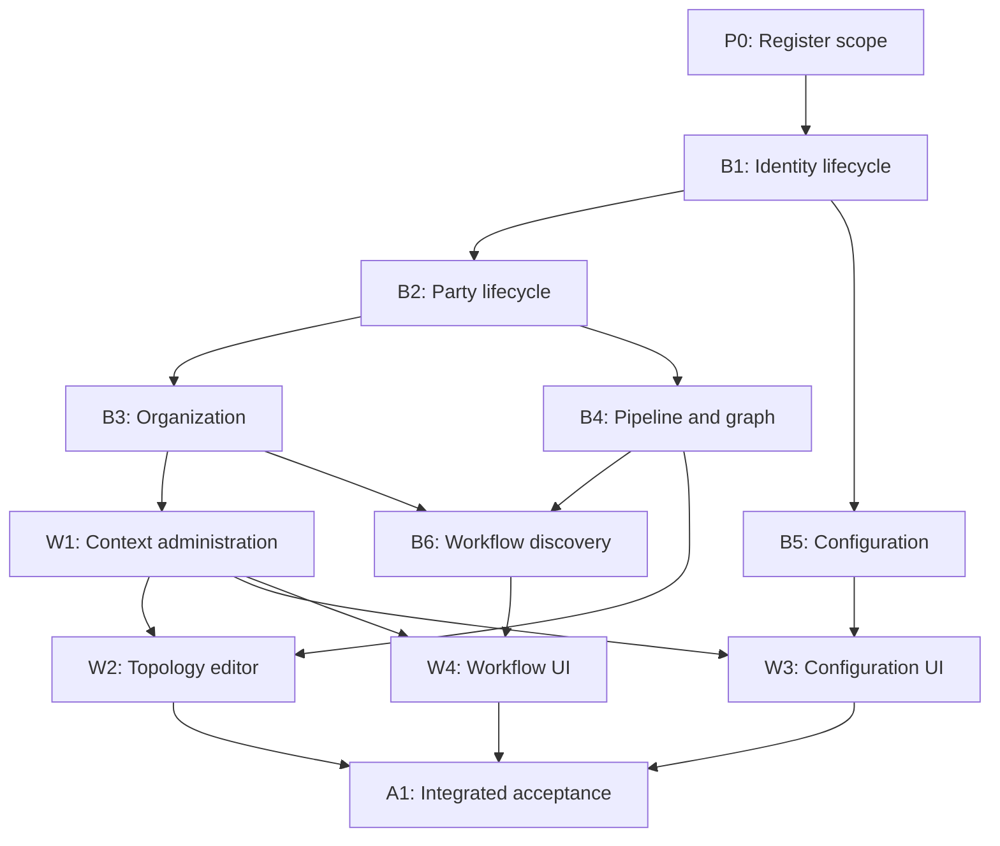

# Hidra six-module functional foundation — adopted execution supplement

## Status

CURRENT — owner approval recorded 2026-11-03. This adoption registers the approved minimum scope; it does not certify the unfinished application. The original read-only audit follows unchanged under its historical heading. This supplement takes precedence over the audit's proposed IDs, pending adoption language and registration-ready pointer.

Accountable authority: repository owner. Source baseline: HidraAPI `b457a28c507dab07e554d4d9e52741783e415ba2`, HidraWEB `46676deb70fd38b906bdb370f020f609d0a16c98`. Current source, runtime OpenAPI and actual CI determine implementation claims. Industrial/SITE acceptance remains NOT ESTABLISHED; unknown/unresolved evidence stays explicit. Numerical/P3 and unrelated enhancements remain DEFERRED.

## Adopted finite delivery set

Owner approval of the delivered FOUNDATION_PRODUCTION_ROADMAP.md selects P0 registration only for this turn and admits the bounded registry extension below. Preserve every original HAPI-001–921 row, meaning, ID, dependency and status. Add HAPI-922–928 in the existing 25 phases; set the validator's exact expected task count to 928. No validator rule, immutable archive hash, module inventory, runtime permission or test assertion is relaxed. The closed S0–S7 sequence is historical and unchanged; this supplement does not invent S8. The approved six-module selection supersedes older execution pointers solely for this foundation. HAPI-605 and HAPI-604/606–609 keep their current registered statuses and are not selected prerequisites for the minimum.

| Proposal label | Canonical API ID | Owner phase | Dependencies | Registered exact message |
|---|---|---|---|---|
| P0 | HAPI-922 | HPS-025 | Owner approval | `docs(roadmap): register six-module functional foundation` |
| B1 | HAPI-923 | HPS-001 | HAPI-922 | `feat(identity): complete foundation user access lifecycle` |
| B2 | HAPI-924 | HPS-003 | HAPI-923 | `feat(party): complete foundation party selection lifecycle` |
| B3 | HAPI-925 | HPS-003 | HAPI-923, HAPI-924 | `feat(organization): complete foundation organization administration` |
| B4 | HAPI-926 | HPS-004 | HAPI-923, HAPI-924 | `feat(topology): connect pipeline authoring to persisted graph views` |
| B5 | HAPI-927 | HPS-018 | HAPI-923 | `feat(configuration): complete typed foundation configuration lifecycle` |
| B6 | HAPI-928 | HPS-015 | HAPI-923, HAPI-925, HAPI-926 | `feat(workflow): complete foundation task discovery and scoped reads` |

There are 12 deliveries total. After this P0 registration, 11 remain: six backend, four frontend and one integrated acceptance. These are whole deliveries with their own runtime tests, not serial preflight/implementation/test substages. CI repairs stay within the responsible task. B1/HAPI-923 is the next eligible whole implementation after exact-P0 documentation CI succeeds and the user selects Next. This registration does not execute B1.

Frontend names below are reserved cross-repository handoffs in this API supplement, not claims that HidraWEB has been modified or its canonical records already registered. At the selected frontend delivery, append its actual WEB registration and exact allowlist to its existing canonical roadmap/contract/gap register as part of that whole delivery. Existing HWEB-F01–F10 remain unchanged; no old editor scope is silently repurposed.

| Label | Reserved WEB ID | Prerequisites | Exact message |
|---|---|---|---|
| W1 | HWEB-F11 | B1, B2, B3 | `feat(context): complete identity organization and party administration` |
| W2 | HWEB-F12 | B4, W1 | `feat(topology): implement persisted foundation network editor` |
| W3 | HWEB-F13 | B5, W1 | `feat(configuration): integrate typed foundation administration` |
| W4 | HWEB-F14 | B6, W1 | `feat(workflow): integrate configured foundation task journeys` |
| A1 | HWEB-F15 | W1, W2, W3, W4 | `test(foundation): verify six-module live backend browser journeys` |

## Registration decisions and acceptance policy

All six-module workflows remain bounded by the explicit minimum and module DoDs in the approved audit. Existing published behavior is reused; the complete new minimum is unaccepted until actual A–E live API/PostgreSQL/browser verification. User-facing IDs and catalogs come from their owning modules. Route string grants, native original-transaction authority and advisory capability previews stay distinct. Current grants are checked before protected existence/count/history disclosure. No general status setter, browser-only persistence, fabricated records or mock-based acceptance is admitted.

API-wide existing effective-date, original-transaction, native principal, generation, no-elevated-role, concurrency and immutable evidence rules remain binding. Timestamp CAS uses exact database precision and existing locked state where available; optional forward DDL is permitted only at the exact reserved new migration paths below when indispensable. Historical migrations remain byte-identical. New files use canonical headers and pure Domain; Application coordinates via ports, adapters own framework imports. Do not move working code merely for aesthetic architecture conformity.

Statuses for HAPI-923–928 are PARTIAL because real existing slices exist, not because this registration implemented the missing behavior. BLOCKED denotes their recorded prerequisite gates; B1 is REGISTERED_PENDING. HAPI-922 is VERIFIED/COMPLETED only for locally validated governance registration. Its post-publication exact-SHA CI remains mandatory before B1; no claim is made in this commit that its own hosted CI has already passed.

### B1 / HAPI-923: binding minimum policy

Minimum policy: ordinary LOCAL onboarding is REGISTERED -> ACTIVE after a valid credential has been stored; ACTIVE -> DISABLED is the admitted deactivation. LOCKED/SUSPENDED are not silently unlocked by activation. Credential initialization/reset hashes through the existing port and never discloses hashes/passwords. Derive actor on the server, require explicit current administrator action/resource authority, expected updatedAt or equivalent locked generation and a reason; preserve the last usable administrator. Deactivation/reset revokes affected sessions and invalidates native authentication provenance using existing fences, not a browser-only logout. Revocation is an ACTIVE ordinary grant -> REVOKED transition retaining the original row/evidence; no unrelated protected grant is fabricated. Effective permissions must stop authorizing after current revocation. Existing authorization decision/AuthenticationEvent evidence is reused; no new universal approval workflow. The capability preview accepts exact company/resource selectors and emits advisory supported/permitted actions, no raw grants/keys/tickets and no protected-resource enumeration. Original protected operations independently reauthorize in their native transaction.

Controlled development provisioning is opt-in only in dev with explicit non-secret selectors and external password/keys; fail outside dev. It may deliberately provision synthetic native test principals/grants under existing authorized writer/separated database-role rules, never ordinary app-owner SQL privilege or a wildcard shortcut. No production credential or general native grant-writer API is introduced.

Required focused acceptance:

- New ordinary user is created, credentialed, activated, logged in and receives native bearer/me/effective grants through real HTTP and PostgreSQL.
- Invalid credentials, expired/revoked session, disabled user, forbidden admin, missing resource authority, stale mutation, failed transaction and grant revocation fail safely.
- Two independently permitted users demonstrate allow/deny on a business API; native capability previews never become commit authority; last usable administrator remains protected.

Exact CREATE allowlist (new paths; no collision at the source baseline):

- `src/main/java/dz/sh/hidra/modules/identity/application/port/in/FoundationIdentityLifecycleUseCase.java`
- `src/main/java/dz/sh/hidra/modules/identity/application/port/out/FoundationIdentityLifecyclePersistencePort.java`
- `src/main/java/dz/sh/hidra/modules/identity/application/port/out/FoundationIdentityAuthorizationPort.java`
- `src/main/java/dz/sh/hidra/modules/identity/application/service/FoundationIdentityLifecycleApplicationService.java`
- `src/main/java/dz/sh/hidra/modules/identity/domain/service/IdentityLifecyclePolicy.java`
- `src/main/java/dz/sh/hidra/modules/identity/api/rest/controller/IdentityLifecycleController.java`
- `src/main/java/dz/sh/hidra/modules/identity/api/rest/request/IdentityLifecycleRequests.java`
- `src/main/java/dz/sh/hidra/modules/identity/api/rest/response/IdentityLifecycleResponses.java`
- `src/main/java/dz/sh/hidra/modules/identity/infrastructure/persistence/adapter/JdbcFoundationIdentityLifecycleAdapter.java`
- `src/main/java/dz/sh/hidra/modules/identity/infrastructure/security/FoundationIdentityAuthorizationAdapter.java`
- `src/main/java/dz/sh/hidra/modules/identity/infrastructure/configuration/FoundationIdentityDevelopmentProvisioner.java`
- `src/test/java/dz/sh/hidra/modules/identity/domain/service/IdentityLifecyclePolicyTest.java`
- `src/test/java/dz/sh/hidra/modules/identity/infrastructure/persistence/FoundationIdentityLifecyclePostgresIntegrationTest.java`
- `src/test/java/dz/sh/hidra/modules/identity/api/rest/controller/IdentityLifecycleControllerTest.java`

Exact MODIFY allowlist (all exist at the source baseline; change only where required by this task):

- `src/main/java/dz/sh/hidra/modules/identity/application/service/IdentityUserApplicationService.java`
- `src/main/java/dz/sh/hidra/modules/identity/application/service/IdentityAdministrationCommandApplicationService.java`
- `src/main/java/dz/sh/hidra/modules/identity/application/port/out/UserRepositoryPort.java`
- `src/main/java/dz/sh/hidra/modules/identity/application/port/out/LocalCredentialRepositoryPort.java`
- `src/main/java/dz/sh/hidra/modules/identity/application/port/out/LoginSessionRepositoryPort.java`
- `src/main/java/dz/sh/hidra/modules/identity/application/port/out/UserRoleGrantRepositoryPort.java`
- `src/main/java/dz/sh/hidra/modules/identity/application/port/out/RolePermissionGrantRepositoryPort.java`
- `src/main/java/dz/sh/hidra/modules/identity/application/port/out/UserPermissionGrantRepositoryPort.java`
- `src/main/java/dz/sh/hidra/modules/identity/infrastructure/persistence/adapter/JpaUserRepositoryAdapter.java`
- `src/main/java/dz/sh/hidra/modules/identity/infrastructure/persistence/adapter/JpaLocalCredentialRepositoryAdapter.java`
- `src/main/java/dz/sh/hidra/modules/identity/infrastructure/persistence/adapter/JpaLoginSessionRepositoryAdapter.java`
- `src/main/java/dz/sh/hidra/modules/identity/infrastructure/persistence/adapter/JpaUserRoleGrantRepositoryAdapter.java`
- `src/main/java/dz/sh/hidra/modules/identity/infrastructure/persistence/adapter/JpaRolePermissionGrantRepositoryAdapter.java`
- `src/main/java/dz/sh/hidra/modules/identity/infrastructure/persistence/adapter/JpaUserPermissionGrantRepositoryAdapter.java`
- `src/main/java/dz/sh/hidra/modules/identity/api/rest/controller/IdentityAuthenticationController.java`
- `src/main/java/dz/sh/hidra/modules/identity/infrastructure/configuration/IdentityModuleConfiguration.java`
- `src/main/resources/application-dev.properties`
- `.github/ci-test-inventory.json`
- `doc/api/openapi.yaml`
- `.github/documentation-validation.json`
- `doc/database/DATA_DICTIONARY.md`
- `doc/roadmap/ULTIMATE_ROADMAP.md`
- `doc/roadmap/ULTIMATE_PHASES.md`
- `doc/roadmap/TASKS_HPS-001.md`

Conditional new DDL path, reserved and unused at registration: `src/main/resources/db/migration/V20261103_002__foundation_identity_lifecycle.sql`. Omit it if existing schema suffices. If main consumes that version before execution, reconcile and record the replacement before editing; never renumber or rewrite an existing migration. No DELETE. No undeclared production/Platform/security exception; a genuinely required extra path must be reconciled in this same task before mutation, not split into another delivery.

### B2 / HAPI-924: binding minimum policy

Minimum policy: DRAFT -> ACTIVE requires valid Party type, unique code and current authorized administration. Deactivation is ACTIVE -> SUSPENDED with a reason; BLOCKED/RETIRED are not silently reactivated. Metadata edits are version-guarded, preserve canonical identity/history and never change an existing reference's identity. Read visibility is explicit administrator-global access or current authorized company/resource visibility, evaluated before counts/detail. New references require ACTIVE current eligibility; existing historical references remain intact. Type/role choices come from Party owner catalogs and role assignments validate current referenced parties/catalogs. Preserve all generation/lock semantics used by Topology and Organization.

Required focused acceptance:

- Register DRAFT Party, discover type/role choices, activate, retrieve/search and select as a current permitted Topology company/owner/manufacturer.
- Duplicate code, invalid catalog/role, inactive/foreign Party, stale lifecycle write and rollback preserve exact owner/generation history.

Exact CREATE allowlist (new paths; no collision at the source baseline):

- `src/main/java/dz/sh/hidra/modules/party/application/port/in/PartyAdministrationUseCase.java`
- `src/main/java/dz/sh/hidra/modules/party/application/port/out/PartyAdministrationPersistencePort.java`
- `src/main/java/dz/sh/hidra/modules/party/application/port/out/PartyAdministrationAuthorizationPort.java`
- `src/main/java/dz/sh/hidra/modules/party/application/service/PartyAdministrationApplicationService.java`
- `src/main/java/dz/sh/hidra/modules/party/domain/service/PartyLifecyclePolicy.java`
- `src/main/java/dz/sh/hidra/modules/party/api/rest/controller/PartyAdministrationController.java`
- `src/main/java/dz/sh/hidra/modules/party/api/rest/request/PartyAdministrationRequests.java`
- `src/main/java/dz/sh/hidra/modules/party/api/rest/response/PartyAdministrationResponses.java`
- `src/main/java/dz/sh/hidra/modules/party/infrastructure/query/JpaPartyAdministrationQueryAdapter.java`
- `src/main/java/dz/sh/hidra/modules/party/infrastructure/security/PartyAdministrationAuthorizationAdapter.java`
- `src/test/java/dz/sh/hidra/modules/party/domain/service/PartyLifecyclePolicyTest.java`
- `src/test/java/dz/sh/hidra/modules/party/infrastructure/persistence/PartyAdministrationPostgresIntegrationTest.java`

Exact MODIFY allowlist (all exist at the source baseline; change only where required by this task):

- `src/main/java/dz/sh/hidra/modules/party/application/service/PartyApplicationService.java`
- `src/main/java/dz/sh/hidra/modules/party/application/service/PartyRoleAssignmentApplicationService.java`
- `src/main/java/dz/sh/hidra/modules/party/application/port/out/PartyRepositoryPort.java`
- `src/main/java/dz/sh/hidra/modules/party/application/port/out/PartyRoleAssignmentRepositoryPort.java`
- `src/main/java/dz/sh/hidra/modules/party/infrastructure/persistence/adapter/JpaPartyRepositoryAdapter.java`
- `src/main/java/dz/sh/hidra/modules/party/infrastructure/persistence/adapter/JpaPartyRoleAssignmentRepositoryAdapter.java`
- `src/main/java/dz/sh/hidra/modules/party/api/rest/mapper/PartyRestMapper.java`
- `src/main/java/dz/sh/hidra/modules/party/infrastructure/persistence/mapper/PartyPersistenceMapper.java`
- `.github/ci-test-inventory.json`
- `doc/api/openapi.yaml`
- `.github/documentation-validation.json`
- `doc/database/DATA_DICTIONARY.md`
- `doc/roadmap/ULTIMATE_ROADMAP.md`
- `doc/roadmap/ULTIMATE_PHASES.md`
- `doc/roadmap/TASKS_HPS-003.md`

Conditional new DDL path, reserved and unused at registration: `src/main/resources/db/migration/V20261103_003__foundation_party_lifecycle.sql`. Omit it if existing schema suffices. If main consumes that version before execution, reconcile and record the replacement before editing; never renumber or rewrite an existing migration. No DELETE. No undeclared production/Platform/security exception; a genuinely required extra path must be reconciled in this same task before mutation, not split into another delivery.

### B3 / HAPI-925: binding minimum policy

Minimum policy: REGISTERED -> ACTIVE employee activation requires current personnel administration, expected updatedAt and valid existing identity/company context; SUSPENDED/RETIRED/TERMINATED are not silently changed. Unit/employee global reads require explicit administrator authority; scoped readers receive only admitted company/unit records and filtered hierarchy/counts, before detail disclosure. Unit/position choices are current owner reference data, not Configuration-owned taxonomy. Preserve native appointment half-open effective windows, proof, writer ordering and history. Existing responsibility operations retain their actual Workflow/reference policy; no new requirement for every Organization mutation to use Workflow. Contacts remain within existing registration capability.

Required focused acceptance:

- Create/read hierarchy, discover valid unit/position, register and activate employee, create and transfer/end an appointment through existing protected APIs.
- Assign/query/revoke an actual supported responsibility; unauthorized hierarchy/detail/count/history and wrong company are denied before disclosure.
- Effective-date/concurrency/rollback regression and existing proof suites remain unchanged and passing.

Exact CREATE allowlist (new paths; no collision at the source baseline):

- `src/main/java/dz/sh/hidra/modules/organization/application/port/in/OrganizationFoundationAdministrationUseCase.java`
- `src/main/java/dz/sh/hidra/modules/organization/application/port/out/OrganizationFoundationAuthorizationPort.java`
- `src/main/java/dz/sh/hidra/modules/organization/application/service/OrganizationFoundationAdministrationApplicationService.java`
- `src/main/java/dz/sh/hidra/modules/organization/api/rest/controller/OrganizationFoundationAdministrationController.java`
- `src/main/java/dz/sh/hidra/modules/organization/api/rest/request/OrganizationFoundationRequests.java`
- `src/main/java/dz/sh/hidra/modules/organization/api/rest/response/OrganizationFoundationResponses.java`
- `src/main/java/dz/sh/hidra/modules/organization/infrastructure/security/OrganizationFoundationAuthorizationAdapter.java`
- `src/test/java/dz/sh/hidra/modules/organization/infrastructure/persistence/OrganizationFoundationAdministrationPostgresIntegrationTest.java`

Exact MODIFY allowlist (all exist at the source baseline; change only where required by this task):

- `src/main/java/dz/sh/hidra/modules/organization/api/rest/controller/OrganizationAdministrationQueryController.java`
- `src/main/java/dz/sh/hidra/modules/organization/infrastructure/query/JpaOrganizationAdministrationQueryAdapter.java`
- `src/main/java/dz/sh/hidra/modules/organization/application/service/EmployeeApplicationService.java`
- `src/main/java/dz/sh/hidra/modules/organization/application/port/out/EmployeeRepositoryPort.java`
- `src/main/java/dz/sh/hidra/modules/organization/infrastructure/persistence/adapter/JpaEmployeeRepositoryAdapter.java`
- `src/main/java/dz/sh/hidra/modules/organization/application/port/in/OrganizationAdministrationQueryUseCase.java`
- `src/main/java/dz/sh/hidra/modules/organization/application/port/out/OrganizationUnitRepositoryPort.java`
- `src/main/java/dz/sh/hidra/modules/organization/application/port/out/PositionRepositoryPort.java`
- `src/main/java/dz/sh/hidra/modules/organization/infrastructure/persistence/adapter/JpaOrganizationUnitRepositoryAdapter.java`
- `src/main/java/dz/sh/hidra/modules/organization/infrastructure/persistence/adapter/JpaPositionRepositoryAdapter.java`
- `.github/ci-test-inventory.json`
- `doc/api/openapi.yaml`
- `.github/documentation-validation.json`
- `doc/database/DATA_DICTIONARY.md`
- `doc/roadmap/ULTIMATE_ROADMAP.md`
- `doc/roadmap/ULTIMATE_PHASES.md`
- `doc/roadmap/TASKS_HPS-003.md`

Conditional new DDL path, reserved and unused at registration: `src/main/resources/db/migration/V20261103_004__foundation_organization_lifecycle.sql`. Omit it if existing schema suffices. If main consumes that version before execution, reconcile and record the replacement before editing; never renumber or rewrite an existing migration. No DELETE. No undeclared production/Platform/security exception; a genuinely required extra path must be reconciled in this same task before mutation, not split into another delivery.

### B4 / HAPI-926: binding minimum policy

Minimum policy: Pipeline has explicit owning company/system context and canonical identity. Link graph PIPE branches and essential Segment references through versioned owner associations; no second editable graph store. Update and view operations require current owner/source authorization and expected version; legacy immutable payloads remain decodable and histories exact. Missing geometry is explicit and a persisted schematic is acceptable; do not synthesize surveyed routes from endpoints. Pipeline/facility/unit/catalog discovery is bounded and scope-filtered before totals. Preserve existing graph publication, installations and station incidence without requiring manufacturer curves, fluid data or aggregate baseline freeze. Supplied optional survey geometry may be reused; no numerical or new OT integration.

Required focused acceptance:

- Create system -> create associated canonical Pipeline -> author nodes/ports/branches/station -> register/install equipment -> save station incidence -> retrieve exact persisted graph -> revise permitted record.
- Revision-aware schematic/map projection shows persisted owner identity without fabricated geometry; canonical Pipeline and Segment references survive reload.
- Dangling connections, wrong ownership/catalogs, stale expected versions, conflicting/replayed writes and rollback reject without partial graphs; existing native suites remain passing.

Exact CREATE allowlist (new paths; no collision at the source baseline):

- `src/main/java/dz/sh/hidra/modules/topology/application/port/in/PipelineAuthoringUseCase.java`
- `src/main/java/dz/sh/hidra/modules/topology/application/port/in/AuthoredTopologyViewUseCase.java`
- `src/main/java/dz/sh/hidra/modules/topology/application/port/out/PipelineAuthoringPersistencePort.java`
- `src/main/java/dz/sh/hidra/modules/topology/application/port/out/AuthoredTopologyAuthorizationPort.java`
- `src/main/java/dz/sh/hidra/modules/topology/application/service/PipelineAuthoringApplicationService.java`
- `src/main/java/dz/sh/hidra/modules/topology/api/rest/controller/PipelineAuthoringController.java`
- `src/main/java/dz/sh/hidra/modules/topology/api/rest/request/PipelineAuthoringRequests.java`
- `src/main/java/dz/sh/hidra/modules/topology/api/rest/response/AuthoredTopologyResponses.java`
- `src/main/java/dz/sh/hidra/modules/topology/infrastructure/query/JpaAuthoredTopologyViewAdapter.java`
- `src/main/java/dz/sh/hidra/modules/topology/infrastructure/security/AuthoredTopologyAuthorizationAdapter.java`
- `src/test/java/dz/sh/hidra/modules/topology/infrastructure/persistence/PipelineAuthoringPostgresIntegrationTest.java`
- `src/test/java/dz/sh/hidra/modules/topology/infrastructure/persistence/AuthoredTopologyProjectionPostgresIntegrationTest.java`

Exact MODIFY allowlist (all exist at the source baseline; change only where required by this task):

- `src/main/java/dz/sh/hidra/modules/topology/api/rest/controller/EngineeringNetworkDraftController.java`
- `src/main/java/dz/sh/hidra/modules/topology/api/rest/request/EngineeringGraphDraftRequests.java`
- `src/main/java/dz/sh/hidra/modules/topology/api/rest/response/EngineeringGraphDraftResponses.java`
- `src/main/java/dz/sh/hidra/modules/topology/application/port/in/EngineeringGraphDraftUseCase.java`
- `src/main/java/dz/sh/hidra/modules/topology/application/service/EngineeringNetworkDraftApplicationService.java`
- `src/main/java/dz/sh/hidra/modules/topology/infrastructure/persistence/adapter/JdbcEngineeringNetworkDraftRepositoryAdapter.java`
- `src/main/java/dz/sh/hidra/modules/topology/domain/model/EngineeringGraphDraft.java`
- `src/main/java/dz/sh/hidra/modules/topology/infrastructure/persistence/entity/PipelineJpaEntity.java`
- `src/main/java/dz/sh/hidra/modules/topology/infrastructure/persistence/entity/PipelineSegmentJpaEntity.java`
- `src/main/java/dz/sh/hidra/modules/topology/api/rest/controller/TopologyMapController.java`
- `src/main/java/dz/sh/hidra/modules/topology/infrastructure/visualization/JpaTopologyMapVisualizationAdapter.java`
- `.github/ci-test-inventory.json`
- `doc/api/openapi.yaml`
- `.github/documentation-validation.json`
- `doc/database/DATA_DICTIONARY.md`
- `doc/roadmap/ULTIMATE_ROADMAP.md`
- `doc/roadmap/ULTIMATE_PHASES.md`
- `doc/roadmap/TASKS_HPS-004.md`

Conditional new DDL path, reserved and unused at registration: `src/main/resources/db/migration/V20261103_005__foundation_pipeline_graph_associations.sql`. Omit it if existing schema suffices. If main consumes that version before execution, reconcile and record the replacement before editing; never renumber or rewrite an existing migration. No DELETE. No undeclared production/Platform/security exception; a genuinely required extra path must be reconciled in this same task before mutation, not split into another delivery.

### B5 / HAPI-927: binding minimum policy

Minimum policy: environment-scoped non-sensitive definitions and BOOLEAN flags are the initial supported administration. Admit strict existing STRING/BOOLEAN/numeric value types only where each parser is implemented/tested; unsupported declared types fail closed rather than being stored as arbitrary text. Definitions/flags activate from DRAFT through an authorized version-guarded command. A valid current environment override wins over the admitted definition default at an explicit instant; half-open windows and overlapping active overrides are rejected. Values must match the active exact definition/version, type and bounds. Derive actor server-side, inspect raw/JSON/default payloads for forbidden secret material and block unsupported requiresApproval changes. Sensitive settings return authorized redacted metadata/reference only. No vault, universal flag rule engine or business taxonomy redesign.

Required focused acceptance:

- Create/activate admitted definition and boolean flag, read default, set typed environment override, persist and read exact effective result through HTTP/PostgreSQL.
- Reject wrong type/version/window/overlap/unsupported approval, impersonated actor, sensitive material and unauthorized reads/writes; rollback and competing writes proven.

Exact CREATE allowlist (new paths; no collision at the source baseline):

- `src/main/java/dz/sh/hidra/modules/configuration/application/port/in/ConfigurationAdministrationUseCase.java`
- `src/main/java/dz/sh/hidra/modules/configuration/application/port/out/ConfigurationAdministrationPersistencePort.java`
- `src/main/java/dz/sh/hidra/modules/configuration/application/port/out/ConfigurationAdministrationAuthorizationPort.java`
- `src/main/java/dz/sh/hidra/modules/configuration/application/service/ConfigurationAdministrationApplicationService.java`
- `src/main/java/dz/sh/hidra/modules/configuration/domain/service/TypedConfigurationPolicy.java`
- `src/main/java/dz/sh/hidra/modules/configuration/api/rest/controller/ConfigurationAdministrationController.java`
- `src/main/java/dz/sh/hidra/modules/configuration/api/rest/request/ConfigurationAdministrationRequests.java`
- `src/main/java/dz/sh/hidra/modules/configuration/api/rest/response/ConfigurationAdministrationResponses.java`
- `src/main/java/dz/sh/hidra/modules/configuration/infrastructure/query/JpaConfigurationAdministrationQueryAdapter.java`
- `src/main/java/dz/sh/hidra/modules/configuration/infrastructure/security/ConfigurationAdministrationAuthorizationAdapter.java`
- `src/test/java/dz/sh/hidra/modules/configuration/domain/service/TypedConfigurationPolicyTest.java`
- `src/test/java/dz/sh/hidra/modules/configuration/infrastructure/persistence/ConfigurationAdministrationPostgresIntegrationTest.java`

Exact MODIFY allowlist (all exist at the source baseline; change only where required by this task):

- `src/main/java/dz/sh/hidra/modules/configuration/application/service/ConfigurationApplicationService.java`
- `src/main/java/dz/sh/hidra/modules/configuration/domain/service/ConfigurationValueGuard.java`
- `src/main/java/dz/sh/hidra/modules/configuration/application/port/out/ConfigurationDefinitionRepositoryPort.java`
- `src/main/java/dz/sh/hidra/modules/configuration/application/port/out/ConfigurationValueRepositoryPort.java`
- `src/main/java/dz/sh/hidra/modules/configuration/application/port/out/FeatureFlagRepositoryPort.java`
- `src/main/java/dz/sh/hidra/modules/configuration/infrastructure/persistence/adapter/JpaConfigurationDefinitionRepositoryAdapter.java`
- `src/main/java/dz/sh/hidra/modules/configuration/infrastructure/persistence/adapter/JpaConfigurationValueRepositoryAdapter.java`
- `src/main/java/dz/sh/hidra/modules/configuration/infrastructure/persistence/adapter/JpaFeatureFlagRepositoryAdapter.java`
- `src/main/java/dz/sh/hidra/modules/configuration/api/rest/mapper/ConfigurationRestMapper.java`
- `src/main/java/dz/sh/hidra/modules/configuration/infrastructure/persistence/mapper/ConfigurationPersistenceMapper.java`
- `.github/ci-test-inventory.json`
- `doc/api/openapi.yaml`
- `.github/documentation-validation.json`
- `doc/database/DATA_DICTIONARY.md`
- `doc/roadmap/ULTIMATE_ROADMAP.md`
- `doc/roadmap/ULTIMATE_PHASES.md`
- `doc/roadmap/TASKS_HPS-018.md`

Conditional new DDL path, reserved and unused at registration: `src/main/resources/db/migration/V20261103_006__foundation_configuration_lifecycle.sql`. Omit it if existing schema suffices. If main consumes that version before execution, reconcile and record the replacement before editing; never renumber or rewrite an existing migration. No DELETE. No undeclared production/Platform/security exception; a genuinely required extra path must be reconciled in this same task before mutation, not split into another delivery.

### B6 / HAPI-928: binding minimum policy

Minimum policy: starter, eligible assigned/claimed actor, authorized organization member or explicit supervisor with the applicable target-resource read may read task/instance/history. Require the protected owner admission as well for recognized native targets, and filter before existence/counts/history disclosure. Definition discovery lists only supported active bindings and safe assignment choices. Use the existing installed-characteristic-link approval target for the synthetic workflow; existing Simulation-owned source evidence is an essential reference dependency only and is not new numerical work. Controlled dev process configuration is explicit opt-in, unavailable outside dev, with an independent human approver; no active business policy is seeded automatically into a production schema. Execute real configured transitions; COMMENT recording cannot create decisions; unsupported condition/callback mechanisms remain fail-closed.

Required focused acceptance:

- Deliberately provision supported dev process configuration, discover it, start valid instance/create permitted task and retrieve the actual assigned inbox.
- Discover backend actions, execute real human APPROVE/REJECT and verify durable task/instance/action/history and independent denial.
- Reject stale/replayed/conflicting transitions, unsupported mechanisms and unauthorized general/protected detail/history/existence; preserve genuine native approvals.

Exact CREATE allowlist (new paths; no collision at the source baseline):

- `src/main/java/dz/sh/hidra/modules/workflow/application/port/in/WorkflowDefinitionDiscoveryUseCase.java`
- `src/main/java/dz/sh/hidra/modules/workflow/application/port/out/WorkflowFoundationReadAuthorizationPort.java`
- `src/main/java/dz/sh/hidra/modules/workflow/api/rest/controller/WorkflowDefinitionDiscoveryController.java`
- `src/main/java/dz/sh/hidra/modules/workflow/api/rest/response/WorkflowDefinitionDiscoveryResponses.java`
- `src/main/java/dz/sh/hidra/modules/workflow/infrastructure/query/JpaWorkflowDefinitionDiscoveryAdapter.java`
- `src/main/java/dz/sh/hidra/modules/workflow/infrastructure/security/WorkflowFoundationReadAuthorizationAdapter.java`
- `src/main/java/dz/sh/hidra/modules/workflow/infrastructure/configuration/FoundationWorkflowDevelopmentProvisioner.java`
- `src/test/java/dz/sh/hidra/modules/workflow/infrastructure/persistence/WorkflowFoundationReadAuthorizationPostgresIntegrationTest.java`
- `src/test/java/dz/sh/hidra/modules/workflow/infrastructure/persistence/WorkflowFoundationProcessPostgresIntegrationTest.java`

Exact MODIFY allowlist (all exist at the source baseline; change only where required by this task):

- `src/main/java/dz/sh/hidra/modules/workflow/application/port/in/WorkflowQueryUseCase.java`
- `src/main/java/dz/sh/hidra/modules/workflow/infrastructure/query/JpaWorkflowQueryAdapter.java`
- `src/main/java/dz/sh/hidra/modules/workflow/application/service/WorkflowApplicationService.java`
- `src/main/java/dz/sh/hidra/modules/workflow/application/service/WorkflowTransitionApplicationService.java`
- `src/main/resources/application-dev.properties`
- `.github/ci-test-inventory.json`
- `doc/api/openapi.yaml`
- `.github/documentation-validation.json`
- `doc/database/DATA_DICTIONARY.md`
- `doc/roadmap/ULTIMATE_ROADMAP.md`
- `doc/roadmap/ULTIMATE_PHASES.md`
- `doc/roadmap/TASKS_HPS-015.md`

Conditional new DDL path, reserved and unused at registration: `src/main/resources/db/migration/V20261103_007__foundation_workflow_read_policy.sql`. Omit it if existing schema suffices. If main consumes that version before execution, reconcile and record the replacement before editing; never renumber or rewrite an existing migration. No DELETE. No undeclared production/Platform/security exception; a genuinely required extra path must be reconciled in this same task before mutation, not split into another delivery.

## P0 publication envelope and verification

Exact message: `docs(roadmap): register six-module functional foundation`. The only CREATE is this document. Exact MODIFY paths:

- `AGENTS.md`
- `.github/documentation-validation.json`
- `doc/governance/DOCUMENT_REGISTER.md`
- `doc/roadmap/ULTIMATE_TASKS.md`
- `doc/roadmap/ULTIMATE_ROADMAP.md`
- `doc/roadmap/ULTIMATE_PHASES.md`
- `doc/roadmap/TASKS_HPS-001.md`
- `doc/roadmap/TASKS_HPS-003.md`
- `doc/roadmap/TASKS_HPS-004.md`
- `doc/roadmap/TASKS_HPS-015.md`
- `doc/roadmap/TASKS_HPS-018.md`
- `doc/roadmap/TASKS_HPS-025.md`
- `doc/model-remediation/RECONCILIATION.md`

Required useful local checks: run the repository documentation validator and its current workflow-required Python test suites, OpenAPI snapshot validator and exact test inventory validator. Verify all 921 historical table rows/phase payload bytes, immutable archives, historical roadmap, Java/resources/tests/workflows and OpenAPI/dictionary remain unchanged. Only the documentation manifest's document inventory and exact task_count registration change. Publish one-parent commit directly to existing main with expected head `b457a28c507dab07e554d4d9e52741783e415ba2`; inspect parent/tree/blobs/scope and observe applicable exact-SHA CI creation/start, then STOP. If main advances, inspect/reconcile rather than overwrite. No release, deployment, PR, branch or automatic successor.

The full audit and proposed frontend file scopes below retain their source applicability. This adoption's concrete backend ledgers and task mappings supersede unresolved registration placeholders without changing the six-module objective. Source fixtures in the audit's appended evidence are historical, not a live browser test pass.

---

# Hidra six-module functional foundation — proposed execution roadmap

Date: 2026-11-03, Africa/Algiers. **READ-ONLY AUDIT / PROPOSAL — NOT ADOPTED GOVERNANCE.**

Repository destination if approved: `doc/roadmap/FOUNDATION_PRODUCTION_ROADMAP.md`. This deliverable was created outside both repository working trees. No GitHub file, issue, branch, pull request, workflow or status was changed.

## 1. Executive decision

**The six-module integrated foundation is not yet accepted as a working application. Reuse the substantial backend already implemented; close lifecycle, discovery, security and frontend-consumption gaps.** Do not execute the remaining global engineering-baseline programme as a prerequisite for this narrower milestone.

The proposed finite plan contains **12 deliveries: one governance/adoption delivery, six bounded backend deliveries, four frontend deliveries and one integrated acceptance delivery**. Ten deliveries implement software; the other two register its scope and prove the integrated result. These are proposal-local labels, not newly registered HAPI/HWEB IDs. CI defect repairs remain within their responsible delivery; the number is not a promise of exactly 12 attempts or commits across two repositories.

The main blockers are concrete:

1. Identity can authenticate existing configured users, but ordinary user creation produces `REGISTERED` users without a complete administrative activation/credential lifecycle.
2. Party registration produces `DRAFT`; new topology references require `ACTIVE`. A newly registered Party cannot complete that journey through the published Party API. There are no dedicated Party list/detail/reference/lifecycle endpoints.
3. Organization creates units and registers employees, but a newly registered employee remains `REGISTERED`. Reference discovery and scoped reads are incomplete for a self-contained administration workflow, despite substantial protected appointment implementation.
4. Topology has protected graph, survey, publication, installed-unit and station-configuration APIs. They must be consumed, not rebuilt. However, there is no explicit canonical Pipeline creation/association API, and the existing map reads legacy Pipeline/Segment/Node tables rather than the engineering draft/publication stores. A draft `PIPE` branch is not a persisted Pipeline aggregate.
5. Configuration creates definitions/flags and inserts values, but does not supply a complete typed effective-configuration administration contract. Client-side value redaction is insufficient evidence of backend confidentiality.
6. Workflow executes real configured transitions, but requires explicitly provisioned active definitions/bindings. Its general detail/history read paths need an explicit actor/resource disclosure policy. The inspected browser tests mock API responses and do not prove live backend persistence.

## 2. Exact source and evidence baseline

| Repository | Main SHA | Parent | Root tree | Latest message |
|---|---|---|---|---|
| HidraAPI | `b457a28c507dab07e554d4d9e52741783e415ba2` | `5ef3af6cd0c56c79a2509d3c148a3e5550439893` | `55d9a0dab39363768734958f478174c96357b575` | `test(topology): qualify HAPI-605 four-family draft completeness` |
| HidraWEB | `46676deb70fd38b906bdb370f020f609d0a16c98` | `7b30cf27fe753fdda2ab157d95424e88afe85801` | `19e14dea9e82b523095fc43fa31f9b6ff9bc219e` | `docs(roadmap): record HWEB-F03 geospatial authoring preflight blocker` |

Live tree listings were complete, not truncated: 6,526 API entries and 586 WEB entries. Local read-only source copies match these commits. Relevant recent API commits include `866e2250…` completing protected baseline drafts, `5ef3af6c…` source acceptance qualification, and `b457a28c…` four-family completeness tests. WEB's latest application-changing acceptance is `501ee147b3bcf9f3a47df5a06b4c160b5d1eb563`; the succeeding three main commits concern roadmap documentation.

| Evidence | Actual result | Meaning and limit |
|---|---|---|
| [API full CI, exact baseline](https://github.com/CHOUABBIA-AMINE/HidraAPI/actions/runs/41642224597) | SUCCESS | Java 21 unit/architecture, all 14 PostgreSQL shards, API/catalog lane and full evidence gate succeeded. The alternative monolithic Maven job was skipped by the chosen matrix mode; no test skips were reported in the accepted test inventory. |
| [API documentation, exact baseline](https://github.com/CHOUABBIA-AMINE/HidraAPI/actions/runs/41642224576) | SUCCESS | Documentation validation; not browser acceptance. |
| [WEB documentation, exact baseline](https://github.com/CHOUABBIA-AMINE/HidraWEB/actions/runs/38702999823) | SUCCESS | There is no Code CI run on this exact documentation-only head. |
| [Latest WEB Code CI](https://github.com/CHOUABBIA-AMINE/HidraWEB/actions/runs/38701540314) | SUCCESS at `501ee147…` | Historical application CI, distinct from current-head Code CI. Relevant Playwright suites use intercepted responses. |
| Downloaded API full evidence artifact `13234540605` | Inspected | `gate.json` records 550 classes, 4,225 tests, zero failures/errors/skips, exact source and run. XML reports were inspected and aggregated. |
| Downloaded runtime OpenAPI artifact `13232989469` | Inspected | `hidra-api.json` SHA-256 `a99ab0d6bda7c5631782f8582460f9a59ba4259a2ba2f6c7b774525b744fb09c`. |
| API migrated catalog evidence | Inspected | PostgreSQL 16.15; 196 migrations, 547 relations, 470 JPA mappings, no unresolved owners. Catalog SHA-256 `417240130b1f66b5da8b63c9087ace6c87ec51a72e060ffe808f5fbc0d07741d`. |

The retrieved runtime OpenAPI and checked-in `doc/api/openapi.yaml` are semantically identical after removing only `x-hidra-ci-source-sha`. That checked-in provenance field names `adeda546…`; the runtime artifact correctly names `b457a28c…`. Do not repin a consumer from the stale provenance field or report a contract mismatch that is only this source annotation.

### Governance and source precedence

Read sources include API `AGENTS.md`, `ULTIMATE_ROADMAP.md`, `ULTIMATE_PHASES.md`, task index, relevant HPS phase/task records, append-only reconciliation, six module documents, actual source/tests/migrations/configuration/workflows and runtime artifacts. WEB sources include its canonical API–Web contract, gap register, Ultimate Roadmap, Orval inputs, API adapters, screens and tests. No root WEB `AGENTS.md` appears in the retrieved tree.

The attached Project source pack is a historical reference (API anchor `f8ca520a…`, 2026-10-15). Its statement that API has no `ULTIMATE_TASKS.md` or `ULTIMATE_PHASES.md` is stale: both exist in the live tree. Its proposed baseline does not override adopted live governance.

API `AGENTS.md` §§3.3–3.4 forbid inventing delivery subdivisions and freeze the historical S0–S7 sequence. The live task register shows HAPI-598 and HAPI-599–603 now VERIFIED/COMPLETED in bounded backend software scope; older AGENTS checkpoint text is historical. This proposal neither adds S8 nor reopens that programme. A new owner-approved foundation selection must explicitly reconcile sequencing before implementation.

HAPI-605 is still PARTIAL/IN_PROGRESS in the roadmap despite passing current CI; HAPI-606–609 and parent HAPI-604 remain blocked/not implemented as registered. **Do not mark them complete or skipped to accommodate this proposal.** Defer selecting them for this narrower milestone; retain all IDs, meanings and evidence. HAPI-606 authoritative aggregate freeze, HAPI-607 reconstruction and HAPI-608/609 aggregate exchange/qualification are not required for basic six-module administration and topology authoring. Existing owner-level topology revision/history guarantees remain required.

## 3. Explicit minimum scope and module findings

Status vocabulary: **VERIFIED** means a named executable scenario has passing retrieved evidence for its bounded scope; **IMPLEMENTED — NOT RUNTIME VERIFIED** means source/wiring exists without sufficient endpoint-specific runtime proof here; **PARTIAL** means some required behavior exists; **MISSING** means the inspected REST/source surface lacks the required operation; **BLOCKED** identifies a dependency or acceptance gate. Runtime OpenAPI discovery proves publication, not full behavior of every operation.

### 3.1 Identity

Minimum: one supported LOCAL authentication path; valid/invalid credentials; native bearer issuance/validation; principal and effective grants; create and activate a local user; initialize/reset credentials without disclosure; create roles/permissions; assign and revoke ordinary grants; demonstrate an authorized and forbidden business operation. Retain LDAP/AD/OIDC integrations already implemented, but external enterprise services are not prerequisites for this development milestone.

**Reusable:** `IdentityAuthenticationController` delegates to `AuthenticateDirectUserUseCase` / `CompleteAuthenticatedPrincipalUseCase`; local credential persistence and token/session issuance exist. `GET /identity/me` and `/me/permissions` are consumed by WEB. Role/permission create and assignment controllers and ports exist. Ordinary route enforcement is in `HidraRouteAuthorizationInterceptor`; exact protected routes delegate to native owner authorization rather than relying on unrelated generic grants.

**Verified evidence:** LOCAL repository authentication test, request/controller tests, native protected Identity authorization suites, JWT/native origin/temporal/denial tests pass in the downloaded run. These prove supported slices, not browser administration of a newly created user.

**Gaps:** `IdentityUserApplicationService.createUser` creates `UserStatus.REGISTERED`; ordinary role grants require ACTIVE users. No published ordinary user activation/deactivation, credential initialization/reset, or grant revocation endpoint exists in the runtime inventory. Bootstrap creates an existing configured administrator; it does not complete ordinary administrator-managed user onboarding. Do not replace protected company/resource grants with a wildcard. A controlled development provisioning mechanism for native company/resource grants, compatible with existing separated-role rules, must be executable and documented. HidraWEB also needs selector-scoped permitted-operation discovery for these native routes: the ordinary route catalog/effective string grants cannot be assumed to describe native admission. Any capability preview is advisory; protected writes/reads must reauthorize on their original transaction.

WEB already has login, token expiry, principal, permission bootstrap and administration panels. `AuthProvider` holds the token in the registered in-memory header factory, clears queries on sign-out/401, and expires the session. Browser reload requiring sign-in is acceptable for the minimum. There is no need to invent refresh-token or backend logout endpoints. OIDC completion takes an externally validated bearer, not arbitrary browser claims.

**Verdict:** PARTIAL for the agreed minimum; backend authentication slices VERIFIED; live browser A NOT VERIFIED.

### 3.2 Organization

Minimum: create/read a unit hierarchy, discover unit/position reference choices, register/activate an employee, assign the employee to a unit/position, inspect/end or transfer an effective appointment, assign/query/revoke a supported operational responsibility, and deny unauthorized company/resource reads including totals/history.

**Reusable:** dedicated units/children/hierarchy/employees queries, protected appointment create/end/transfer/correction/history, operational scope and responsibility controllers; actual Identity/Party/Topology/Workflow contracts. Appointments are not a free-form assignment table; retain native authority, effective dates, exact company/unit/employee checks, concurrency and audit proof.

**Gaps:** employee registration produces `EmployeeStatus.REGISTERED`; lifecycle completion is not published as an employee activation command. Unit creation requires an existing active unit type; appointment requires position/policy/reference data. There are no dedicated public reference-catalog endpoints for the administration forms. `JpaOrganizationAdministrationQueryAdapter` unit/employee list/detail paths query owner entities without the native scope admission used by appointments. Route grants alone do not prove company/resource isolation. Define explicit global-administrator reads versus resource-scoped reads and enforce filtering before counts/paging, detail or hierarchy construction. Do not relabel a global query as scoped merely by adding a browser filter.

WEB context/administration screens and responsibility panel are reusable; existing forms still require operator-entered IDs for several prerequisites. Exclude a complete HR system, employment payroll and unrestricted catalog editors. Minimal supported contact data can use registration fields; do not invent a separate contact administration requirement.

**Verdict:** PARTIAL; protected appointment persistence/security VERIFIED within existing cases; complete self-service B and live browser NOT VERIFIED.

### 3.3 Party

Minimum: discover Party type/role choices; create a legal/business Party; perform an authorized lifecycle activation; search and retrieve only permitted Party data; assign a valid role; select an ACTIVE company/owner/manufacturer reference from a HidraWEB chooser. Party owns the business actor; Organization owns employees, units, positions and responsibilities.

**Reusable:** `POST /party/parties`, `POST /party/roles/assignments`, domain invariants, uniqueness check, JPA repository and exported topology eligibility/reference contracts. Existing Company/Manufacturer eligibility, generation/fence and cross-owner tests are valuable. WEB `CustodyPartyMasterContext` displays a known Party via workbench; it explicitly does not list/search Parties and is not a Party management screen.

**Blocking defect in complete journey:** `PartyApplicationService` writes DRAFT, while `Party.selectableForNewReference()` requires ACTIVE. No Party lifecycle controller publishes activation. Direct SQL updates or test fixtures cannot count as user-facing completion. Facility legacy registration checks Party existence; newer protected graph/installed-unit operations check current eligibility. Preserve the stronger rules and align new-reference semantics, rather than weakening eligibility.

Missing dedicated reads, type/role discovery and lifecycle transitions are required. Updating legal/trade-name metadata can be bounded to the supported draft/active policy; contact relationships are excluded unless already part of the chosen minimum form. No duplicate organizational hierarchy belongs here.

**Verdict:** PARTIAL; Party eligibility contracts VERIFIED, new Party-to-topology browser path BLOCKED.

### 3.4 Topology

Minimum: create/select a pipeline system, create an explicit Pipeline associated with it, save/retrieve essential nodes/ports/branches and Pipeline/Segment references, create/select a facility/station, register/install equipment and save station incidence, render the supported persisted graph, revise it with conflict detection and reject invalid/foreign references. A schematic graph is acceptable without survey data. Geographic rendering must use supplied geometry, with missing geometry explicit.

**Reusable, substantial:**

- `EngineeringNetworkDraftController`: scoped draft create/read/update/validate, graph GET/PUT, optional survey GET/PUT.
- `EngineeringRevisionPublicationController`: publish, withdraw, reactivate, exact/current/effective/history/request receipts.
- `EngineeringLocalExchangeController`: typed editor capabilities/dry-run/import/export.
- `InstalledUnitLifecycleController`: register/read an independent unit, record/close/relocate/replace installation, history.
- `StationInstalledConfigurationController`: current/exact/history and expected-epoch configuration save.
- Installed-characteristic links/real Workflow approval already exist, but manufacturer curves and numerical computation are not prerequisites for registering ordinary equipment in this milestone.
- Existing read-only map, search, paging, layer controls and MapLibre adapter remain reusable.

**Exact gaps:** no `POST /topology/pipelines` or equivalent canonical Pipeline authoring operation; no first-class Pipeline list/detail/revise API in the runtime artifact. `EngineeringGraphDraft.Branch` carries id/kind/fromPortId/toPortId only, not a Pipeline reference. Its PIPE kind is explicitly a placeholder. `JpaTopologyMapVisualizationAdapter` queries `PipelineJpaEntity`, `PipelineSegmentJpaEntity`, `TopologyNodeJpaEntity` and facility data; it does not read draft/publication payloads. Publishing a graph does not itself prove that this map contains the authored graph.

Smallest safe repair: retain the versioned graph owner as authoritative; add explicit Pipeline association and a typed revision-aware read projection linking canonical Pipeline/Segment identity to graph elements. Supply graph visualization directly from that persisted owner projection. Do not make two independent graph stores editable. If legacy map compatibility is required, provide a deterministic owner projection with tested revision identity rather than unrelated dual writes. Scope and permissions apply before IDs, counts and geometry are returned.

Optional supplied survey geometry may be reused for a map; do not require advanced surveyed profiles/elevations, certified curves, product composition or HAPI-606 aggregate freeze for a schematic authoring screen. Existing publication qualification must not be weakened to make an incomplete engineering baseline look qualified. Drafts remain visibly drafts.

**Verdict:** existing protected authoring slices VERIFIED; full C PARTIAL; editor consumption MISSING. Old WEB F02/F03 blocker notes need source-backed reassessment, not a blanket conclusion that backend authoring is absent.

### 3.5 Configuration

Minimum: discover namespaces/definitions, create one supported non-sensitive definition, activate an admitted definition/version, read default/effective value, set a typed environment-scoped value, persist/retrieve it, and manage one boolean flag through an explicit permitted lifecycle. Environment is the initial supported scope; richer scopes are unavailable until an explicit owner contract exists. Module-owned business catalogs stay in their own modules.

**Reusable:** definition/value/flag models, three command use cases, JPA adapters, namespace/version relationships, taxonomy and raw-secret boundary guard, existing WEB forms. `ConfigurationValueResponse` omits value payloads; this is useful but does not supply an effective-value read.

**Gaps:** `ConfigurationApplicationService.setConfigurationValue` checks raw-value secret patterns, then inserts a new ACTIVE value. It does not load the definition to validate its declared type, sensitivity, lifecycle/version, default/override precedence or approval requirement. It accepts `createdByActorId` from the command. JSON and default payload confidentiality require server-side validation; browser-only redaction cannot satisfy this. No dedicated namespace/definition/value/effective/flag read API, definition activation or flag mutation/evaluation API is published. Definitions/flags are created DRAFT, while current UI warning correctly says activate/toggle is unavailable. Workbench exposure is allowlisted and empty by default, so it cannot be assumed to supply the missing reads in any configured runtime.

Minimum policy: support a documented set of value types with strict parsing; environment-level override over a definition default; explicit half-open effective windows; reject ambiguous overlap, unknown versions and approval-required changes unless an existing supported approval contract is satisfied. Derive actor on the server. For sensitive definitions, return only authorized redacted metadata or secret references, never secret material. Do not add a vault or universal approval engine.

**Verdict:** PARTIAL. Existing Configuration tests are three semantic classes/nine cases, insufficient for HTTP + PostgreSQL effective-setting acceptance D.

### 3.6 Workflow

Minimum: one deliberately configured, supported approval process; discover its definition/assignment prerequisites; start a valid instance and create its permitted task or use the owning module's existing creation path; current-user inbox; task/detail/timeline; available actions; APPROVE/REJECT through registered transitions; durable evidence; stale/conflicting/foreign-user rejection. Definition design in a general workflow editor is excluded.

**Reusable:** `WorkflowApplicationService` validates active definition/version, target/purpose binding, actor, assignment and step. Generic record-action is COMMENT-only; do not use it to forge decisions. `WorkflowTransitionApplicationService` performs locked state/action/history advancement, permissions/ownership/version/reason/comment checks and terminal/next-task handling. WEB `WorkflowTasksPage` renders backend action metadata, sends expectedTaskUpdatedAt and refetches after success.

**Gaps:** no dedicated definition/catalog/assignment-choice discovery endpoint. Migration `V20261101_002__workflow_topology_characteristic_approval_catalog.sql` explicitly seeds no active definition/binding/task/grant. A fresh-schema development workflow must have deliberate configuration, not assume an approval process appears by starting the server. Reuse the existing Topology characteristic-link approval target for E; its existing Simulation-owned manufacturer source is an essential reference dependency only, with synthetic data and no numerical work. The integration fixture may provision approved process configuration as controlled setup; decisions must use actual HTTP transitions. A universal target or arbitrary status API is forbidden.

`JpaWorkflowQueryAdapter.tasks` filters by actor. `task`, `instance` and `timeline` call protected-owner read guards, but those guards apply only to the recognized Topology/Simulation protected target families; other targets do not receive the same per-actor ownership check there. This is a source-verified disclosure-policy gap for general read grants, not a claim that an exploit was executed. Add a registered policy for starter/assignee/member/explicit supervisor and test unauthorized detail, history and existence before broad rollout. Preserve protected target's stronger current authorization.

Unsupported conditional expressions/callback actions remain fail-closed. No delegation/escalation designer is needed.

**Verdict:** genuine transition capability VERIFIED in bounded backend suites; full configured/discoverable/authorized E PARTIAL, live browser NOT VERIFIED.

## 4. Minimum HidraWEB readiness matrix

| Module | Required HidraWEB screens | API available | API missing | Security verified | Browser workflow verified | Status |
|---|---|---|---|---|---|---|
| Identity | Login; users; roles/permissions; assignments | Login/me/grants/create/query | Ordinary activation, credential lifecycle, revocation | Native/route slices yes; full admin chain no | Mocked/source evidence only; live A no | PARTIAL |
| Organization | Hierarchy; employees/appointments; responsibilities | Dedicated queries, create, protected lifecycle/responsibility | Employee activation, dedicated choices, scoped global-read contract | Appointment slices yes; all list/detail/counts no | Existing screens; live B no | PARTIAL |
| Party | Party list/detail/create; eligible Party picker | Register/assign; workbench known-id display | Dedicated reads/catalogs/lifecycle | Eligibility slices yes; complete Party admin no | Standalone management absent | BLOCKED |
| Topology | System/Pipeline browser; schematic editor; station/equipment panel; supported map | Graph/revisions/installation/station/map APIs | Pipeline association/discovery; authored-revision visualization bridge | Protected graph/install/configuration yes; new operations no | Current read-only map mocked; C no | PARTIAL |
| Configuration | Definition/value/flag administration and effective read | Three writes; allowlisted workbench metadata | Typed effective reads, activation/flag lifecycle, safe value handling | Boundary tests only; full D no | Current forms mocked; D no | PARTIAL |
| Workflow | Inbox/detail/actions/history; supported start/assignment | Real transition and query APIs | Definition/configuration discovery; general disclosure policy | Transition/selected target slices yes; all reads no | Existing workspace mocked; live E no | PARTIAL |

### Contract generation and reuse

Retain generated Orval transport/model boundaries and the existing HTTP mutator. Current feature pins are Identity/Organization `d14c44fc…`, Topology `81d46bcb…`, Configuration `76b14cda…`, Workflow `da4ce33e…`. They are older than the audited API. Party has no dedicated feature generator among the twenty current configs. Do not silently replace all twenty inputs or alter unrelated features. Each frontend delivery must obtain the new successful exact-SHA runtime artifact, extract its relevant slice with local reference closure and provenance/digest, update the matching pin/verifier, regenerate and typecheck its actual consumers. Generated files are build outputs; no competing hand-written DTO catalogue is admitted.

Existing API adapters often use verified URL strings with generated types. This audit does not authorize a project-wide refactor of those adapters; use generated operations where practical for changed functionality. Fix behavior, not style.

## 5. Action-to-persistence traceability

The table traces the required minimum actions. Complete published transport enumeration and schema dictionary follow in appendices. Missing/proposed operations are expressly separated from existing endpoints.

| User action | REST / DTO | Authorization | Use case and persistence | Result / gap |
|---|---|---|---|---|
| Sign in | POST `/identity/authentication/login`; AuthenticationLoginRequest → AuthenticationLoginResponse | Explicit supported provider + credential validation | DirectAuthenticationApplicationService, credential/user repositories, completion/session/token ports | Native bearer, expiry; existing |
| Load current session | GET `/identity/me`, `/me/permissions`; PrincipalView/string array | Authenticated principal, effective current grants | Identity administration query/effective resolver | Existing; browser query bootstrap |
| Create/administer access | POST `/identity/users`, `/roles`, `/permissions`, `/users/role-grants`, `/roles/permission-grants`, `/users/permission-grants`; published create/grant DTOs | Route grants; protected native grants remain distinct | IdentityUserApplicationService; IdentityAdministrationCommandApplicationService; owner JPA repositories | Creation/assignment exists; onboarding/revocation incomplete |
| Create unit and browse hierarchy | POST `/organization/units`; CreateOrganizationUnitRequest → OrganizationUnitResponse; GET `/units`, `/hierarchy` | Ordinary route permissions; missing complete scoped-read proof | OrganizationUnitApplicationService; OrganizationUnitRepositoryPort; JpaOrganizationAdministrationQueryAdapter | Active type required; no catalog chooser |
| Register/assign employee | POST `/organization/employees`, `/employees/assignments`; RegisterEmployeeRequest / AssignEmployeeRequest | Route registration + protected appointment admission | EmployeeApplicationService; EmployeeAppointmentLifecycleUseCase; protected JDBC/JPA owner storage | Employee activation gap; assignment persistence exists |
| Assign responsibility | POST `/organization/operational-scopes`, `/responsibilities`; CreateOperationalScopeRequest / AssignResponsibilityRequest | Explicit responsibility authority, workflow/reference validation | Scope and Responsibility use cases; owning repositories and audit contracts | Reuse existing; valid approved context required |
| Register/select Party | POST `/party/parties`; RegisterPartyRequest → PartyResponse; proposed dedicated reads/activation | Party administration and current eligibility | PartyApplicationService; PartyRepositoryPort/JpaPartyRepositoryAdapter | DRAFT blocks new-reference selection |
| Create system/facility | POST `/topology/pipeline-systems`, `/facilities`; CreatePipelineSystemRequest / RegisterFacilityRequest | Route permission; current reference checks | PipelineSystemApplicationService / FacilityApplicationService; owner repository ports | Existing; canonical Pipeline creation still missing |
| Save graph/revise | POST `/topology/engineering-networks`; GET/PUT `/{draftId}` and `/{draftId}/graph`; named Engineering draft/graph DTOs | Native company/network + current source guards | EngineeringNetworkDraftUseCase / EngineeringGraphDraftUseCase; protected coordinator/JDBC immutable versions | Existing; preserve expectedVersion and original transaction |
| Publish supported graph | POST `.../{draftId}/publications`; request schema from runtime artifact | Native owner admission and publication guards | EngineeringRevisionPublicationUseCase; snapshot/event/head/receipt tables | Existing owner revision, not HAPI-606 aggregate freeze |
| Register/install equipment | PUT `/topology/installed-units/{unitId}`; POST `.../installations`; InstalledUnit lifecycle DTOs | Native company/unit/facility/source grants | InstalledUnitLifecycleUseCase; protected installed-unit storage | Existing; optional manufacturer evidence must remain explicit |
| Save station incidence | PUT `/topology/facilities/{facilityId}/installed-configuration`; Save DTO | Native facility/network/installation source guards | StationInstalledConfigurationUseCase; immutable revisions/head/history | Existing; graph/position/occupancy consistency required |
| Display authored graph | Existing graph GET for schematic; legacy map GET for legacy features | Owner scope for graph; map route alone not full resource proof | Persisted graph owner + proposed revision-aware projection | Bridge and canonical Pipeline association required |
| Administer setting | POST `/configuration/definitions`, `/values`, `/feature-flags`; published create/set DTOs | Route grant now; proposed definition/sensitivity/scope checks | ConfigurationApplicationService; three owner repository ports | No typed effective read or complete lifecycle |
| Read inbox and act | GET `/workflow/tasks`, `/{id}`, `/available-actions`, instance/timeline; POST `tasks/{taskId}/transitions/{transitionId}/execute`; ExecuteWorkflowTransitionRequest | Current actor, assignment, current permission, expected timestamp, protected target | WorkflowQueryUseCase; WorkflowTransitionApplicationService; locked instance/task and action/history repositories | Actual transitions exist; discovery and general disclosure gaps |

Prefixes in this table are `/api/v1`. Where names are ambiguous nested Java records, the endpoint appendix gives the actual runtime `$ref` rather than inventing a DTO name.

## 6. Scenarios and acceptance state

| Scenario | Existing executable evidence | Missing whole-journey proof | Current state |
|---|---|---|---|
| A Authentication | LOCAL repository authentication, request forwarding, native/JWT identity/authorization suites | New user onboarding → login → me/grants → authorized business call → forbidden call in real browser/backend | PARTIAL |
| B Organization + Party | Protected appointments, Party eligibility, responsibility/reference tests | Create/activate both identities from UI; reference discovery; scoped hierarchy/responsibility journey | BLOCKED by lifecycle/read gaps |
| C Topology | 43 EngineeringNetworkDraftPostgresIntegrationTest cases; 8 TopologyEngineeringOperatorQualificationTest cases; 28 protected station configuration cases, plus installed-unit suites | Canonical Pipeline association, user-provisioned references, persisted graph/map projection and editor round trip | PARTIAL |
| D Configuration | 9 semantic cases and persisted model mappings | Typed validation/default/override/actor/confidentiality + real HTTP/PostgreSQL round trip | PARTIAL |
| E Workflow | 10 transition service cases, 10 WorkflowExecutionPostgresTest cases, genuine Topology approval consumer/native tests | Deliberate fresh-schema config/discovery, authorized query policy and real browser action/conflict evidence | PARTIAL |

All acceptance data is synthetic. Backend integration fixtures may provision deliberate catalog/process/security setup; they must not replace user operations that this minimum promises to the browser. No direct SQL transition, mock service, local pseudo-persistence or forged approval counts as an accepted scenario.

## 7. Finite task set and exact proposed messages

These labels are local proposal references only. Registration must assign/reuse canonical IDs without repurposing completed tasks. Whole delivery scopes include their own DTOs, ports, adapters, database effects, security, focused tests and API evidence; no serial preflight/test substages are proposed.

| Delivery | Repository | Dependencies | Complete deliverable / objective exit condition | Exact proposed commit message |
|---|---|---|---|---|
| P0 | API governance | Owner approval of this document | Admit the six-module minimum, task mappings/allowlists and sequencing exception; preserve existing statuses/IDs and S0–S7 history | `docs(roadmap): register six-module functional foundation` |
| B1 | API | P0 | Complete ordinary local user activation/credential/grant lifecycle; two distinct users log in, revocation/denial is effective; native provisioning uses existing authority rules | `feat(identity): complete foundation user access lifecycle` |
| B2 | API | B1 | Party scoped list/detail/catalog choices and guarded activation; registered Party becomes selectable through APIs; invalid/foreign/inactive cases denied | `feat(party): complete foundation party selection lifecycle` |
| B3 | API | B1, B2 | Employee activation and unit/position choices; complete scoped unit/employee/appointment/responsibility journey; no unauthorized counts/history | `feat(organization): complete foundation organization administration` |
| B4 | API | B1, B2 | Explicit Pipeline association and revision-aware authored-graph projection; reuse protected graph/station/install APIs; full synthetic C backend journey without unrelated SQL repairs | `feat(topology): connect pipeline authoring to persisted graph views` |
| B5 | API | B1 | Definition/version choices, typed effective configuration, admitted activation/default/override, boolean flag lifecycle, trusted actor/confidentiality; D HTTP/PostgreSQL positive/negative cases pass | `feat(configuration): complete typed foundation configuration lifecycle` |
| B6 | API | B1, B3, B4 | Supported Workflow definition/choice discovery, deliberate development process setup, general read disclosure guard; genuine approval/rejection and conflicts retain durable evidence | `feat(workflow): complete foundation task discovery and scoped reads` |
| W1 | WEB | B1, B2, B3 | Reuse auth/context panels; implement missing lifecycle/pickers/Party management using generated contracts; real backend A/B browser tests | `feat(context): complete identity organization and party administration` |
| W2 | WEB | B4, W1 | Reuse map and topology panels; add minimal Pipeline/graph/station/equipment editor with expected-version conflicts, reference selection and persisted graph view; real backend C | `feat(topology): implement persisted foundation network editor` |
| W3 | WEB | B5, W1 | Reuse ConfigurationAdministrationPage; typed definition/value/flag choices and effective read; backend confidential fields never enter browser payloads; real D | `feat(configuration): integrate typed foundation administration` |
| W4 | WEB | B6, W1 | Reuse WorkflowTasksPage; supported process/task selection and real action/refetch/conflict UX; forbidden detail/history/actions denied; real E | `feat(workflow): integrate configured foundation task journeys` |
| A1 | WEB acceptance | W1, W2, W3, W4 | Run all A–E against pinned actual API + fresh PostgreSQL; record both SHAs, artifacts, browser results and module DoD; no business API interception | `test(foundation): verify six-module live backend browser journeys` |

Count: **12 proposed remaining deliveries** (P0 + B1–B6 + W1–W4 + A1). **10 implementation deliveries** after registration; **11 deliveries after P0** including final acceptance. Failures require bounded repairs, not new feature tasks. Registration may reduce a delivery to qualification-only if refreshed source proves its entire scope already delivered; no silent omissions or renumbering.

B2/B3/B4/B5/B6 do not mean rewriting six modules. Each adds only the gaps above; existing API functionality and tests remain intact. B6 does not include a generic workflow designer. W1 combines the closely related context/picker administration screens to avoid separate generator-only deliveries. No broad whole-estate Orval repin stage is required.

### Dependency and critical path

The longest dependency chain by delivery count is P0 → B1 → B2 → B3 → B6 → W4 → A1, with B4 feeding B6 and W1 feeding W4. This is a precedence path, not an estimated calendar duration: task durations are not measured. B3/B4 and B5 may progress independently once their prerequisites are satisfied; no parallel publication or delegation is authorized by this diagram.

**Immediate next registration-ready task:** P0, after owner approval. Then B1 is the first implementation task. There is no newly authorized registered implementation stage in this read-only audit. The existing unrelated HAPI-605 continuation is not automatically selected, and HAPI-606 is not the first task for this minimum.

## 8. Proposed exact file scope

All API Java paths below are relative to `src/main/java/dz/sh/hidra/modules/`; tests use the matching `src/test/java/dz/sh/hidra/modules/` root. New class names and migration names are proposals, not existing source claims. No DELETE is proposed. Full-file append-only task evidence is distinct from status-only roadmap cells.

P0 MODIFY `AGENTS.md` only to record the approved new sequencing decision; `doc/roadmap/ULTIMATE_TASKS.md` index links only; the owning `TASKS_HPS-001.md`, `TASKS_HPS-002.md`, `TASKS_HPS-003.md`, `TASKS_HPS-004.md`, `TASKS_HPS-006.md`, `TASKS_HPS-015.md`, `TASKS_HPS-018.md` technical registrations as applicable; status-only cells in ROADMAP/PHASES where explicitly approved; append `doc/model-remediation/RECONCILIATION.md`. CREATE `doc/roadmap/FOUNDATION_PRODUCTION_ROADMAP.md` from this proposal after approval. Do not replace the historical task baseline/evidence archives. WEB adoption is recorded in the corresponding frontend deliveries' canonical roadmap/contract/gap register; no cross-repository atomic commit is implied.

### B1 Identity

CREATE `identity/application/port/in/FoundationIdentityLifecycleUseCase.java`, `identity/application/service/FoundationIdentityLifecycleApplicationService.java`, `identity/domain/service/IdentityLifecyclePolicy.java`, `identity/api/rest/controller/IdentityLifecycleController.java`, `identity/api/rest/request/IdentityLifecycleRequests.java`, `identity/api/rest/response/IdentityLifecycleResponses.java`, and corresponding `IdentityLifecyclePolicyTest.java`, `FoundationIdentityLifecyclePostgresIntegrationTest.java`. MODIFY existing `IdentityUserApplicationService.java`, `IdentityAdministrationCommandApplicationService.java`, `UserRepositoryPort.java`, `LocalCredentialRepositoryPort.java` and their existing owner adapters/mappers as required for guarded activation, credential persistence and grant revocation. Reuse LocalPasswordHashPort, token/session and authorization contracts. Resolve exact revocable grant adapter paths from the existing class inventory in the appendix; include every changed path in registration, not a wildcard authorization. No new credential exposure via workbench.

### B2 Party

CREATE `party/application/port/in/PartyAdministrationUseCase.java`, `party/application/service/PartyAdministrationApplicationService.java`, `party/domain/service/PartyLifecyclePolicy.java`, `party/api/rest/controller/PartyAdministrationController.java`, `party/api/rest/request/PartyAdministrationRequests.java`, `party/api/rest/response/PartyAdministrationResponses.java`, `party/infrastructure/query/JpaPartyAdministrationQueryAdapter.java`, and `PartyLifecyclePolicyTest.java`, `PartyAdministrationPostgresIntegrationTest.java`. MODIFY `PartyApplicationService.java`, `PartyRoleAssignmentApplicationService.java`, `PartyRepositoryPort.java`, owner repository adapters and DTO mappings only for the admitted metadata/lifecycle/current eligibility requirements. Preserve generation/owner locks consumed by protected Topology.

### B3 Organization

CREATE `organization/application/port/in/OrganizationFoundationAdministrationUseCase.java`, `organization/application/service/OrganizationFoundationAdministrationApplicationService.java`, `organization/api/rest/controller/OrganizationFoundationAdministrationController.java`, `organization/api/rest/request/OrganizationFoundationRequests.java`, `organization/api/rest/response/OrganizationFoundationResponses.java`, and `OrganizationFoundationAdministrationPostgresIntegrationTest.java`. MODIFY `OrganizationAdministrationQueryController.java`, `JpaOrganizationAdministrationQueryAdapter.java`, existing `EmployeeApplicationService.java`, employee repository port/adapter and existing read contracts to apply lifecycle/disclosure policy and discover unit/position choices. Preserve protected appointment services, signed proof and all existing migrations; do not duplicate their logic.

### B4 Topology

CREATE `topology/application/port/in/PipelineAuthoringUseCase.java`, `topology/application/port/in/AuthoredTopologyViewUseCase.java`, `topology/application/service/PipelineAuthoringApplicationService.java`, `topology/api/rest/controller/PipelineAuthoringController.java`, `topology/api/rest/request/PipelineAuthoringRequests.java`, `topology/api/rest/response/AuthoredTopologyResponses.java`, `topology/infrastructure/query/JpaAuthoredTopologyViewAdapter.java`, and `PipelineAuthoringPostgresIntegrationTest.java`, `AuthoredTopologyProjectionPostgresIntegrationTest.java`. MODIFY current graph request/response/mapping and owner storage only to add explicit canonical Pipeline/Segment association with immutable historical compatibility. MODIFY `TopologyMapController.java` / `JpaTopologyMapVisualizationAdapter.java` only if a tested authorized authored-revision map projection is admitted; preserve legacy reads. Discovery for systems/facilities/equipment kinds/units must use owner contracts and safe DTOs, not workbench reflection or invented IDs.

### B5 Configuration

CREATE `configuration/application/port/in/ConfigurationAdministrationUseCase.java`, `configuration/application/service/ConfigurationAdministrationApplicationService.java`, `configuration/domain/service/TypedConfigurationPolicy.java`, `configuration/api/rest/controller/ConfigurationAdministrationController.java`, `configuration/api/rest/request/ConfigurationAdministrationRequests.java`, `configuration/api/rest/response/ConfigurationAdministrationResponses.java`, `configuration/infrastructure/query/JpaConfigurationAdministrationQueryAdapter.java`, and `TypedConfigurationPolicyTest.java`, `ConfigurationAdministrationPostgresIntegrationTest.java`. MODIFY `ConfigurationApplicationService.java`, `ConfigurationValueGuard.java`, owner repository ports/adapters and mappers to enforce typed/versioned/effective/confidential behavior and current actor attribution. No new taxonomy owner or universal Configuration-driven security policy.

### B6 Workflow

CREATE `workflow/application/port/in/WorkflowDefinitionDiscoveryUseCase.java`, `workflow/api/rest/controller/WorkflowDefinitionDiscoveryController.java`, `workflow/api/rest/response/WorkflowDefinitionDiscoveryResponses.java`, `workflow/infrastructure/query/JpaWorkflowDefinitionDiscoveryAdapter.java`, and `WorkflowFoundationReadAuthorizationPostgresIntegrationTest.java`, `WorkflowFoundationProcessPostgresIntegrationTest.java`. MODIFY `WorkflowQueryUseCase.java`, `JpaWorkflowQueryAdapter.java` and actor/organization ports as needed to implement the explicit disclosure policy. Reuse `WorkflowApplicationService.java`, `WorkflowTransitionApplicationService.java` and native Topology target resolver; do not replace execution with status mutation. CREATE a development-only controlled process/bootstrap fixture and its exact opt-in wiring path at registration; test definitions are configuration, not production business policy seeded silently by a migration.

### Database and shared validation scope for B1–B6

Where schema changes are necessary, the proposed reserved next files at this baseline are `V20261103_002__foundation_identity_lifecycle.sql`, `V20261103_003__foundation_party_lifecycle.sql`, `V20261103_004__foundation_organization_lifecycle.sql`, `V20261103_005__foundation_pipeline_graph_associations.sql`, `V20261103_006__foundation_configuration_lifecycle.sql`, and `V20261103_007__foundation_workflow_read_policy.sql`. These filenames are proposals only: reserve the actual next unused ordered versions during registration, omit migrations with no genuine DDL need, and refresh if main advances. **Do not edit/reorder the 196 historical migrations.** Existing statuses/columns often suffice; avoid unnecessary new schema. Required native owner function/permission registry changes must be explicitly registered with the affected task; no broad permission bypass is admitted.

The current inventory path is verified as `.github/ci-test-inventory.json`. Each backend task MODIFY its exact relevant entries/hashes, generated `doc/api/openapi.yaml` and actual database dictionary only from genuine hosted artifacts, and its owning task evidence. Its selection is verified in live `.github/workflows/ci.yml`; retain its exact source-bound class selection. Preserve source-hash provenance and every existing test case.

### W1 Context/Party frontend

MODIFY `src/app/auth/authenticationGateway.ts`, `src/features/context/api/identityOrganizationApi.ts`, `src/features/context/IdentityAdministrationPage.tsx`, `OrganizationAdministrationPage.tsx`, their existing command/access/responsibility panels, `src/app/router/router.tsx`, `src/shell/navigation/navigationRegistry.ts` and matching translations/tests. CREATE `src/features/party/PartyAdministrationPage.tsx`, `src/features/party/api/partyApi.ts`, `src/features/party/components/PartySelector.tsx`, `orval.party.config.ts`, `tests/e2e/foundation-context-live.spec.ts`. Update only relevant source-pinned OpenAPI inputs/verifiers, `package.json` generation scripts and compatibility contract-count assertions deliberately when adding Party (current expected count is exactly twenty). Keep all twenty unrelated existing generators functioning. Do not copy Party DTOs into Context.

### W2 Topology frontend

MODIFY `src/features/topology/NetworkTopologyPage.tsx`, `api/topologyApi.ts`, `api/topologyPermissions.ts`, existing layer/list/inspector/presentation/map integration and `orval.topology.config.ts`. CREATE `src/features/topology/components/NetworkAuthoringPanel.tsx`, `PipelineEditor.tsx`, `InstalledUnitPanel.tsx`, `StationConfigurationPanel.tsx` and `tests/e2e/foundation-topology-live.spec.ts`. Use local unsaved drafts only until actual API save, explicit authoring revision labels and conflict refresh. Source choice/capability discovery is backend-owned; no local durable network truth.

### W3 Configuration frontend

MODIFY `src/features/configuration/ConfigurationAdministrationPage.tsx`, `api/configurationApi.ts`, `orval.configuration.config.ts`, existing configuration tests and translations. CREATE `tests/e2e/foundation-configuration-live.spec.ts`. Replace opaque ID entry/JSON inspection where needed with owner-generated choices and typed effective-value controls. Do not claim UI redaction secures a payload already delivered to the browser.

### W4 Workflow frontend

MODIFY `src/features/workflow/WorkflowTasksPage.tsx`, `api/workflowApi.ts`, `api/workflowPermissions.ts`, `orval.workflow.config.ts` and matching tests/translations. CREATE `tests/e2e/foundation-workflow-live.spec.ts`. Preserve current backend-authored action discovery, no permitted=false control, reason/comment requirements and stale-version handling. Add only the supported process configuration/assignment choices necessary for the admitted workflow.

### A1 Integrated qualification

CREATE `tests/e2e/foundation-integrated-live.spec.ts`, `tests/e2e/support/foundationBackend.ts` and `docs/deployment/Six-Module-Foundation-Acceptance.md`. MODIFY `playwright.config.ts` or create an explicitly selected live-backend config; modify `.github/workflows/ci.yml` only to run this foundation qualification against a pinned API artifact/service and fresh PostgreSQL with correct separated roles. No CI optimization programme. Existing mocked tests remain regression tests and are labeled accordingly. Record exact API/WEB commits, setup inputs without secrets, actual migrations, test reports and runtime contract digests. No deployment/release/tag is authorized by acceptance.

The per-task lists above are proposed implementation ledgers, not permission to edit every matching file. At P0 resolve the named ports/adapters to exact existing paths, confirm no class-name collision, finalize the complete allowlist, process bootstrap path, migration need and canonical IDs/messages. That one adoption activity is included in the finite count, not an unbounded future planning phase.

## 9. Definition of Done and scorecard

| Module | Minimum module Definition of Done |
|---|---|
| Identity | A new LOCAL user can be administered, credentialed and authenticated; me/grants correct; grant/revocation and business resource restrictions work; invalid/expired/unauthorized paths proven; browser state follows accepted session contract. |
| Organization | Unit hierarchy and active employee/appointment/responsibility journey is executable from real screens; reference choices discoverable; effective dates/concurrency respected; foreign detail/count/history denied. |
| Party | Register → guarded activation → scoped lookup/detail → supported role → valid Topology owner/manufacturer selection; duplicate/inactive/foreign reference failures proven; Organization ownership stays distinct. |
| Topology | Create/select system and Pipeline → graph/station/equipment author → save/retrieve/revise → supported persisted graph/map display; invalid connectivity/references/stale writers denied; historical owner revisions preserved. |
| Configuration | Supported definition/flag lifecycle and typed setting update → durable effective read with deterministic default/override; actor trusted; bad type/version/window/secret/unauthorized requests rejected; browser receives no protected value material. |
| Workflow | Deliberately configured process → actual assigned task → authoritative actions → real approve/reject → durable state/history; stale/replay/foreign actor reads and actions denied; no forged decisions. |

Strict counts below refer to **the complete proposed minimum per module**, not the number with any code or any passing test. None has yet passed this newly specified complete six-module acceptance. Separate existing evidence is supplied to avoid implying that zero software exists.

| Acceptance dimension | Complete minimum accepted now | Existing evidence that must be reused |
|---|---|---|
| Domain/application capability | 0/6 | All six have working partial use cases; native topology/appointment/transition slices have strong tested behavior. |
| Database persistence | 0/6 | Existing persisted slices present in 6/6; actual PostgreSQL tests strong in five, Configuration has narrower semantic coverage and full HTTP/effective-value proof missing. All mapped schema captured in actual catalog. |
| REST functionality | 0/6 | Runtime publishes 128 operations under these module prefixes, including aliases; enumeration is not per-operation functional acceptance. |
| OpenAPI compatibility | 0/6 | Backend snapshot/runtime equality apart from provenance and parent compatibility passed; required new operations and current WEB consumption not yet accepted. |
| Backend security acceptance | 0/6 | Many native authorization slices proven; newly required administration/read/confidentiality policies incomplete. |
| HidraWEB contract readiness | 0/6 | Existing consumers work with historical source pins; required complete minimum contracts not all present/consumed. |
| HidraWEB end-to-end verification | 0/6 | Existing fixture-backed browser tests; no retrieved complete live six-module acceptance. |

Overall completion requires **6/6 in each dimension for this exact scope**, A–E passing against actual APIs and fresh PostgreSQL, exact-SHA backend and frontend CI, compatible generated clients, and preserved security/history guarantees. This is development-software acceptance, not industrial calibration, live enterprise IdP, SITE, release or production deployment acceptance. The filename's word PRODUCTION does not confer production readiness.

## 10. Validation performed and limitations

Additional local PASS: the repository’s `validate_openapi_snapshot.py --generated <retrieved runtime artifact> --generated-source-sha b457a28c507dab07e554d4d9e52741783e415ba2` validated all 305 paths / 335 operations / 383 schemas and runtime equality. `verify_ci_test_inventory.py` passed the source-linked inventory. Running only the two dependency-free Identity/Organization and integrated-consumer Node test files completed with eight tests passing, zero failures/skips. The broader command below remains limited by the absent dependency.

Performed: live connector retrieval of both heads/parents/trees/history and workflow state; exact-source read-only checkouts; production/REST/use-case/persistence/security/source/migration/configuration and frontend-consumer inspection; downloaded CI gate/XML/catalog/runtime OpenAPI inspection; independent report aggregation and runtime/snapshot comparison; source pin and browser interception inspection.

Local focused command: `node --test scripts/verify-identity-organization-candidate.test.mjs scripts/verify-topology-candidate.test.mjs scripts/verify-configuration-candidate.test.mjs scripts/verify-workflow-candidate.test.mjs scripts/verify-integrated-consumer-boundaries.test.mjs`. **Overall exit 1: eight assertions passed; three test files could not load because package `yaml` is not installed in this checkout.** This is an environment limitation, not evidence of a new application defect. No local Orval generation, full typecheck, React suite or browser suite pass is claimed. Node 24.22.1 is available; checkout dependencies are absent. Java is 17, not project Java 21; Maven/Docker executables were not found. No complete environment was provisioned and no local Java/PostgreSQL execution was claimed. Retrieved hosted Java21/PostgreSQL evidence is explicitly attributed above.

Do not add mirrored implementation tests for this document. Implementation deliveries must reuse existing meaningful suites first, then add missing positive/negative HTTP, use-case, PostgreSQL, transaction/rollback/concurrency and live browser cases. Snapshot generation and skipped tests do not replace those cases.

No images/screenshots were generated as evidence. No real plant data, live SCADA, numerical solver, advanced AI, unrelated module development, cosmetic refactor, broad CI optimization, release or deployment is included.

## 11. Final handoff

Stage completed: read-only six-module foundation audit and proposal generation. Repository implementation changed: none. Commit: none by design. Exact-SHA CI states are the observed existing runs in §2; no new workflow was started. Remaining acceptance gate: owner adoption of this proposed minimum and registered scopes, followed by the finite deliveries and A–E live acceptance. Next registration-ready delivery: **P0**, then **B1**; neither is executed by this audit.

The appendices below provide the exhaustive published endpoint/DTO inventory, source-wiring index, test evidence and proposed missing operations used by this roadmap.

## Appendix A. Exhaustive published endpoint inventory

Source: retrieved runtime artifact, not the static capability descriptions. Includes legacy aliases. All parameters are listed with their wire name, location, type and required marker. Request/response refs refer to Appendix B. Success and error codes listed here are those actually published; absent negative codes do not establish absent runtime errors.

Per-operation label **I** = IMPLEMENTED — NOT RUNTIME VERIFIED for the complete requested operation acceptance. It deliberately does not promote every endpoint from a passing aggregate CI result. Named verified sub-scenarios in Appendix D supersede I only for their demonstrated cases. **P** = PARTIAL for a source-visible functional/security gap. Missing operations are in Appendix F.

### A.1 Identity — 20 HTTP operations

| Method and path | Operation / controller tag | Request and parameters | Published responses | Security / acceptance |
|---|---|---|---|---|
| `POST /api/v1/identity/authentication/login` | `login`; identity-authentication-controller | application/json: AuthenticationLoginRequest | 200 */*: AuthenticationLoginResponse | PUBLIC; credential verification; **I** |
| `POST /api/v1/identity/authentication/oidc/complete` | `completeOidc`; identity-authentication-controller | none | 200 */*: AuthenticationLoginResponse | externalOidcBearerJwt; external OIDC / accepted authentication contract; **I** |
| `POST /api/v1/identity/authentication/oidc/evaluate` | `evaluate_3`; identity-oidc-authorization-controller | application/json: EvaluatePermissionRequest | 200 */*: PermissionDecisionResponse | externalOidcBearerJwt; authenticated OIDC evaluation contract; **I** |
| `GET /api/v1/identity/capabilities` | `capabilities_16`; spring-identity-controller | none | 200 */*: object | hidraBearerJwt; ordinary route permission; full resource scope not inferred; **I** |
| `POST /api/v1/identity/create-user` | `createUser`; spring-identity-controller | application/json: CreateUserRequest | 200 */*: UserResponse | hidraBearerJwt; ordinary route permission; full resource scope not inferred; **I** |
| `POST /api/v1/identity/evaluate` | `evaluate_2`; spring-identity-controller | application/json: EvaluatePermissionRequest | 200 */*: PermissionDecisionResponse | hidraBearerJwt; ordinary route permission; full resource scope not inferred; **I** |
| `POST /api/v1/identity/evaluate-permission` | `evaluate`; spring-identity-controller | application/json: EvaluatePermissionRequest | 200 */*: PermissionDecisionResponse | hidraBearerJwt; ordinary route permission; full resource scope not inferred; **I** |
| `GET /api/v1/identity/me` | `me`; Identity Administration | none | 200 */*: PrincipalView | hidraBearerJwt; authenticated self; **I** |
| `GET /api/v1/identity/me/permissions` | `myPermissions`; Identity Administration | none | 200 */*: array<string> | hidraBearerJwt; authenticated self; **I** |
| `GET /api/v1/identity/permissions` | `permissions`; Identity Administration | none / query q: string; query page: integer (int32); query size: integer (int32) | 200 */*: PagePermissionView | hidraBearerJwt; ordinary route permission; full resource scope not inferred; **I** |
| `POST /api/v1/identity/permissions` | `createPermission`; Identity Administration | application/json: CreatePermission | 201 */*: PermissionView | hidraBearerJwt; ordinary route permission; full resource scope not inferred; **I** |
| `POST /api/v1/identity/permissions/evaluations` | `evaluate_1`; spring-identity-controller | application/json: EvaluatePermissionRequest | 200 */*: PermissionDecisionResponse | hidraBearerJwt; ordinary route permission; full resource scope not inferred; **I** |
| `GET /api/v1/identity/roles` | `roles`; Identity Administration | none / query q: string; query page: integer (int32); query size: integer (int32) | 200 */*: PageRoleView | hidraBearerJwt; ordinary route permission; full resource scope not inferred; **I** |
| `POST /api/v1/identity/roles` | `createRole`; Identity Administration | application/json: CreateRole | 201 */*: RoleView | hidraBearerJwt; ordinary route permission; full resource scope not inferred; **I** |
| `POST /api/v1/identity/roles/permission-grants` | `grantRolePermission`; Identity Administration | application/json: GrantPermissionToRole | 201 */*: string | hidraBearerJwt; ordinary route permission; full resource scope not inferred; **I** |
| `GET /api/v1/identity/users` | `users`; Identity Administration | none / query q: string; query page: integer (int32); query size: integer (int32) | 200 */*: PageUserView | hidraBearerJwt; ordinary route permission; full resource scope not inferred; **I** |
| `POST /api/v1/identity/users` | `createUser_1`; spring-identity-controller | application/json: CreateUserRequest | 200 */*: UserResponse | hidraBearerJwt; ordinary route permission; full resource scope not inferred; **I** |
| `POST /api/v1/identity/users/permission-grants` | `grantUserPermission`; Identity Administration | application/json: GrantPermissionToUser | 201 */*: string | hidraBearerJwt; ordinary route permission; full resource scope not inferred; **I** |
| `POST /api/v1/identity/users/role-grants` | `grantRole`; Identity Administration | application/json: GrantRoleToUser | 201 */*: string | hidraBearerJwt; ordinary route permission; full resource scope not inferred; **I** |
| `GET /api/v1/identity/users/{id}` | `user`; Identity Administration | none / path id*: string | 200 */*: UserView | hidraBearerJwt; ordinary route permission; full resource scope not inferred; **I** |

### A.2 Organization — 29 HTTP operations

| Method and path | Operation / controller tag | Request and parameters | Published responses | Security / acceptance |
|---|---|---|---|---|
| `POST /api/v1/organization/assign-employee` | `assignEmployee`; spring-organization-controller | application/json: AssignEmployeeRequest | 200 */*: string | hidraBearerJwt; protected appointment owner admission; **I** |
| `GET /api/v1/organization/assignments` | `assignments`; organization-administration-query-controller | none / query employeeId: string; query organizationUnitId: string; query status: string {ACTIVE, SUSPENDED, ENDED, CANCELLED}; query page: integer (int32); query size: integer (int32) | 200 */*: PageEmployeeAssignmentView | hidraBearerJwt; protected appointment owner admission; **I** |
| `POST /api/v1/organization/assignments/{id}/corrections` | `correctEmployeeAppointment`; employee-appointment-lifecycle-controller | application/json: EmployeeAppointmentCorrectRequest / path id*: string; query companyPartyId*: string | 200 */*: EmployeeAppointmentMutationResponse | hidraBearerJwt; protected appointment owner admission; **I** |
| `POST /api/v1/organization/assignments/{id}/end` | `endEmployeeAppointment`; employee-appointment-lifecycle-controller | application/json: EmployeeAppointmentEndRequest / path id*: string; query companyPartyId*: string | 200 */*: EmployeeAppointmentMutationResponse | hidraBearerJwt; protected appointment owner admission; **I** |
| `GET /api/v1/organization/assignments/{id}/history` | `readEmployeeAssignmentAppointmentHistory`; employee-appointment-lifecycle-controller | none / path id*: string; query companyPartyId*: string; query limit: string; query cursor: string | 200 */*: EmployeeAppointmentPrivateHistoryResponse | hidraBearerJwt; protected appointment owner admission; **I** |
| `POST /api/v1/organization/assignments/{id}/transfer` | `transferEmployeeAppointment`; employee-appointment-lifecycle-controller | application/json: EmployeeAppointmentTransferRequest / path id*: string; query companyPartyId*: string | 200 */*: EmployeeAppointmentMutationResponse | hidraBearerJwt; protected appointment owner admission; **I** |
| `GET /api/v1/organization/assignments/{id}/versions/{version}` | `readExactEmployeeAppointmentVersion`; employee-appointment-lifecycle-controller | none / path id*: string; path version*: integer (int64); query companyPartyId*: string | 200 */*: EmployeeAppointmentAssignmentResponse | hidraBearerJwt; protected appointment owner admission; **I** |
| `GET /api/v1/organization/capabilities` | `capabilities_9`; spring-organization-controller | none | 200 */*: object | hidraBearerJwt; ordinary route permission; full resource scope not inferred; **I** |
| `POST /api/v1/organization/create-organization-unit` | `createOrganizationUnit`; spring-organization-controller | application/json: CreateOrganizationUnitRequest | 200 */*: OrganizationUnitResponse | hidraBearerJwt; ordinary route permission; full resource scope not inferred; **I** |
| `GET /api/v1/organization/employees` | `employees`; organization-administration-query-controller | none / query q: string; query page: integer (int32); query size: integer (int32) | 200 */*: PageEmployeeView | hidraBearerJwt; ordinary route permission; full resource scope not inferred; **I** |
| `POST /api/v1/organization/employees` | `registerEmployee`; spring-organization-controller | application/json: RegisterEmployeeRequest | 200 */*: EmployeeResponse | hidraBearerJwt; ordinary route permission; full resource scope not inferred; **I** |
| `POST /api/v1/organization/employees/assignments` | `assignEmployee_1`; spring-organization-controller | application/json: AssignEmployeeRequest | 200 */*: string | hidraBearerJwt; protected appointment owner admission; **I** |
| `GET /api/v1/organization/employees/{employeeId}/appointment-history` | `readEmployeeAppointmentHistory`; employee-appointment-lifecycle-controller | none / path employeeId*: string; query companyPartyId*: string; query limit: string; query cursor: string | 200 */*: EmployeeAppointmentPrivateHistoryResponse | hidraBearerJwt; protected appointment owner admission; **I** |
| `GET /api/v1/organization/employees/{id}` | `employee`; organization-administration-query-controller | none / path id*: string | 200 */*: EmployeeView | hidraBearerJwt; ordinary route permission; full resource scope not inferred; **I** |
| `GET /api/v1/organization/employees/{id}/assignments` | `employeeAssignments`; organization-administration-query-controller | none / path id*: string | 200 */*: array<EmployeeAssignmentView> | hidraBearerJwt; protected appointment owner admission; **I** |
| `GET /api/v1/organization/hierarchy` | `hierarchy`; organization-administration-query-controller | none | 200 */*: array<OrganizationNodeView> | hidraBearerJwt; ordinary route permission; full resource scope not inferred; **I** |
| `POST /api/v1/organization/operational-scopes` | `registerScope`; Organization Responsibilities | application/json: RegisterOperationalScopeRequest | 200 */*: OperationalScopeResponse | hidraBearerJwt; explicit scope/responsibility authority + route policy; **I** |
| `GET /api/v1/organization/operational-scopes/{scopeId}` | `scope`; Organization Responsibilities | none / path scopeId*: integer (int64) | 200 */*: OperationalScopeResponse | hidraBearerJwt; explicit scope/responsibility authority + route policy; **I** |
| `POST /api/v1/organization/register-employee` | `registerEmployee_1`; spring-organization-controller | application/json: RegisterEmployeeRequest | 200 */*: EmployeeResponse | hidraBearerJwt; ordinary route permission; full resource scope not inferred; **I** |
| `GET /api/v1/organization/responsibilities` | `responsibilities`; Organization Responsibilities | none / query scopeId: integer (int64); query assigneeType: string {EMPLOYEE, ORGANIZATION_UNIT}; query assigneeId: string | 200 */*: array<ResponsibilityResponse> | hidraBearerJwt; explicit scope/responsibility authority + route policy; **I** |
| `POST /api/v1/organization/responsibilities` | `assign`; Organization Responsibilities | application/json: AssignResponsibilityRequest | 200 */*: ResponsibilityMutationResponse | hidraBearerJwt; explicit scope/responsibility authority + route policy; **I** |
| `POST /api/v1/organization/responsibilities/reconcile` | `reconcile`; Organization Responsibilities | none | 200 */*: ResponsibilityReconciliationResponse | hidraBearerJwt; explicit scope/responsibility authority + route policy; **I** |
| `POST /api/v1/organization/responsibilities/{assignmentId}/revoke` | `revoke`; Organization Responsibilities | application/json: RevokeResponsibilityRequest / path assignmentId*: string | 200 */*: ResponsibilityMutationResponse | hidraBearerJwt; explicit scope/responsibility authority + route policy; **I** |
| `GET /api/v1/organization/units` | `units`; organization-administration-query-controller | none / query q: string; query page: integer (int32); query size: integer (int32) | 200 */*: PageOrganizationUnitView | hidraBearerJwt; ordinary route permission; full resource scope not inferred; **I** |
| `POST /api/v1/organization/units` | `createOrganizationUnit_1`; spring-organization-controller | application/json: CreateOrganizationUnitRequest | 200 */*: OrganizationUnitResponse | hidraBearerJwt; ordinary route permission; full resource scope not inferred; **I** |
| `GET /api/v1/organization/units/{id}` | `unit`; organization-administration-query-controller | none / path id*: string | 200 */*: OrganizationUnitView | hidraBearerJwt; ordinary route permission; full resource scope not inferred; **I** |
| `GET /api/v1/organization/units/{id}/children` | `children`; organization-administration-query-controller | none / path id*: string | 200 */*: array<OrganizationUnitView> | hidraBearerJwt; ordinary route permission; full resource scope not inferred; **I** |
| `GET /api/v1/organization/units/{unitId}/appointment-policy` | `readEmployeeAppointmentPolicy`; employee-appointment-lifecycle-controller | none / path unitId*: string; query companyPartyId*: string | 200 */*: EmployeeAppointmentPolicyResponse | hidraBearerJwt; protected appointment owner admission; **I** |
| `GET /api/v1/organization/units/{unitId}/positions/{positionId}/appointment-history` | `readPositionAppointmentHistory`; employee-appointment-lifecycle-controller | none / path unitId*: string; path positionId*: string; query companyPartyId*: string; query limit: string; query cursor: string | 200 */*: EmployeeAppointmentPositionHistoryResponse | hidraBearerJwt; protected appointment owner admission; **I** |

### A.3 Party — 5 HTTP operations

| Method and path | Operation / controller tag | Request and parameters | Published responses | Security / acceptance |
|---|---|---|---|---|
| `POST /api/v1/party/assign-role` | `assignRole`; spring-party-controller | application/json: AssignPartyRoleRequest | 200 */*: string | hidraBearerJwt; ordinary route permission; full resource scope not inferred; **P** |
| `GET /api/v1/party/capabilities` | `capabilities_8`; spring-party-controller | none | 200 */*: object | hidraBearerJwt; ordinary route permission; full resource scope not inferred; **I** |
| `POST /api/v1/party/parties` | `registerParty`; spring-party-controller | application/json: RegisterPartyRequest | 200 */*: PartyResponse | hidraBearerJwt; ordinary route permission; full resource scope not inferred; **P** |
| `POST /api/v1/party/register-party` | `registerParty_1`; spring-party-controller | application/json: RegisterPartyRequest | 200 */*: PartyResponse | hidraBearerJwt; ordinary route permission; full resource scope not inferred; **P** |
| `POST /api/v1/party/roles/assignments` | `assignRole_1`; spring-party-controller | application/json: AssignPartyRoleRequest | 200 */*: string | hidraBearerJwt; ordinary route permission; full resource scope not inferred; **P** |

### A.4 Topology — 54 HTTP operations

| Method and path | Operation / controller tag | Request and parameters | Published responses | Security / acceptance |
|---|---|---|---|---|
| `GET /api/v1/topology/capabilities` | `capabilities_1`; spring-topology-controller | none | 200 */*: object | hidraBearerJwt; ordinary route permission; full resource scope not inferred; **I** |
| `POST /api/v1/topology/create-pipeline-system` | `createPipelineSystem`; spring-topology-controller | application/json: CreatePipelineSystemRequest | 200 */*: PipelineSystemResponse | hidraBearerJwt; ordinary route permission; full resource scope not inferred; **I** |
| `POST /api/v1/topology/engineering-baselines` | `createEngineeringBaselineDraft`; engineering-baseline-draft-controller | application/json: Create | 200 */*: Draft; 400 */*: Draft; 401 */*: Draft; 403 */*: Draft; 404 */*: Draft; 409 */*: Draft; 503 */*: Draft | hidraBearerJwt; native owner-scoped admission; not generic route grants; **I** |
| `GET /api/v1/topology/engineering-baselines/{manifestId}` | `readEngineeringBaselineDraft`; engineering-baseline-draft-controller | none / path manifestId*: string (uuid); query companyPartyId*: string; query pipelineSystemId*: string | 200 */*: Draft; 400 */*: Draft; 401 */*: Draft; 403 */*: Draft; 404 */*: Draft; 409 */*: Draft; 503 */*: Draft | hidraBearerJwt; native owner-scoped admission; not generic route grants; **I** |
| `PUT /api/v1/topology/engineering-baselines/{manifestId}` | `updateEngineeringBaselineDraft`; engineering-baseline-draft-controller | application/json: Update / path manifestId*: string (uuid) | 200 */*: Draft; 400 */*: Draft; 401 */*: Draft; 403 */*: Draft; 404 */*: Draft; 409 */*: Draft; 503 */*: Draft | hidraBearerJwt; native owner-scoped admission; not generic route grants; **I** |
| `GET /api/v1/topology/engineering-baselines/{manifestId}/revisions/{version}` | `readEngineeringBaselineDraftRevision`; engineering-baseline-draft-controller | none / path manifestId*: string (uuid); path version*: integer (int64); query companyPartyId*: string; query pipelineSystemId*: string | 200 */*: Draft; 400 */*: Draft; 401 */*: Draft; 403 */*: Draft; 404 */*: Draft; 409 */*: Draft; 503 */*: Draft | hidraBearerJwt; native owner-scoped admission; not generic route grants; **I** |
| `POST /api/v1/topology/engineering-baselines/{manifestId}/validation` | `validateEngineeringBaselineDraft`; engineering-baseline-draft-controller | none / path manifestId*: string (uuid); query companyPartyId*: string; query pipelineSystemId*: string; query version: integer (int64) | 200 */*: Draft; 400 */*: Draft; 401 */*: Draft; 403 */*: Draft; 404 */*: Draft; 409 */*: Draft; 503 */*: Draft | hidraBearerJwt; native owner-scoped admission; not generic route grants; **I** |
| `POST /api/v1/topology/engineering-networks` | `createEngineeringNetworkDraft`; engineering-network-draft-controller | application/json: EngineeringDraftCreateRequest | 200 */*: EngineeringNetworkDraftResponse; 201 application/json: EngineeringNetworkDraftResponse; 400 application/problem+json: ProblemDetail; 401 no body schema; 403 application/problem+json: ProblemDetail; 404 application/problem+json: ProblemDetail; 409 application/problem+json: ProblemDetail; 503 application/problem+json: ProblemDetail | hidraBearerJwt; native owner-scoped admission; not generic route grants; **I** |
| `GET /api/v1/topology/engineering-networks/{draftId}` | `readEngineeringNetworkDraft`; engineering-network-draft-controller | none / path draftId*: string; query companyPartyId*: string; query pipelineSystemId*: string | 200 */*: EngineeringNetworkDraftResponse; 400 application/problem+json: ProblemDetail; 401 no body schema; 403 application/problem+json: ProblemDetail; 404 application/problem+json: ProblemDetail; 409 application/problem+json: ProblemDetail; 503 application/problem+json: ProblemDetail | hidraBearerJwt; native owner-scoped admission; not generic route grants; **I** |
| `PUT /api/v1/topology/engineering-networks/{draftId}` | `updateEngineeringNetworkDraft`; engineering-network-draft-controller | application/json: EngineeringDraftUpdateRequest / path draftId*: string; query companyPartyId*: string; query pipelineSystemId*: string | 200 */*: EngineeringNetworkDraftResponse; 400 application/problem+json: ProblemDetail; 401 no body schema; 403 application/problem+json: ProblemDetail; 404 application/problem+json: ProblemDetail; 409 application/problem+json: ProblemDetail; 503 application/problem+json: ProblemDetail | hidraBearerJwt; native owner-scoped admission; not generic route grants; **I** |
| `GET /api/v1/topology/engineering-networks/{draftId}/exchanges/{editor}/capabilities` | `readEngineeringLocalExchangeCapabilities`; engineering-local-exchange-controller | none / path draftId*: string; path editor*: string; query companyPartyId*: string; query pipelineSystemId*: string; query branchId: string; query version: integer (int64) | 200 */*: EngineeringLocalExchangeResult; 400 application/problem+json: ProblemDetail; 401 no body schema; 403 application/problem+json: ProblemDetail; 404 application/problem+json: ProblemDetail; 409 application/problem+json: ProblemDetail; 503 application/problem+json: ProblemDetail | hidraBearerJwt; native owner-scoped admission; not generic route grants; **I** |
| `POST /api/v1/topology/engineering-networks/{draftId}/exchanges/{editor}/dry-runs` | `dryRunEngineeringLocalExchange`; engineering-local-exchange-controller | application/json: EngineeringLocalExchangeSubmission / path draftId*: string; path editor*: string; query companyPartyId*: string; query pipelineSystemId*: string; query branchId: string; query version: integer (int64) | 200 */*: EngineeringLocalExchangeResult; 400 application/problem+json: ProblemDetail; 401 no body schema; 403 application/problem+json: ProblemDetail; 404 application/problem+json: ProblemDetail; 409 application/problem+json: ProblemDetail; 503 application/problem+json: ProblemDetail | hidraBearerJwt; native owner-scoped admission; not generic route grants; **I** |
| `GET /api/v1/topology/engineering-networks/{draftId}/exchanges/{editor}/export` | `exportEngineeringLocalExchange`; engineering-local-exchange-controller | none / path draftId*: string; path editor*: string; query companyPartyId*: string; query pipelineSystemId*: string; query branchId: string; query version: integer (int64) | 200 */*: EngineeringLocalExchangeResult; 400 application/problem+json: ProblemDetail; 401 no body schema; 403 application/problem+json: ProblemDetail; 404 application/problem+json: ProblemDetail; 409 application/problem+json: ProblemDetail; 503 application/problem+json: ProblemDetail | hidraBearerJwt; native owner-scoped admission; not generic route grants; **I** |
| `POST /api/v1/topology/engineering-networks/{draftId}/exchanges/{editor}/imports` | `importEngineeringLocalExchange`; engineering-local-exchange-controller | application/json: EngineeringLocalExchangeSubmission / path draftId*: string; path editor*: string; query companyPartyId*: string; query pipelineSystemId*: string; query branchId: string; query version: integer (int64) | 200 */*: EngineeringLocalExchangeResult; 400 application/problem+json: ProblemDetail; 401 no body schema; 403 application/problem+json: ProblemDetail; 404 application/problem+json: ProblemDetail; 409 application/problem+json: ProblemDetail; 503 application/problem+json: ProblemDetail | hidraBearerJwt; native owner-scoped admission; not generic route grants; **I** |
| `GET /api/v1/topology/engineering-networks/{draftId}/graph` | `readEngineeringNetworkDraftGraph`; engineering-network-draft-controller | none / path draftId*: string; query companyPartyId*: string; query pipelineSystemId*: string; query version: integer (int64) | 200 */*: EngineeringGraphDraftResponse; 400 application/problem+json: ProblemDetail; 401 no body schema; 403 application/problem+json: ProblemDetail; 404 application/problem+json: ProblemDetail; 409 application/problem+json: ProblemDetail; 503 application/problem+json: ProblemDetail | hidraBearerJwt; native owner-scoped admission; not generic route grants; **I** |
| `PUT /api/v1/topology/engineering-networks/{draftId}/graph` | `updateEngineeringNetworkDraftGraph`; engineering-network-draft-controller | application/json: EngineeringGraphDraftUpdateRequest / path draftId*: string; query companyPartyId*: string; query pipelineSystemId*: string | 200 */*: EngineeringGraphDraftResponse; 400 application/problem+json: ProblemDetail; 401 no body schema; 403 application/problem+json: ProblemDetail; 404 application/problem+json: ProblemDetail; 409 application/problem+json: ProblemDetail; 503 application/problem+json: ProblemDetail | hidraBearerJwt; native owner-scoped admission; not generic route grants; **I** |
| `POST /api/v1/topology/engineering-networks/{draftId}/publications` | `publishEngineeringRevision`; engineering-revision-publication-controller | application/json: EngineeringPublicationPublishRequest / path draftId*: string; query companyPartyId*: string; query pipelineSystemId*: string | 200 */*: EngineeringPublicationPublicationResponse; 400 application/problem+json: ProblemDetail; 401 no body schema; 403 application/problem+json: ProblemDetail; 404 application/problem+json: ProblemDetail; 409 application/problem+json: ProblemDetail; 503 application/problem+json: ProblemDetail | hidraBearerJwt; native owner-scoped admission; not generic route grants; **I** |
| `GET /api/v1/topology/engineering-networks/{draftId}/publications/current` | `readCurrentEngineeringRevision`; engineering-revision-publication-controller | none / path draftId*: string; query companyPartyId*: string; query pipelineSystemId*: string | 200 */*: EngineeringPublicationPublicationResponse; 400 application/problem+json: ProblemDetail; 401 no body schema; 403 application/problem+json: ProblemDetail; 404 application/problem+json: ProblemDetail; 409 application/problem+json: ProblemDetail; 503 application/problem+json: ProblemDetail | hidraBearerJwt; native owner-scoped admission; not generic route grants; **I** |
| `GET /api/v1/topology/engineering-networks/{draftId}/publications/effective` | `readEffectiveEngineeringRevision`; engineering-revision-publication-controller | none / path draftId*: string; query companyPartyId*: string; query pipelineSystemId*: string; query asOf*: string | 200 */*: EngineeringPublicationPublicationResponse; 400 application/problem+json: ProblemDetail; 401 no body schema; 403 application/problem+json: ProblemDetail; 404 application/problem+json: ProblemDetail; 409 application/problem+json: ProblemDetail; 503 application/problem+json: ProblemDetail | hidraBearerJwt; native owner-scoped admission; not generic route grants; **I** |
| `GET /api/v1/topology/engineering-networks/{draftId}/publications/history` | `listEngineeringRevisionHistory`; engineering-revision-publication-controller | none / path draftId*: string; query companyPartyId*: string; query pipelineSystemId*: string; query limit: integer (int32); query cursor: string; query asOf: string | 200 */*: EngineeringPublicationPublicationResponse; 400 application/problem+json: ProblemDetail; 401 no body schema; 403 application/problem+json: ProblemDetail; 404 application/problem+json: ProblemDetail; 409 application/problem+json: ProblemDetail; 503 application/problem+json: ProblemDetail | hidraBearerJwt; native owner-scoped admission; not generic route grants; **I** |
| `POST /api/v1/topology/engineering-networks/{draftId}/publications/reactivate` | `reactivateEngineeringRevision`; engineering-revision-publication-controller | application/json: EngineeringPublicationTransitionRequest / path draftId*: string; query companyPartyId*: string; query pipelineSystemId*: string | 200 */*: EngineeringPublicationPublicationResponse; 400 application/problem+json: ProblemDetail; 401 no body schema; 403 application/problem+json: ProblemDetail; 404 application/problem+json: ProblemDetail; 409 application/problem+json: ProblemDetail; 503 application/problem+json: ProblemDetail | hidraBearerJwt; native owner-scoped admission; not generic route grants; **I** |
| `GET /api/v1/topology/engineering-networks/{draftId}/publications/requests/{requestId}` | `readEngineeringPublicationRequest`; engineering-revision-publication-controller | none / path draftId*: string; path requestId*: string; query companyPartyId*: string; query pipelineSystemId*: string | 200 */*: EngineeringPublicationPublicationResponse; 400 application/problem+json: ProblemDetail; 401 no body schema; 403 application/problem+json: ProblemDetail; 404 application/problem+json: ProblemDetail; 409 application/problem+json: ProblemDetail; 503 application/problem+json: ProblemDetail | hidraBearerJwt; native owner-scoped admission; not generic route grants; **I** |
| `GET /api/v1/topology/engineering-networks/{draftId}/publications/revisions/{revisionId}` | `readExactEngineeringRevision`; engineering-revision-publication-controller | none / path draftId*: string; path revisionId*: string; query companyPartyId*: string; query pipelineSystemId*: string | 200 */*: EngineeringPublicationPublicationResponse; 400 application/problem+json: ProblemDetail; 401 no body schema; 403 application/problem+json: ProblemDetail; 404 application/problem+json: ProblemDetail; 409 application/problem+json: ProblemDetail; 503 application/problem+json: ProblemDetail | hidraBearerJwt; native owner-scoped admission; not generic route grants; **I** |
| `POST /api/v1/topology/engineering-networks/{draftId}/publications/withdraw` | `withdrawEngineeringRevision`; engineering-revision-publication-controller | application/json: EngineeringPublicationTransitionRequest / path draftId*: string; query companyPartyId*: string; query pipelineSystemId*: string | 200 */*: EngineeringPublicationPublicationResponse; 400 application/problem+json: ProblemDetail; 401 no body schema; 403 application/problem+json: ProblemDetail; 404 application/problem+json: ProblemDetail; 409 application/problem+json: ProblemDetail; 503 application/problem+json: ProblemDetail | hidraBearerJwt; native owner-scoped admission; not generic route grants; **I** |
| `GET /api/v1/topology/engineering-networks/{draftId}/survey/{branchId}` | `readEngineeringNetworkDraftSurvey`; engineering-network-draft-controller | none / path draftId*: string; path branchId*: string; query companyPartyId*: string; query pipelineSystemId*: string; query version: integer (int64) | 200 */*: SurveyRouteProfileResponse; 400 application/problem+json: ProblemDetail; 401 no body schema; 403 application/problem+json: ProblemDetail; 404 application/problem+json: ProblemDetail; 409 application/problem+json: ProblemDetail; 503 application/problem+json: ProblemDetail | hidraBearerJwt; native owner-scoped admission; not generic route grants; **I** |
| `PUT /api/v1/topology/engineering-networks/{draftId}/survey/{branchId}` | `updateEngineeringNetworkDraftSurvey`; engineering-network-draft-controller | application/json: SurveyRouteProfileUpdateRequest / path draftId*: string; path branchId*: string; query companyPartyId*: string; query pipelineSystemId*: string | 200 */*: SurveyRouteProfileResponse; 400 application/problem+json: ProblemDetail; 401 no body schema; 403 application/problem+json: ProblemDetail; 404 application/problem+json: ProblemDetail; 409 application/problem+json: ProblemDetail; 503 application/problem+json: ProblemDetail | hidraBearerJwt; native owner-scoped admission; not generic route grants; **I** |
| `POST /api/v1/topology/engineering-networks/{draftId}/validate` | `validateEngineeringNetworkDraft`; engineering-network-draft-controller | application/json: EngineeringDraftValidateRequest / path draftId*: string; query companyPartyId*: string; query pipelineSystemId*: string | 200 */*: EngineeringNetworkDraftResponse; 400 application/problem+json: ProblemDetail; 401 no body schema; 403 application/problem+json: ProblemDetail; 404 application/problem+json: ProblemDetail; 409 application/problem+json: ProblemDetail; 503 application/problem+json: ProblemDetail | hidraBearerJwt; native owner-scoped admission; not generic route grants; **I** |
| `POST /api/v1/topology/facilities` | `registerFacility_1`; spring-topology-controller | application/json: RegisterFacilityRequest | 200 */*: FacilityResponse | hidraBearerJwt; ordinary route permission; full resource scope not inferred; **I** |
| `GET /api/v1/topology/facilities/{facilityId}/installed-configuration` | `readCurrentInstalledStationConfiguration`; station-installed-configuration-controller | none / path facilityId*: string; query companyPartyId*: string | 200 */*: StationConfigurationOperationResponse; 400 application/problem+json: ProblemDetail; 401 */*: StationConfigurationOperationResponse; 403 application/problem+json: ProblemDetail; 404 application/problem+json: ProblemDetail; 409 application/problem+json: ProblemDetail; 503 application/problem+json: ProblemDetail | hidraBearerJwt; native owner-scoped admission; not generic route grants; **I** |
| `PUT /api/v1/topology/facilities/{facilityId}/installed-configuration` | `saveInstalledStationConfiguration`; station-installed-configuration-controller | application/json: StationConfigurationSaveRequest / path facilityId*: string | 200 */*: StationConfigurationOperationResponse; 400 application/problem+json: ProblemDetail; 401 */*: StationConfigurationOperationResponse; 403 application/problem+json: ProblemDetail; 404 application/problem+json: ProblemDetail; 409 application/problem+json: ProblemDetail; 503 application/problem+json: ProblemDetail | hidraBearerJwt; native owner-scoped admission; not generic route grants; **I** |
| `GET /api/v1/topology/facilities/{facilityId}/installed-configuration/history` | `listInstalledStationConfigurationHistory`; station-installed-configuration-controller | none / path facilityId*: string; query companyPartyId*: string; query limit: integer (int32); query cursor: string | 200 */*: StationConfigurationOperationResponse; 400 application/problem+json: ProblemDetail; 401 */*: StationConfigurationOperationResponse; 403 application/problem+json: ProblemDetail; 404 application/problem+json: ProblemDetail; 409 application/problem+json: ProblemDetail; 503 application/problem+json: ProblemDetail | hidraBearerJwt; native owner-scoped admission; not generic route grants; **I** |
| `GET /api/v1/topology/facilities/{facilityId}/installed-configuration/revisions/{revisionId}` | `readInstalledStationConfigurationRevision`; station-installed-configuration-controller | none / path facilityId*: string; path revisionId*: string; query companyPartyId*: string | 200 */*: StationConfigurationOperationResponse; 400 application/problem+json: ProblemDetail; 401 */*: StationConfigurationOperationResponse; 403 application/problem+json: ProblemDetail; 404 application/problem+json: ProblemDetail; 409 application/problem+json: ProblemDetail; 503 application/problem+json: ProblemDetail | hidraBearerJwt; native owner-scoped admission; not generic route grants; **I** |
| `GET /api/v1/topology/installed-units/{unitId}` | `readInstalledUnit`; installed-unit-lifecycle-controller | none / path unitId*: string; query companyPartyId*: string | 200 */*: InstalledUnitLifecycleResponse; 400 application/problem+json: ProblemDetail; 401 no body schema; 403 application/problem+json: ProblemDetail; 404 application/problem+json: ProblemDetail; 409 application/problem+json: ProblemDetail; 503 application/problem+json: ProblemDetail | hidraBearerJwt; native owner-scoped admission; not generic route grants; **I** |
| `PUT /api/v1/topology/installed-units/{unitId}` | `registerInstalledUnit`; installed-unit-lifecycle-controller | application/json: InstalledUnitRegisterRequest / path unitId*: string | 200 */*: InstalledUnitLifecycleResponse; 400 application/problem+json: ProblemDetail; 401 no body schema; 403 application/problem+json: ProblemDetail; 404 application/problem+json: ProblemDetail; 409 application/problem+json: ProblemDetail; 503 application/problem+json: ProblemDetail | hidraBearerJwt; native owner-scoped admission; not generic route grants; **I** |
| `GET /api/v1/topology/installed-units/{unitId}/characteristic-links/{linkId}` | `readCurrentInstalledCharacteristicDraftLink`; installed-characteristic-link-controller | none / path unitId*: string; path linkId*: string; query companyPartyId*: string | 200 */*: TopologyInstalledCharacteristicLinkPage; 400 */*: TopologyInstalledCharacteristicLinkPage; 401 */*: TopologyInstalledCharacteristicLinkPage; 403 */*: TopologyInstalledCharacteristicLinkPage; 404 */*: TopologyInstalledCharacteristicLinkPage; 409 */*: TopologyInstalledCharacteristicLinkPage; 503 */*: TopologyInstalledCharacteristicLinkPage | hidraBearerJwt; native owner-scoped admission; not generic route grants; **I** |
| `PUT /api/v1/topology/installed-units/{unitId}/characteristic-links/{linkId}` | `saveInstalledCharacteristicDraftLink`; installed-characteristic-link-controller | application/json: CharacteristicLinkDraftSave / path unitId*: string; path linkId*: string | 200 */*: TopologyInstalledCharacteristicLinkPage; 400 */*: TopologyInstalledCharacteristicLinkPage; 401 */*: TopologyInstalledCharacteristicLinkPage; 403 */*: TopologyInstalledCharacteristicLinkPage; 404 */*: TopologyInstalledCharacteristicLinkPage; 409 */*: TopologyInstalledCharacteristicLinkPage; 503 */*: TopologyInstalledCharacteristicLinkPage | hidraBearerJwt; native owner-scoped admission; not generic route grants; **I** |
| `GET /api/v1/topology/installed-units/{unitId}/characteristic-links/{linkId}/approvals/history` | `listInstalledCharacteristicLinkApprovalHistory`; installed-characteristic-link-controller | none / path unitId*: string; path linkId*: string; query companyPartyId*: string; query limit: integer (int32); query beforeRevision: integer (int64) | 200 */*: TopologyInstalledCharacteristicApprovalPage; 400 */*: TopologyInstalledCharacteristicApprovalPage; 401 */*: TopologyInstalledCharacteristicApprovalPage; 403 */*: TopologyInstalledCharacteristicApprovalPage; 404 */*: TopologyInstalledCharacteristicApprovalPage; 409 */*: TopologyInstalledCharacteristicApprovalPage; 503 */*: TopologyInstalledCharacteristicApprovalPage | hidraBearerJwt; native owner-scoped admission; not generic route grants; **I** |
| `GET /api/v1/topology/installed-units/{unitId}/characteristic-links/{linkId}/history` | `listInstalledCharacteristicDraftHistory`; installed-characteristic-link-controller | none / path unitId*: string; path linkId*: string; query companyPartyId*: string; query limit: integer (int32); query beforeRevision: integer (int64) | 200 */*: TopologyInstalledCharacteristicLinkPage; 400 */*: TopologyInstalledCharacteristicLinkPage; 401 */*: TopologyInstalledCharacteristicLinkPage; 403 */*: TopologyInstalledCharacteristicLinkPage; 404 */*: TopologyInstalledCharacteristicLinkPage; 409 */*: TopologyInstalledCharacteristicLinkPage; 503 */*: TopologyInstalledCharacteristicLinkPage | hidraBearerJwt; native owner-scoped admission; not generic route grants; **I** |
| `GET /api/v1/topology/installed-units/{unitId}/characteristic-links/{linkId}/revisions/{revisionId}` | `readInstalledCharacteristicDraftRevision`; installed-characteristic-link-controller | none / path unitId*: string; path linkId*: string; path revisionId*: integer (int64); query companyPartyId*: string | 200 */*: TopologyInstalledCharacteristicLinkPage; 400 */*: TopologyInstalledCharacteristicLinkPage; 401 */*: TopologyInstalledCharacteristicLinkPage; 403 */*: TopologyInstalledCharacteristicLinkPage; 404 */*: TopologyInstalledCharacteristicLinkPage; 409 */*: TopologyInstalledCharacteristicLinkPage; 503 */*: TopologyInstalledCharacteristicLinkPage | hidraBearerJwt; native owner-scoped admission; not generic route grants; **I** |
| `GET /api/v1/topology/installed-units/{unitId}/characteristic-links/{linkId}/revisions/{revisionId}/approval` | `readInstalledCharacteristicLinkApproval`; installed-characteristic-link-controller | none / path unitId*: string; path linkId*: string; path revisionId*: integer (int64); query companyPartyId*: string | 200 */*: TopologyInstalledCharacteristicApprovalPage; 400 */*: TopologyInstalledCharacteristicApprovalPage; 401 */*: TopologyInstalledCharacteristicApprovalPage; 403 */*: TopologyInstalledCharacteristicApprovalPage; 404 */*: TopologyInstalledCharacteristicApprovalPage; 409 */*: TopologyInstalledCharacteristicApprovalPage; 503 */*: TopologyInstalledCharacteristicApprovalPage | hidraBearerJwt; native owner-scoped admission; not generic route grants; **I** |
| `POST /api/v1/topology/installed-units/{unitId}/characteristic-links/{linkId}/revisions/{revisionId}/approval` | `approveInstalledCharacteristicLinkRevision`; installed-characteristic-link-controller | application/json: CharacteristicLinkApprovalCommand / path unitId*: string; path linkId*: string; path revisionId*: integer (int64) | 200 */*: TopologyInstalledCharacteristicApprovalPage; 400 */*: TopologyInstalledCharacteristicApprovalPage; 401 */*: TopologyInstalledCharacteristicApprovalPage; 403 */*: TopologyInstalledCharacteristicApprovalPage; 404 */*: TopologyInstalledCharacteristicApprovalPage; 409 */*: TopologyInstalledCharacteristicApprovalPage; 503 */*: TopologyInstalledCharacteristicApprovalPage | hidraBearerJwt; native owner-scoped admission; not generic route grants; **I** |
| `POST /api/v1/topology/installed-units/{unitId}/installations` | `recordInstalledUnitInstallation`; installed-unit-lifecycle-controller | application/json: InstalledUnitRecordInstallationRequest / path unitId*: string | 200 */*: InstalledUnitLifecycleResponse; 400 application/problem+json: ProblemDetail; 401 no body schema; 403 application/problem+json: ProblemDetail; 404 application/problem+json: ProblemDetail; 409 application/problem+json: ProblemDetail; 503 application/problem+json: ProblemDetail | hidraBearerJwt; native owner-scoped admission; not generic route grants; **I** |
| `GET /api/v1/topology/installed-units/{unitId}/installations/{installationId}` | `readInstalledUnitInstallation`; installed-unit-lifecycle-controller | none / path unitId*: string; path installationId*: string; query companyPartyId*: string; query positionId*: string; query facilityId*: string | 200 */*: InstalledUnitLifecycleResponse; 400 application/problem+json: ProblemDetail; 401 no body schema; 403 application/problem+json: ProblemDetail; 404 application/problem+json: ProblemDetail; 409 application/problem+json: ProblemDetail; 503 application/problem+json: ProblemDetail | hidraBearerJwt; native owner-scoped admission; not generic route grants; **I** |
| `POST /api/v1/topology/installed-units/{unitId}/installations/{installationId}/close` | `closeInstalledUnitInstallation`; installed-unit-lifecycle-controller | application/json: InstalledUnitCloseInstallationRequest / path unitId*: string; path installationId*: string | 200 */*: InstalledUnitLifecycleResponse; 400 application/problem+json: ProblemDetail; 401 no body schema; 403 application/problem+json: ProblemDetail; 404 application/problem+json: ProblemDetail; 409 application/problem+json: ProblemDetail; 503 application/problem+json: ProblemDetail | hidraBearerJwt; native owner-scoped admission; not generic route grants; **I** |
| `GET /api/v1/topology/installed-units/{unitId}/installations/{installationId}/history` | `readInstalledUnitInstallationHistory`; installed-unit-lifecycle-controller | none / path unitId*: string; path installationId*: string; query companyPartyId*: string; query positionId*: string; query facilityId*: string | 200 */*: InstalledUnitLifecycleResponse; 400 application/problem+json: ProblemDetail; 401 no body schema; 403 application/problem+json: ProblemDetail; 404 application/problem+json: ProblemDetail; 409 application/problem+json: ProblemDetail; 503 application/problem+json: ProblemDetail | hidraBearerJwt; native owner-scoped admission; not generic route grants; **I** |
| `POST /api/v1/topology/installed-units/{unitId}/installations/{installationId}/relocate` | `relocateInstalledUnitInstallation`; installed-unit-lifecycle-controller | application/json: InstalledUnitRelocateRequest / path unitId*: string; path installationId*: string | 200 */*: InstalledUnitLifecycleResponse; 400 application/problem+json: ProblemDetail; 401 no body schema; 403 application/problem+json: ProblemDetail; 404 application/problem+json: ProblemDetail; 409 application/problem+json: ProblemDetail; 503 application/problem+json: ProblemDetail | hidraBearerJwt; native owner-scoped admission; not generic route grants; **I** |
| `POST /api/v1/topology/installed-units/{unitId}/installations/{installationId}/replace` | `replaceInstalledUnitInstallation`; installed-unit-lifecycle-controller | application/json: InstalledUnitReplaceRequest / path unitId*: string; path installationId*: string | 200 */*: InstalledUnitLifecycleResponse; 400 application/problem+json: ProblemDetail; 401 no body schema; 403 application/problem+json: ProblemDetail; 404 application/problem+json: ProblemDetail; 409 application/problem+json: ProblemDetail; 503 application/problem+json: ProblemDetail | hidraBearerJwt; native owner-scoped admission; not generic route grants; **I** |
| `GET /api/v1/topology/map/geojson` | `geoJson`; topology-map-controller | none / query layers: string; query page: integer (int32); query size: integer (int32); query q: string | 200 */*: FeatureCollection | hidraBearerJwt; ordinary route permission; full resource scope not inferred; **I** |
| `GET /api/v1/topology/map/layers` | `layers`; topology-map-controller | none | 200 */*: array<LayerDescriptor> | hidraBearerJwt; ordinary route permission; full resource scope not inferred; **I** |
| `GET /api/v1/topology/map/layers/{layerId}` | `layer`; topology-map-controller | none / path layerId*: string | 200 */*: LayerDescriptor | hidraBearerJwt; ordinary route permission; full resource scope not inferred; **I** |
| `GET /api/v1/topology/map/layers/{layerId}/features` | `features`; topology-map-controller | none / path layerId*: string; query page: integer (int32); query size: integer (int32); query q: string | 200 */*: FeatureCollection | hidraBearerJwt; ordinary route permission; full resource scope not inferred; **I** |
| `GET /api/v1/topology/map/search` | `search_2`; topology-map-controller | none / query q*: string; query page: integer (int32); query size: integer (int32) | 200 */*: SearchResult | hidraBearerJwt; ordinary route permission; full resource scope not inferred; **I** |
| `POST /api/v1/topology/pipeline-systems` | `createPipelineSystem_1`; spring-topology-controller | application/json: CreatePipelineSystemRequest | 200 */*: PipelineSystemResponse | hidraBearerJwt; ordinary route permission; full resource scope not inferred; **I** |
| `POST /api/v1/topology/register-facility` | `registerFacility`; spring-topology-controller | application/json: RegisterFacilityRequest | 200 */*: FacilityResponse | hidraBearerJwt; ordinary route permission; full resource scope not inferred; **I** |

### A.5 Configuration — 7 HTTP operations

| Method and path | Operation / controller tag | Request and parameters | Published responses | Security / acceptance |
|---|---|---|---|---|
| `GET /api/v1/configuration/capabilities` | `capabilities_20`; spring-configuration-controller | none | 200 */*: object | hidraBearerJwt; ordinary route permission; full resource scope not inferred; **I** |
| `POST /api/v1/configuration/create-configuration-definition` | `createConfigurationDefinition_1`; spring-configuration-controller | application/json: CreateConfigurationDefinitionRequest | 200 */*: ConfigurationDefinitionResponse | hidraBearerJwt; ordinary route permission; full resource scope not inferred; **P** |
| `POST /api/v1/configuration/create-feature-flag` | `createFeatureFlag`; spring-configuration-controller | application/json: CreateFeatureFlagRequest | 200 */*: FeatureFlagResponse | hidraBearerJwt; ordinary route permission; full resource scope not inferred; **P** |
| `POST /api/v1/configuration/definitions` | `createConfigurationDefinition`; spring-configuration-controller | application/json: CreateConfigurationDefinitionRequest | 200 */*: ConfigurationDefinitionResponse | hidraBearerJwt; ordinary route permission; full resource scope not inferred; **P** |
| `POST /api/v1/configuration/feature-flags` | `createFeatureFlag_1`; spring-configuration-controller | application/json: CreateFeatureFlagRequest | 200 */*: FeatureFlagResponse | hidraBearerJwt; ordinary route permission; full resource scope not inferred; **P** |
| `POST /api/v1/configuration/set-configuration-value` | `setConfigurationValue`; spring-configuration-controller | application/json: SetConfigurationValueRequest | 200 */*: ConfigurationValueResponse | hidraBearerJwt; ordinary route permission; full resource scope not inferred; **P** |
| `POST /api/v1/configuration/values` | `setConfigurationValue_1`; spring-configuration-controller | application/json: SetConfigurationValueRequest | 200 */*: ConfigurationValueResponse | hidraBearerJwt; ordinary route permission; full resource scope not inferred; **P** |

### A.6 Workflow — 13 HTTP operations

| Method and path | Operation / controller tag | Request and parameters | Published responses | Security / acceptance |
|---|---|---|---|---|
| `POST /api/v1/workflow/actions` | `recordWorkflowAction`; spring-workflow-controller | application/json: RecordWorkflowActionRequest | 200 */*: WorkflowActionResponse | hidraBearerJwt; route + actor/assignment/transition policy; protected target guard where applicable; **I** |
| `GET /api/v1/workflow/capabilities` | `capabilities`; spring-workflow-controller | none | 200 */*: object | hidraBearerJwt; route + actor/assignment/transition policy; protected target guard where applicable; **I** |
| `POST /api/v1/workflow/create-workflow-task` | `createWorkflowTask_1`; spring-workflow-controller | application/json: CreateWorkflowTaskRequest | 200 */*: WorkflowTaskResponse | hidraBearerJwt; route + actor/assignment/transition policy; protected target guard where applicable; **I** |
| `POST /api/v1/workflow/instances` | `startWorkflowInstance`; spring-workflow-controller | application/json: StartWorkflowInstanceRequest | 200 */*: WorkflowInstanceResponse | hidraBearerJwt; route + actor/assignment/transition policy; protected target guard where applicable; **I** |
| `GET /api/v1/workflow/instances/{id}` | `instance`; Workflow Queries | none / path id*: string | 200 */*: InstanceView | hidraBearerJwt; route + actor/assignment/transition policy; protected target guard where applicable; **P** |
| `GET /api/v1/workflow/instances/{id}/timeline` | `timeline`; Workflow Queries | none / path id*: string | 200 */*: array<TimelineEntry> | hidraBearerJwt; route + actor/assignment/transition policy; protected target guard where applicable; **P** |
| `POST /api/v1/workflow/record-workflow-action` | `recordWorkflowAction_1`; spring-workflow-controller | application/json: RecordWorkflowActionRequest | 200 */*: WorkflowActionResponse | hidraBearerJwt; route + actor/assignment/transition policy; protected target guard where applicable; **I** |
| `POST /api/v1/workflow/start-workflow-instance` | `startWorkflowInstance_1`; spring-workflow-controller | application/json: StartWorkflowInstanceRequest | 200 */*: WorkflowInstanceResponse | hidraBearerJwt; route + actor/assignment/transition policy; protected target guard where applicable; **I** |
| `GET /api/v1/workflow/tasks` | `tasks`; Workflow Queries | none / query view: string; query page: integer (int32); query size: integer (int32) | 200 */*: PageTaskView | hidraBearerJwt; route + actor/assignment/transition policy; protected target guard where applicable; **I** |
| `POST /api/v1/workflow/tasks` | `createWorkflowTask`; spring-workflow-controller | application/json: CreateWorkflowTaskRequest | 200 */*: WorkflowTaskResponse | hidraBearerJwt; route + actor/assignment/transition policy; protected target guard where applicable; **I** |
| `GET /api/v1/workflow/tasks/{id}` | `task`; Workflow Queries | none / path id*: string | 200 */*: TaskView | hidraBearerJwt; route + actor/assignment/transition policy; protected target guard where applicable; **P** |
| `GET /api/v1/workflow/tasks/{id}/available-actions` | `availableActions`; Workflow Queries | none / path id*: string | 200 */*: array<AvailableActionView> | hidraBearerJwt; route + actor/assignment/transition policy; protected target guard where applicable; **I** |
| `POST /api/v1/workflow/tasks/{taskId}/transitions/{transitionId}/execute` | `execute`; Workflow Transitions | application/json: ExecuteWorkflowTransitionRequest / path taskId*: string; path transitionId*: string | 200 */*: WorkflowTransitionExecutionResponse | hidraBearerJwt; route + actor/assignment/transition policy; protected target guard where applicable; **I** |

Total: **128 operations**, with aliases counted separately. Ordinary route naming is derived by `HidraRoutePermissionNaming`, and native handlers are recognized by exact handler/method/route tuples in `HidraRouteAuthorizationInterceptor` and the trusted registry. OpenAPI bearer security does not encode those resource grants. The public catalogue (`GET /api/v1/security/permissions/routes`) and effective user grants must be read separately at integration time; this report does not invent native permission names from URL structure.

## Appendix B. Exact reachable DTO/schema dictionary

Every named request/response and transitive component referenced by the six-module operation inventory is included below. Asterisk marks an OpenAPI-required field. Optionality is preserved exactly; domain validation may impose additional requirements. This includes generic nested record names as actually emitted by Springdoc. Do not rename the generated contract to make an assumed DTO.

- **AssignEmployeeRequest**: `assignmentType`: string {PRIMARY, SECONDARY, TEMPORARY, ACTING}; `employeeId`: string; `organizationUnitId`: string; `positionId`: string; `requestId`: string; `validFrom`: string (date-time); `validTo`: string (date-time).

- **AssignPartyRoleRequest**: `partyId`: string; `qualificationRequired`: boolean; `roleId`: string; `validFrom`: string (date-time); `validTo`: string (date-time).

- **AssignResponsibilityRequest**: `assigneeId*`: string [minLength=1]; `assigneeType*`: string {EMPLOYEE, ORGANIZATION_UNIT}; `description`: string; `operationReference*`: string [minLength=1]; `responsibilityType*`: string {OWNER, ACCOUNTABLE, RESPONSIBLE, SUPPORT, ESCALATION, APPROVER}; `scopeId*`: integer (int64); `validFrom`: string (date-time); `validTo`: string (date-time); `workflowInstanceId*`: string [minLength=1].

- **AuthenticationLoginRequest**: `credentials*`: string [minLength=1]; `principal*`: string [minLength=1]; `providerType*`: string {LOCAL, LDAP, ACTIVE_DIRECTORY, OIDC, OAUTH2, SAML2, KEYCLOAK, AZURE_AD, OKTA}.

- **AuthenticationLoginResponse**: `accessToken`: string; `authenticationType`: string {LOCAL, LDAP, ACTIVE_DIRECTORY, OIDC, OAUTH2, SAML2, KEYCLOAK, AZURE_AD, OKTA}; `displayName`: string; `expiresAt`: string (date-time); `identityProviderId`: string; `issuedAt`: string (date-time); `jti`: string; `permissions`: array<string>; `roles`: array<string>; `sessionId`: string; `tokenType`: string; `userId`: string; `username`: string.

- **AuthorizationScopeRequest**: `scopeCodeSnapshot`: string; `scopeReferenceId`: string; `scopeType`: string {GLOBAL, ORGANIZATION_UNIT, PIPELINE_SYSTEM, PIPELINE, FACILITY, EQUIPMENT, CUSTOM}.

- **AvailableActionView**: `commentRequired`: boolean; `decision`: string; `fromStepId`: string; `permitted`: boolean; `reasonRequired`: boolean; `requiredPermissionCode`: string; `targetModuleCallback`: string; `toStepId`: string; `transitionId`: string.

- **Branch**: `fromPortId`: string; `id`: string; `kind`: string; `toPortId`: string.

- **CharacteristicLinkApprovalCommand**: `companyPartyId`: string; `expectedEpoch`: integer (int64); `requestId`: string; `workflow`: CharacteristicLinkWorkflowReference.

- **CharacteristicLinkDraftSave**: `companyPartyId`: string; `effectiveFrom`: string (date-time); `effectiveUntil`: string (date-time); `evidenceReference`: string; `expectedEpoch`: integer (int64); `installationId`: string; `kind`: string; `linkRevision`: integer (int64); `recordedAt`: string (date-time); `requestId`: string; `sourceId`: string; `sourceRevisionId`: string; `sourceSha256`: string.

- **CharacteristicLinkWorkflowReference**: `actionId`: string; `definitionId`: string; `definitionVersion`: integer (int32); `instanceId`: string; `purposeId`: string; `targetTypeId`: string; `taskId`: string.

- **Completeness**: `complete`: boolean; `findings`: array<Finding>.

- **ConfigurationDefinitionResponse**: `displayNameFr`: string; `id`: string; `key`: string; `namespaceId`: string; `requiresApproval`: boolean; `scoped`: boolean; `sensitivity`: string {PUBLIC, INTERNAL, RESTRICTED, SECRET_REFERENCE_ONLY}; `status`: string {DRAFT, ACTIVE, DEPRECATED, RETIRED}; `valueType`: string {STRING, NUMBER, BOOLEAN, DATE, DURATION, JSON, REFERENCE, LIST}.

- **ConfigurationValueResponse**: `definitionId`: string; `definitionVersionId`: string; `effectiveFrom`: string (date-time); `effectiveTo`: string (date-time); `environment`: string; `id`: string; `status`: string {DRAFT, ACTIVE, SUPERSEDED, EXPIRED, REVOKED}.

- **Create**: `companyPartyId`: string; `effectiveFrom`: string (date-time); `effectiveUntil`: string (date-time); `manifestId`: string (uuid); `pins`: array<SourcePin>; `pipelineSystemId`: string; `requestId`: string (uuid).

- **CreateConfigurationDefinitionRequest**: `defaultValue`: string; `description`: string; `displayNameAr`: string; `displayNameEn`: string; `displayNameFr`: string; `key`: string; `namespaceId`: string; `requiresApproval`: boolean; `scoped`: boolean; `sensitivity`: string {PUBLIC, INTERNAL, RESTRICTED, SECRET_REFERENCE_ONLY}; `valueType`: string {STRING, NUMBER, BOOLEAN, DATE, DURATION, JSON, REFERENCE, LIST}.

- **CreateFeatureFlagRequest**: `code`: string; `defaultEnabled`: boolean; `description`: string; `evaluationStrategy`: string {BOOLEAN, PERCENTAGE, RULE_BASED, ALLOW_LIST, DENY_LIST}; `nameAr`: string; `nameEn`: string; `nameFr`: string; `owningModule`: string.

- **CreateOrganizationUnitRequest**: `code`: string; `nameAr`: string; `nameEn`: string; `nameFr`: string; `parentUnitId`: string; `status`: string {ACTIVE, INACTIVE, MERGED, CLOSED}; `unitTypeId`: string; `validFrom*`: string (date-time).

- **CreatePermission**: `action*`: string [minLength=1]; `code*`: string [minLength=1]; `description`: string; `nameAr`: string; `nameEn`: string; `nameFr`: string; `permissionDomain*`: string [minLength=1]; `resourceType*`: string [minLength=1]; `sensitive`: boolean; `status*`: string [minLength=1].

- **CreatePipelineSystemRequest**: `code`: string; `description`: string; `nameAr`: string; `nameEn`: string; `nameFr`: string; `systemTypeCode`: string.

- **CreateRole**: `code*`: string [minLength=1]; `description`: string; `nameAr`: string; `nameEn`: string; `nameFr`: string; `roleType*`: string [minLength=1]; `status*`: string [minLength=1].

- **CreateUserRequest**: `displayName`: string; `emailAddress`: string; `employeeReferenceId`: string; `userType`: string {HUMAN, SERVICE, SYSTEM, INTEGRATION, BREAK_GLASS}; `username`: string.

- **CreateWorkflowTaskRequest**: `assignedActorDisplayNameSnapshot`: string; `assignedActorId`: string; `assignedActorUsernameSnapshot`: string; `assignedOrganizationUnitId`: string; `assignedOrganizationUnitNameSnapshot`: string; `assignedRoleCodeSnapshot`: string; `assignmentModeId`: string; `dueAt`: string (date-time); `instanceId`: string; `priorityId`: string; `stepId`: string; `taskLabelSnapshot`: string.

- **Draft**: `authoritative`: boolean; `canonicalSha256`: string; `capturedCompleteness`: Completeness; `companyPartyId`: string; `currentCompleteness`: Completeness; `effectiveFrom`: string (date-time); `effectiveUntil`: string (date-time); `engineeringQualified`: boolean; `frozen`: boolean; `manifestId`: string (uuid); `pins`: array<SourcePin>; `pipelineSystemId`: string; `replayed`: boolean; `version`: integer (int64).

- **EmployeeAppointmentAssignmentResponse**: `assignmentType`: string; `bindingId`: string; `bindingRevision`: integer (int64); `companyPartyId`: string; `employeeId`: string; `id`: string; `organizationUnitId`: string; `policyId`: string; `policyRevision`: integer (int64); `positionId`: string; `status`: string; `validFrom`: string (date-time); `validTo`: string (date-time); `version`: integer (int64).

- **EmployeeAppointmentCorrectRequest**: `correctedOrganizationUnitId*`: string; `correctedPositionId*`: string; `correctedStatus*`: string {ACTIVE, SUSPENDED, ENDED, CANCELLED}; `correctedType*`: string {PRIMARY, SECONDARY, TEMPORARY, ACTING}; `correctedValidFrom*`: string (date-time); `correctedValidTo`: string (date-time); `expectedDestinationBindingRevision*`: integer (int64); `expectedDestinationPolicyRevision*`: integer (int64); `expectedVersion*`: integer (int64); `reason*`: string; `requestId*`: string.

- **EmployeeAppointmentEndRequest**: `endAt*`: string (date-time); `expectedVersion*`: integer (int64); `reason*`: string; `requestId*`: string.

- **EmployeeAppointmentMutationResponse**: `after`: EmployeeAppointmentAssignmentResponse; `before`: EmployeeAppointmentAssignmentResponse; `eventId`: string; `historicalReplay`: boolean; `kind`: string; `requestId`: string; `sampledAt`: string (date-time); `successor`: EmployeeAppointmentAssignmentResponse.

- **EmployeeAppointmentOccupancyResponse**: `assignmentType`: string; `bindingId`: string; `bindingRevision`: integer (int64); `companyPartyId`: string; `id`: string; `organizationUnitId`: string; `policyId`: string; `policyRevision`: integer (int64); `positionId`: string; `status`: string; `validFrom`: string (date-time); `validTo`: string (date-time); `version`: integer (int64).

- **EmployeeAppointmentOverlapResponse**: `allowed`: boolean; `first`: string; `second`: string.

- **EmployeeAppointmentPolicyResponse**: `companyPartyId`: string; `maxConcurrentPrimary`: integer (int32); `organizationUnitId`: string; `overlapsAllowed`: array<EmployeeAppointmentOverlapResponse>; `policyId`: string; `positionCapacity`: string; `revision`: integer (int64).

- **EmployeeAppointmentPositionEventResponse**: `after`: EmployeeAppointmentOccupancyResponse; `before`: EmployeeAppointmentOccupancyResponse; `eventId`: string; `kind`: string; `sampledAt`: string (date-time); `successor`: EmployeeAppointmentOccupancyResponse.

- **EmployeeAppointmentPositionHistoryResponse**: `entries`: array<EmployeeAppointmentPositionEventResponse>; `hasNext`: boolean; `nextCursor`: string.

- **EmployeeAppointmentPrivateEventResponse**: `after`: EmployeeAppointmentAssignmentResponse; `before`: EmployeeAppointmentAssignmentResponse; `eventId`: string; `kind`: string; `sampledAt`: string (date-time); `successor`: EmployeeAppointmentAssignmentResponse.

- **EmployeeAppointmentPrivateHistoryResponse**: `entries`: array<EmployeeAppointmentPrivateEventResponse>; `hasNext`: boolean; `nextCursor`: string.

- **EmployeeAppointmentTransferRequest**: `destinationOrganizationUnitId*`: string; `destinationPositionId*`: string; `destinationType*`: string {PRIMARY, SECONDARY, TEMPORARY, ACTING}; `effectiveAt*`: string (date-time); `expectedDestinationBindingRevision*`: integer (int64); `expectedDestinationPolicyRevision*`: integer (int64); `expectedVersion*`: integer (int64); `reason*`: string; `requestId*`: string; `successorValidTo`: string (date-time).

- **EmployeeAssignmentView**: `assignmentType`: string; `employeeId`: string; `id`: string; `organizationUnitId`: string; `positionId`: string; `status`: string; `validFrom`: string (date-time); `validTo`: string (date-time).

- **EmployeeResponse**: `birthLocalityId`: string; `birthPlaceAr`: string; `birthPlaceEn`: string; `birthPlaceFr`: string; `dateOfBirth`: string (date); `displayNameAr`: string; `displayNameLt`: string; `emailAddress`: string; `employeeNumber`: string; `employeeType`: string {PERMANENT, TEMPORARY, CONTRACTUAL, INTERN, CONSULTANT}; `id`: string; `identityUserReference`: string; `status`: string {REGISTERED, ACTIVE, SUSPENDED, RETIRED, TERMINATED}.

- **EmployeeView**: `displayNameAr`: string; `displayNameLt`: string; `emailAddress`: string; `employeeNumber`: string; `employeeType`: string; `hiredAt`: string (date-time); `id`: string; `identityUserReference`: string; `mobileNumber`: string; `status`: string; `terminatedAt`: string (date-time).

- **EngineeringDraftCreateRequest**: `companyPartyId`: string; `creationRequestId`: string; `description`: string; `evidenceReference`: string; `pipelineSystemId`: string; `title`: string.

- **EngineeringDraftMetadataResponse**: `description`: string; `evidenceReference`: string; `title`: string.

- **EngineeringDraftUpdateRequest**: `description`: string; `evidenceReference`: string; `expectedVersion`: integer (int64); `title`: string.

- **EngineeringDraftValidateRequest**: `expectedVersion`: integer (int64).

- **EngineeringGraphDraftBranchResponse**: `fromPortId`: string; `id`: string; `kind`: string; `toPortId`: string.

- **EngineeringGraphDraftNodeResponse**: `facilityId`: string; `id`: string; `kind`: string.

- **EngineeringGraphDraftPortResponse**: `direction`: string; `id`: string; `nodeId`: string.

- **EngineeringGraphDraftResponse**: `branches`: array<EngineeringGraphDraftBranchResponse>; `diagnostics`: array<string>; `draftId`: string (uuid); `engineeringComplete`: boolean; `graphSha256`: string; `graphVersion`: integer (int64); `nodes`: array<EngineeringGraphDraftNodeResponse>; `ports`: array<EngineeringGraphDraftPortResponse>; `state`: string; `version`: integer (int64).

- **EngineeringGraphDraftUpdateRequest**: `branches`: array<Branch>; `expectedVersion`: integer (int64); `nodes`: array<Node>; `ports`: array<Port>.

- **EngineeringLocalExchangeEnvelopeRequest**: `boundGraphSha256`: string; `boundGraphVersion`: integer (int64); `branchId`: string; `companyPartyId`: string; `componentFormat`: string; `componentVersion`: integer (int64); `contextId`: string; `draftId`: string; `editor`: string; `format`: string; `payload`: string; `pipelineSystemId`: string; `sha256`: string; `sourceVersion`: integer (int64).

- **EngineeringLocalExchangeEnvelopeResponse**: `boundGraphSha256`: string; `boundGraphVersion`: integer (int64); `branchId`: string; `companyPartyId`: string; `componentFormat`: string; `componentVersion`: integer (int64); `contextId`: string; `draftId`: string; `editor`: string; `format`: string; `payload`: string; `pipelineSystemId`: string; `sha256`: string; `sourceVersion`: integer (int64).

- **EngineeringLocalExchangeResult**: `boundGraphSha256`: string; `boundGraphVersion`: integer (int64); `diagnostics`: array<string>; `editor`: string; `engineeringQualified`: boolean; `maximumDecodedBytes`: integer (int32); `observedVersion`: integer (int64); `operation`: string; `package`: EngineeringLocalExchangeEnvelopeResponse; `state`: string; `supportedOperations`: array<string>; `targetVersion`: integer (int64); `writeAuthorization`: string.

- **EngineeringLocalExchangeSubmission**: `expectedVersion`: integer (int64); `package`: EngineeringLocalExchangeEnvelopeRequest.

- **EngineeringNetworkDraftResponse**: `companyPartyId`: string; `contextId`: string (uuid); `diagnostics`: array<string>; `draftId`: string (uuid); `engineeringComplete`: boolean; `metadata`: EngineeringDraftMetadataResponse; `pipelineSystemId`: string; `replayed`: boolean; `state`: string; `validationStatus`: string; `version`: integer (int64).

- **EngineeringPublicationComponentResponse**: `base64`: string; `format`: string; `sha256`: string; `version`: integer (int64).

- **EngineeringPublicationEventResponse**: `action`: string; `commandSha256`: string; `effectiveAt`: string (date-time); `epoch`: integer (int64); `eventId`: string (uuid); `priorRevisionId`: string (uuid); `requestId`: string (uuid); `revisionId`: string (uuid); `state`: string.

- **EngineeringPublicationHeadResponse**: `effectiveAt`: string (date-time); `epoch`: integer (int64); `eventId`: string (uuid); `revisionId`: string (uuid); `state`: string.

- **EngineeringPublicationPublicationResponse**: `events`: array<EngineeringPublicationEventResponse>; `head`: EngineeringPublicationHeadResponse; `nextCursor`: string; `receipt`: EngineeringPublicationReceiptResponse; `replayed`: boolean; `snapshot`: EngineeringPublicationSnapshotResponse.

- **EngineeringPublicationPublishRequest**: `draftVersion`: integer (int64); `expectedEpoch`: integer (int64); `expectedRevisionId`: string; `requestId`: string.

- **EngineeringPublicationReceiptResponse**: `commandSha256`: string; `outcome`: EngineeringPublicationEventResponse; `requestId`: string (uuid).

- **EngineeringPublicationSnapshotResponse**: `companyPartyId`: string; `contextId`: string (uuid); `diagnostics`: array<string>; `draftId`: string (uuid); `engineeringQualified`: boolean; `format`: string; `graph`: EngineeringPublicationComponentResponse; `metadata`: EngineeringPublicationComponentResponse; `pipelineSystemId`: string; `revisionId`: string (uuid); `surveys`: array<EngineeringPublicationSurveyResponse>; `version`: integer (int64).

- **EngineeringPublicationSurveyResponse**: `branchId`: string; `diagnostics`: array<string>; `graphSha256`: string; `graphVersion`: integer (int64); `source`: EngineeringPublicationComponentResponse.

- **EngineeringPublicationTransitionRequest**: `expectedEpoch`: integer (int64); `expectedRevisionId`: string; `requestId`: string.

- **EvaluatePermissionRequest**: `permissionCode`: string; `resourceReferenceId`: string; `resourceType`: string; `scope`: AuthorizationScopeRequest; `userId`: string.

- **ExecuteWorkflowTransitionRequest**: `commentText`: string; `correlationId`: string; `decisionNote`: string; `expectedTaskUpdatedAt*`: string (date-time); `reasonId`: string.

- **FacilityResponse**: `code`: string; `facilityKind`: string {STATION, TERMINAL, DEPOT, PUMP_STATION, COMPRESSOR_STATION, METERING_STATION, PROCESSING_FACILITY, OTHER}; `id`: string; `nameAr`: string; `nameEn`: string; `nameFr`: string; `status`: string {PLANNED, ACTIVE, SUSPENDED, DECOMMISSIONED, RETIRED}.

- **Feature**: `geometry`: object; `id`: string; `properties`: FeatureProperties; `type`: string.

- **FeatureCollection**: `features`: array<Feature>; `hasNext`: boolean; `layer`: string; `layers`: array<string>; `name`: string; `page`: integer (int32); `size`: integer (int32); `totalFeatures`: integer (int64); `totalPages`: integer (int32); `type`: string.

- **FeatureFlagResponse**: `code`: string; `defaultEnabled`: boolean; `evaluationStrategy`: string {BOOLEAN, PERCENTAGE, RULE_BASED, ALLOW_LIST, DENY_LIST}; `id`: string; `nameFr`: string; `owningModule`: string; `status`: string {DRAFT, ACTIVE, PAUSED, RETIRED}.

- **FeatureProperties**: `code`: string; `connectionType`: string; `entityId`: string; `entityType`: string; `facilityKind`: string; `flowDirection`: string; `fromNodeId`: string; `layer`: string; `nameAr`: string; `nameEn`: string; `nameFr`: string; `nodeType`: string; `pipelineSystemId`: string; `pipelineType`: string; `segmentType`: string; `status`: string; `toNodeId`: string.

- **Finding**: `finding`: string; `kind`: string; `ownerId`: string.

- **Geometry**: object.

- **GrantPermissionToRole**: `conditionExpression`: string; `effect*`: string [minLength=1]; `permissionId*`: string [minLength=1]; `roleId*`: string [minLength=1]; `validFrom`: string (date-time); `validTo`: string (date-time).

- **GrantPermissionToUser**: `approvedByWorkflowId`: string; `effect*`: string [minLength=1]; `emergencyAccess`: boolean; `permissionId*`: string [minLength=1]; `reason`: string; `scopeCodeSnapshot`: string; `scopeReferenceId`: string; `scopeType`: string; `userId*`: string [minLength=1]; `validFrom`: string (date-time); `validTo`: string (date-time).

- **GrantRoleToUser**: `approvedByWorkflowId`: string; `reason`: string; `roleId*`: string [minLength=1]; `scopeCodeSnapshot`: string; `scopeReferenceId`: string; `scopeType`: string; `userId*`: string [minLength=1]; `validFrom`: string (date-time); `validTo`: string (date-time).

- **InstalledUnitCloseInstallationRequest**: `companyPartyId`: string; `effectiveUntil`: string (date-time); `expectedRevision`: integer (int64); `facilityId`: string; `positionId`: string; `requestId`: string.

- **InstalledUnitEvidenceRequest**: `sourceReference`: string; `value`: string; `verification`: string.

- **InstalledUnitEvidenceResponse**: `sourceReference`: string; `value`: string; `verification`: string.

- **InstalledUnitIdentityResponse**: `companyPartyId`: string; `equipmentKindId`: string; `id`: string; `maintainableAssetId`: string; `manufacturerModel`: InstalledUnitEvidenceResponse; `manufacturerParty`: InstalledUnitEvidenceResponse; `serialNumber`: InstalledUnitEvidenceResponse.

- **InstalledUnitInstallationResponse**: `companyPartyId`: string; `effectiveFrom`: string (date-time); `effectiveUntil`: string (date-time); `equipmentPositionId`: string; `evidenceReference`: string; `installationId`: string; `installedUnitId`: string; `recordedAt`: string (date-time); `revision`: integer (int64).

- **InstalledUnitLifecycleResponse**: `history`: array<InstalledUnitInstallationResponse>; `installation`: InstalledUnitInstallationResponse; `replacement`: InstalledUnitInstallationResponse; `replacementUnit`: InstalledUnitIdentityResponse; `replayed`: boolean; `unit`: InstalledUnitIdentityResponse.

- **InstalledUnitRecordInstallationRequest**: `companyPartyId`: string; `effectiveFrom`: string (date-time); `effectiveUntil`: string (date-time); `evidenceReference`: string; `facilityId`: string; `installationId`: string; `positionId`: string; `requestId`: string.

- **InstalledUnitRegisterRequest**: `companyPartyId`: string; `equipmentKindId`: string; `maintainableAssetId`: string; `manufacturerModel`: InstalledUnitEvidenceRequest; `manufacturerParty`: InstalledUnitEvidenceRequest; `requestId`: string; `serialNumber`: InstalledUnitEvidenceRequest.

- **InstalledUnitRelocateRequest**: `companyPartyId`: string; `destinationFacilityId`: string; `destinationPositionId`: string; `effectiveAt`: string (date-time); `evidenceReference`: string; `expectedRevision`: integer (int64); `replacementInstallationId`: string; `requestId`: string; `sourceFacilityId`: string; `sourcePositionId`: string.

- **InstalledUnitReplaceRequest**: `companyPartyId`: string; `effectiveAt`: string (date-time); `evidenceReference`: string; `expectedRevision`: integer (int64); `facilityId`: string; `positionId`: string; `replacementInstallationId`: string; `replacementUnitId`: string; `requestId`: string.

- **InstanceView**: `cancelledAt`: string (date-time); `completedAt`: string (date-time); `correlationId`: string; `currentStepId`: string; `definitionId`: string; `definitionVersion`: integer (int32); `id`: string; `startedAt`: string (date-time); `startedByActorId`: string; `startedByDisplayName`: string; `startedByUsername`: string; `status`: string; `targetCode`: string; `targetId`: string; `targetLabel`: string; `targetModule`: string; `targetTypeId`: string; `workflowPurposeId`: string.

- **Issue**: `assignmentId`: string; `code`: string {MISSING_ASSIGNEE, ASSIGNEE_NOT_ACTIVE, UNKNOWN_SCOPE, UNSUPPORTED_SCOPE_RESOLVER, MISSING_SCOPE_OWNER, SCOPE_OWNER_IDENTITY_MISMATCH, SCOPE_OWNER_NOT_ASSIGNABLE, SELF_TARGET_RESPONSIBILITY}; `referenceId`: string.

- **LayerDescriptor**: `description`: string; `featuresEndpoint`: string; `geometryType`: string; `id`: string; `label`: string.

- **LineStringGeometry**: Geometry & object.

- **MultiLineStringGeometry**: Geometry & object.

- **Node**: `facilityId`: string; `id`: string; `kind`: string.

- **OperationalScopeResponse**: `assignable`: boolean; `code`: string; `id`: integer (int64); `name`: string; `targetId`: string; `type`: string {GLOBAL, ORGANIZATION_UNIT, PIPELINE_SYSTEM, PIPELINE, FACILITY, EQUIPMENT, CUSTOM}.

- **OrganizationNodeView**: `children`: array<OrganizationNodeView>; `unit`: OrganizationUnitView.

- **OrganizationUnitResponse**: `code`: string; `id`: string; `nameAr`: string; `nameEn`: string; `nameFr`: string; `parentUnitId`: string; `status`: string {ACTIVE, INACTIVE, MERGED, CLOSED}; `unitTypeId`: string.

- **OrganizationUnitView**: `code`: string; `id`: string; `nameAr`: string; `nameEn`: string; `nameFr`: string; `parentUnitId`: string; `status`: string; `unitTypeId`: string; `validFrom`: string (date-time); `validTo`: string (date-time).

- **PageEmployeeAssignmentView**: `content`: array<EmployeeAssignmentView>; `hasNext`: boolean; `page`: integer (int32); `size`: integer (int32); `totalElements`: integer (int64); `totalPages`: integer (int32).

- **PageEmployeeView**: `content`: array<EmployeeView>; `hasNext`: boolean; `page`: integer (int32); `size`: integer (int32); `totalElements`: integer (int64); `totalPages`: integer (int32).

- **PageOrganizationUnitView**: `content`: array<OrganizationUnitView>; `hasNext`: boolean; `page`: integer (int32); `size`: integer (int32); `totalElements`: integer (int64); `totalPages`: integer (int32).

- **PagePermissionView**: `content`: array<PermissionView>; `hasNext`: boolean; `page`: integer (int32); `size`: integer (int32); `totalElements`: integer (int64); `totalPages`: integer (int32).

- **PageRoleView**: `content`: array<RoleView>; `hasNext`: boolean; `page`: integer (int32); `size`: integer (int32); `totalElements`: integer (int64); `totalPages`: integer (int32).

- **PageTaskView**: `content`: array<TaskView>; `hasNext`: boolean; `page`: integer (int32); `size`: integer (int32); `totalElements`: integer (int64); `totalPages`: integer (int32).

- **PageUserView**: `content`: array<UserView>; `hasNext`: boolean; `page`: integer (int32); `size`: integer (int32); `totalElements`: integer (int64); `totalPages`: integer (int32).

- **PartyResponse**: `code`: string; `countryCode`: string; `id`: string; `legalName`: string; `primaryRoleCodeSnapshot`: string; `shortName`: string; `status`: string {DRAFT, ACTIVE, SUSPENDED, BLOCKED, RETIRED}; `tradeName`: string.

- **PermissionDecisionResponse**: `decision`: string {PERMIT, DENY, NOT_APPLICABLE, INDETERMINATE}; `evaluatedAt`: string (date-time); `permitted`: boolean; `reasonCode`: string; `reasonMessage`: string.

- **PermissionView**: `action`: string; `code`: string; `description`: string; `id`: string; `nameAr`: string; `nameEn`: string; `nameFr`: string; `permissionDomain`: string; `resourceType`: string; `sensitive`: boolean; `status`: string.

- **PipelineSystemResponse**: `code`: string; `id`: string; `nameAr`: string; `nameEn`: string; `nameFr`: string; `status`: string {DRAFT, ACTIVE, SUSPENDED, RETIRED, ARCHIVED}; `systemTypeCode`: string; `systemTypeId`: string; `systemTypeNameAr`: string; `systemTypeNameEn`: string; `systemTypeNameFr`: string.

- **PointGeometry**: Geometry & object.

- **Port**: `direction`: string; `id`: string; `nodeId`: string.

- **PrincipalView**: `authenticationAuthorities`: array<string>; `authenticationName`: string; `authenticationType`: string; `displayName`: string; `effectivePermissions`: array<string>; `employeeReferenceId`: string; `userId`: string; `username`: string.

- **ProblemDetail**: `detail`: string; `instance`: string (uri); `properties`: object; `status`: integer (int32); `title`: string; `type`: string (uri).

- **RecordWorkflowActionRequest**: `actedAt`: string (date-time); `actionSequence`: integer (int64); `actionType`: string {START, ASSIGN, CLAIM, APPROVE, REJECT, REQUEST_CORRECTION, CORRECT, RETURN, DELEGATE, ESCALATE, CANCEL, COMMENT, COMPLETE}; `actorDisplayNameSnapshot`: string; `actorId`: string; `actorRoleCodeSnapshot`: string; `actorUsernameSnapshot`: string; `commentText`: string; `correlationId`: string; `decision`: string {APPROVE, REJECT, REQUEST_CORRECTION, CORRECT, RETURN, DELEGATE, ESCALATE, CANCEL, COMMENT}; `decisionNote`: string; `instanceId`: string; `organizationRoleCodeSnapshot`: string; `organizationUnitId`: string; `organizationUnitNameSnapshot`: string; `reasonId`: string; `sourceSystem`: string; `taskId`: string.

- **RegisterEmployeeRequest**: `birthLocalityId`: string; `birthPlaceAr`: string; `birthPlaceEn`: string; `birthPlaceFr`: string; `dateOfBirth`: string (date); `emailAddress`: string; `employeeNumber`: string; `employeeType`: string {PERMANENT, TEMPORARY, CONTRACTUAL, INTERN, CONSULTANT}; `firstNameAr`: string; `firstNameLt`: string; `identityUserReference`: string; `lastNameAr`: string; `lastNameLt`: string; `mobileNumber`: string.

- **RegisterFacilityRequest**: `code`: string; `elevationMeters`: number; `facilityKind`: string {STATION, TERMINAL, DEPOT, PUMP_STATION, COMPRESSOR_STATION, METERING_STATION, PROCESSING_FACILITY, OTHER}; `facilityTypeId`: string; `latitude`: number; `longitude`: number; `nameAr`: string; `nameEn`: string; `nameFr`: string; `ownerPartyCodeSnapshot`: string; `ownerPartyId`: string; `ownerPartyNameSnapshot`: string.

- **RegisterOperationalScopeRequest**: `targetId`: string; `type*`: string {GLOBAL, ORGANIZATION_UNIT, PIPELINE_SYSTEM, PIPELINE, FACILITY, EQUIPMENT, CUSTOM}.

- **RegisterPartyRequest**: `code`: string; `countryCode`: string; `jurisdictionCode`: string; `legalName`: string; `partyTypeId`: string; `primaryRoleCodeSnapshot`: string; `shortName`: string; `tradeName`: string.

- **ResponsibilityMutationResponse**: `id`: string.

- **ResponsibilityReconciliationResponse**: `issues`: array<Issue>; `scannedAssignments`: integer (int32).

- **ResponsibilityResponse**: `assigneeId`: string; `assigneeType`: string {EMPLOYEE, ORGANIZATION_UNIT}; `createdAt`: string (date-time); `description`: string; `id`: string; `responsibilityType`: string {OWNER, ACCOUNTABLE, RESPONSIBLE, SUPPORT, ESCALATION, APPROVER}; `scope`: OperationalScopeResponse; `scopeId`: integer (int64); `status`: string {ACTIVE, SUSPENDED, ENDED, CANCELLED}; `updatedAt`: string (date-time); `validFrom`: string (date-time); `validTo`: string (date-time).

- **RevokeResponsibilityRequest**: `effectiveAt`: string (date-time); `operationReference*`: string [minLength=1]; `workflowInstanceId*`: string [minLength=1].

- **RoleView**: `code`: string; `description`: string; `id`: string; `nameAr`: string; `nameEn`: string; `nameFr`: string; `roleType`: string; `status`: string.

- **SearchResult**: `features`: array<Feature>; `hasNext`: boolean; `page`: integer (int32); `query`: string; `size`: integer (int32); `totalFeatures`: integer (int64); `totalPages`: integer (int32); `type`: string.

- **SetConfigurationValueRequest**: `createdByActorId`: string; `definitionId`: string; `definitionVersionId`: string; `effectiveFrom`: string (date-time); `effectiveTo`: string (date-time); `environment`: string; `jsonValue`: string; `rawValue`: string; `secretReference`: string.

- **SourcePin**: `kind`: string; `ownerId`: string; `revisionId`: string; `sha256`: string; `sourceId`: string.

- **StartWorkflowInstanceRequest**: `correlationId`: string; `currentStepId`: string; `definitionId`: string; `definitionVersion`: integer (int32); `startedByActorId`: string; `startedByDisplayNameSnapshot`: string; `startedByRoleCodeSnapshot`: string; `startedByUsernameSnapshot`: string; `targetCodeSnapshot`: string; `targetId`: string; `targetLabelSnapshot`: string; `targetModule`: string; `targetTypeId`: string; `workflowPurposeId`: string.

- **StationConfigurationEdgeRequest**: `fromPortId`: string; `id`: string; `toPortId`: string.

- **StationConfigurationEdgeResponse**: `fromPortId`: string; `id`: string; `toPortId`: string.

- **StationConfigurationGraphRequest**: `edges`: array<StationConfigurationEdgeRequest>; `facilityId`: string; `headers`: array<StationConfigurationHeaderRequest>; `revisionId`: string; `status`: string; `units`: array<StationConfigurationUnitRequest>.

- **StationConfigurationGraphResponse**: `edges`: array<StationConfigurationEdgeResponse>; `facilityId`: string; `headers`: array<StationConfigurationHeaderResponse>; `revisionId`: string; `status`: string; `units`: array<StationConfigurationUnitResponse>.

- **StationConfigurationGraphRevisionRequest**: `effectiveFrom`: string; `effectiveUntil`: string; `evidenceReference`: string; `expectedPredecessorRevisionId`: string; `facilityId`: string; `graph`: StationConfigurationGraphRequest; `qualification`: string; `recordedAt`: string; `revisionId`: string; `sourceClassification`: string.

- **StationConfigurationGraphRevisionResponse**: `effectiveFrom`: string (date-time); `effectiveUntil`: string (date-time); `evidenceReference`: string; `expectedPredecessorRevisionId`: string; `facilityId`: string; `graph`: StationConfigurationGraphResponse; `qualification`: string; `recordedAt`: string (date-time); `revisionId`: string; `sourceClassification`: string.

- **StationConfigurationHeaderRequest**: `id`: string; `kind`: string; `portId`: string.

- **StationConfigurationHeaderResponse**: `id`: string; `kind`: string; `portId`: string.

- **StationConfigurationOperationResponse**: `engineeringQualified`: boolean; `history`: array<StationConfigurationSnapshotResponse>; `nextCursor`: string; `operatingStateValidated`: boolean; `replayed`: boolean; `snapshot`: StationConfigurationSnapshotResponse.

- **StationConfigurationPositionRequest**: `disposition`: string; `installationEvidenceReference`: string; `installationFrom`: string; `installationId`: string; `installationRevision`: integer (int64); `installationUntil`: string; `installedUnitId`: string; `positionId`: string.

- **StationConfigurationPositionResponse**: `disposition`: string; `installationEvidenceReference`: string; `installationFrom`: string (date-time); `installationId`: string; `installationRevision`: integer (int64); `installationUntil`: string (date-time); `installedUnitId`: string; `positionId`: string.

- **StationConfigurationSaveRequest**: `activeEdgeIds`: array<string>; `companyPartyId`: string; `effectiveFrom`: string; `effectiveUntil`: string; `expectedEpoch`: integer (int64); `graphHeadEpoch`: integer (int64); `graphPayloadFormat`: string; `graphSha256`: string; `pinnedGraph`: StationConfigurationGraphRevisionRequest; `positions`: array<StationConfigurationPositionRequest>; `requestId`: string; `revisionId`: string; `sourceReference`: string.

- **StationConfigurationSnapshotResponse**: `activeEdgeIds`: array<string>; `actorBindingId`: string; `actorSessionId`: string; `actorUserId`: string; `companyPartyId`: string; `effectiveFrom`: string (date-time); `effectiveUntil`: string (date-time); `expectedEpoch`: integer (int64); `facilityId`: string; `graphHeadEpoch`: integer (int64); `graphPayloadFormat`: string; `graphSha256`: string; `parallelPairs`: array<string>; `pinnedGraph`: StationConfigurationGraphRevisionResponse; `positions`: array<StationConfigurationPositionResponse>; `recordedAt`: string (date-time); `requestId`: string; `revisionId`: string; `selectedEpoch`: integer (int64); `seriesPairs`: array<string>; `sourceReference`: string; `structuralDiagnostics`: array<string>.

- **StationConfigurationUnitRequest**: `equipmentId`: string; `facilityId`: string; `inletPortId`: string; `outletPortId`: string.

- **StationConfigurationUnitResponse**: `equipmentId`: string; `facilityId`: string; `inletPortId`: string; `outletPortId`: string.

- **SurveyRouteProfileAxisRequest**: `name`: string; `unitIdentifier`: string.

- **SurveyRouteProfileAxisResponse**: `name`: string; `unitIdentifier`: string.

- **SurveyRouteProfileCrsRequest**: `authority`: string; `axes`: array<SurveyRouteProfileAxisRequest>; `code`: string.

- **SurveyRouteProfileCrsResponse**: `authority`: string; `axes`: array<SurveyRouteProfileAxisResponse>; `code`: string.

- **SurveyRouteProfilePointRequest**: `chainageMetres`: string; `chainagePrecisionMetres`: string; `coordinatePrecision`: string; `elevation`: string; `elevationPrecision`: string; `firstCoordinate`: string; `id`: string; `secondCoordinate`: string.

- **SurveyRouteProfilePointResponse**: `chainageMetres`: string; `chainagePrecisionMetres`: string; `coordinatePrecision`: string; `elevation`: string; `elevationPrecision`: string; `firstCoordinate`: string; `id`: string; `secondCoordinate`: string.

- **SurveyRouteProfileProfileRequest**: `branchId`: string; `chainageOriginReference`: string; `direction`: string; `evidenceReference`: string; `horizontalCrs`: SurveyRouteProfileCrsRequest; `points`: array<SurveyRouteProfilePointRequest>; `sections`: array<SurveyRouteProfileSectionRequest>; `verticalReference`: SurveyRouteProfileVerticalReferenceRequest.

- **SurveyRouteProfileProfileResponse**: `branchId`: string; `chainageOriginReference`: string; `direction`: string; `evidenceReference`: string; `horizontalCrs`: SurveyRouteProfileCrsResponse; `points`: array<SurveyRouteProfilePointResponse>; `sections`: array<SurveyRouteProfileSectionResponse>; `verticalReference`: SurveyRouteProfileVerticalReferenceResponse.

- **SurveyRouteProfileResponse**: `boundGraphSha256`: string; `boundGraphVersion`: integer (int64); `branchId`: string; `diagnostics`: array<string>; `draftId`: string (uuid); `engineeringComplete`: boolean; `profile`: SurveyRouteProfileProfileResponse; `state`: string; `surveySha256`: string; `surveyVersion`: integer (int64); `version`: integer (int64).

- **SurveyRouteProfileSectionRequest**: `endChainageMetres`: string; `evidenceReference`: string; `id`: string; `startChainageMetres`: string.

- **SurveyRouteProfileSectionResponse**: `endChainageMetres`: string; `evidenceReference`: string; `id`: string; `startChainageMetres`: string.

- **SurveyRouteProfileUpdateRequest**: `expectedVersion`: integer (int64); `profile`: SurveyRouteProfileProfileRequest.

- **SurveyRouteProfileVerticalReferenceRequest**: `datumAuthority`: string; `datumCode`: string; `unitIdentifier`: string.

- **SurveyRouteProfileVerticalReferenceResponse**: `datumAuthority`: string; `datumCode`: string; `unitIdentifier`: string.

- **TaskView**: `assignedActorDisplayName`: string; `assignedActorId`: string; `assignedActorUsername`: string; `assignedOrganizationUnitId`: string; `assignedOrganizationUnitName`: string; `assignedRoleCode`: string; `claimedAt`: string (date-time); `claimedByActorId`: string; `completedAt`: string (date-time); `completedByActorId`: string; `createdAt`: string (date-time); `delegatedAt`: string (date-time); `dueAt`: string (date-time); `escalatedAt`: string (date-time); `expiresAt`: string (date-time); `id`: string; `instanceId`: string; `priorityId`: string; `slaStatus`: string; `status`: string; `stepId`: string; `taskLabel`: string; `updatedAt`: string (date-time).

- **TimelineEntry**: `actionType`: string; `actorDisplayName`: string; `actorId`: string; `commentText`: string; `decision`: string; `decisionNote`: string; `id`: string; `instanceId`: string; `occurredAt`: string (date-time); `sequence`: integer (int64); `taskId`: string.

- **TopologyInstalledCharacteristicApprovalDecision**: `approvedAt`: string (date-time); `approvingActorUserId`: string; `draftActorUserId`: string; `target`: TopologyInstalledCharacteristicLinkRecord; `targetSha256`: string; `workflow`: TopologyInstalledCharacteristicApprovalWorkflow.

- **TopologyInstalledCharacteristicApprovalPage**: `approval`: TopologyInstalledCharacteristicApprovalDecision; `history`: array<TopologyInstalledCharacteristicApprovalDecision>; `nextBeforeRevision`: integer (int64); `replayed`: boolean.

- **TopologyInstalledCharacteristicApprovalWorkflow**: `actedAt`: string (date-time); `actionId`: string; `actorUserId`: string; `definitionId`: string; `definitionVersion`: integer (int32); `instanceId`: string; `purposeCode`: string; `purposeId`: string; `targetTypeCode`: string; `targetTypeId`: string; `taskId`: string.

- **TopologyInstalledCharacteristicLinkPage**: `history`: array<TopologyInstalledCharacteristicLinkRecord>; `link`: TopologyInstalledCharacteristicLinkRecord; `nextBeforeRevision`: integer (int64); `replayed`: boolean.

- **TopologyInstalledCharacteristicLinkRecord**: `companyPartyId`: string; `effectiveFrom`: string (date-time); `effectiveUntil`: string (date-time); `evidenceReference`: string; `installationId`: string; `installedUnitId`: string; `kind`: string; `linkId`: string; `linkRevision`: integer (int64); `recordedAt`: string (date-time); `sourceId`: string; `sourceRevisionId`: string; `sourceSha256`: string; `state`: string.

- **Update**: `companyPartyId`: string; `effectiveFrom`: string (date-time); `effectiveUntil`: string (date-time); `expectedVersion`: integer (int64); `pins`: array<SourcePin>; `pipelineSystemId`: string; `requestId`: string (uuid).

- **UserResponse**: `displayName`: string; `emailAddress`: string; `id`: string; `status`: string {REGISTERED, ACTIVE, SUSPENDED, DISABLED, LOCKED}; `userType`: string {HUMAN, SERVICE, SYSTEM, INTEGRATION, BREAK_GLASS}; `username`: string.

- **UserView**: `displayName`: string; `emailAddress`: string; `employeeReferenceId`: string; `id`: string; `status`: string; `userType`: string; `username`: string.

- **WorkflowActionResponse**: `actedAt`: string (date-time); `actionSequence`: integer (int64); `actionType`: string {START, ASSIGN, CLAIM, APPROVE, REJECT, REQUEST_CORRECTION, CORRECT, RETURN, DELEGATE, ESCALATE, CANCEL, COMMENT, COMPLETE}; `actorDisplayNameSnapshot`: string; `actorId`: string; `decision`: string {APPROVE, REJECT, REQUEST_CORRECTION, CORRECT, RETURN, DELEGATE, ESCALATE, CANCEL, COMMENT}; `id`: string; `instanceId`: string; `reasonId`: string; `taskId`: string.

- **WorkflowInstanceResponse**: `completedAt`: string (date-time); `currentStepId`: string; `definitionId`: string; `definitionVersion`: integer (int32); `id`: string; `startedAt`: string (date-time); `status`: string {DRAFT, STARTED, IN_PROGRESS, WAITING, COMPLETED, CANCELLED, FAILED}; `targetId`: string; `targetModule`: string; `targetTypeId`: string.

- **WorkflowTaskResponse**: `assignedActorId`: string; `assignedOrganizationUnitId`: string; `dueAt`: string (date-time); `id`: string; `instanceId`: string; `priorityId`: string; `status`: string {OPEN, CLAIMED, IN_REVIEW, APPROVED, REJECTED, RETURNED, DELEGATED, ESCALATED, CANCELLED, EXPIRED}; `stepId`: string.

- **WorkflowTransitionExecutionResponse**: `actionId`: string; `currentStepId`: string; `decision`: string; `executedAt`: string (date-time); `instanceId`: string; `instanceStatus`: string; `nextTaskId`: string; `taskId`: string; `taskStatus`: string; `transitionId`: string.

## Appendix C. Exact source wiring and persistence index

The following index extracts actual constructor/field/import boundaries from every annotated REST controller in the six modules. It is a source wiring map, not runtime coverage. Production paths link to the pinned commit. Dedicated application services and outbound ports listed below establish where persistence/reference behavior is implemented; never expose their JPA entities as DTOs.

### C.1 Identity

| Controller | Injected contracts / collaborators | Imported request/response and mapper types |
|---|---|---|
| [src/main/java/dz/sh/hidra/modules/identity/api/rest/controller/IdentityAdministrationCommandController.java](https://github.com/CHOUABBIA-AMINE/HidraAPI/blob/b457a28c507dab07e554d4d9e52741783e415ba2/src/main/java/dz/sh/hidra/modules/identity/api/rest/controller/IdentityAdministrationCommandController.java) | IdentityAdministrationCommandUseCase commandUseCase | IdentityAdministrationRequests |
| [src/main/java/dz/sh/hidra/modules/identity/api/rest/controller/IdentityAdministrationQueryController.java](https://github.com/CHOUABBIA-AMINE/HidraAPI/blob/b457a28c507dab07e554d4d9e52741783e415ba2/src/main/java/dz/sh/hidra/modules/identity/api/rest/controller/IdentityAdministrationQueryController.java) | IdentityAdministrationQueryUseCase queryUseCase; HidraEffectivePermissionResolver permissionResolver |  |
| [src/main/java/dz/sh/hidra/modules/identity/api/rest/controller/IdentityAuthenticationController.java](https://github.com/CHOUABBIA-AMINE/HidraAPI/blob/b457a28c507dab07e554d4d9e52741783e415ba2/src/main/java/dz/sh/hidra/modules/identity/api/rest/controller/IdentityAuthenticationController.java) | AuthenticateDirectUserUseCase authenticateDirectUserUseCase; CompleteAuthenticatedPrincipalUseCase completionUseCase | IdentityAuthenticationWebMapper, AuthenticationLoginRequest, AuthenticationLoginResponse |
| [src/main/java/dz/sh/hidra/modules/identity/api/rest/controller/IdentityOidcAuthorizationController.java](https://github.com/CHOUABBIA-AMINE/HidraAPI/blob/b457a28c507dab07e554d4d9e52741783e415ba2/src/main/java/dz/sh/hidra/modules/identity/api/rest/controller/IdentityOidcAuthorizationController.java) | EvaluatePermissionUseCase evaluateUseCase | IdentityAuthenticationWebMapper, IdentityRestMapper, EvaluatePermissionRequest, PermissionDecisionResponse |
| [src/main/java/dz/sh/hidra/modules/identity/api/rest/controller/SpringIdentityController.java](https://github.com/CHOUABBIA-AMINE/HidraAPI/blob/b457a28c507dab07e554d4d9e52741783e415ba2/src/main/java/dz/sh/hidra/modules/identity/api/rest/controller/SpringIdentityController.java) | CreateUserUseCase createUserUseCase; EvaluatePermissionUseCase evaluatePermissionUseCase | IdentityRestMapper, CreateUserRequest, EvaluatePermissionRequest, PermissionDecisionResponse, UserResponse |

Existing inbound ports (exact paths):

- [src/main/java/dz/sh/hidra/modules/identity/application/port/in/AuthenticateDirectUserUseCase.java](https://github.com/CHOUABBIA-AMINE/HidraAPI/blob/b457a28c507dab07e554d4d9e52741783e415ba2/src/main/java/dz/sh/hidra/modules/identity/application/port/in/AuthenticateDirectUserUseCase.java)
- [src/main/java/dz/sh/hidra/modules/identity/application/port/in/BootstrapLocalAdministratorUseCase.java](https://github.com/CHOUABBIA-AMINE/HidraAPI/blob/b457a28c507dab07e554d4d9e52741783e415ba2/src/main/java/dz/sh/hidra/modules/identity/application/port/in/BootstrapLocalAdministratorUseCase.java)
- [src/main/java/dz/sh/hidra/modules/identity/application/port/in/CompleteAuthenticatedPrincipalUseCase.java](https://github.com/CHOUABBIA-AMINE/HidraAPI/blob/b457a28c507dab07e554d4d9e52741783e415ba2/src/main/java/dz/sh/hidra/modules/identity/application/port/in/CompleteAuthenticatedPrincipalUseCase.java)
- [src/main/java/dz/sh/hidra/modules/identity/application/port/in/CreateUserUseCase.java](https://github.com/CHOUABBIA-AMINE/HidraAPI/blob/b457a28c507dab07e554d4d9e52741783e415ba2/src/main/java/dz/sh/hidra/modules/identity/application/port/in/CreateUserUseCase.java)
- [src/main/java/dz/sh/hidra/modules/identity/application/port/in/EvaluatePermissionUseCase.java](https://github.com/CHOUABBIA-AMINE/HidraAPI/blob/b457a28c507dab07e554d4d9e52741783e415ba2/src/main/java/dz/sh/hidra/modules/identity/application/port/in/EvaluatePermissionUseCase.java)
- [src/main/java/dz/sh/hidra/modules/identity/application/port/in/IdentityAdministrationCommandUseCase.java](https://github.com/CHOUABBIA-AMINE/HidraAPI/blob/b457a28c507dab07e554d4d9e52741783e415ba2/src/main/java/dz/sh/hidra/modules/identity/application/port/in/IdentityAdministrationCommandUseCase.java)
- [src/main/java/dz/sh/hidra/modules/identity/application/port/in/IdentityAdministrationQueryUseCase.java](https://github.com/CHOUABBIA-AMINE/HidraAPI/blob/b457a28c507dab07e554d4d9e52741783e415ba2/src/main/java/dz/sh/hidra/modules/identity/application/port/in/IdentityAdministrationQueryUseCase.java)

Owning services, persistence/reference contracts and adapter files (inventory; not a claim that every collaborator is required by the minimum):

- [src/main/java/dz/sh/hidra/modules/identity/application/service/AuthenticationCompletionApplicationService.java](https://github.com/CHOUABBIA-AMINE/HidraAPI/blob/b457a28c507dab07e554d4d9e52741783e415ba2/src/main/java/dz/sh/hidra/modules/identity/application/service/AuthenticationCompletionApplicationService.java)
- [src/main/java/dz/sh/hidra/modules/identity/application/service/AuthenticationSessionLifecycleApplicationService.java](https://github.com/CHOUABBIA-AMINE/HidraAPI/blob/b457a28c507dab07e554d4d9e52741783e415ba2/src/main/java/dz/sh/hidra/modules/identity/application/service/AuthenticationSessionLifecycleApplicationService.java)
- [src/main/java/dz/sh/hidra/modules/identity/application/service/CustodyTransferTicketActorReferenceQueryService.java](https://github.com/CHOUABBIA-AMINE/HidraAPI/blob/b457a28c507dab07e554d4d9e52741783e415ba2/src/main/java/dz/sh/hidra/modules/identity/application/service/CustodyTransferTicketActorReferenceQueryService.java)
- [src/main/java/dz/sh/hidra/modules/identity/application/service/DirectAuthenticationApplicationService.java](https://github.com/CHOUABBIA-AMINE/HidraAPI/blob/b457a28c507dab07e554d4d9e52741783e415ba2/src/main/java/dz/sh/hidra/modules/identity/application/service/DirectAuthenticationApplicationService.java)
- [src/main/java/dz/sh/hidra/modules/identity/application/service/DocumentsActorQueryService.java](https://github.com/CHOUABBIA-AMINE/HidraAPI/blob/b457a28c507dab07e554d4d9e52741783e415ba2/src/main/java/dz/sh/hidra/modules/identity/application/service/DocumentsActorQueryService.java)
- [src/main/java/dz/sh/hidra/modules/identity/application/service/HseActorQueryService.java](https://github.com/CHOUABBIA-AMINE/HidraAPI/blob/b457a28c507dab07e554d4d9e52741783e415ba2/src/main/java/dz/sh/hidra/modules/identity/application/service/HseActorQueryService.java)
- [src/main/java/dz/sh/hidra/modules/identity/application/service/IdentityAdministrationCommandApplicationService.java](https://github.com/CHOUABBIA-AMINE/HidraAPI/blob/b457a28c507dab07e554d4d9e52741783e415ba2/src/main/java/dz/sh/hidra/modules/identity/application/service/IdentityAdministrationCommandApplicationService.java)
- [src/main/java/dz/sh/hidra/modules/identity/application/service/IdentityAuthorizationApplicationService.java](https://github.com/CHOUABBIA-AMINE/HidraAPI/blob/b457a28c507dab07e554d4d9e52741783e415ba2/src/main/java/dz/sh/hidra/modules/identity/application/service/IdentityAuthorizationApplicationService.java)
- [src/main/java/dz/sh/hidra/modules/identity/application/service/IdentityUserApplicationService.java](https://github.com/CHOUABBIA-AMINE/HidraAPI/blob/b457a28c507dab07e554d4d9e52741783e415ba2/src/main/java/dz/sh/hidra/modules/identity/application/service/IdentityUserApplicationService.java)
- [src/main/java/dz/sh/hidra/modules/identity/application/service/IncidentActorQueryService.java](https://github.com/CHOUABBIA-AMINE/HidraAPI/blob/b457a28c507dab07e554d4d9e52741783e415ba2/src/main/java/dz/sh/hidra/modules/identity/application/service/IncidentActorQueryService.java)
- [src/main/java/dz/sh/hidra/modules/identity/application/service/IntegrationResolverQueryService.java](https://github.com/CHOUABBIA-AMINE/HidraAPI/blob/b457a28c507dab07e554d4d9e52741783e415ba2/src/main/java/dz/sh/hidra/modules/identity/application/service/IntegrationResolverQueryService.java)
- [src/main/java/dz/sh/hidra/modules/identity/application/service/IntegrityAssessmentActorReferenceQueryService.java](https://github.com/CHOUABBIA-AMINE/HidraAPI/blob/b457a28c507dab07e554d4d9e52741783e415ba2/src/main/java/dz/sh/hidra/modules/identity/application/service/IntegrityAssessmentActorReferenceQueryService.java)
- [src/main/java/dz/sh/hidra/modules/identity/application/service/IntegrityCaseActorReferenceQueryService.java](https://github.com/CHOUABBIA-AMINE/HidraAPI/blob/b457a28c507dab07e554d4d9e52741783e415ba2/src/main/java/dz/sh/hidra/modules/identity/application/service/IntegrityCaseActorReferenceQueryService.java)
- [src/main/java/dz/sh/hidra/modules/identity/application/service/LocalAdministratorBootstrapApplicationService.java](https://github.com/CHOUABBIA-AMINE/HidraAPI/blob/b457a28c507dab07e554d4d9e52741783e415ba2/src/main/java/dz/sh/hidra/modules/identity/application/service/LocalAdministratorBootstrapApplicationService.java)
- [src/main/java/dz/sh/hidra/modules/identity/application/service/LocalAuthenticationOutcomeApplicationService.java](https://github.com/CHOUABBIA-AMINE/HidraAPI/blob/b457a28c507dab07e554d4d9e52741783e415ba2/src/main/java/dz/sh/hidra/modules/identity/application/service/LocalAuthenticationOutcomeApplicationService.java)
- [src/main/java/dz/sh/hidra/modules/identity/application/service/MaintenanceWorkOrderActorReferenceQueryService.java](https://github.com/CHOUABBIA-AMINE/HidraAPI/blob/b457a28c507dab07e554d4d9e52741783e415ba2/src/main/java/dz/sh/hidra/modules/identity/application/service/MaintenanceWorkOrderActorReferenceQueryService.java)
- [src/main/java/dz/sh/hidra/modules/identity/application/service/OperationAuthenticationQueryApplicationService.java](https://github.com/CHOUABBIA-AMINE/HidraAPI/blob/b457a28c507dab07e554d4d9e52741783e415ba2/src/main/java/dz/sh/hidra/modules/identity/application/service/OperationAuthenticationQueryApplicationService.java)
- [src/main/java/dz/sh/hidra/modules/identity/application/service/PlanningCreatorQueryService.java](https://github.com/CHOUABBIA-AMINE/HidraAPI/blob/b457a28c507dab07e554d4d9e52741783e415ba2/src/main/java/dz/sh/hidra/modules/identity/application/service/PlanningCreatorQueryService.java)
- [src/main/java/dz/sh/hidra/modules/identity/application/service/ReportingAccessAuthorizationQueryService.java](https://github.com/CHOUABBIA-AMINE/HidraAPI/blob/b457a28c507dab07e554d4d9e52741783e415ba2/src/main/java/dz/sh/hidra/modules/identity/application/service/ReportingAccessAuthorizationQueryService.java)
- [src/main/java/dz/sh/hidra/modules/identity/application/service/RiskActorQueryService.java](https://github.com/CHOUABBIA-AMINE/HidraAPI/blob/b457a28c507dab07e554d4d9e52741783e415ba2/src/main/java/dz/sh/hidra/modules/identity/application/service/RiskActorQueryService.java)
- [src/main/java/dz/sh/hidra/modules/identity/application/service/TopologyScopedAccessQueryService.java](https://github.com/CHOUABBIA-AMINE/HidraAPI/blob/b457a28c507dab07e554d4d9e52741783e415ba2/src/main/java/dz/sh/hidra/modules/identity/application/service/TopologyScopedAccessQueryService.java)
- [src/main/java/dz/sh/hidra/modules/identity/application/service/WorkflowActorQueryService.java](https://github.com/CHOUABBIA-AMINE/HidraAPI/blob/b457a28c507dab07e554d4d9e52741783e415ba2/src/main/java/dz/sh/hidra/modules/identity/application/service/WorkflowActorQueryService.java)
- [src/main/java/dz/sh/hidra/modules/identity/application/service/WorkflowHumanActorQueryService.java](https://github.com/CHOUABBIA-AMINE/HidraAPI/blob/b457a28c507dab07e554d4d9e52741783e415ba2/src/main/java/dz/sh/hidra/modules/identity/application/service/WorkflowHumanActorQueryService.java)
- [src/main/java/dz/sh/hidra/modules/identity/application/port/out/AccessTokenIssuerPort.java](https://github.com/CHOUABBIA-AMINE/HidraAPI/blob/b457a28c507dab07e554d4d9e52741783e415ba2/src/main/java/dz/sh/hidra/modules/identity/application/port/out/AccessTokenIssuerPort.java)
- [src/main/java/dz/sh/hidra/modules/identity/application/port/out/AuthenticationEventRepositoryPort.java](https://github.com/CHOUABBIA-AMINE/HidraAPI/blob/b457a28c507dab07e554d4d9e52741783e415ba2/src/main/java/dz/sh/hidra/modules/identity/application/port/out/AuthenticationEventRepositoryPort.java)
- [src/main/java/dz/sh/hidra/modules/identity/application/port/out/AuthenticationSecurityStateQueryPort.java](https://github.com/CHOUABBIA-AMINE/HidraAPI/blob/b457a28c507dab07e554d4d9e52741783e415ba2/src/main/java/dz/sh/hidra/modules/identity/application/port/out/AuthenticationSecurityStateQueryPort.java)
- [src/main/java/dz/sh/hidra/modules/identity/application/port/out/AuthorizationAssertionPort.java](https://github.com/CHOUABBIA-AMINE/HidraAPI/blob/b457a28c507dab07e554d4d9e52741783e415ba2/src/main/java/dz/sh/hidra/modules/identity/application/port/out/AuthorizationAssertionPort.java)
- [src/main/java/dz/sh/hidra/modules/identity/application/port/out/AuthorizationDecisionRepositoryPort.java](https://github.com/CHOUABBIA-AMINE/HidraAPI/blob/b457a28c507dab07e554d4d9e52741783e415ba2/src/main/java/dz/sh/hidra/modules/identity/application/port/out/AuthorizationDecisionRepositoryPort.java)
- [src/main/java/dz/sh/hidra/modules/identity/application/port/out/AuthorizationDecisionSettingsPort.java](https://github.com/CHOUABBIA-AMINE/HidraAPI/blob/b457a28c507dab07e554d4d9e52741783e415ba2/src/main/java/dz/sh/hidra/modules/identity/application/port/out/AuthorizationDecisionSettingsPort.java)
- [src/main/java/dz/sh/hidra/modules/identity/application/port/out/AuthorizationDelegationGrantRepositoryPort.java](https://github.com/CHOUABBIA-AMINE/HidraAPI/blob/b457a28c507dab07e554d4d9e52741783e415ba2/src/main/java/dz/sh/hidra/modules/identity/application/port/out/AuthorizationDelegationGrantRepositoryPort.java)
- [src/main/java/dz/sh/hidra/modules/identity/application/port/out/AuthorizationEvidencePort.java](https://github.com/CHOUABBIA-AMINE/HidraAPI/blob/b457a28c507dab07e554d4d9e52741783e415ba2/src/main/java/dz/sh/hidra/modules/identity/application/port/out/AuthorizationEvidencePort.java)
- [src/main/java/dz/sh/hidra/modules/identity/application/port/out/BoundSourceClaimEvidenceRepositoryPort.java](https://github.com/CHOUABBIA-AMINE/HidraAPI/blob/b457a28c507dab07e554d4d9e52741783e415ba2/src/main/java/dz/sh/hidra/modules/identity/application/port/out/BoundSourceClaimEvidenceRepositoryPort.java)
- [src/main/java/dz/sh/hidra/modules/identity/application/port/out/BoundSourceClaimIssuanceFencePort.java](https://github.com/CHOUABBIA-AMINE/HidraAPI/blob/b457a28c507dab07e554d4d9e52741783e415ba2/src/main/java/dz/sh/hidra/modules/identity/application/port/out/BoundSourceClaimIssuanceFencePort.java)
- [src/main/java/dz/sh/hidra/modules/identity/application/port/out/ClaimNameCatalogPort.java](https://github.com/CHOUABBIA-AMINE/HidraAPI/blob/b457a28c507dab07e554d4d9e52741783e415ba2/src/main/java/dz/sh/hidra/modules/identity/application/port/out/ClaimNameCatalogPort.java)
- [src/main/java/dz/sh/hidra/modules/identity/application/port/out/DirectAuthenticationPort.java](https://github.com/CHOUABBIA-AMINE/HidraAPI/blob/b457a28c507dab07e554d4d9e52741783e415ba2/src/main/java/dz/sh/hidra/modules/identity/application/port/out/DirectAuthenticationPort.java)
- [src/main/java/dz/sh/hidra/modules/identity/application/port/out/ExternalRoleMappingRepositoryPort.java](https://github.com/CHOUABBIA-AMINE/HidraAPI/blob/b457a28c507dab07e554d4d9e52741783e415ba2/src/main/java/dz/sh/hidra/modules/identity/application/port/out/ExternalRoleMappingRepositoryPort.java)
- [src/main/java/dz/sh/hidra/modules/identity/application/port/out/GroupRoleGrantRepositoryPort.java](https://github.com/CHOUABBIA-AMINE/HidraAPI/blob/b457a28c507dab07e554d4d9e52741783e415ba2/src/main/java/dz/sh/hidra/modules/identity/application/port/out/GroupRoleGrantRepositoryPort.java)
- [src/main/java/dz/sh/hidra/modules/identity/application/port/out/IdentityProviderRepositoryPort.java](https://github.com/CHOUABBIA-AMINE/HidraAPI/blob/b457a28c507dab07e554d4d9e52741783e415ba2/src/main/java/dz/sh/hidra/modules/identity/application/port/out/IdentityProviderRepositoryPort.java)
- [src/main/java/dz/sh/hidra/modules/identity/application/port/out/LdapCredentialVerificationPort.java](https://github.com/CHOUABBIA-AMINE/HidraAPI/blob/b457a28c507dab07e554d4d9e52741783e415ba2/src/main/java/dz/sh/hidra/modules/identity/application/port/out/LdapCredentialVerificationPort.java)
- [src/main/java/dz/sh/hidra/modules/identity/application/port/out/LocalCredentialRepositoryPort.java](https://github.com/CHOUABBIA-AMINE/HidraAPI/blob/b457a28c507dab07e554d4d9e52741783e415ba2/src/main/java/dz/sh/hidra/modules/identity/application/port/out/LocalCredentialRepositoryPort.java)
- [src/main/java/dz/sh/hidra/modules/identity/application/port/out/LocalPasswordHashPort.java](https://github.com/CHOUABBIA-AMINE/HidraAPI/blob/b457a28c507dab07e554d4d9e52741783e415ba2/src/main/java/dz/sh/hidra/modules/identity/application/port/out/LocalPasswordHashPort.java)
- [src/main/java/dz/sh/hidra/modules/identity/application/port/out/LoginSessionRepositoryPort.java](https://github.com/CHOUABBIA-AMINE/HidraAPI/blob/b457a28c507dab07e554d4d9e52741783e415ba2/src/main/java/dz/sh/hidra/modules/identity/application/port/out/LoginSessionRepositoryPort.java)
- [src/main/java/dz/sh/hidra/modules/identity/application/port/out/OperationAuthenticationBindingRepositoryPort.java](https://github.com/CHOUABBIA-AMINE/HidraAPI/blob/b457a28c507dab07e554d4d9e52741783e415ba2/src/main/java/dz/sh/hidra/modules/identity/application/port/out/OperationAuthenticationBindingRepositoryPort.java)
- [src/main/java/dz/sh/hidra/modules/identity/application/port/out/PermissionRepositoryPort.java](https://github.com/CHOUABBIA-AMINE/HidraAPI/blob/b457a28c507dab07e554d4d9e52741783e415ba2/src/main/java/dz/sh/hidra/modules/identity/application/port/out/PermissionRepositoryPort.java)
- [src/main/java/dz/sh/hidra/modules/identity/application/port/out/RolePermissionGrantRepositoryPort.java](https://github.com/CHOUABBIA-AMINE/HidraAPI/blob/b457a28c507dab07e554d4d9e52741783e415ba2/src/main/java/dz/sh/hidra/modules/identity/application/port/out/RolePermissionGrantRepositoryPort.java)
- [src/main/java/dz/sh/hidra/modules/identity/application/port/out/RoleRepositoryPort.java](https://github.com/CHOUABBIA-AMINE/HidraAPI/blob/b457a28c507dab07e554d4d9e52741783e415ba2/src/main/java/dz/sh/hidra/modules/identity/application/port/out/RoleRepositoryPort.java)
- [src/main/java/dz/sh/hidra/modules/identity/application/port/out/TrustedAuthenticationVerificationPort.java](https://github.com/CHOUABBIA-AMINE/HidraAPI/blob/b457a28c507dab07e554d4d9e52741783e415ba2/src/main/java/dz/sh/hidra/modules/identity/application/port/out/TrustedAuthenticationVerificationPort.java)
- [src/main/java/dz/sh/hidra/modules/identity/application/port/out/UserPermissionGrantRepositoryPort.java](https://github.com/CHOUABBIA-AMINE/HidraAPI/blob/b457a28c507dab07e554d4d9e52741783e415ba2/src/main/java/dz/sh/hidra/modules/identity/application/port/out/UserPermissionGrantRepositoryPort.java)
- [src/main/java/dz/sh/hidra/modules/identity/application/port/out/UserRepositoryPort.java](https://github.com/CHOUABBIA-AMINE/HidraAPI/blob/b457a28c507dab07e554d4d9e52741783e415ba2/src/main/java/dz/sh/hidra/modules/identity/application/port/out/UserRepositoryPort.java)
- [src/main/java/dz/sh/hidra/modules/identity/application/port/out/UserRoleGrantRepositoryPort.java](https://github.com/CHOUABBIA-AMINE/HidraAPI/blob/b457a28c507dab07e554d4d9e52741783e415ba2/src/main/java/dz/sh/hidra/modules/identity/application/port/out/UserRoleGrantRepositoryPort.java)
- [src/main/java/dz/sh/hidra/modules/identity/infrastructure/persistence/adapter/BoundSourceClaimEvidenceCodec.java](https://github.com/CHOUABBIA-AMINE/HidraAPI/blob/b457a28c507dab07e554d4d9e52741783e415ba2/src/main/java/dz/sh/hidra/modules/identity/infrastructure/persistence/adapter/BoundSourceClaimEvidenceCodec.java)
- [src/main/java/dz/sh/hidra/modules/identity/infrastructure/persistence/adapter/IdentityPersistenceAdapter.java](https://github.com/CHOUABBIA-AMINE/HidraAPI/blob/b457a28c507dab07e554d4d9e52741783e415ba2/src/main/java/dz/sh/hidra/modules/identity/infrastructure/persistence/adapter/IdentityPersistenceAdapter.java)
- [src/main/java/dz/sh/hidra/modules/identity/infrastructure/persistence/adapter/JdbcAuthenticationSecurityStateQueryAdapter.java](https://github.com/CHOUABBIA-AMINE/HidraAPI/blob/b457a28c507dab07e554d4d9e52741783e415ba2/src/main/java/dz/sh/hidra/modules/identity/infrastructure/persistence/adapter/JdbcAuthenticationSecurityStateQueryAdapter.java)
- [src/main/java/dz/sh/hidra/modules/identity/infrastructure/persistence/adapter/JdbcBoundSourceClaimEvidenceRepositoryAdapter.java](https://github.com/CHOUABBIA-AMINE/HidraAPI/blob/b457a28c507dab07e554d4d9e52741783e415ba2/src/main/java/dz/sh/hidra/modules/identity/infrastructure/persistence/adapter/JdbcBoundSourceClaimEvidenceRepositoryAdapter.java)
- [src/main/java/dz/sh/hidra/modules/identity/infrastructure/persistence/adapter/JdbcBoundSourceClaimIssuanceFence.java](https://github.com/CHOUABBIA-AMINE/HidraAPI/blob/b457a28c507dab07e554d4d9e52741783e415ba2/src/main/java/dz/sh/hidra/modules/identity/infrastructure/persistence/adapter/JdbcBoundSourceClaimIssuanceFence.java)
- [src/main/java/dz/sh/hidra/modules/identity/infrastructure/persistence/adapter/JdbcClaimNameCatalogAdapter.java](https://github.com/CHOUABBIA-AMINE/HidraAPI/blob/b457a28c507dab07e554d4d9e52741783e415ba2/src/main/java/dz/sh/hidra/modules/identity/infrastructure/persistence/adapter/JdbcClaimNameCatalogAdapter.java)
- [src/main/java/dz/sh/hidra/modules/identity/infrastructure/persistence/adapter/JdbcIdentityAuthorityFence.java](https://github.com/CHOUABBIA-AMINE/HidraAPI/blob/b457a28c507dab07e554d4d9e52741783e415ba2/src/main/java/dz/sh/hidra/modules/identity/infrastructure/persistence/adapter/JdbcIdentityAuthorityFence.java)
- [src/main/java/dz/sh/hidra/modules/identity/infrastructure/persistence/adapter/JdbcIdentityTemporalEventCollector.java](https://github.com/CHOUABBIA-AMINE/HidraAPI/blob/b457a28c507dab07e554d4d9e52741783e415ba2/src/main/java/dz/sh/hidra/modules/identity/infrastructure/persistence/adapter/JdbcIdentityTemporalEventCollector.java)
- [src/main/java/dz/sh/hidra/modules/identity/infrastructure/persistence/adapter/JdbcOperationAuthenticationBindingRepositoryAdapter.java](https://github.com/CHOUABBIA-AMINE/HidraAPI/blob/b457a28c507dab07e554d4d9e52741783e415ba2/src/main/java/dz/sh/hidra/modules/identity/infrastructure/persistence/adapter/JdbcOperationAuthenticationBindingRepositoryAdapter.java)
- [src/main/java/dz/sh/hidra/modules/identity/infrastructure/persistence/adapter/JdbcOrganizationAppointmentCommitProofKeyAdapter.java](https://github.com/CHOUABBIA-AMINE/HidraAPI/blob/b457a28c507dab07e554d4d9e52741783e415ba2/src/main/java/dz/sh/hidra/modules/identity/infrastructure/persistence/adapter/JdbcOrganizationAppointmentCommitProofKeyAdapter.java)
- [src/main/java/dz/sh/hidra/modules/identity/infrastructure/persistence/adapter/JdbcProtectedAuthorizationEvidenceReader.java](https://github.com/CHOUABBIA-AMINE/HidraAPI/blob/b457a28c507dab07e554d4d9e52741783e415ba2/src/main/java/dz/sh/hidra/modules/identity/infrastructure/persistence/adapter/JdbcProtectedAuthorizationEvidenceReader.java)
- [src/main/java/dz/sh/hidra/modules/identity/infrastructure/persistence/adapter/JpaAuthenticationEventRepositoryAdapter.java](https://github.com/CHOUABBIA-AMINE/HidraAPI/blob/b457a28c507dab07e554d4d9e52741783e415ba2/src/main/java/dz/sh/hidra/modules/identity/infrastructure/persistence/adapter/JpaAuthenticationEventRepositoryAdapter.java)
- [src/main/java/dz/sh/hidra/modules/identity/infrastructure/persistence/adapter/JpaAuthorizationDecisionRepositoryAdapter.java](https://github.com/CHOUABBIA-AMINE/HidraAPI/blob/b457a28c507dab07e554d4d9e52741783e415ba2/src/main/java/dz/sh/hidra/modules/identity/infrastructure/persistence/adapter/JpaAuthorizationDecisionRepositoryAdapter.java)
- [src/main/java/dz/sh/hidra/modules/identity/infrastructure/persistence/adapter/JpaAuthorizationDelegationGrantRepositoryAdapter.java](https://github.com/CHOUABBIA-AMINE/HidraAPI/blob/b457a28c507dab07e554d4d9e52741783e415ba2/src/main/java/dz/sh/hidra/modules/identity/infrastructure/persistence/adapter/JpaAuthorizationDelegationGrantRepositoryAdapter.java)
- [src/main/java/dz/sh/hidra/modules/identity/infrastructure/persistence/adapter/JpaAuthorizationEvidenceAdapter.java](https://github.com/CHOUABBIA-AMINE/HidraAPI/blob/b457a28c507dab07e554d4d9e52741783e415ba2/src/main/java/dz/sh/hidra/modules/identity/infrastructure/persistence/adapter/JpaAuthorizationEvidenceAdapter.java)
- [src/main/java/dz/sh/hidra/modules/identity/infrastructure/persistence/adapter/JpaExternalRoleMappingRepositoryAdapter.java](https://github.com/CHOUABBIA-AMINE/HidraAPI/blob/b457a28c507dab07e554d4d9e52741783e415ba2/src/main/java/dz/sh/hidra/modules/identity/infrastructure/persistence/adapter/JpaExternalRoleMappingRepositoryAdapter.java)
- [src/main/java/dz/sh/hidra/modules/identity/infrastructure/persistence/adapter/JpaGroupRoleGrantRepositoryAdapter.java](https://github.com/CHOUABBIA-AMINE/HidraAPI/blob/b457a28c507dab07e554d4d9e52741783e415ba2/src/main/java/dz/sh/hidra/modules/identity/infrastructure/persistence/adapter/JpaGroupRoleGrantRepositoryAdapter.java)
- [src/main/java/dz/sh/hidra/modules/identity/infrastructure/persistence/adapter/JpaIdentityProviderRepositoryAdapter.java](https://github.com/CHOUABBIA-AMINE/HidraAPI/blob/b457a28c507dab07e554d4d9e52741783e415ba2/src/main/java/dz/sh/hidra/modules/identity/infrastructure/persistence/adapter/JpaIdentityProviderRepositoryAdapter.java)
- [src/main/java/dz/sh/hidra/modules/identity/infrastructure/persistence/adapter/JpaLocalCredentialRepositoryAdapter.java](https://github.com/CHOUABBIA-AMINE/HidraAPI/blob/b457a28c507dab07e554d4d9e52741783e415ba2/src/main/java/dz/sh/hidra/modules/identity/infrastructure/persistence/adapter/JpaLocalCredentialRepositoryAdapter.java)
- [src/main/java/dz/sh/hidra/modules/identity/infrastructure/persistence/adapter/JpaLoginSessionRepositoryAdapter.java](https://github.com/CHOUABBIA-AMINE/HidraAPI/blob/b457a28c507dab07e554d4d9e52741783e415ba2/src/main/java/dz/sh/hidra/modules/identity/infrastructure/persistence/adapter/JpaLoginSessionRepositoryAdapter.java)
- [src/main/java/dz/sh/hidra/modules/identity/infrastructure/persistence/adapter/JpaPermissionRepositoryAdapter.java](https://github.com/CHOUABBIA-AMINE/HidraAPI/blob/b457a28c507dab07e554d4d9e52741783e415ba2/src/main/java/dz/sh/hidra/modules/identity/infrastructure/persistence/adapter/JpaPermissionRepositoryAdapter.java)
- [src/main/java/dz/sh/hidra/modules/identity/infrastructure/persistence/adapter/JpaRolePermissionGrantRepositoryAdapter.java](https://github.com/CHOUABBIA-AMINE/HidraAPI/blob/b457a28c507dab07e554d4d9e52741783e415ba2/src/main/java/dz/sh/hidra/modules/identity/infrastructure/persistence/adapter/JpaRolePermissionGrantRepositoryAdapter.java)
- [src/main/java/dz/sh/hidra/modules/identity/infrastructure/persistence/adapter/JpaRoleRepositoryAdapter.java](https://github.com/CHOUABBIA-AMINE/HidraAPI/blob/b457a28c507dab07e554d4d9e52741783e415ba2/src/main/java/dz/sh/hidra/modules/identity/infrastructure/persistence/adapter/JpaRoleRepositoryAdapter.java)
- [src/main/java/dz/sh/hidra/modules/identity/infrastructure/persistence/adapter/JpaUserPermissionGrantRepositoryAdapter.java](https://github.com/CHOUABBIA-AMINE/HidraAPI/blob/b457a28c507dab07e554d4d9e52741783e415ba2/src/main/java/dz/sh/hidra/modules/identity/infrastructure/persistence/adapter/JpaUserPermissionGrantRepositoryAdapter.java)
- [src/main/java/dz/sh/hidra/modules/identity/infrastructure/persistence/adapter/JpaUserRepositoryAdapter.java](https://github.com/CHOUABBIA-AMINE/HidraAPI/blob/b457a28c507dab07e554d4d9e52741783e415ba2/src/main/java/dz/sh/hidra/modules/identity/infrastructure/persistence/adapter/JpaUserRepositoryAdapter.java)
- [src/main/java/dz/sh/hidra/modules/identity/infrastructure/persistence/adapter/JpaUserRoleGrantRepositoryAdapter.java](https://github.com/CHOUABBIA-AMINE/HidraAPI/blob/b457a28c507dab07e554d4d9e52741783e415ba2/src/main/java/dz/sh/hidra/modules/identity/infrastructure/persistence/adapter/JpaUserRoleGrantRepositoryAdapter.java)
- [src/main/java/dz/sh/hidra/modules/identity/infrastructure/query/JpaIdentityAdministrationQueryAdapter.java](https://github.com/CHOUABBIA-AMINE/HidraAPI/blob/b457a28c507dab07e554d4d9e52741783e415ba2/src/main/java/dz/sh/hidra/modules/identity/infrastructure/query/JpaIdentityAdministrationQueryAdapter.java)

### C.2 Organization

| Controller | Injected contracts / collaborators | Imported request/response and mapper types |
|---|---|---|
| [src/main/java/dz/sh/hidra/modules/organization/api/rest/controller/EmployeeAppointmentLifecycleController.java](https://github.com/CHOUABBIA-AMINE/HidraAPI/blob/b457a28c507dab07e554d4d9e52741783e415ba2/src/main/java/dz/sh/hidra/modules/organization/api/rest/controller/EmployeeAppointmentLifecycleController.java) | EmployeeAppointmentLifecycleUseCase useCase | *, *, EmployeeAppointmentRestMapper |
| [src/main/java/dz/sh/hidra/modules/organization/api/rest/controller/OrganizationAdministrationQueryController.java](https://github.com/CHOUABBIA-AMINE/HidraAPI/blob/b457a28c507dab07e554d4d9e52741783e415ba2/src/main/java/dz/sh/hidra/modules/organization/api/rest/controller/OrganizationAdministrationQueryController.java) | OrganizationAdministrationQueryUseCase useCase |  |
| [src/main/java/dz/sh/hidra/modules/organization/api/rest/controller/OrganizationResponsibilityController.java](https://github.com/CHOUABBIA-AMINE/HidraAPI/blob/b457a28c507dab07e554d4d9e52741783e415ba2/src/main/java/dz/sh/hidra/modules/organization/api/rest/controller/OrganizationResponsibilityController.java) | RegisterOperationalScopeUseCase registerOperationalScope; OperationalScopeQueryUseCase scopeQuery; AssignResponsibilityUseCase assignResponsibility; RevokeResponsibilityUseCase revokeResponsibility; ListResponsibilitiesUseCase listResponsibilities; ReconcileResponsibilitiesUseCase reconcileResponsibilities; CurrentSecurityContext securityContext; HidraEffectivePermissionResolver permissionResolver | AssignResponsibilityRequest, RegisterOperationalScopeRequest, RevokeResponsibilityRequest, OperationalScopeResponse, ResponsibilityMutationResponse, ResponsibilityReconciliationResponse, ResponsibilityResponse |
| [src/main/java/dz/sh/hidra/modules/organization/api/rest/controller/SpringOrganizationController.java](https://github.com/CHOUABBIA-AMINE/HidraAPI/blob/b457a28c507dab07e554d4d9e52741783e415ba2/src/main/java/dz/sh/hidra/modules/organization/api/rest/controller/SpringOrganizationController.java) | AssignEmployeeUseCase assignEmployeeUseCase; CreateOrganizationUnitUseCase createOrganizationUnitUseCase; RegisterEmployeeUseCase registerEmployeeUseCase | OrganizationRestMapper, AssignEmployeeRequest, CreateOrganizationUnitRequest, RegisterEmployeeRequest, EmployeeResponse, OrganizationUnitResponse |

Existing inbound ports (exact paths):

- [src/main/java/dz/sh/hidra/modules/organization/application/port/in/AssignEmployeeUseCase.java](https://github.com/CHOUABBIA-AMINE/HidraAPI/blob/b457a28c507dab07e554d4d9e52741783e415ba2/src/main/java/dz/sh/hidra/modules/organization/application/port/in/AssignEmployeeUseCase.java)
- [src/main/java/dz/sh/hidra/modules/organization/application/port/in/AssignResponsibilityUseCase.java](https://github.com/CHOUABBIA-AMINE/HidraAPI/blob/b457a28c507dab07e554d4d9e52741783e415ba2/src/main/java/dz/sh/hidra/modules/organization/application/port/in/AssignResponsibilityUseCase.java)
- [src/main/java/dz/sh/hidra/modules/organization/application/port/in/CreateOrganizationContactPointUseCase.java](https://github.com/CHOUABBIA-AMINE/HidraAPI/blob/b457a28c507dab07e554d4d9e52741783e415ba2/src/main/java/dz/sh/hidra/modules/organization/application/port/in/CreateOrganizationContactPointUseCase.java)
- [src/main/java/dz/sh/hidra/modules/organization/application/port/in/CreateOrganizationUnitUseCase.java](https://github.com/CHOUABBIA-AMINE/HidraAPI/blob/b457a28c507dab07e554d4d9e52741783e415ba2/src/main/java/dz/sh/hidra/modules/organization/application/port/in/CreateOrganizationUnitUseCase.java)
- [src/main/java/dz/sh/hidra/modules/organization/application/port/in/EmployeeAppointmentLifecycleUseCase.java](https://github.com/CHOUABBIA-AMINE/HidraAPI/blob/b457a28c507dab07e554d4d9e52741783e415ba2/src/main/java/dz/sh/hidra/modules/organization/application/port/in/EmployeeAppointmentLifecycleUseCase.java)
- [src/main/java/dz/sh/hidra/modules/organization/application/port/in/ListResponsibilitiesUseCase.java](https://github.com/CHOUABBIA-AMINE/HidraAPI/blob/b457a28c507dab07e554d4d9e52741783e415ba2/src/main/java/dz/sh/hidra/modules/organization/application/port/in/ListResponsibilitiesUseCase.java)
- [src/main/java/dz/sh/hidra/modules/organization/application/port/in/OperationalScopeQueryUseCase.java](https://github.com/CHOUABBIA-AMINE/HidraAPI/blob/b457a28c507dab07e554d4d9e52741783e415ba2/src/main/java/dz/sh/hidra/modules/organization/application/port/in/OperationalScopeQueryUseCase.java)
- [src/main/java/dz/sh/hidra/modules/organization/application/port/in/OrganizationAdministrationQueryUseCase.java](https://github.com/CHOUABBIA-AMINE/HidraAPI/blob/b457a28c507dab07e554d4d9e52741783e415ba2/src/main/java/dz/sh/hidra/modules/organization/application/port/in/OrganizationAdministrationQueryUseCase.java)
- [src/main/java/dz/sh/hidra/modules/organization/application/port/in/ReconcileResponsibilitiesUseCase.java](https://github.com/CHOUABBIA-AMINE/HidraAPI/blob/b457a28c507dab07e554d4d9e52741783e415ba2/src/main/java/dz/sh/hidra/modules/organization/application/port/in/ReconcileResponsibilitiesUseCase.java)
- [src/main/java/dz/sh/hidra/modules/organization/application/port/in/RegisterEmployeeUseCase.java](https://github.com/CHOUABBIA-AMINE/HidraAPI/blob/b457a28c507dab07e554d4d9e52741783e415ba2/src/main/java/dz/sh/hidra/modules/organization/application/port/in/RegisterEmployeeUseCase.java)
- [src/main/java/dz/sh/hidra/modules/organization/application/port/in/RegisterOperationalScopeUseCase.java](https://github.com/CHOUABBIA-AMINE/HidraAPI/blob/b457a28c507dab07e554d4d9e52741783e415ba2/src/main/java/dz/sh/hidra/modules/organization/application/port/in/RegisterOperationalScopeUseCase.java)
- [src/main/java/dz/sh/hidra/modules/organization/application/port/in/RevokeResponsibilityUseCase.java](https://github.com/CHOUABBIA-AMINE/HidraAPI/blob/b457a28c507dab07e554d4d9e52741783e415ba2/src/main/java/dz/sh/hidra/modules/organization/application/port/in/RevokeResponsibilityUseCase.java)

Owning services, persistence/reference contracts and adapter files (inventory; not a claim that every collaborator is required by the minimum):

- [src/main/java/dz/sh/hidra/modules/organization/application/service/AssetsOrganizationUnitReferenceQueryService.java](https://github.com/CHOUABBIA-AMINE/HidraAPI/blob/b457a28c507dab07e554d4d9e52741783e415ba2/src/main/java/dz/sh/hidra/modules/organization/application/service/AssetsOrganizationUnitReferenceQueryService.java)
- [src/main/java/dz/sh/hidra/modules/organization/application/service/EmployeeApplicationService.java](https://github.com/CHOUABBIA-AMINE/HidraAPI/blob/b457a28c507dab07e554d4d9e52741783e415ba2/src/main/java/dz/sh/hidra/modules/organization/application/service/EmployeeApplicationService.java)
- [src/main/java/dz/sh/hidra/modules/organization/application/service/EmployeeAppointmentLifecycleApplicationService.java](https://github.com/CHOUABBIA-AMINE/HidraAPI/blob/b457a28c507dab07e554d4d9e52741783e415ba2/src/main/java/dz/sh/hidra/modules/organization/application/service/EmployeeAppointmentLifecycleApplicationService.java)
- [src/main/java/dz/sh/hidra/modules/organization/application/service/EmployeeAssignmentApplicationService.java](https://github.com/CHOUABBIA-AMINE/HidraAPI/blob/b457a28c507dab07e554d4d9e52741783e415ba2/src/main/java/dz/sh/hidra/modules/organization/application/service/EmployeeAssignmentApplicationService.java)
- [src/main/java/dz/sh/hidra/modules/organization/application/service/HseOrganizationReferenceQueryService.java](https://github.com/CHOUABBIA-AMINE/HidraAPI/blob/b457a28c507dab07e554d4d9e52741783e415ba2/src/main/java/dz/sh/hidra/modules/organization/application/service/HseOrganizationReferenceQueryService.java)
- [src/main/java/dz/sh/hidra/modules/organization/application/service/IdentityEmployeeReferenceQueryService.java](https://github.com/CHOUABBIA-AMINE/HidraAPI/blob/b457a28c507dab07e554d4d9e52741783e415ba2/src/main/java/dz/sh/hidra/modules/organization/application/service/IdentityEmployeeReferenceQueryService.java)
- [src/main/java/dz/sh/hidra/modules/organization/application/service/IncidentOrganizationQueryService.java](https://github.com/CHOUABBIA-AMINE/HidraAPI/blob/b457a28c507dab07e554d4d9e52741783e415ba2/src/main/java/dz/sh/hidra/modules/organization/application/service/IncidentOrganizationQueryService.java)
- [src/main/java/dz/sh/hidra/modules/organization/application/service/IntegrationOrganizationUnitReferenceQueryService.java](https://github.com/CHOUABBIA-AMINE/HidraAPI/blob/b457a28c507dab07e554d4d9e52741783e415ba2/src/main/java/dz/sh/hidra/modules/organization/application/service/IntegrationOrganizationUnitReferenceQueryService.java)
- [src/main/java/dz/sh/hidra/modules/organization/application/service/IntegrityOrganizationUnitReferenceQueryService.java](https://github.com/CHOUABBIA-AMINE/HidraAPI/blob/b457a28c507dab07e554d4d9e52741783e415ba2/src/main/java/dz/sh/hidra/modules/organization/application/service/IntegrityOrganizationUnitReferenceQueryService.java)
- [src/main/java/dz/sh/hidra/modules/organization/application/service/LeakDetectionOrganizationUnitReferenceQueryService.java](https://github.com/CHOUABBIA-AMINE/HidraAPI/blob/b457a28c507dab07e554d4d9e52741783e415ba2/src/main/java/dz/sh/hidra/modules/organization/application/service/LeakDetectionOrganizationUnitReferenceQueryService.java)
- [src/main/java/dz/sh/hidra/modules/organization/application/service/OperationalScopeApplicationService.java](https://github.com/CHOUABBIA-AMINE/HidraAPI/blob/b457a28c507dab07e554d4d9e52741783e415ba2/src/main/java/dz/sh/hidra/modules/organization/application/service/OperationalScopeApplicationService.java)
- [src/main/java/dz/sh/hidra/modules/organization/application/service/OperationalScopeQueryApplicationService.java](https://github.com/CHOUABBIA-AMINE/HidraAPI/blob/b457a28c507dab07e554d4d9e52741783e415ba2/src/main/java/dz/sh/hidra/modules/organization/application/service/OperationalScopeQueryApplicationService.java)
- [src/main/java/dz/sh/hidra/modules/organization/application/service/OperationalScopeRegistrationValidator.java](https://github.com/CHOUABBIA-AMINE/HidraAPI/blob/b457a28c507dab07e554d4d9e52741783e415ba2/src/main/java/dz/sh/hidra/modules/organization/application/service/OperationalScopeRegistrationValidator.java)
- [src/main/java/dz/sh/hidra/modules/organization/application/service/OrganizationContactPointApplicationService.java](https://github.com/CHOUABBIA-AMINE/HidraAPI/blob/b457a28c507dab07e554d4d9e52741783e415ba2/src/main/java/dz/sh/hidra/modules/organization/application/service/OrganizationContactPointApplicationService.java)
- [src/main/java/dz/sh/hidra/modules/organization/application/service/OrganizationContactPointTargetValidator.java](https://github.com/CHOUABBIA-AMINE/HidraAPI/blob/b457a28c507dab07e554d4d9e52741783e415ba2/src/main/java/dz/sh/hidra/modules/organization/application/service/OrganizationContactPointTargetValidator.java)
- [src/main/java/dz/sh/hidra/modules/organization/application/service/OrganizationUnitApplicationService.java](https://github.com/CHOUABBIA-AMINE/HidraAPI/blob/b457a28c507dab07e554d4d9e52741783e415ba2/src/main/java/dz/sh/hidra/modules/organization/application/service/OrganizationUnitApplicationService.java)
- [src/main/java/dz/sh/hidra/modules/organization/application/service/ProtectedEmployeeAppointmentAdmissionCoordinator.java](https://github.com/CHOUABBIA-AMINE/HidraAPI/blob/b457a28c507dab07e554d4d9e52741783e415ba2/src/main/java/dz/sh/hidra/modules/organization/application/service/ProtectedEmployeeAppointmentAdmissionCoordinator.java)
- [src/main/java/dz/sh/hidra/modules/organization/application/service/ReportingOrganizationUnitReferenceQueryService.java](https://github.com/CHOUABBIA-AMINE/HidraAPI/blob/b457a28c507dab07e554d4d9e52741783e415ba2/src/main/java/dz/sh/hidra/modules/organization/application/service/ReportingOrganizationUnitReferenceQueryService.java)
- [src/main/java/dz/sh/hidra/modules/organization/application/service/ResponsibilityAssignmentApplicationService.java](https://github.com/CHOUABBIA-AMINE/HidraAPI/blob/b457a28c507dab07e554d4d9e52741783e415ba2/src/main/java/dz/sh/hidra/modules/organization/application/service/ResponsibilityAssignmentApplicationService.java)
- [src/main/java/dz/sh/hidra/modules/organization/application/service/ResponsibilityQueryApplicationService.java](https://github.com/CHOUABBIA-AMINE/HidraAPI/blob/b457a28c507dab07e554d4d9e52741783e415ba2/src/main/java/dz/sh/hidra/modules/organization/application/service/ResponsibilityQueryApplicationService.java)
- [src/main/java/dz/sh/hidra/modules/organization/application/service/ResponsibilityReconciliationApplicationService.java](https://github.com/CHOUABBIA-AMINE/HidraAPI/blob/b457a28c507dab07e554d4d9e52741783e415ba2/src/main/java/dz/sh/hidra/modules/organization/application/service/ResponsibilityReconciliationApplicationService.java)
- [src/main/java/dz/sh/hidra/modules/organization/application/service/ResponsibilityRevocationApplicationService.java](https://github.com/CHOUABBIA-AMINE/HidraAPI/blob/b457a28c507dab07e554d4d9e52741783e415ba2/src/main/java/dz/sh/hidra/modules/organization/application/service/ResponsibilityRevocationApplicationService.java)
- [src/main/java/dz/sh/hidra/modules/organization/application/service/RiskOrganizationReferenceQueryService.java](https://github.com/CHOUABBIA-AMINE/HidraAPI/blob/b457a28c507dab07e554d4d9e52741783e415ba2/src/main/java/dz/sh/hidra/modules/organization/application/service/RiskOrganizationReferenceQueryService.java)
- [src/main/java/dz/sh/hidra/modules/organization/application/port/out/AdministrativeDistrictRepositoryPort.java](https://github.com/CHOUABBIA-AMINE/HidraAPI/blob/b457a28c507dab07e554d4d9e52741783e415ba2/src/main/java/dz/sh/hidra/modules/organization/application/port/out/AdministrativeDistrictRepositoryPort.java)
- [src/main/java/dz/sh/hidra/modules/organization/application/port/out/AdministrativeLocalityRepositoryPort.java](https://github.com/CHOUABBIA-AMINE/HidraAPI/blob/b457a28c507dab07e554d4d9e52741783e415ba2/src/main/java/dz/sh/hidra/modules/organization/application/port/out/AdministrativeLocalityRepositoryPort.java)
- [src/main/java/dz/sh/hidra/modules/organization/application/port/out/AdministrativeStateRepositoryPort.java](https://github.com/CHOUABBIA-AMINE/HidraAPI/blob/b457a28c507dab07e554d4d9e52741783e415ba2/src/main/java/dz/sh/hidra/modules/organization/application/port/out/AdministrativeStateRepositoryPort.java)
- [src/main/java/dz/sh/hidra/modules/organization/application/port/out/EmployeeAddressRepositoryPort.java](https://github.com/CHOUABBIA-AMINE/HidraAPI/blob/b457a28c507dab07e554d4d9e52741783e415ba2/src/main/java/dz/sh/hidra/modules/organization/application/port/out/EmployeeAddressRepositoryPort.java)
- [src/main/java/dz/sh/hidra/modules/organization/application/port/out/EmployeeAssignmentRepositoryPort.java](https://github.com/CHOUABBIA-AMINE/HidraAPI/blob/b457a28c507dab07e554d4d9e52741783e415ba2/src/main/java/dz/sh/hidra/modules/organization/application/port/out/EmployeeAssignmentRepositoryPort.java)
- [src/main/java/dz/sh/hidra/modules/organization/application/port/out/EmployeeRepositoryPort.java](https://github.com/CHOUABBIA-AMINE/HidraAPI/blob/b457a28c507dab07e554d4d9e52741783e415ba2/src/main/java/dz/sh/hidra/modules/organization/application/port/out/EmployeeRepositoryPort.java)
- [src/main/java/dz/sh/hidra/modules/organization/application/port/out/OperationalScopeRegistryRepositoryPort.java](https://github.com/CHOUABBIA-AMINE/HidraAPI/blob/b457a28c507dab07e554d4d9e52741783e415ba2/src/main/java/dz/sh/hidra/modules/organization/application/port/out/OperationalScopeRegistryRepositoryPort.java)
- [src/main/java/dz/sh/hidra/modules/organization/application/port/out/OperationalScopeTargetResolverPort.java](https://github.com/CHOUABBIA-AMINE/HidraAPI/blob/b457a28c507dab07e554d4d9e52741783e415ba2/src/main/java/dz/sh/hidra/modules/organization/application/port/out/OperationalScopeTargetResolverPort.java)
- [src/main/java/dz/sh/hidra/modules/organization/application/port/out/OrganizationContactPointRepositoryPort.java](https://github.com/CHOUABBIA-AMINE/HidraAPI/blob/b457a28c507dab07e554d4d9e52741783e415ba2/src/main/java/dz/sh/hidra/modules/organization/application/port/out/OrganizationContactPointRepositoryPort.java)
- [src/main/java/dz/sh/hidra/modules/organization/application/port/out/OrganizationDelegationRepositoryPort.java](https://github.com/CHOUABBIA-AMINE/HidraAPI/blob/b457a28c507dab07e554d4d9e52741783e415ba2/src/main/java/dz/sh/hidra/modules/organization/application/port/out/OrganizationDelegationRepositoryPort.java)
- [src/main/java/dz/sh/hidra/modules/organization/application/port/out/OrganizationHierarchySnapshotRepositoryPort.java](https://github.com/CHOUABBIA-AMINE/HidraAPI/blob/b457a28c507dab07e554d4d9e52741783e415ba2/src/main/java/dz/sh/hidra/modules/organization/application/port/out/OrganizationHierarchySnapshotRepositoryPort.java)
- [src/main/java/dz/sh/hidra/modules/organization/application/port/out/OrganizationUnitRepositoryPort.java](https://github.com/CHOUABBIA-AMINE/HidraAPI/blob/b457a28c507dab07e554d4d9e52741783e415ba2/src/main/java/dz/sh/hidra/modules/organization/application/port/out/OrganizationUnitRepositoryPort.java)
- [src/main/java/dz/sh/hidra/modules/organization/application/port/out/OrganizationUnitTypeRepositoryPort.java](https://github.com/CHOUABBIA-AMINE/HidraAPI/blob/b457a28c507dab07e554d4d9e52741783e415ba2/src/main/java/dz/sh/hidra/modules/organization/application/port/out/OrganizationUnitTypeRepositoryPort.java)
- [src/main/java/dz/sh/hidra/modules/organization/application/port/out/PositionRepositoryPort.java](https://github.com/CHOUABBIA-AMINE/HidraAPI/blob/b457a28c507dab07e554d4d9e52741783e415ba2/src/main/java/dz/sh/hidra/modules/organization/application/port/out/PositionRepositoryPort.java)
- [src/main/java/dz/sh/hidra/modules/organization/application/port/out/ProtectedEmployeeAppointmentRepositoryPort.java](https://github.com/CHOUABBIA-AMINE/HidraAPI/blob/b457a28c507dab07e554d4d9e52741783e415ba2/src/main/java/dz/sh/hidra/modules/organization/application/port/out/ProtectedEmployeeAppointmentRepositoryPort.java)
- [src/main/java/dz/sh/hidra/modules/organization/application/port/out/ReportingLineRepositoryPort.java](https://github.com/CHOUABBIA-AMINE/HidraAPI/blob/b457a28c507dab07e554d4d9e52741783e415ba2/src/main/java/dz/sh/hidra/modules/organization/application/port/out/ReportingLineRepositoryPort.java)
- [src/main/java/dz/sh/hidra/modules/organization/application/port/out/ResponsibilityAssignmentRepositoryPort.java](https://github.com/CHOUABBIA-AMINE/HidraAPI/blob/b457a28c507dab07e554d4d9e52741783e415ba2/src/main/java/dz/sh/hidra/modules/organization/application/port/out/ResponsibilityAssignmentRepositoryPort.java)
- [src/main/java/dz/sh/hidra/modules/organization/application/port/out/ShiftAssignmentRepositoryPort.java](https://github.com/CHOUABBIA-AMINE/HidraAPI/blob/b457a28c507dab07e554d4d9e52741783e415ba2/src/main/java/dz/sh/hidra/modules/organization/application/port/out/ShiftAssignmentRepositoryPort.java)
- [src/main/java/dz/sh/hidra/modules/organization/application/port/out/ShiftRepositoryPort.java](https://github.com/CHOUABBIA-AMINE/HidraAPI/blob/b457a28c507dab07e554d4d9e52741783e415ba2/src/main/java/dz/sh/hidra/modules/organization/application/port/out/ShiftRepositoryPort.java)
- [src/main/java/dz/sh/hidra/modules/organization/infrastructure/persistence/adapter/JdbcProtectedEmployeeAppointmentRepositoryAdapter.java](https://github.com/CHOUABBIA-AMINE/HidraAPI/blob/b457a28c507dab07e554d4d9e52741783e415ba2/src/main/java/dz/sh/hidra/modules/organization/infrastructure/persistence/adapter/JdbcProtectedEmployeeAppointmentRepositoryAdapter.java)
- [src/main/java/dz/sh/hidra/modules/organization/infrastructure/persistence/adapter/JpaAdministrativeDistrictRepositoryAdapter.java](https://github.com/CHOUABBIA-AMINE/HidraAPI/blob/b457a28c507dab07e554d4d9e52741783e415ba2/src/main/java/dz/sh/hidra/modules/organization/infrastructure/persistence/adapter/JpaAdministrativeDistrictRepositoryAdapter.java)
- [src/main/java/dz/sh/hidra/modules/organization/infrastructure/persistence/adapter/JpaAdministrativeLocalityRepositoryAdapter.java](https://github.com/CHOUABBIA-AMINE/HidraAPI/blob/b457a28c507dab07e554d4d9e52741783e415ba2/src/main/java/dz/sh/hidra/modules/organization/infrastructure/persistence/adapter/JpaAdministrativeLocalityRepositoryAdapter.java)
- [src/main/java/dz/sh/hidra/modules/organization/infrastructure/persistence/adapter/JpaAdministrativeStateRepositoryAdapter.java](https://github.com/CHOUABBIA-AMINE/HidraAPI/blob/b457a28c507dab07e554d4d9e52741783e415ba2/src/main/java/dz/sh/hidra/modules/organization/infrastructure/persistence/adapter/JpaAdministrativeStateRepositoryAdapter.java)
- [src/main/java/dz/sh/hidra/modules/organization/infrastructure/persistence/adapter/JpaEmployeeAddressRepositoryAdapter.java](https://github.com/CHOUABBIA-AMINE/HidraAPI/blob/b457a28c507dab07e554d4d9e52741783e415ba2/src/main/java/dz/sh/hidra/modules/organization/infrastructure/persistence/adapter/JpaEmployeeAddressRepositoryAdapter.java)
- [src/main/java/dz/sh/hidra/modules/organization/infrastructure/persistence/adapter/JpaEmployeeAssignmentRepositoryAdapter.java](https://github.com/CHOUABBIA-AMINE/HidraAPI/blob/b457a28c507dab07e554d4d9e52741783e415ba2/src/main/java/dz/sh/hidra/modules/organization/infrastructure/persistence/adapter/JpaEmployeeAssignmentRepositoryAdapter.java)
- [src/main/java/dz/sh/hidra/modules/organization/infrastructure/persistence/adapter/JpaEmployeeRepositoryAdapter.java](https://github.com/CHOUABBIA-AMINE/HidraAPI/blob/b457a28c507dab07e554d4d9e52741783e415ba2/src/main/java/dz/sh/hidra/modules/organization/infrastructure/persistence/adapter/JpaEmployeeRepositoryAdapter.java)
- [src/main/java/dz/sh/hidra/modules/organization/infrastructure/persistence/adapter/JpaOperationalScopeRegistryRepositoryAdapter.java](https://github.com/CHOUABBIA-AMINE/HidraAPI/blob/b457a28c507dab07e554d4d9e52741783e415ba2/src/main/java/dz/sh/hidra/modules/organization/infrastructure/persistence/adapter/JpaOperationalScopeRegistryRepositoryAdapter.java)
- [src/main/java/dz/sh/hidra/modules/organization/infrastructure/persistence/adapter/JpaOrganizationContactPointRepositoryAdapter.java](https://github.com/CHOUABBIA-AMINE/HidraAPI/blob/b457a28c507dab07e554d4d9e52741783e415ba2/src/main/java/dz/sh/hidra/modules/organization/infrastructure/persistence/adapter/JpaOrganizationContactPointRepositoryAdapter.java)
- [src/main/java/dz/sh/hidra/modules/organization/infrastructure/persistence/adapter/JpaOrganizationDelegationRepositoryAdapter.java](https://github.com/CHOUABBIA-AMINE/HidraAPI/blob/b457a28c507dab07e554d4d9e52741783e415ba2/src/main/java/dz/sh/hidra/modules/organization/infrastructure/persistence/adapter/JpaOrganizationDelegationRepositoryAdapter.java)
- [src/main/java/dz/sh/hidra/modules/organization/infrastructure/persistence/adapter/JpaOrganizationHierarchySnapshotRepositoryAdapter.java](https://github.com/CHOUABBIA-AMINE/HidraAPI/blob/b457a28c507dab07e554d4d9e52741783e415ba2/src/main/java/dz/sh/hidra/modules/organization/infrastructure/persistence/adapter/JpaOrganizationHierarchySnapshotRepositoryAdapter.java)
- [src/main/java/dz/sh/hidra/modules/organization/infrastructure/persistence/adapter/JpaOrganizationUnitRepositoryAdapter.java](https://github.com/CHOUABBIA-AMINE/HidraAPI/blob/b457a28c507dab07e554d4d9e52741783e415ba2/src/main/java/dz/sh/hidra/modules/organization/infrastructure/persistence/adapter/JpaOrganizationUnitRepositoryAdapter.java)
- [src/main/java/dz/sh/hidra/modules/organization/infrastructure/persistence/adapter/JpaOrganizationUnitTypeRepositoryAdapter.java](https://github.com/CHOUABBIA-AMINE/HidraAPI/blob/b457a28c507dab07e554d4d9e52741783e415ba2/src/main/java/dz/sh/hidra/modules/organization/infrastructure/persistence/adapter/JpaOrganizationUnitTypeRepositoryAdapter.java)
- [src/main/java/dz/sh/hidra/modules/organization/infrastructure/persistence/adapter/JpaPositionRepositoryAdapter.java](https://github.com/CHOUABBIA-AMINE/HidraAPI/blob/b457a28c507dab07e554d4d9e52741783e415ba2/src/main/java/dz/sh/hidra/modules/organization/infrastructure/persistence/adapter/JpaPositionRepositoryAdapter.java)
- [src/main/java/dz/sh/hidra/modules/organization/infrastructure/persistence/adapter/JpaReportingLineRepositoryAdapter.java](https://github.com/CHOUABBIA-AMINE/HidraAPI/blob/b457a28c507dab07e554d4d9e52741783e415ba2/src/main/java/dz/sh/hidra/modules/organization/infrastructure/persistence/adapter/JpaReportingLineRepositoryAdapter.java)
- [src/main/java/dz/sh/hidra/modules/organization/infrastructure/persistence/adapter/JpaResponsibilityAssignmentRepositoryAdapter.java](https://github.com/CHOUABBIA-AMINE/HidraAPI/blob/b457a28c507dab07e554d4d9e52741783e415ba2/src/main/java/dz/sh/hidra/modules/organization/infrastructure/persistence/adapter/JpaResponsibilityAssignmentRepositoryAdapter.java)
- [src/main/java/dz/sh/hidra/modules/organization/infrastructure/persistence/adapter/JpaShiftAssignmentRepositoryAdapter.java](https://github.com/CHOUABBIA-AMINE/HidraAPI/blob/b457a28c507dab07e554d4d9e52741783e415ba2/src/main/java/dz/sh/hidra/modules/organization/infrastructure/persistence/adapter/JpaShiftAssignmentRepositoryAdapter.java)
- [src/main/java/dz/sh/hidra/modules/organization/infrastructure/persistence/adapter/JpaShiftRepositoryAdapter.java](https://github.com/CHOUABBIA-AMINE/HidraAPI/blob/b457a28c507dab07e554d4d9e52741783e415ba2/src/main/java/dz/sh/hidra/modules/organization/infrastructure/persistence/adapter/JpaShiftRepositoryAdapter.java)
- [src/main/java/dz/sh/hidra/modules/organization/infrastructure/query/JpaOrganizationAdministrationQueryAdapter.java](https://github.com/CHOUABBIA-AMINE/HidraAPI/blob/b457a28c507dab07e554d4d9e52741783e415ba2/src/main/java/dz/sh/hidra/modules/organization/infrastructure/query/JpaOrganizationAdministrationQueryAdapter.java)
- [src/main/java/dz/sh/hidra/modules/organization/infrastructure/query/PlanningResponsibleUnitQueryAdapter.java](https://github.com/CHOUABBIA-AMINE/HidraAPI/blob/b457a28c507dab07e554d4d9e52741783e415ba2/src/main/java/dz/sh/hidra/modules/organization/infrastructure/query/PlanningResponsibleUnitQueryAdapter.java)
- [src/main/java/dz/sh/hidra/modules/organization/infrastructure/query/WorkflowOrganizationQueryAdapter.java](https://github.com/CHOUABBIA-AMINE/HidraAPI/blob/b457a28c507dab07e554d4d9e52741783e415ba2/src/main/java/dz/sh/hidra/modules/organization/infrastructure/query/WorkflowOrganizationQueryAdapter.java)

### C.3 Party

| Controller | Injected contracts / collaborators | Imported request/response and mapper types |
|---|---|---|
| [src/main/java/dz/sh/hidra/modules/party/api/rest/controller/SpringPartyController.java](https://github.com/CHOUABBIA-AMINE/HidraAPI/blob/b457a28c507dab07e554d4d9e52741783e415ba2/src/main/java/dz/sh/hidra/modules/party/api/rest/controller/SpringPartyController.java) | AssignPartyRoleUseCase assignPartyRoleUseCase; RegisterPartyUseCase registerPartyUseCase | PartyRestMapper, AssignPartyRoleRequest, RegisterPartyRequest, PartyResponse |

Existing inbound ports (exact paths):

- [src/main/java/dz/sh/hidra/modules/party/application/port/in/AssignPartyRoleUseCase.java](https://github.com/CHOUABBIA-AMINE/HidraAPI/blob/b457a28c507dab07e554d4d9e52741783e415ba2/src/main/java/dz/sh/hidra/modules/party/application/port/in/AssignPartyRoleUseCase.java)
- [src/main/java/dz/sh/hidra/modules/party/application/port/in/RegisterPartyUseCase.java](https://github.com/CHOUABBIA-AMINE/HidraAPI/blob/b457a28c507dab07e554d4d9e52741783e415ba2/src/main/java/dz/sh/hidra/modules/party/application/port/in/RegisterPartyUseCase.java)

Owning services, persistence/reference contracts and adapter files (inventory; not a claim that every collaborator is required by the minimum):

- [src/main/java/dz/sh/hidra/modules/party/application/service/AssetsPartyReferenceQueryService.java](https://github.com/CHOUABBIA-AMINE/HidraAPI/blob/b457a28c507dab07e554d4d9e52741783e415ba2/src/main/java/dz/sh/hidra/modules/party/application/service/AssetsPartyReferenceQueryService.java)
- [src/main/java/dz/sh/hidra/modules/party/application/service/PartyApplicationService.java](https://github.com/CHOUABBIA-AMINE/HidraAPI/blob/b457a28c507dab07e554d4d9e52741783e415ba2/src/main/java/dz/sh/hidra/modules/party/application/service/PartyApplicationService.java)
- [src/main/java/dz/sh/hidra/modules/party/application/service/PartyRoleAssignmentApplicationService.java](https://github.com/CHOUABBIA-AMINE/HidraAPI/blob/b457a28c507dab07e554d4d9e52741783e415ba2/src/main/java/dz/sh/hidra/modules/party/application/service/PartyRoleAssignmentApplicationService.java)
- [src/main/java/dz/sh/hidra/modules/party/application/service/TopologyPartyEligibilityQueryService.java](https://github.com/CHOUABBIA-AMINE/HidraAPI/blob/b457a28c507dab07e554d4d9e52741783e415ba2/src/main/java/dz/sh/hidra/modules/party/application/service/TopologyPartyEligibilityQueryService.java)
- [src/main/java/dz/sh/hidra/modules/party/application/service/TopologyPartyReferenceQueryService.java](https://github.com/CHOUABBIA-AMINE/HidraAPI/blob/b457a28c507dab07e554d4d9e52741783e415ba2/src/main/java/dz/sh/hidra/modules/party/application/service/TopologyPartyReferenceQueryService.java)
- [src/main/java/dz/sh/hidra/modules/party/application/port/out/PartyRepositoryPort.java](https://github.com/CHOUABBIA-AMINE/HidraAPI/blob/b457a28c507dab07e554d4d9e52741783e415ba2/src/main/java/dz/sh/hidra/modules/party/application/port/out/PartyRepositoryPort.java)
- [src/main/java/dz/sh/hidra/modules/party/application/port/out/PartyRoleAssignmentRepositoryPort.java](https://github.com/CHOUABBIA-AMINE/HidraAPI/blob/b457a28c507dab07e554d4d9e52741783e415ba2/src/main/java/dz/sh/hidra/modules/party/application/port/out/PartyRoleAssignmentRepositoryPort.java)
- [src/main/java/dz/sh/hidra/modules/party/infrastructure/persistence/adapter/JdbcCustodyProtectedPartyEligibilityAdapter.java](https://github.com/CHOUABBIA-AMINE/HidraAPI/blob/b457a28c507dab07e554d4d9e52741783e415ba2/src/main/java/dz/sh/hidra/modules/party/infrastructure/persistence/adapter/JdbcCustodyProtectedPartyEligibilityAdapter.java)
- [src/main/java/dz/sh/hidra/modules/party/infrastructure/persistence/adapter/JdbcOrganizationProtectedPartyEligibilityAdapter.java](https://github.com/CHOUABBIA-AMINE/HidraAPI/blob/b457a28c507dab07e554d4d9e52741783e415ba2/src/main/java/dz/sh/hidra/modules/party/infrastructure/persistence/adapter/JdbcOrganizationProtectedPartyEligibilityAdapter.java)
- [src/main/java/dz/sh/hidra/modules/party/infrastructure/persistence/adapter/JdbcSimulationManufacturerEvidenceAdapter.java](https://github.com/CHOUABBIA-AMINE/HidraAPI/blob/b457a28c507dab07e554d4d9e52741783e415ba2/src/main/java/dz/sh/hidra/modules/party/infrastructure/persistence/adapter/JdbcSimulationManufacturerEvidenceAdapter.java)
- [src/main/java/dz/sh/hidra/modules/party/infrastructure/persistence/adapter/JdbcTopologyInstalledUnitCompanyEvidenceAdapter.java](https://github.com/CHOUABBIA-AMINE/HidraAPI/blob/b457a28c507dab07e554d4d9e52741783e415ba2/src/main/java/dz/sh/hidra/modules/party/infrastructure/persistence/adapter/JdbcTopologyInstalledUnitCompanyEvidenceAdapter.java)
- [src/main/java/dz/sh/hidra/modules/party/infrastructure/persistence/adapter/JdbcTopologyInstalledUnitManufacturerEvidenceAdapter.java](https://github.com/CHOUABBIA-AMINE/HidraAPI/blob/b457a28c507dab07e554d4d9e52741783e415ba2/src/main/java/dz/sh/hidra/modules/party/infrastructure/persistence/adapter/JdbcTopologyInstalledUnitManufacturerEvidenceAdapter.java)
- [src/main/java/dz/sh/hidra/modules/party/infrastructure/persistence/adapter/JdbcTopologyProtectedPartyEligibilityAdapter.java](https://github.com/CHOUABBIA-AMINE/HidraAPI/blob/b457a28c507dab07e554d4d9e52741783e415ba2/src/main/java/dz/sh/hidra/modules/party/infrastructure/persistence/adapter/JdbcTopologyProtectedPartyEligibilityAdapter.java)
- [src/main/java/dz/sh/hidra/modules/party/infrastructure/persistence/adapter/JpaPartyRepositoryAdapter.java](https://github.com/CHOUABBIA-AMINE/HidraAPI/blob/b457a28c507dab07e554d4d9e52741783e415ba2/src/main/java/dz/sh/hidra/modules/party/infrastructure/persistence/adapter/JpaPartyRepositoryAdapter.java)
- [src/main/java/dz/sh/hidra/modules/party/infrastructure/persistence/adapter/JpaPartyRoleAssignmentRepositoryAdapter.java](https://github.com/CHOUABBIA-AMINE/HidraAPI/blob/b457a28c507dab07e554d4d9e52741783e415ba2/src/main/java/dz/sh/hidra/modules/party/infrastructure/persistence/adapter/JpaPartyRoleAssignmentRepositoryAdapter.java)

### C.4 Topology

| Controller | Injected contracts / collaborators | Imported request/response and mapper types |
|---|---|---|
| [src/main/java/dz/sh/hidra/modules/topology/api/rest/controller/EngineeringBaselineDraftController.java](https://github.com/CHOUABBIA-AMINE/HidraAPI/blob/b457a28c507dab07e554d4d9e52741783e415ba2/src/main/java/dz/sh/hidra/modules/topology/api/rest/controller/EngineeringBaselineDraftController.java) | EngineeringBaselineDraftUseCase owner | *, Draft, EngineeringBaselineDraftRestMapper |
| [src/main/java/dz/sh/hidra/modules/topology/api/rest/controller/EngineeringLocalExchangeController.java](https://github.com/CHOUABBIA-AMINE/HidraAPI/blob/b457a28c507dab07e554d4d9e52741783e415ba2/src/main/java/dz/sh/hidra/modules/topology/api/rest/controller/EngineeringLocalExchangeController.java) | EngineeringLocalExchangeUseCase owner | Submission, Result, EngineeringLocalExchangeRestMapper |
| [src/main/java/dz/sh/hidra/modules/topology/api/rest/controller/EngineeringNetworkDraftController.java](https://github.com/CHOUABBIA-AMINE/HidraAPI/blob/b457a28c507dab07e554d4d9e52741783e415ba2/src/main/java/dz/sh/hidra/modules/topology/api/rest/controller/EngineeringNetworkDraftController.java) | EngineeringNetworkDraftUseCase useCase; EngineeringGraphDraftUseCase graphUseCase; dz.sh.hidra.modules.topology.application.port.in.SurveyRouteProfileUseCase surveyUseCase | *, EngineeringGraphDraftRequests, EngineeringNetworkDraftResponses, Draft, EngineeringGraphDraftResponses |
| [src/main/java/dz/sh/hidra/modules/topology/api/rest/controller/EngineeringRevisionPublicationController.java](https://github.com/CHOUABBIA-AMINE/HidraAPI/blob/b457a28c507dab07e554d4d9e52741783e415ba2/src/main/java/dz/sh/hidra/modules/topology/api/rest/controller/EngineeringRevisionPublicationController.java) | EngineeringRevisionPublicationUseCase useCase | *, EngineeringRevisionPublicationResponses, Publication |
| [src/main/java/dz/sh/hidra/modules/topology/api/rest/controller/InstalledCharacteristicLinkController.java](https://github.com/CHOUABBIA-AMINE/HidraAPI/blob/b457a28c507dab07e554d4d9e52741783e415ba2/src/main/java/dz/sh/hidra/modules/topology/api/rest/controller/InstalledCharacteristicLinkController.java) | InstalledCharacteristicLinkUseCase owner | InstalledCharacteristicLinkRestMapper, CharacteristicLinkDraftSave, CharacteristicLinkApprovalCommand, ApprovalPage, Page |
| [src/main/java/dz/sh/hidra/modules/topology/api/rest/controller/InstalledUnitLifecycleController.java](https://github.com/CHOUABBIA-AMINE/HidraAPI/blob/b457a28c507dab07e554d4d9e52741783e415ba2/src/main/java/dz/sh/hidra/modules/topology/api/rest/controller/InstalledUnitLifecycleController.java) | InstalledUnitLifecycleUseCase useCase | InstalledUnitLifecycleRestMapper, *, Lifecycle |
| [src/main/java/dz/sh/hidra/modules/topology/api/rest/controller/SpringTopologyController.java](https://github.com/CHOUABBIA-AMINE/HidraAPI/blob/b457a28c507dab07e554d4d9e52741783e415ba2/src/main/java/dz/sh/hidra/modules/topology/api/rest/controller/SpringTopologyController.java) | CreatePipelineSystemUseCase createPipelineSystemUseCase; RegisterFacilityUseCase registerFacilityUseCase | TopologyRestMapper, CreatePipelineSystemRequest, RegisterFacilityRequest, FacilityResponse, PipelineSystemResponse |
| [src/main/java/dz/sh/hidra/modules/topology/api/rest/controller/StationInstalledConfigurationController.java](https://github.com/CHOUABBIA-AMINE/HidraAPI/blob/b457a28c507dab07e554d4d9e52741783e415ba2/src/main/java/dz/sh/hidra/modules/topology/api/rest/controller/StationInstalledConfigurationController.java) | StationInstalledConfigurationUseCase owner | StationInstalledConfigurationRestMapper, Save, Configuration |
| [src/main/java/dz/sh/hidra/modules/topology/api/rest/controller/TopologyMapController.java](https://github.com/CHOUABBIA-AMINE/HidraAPI/blob/b457a28c507dab07e554d4d9e52741783e415ba2/src/main/java/dz/sh/hidra/modules/topology/api/rest/controller/TopologyMapController.java) | TopologyMapVisualizationUseCase visualizationUseCase |  |

Existing inbound ports (exact paths):

- [src/main/java/dz/sh/hidra/modules/topology/application/port/in/CreatePipelineSystemUseCase.java](https://github.com/CHOUABBIA-AMINE/HidraAPI/blob/b457a28c507dab07e554d4d9e52741783e415ba2/src/main/java/dz/sh/hidra/modules/topology/application/port/in/CreatePipelineSystemUseCase.java)
- [src/main/java/dz/sh/hidra/modules/topology/application/port/in/EngineeringBaselineDraftUseCase.java](https://github.com/CHOUABBIA-AMINE/HidraAPI/blob/b457a28c507dab07e554d4d9e52741783e415ba2/src/main/java/dz/sh/hidra/modules/topology/application/port/in/EngineeringBaselineDraftUseCase.java)
- [src/main/java/dz/sh/hidra/modules/topology/application/port/in/EngineeringGraphDraftUseCase.java](https://github.com/CHOUABBIA-AMINE/HidraAPI/blob/b457a28c507dab07e554d4d9e52741783e415ba2/src/main/java/dz/sh/hidra/modules/topology/application/port/in/EngineeringGraphDraftUseCase.java)
- [src/main/java/dz/sh/hidra/modules/topology/application/port/in/EngineeringLocalExchangeUseCase.java](https://github.com/CHOUABBIA-AMINE/HidraAPI/blob/b457a28c507dab07e554d4d9e52741783e415ba2/src/main/java/dz/sh/hidra/modules/topology/application/port/in/EngineeringLocalExchangeUseCase.java)
- [src/main/java/dz/sh/hidra/modules/topology/application/port/in/EngineeringNetworkDraftUseCase.java](https://github.com/CHOUABBIA-AMINE/HidraAPI/blob/b457a28c507dab07e554d4d9e52741783e415ba2/src/main/java/dz/sh/hidra/modules/topology/application/port/in/EngineeringNetworkDraftUseCase.java)
- [src/main/java/dz/sh/hidra/modules/topology/application/port/in/EngineeringRevisionPublicationUseCase.java](https://github.com/CHOUABBIA-AMINE/HidraAPI/blob/b457a28c507dab07e554d4d9e52741783e415ba2/src/main/java/dz/sh/hidra/modules/topology/application/port/in/EngineeringRevisionPublicationUseCase.java)
- [src/main/java/dz/sh/hidra/modules/topology/application/port/in/InstalledCharacteristicLinkUseCase.java](https://github.com/CHOUABBIA-AMINE/HidraAPI/blob/b457a28c507dab07e554d4d9e52741783e415ba2/src/main/java/dz/sh/hidra/modules/topology/application/port/in/InstalledCharacteristicLinkUseCase.java)
- [src/main/java/dz/sh/hidra/modules/topology/application/port/in/InstalledUnitLifecycleUseCase.java](https://github.com/CHOUABBIA-AMINE/HidraAPI/blob/b457a28c507dab07e554d4d9e52741783e415ba2/src/main/java/dz/sh/hidra/modules/topology/application/port/in/InstalledUnitLifecycleUseCase.java)
- [src/main/java/dz/sh/hidra/modules/topology/application/port/in/ProtectedStationGraphOperationUseCase.java](https://github.com/CHOUABBIA-AMINE/HidraAPI/blob/b457a28c507dab07e554d4d9e52741783e415ba2/src/main/java/dz/sh/hidra/modules/topology/application/port/in/ProtectedStationGraphOperationUseCase.java)
- [src/main/java/dz/sh/hidra/modules/topology/application/port/in/RegisterFacilityUseCase.java](https://github.com/CHOUABBIA-AMINE/HidraAPI/blob/b457a28c507dab07e554d4d9e52741783e415ba2/src/main/java/dz/sh/hidra/modules/topology/application/port/in/RegisterFacilityUseCase.java)
- [src/main/java/dz/sh/hidra/modules/topology/application/port/in/StationInstalledConfigurationUseCase.java](https://github.com/CHOUABBIA-AMINE/HidraAPI/blob/b457a28c507dab07e554d4d9e52741783e415ba2/src/main/java/dz/sh/hidra/modules/topology/application/port/in/StationInstalledConfigurationUseCase.java)
- [src/main/java/dz/sh/hidra/modules/topology/application/port/in/SurveyRouteProfileUseCase.java](https://github.com/CHOUABBIA-AMINE/HidraAPI/blob/b457a28c507dab07e554d4d9e52741783e415ba2/src/main/java/dz/sh/hidra/modules/topology/application/port/in/SurveyRouteProfileUseCase.java)
- [src/main/java/dz/sh/hidra/modules/topology/application/port/in/TopologyMapVisualizationUseCase.java](https://github.com/CHOUABBIA-AMINE/HidraAPI/blob/b457a28c507dab07e554d4d9e52741783e415ba2/src/main/java/dz/sh/hidra/modules/topology/application/port/in/TopologyMapVisualizationUseCase.java)

Owning services, persistence/reference contracts and adapter files (inventory; not a claim that every collaborator is required by the minimum):

- [src/main/java/dz/sh/hidra/modules/topology/application/service/AssetsTopologyReferenceQueryService.java](https://github.com/CHOUABBIA-AMINE/HidraAPI/blob/b457a28c507dab07e554d4d9e52741783e415ba2/src/main/java/dz/sh/hidra/modules/topology/application/service/AssetsTopologyReferenceQueryService.java)
- [src/main/java/dz/sh/hidra/modules/topology/application/service/DocumentsTopologyTargetLookup.java](https://github.com/CHOUABBIA-AMINE/HidraAPI/blob/b457a28c507dab07e554d4d9e52741783e415ba2/src/main/java/dz/sh/hidra/modules/topology/application/service/DocumentsTopologyTargetLookup.java)
- [src/main/java/dz/sh/hidra/modules/topology/application/service/EngineeringBaselineDraftApplicationService.java](https://github.com/CHOUABBIA-AMINE/HidraAPI/blob/b457a28c507dab07e554d4d9e52741783e415ba2/src/main/java/dz/sh/hidra/modules/topology/application/service/EngineeringBaselineDraftApplicationService.java)
- [src/main/java/dz/sh/hidra/modules/topology/application/service/EngineeringLocalExchangeApplicationService.java](https://github.com/CHOUABBIA-AMINE/HidraAPI/blob/b457a28c507dab07e554d4d9e52741783e415ba2/src/main/java/dz/sh/hidra/modules/topology/application/service/EngineeringLocalExchangeApplicationService.java)
- [src/main/java/dz/sh/hidra/modules/topology/application/service/EngineeringNetworkDraftApplicationService.java](https://github.com/CHOUABBIA-AMINE/HidraAPI/blob/b457a28c507dab07e554d4d9e52741783e415ba2/src/main/java/dz/sh/hidra/modules/topology/application/service/EngineeringNetworkDraftApplicationService.java)
- [src/main/java/dz/sh/hidra/modules/topology/application/service/EngineeringRevisionPublicationApplicationService.java](https://github.com/CHOUABBIA-AMINE/HidraAPI/blob/b457a28c507dab07e554d4d9e52741783e415ba2/src/main/java/dz/sh/hidra/modules/topology/application/service/EngineeringRevisionPublicationApplicationService.java)
- [src/main/java/dz/sh/hidra/modules/topology/application/service/FacilityApplicationService.java](https://github.com/CHOUABBIA-AMINE/HidraAPI/blob/b457a28c507dab07e554d4d9e52741783e415ba2/src/main/java/dz/sh/hidra/modules/topology/application/service/FacilityApplicationService.java)
- [src/main/java/dz/sh/hidra/modules/topology/application/service/InstalledCharacteristicLinkApplicationService.java](https://github.com/CHOUABBIA-AMINE/HidraAPI/blob/b457a28c507dab07e554d4d9e52741783e415ba2/src/main/java/dz/sh/hidra/modules/topology/application/service/InstalledCharacteristicLinkApplicationService.java)
- [src/main/java/dz/sh/hidra/modules/topology/application/service/InstalledUnitLifecycleApplicationService.java](https://github.com/CHOUABBIA-AMINE/HidraAPI/blob/b457a28c507dab07e554d4d9e52741783e415ba2/src/main/java/dz/sh/hidra/modules/topology/application/service/InstalledUnitLifecycleApplicationService.java)
- [src/main/java/dz/sh/hidra/modules/topology/application/service/PipelineSystemApplicationService.java](https://github.com/CHOUABBIA-AMINE/HidraAPI/blob/b457a28c507dab07e554d4d9e52741783e415ba2/src/main/java/dz/sh/hidra/modules/topology/application/service/PipelineSystemApplicationService.java)
- [src/main/java/dz/sh/hidra/modules/topology/application/service/PlanningTopologyScopeQueryService.java](https://github.com/CHOUABBIA-AMINE/HidraAPI/blob/b457a28c507dab07e554d4d9e52741783e415ba2/src/main/java/dz/sh/hidra/modules/topology/application/service/PlanningTopologyScopeQueryService.java)
- [src/main/java/dz/sh/hidra/modules/topology/application/service/ProtectedEngineeringBaselineAdmissionCoordinator.java](https://github.com/CHOUABBIA-AMINE/HidraAPI/blob/b457a28c507dab07e554d4d9e52741783e415ba2/src/main/java/dz/sh/hidra/modules/topology/application/service/ProtectedEngineeringBaselineAdmissionCoordinator.java)
- [src/main/java/dz/sh/hidra/modules/topology/application/service/ProtectedEngineeringDraftAdmissionCoordinator.java](https://github.com/CHOUABBIA-AMINE/HidraAPI/blob/b457a28c507dab07e554d4d9e52741783e415ba2/src/main/java/dz/sh/hidra/modules/topology/application/service/ProtectedEngineeringDraftAdmissionCoordinator.java)
- [src/main/java/dz/sh/hidra/modules/topology/application/service/ProtectedEngineeringPublicationAdmissionCoordinator.java](https://github.com/CHOUABBIA-AMINE/HidraAPI/blob/b457a28c507dab07e554d4d9e52741783e415ba2/src/main/java/dz/sh/hidra/modules/topology/application/service/ProtectedEngineeringPublicationAdmissionCoordinator.java)
- [src/main/java/dz/sh/hidra/modules/topology/application/service/ProtectedInstalledCharacteristicLinkAdmissionCoordinator.java](https://github.com/CHOUABBIA-AMINE/HidraAPI/blob/b457a28c507dab07e554d4d9e52741783e415ba2/src/main/java/dz/sh/hidra/modules/topology/application/service/ProtectedInstalledCharacteristicLinkAdmissionCoordinator.java)
- [src/main/java/dz/sh/hidra/modules/topology/application/service/ProtectedInstalledUnitAdmissionCoordinator.java](https://github.com/CHOUABBIA-AMINE/HidraAPI/blob/b457a28c507dab07e554d4d9e52741783e415ba2/src/main/java/dz/sh/hidra/modules/topology/application/service/ProtectedInstalledUnitAdmissionCoordinator.java)
- [src/main/java/dz/sh/hidra/modules/topology/application/service/ProtectedStationAdmissionCoordinator.java](https://github.com/CHOUABBIA-AMINE/HidraAPI/blob/b457a28c507dab07e554d4d9e52741783e415ba2/src/main/java/dz/sh/hidra/modules/topology/application/service/ProtectedStationAdmissionCoordinator.java)
- [src/main/java/dz/sh/hidra/modules/topology/application/service/ProtectedStationConfigurationAdmissionCoordinator.java](https://github.com/CHOUABBIA-AMINE/HidraAPI/blob/b457a28c507dab07e554d4d9e52741783e415ba2/src/main/java/dz/sh/hidra/modules/topology/application/service/ProtectedStationConfigurationAdmissionCoordinator.java)
- [src/main/java/dz/sh/hidra/modules/topology/application/service/ProtectedStationGraphOperationService.java](https://github.com/CHOUABBIA-AMINE/HidraAPI/blob/b457a28c507dab07e554d4d9e52741783e415ba2/src/main/java/dz/sh/hidra/modules/topology/application/service/ProtectedStationGraphOperationService.java)
- [src/main/java/dz/sh/hidra/modules/topology/application/service/RiskTopologyScopeReferenceQueryService.java](https://github.com/CHOUABBIA-AMINE/HidraAPI/blob/b457a28c507dab07e554d4d9e52741783e415ba2/src/main/java/dz/sh/hidra/modules/topology/application/service/RiskTopologyScopeReferenceQueryService.java)
- [src/main/java/dz/sh/hidra/modules/topology/application/service/StationInstalledConfigurationApplicationService.java](https://github.com/CHOUABBIA-AMINE/HidraAPI/blob/b457a28c507dab07e554d4d9e52741783e415ba2/src/main/java/dz/sh/hidra/modules/topology/application/service/StationInstalledConfigurationApplicationService.java)
- [src/main/java/dz/sh/hidra/modules/topology/application/service/StationRevisionOwnerQueryService.java](https://github.com/CHOUABBIA-AMINE/HidraAPI/blob/b457a28c507dab07e554d4d9e52741783e415ba2/src/main/java/dz/sh/hidra/modules/topology/application/service/StationRevisionOwnerQueryService.java)
- [src/main/java/dz/sh/hidra/modules/topology/application/service/TopologyOperationalScopeTargetQueryService.java](https://github.com/CHOUABBIA-AMINE/HidraAPI/blob/b457a28c507dab07e554d4d9e52741783e415ba2/src/main/java/dz/sh/hidra/modules/topology/application/service/TopologyOperationalScopeTargetQueryService.java)
- [src/main/java/dz/sh/hidra/modules/topology/application/service/TopologySimulationPhysicalNetworkRevisionQueryService.java](https://github.com/CHOUABBIA-AMINE/HidraAPI/blob/b457a28c507dab07e554d4d9e52741783e415ba2/src/main/java/dz/sh/hidra/modules/topology/application/service/TopologySimulationPhysicalNetworkRevisionQueryService.java)
- [src/main/java/dz/sh/hidra/modules/topology/application/service/TopologySimulationScopeQueryService.java](https://github.com/CHOUABBIA-AMINE/HidraAPI/blob/b457a28c507dab07e554d4d9e52741783e415ba2/src/main/java/dz/sh/hidra/modules/topology/application/service/TopologySimulationScopeQueryService.java)
- [src/main/java/dz/sh/hidra/modules/topology/application/port/out/EngineeringBaselineDraftRepositoryPort.java](https://github.com/CHOUABBIA-AMINE/HidraAPI/blob/b457a28c507dab07e554d4d9e52741783e415ba2/src/main/java/dz/sh/hidra/modules/topology/application/port/out/EngineeringBaselineDraftRepositoryPort.java)
- [src/main/java/dz/sh/hidra/modules/topology/application/port/out/EngineeringBaselineSourcePort.java](https://github.com/CHOUABBIA-AMINE/HidraAPI/blob/b457a28c507dab07e554d4d9e52741783e415ba2/src/main/java/dz/sh/hidra/modules/topology/application/port/out/EngineeringBaselineSourcePort.java)
- [src/main/java/dz/sh/hidra/modules/topology/application/port/out/EngineeringGraphDraftRepositoryPort.java](https://github.com/CHOUABBIA-AMINE/HidraAPI/blob/b457a28c507dab07e554d4d9e52741783e415ba2/src/main/java/dz/sh/hidra/modules/topology/application/port/out/EngineeringGraphDraftRepositoryPort.java)
- [src/main/java/dz/sh/hidra/modules/topology/application/port/out/EngineeringGraphStationWitnessPort.java](https://github.com/CHOUABBIA-AMINE/HidraAPI/blob/b457a28c507dab07e554d4d9e52741783e415ba2/src/main/java/dz/sh/hidra/modules/topology/application/port/out/EngineeringGraphStationWitnessPort.java)
- [src/main/java/dz/sh/hidra/modules/topology/application/port/out/EngineeringLocalExchangeCodecPort.java](https://github.com/CHOUABBIA-AMINE/HidraAPI/blob/b457a28c507dab07e554d4d9e52741783e415ba2/src/main/java/dz/sh/hidra/modules/topology/application/port/out/EngineeringLocalExchangeCodecPort.java)
- [src/main/java/dz/sh/hidra/modules/topology/application/port/out/EngineeringNetworkDraftRepositoryPort.java](https://github.com/CHOUABBIA-AMINE/HidraAPI/blob/b457a28c507dab07e554d4d9e52741783e415ba2/src/main/java/dz/sh/hidra/modules/topology/application/port/out/EngineeringNetworkDraftRepositoryPort.java)
- [src/main/java/dz/sh/hidra/modules/topology/application/port/out/EngineeringRevisionPublicationRepositoryPort.java](https://github.com/CHOUABBIA-AMINE/HidraAPI/blob/b457a28c507dab07e554d4d9e52741783e415ba2/src/main/java/dz/sh/hidra/modules/topology/application/port/out/EngineeringRevisionPublicationRepositoryPort.java)
- [src/main/java/dz/sh/hidra/modules/topology/application/port/out/EquipmentRepositoryPort.java](https://github.com/CHOUABBIA-AMINE/HidraAPI/blob/b457a28c507dab07e554d4d9e52741783e415ba2/src/main/java/dz/sh/hidra/modules/topology/application/port/out/EquipmentRepositoryPort.java)
- [src/main/java/dz/sh/hidra/modules/topology/application/port/out/FacilityRepositoryPort.java](https://github.com/CHOUABBIA-AMINE/HidraAPI/blob/b457a28c507dab07e554d4d9e52741783e415ba2/src/main/java/dz/sh/hidra/modules/topology/application/port/out/FacilityRepositoryPort.java)
- [src/main/java/dz/sh/hidra/modules/topology/application/port/out/InstalledCharacteristicLinkApprovalEvidencePort.java](https://github.com/CHOUABBIA-AMINE/HidraAPI/blob/b457a28c507dab07e554d4d9e52741783e415ba2/src/main/java/dz/sh/hidra/modules/topology/application/port/out/InstalledCharacteristicLinkApprovalEvidencePort.java)
- [src/main/java/dz/sh/hidra/modules/topology/application/port/out/InstalledCharacteristicLinkRepositoryPort.java](https://github.com/CHOUABBIA-AMINE/HidraAPI/blob/b457a28c507dab07e554d4d9e52741783e415ba2/src/main/java/dz/sh/hidra/modules/topology/application/port/out/InstalledCharacteristicLinkRepositoryPort.java)
- [src/main/java/dz/sh/hidra/modules/topology/application/port/out/InstalledCharacteristicLinkStoragePort.java](https://github.com/CHOUABBIA-AMINE/HidraAPI/blob/b457a28c507dab07e554d4d9e52741783e415ba2/src/main/java/dz/sh/hidra/modules/topology/application/port/out/InstalledCharacteristicLinkStoragePort.java)
- [src/main/java/dz/sh/hidra/modules/topology/application/port/out/InstalledUnitPositionOwnershipPort.java](https://github.com/CHOUABBIA-AMINE/HidraAPI/blob/b457a28c507dab07e554d4d9e52741783e415ba2/src/main/java/dz/sh/hidra/modules/topology/application/port/out/InstalledUnitPositionOwnershipPort.java)
- [src/main/java/dz/sh/hidra/modules/topology/application/port/out/InstalledUnitRepositoryPort.java](https://github.com/CHOUABBIA-AMINE/HidraAPI/blob/b457a28c507dab07e554d4d9e52741783e415ba2/src/main/java/dz/sh/hidra/modules/topology/application/port/out/InstalledUnitRepositoryPort.java)
- [src/main/java/dz/sh/hidra/modules/topology/application/port/out/PipelineRepositoryPort.java](https://github.com/CHOUABBIA-AMINE/HidraAPI/blob/b457a28c507dab07e554d4d9e52741783e415ba2/src/main/java/dz/sh/hidra/modules/topology/application/port/out/PipelineRepositoryPort.java)
- [src/main/java/dz/sh/hidra/modules/topology/application/port/out/PipelineSystemRepositoryPort.java](https://github.com/CHOUABBIA-AMINE/HidraAPI/blob/b457a28c507dab07e554d4d9e52741783e415ba2/src/main/java/dz/sh/hidra/modules/topology/application/port/out/PipelineSystemRepositoryPort.java)
- [src/main/java/dz/sh/hidra/modules/topology/application/port/out/ProtectedInstalledUnitRepositoryPort.java](https://github.com/CHOUABBIA-AMINE/HidraAPI/blob/b457a28c507dab07e554d4d9e52741783e415ba2/src/main/java/dz/sh/hidra/modules/topology/application/port/out/ProtectedInstalledUnitRepositoryPort.java)
- [src/main/java/dz/sh/hidra/modules/topology/application/port/out/StationConfigurationSourceEvidencePort.java](https://github.com/CHOUABBIA-AMINE/HidraAPI/blob/b457a28c507dab07e554d4d9e52741783e415ba2/src/main/java/dz/sh/hidra/modules/topology/application/port/out/StationConfigurationSourceEvidencePort.java)
- [src/main/java/dz/sh/hidra/modules/topology/application/port/out/StationGraphProtectedPublicationPort.java](https://github.com/CHOUABBIA-AMINE/HidraAPI/blob/b457a28c507dab07e554d4d9e52741783e415ba2/src/main/java/dz/sh/hidra/modules/topology/application/port/out/StationGraphProtectedPublicationPort.java)
- [src/main/java/dz/sh/hidra/modules/topology/application/port/out/StationInstalledConfigurationRepositoryPort.java](https://github.com/CHOUABBIA-AMINE/HidraAPI/blob/b457a28c507dab07e554d4d9e52741783e415ba2/src/main/java/dz/sh/hidra/modules/topology/application/port/out/StationInstalledConfigurationRepositoryPort.java)
- [src/main/java/dz/sh/hidra/modules/topology/application/port/out/StationInternalGraphRevisionRepositoryPort.java](https://github.com/CHOUABBIA-AMINE/HidraAPI/blob/b457a28c507dab07e554d4d9e52741783e415ba2/src/main/java/dz/sh/hidra/modules/topology/application/port/out/StationInternalGraphRevisionRepositoryPort.java)
- [src/main/java/dz/sh/hidra/modules/topology/application/port/out/SurveyRouteProfileRepositoryPort.java](https://github.com/CHOUABBIA-AMINE/HidraAPI/blob/b457a28c507dab07e554d4d9e52741783e415ba2/src/main/java/dz/sh/hidra/modules/topology/application/port/out/SurveyRouteProfileRepositoryPort.java)
- [src/main/java/dz/sh/hidra/modules/topology/application/port/out/TopologyConnectionRepositoryPort.java](https://github.com/CHOUABBIA-AMINE/HidraAPI/blob/b457a28c507dab07e554d4d9e52741783e415ba2/src/main/java/dz/sh/hidra/modules/topology/application/port/out/TopologyConnectionRepositoryPort.java)
- [src/main/java/dz/sh/hidra/modules/topology/application/port/out/TopologyPhysicalNetworkRevisionRepositoryPort.java](https://github.com/CHOUABBIA-AMINE/HidraAPI/blob/b457a28c507dab07e554d4d9e52741783e415ba2/src/main/java/dz/sh/hidra/modules/topology/application/port/out/TopologyPhysicalNetworkRevisionRepositoryPort.java)
- [src/main/java/dz/sh/hidra/modules/topology/infrastructure/persistence/adapter/EngineeringBaselineDraftCatalog.java](https://github.com/CHOUABBIA-AMINE/HidraAPI/blob/b457a28c507dab07e554d4d9e52741783e415ba2/src/main/java/dz/sh/hidra/modules/topology/infrastructure/persistence/adapter/EngineeringBaselineDraftCatalog.java)
- [src/main/java/dz/sh/hidra/modules/topology/infrastructure/persistence/adapter/EngineeringBaselineManifestCodec.java](https://github.com/CHOUABBIA-AMINE/HidraAPI/blob/b457a28c507dab07e554d4d9e52741783e415ba2/src/main/java/dz/sh/hidra/modules/topology/infrastructure/persistence/adapter/EngineeringBaselineManifestCodec.java)
- [src/main/java/dz/sh/hidra/modules/topology/infrastructure/persistence/adapter/EngineeringGraphDraftCodec.java](https://github.com/CHOUABBIA-AMINE/HidraAPI/blob/b457a28c507dab07e554d4d9e52741783e415ba2/src/main/java/dz/sh/hidra/modules/topology/infrastructure/persistence/adapter/EngineeringGraphDraftCodec.java)
- [src/main/java/dz/sh/hidra/modules/topology/infrastructure/persistence/adapter/EngineeringLocalExchangeCodec.java](https://github.com/CHOUABBIA-AMINE/HidraAPI/blob/b457a28c507dab07e554d4d9e52741783e415ba2/src/main/java/dz/sh/hidra/modules/topology/infrastructure/persistence/adapter/EngineeringLocalExchangeCodec.java)
- [src/main/java/dz/sh/hidra/modules/topology/infrastructure/persistence/adapter/EngineeringNetworkDraftCodec.java](https://github.com/CHOUABBIA-AMINE/HidraAPI/blob/b457a28c507dab07e554d4d9e52741783e415ba2/src/main/java/dz/sh/hidra/modules/topology/infrastructure/persistence/adapter/EngineeringNetworkDraftCodec.java)
- [src/main/java/dz/sh/hidra/modules/topology/infrastructure/persistence/adapter/EngineeringRevisionPublicationCodec.java](https://github.com/CHOUABBIA-AMINE/HidraAPI/blob/b457a28c507dab07e554d4d9e52741783e415ba2/src/main/java/dz/sh/hidra/modules/topology/infrastructure/persistence/adapter/EngineeringRevisionPublicationCodec.java)
- [src/main/java/dz/sh/hidra/modules/topology/infrastructure/persistence/adapter/EngineeringRevisionPublicationCursorCodec.java](https://github.com/CHOUABBIA-AMINE/HidraAPI/blob/b457a28c507dab07e554d4d9e52741783e415ba2/src/main/java/dz/sh/hidra/modules/topology/infrastructure/persistence/adapter/EngineeringRevisionPublicationCursorCodec.java)
- [src/main/java/dz/sh/hidra/modules/topology/infrastructure/persistence/adapter/JdbcEngineeringBaselineDraftRepositoryAdapter.java](https://github.com/CHOUABBIA-AMINE/HidraAPI/blob/b457a28c507dab07e554d4d9e52741783e415ba2/src/main/java/dz/sh/hidra/modules/topology/infrastructure/persistence/adapter/JdbcEngineeringBaselineDraftRepositoryAdapter.java)
- [src/main/java/dz/sh/hidra/modules/topology/infrastructure/persistence/adapter/JdbcEngineeringGraphDraftRepositoryAdapter.java](https://github.com/CHOUABBIA-AMINE/HidraAPI/blob/b457a28c507dab07e554d4d9e52741783e415ba2/src/main/java/dz/sh/hidra/modules/topology/infrastructure/persistence/adapter/JdbcEngineeringGraphDraftRepositoryAdapter.java)
- [src/main/java/dz/sh/hidra/modules/topology/infrastructure/persistence/adapter/JdbcEngineeringGraphStationWitnessAdapter.java](https://github.com/CHOUABBIA-AMINE/HidraAPI/blob/b457a28c507dab07e554d4d9e52741783e415ba2/src/main/java/dz/sh/hidra/modules/topology/infrastructure/persistence/adapter/JdbcEngineeringGraphStationWitnessAdapter.java)
- [src/main/java/dz/sh/hidra/modules/topology/infrastructure/persistence/adapter/JdbcEngineeringNetworkDraftRepositoryAdapter.java](https://github.com/CHOUABBIA-AMINE/HidraAPI/blob/b457a28c507dab07e554d4d9e52741783e415ba2/src/main/java/dz/sh/hidra/modules/topology/infrastructure/persistence/adapter/JdbcEngineeringNetworkDraftRepositoryAdapter.java)
- [src/main/java/dz/sh/hidra/modules/topology/infrastructure/persistence/adapter/JdbcEngineeringRevisionPublicationRepositoryAdapter.java](https://github.com/CHOUABBIA-AMINE/HidraAPI/blob/b457a28c507dab07e554d4d9e52741783e415ba2/src/main/java/dz/sh/hidra/modules/topology/infrastructure/persistence/adapter/JdbcEngineeringRevisionPublicationRepositoryAdapter.java)
- [src/main/java/dz/sh/hidra/modules/topology/infrastructure/persistence/adapter/JdbcInstalledCharacteristicLinkRepositoryAdapter.java](https://github.com/CHOUABBIA-AMINE/HidraAPI/blob/b457a28c507dab07e554d4d9e52741783e415ba2/src/main/java/dz/sh/hidra/modules/topology/infrastructure/persistence/adapter/JdbcInstalledCharacteristicLinkRepositoryAdapter.java)
- [src/main/java/dz/sh/hidra/modules/topology/infrastructure/persistence/adapter/JdbcInstalledUnitPositionOwnershipAdapter.java](https://github.com/CHOUABBIA-AMINE/HidraAPI/blob/b457a28c507dab07e554d4d9e52741783e415ba2/src/main/java/dz/sh/hidra/modules/topology/infrastructure/persistence/adapter/JdbcInstalledUnitPositionOwnershipAdapter.java)
- [src/main/java/dz/sh/hidra/modules/topology/infrastructure/persistence/adapter/JdbcInstalledUnitRepositoryAdapter.java](https://github.com/CHOUABBIA-AMINE/HidraAPI/blob/b457a28c507dab07e554d4d9e52741783e415ba2/src/main/java/dz/sh/hidra/modules/topology/infrastructure/persistence/adapter/JdbcInstalledUnitRepositoryAdapter.java)
- [src/main/java/dz/sh/hidra/modules/topology/infrastructure/persistence/adapter/JdbcProtectedInstalledUnitRepositoryAdapter.java](https://github.com/CHOUABBIA-AMINE/HidraAPI/blob/b457a28c507dab07e554d4d9e52741783e415ba2/src/main/java/dz/sh/hidra/modules/topology/infrastructure/persistence/adapter/JdbcProtectedInstalledUnitRepositoryAdapter.java)
- [src/main/java/dz/sh/hidra/modules/topology/infrastructure/persistence/adapter/JdbcStationConfigurationSourceEvidenceAdapter.java](https://github.com/CHOUABBIA-AMINE/HidraAPI/blob/b457a28c507dab07e554d4d9e52741783e415ba2/src/main/java/dz/sh/hidra/modules/topology/infrastructure/persistence/adapter/JdbcStationConfigurationSourceEvidenceAdapter.java)
- [src/main/java/dz/sh/hidra/modules/topology/infrastructure/persistence/adapter/JdbcStationGraphProtectedPublicationAdapter.java](https://github.com/CHOUABBIA-AMINE/HidraAPI/blob/b457a28c507dab07e554d4d9e52741783e415ba2/src/main/java/dz/sh/hidra/modules/topology/infrastructure/persistence/adapter/JdbcStationGraphProtectedPublicationAdapter.java)
- [src/main/java/dz/sh/hidra/modules/topology/infrastructure/persistence/adapter/JdbcStationInstalledConfigurationRepositoryAdapter.java](https://github.com/CHOUABBIA-AMINE/HidraAPI/blob/b457a28c507dab07e554d4d9e52741783e415ba2/src/main/java/dz/sh/hidra/modules/topology/infrastructure/persistence/adapter/JdbcStationInstalledConfigurationRepositoryAdapter.java)
- [src/main/java/dz/sh/hidra/modules/topology/infrastructure/persistence/adapter/JdbcStationInternalGraphRevisionRepositoryAdapter.java](https://github.com/CHOUABBIA-AMINE/HidraAPI/blob/b457a28c507dab07e554d4d9e52741783e415ba2/src/main/java/dz/sh/hidra/modules/topology/infrastructure/persistence/adapter/JdbcStationInternalGraphRevisionRepositoryAdapter.java)
- [src/main/java/dz/sh/hidra/modules/topology/infrastructure/persistence/adapter/JdbcStationProtectedFacilityOwnershipAdapter.java](https://github.com/CHOUABBIA-AMINE/HidraAPI/blob/b457a28c507dab07e554d4d9e52741783e415ba2/src/main/java/dz/sh/hidra/modules/topology/infrastructure/persistence/adapter/JdbcStationProtectedFacilityOwnershipAdapter.java)
- [src/main/java/dz/sh/hidra/modules/topology/infrastructure/persistence/adapter/JdbcSurveyRouteProfileRepositoryAdapter.java](https://github.com/CHOUABBIA-AMINE/HidraAPI/blob/b457a28c507dab07e554d4d9e52741783e415ba2/src/main/java/dz/sh/hidra/modules/topology/infrastructure/persistence/adapter/JdbcSurveyRouteProfileRepositoryAdapter.java)
- [src/main/java/dz/sh/hidra/modules/topology/infrastructure/persistence/adapter/JdbcTopologyPhysicalNetworkRevisionRepositoryAdapter.java](https://github.com/CHOUABBIA-AMINE/HidraAPI/blob/b457a28c507dab07e554d4d9e52741783e415ba2/src/main/java/dz/sh/hidra/modules/topology/infrastructure/persistence/adapter/JdbcTopologyPhysicalNetworkRevisionRepositoryAdapter.java)
- [src/main/java/dz/sh/hidra/modules/topology/infrastructure/persistence/adapter/JpaEquipmentRepositoryAdapter.java](https://github.com/CHOUABBIA-AMINE/HidraAPI/blob/b457a28c507dab07e554d4d9e52741783e415ba2/src/main/java/dz/sh/hidra/modules/topology/infrastructure/persistence/adapter/JpaEquipmentRepositoryAdapter.java)
- [src/main/java/dz/sh/hidra/modules/topology/infrastructure/persistence/adapter/JpaFacilityRepositoryAdapter.java](https://github.com/CHOUABBIA-AMINE/HidraAPI/blob/b457a28c507dab07e554d4d9e52741783e415ba2/src/main/java/dz/sh/hidra/modules/topology/infrastructure/persistence/adapter/JpaFacilityRepositoryAdapter.java)
- [src/main/java/dz/sh/hidra/modules/topology/infrastructure/persistence/adapter/JpaPipelineRepositoryAdapter.java](https://github.com/CHOUABBIA-AMINE/HidraAPI/blob/b457a28c507dab07e554d4d9e52741783e415ba2/src/main/java/dz/sh/hidra/modules/topology/infrastructure/persistence/adapter/JpaPipelineRepositoryAdapter.java)
- [src/main/java/dz/sh/hidra/modules/topology/infrastructure/persistence/adapter/JpaPipelineSystemRepositoryAdapter.java](https://github.com/CHOUABBIA-AMINE/HidraAPI/blob/b457a28c507dab07e554d4d9e52741783e415ba2/src/main/java/dz/sh/hidra/modules/topology/infrastructure/persistence/adapter/JpaPipelineSystemRepositoryAdapter.java)
- [src/main/java/dz/sh/hidra/modules/topology/infrastructure/persistence/adapter/JpaTopologyConnectionRepositoryAdapter.java](https://github.com/CHOUABBIA-AMINE/HidraAPI/blob/b457a28c507dab07e554d4d9e52741783e415ba2/src/main/java/dz/sh/hidra/modules/topology/infrastructure/persistence/adapter/JpaTopologyConnectionRepositoryAdapter.java)
- [src/main/java/dz/sh/hidra/modules/topology/infrastructure/persistence/adapter/StationInstalledConfigurationCodec.java](https://github.com/CHOUABBIA-AMINE/HidraAPI/blob/b457a28c507dab07e554d4d9e52741783e415ba2/src/main/java/dz/sh/hidra/modules/topology/infrastructure/persistence/adapter/StationInstalledConfigurationCodec.java)
- [src/main/java/dz/sh/hidra/modules/topology/infrastructure/persistence/adapter/StationInternalGraphRevisionCodec.java](https://github.com/CHOUABBIA-AMINE/HidraAPI/blob/b457a28c507dab07e554d4d9e52741783e415ba2/src/main/java/dz/sh/hidra/modules/topology/infrastructure/persistence/adapter/StationInternalGraphRevisionCodec.java)
- [src/main/java/dz/sh/hidra/modules/topology/infrastructure/persistence/adapter/SurveyRouteProfileCodec.java](https://github.com/CHOUABBIA-AMINE/HidraAPI/blob/b457a28c507dab07e554d4d9e52741783e415ba2/src/main/java/dz/sh/hidra/modules/topology/infrastructure/persistence/adapter/SurveyRouteProfileCodec.java)
- [src/main/java/dz/sh/hidra/modules/topology/infrastructure/persistence/adapter/TopologyPhysicalNetworkRevisionCodec.java](https://github.com/CHOUABBIA-AMINE/HidraAPI/blob/b457a28c507dab07e554d4d9e52741783e415ba2/src/main/java/dz/sh/hidra/modules/topology/infrastructure/persistence/adapter/TopologyPhysicalNetworkRevisionCodec.java)

### C.5 Configuration

| Controller | Injected contracts / collaborators | Imported request/response and mapper types |
|---|---|---|
| [src/main/java/dz/sh/hidra/modules/configuration/api/rest/controller/SpringConfigurationController.java](https://github.com/CHOUABBIA-AMINE/HidraAPI/blob/b457a28c507dab07e554d4d9e52741783e415ba2/src/main/java/dz/sh/hidra/modules/configuration/api/rest/controller/SpringConfigurationController.java) | CreateConfigurationDefinitionUseCase createConfigurationDefinitionUseCase; CreateFeatureFlagUseCase createFeatureFlagUseCase; SetConfigurationValueUseCase setConfigurationValueUseCase | ConfigurationRestMapper, CreateConfigurationDefinitionRequest, CreateFeatureFlagRequest, SetConfigurationValueRequest, ConfigurationDefinitionResponse, ConfigurationValueResponse, FeatureFlagResponse |

Existing inbound ports (exact paths):

- [src/main/java/dz/sh/hidra/modules/configuration/application/port/in/CreateConfigurationDefinitionUseCase.java](https://github.com/CHOUABBIA-AMINE/HidraAPI/blob/b457a28c507dab07e554d4d9e52741783e415ba2/src/main/java/dz/sh/hidra/modules/configuration/application/port/in/CreateConfigurationDefinitionUseCase.java)
- [src/main/java/dz/sh/hidra/modules/configuration/application/port/in/CreateFeatureFlagUseCase.java](https://github.com/CHOUABBIA-AMINE/HidraAPI/blob/b457a28c507dab07e554d4d9e52741783e415ba2/src/main/java/dz/sh/hidra/modules/configuration/application/port/in/CreateFeatureFlagUseCase.java)
- [src/main/java/dz/sh/hidra/modules/configuration/application/port/in/SetConfigurationValueUseCase.java](https://github.com/CHOUABBIA-AMINE/HidraAPI/blob/b457a28c507dab07e554d4d9e52741783e415ba2/src/main/java/dz/sh/hidra/modules/configuration/application/port/in/SetConfigurationValueUseCase.java)

Owning services, persistence/reference contracts and adapter files (inventory; not a claim that every collaborator is required by the minimum):

- [src/main/java/dz/sh/hidra/modules/configuration/application/service/ConfigurationApplicationService.java](https://github.com/CHOUABBIA-AMINE/HidraAPI/blob/b457a28c507dab07e554d4d9e52741783e415ba2/src/main/java/dz/sh/hidra/modules/configuration/application/service/ConfigurationApplicationService.java)
- [src/main/java/dz/sh/hidra/modules/configuration/application/port/out/ConfigurationAuditPort.java](https://github.com/CHOUABBIA-AMINE/HidraAPI/blob/b457a28c507dab07e554d4d9e52741783e415ba2/src/main/java/dz/sh/hidra/modules/configuration/application/port/out/ConfigurationAuditPort.java)
- [src/main/java/dz/sh/hidra/modules/configuration/application/port/out/ConfigurationDefinitionRepositoryPort.java](https://github.com/CHOUABBIA-AMINE/HidraAPI/blob/b457a28c507dab07e554d4d9e52741783e415ba2/src/main/java/dz/sh/hidra/modules/configuration/application/port/out/ConfigurationDefinitionRepositoryPort.java)
- [src/main/java/dz/sh/hidra/modules/configuration/application/port/out/ConfigurationDeploymentNotificationPort.java](https://github.com/CHOUABBIA-AMINE/HidraAPI/blob/b457a28c507dab07e554d4d9e52741783e415ba2/src/main/java/dz/sh/hidra/modules/configuration/application/port/out/ConfigurationDeploymentNotificationPort.java)
- [src/main/java/dz/sh/hidra/modules/configuration/application/port/out/ConfigurationModuleReferencePort.java](https://github.com/CHOUABBIA-AMINE/HidraAPI/blob/b457a28c507dab07e554d4d9e52741783e415ba2/src/main/java/dz/sh/hidra/modules/configuration/application/port/out/ConfigurationModuleReferencePort.java)
- [src/main/java/dz/sh/hidra/modules/configuration/application/port/out/ConfigurationSecretReferencePort.java](https://github.com/CHOUABBIA-AMINE/HidraAPI/blob/b457a28c507dab07e554d4d9e52741783e415ba2/src/main/java/dz/sh/hidra/modules/configuration/application/port/out/ConfigurationSecretReferencePort.java)
- [src/main/java/dz/sh/hidra/modules/configuration/application/port/out/ConfigurationValueRepositoryPort.java](https://github.com/CHOUABBIA-AMINE/HidraAPI/blob/b457a28c507dab07e554d4d9e52741783e415ba2/src/main/java/dz/sh/hidra/modules/configuration/application/port/out/ConfigurationValueRepositoryPort.java)
- [src/main/java/dz/sh/hidra/modules/configuration/application/port/out/ConfigurationWorkflowApprovalPort.java](https://github.com/CHOUABBIA-AMINE/HidraAPI/blob/b457a28c507dab07e554d4d9e52741783e415ba2/src/main/java/dz/sh/hidra/modules/configuration/application/port/out/ConfigurationWorkflowApprovalPort.java)
- [src/main/java/dz/sh/hidra/modules/configuration/application/port/out/FeatureFlagRepositoryPort.java](https://github.com/CHOUABBIA-AMINE/HidraAPI/blob/b457a28c507dab07e554d4d9e52741783e415ba2/src/main/java/dz/sh/hidra/modules/configuration/application/port/out/FeatureFlagRepositoryPort.java)
- [src/main/java/dz/sh/hidra/modules/configuration/infrastructure/persistence/adapter/JpaConfigurationDefinitionRepositoryAdapter.java](https://github.com/CHOUABBIA-AMINE/HidraAPI/blob/b457a28c507dab07e554d4d9e52741783e415ba2/src/main/java/dz/sh/hidra/modules/configuration/infrastructure/persistence/adapter/JpaConfigurationDefinitionRepositoryAdapter.java)
- [src/main/java/dz/sh/hidra/modules/configuration/infrastructure/persistence/adapter/JpaConfigurationValueRepositoryAdapter.java](https://github.com/CHOUABBIA-AMINE/HidraAPI/blob/b457a28c507dab07e554d4d9e52741783e415ba2/src/main/java/dz/sh/hidra/modules/configuration/infrastructure/persistence/adapter/JpaConfigurationValueRepositoryAdapter.java)
- [src/main/java/dz/sh/hidra/modules/configuration/infrastructure/persistence/adapter/JpaFeatureFlagRepositoryAdapter.java](https://github.com/CHOUABBIA-AMINE/HidraAPI/blob/b457a28c507dab07e554d4d9e52741783e415ba2/src/main/java/dz/sh/hidra/modules/configuration/infrastructure/persistence/adapter/JpaFeatureFlagRepositoryAdapter.java)

### C.6 Workflow

| Controller | Injected contracts / collaborators | Imported request/response and mapper types |
|---|---|---|
| [src/main/java/dz/sh/hidra/modules/workflow/api/rest/controller/SpringWorkflowController.java](https://github.com/CHOUABBIA-AMINE/HidraAPI/blob/b457a28c507dab07e554d4d9e52741783e415ba2/src/main/java/dz/sh/hidra/modules/workflow/api/rest/controller/SpringWorkflowController.java) | CreateWorkflowTaskUseCase createWorkflowTaskUseCase; RecordWorkflowActionUseCase recordWorkflowActionUseCase; StartWorkflowInstanceUseCase startWorkflowInstanceUseCase | WorkflowRestMapper, CreateWorkflowTaskRequest, RecordWorkflowActionRequest, StartWorkflowInstanceRequest, WorkflowActionResponse, WorkflowInstanceResponse, WorkflowTaskResponse |
| [src/main/java/dz/sh/hidra/modules/workflow/api/rest/controller/WorkflowQueryController.java](https://github.com/CHOUABBIA-AMINE/HidraAPI/blob/b457a28c507dab07e554d4d9e52741783e415ba2/src/main/java/dz/sh/hidra/modules/workflow/api/rest/controller/WorkflowQueryController.java) | WorkflowQueryUseCase useCase; CurrentActorResolver actorResolver; HidraEffectivePermissionResolver permissionResolver |  |
| [src/main/java/dz/sh/hidra/modules/workflow/api/rest/controller/WorkflowTransitionController.java](https://github.com/CHOUABBIA-AMINE/HidraAPI/blob/b457a28c507dab07e554d4d9e52741783e415ba2/src/main/java/dz/sh/hidra/modules/workflow/api/rest/controller/WorkflowTransitionController.java) | ExecuteWorkflowTransitionUseCase useCase; CurrentSecurityContext securityContext; HidraEffectivePermissionResolver permissionResolver | ExecuteWorkflowTransitionRequest, WorkflowTransitionExecutionResponse |

Existing inbound ports (exact paths):

- [src/main/java/dz/sh/hidra/modules/workflow/application/port/in/CreateWorkflowTaskUseCase.java](https://github.com/CHOUABBIA-AMINE/HidraAPI/blob/b457a28c507dab07e554d4d9e52741783e415ba2/src/main/java/dz/sh/hidra/modules/workflow/application/port/in/CreateWorkflowTaskUseCase.java)
- [src/main/java/dz/sh/hidra/modules/workflow/application/port/in/ExecuteWorkflowTargetTransitionUseCase.java](https://github.com/CHOUABBIA-AMINE/HidraAPI/blob/b457a28c507dab07e554d4d9e52741783e415ba2/src/main/java/dz/sh/hidra/modules/workflow/application/port/in/ExecuteWorkflowTargetTransitionUseCase.java)
- [src/main/java/dz/sh/hidra/modules/workflow/application/port/in/ExecuteWorkflowTransitionUseCase.java](https://github.com/CHOUABBIA-AMINE/HidraAPI/blob/b457a28c507dab07e554d4d9e52741783e415ba2/src/main/java/dz/sh/hidra/modules/workflow/application/port/in/ExecuteWorkflowTransitionUseCase.java)
- [src/main/java/dz/sh/hidra/modules/workflow/application/port/in/RecordWorkflowActionUseCase.java](https://github.com/CHOUABBIA-AMINE/HidraAPI/blob/b457a28c507dab07e554d4d9e52741783e415ba2/src/main/java/dz/sh/hidra/modules/workflow/application/port/in/RecordWorkflowActionUseCase.java)
- [src/main/java/dz/sh/hidra/modules/workflow/application/port/in/StartWorkflowInstanceUseCase.java](https://github.com/CHOUABBIA-AMINE/HidraAPI/blob/b457a28c507dab07e554d4d9e52741783e415ba2/src/main/java/dz/sh/hidra/modules/workflow/application/port/in/StartWorkflowInstanceUseCase.java)
- [src/main/java/dz/sh/hidra/modules/workflow/application/port/in/WorkflowQueryUseCase.java](https://github.com/CHOUABBIA-AMINE/HidraAPI/blob/b457a28c507dab07e554d4d9e52741783e415ba2/src/main/java/dz/sh/hidra/modules/workflow/application/port/in/WorkflowQueryUseCase.java)

Owning services, persistence/reference contracts and adapter files (inventory; not a claim that every collaborator is required by the minimum):

- [src/main/java/dz/sh/hidra/modules/workflow/application/service/AlarmSuppressionWorkflowContractAdapter.java](https://github.com/CHOUABBIA-AMINE/HidraAPI/blob/b457a28c507dab07e554d4d9e52741783e415ba2/src/main/java/dz/sh/hidra/modules/workflow/application/service/AlarmSuppressionWorkflowContractAdapter.java)
- [src/main/java/dz/sh/hidra/modules/workflow/application/service/AuditWorkflowReferenceQueryService.java](https://github.com/CHOUABBIA-AMINE/HidraAPI/blob/b457a28c507dab07e554d4d9e52741783e415ba2/src/main/java/dz/sh/hidra/modules/workflow/application/service/AuditWorkflowReferenceQueryService.java)
- [src/main/java/dz/sh/hidra/modules/workflow/application/service/CustodyTransferTicketWorkflowReferenceQueryService.java](https://github.com/CHOUABBIA-AMINE/HidraAPI/blob/b457a28c507dab07e554d4d9e52741783e415ba2/src/main/java/dz/sh/hidra/modules/workflow/application/service/CustodyTransferTicketWorkflowReferenceQueryService.java)
- [src/main/java/dz/sh/hidra/modules/workflow/application/service/DocumentsApprovalReferenceQueryService.java](https://github.com/CHOUABBIA-AMINE/HidraAPI/blob/b457a28c507dab07e554d4d9e52741783e415ba2/src/main/java/dz/sh/hidra/modules/workflow/application/service/DocumentsApprovalReferenceQueryService.java)
- [src/main/java/dz/sh/hidra/modules/workflow/application/service/HseWorkflowReferenceQueryService.java](https://github.com/CHOUABBIA-AMINE/HidraAPI/blob/b457a28c507dab07e554d4d9e52741783e415ba2/src/main/java/dz/sh/hidra/modules/workflow/application/service/HseWorkflowReferenceQueryService.java)
- [src/main/java/dz/sh/hidra/modules/workflow/application/service/IncidentWorkflowQueryService.java](https://github.com/CHOUABBIA-AMINE/HidraAPI/blob/b457a28c507dab07e554d4d9e52741783e415ba2/src/main/java/dz/sh/hidra/modules/workflow/application/service/IncidentWorkflowQueryService.java)
- [src/main/java/dz/sh/hidra/modules/workflow/application/service/IntegrityAssessmentWorkflowReferenceQueryService.java](https://github.com/CHOUABBIA-AMINE/HidraAPI/blob/b457a28c507dab07e554d4d9e52741783e415ba2/src/main/java/dz/sh/hidra/modules/workflow/application/service/IntegrityAssessmentWorkflowReferenceQueryService.java)
- [src/main/java/dz/sh/hidra/modules/workflow/application/service/IntegrityCaseWorkflowReferenceQueryService.java](https://github.com/CHOUABBIA-AMINE/HidraAPI/blob/b457a28c507dab07e554d4d9e52741783e415ba2/src/main/java/dz/sh/hidra/modules/workflow/application/service/IntegrityCaseWorkflowReferenceQueryService.java)
- [src/main/java/dz/sh/hidra/modules/workflow/application/service/MaintenanceWorkOrderWorkflowReferenceQueryService.java](https://github.com/CHOUABBIA-AMINE/HidraAPI/blob/b457a28c507dab07e554d4d9e52741783e415ba2/src/main/java/dz/sh/hidra/modules/workflow/application/service/MaintenanceWorkOrderWorkflowReferenceQueryService.java)
- [src/main/java/dz/sh/hidra/modules/workflow/application/service/OrganizationResponsibilityWorkflowContractAdapter.java](https://github.com/CHOUABBIA-AMINE/HidraAPI/blob/b457a28c507dab07e554d4d9e52741783e415ba2/src/main/java/dz/sh/hidra/modules/workflow/application/service/OrganizationResponsibilityWorkflowContractAdapter.java)
- [src/main/java/dz/sh/hidra/modules/workflow/application/service/PlanningWorkflowContractAdapter.java](https://github.com/CHOUABBIA-AMINE/HidraAPI/blob/b457a28c507dab07e554d4d9e52741783e415ba2/src/main/java/dz/sh/hidra/modules/workflow/application/service/PlanningWorkflowContractAdapter.java)
- [src/main/java/dz/sh/hidra/modules/workflow/application/service/ReportingWorkflowApprovalQueryService.java](https://github.com/CHOUABBIA-AMINE/HidraAPI/blob/b457a28c507dab07e554d4d9e52741783e415ba2/src/main/java/dz/sh/hidra/modules/workflow/application/service/ReportingWorkflowApprovalQueryService.java)
- [src/main/java/dz/sh/hidra/modules/workflow/application/service/RevisionApprovalEvidenceQueryService.java](https://github.com/CHOUABBIA-AMINE/HidraAPI/blob/b457a28c507dab07e554d4d9e52741783e415ba2/src/main/java/dz/sh/hidra/modules/workflow/application/service/RevisionApprovalEvidenceQueryService.java)
- [src/main/java/dz/sh/hidra/modules/workflow/application/service/RiskAssessmentApprovalService.java](https://github.com/CHOUABBIA-AMINE/HidraAPI/blob/b457a28c507dab07e554d4d9e52741783e415ba2/src/main/java/dz/sh/hidra/modules/workflow/application/service/RiskAssessmentApprovalService.java)
- [src/main/java/dz/sh/hidra/modules/workflow/application/service/WorkflowApplicationService.java](https://github.com/CHOUABBIA-AMINE/HidraAPI/blob/b457a28c507dab07e554d4d9e52741783e415ba2/src/main/java/dz/sh/hidra/modules/workflow/application/service/WorkflowApplicationService.java)
- [src/main/java/dz/sh/hidra/modules/workflow/application/service/WorkflowExecutionOwnership.java](https://github.com/CHOUABBIA-AMINE/HidraAPI/blob/b457a28c507dab07e554d4d9e52741783e415ba2/src/main/java/dz/sh/hidra/modules/workflow/application/service/WorkflowExecutionOwnership.java)
- [src/main/java/dz/sh/hidra/modules/workflow/application/service/WorkflowTargetTransitionApplicationService.java](https://github.com/CHOUABBIA-AMINE/HidraAPI/blob/b457a28c507dab07e554d4d9e52741783e415ba2/src/main/java/dz/sh/hidra/modules/workflow/application/service/WorkflowTargetTransitionApplicationService.java)
- [src/main/java/dz/sh/hidra/modules/workflow/application/service/WorkflowTransitionApplicationService.java](https://github.com/CHOUABBIA-AMINE/HidraAPI/blob/b457a28c507dab07e554d4d9e52741783e415ba2/src/main/java/dz/sh/hidra/modules/workflow/application/service/WorkflowTransitionApplicationService.java)
- [src/main/java/dz/sh/hidra/modules/workflow/application/port/out/WorkflowActionRepositoryPort.java](https://github.com/CHOUABBIA-AMINE/HidraAPI/blob/b457a28c507dab07e554d4d9e52741783e415ba2/src/main/java/dz/sh/hidra/modules/workflow/application/port/out/WorkflowActionRepositoryPort.java)
- [src/main/java/dz/sh/hidra/modules/workflow/application/port/out/WorkflowAuditEventPort.java](https://github.com/CHOUABBIA-AMINE/HidraAPI/blob/b457a28c507dab07e554d4d9e52741783e415ba2/src/main/java/dz/sh/hidra/modules/workflow/application/port/out/WorkflowAuditEventPort.java)
- [src/main/java/dz/sh/hidra/modules/workflow/application/port/out/WorkflowConfigurationPort.java](https://github.com/CHOUABBIA-AMINE/HidraAPI/blob/b457a28c507dab07e554d4d9e52741783e415ba2/src/main/java/dz/sh/hidra/modules/workflow/application/port/out/WorkflowConfigurationPort.java)
- [src/main/java/dz/sh/hidra/modules/workflow/application/port/out/WorkflowDefinitionRepositoryPort.java](https://github.com/CHOUABBIA-AMINE/HidraAPI/blob/b457a28c507dab07e554d4d9e52741783e415ba2/src/main/java/dz/sh/hidra/modules/workflow/application/port/out/WorkflowDefinitionRepositoryPort.java)
- [src/main/java/dz/sh/hidra/modules/workflow/application/port/out/WorkflowEligibilityLookupPort.java](https://github.com/CHOUABBIA-AMINE/HidraAPI/blob/b457a28c507dab07e554d4d9e52741783e415ba2/src/main/java/dz/sh/hidra/modules/workflow/application/port/out/WorkflowEligibilityLookupPort.java)
- [src/main/java/dz/sh/hidra/modules/workflow/application/port/out/WorkflowIdentitySnapshotPort.java](https://github.com/CHOUABBIA-AMINE/HidraAPI/blob/b457a28c507dab07e554d4d9e52741783e415ba2/src/main/java/dz/sh/hidra/modules/workflow/application/port/out/WorkflowIdentitySnapshotPort.java)
- [src/main/java/dz/sh/hidra/modules/workflow/application/port/out/WorkflowInstanceRepositoryPort.java](https://github.com/CHOUABBIA-AMINE/HidraAPI/blob/b457a28c507dab07e554d4d9e52741783e415ba2/src/main/java/dz/sh/hidra/modules/workflow/application/port/out/WorkflowInstanceRepositoryPort.java)
- [src/main/java/dz/sh/hidra/modules/workflow/application/port/out/WorkflowNotificationRequestPort.java](https://github.com/CHOUABBIA-AMINE/HidraAPI/blob/b457a28c507dab07e554d4d9e52741783e415ba2/src/main/java/dz/sh/hidra/modules/workflow/application/port/out/WorkflowNotificationRequestPort.java)
- [src/main/java/dz/sh/hidra/modules/workflow/application/port/out/WorkflowOrganizationSnapshotPort.java](https://github.com/CHOUABBIA-AMINE/HidraAPI/blob/b457a28c507dab07e554d4d9e52741783e415ba2/src/main/java/dz/sh/hidra/modules/workflow/application/port/out/WorkflowOrganizationSnapshotPort.java)
- [src/main/java/dz/sh/hidra/modules/workflow/application/port/out/WorkflowStateHistoryRepositoryPort.java](https://github.com/CHOUABBIA-AMINE/HidraAPI/blob/b457a28c507dab07e554d4d9e52741783e415ba2/src/main/java/dz/sh/hidra/modules/workflow/application/port/out/WorkflowStateHistoryRepositoryPort.java)
- [src/main/java/dz/sh/hidra/modules/workflow/application/port/out/WorkflowStepAssignmentRuleRepositoryPort.java](https://github.com/CHOUABBIA-AMINE/HidraAPI/blob/b457a28c507dab07e554d4d9e52741783e415ba2/src/main/java/dz/sh/hidra/modules/workflow/application/port/out/WorkflowStepAssignmentRuleRepositoryPort.java)
- [src/main/java/dz/sh/hidra/modules/workflow/application/port/out/WorkflowStepRepositoryPort.java](https://github.com/CHOUABBIA-AMINE/HidraAPI/blob/b457a28c507dab07e554d4d9e52741783e415ba2/src/main/java/dz/sh/hidra/modules/workflow/application/port/out/WorkflowStepRepositoryPort.java)
- [src/main/java/dz/sh/hidra/modules/workflow/application/port/out/WorkflowTargetMutationPort.java](https://github.com/CHOUABBIA-AMINE/HidraAPI/blob/b457a28c507dab07e554d4d9e52741783e415ba2/src/main/java/dz/sh/hidra/modules/workflow/application/port/out/WorkflowTargetMutationPort.java)
- [src/main/java/dz/sh/hidra/modules/workflow/application/port/out/WorkflowTaskRepositoryPort.java](https://github.com/CHOUABBIA-AMINE/HidraAPI/blob/b457a28c507dab07e554d4d9e52741783e415ba2/src/main/java/dz/sh/hidra/modules/workflow/application/port/out/WorkflowTaskRepositoryPort.java)
- [src/main/java/dz/sh/hidra/modules/workflow/application/port/out/WorkflowTransitionRepositoryPort.java](https://github.com/CHOUABBIA-AMINE/HidraAPI/blob/b457a28c507dab07e554d4d9e52741783e415ba2/src/main/java/dz/sh/hidra/modules/workflow/application/port/out/WorkflowTransitionRepositoryPort.java)
- [src/main/java/dz/sh/hidra/modules/workflow/infrastructure/persistence/adapter/JdbcCustodyProtectedProductPublicationApprovalAdapter.java](https://github.com/CHOUABBIA-AMINE/HidraAPI/blob/b457a28c507dab07e554d4d9e52741783e415ba2/src/main/java/dz/sh/hidra/modules/workflow/infrastructure/persistence/adapter/JdbcCustodyProtectedProductPublicationApprovalAdapter.java)
- [src/main/java/dz/sh/hidra/modules/workflow/infrastructure/persistence/adapter/JpaWorkflowActionRepositoryAdapter.java](https://github.com/CHOUABBIA-AMINE/HidraAPI/blob/b457a28c507dab07e554d4d9e52741783e415ba2/src/main/java/dz/sh/hidra/modules/workflow/infrastructure/persistence/adapter/JpaWorkflowActionRepositoryAdapter.java)
- [src/main/java/dz/sh/hidra/modules/workflow/infrastructure/persistence/adapter/JpaWorkflowConfigurationAdapter.java](https://github.com/CHOUABBIA-AMINE/HidraAPI/blob/b457a28c507dab07e554d4d9e52741783e415ba2/src/main/java/dz/sh/hidra/modules/workflow/infrastructure/persistence/adapter/JpaWorkflowConfigurationAdapter.java)
- [src/main/java/dz/sh/hidra/modules/workflow/infrastructure/persistence/adapter/JpaWorkflowDefinitionRepositoryAdapter.java](https://github.com/CHOUABBIA-AMINE/HidraAPI/blob/b457a28c507dab07e554d4d9e52741783e415ba2/src/main/java/dz/sh/hidra/modules/workflow/infrastructure/persistence/adapter/JpaWorkflowDefinitionRepositoryAdapter.java)
- [src/main/java/dz/sh/hidra/modules/workflow/infrastructure/persistence/adapter/JpaWorkflowInstanceRepositoryAdapter.java](https://github.com/CHOUABBIA-AMINE/HidraAPI/blob/b457a28c507dab07e554d4d9e52741783e415ba2/src/main/java/dz/sh/hidra/modules/workflow/infrastructure/persistence/adapter/JpaWorkflowInstanceRepositoryAdapter.java)
- [src/main/java/dz/sh/hidra/modules/workflow/infrastructure/persistence/adapter/JpaWorkflowStateHistoryRepositoryAdapter.java](https://github.com/CHOUABBIA-AMINE/HidraAPI/blob/b457a28c507dab07e554d4d9e52741783e415ba2/src/main/java/dz/sh/hidra/modules/workflow/infrastructure/persistence/adapter/JpaWorkflowStateHistoryRepositoryAdapter.java)
- [src/main/java/dz/sh/hidra/modules/workflow/infrastructure/persistence/adapter/JpaWorkflowStepAssignmentRuleRepositoryAdapter.java](https://github.com/CHOUABBIA-AMINE/HidraAPI/blob/b457a28c507dab07e554d4d9e52741783e415ba2/src/main/java/dz/sh/hidra/modules/workflow/infrastructure/persistence/adapter/JpaWorkflowStepAssignmentRuleRepositoryAdapter.java)
- [src/main/java/dz/sh/hidra/modules/workflow/infrastructure/persistence/adapter/JpaWorkflowStepRepositoryAdapter.java](https://github.com/CHOUABBIA-AMINE/HidraAPI/blob/b457a28c507dab07e554d4d9e52741783e415ba2/src/main/java/dz/sh/hidra/modules/workflow/infrastructure/persistence/adapter/JpaWorkflowStepRepositoryAdapter.java)
- [src/main/java/dz/sh/hidra/modules/workflow/infrastructure/persistence/adapter/JpaWorkflowTaskRepositoryAdapter.java](https://github.com/CHOUABBIA-AMINE/HidraAPI/blob/b457a28c507dab07e554d4d9e52741783e415ba2/src/main/java/dz/sh/hidra/modules/workflow/infrastructure/persistence/adapter/JpaWorkflowTaskRepositoryAdapter.java)
- [src/main/java/dz/sh/hidra/modules/workflow/infrastructure/persistence/adapter/JpaWorkflowTransitionRepositoryAdapter.java](https://github.com/CHOUABBIA-AMINE/HidraAPI/blob/b457a28c507dab07e554d4d9e52741783e415ba2/src/main/java/dz/sh/hidra/modules/workflow/infrastructure/persistence/adapter/JpaWorkflowTransitionRepositoryAdapter.java)
- [src/main/java/dz/sh/hidra/modules/workflow/infrastructure/query/JpaWorkflowQueryAdapter.java](https://github.com/CHOUABBIA-AMINE/HidraAPI/blob/b457a28c507dab07e554d4d9e52741783e415ba2/src/main/java/dz/sh/hidra/modules/workflow/infrastructure/query/JpaWorkflowQueryAdapter.java)

## Appendix D. Retrieved exact-SHA executable test evidence

Counts aggregate the downloaded Surefire XML in full evidence artifact 13234540605. Class ownership is based on its package; references from other modules/platform are additional coverage, not double-counted below. Passing cases prove their assertions, not every requested screen/action. All rows have zero failures/errors/skips.

| Module package | Classes | Tests |
|---|---:|---:|
| identity | 92 | 1003 |
| organization | 77 | 564 |
| party | 15 | 169 |
| topology | 108 | 914 |
| configuration | 3 | 9 |
| workflow | 28 | 153 |

### D.1 Identity test classes

- `dz.sh.hidra.modules.identity.AuthenticationArchitectureAndSecretGuardrailTest` — 9 cases.
- `dz.sh.hidra.modules.identity.OperationAuthenticationBoundaryGuardrailTest` — 24 cases.
- `dz.sh.hidra.modules.identity.api.rest.controller.IdentityAuthenticationControllerLdapApiTest` — 2 cases.
- `dz.sh.hidra.modules.identity.api.rest.controller.IdentityAuthenticationControllerLocalApiTest` — 1 cases.
- `dz.sh.hidra.modules.identity.api.rest.controller.IdentityAuthenticationControllerOidcApiTest` — 2 cases.
- `dz.sh.hidra.modules.identity.api.rest.controller.IdentityOidcAuthorizationControllerTest` — 2 cases.
- `dz.sh.hidra.modules.identity.api.rest.controller.SpringIdentityControllerPermissionScopeApiTest` — 1 cases.
- `dz.sh.hidra.modules.identity.api.rest.mapper.IdentityRestMapperPermissionScopeTest` — 4 cases.
- `dz.sh.hidra.modules.identity.application.contract.topology.TopologyStationConfigurationAuthorizationContractTest` — 12 cases.
- `dz.sh.hidra.modules.identity.application.service.DocumentsActorQueryServiceTest` — 1 cases.
- `dz.sh.hidra.modules.identity.application.service.IdentityAdministrationCommandApplicationServiceTest` — 4 cases.
- `dz.sh.hidra.modules.identity.application.service.IntegrationResolverQueryServiceTest` — 1 cases.
- `dz.sh.hidra.modules.identity.application.service.PlanningCreatorQueryServiceTest` — 1 cases.
- `dz.sh.hidra.modules.identity.application.service.ReportingAccessAuthorizationQueryServiceTest` — 1 cases.
- `dz.sh.hidra.modules.identity.application.service.RiskActorQueryServiceTest` — 2 cases.
- `dz.sh.hidra.modules.identity.application.service.TopologyScopedAccessPostgresIntegrationTest` — 11 cases.
- `dz.sh.hidra.modules.identity.application.service.TopologyScopedAccessQueryServiceTest` — 34 cases.
- `dz.sh.hidra.modules.identity.application.service.WorkflowHumanActorQueryServiceTest` — 3 cases.
- `dz.sh.hidra.modules.identity.domain.service.AuthorizationExpressionStabilityCompilerTest` — 12 cases.
- `dz.sh.hidra.modules.identity.domain.service.AuthorizationTemporalBoundaryCompilerTest` — 12 cases.
- `dz.sh.hidra.modules.identity.domain.service.ExternalClaimMatchEvaluatorTest` — 6 cases.
- `dz.sh.hidra.modules.identity.domain.value.BoundSourceClaimEvidenceTest` — 3 cases.
- `dz.sh.hidra.modules.identity.domain.value.ClaimCoverageTest` — 15 cases.
- `dz.sh.hidra.modules.identity.infrastructure.configuration.OrganizationAppointmentCommitProofPropertiesTest` — 4 cases.
- `dz.sh.hidra.modules.identity.infrastructure.persistence.AuthorizationTemporalBoundaryPostgresIntegrationTest` — 4 cases.
- `dz.sh.hidra.modules.identity.infrastructure.persistence.BoundAuthenticationCompletionPostgresIntegrationTest` — 29 cases.
- `dz.sh.hidra.modules.identity.infrastructure.persistence.BoundSourceClaimEvidencePostgresIntegrationTest` — 8 cases.
- `dz.sh.hidra.modules.identity.infrastructure.persistence.ClaimNameCatalogPostgresIntegrationTest` — 15 cases.
- `dz.sh.hidra.modules.identity.infrastructure.persistence.CrossOwnerOperationTemporalFencePostgresIntegrationTest` — 22 cases.
- `dz.sh.hidra.modules.identity.infrastructure.persistence.ExternalMappingGenerationPostgresIntegrationTest` — 21 cases.
- `dz.sh.hidra.modules.identity.infrastructure.persistence.IdentityAuthorityFencePostgresIntegrationTest` — 15 cases.
- `dz.sh.hidra.modules.identity.infrastructure.persistence.IdentityProviderLinkJsonbPostgresIntegrationTest` — 9 cases.
- `dz.sh.hidra.modules.identity.infrastructure.persistence.IdentityTemporalEventCollectorPostgresIntegrationTest` — 11 cases.
- `dz.sh.hidra.modules.identity.infrastructure.persistence.LocalCredentialSecurityGenerationPostgresIntegrationTest` — 8 cases.
- `dz.sh.hidra.modules.identity.infrastructure.persistence.NativeOwnerFenceCompatibilityPostgresIntegrationTest` — 6 cases.
- `dz.sh.hidra.modules.identity.infrastructure.persistence.OperationAuthenticationBindingPostgresIntegrationTest` — 37 cases.
- `dz.sh.hidra.modules.identity.infrastructure.persistence.OperationAuthenticationQueryPostgresIntegrationTest` — 26 cases.
- `dz.sh.hidra.modules.identity.infrastructure.persistence.OrganizationAppointmentCommitProofPostgresIntegrationTest` — 17 cases.
- `dz.sh.hidra.modules.identity.infrastructure.persistence.ProtectedAuthorizationEvidencePostgresIntegrationTest` — 43 cases.
- `dz.sh.hidra.modules.identity.infrastructure.persistence.ProtectedEngineeringDraftAuthorizationPostgresIntegrationTest` — 7 cases.
- `dz.sh.hidra.modules.identity.infrastructure.persistence.ProtectedFluidPropertyAuthorizationPostgresIntegrationTest` — 18 cases.
- `dz.sh.hidra.modules.identity.infrastructure.persistence.ProtectedOperationIdentityParticipantPostgresIntegrationTest` — 13 cases.
- `dz.sh.hidra.modules.identity.infrastructure.persistence.ProtectedOrganizationAppointmentAuthorizationPostgresIntegrationTest` — 33 cases.
- `dz.sh.hidra.modules.identity.infrastructure.persistence.ProtectedProductDraftAuthorizationPostgresIntegrationTest` — 16 cases.
- `dz.sh.hidra.modules.identity.infrastructure.persistence.ProtectedProductPublicationAuthorizationPostgresIntegrationTest` — 20 cases.
- `dz.sh.hidra.modules.identity.infrastructure.persistence.ProtectedTopologyAuthorizationPostgresIntegrationTest` — 11 cases.
- `dz.sh.hidra.modules.identity.infrastructure.persistence.ProtectedTopologyInstalledUnitAuthorizationPostgresIntegrationTest` — 25 cases.
- `dz.sh.hidra.modules.identity.infrastructure.persistence.ProtectedTopologyStationConfigurationAuthorizationPostgresIntegrationTest` — 23 cases.
- `dz.sh.hidra.modules.identity.infrastructure.persistence.ProtectedTransactionLifecyclePostgresIntegrationTest` — 26 cases.
- `dz.sh.hidra.modules.identity.infrastructure.persistence.ProviderLinkSecurityGenerationPostgresIntegrationTest` — 13 cases.
- `dz.sh.hidra.modules.identity.infrastructure.persistence.adapter.BoundSourceClaimEvidenceCodecTest` — 5 cases.
- `dz.sh.hidra.modules.identity.infrastructure.persistence.adapter.JdbcProtectedAuthorizationEvidenceReaderTest` — 23 cases.
- `dz.sh.hidra.modules.identity.infrastructure.security.AuthorizationAssertionTrustTest` — 3 cases.
- `dz.sh.hidra.modules.identity.infrastructure.security.HidraAuthorizationOwnershipTest` — 2 cases.
- `dz.sh.hidra.modules.identity.infrastructure.security.IdentityAdministratorGrantServiceTest` — 8 cases.
- `dz.sh.hidra.modules.identity.infrastructure.security.IdentityAuthenticationRequestRouterTest` — 5 cases.
- `dz.sh.hidra.modules.identity.infrastructure.security.IdentityOidcJwtAuthenticationConverterTest` — 8 cases.
- `dz.sh.hidra.modules.identity.infrastructure.security.LdapAuthenticationProviderTest` — 10 cases.
- `dz.sh.hidra.modules.identity.infrastructure.security.LdapCredentialVerificationAdapterTest` — 7 cases.
- `dz.sh.hidra.modules.identity.infrastructure.security.LdapVerifiedClaimReceiptTest` — 13 cases.
- `dz.sh.hidra.modules.identity.infrastructure.security.LocalAuthenticationIntegrationTest` — 1 cases.
- `dz.sh.hidra.modules.identity.infrastructure.security.LocalAuthenticationProviderTest` — 8 cases.
- `dz.sh.hidra.modules.identity.infrastructure.security.OidcClaimCoverageProjectorTest` — 15 cases.
- `dz.sh.hidra.modules.identity.infrastructure.security.OidcVerifiedClaimReceiptTest` — 7 cases.
- `dz.sh.hidra.modules.identity.infrastructure.security.OrganizationAppointmentCommitProofCodecTest` — 6 cases.
- `dz.sh.hidra.modules.identity.infrastructure.security.ProtectedOperationIdentityParticipantTest` — 22 cases.
- `dz.sh.hidra.modules.identity.infrastructure.security.ProtectedOrganizationAppointmentAuthorizationParticipantTest` — 34 cases.
- `dz.sh.hidra.modules.identity.infrastructure.security.ProtectedSimulationManufacturerCharacteristicAuthorizationParticipantTest` — 3 cases.
- `dz.sh.hidra.modules.identity.infrastructure.security.ProtectedTopologyAuthorizationParticipantTest` — 14 cases.
- `dz.sh.hidra.modules.identity.infrastructure.security.ProtectedTopologyInstalledUnitAuthorizationParticipantTest` — 11 cases.
- `dz.sh.hidra.modules.identity.infrastructure.security.TopologyCurrentActorQueryAdapterTest` — 44 cases.
- `dz.sh.hidra.modules.identity.infrastructure.security.TrustedAuthenticationVerificationTest` — 47 cases.
- `dz.sh.hidra.modules.identity.semantic.AuthorizationDecisionSemanticRemediationTest` — 10 cases.
- `dz.sh.hidra.modules.identity.semantic.AuthorizationDelegationGrantIntegrityMigrationTest` — 2 cases.
- `dz.sh.hidra.modules.identity.semantic.AuthorizationDelegationGrantSemanticRemediationTest` — 2 cases.
- `dz.sh.hidra.modules.identity.semantic.AuthorizationEvidencePostgresTest` — 9 cases.
- `dz.sh.hidra.modules.identity.semantic.CustodyTransferTicketActorReferenceContractTest` — 2 cases.
- `dz.sh.hidra.modules.identity.semantic.HseActorContractTest` — 2 cases.
- `dz.sh.hidra.modules.identity.semantic.IdentityProviderSemanticRemediationTest` — 6 cases.
- `dz.sh.hidra.modules.identity.semantic.IncidentActorContractTest` — 2 cases.
- `dz.sh.hidra.modules.identity.semantic.IntegrityAssessmentActorReferenceContractTest` — 2 cases.
- `dz.sh.hidra.modules.identity.semantic.IntegrityCaseActorReferenceContractTest` — 2 cases.
- `dz.sh.hidra.modules.identity.semantic.LoginSessionIntegrityMigrationTest` — 2 cases.
- `dz.sh.hidra.modules.identity.semantic.LoginSessionSemanticRemediationTest` — 5 cases.
- `dz.sh.hidra.modules.identity.semantic.MaintenanceWorkOrderActorReferenceContractTest` — 2 cases.
- `dz.sh.hidra.modules.identity.semantic.PermissionSemanticRemediationTest` — 5 cases.
- `dz.sh.hidra.modules.identity.semantic.RoleSemanticRemediationTest` — 1 cases.
- `dz.sh.hidra.modules.identity.semantic.UserIntegrityMigrationTest` — 2 cases.
- `dz.sh.hidra.modules.identity.semantic.UserPermissionGrantIntegrityMigrationTest` — 2 cases.
- `dz.sh.hidra.modules.identity.semantic.UserPermissionGrantSemanticRemediationTest` — 2 cases.
- `dz.sh.hidra.modules.identity.semantic.UserRoleGrantSemanticRemediationTest` — 2 cases.
- `dz.sh.hidra.modules.identity.semantic.UserSemanticRemediationTest` — 2 cases.

### D.2 Organization test classes

- `dz.sh.hidra.modules.organization.EmployeeAppointmentBoundaryGuardrailTest` — 23 cases.
- `dz.sh.hidra.modules.organization.OperationalScopeEvidenceInventoryTest` — 3 cases.
- `dz.sh.hidra.modules.organization.OrganizationEmbeddedMultilingualIntegrityTest` — 5 cases.
- `dz.sh.hidra.modules.organization.OrganizationModelValueIntegrityTest` — 7 cases.
- `dz.sh.hidra.modules.organization.OrganizationPersistenceDriftGuardrailTest` — 5 cases.
- `dz.sh.hidra.modules.organization.OrganizationTypedDependencyIntegrityTest` — 6 cases.
- `dz.sh.hidra.modules.organization.api.rest.EmployeeAppointmentApiExceptionHandlerTest` — 3 cases.
- `dz.sh.hidra.modules.organization.api.rest.controller.EmployeeAppointmentLifecycleControllerTest` — 5 cases.
- `dz.sh.hidra.modules.organization.api.rest.controller.OrganizationResponsibilityControllerTest` — 4 cases.
- `dz.sh.hidra.modules.organization.api.rest.mapper.OrganizationRestMapperEmployeePersonalDataTest` — 2 cases.
- `dz.sh.hidra.modules.organization.application.command.CreateOrganizationUnitCommandTest` — 3 cases.
- `dz.sh.hidra.modules.organization.application.mapper.OrganizationApplicationMapperEmployeeDisplayNameTest` — 2 cases.
- `dz.sh.hidra.modules.organization.application.port.out.OperationalScopeTargetResolverPortTest` — 3 cases.
- `dz.sh.hidra.modules.organization.application.service.AssetsOrganizationUnitReferenceQueryServiceTest` — 1 cases.
- `dz.sh.hidra.modules.organization.application.service.EmployeeApplicationServicePersonalDataTest` — 1 cases.
- `dz.sh.hidra.modules.organization.application.service.EmployeeAppointmentLifecycleApplicationServiceTest` — 12 cases.
- `dz.sh.hidra.modules.organization.application.service.IntegrationOrganizationUnitReferenceQueryServiceTest` — 1 cases.
- `dz.sh.hidra.modules.organization.application.service.OperationalScopeApplicationServiceTest` — 3 cases.
- `dz.sh.hidra.modules.organization.application.service.OperationalScopeQueryApplicationServiceTest` — 2 cases.
- `dz.sh.hidra.modules.organization.application.service.OperationalScopeRegistrationValidatorTest` — 5 cases.
- `dz.sh.hidra.modules.organization.application.service.OrganizationContactPointApplicationServiceTest` — 2 cases.
- `dz.sh.hidra.modules.organization.application.service.OrganizationContactPointTargetValidatorTest` — 3 cases.
- `dz.sh.hidra.modules.organization.application.service.OrganizationOperationalScopeEndToEndTest` — 2 cases.
- `dz.sh.hidra.modules.organization.application.service.ProtectedEmployeeAppointmentAdmissionCoordinatorTest` — 79 cases.
- `dz.sh.hidra.modules.organization.application.service.ReportingOrganizationUnitReferenceQueryServiceTest` — 1 cases.
- `dz.sh.hidra.modules.organization.application.service.ResponsibilityAssignmentApplicationServiceTest` — 9 cases.
- `dz.sh.hidra.modules.organization.application.service.ResponsibilityQueryApplicationServiceTest` — 2 cases.
- `dz.sh.hidra.modules.organization.application.service.ResponsibilityReconciliationApplicationServiceTest` — 6 cases.
- `dz.sh.hidra.modules.organization.application.service.ResponsibilityRevocationApplicationServiceTest` — 8 cases.
- `dz.sh.hidra.modules.organization.application.service.RiskOrganizationReferenceQueryServiceTest` — 1 cases.
- `dz.sh.hidra.modules.organization.domain.model.CompanyBoundEmployeeAppointmentTest` — 3 cases.
- `dz.sh.hidra.modules.organization.domain.model.EmployeeAppointmentChangeTest` — 12 cases.
- `dz.sh.hidra.modules.organization.domain.model.EmployeeContactOwnershipTest` — 3 cases.
- `dz.sh.hidra.modules.organization.domain.model.EmployeeDisplayNameSemanticsTest` — 4 cases.
- `dz.sh.hidra.modules.organization.domain.model.EmployeeTest` — 6 cases.
- `dz.sh.hidra.modules.organization.domain.model.OperationalScopeTest` — 5 cases.
- `dz.sh.hidra.modules.organization.domain.model.OrganizationDomainInvariantTest` — 8 cases.
- `dz.sh.hidra.modules.organization.domain.model.OrganizationUnitCompanyBindingTest` — 4 cases.
- `dz.sh.hidra.modules.organization.domain.model.ResponsibilityAssignmentTest` — 3 cases.
- `dz.sh.hidra.modules.organization.domain.policy.EmployeeAppointmentOwnershipPolicyTest` — 17 cases.
- `dz.sh.hidra.modules.organization.domain.policy.EmployeeAppointmentPolicyTest` — 12 cases.
- `dz.sh.hidra.modules.organization.domain.value.ContactPointTargetReferenceTest` — 2 cases.
- `dz.sh.hidra.modules.organization.domain.value.OperationalScopeReferenceTest` — 6 cases.
- `dz.sh.hidra.modules.organization.domain.value.OrganizationCodeAdoptionTest` — 2 cases.
- `dz.sh.hidra.modules.organization.domain.value.OrganizationIdTest` — 4 cases.
- `dz.sh.hidra.modules.organization.domain.value.ReportingSubjectReferenceTest` — 2 cases.
- `dz.sh.hidra.modules.organization.domain.value.ResponsibilityAssigneeTypeTest` — 2 cases.
- `dz.sh.hidra.modules.organization.infrastructure.adapter.AuthoritativeOperationalScopeTargetResolverAdapterTest` — 5 cases.
- `dz.sh.hidra.modules.organization.infrastructure.persistence.EmployeeAppointmentConcurrencyPostgresIntegrationTest` — 54 cases.
- `dz.sh.hidra.modules.organization.infrastructure.persistence.EmployeeAppointmentCurrentReadPostgresIntegrationTest` — 20 cases.
- `dz.sh.hidra.modules.organization.infrastructure.persistence.EmployeeAppointmentLifecyclePostgresIntegrationTest` — 99 cases.
- `dz.sh.hidra.modules.organization.infrastructure.persistence.EmployeeAppointmentNativeLifecyclePostgresIntegrationTest` — 8 cases.
- `dz.sh.hidra.modules.organization.infrastructure.persistence.OrganizationCanonicalScopePersistenceMappingTest` — 4 cases.
- `dz.sh.hidra.modules.organization.infrastructure.persistence.OrganizationEmployeeBirthDataMigrationTest` — 2 cases.
- `dz.sh.hidra.modules.organization.infrastructure.persistence.OrganizationGreenfieldScopePersistenceTest` — 2 cases.
- `dz.sh.hidra.modules.organization.infrastructure.persistence.OrganizationInternalReferenceIntegrityMigrationTest` — 3 cases.
- `dz.sh.hidra.modules.organization.infrastructure.persistence.OrganizationOperationalScopeSchemaMigrationTest` — 5 cases.
- `dz.sh.hidra.modules.organization.infrastructure.persistence.OrganizationResponsibilityApiProvisioningMigrationTest` — 1 cases.
- `dz.sh.hidra.modules.organization.infrastructure.persistence.mapper.OperationalScopePersistenceMapperTest` — 2 cases.
- `dz.sh.hidra.modules.organization.infrastructure.persistence.mapper.OrganizationContactPointPersistenceMapperTest` — 1 cases.
- `dz.sh.hidra.modules.organization.infrastructure.persistence.mapper.OrganizationEmbeddedMultilingualPersistenceMapperTest` — 3 cases.
- `dz.sh.hidra.modules.organization.infrastructure.persistence.mapper.OrganizationPersistenceMapperEmployeeTest` — 1 cases.
- `dz.sh.hidra.modules.organization.infrastructure.persistence.mapper.ReportingLinePersistenceMapperTest` — 1 cases.
- `dz.sh.hidra.modules.organization.infrastructure.query.PlanningResponsibleUnitQueryAdapterTest` — 1 cases.
- `dz.sh.hidra.modules.organization.infrastructure.query.WorkflowOrganizationAppointmentMembershipTest` — 6 cases.
- `dz.sh.hidra.modules.organization.infrastructure.reference.JpaAnalyticsOrganizationScopeContractAdapterTest` — 1 cases.
- `dz.sh.hidra.modules.organization.semantic.EmployeeAssignmentSemanticRemediationTest` — 10 cases.
- `dz.sh.hidra.modules.organization.semantic.HseOrganizationReferenceContractTest` — 2 cases.
- `dz.sh.hidra.modules.organization.semantic.IncidentOrganizationContractTest` — 1 cases.
- `dz.sh.hidra.modules.organization.semantic.IntegrityOrganizationUnitReferenceContractTest` — 2 cases.
- `dz.sh.hidra.modules.organization.semantic.OrganizationDelegationSemanticRemediationTest` — 3 cases.
- `dz.sh.hidra.modules.organization.semantic.OrganizationHierarchySnapshotSemanticRemediationTest` — 3 cases.
- `dz.sh.hidra.modules.organization.semantic.OrganizationUnitSemanticRemediationTest` — 4 cases.
- `dz.sh.hidra.modules.organization.semantic.PositionSemanticRemediationTest` — 3 cases.
- `dz.sh.hidra.modules.organization.semantic.ReportingLineSemanticRemediationTest` — 5 cases.
- `dz.sh.hidra.modules.organization.semantic.ShiftAssignmentSemanticRemediationTest` — 3 cases.
- `dz.sh.hidra.modules.organization.semantic.ShiftSemanticRemediationTest` — 5 cases.

### D.3 Party test classes

- `dz.sh.hidra.modules.party.application.service.AssetsPartyReferenceQueryServiceTest` — 1 cases.
- `dz.sh.hidra.modules.party.application.service.TopologyPartyEligibilityQueryServiceTest` — 9 cases.
- `dz.sh.hidra.modules.party.application.service.TopologyPartyReferenceQueryServiceTest` — 1 cases.
- `dz.sh.hidra.modules.party.infrastructure.integration.PlanningPartyReferenceQueryAdapterTest` — 2 cases.
- `dz.sh.hidra.modules.party.infrastructure.persistence.CustodyProtectedPartyEligibilityPostgresIntegrationTest` — 11 cases.
- `dz.sh.hidra.modules.party.infrastructure.persistence.OrganizationConfigurationReferencePostgresIntegrationTest` — 21 cases.
- `dz.sh.hidra.modules.party.infrastructure.persistence.OrganizationProtectedPartyEligibilityPostgresIntegrationTest` — 31 cases.
- `dz.sh.hidra.modules.party.infrastructure.persistence.ProtectedPartyEligibilityPostgresIntegrationTest` — 22 cases.
- `dz.sh.hidra.modules.party.infrastructure.persistence.SimulationManufacturerEvidencePostgresIntegrationTest` — 2 cases.
- `dz.sh.hidra.modules.party.infrastructure.persistence.TopologyInstalledUnitCompanyEvidencePostgresIntegrationTest` — 28 cases.
- `dz.sh.hidra.modules.party.infrastructure.persistence.TopologyInstalledUnitManufacturerEvidencePostgresIntegrationTest` — 16 cases.
- `dz.sh.hidra.modules.party.infrastructure.persistence.adapter.JdbcOrganizationProtectedPartyEligibilityAdapterTest` — 11 cases.
- `dz.sh.hidra.modules.party.infrastructure.persistence.adapter.JdbcTopologyProtectedPartyEligibilityAdapterTest` — 9 cases.
- `dz.sh.hidra.modules.party.semantic.PartyRoleAssignmentSemanticRemediationTest` — 2 cases.
- `dz.sh.hidra.modules.party.semantic.PartySemanticRemediationTest` — 3 cases.

### D.4 Topology test classes

- `dz.sh.hidra.modules.topology.EngineeringGraphDraftBoundaryGuardrailTest` — 5 cases.
- `dz.sh.hidra.modules.topology.EngineeringLocalExchangeBoundaryGuardrailTest` — 4 cases.
- `dz.sh.hidra.modules.topology.EngineeringNetworkDraftBoundaryGuardrailTest` — 4 cases.
- `dz.sh.hidra.modules.topology.EngineeringRevisionPublicationBoundaryGuardrailTest` — 5 cases.
- `dz.sh.hidra.modules.topology.ProtectedOwnerWitnessBoundaryGuardrailTest` — 3 cases.
- `dz.sh.hidra.modules.topology.ProtectedStationAdmissionBoundaryGuardrailTest` — 9 cases.
- `dz.sh.hidra.modules.topology.SurveyRouteProfileBoundaryGuardrailTest` — 3 cases.
- `dz.sh.hidra.modules.topology.api.rest.EngineeringBaselineDraftRestMapperTest` — 6 cases.
- `dz.sh.hidra.modules.topology.api.rest.EngineeringGraphDraftControllerTest` — 7 cases.
- `dz.sh.hidra.modules.topology.api.rest.EngineeringLocalExchangeApiExceptionHandlerTest` — 3 cases.
- `dz.sh.hidra.modules.topology.api.rest.EngineeringLocalExchangeControllerTest` — 5 cases.
- `dz.sh.hidra.modules.topology.api.rest.EngineeringNetworkDraftControllerTest` — 4 cases.
- `dz.sh.hidra.modules.topology.api.rest.EngineeringRevisionPublicationControllerTest` — 8 cases.
- `dz.sh.hidra.modules.topology.api.rest.InstalledCharacteristicLinkApiExceptionHandlerTest` — 3 cases.
- `dz.sh.hidra.modules.topology.api.rest.InstalledCharacteristicLinkRestMapperTest` — 5 cases.
- `dz.sh.hidra.modules.topology.api.rest.InstalledUnitLifecycleApiExceptionHandlerTest` — 3 cases.
- `dz.sh.hidra.modules.topology.api.rest.InstalledUnitLifecycleControllerTest` — 5 cases.
- `dz.sh.hidra.modules.topology.api.rest.InstalledUnitLifecycleRestMapperTest` — 5 cases.
- `dz.sh.hidra.modules.topology.api.rest.StationInstalledConfigurationApiExceptionHandlerTest` — 3 cases.
- `dz.sh.hidra.modules.topology.api.rest.StationInstalledConfigurationRestMapperTest` — 4 cases.
- `dz.sh.hidra.modules.topology.api.rest.SurveyRouteProfileControllerTest` — 5 cases.
- `dz.sh.hidra.modules.topology.api.rest.controller.InstalledCharacteristicLinkControllerTest` — 7 cases.
- `dz.sh.hidra.modules.topology.api.rest.controller.StationInstalledConfigurationControllerTest` — 5 cases.
- `dz.sh.hidra.modules.topology.application.contract.simulation.SimulationPhysicalNetworkRevisionContractTest` — 5 cases.
- `dz.sh.hidra.modules.topology.application.port.out.StationInternalGraphRevisionRepositoryPortTest` — 3 cases.
- `dz.sh.hidra.modules.topology.application.service.AssetsTopologyReferenceQueryServiceTest` — 1 cases.
- `dz.sh.hidra.modules.topology.application.service.DocumentsTopologyTargetLookupTest` — 2 cases.
- `dz.sh.hidra.modules.topology.application.service.EngineeringGraphDraftApplicationServiceTest` — 8 cases.
- `dz.sh.hidra.modules.topology.application.service.EngineeringLocalExchangeApplicationServiceTest` — 8 cases.
- `dz.sh.hidra.modules.topology.application.service.EngineeringNetworkDraftApplicationServiceTest` — 4 cases.
- `dz.sh.hidra.modules.topology.application.service.EngineeringRevisionPublicationApplicationServiceTest` — 8 cases.
- `dz.sh.hidra.modules.topology.application.service.InstalledCharacteristicLinkApplicationServiceTest` — 13 cases.
- `dz.sh.hidra.modules.topology.application.service.InstalledUnitLifecycleApplicationServiceTest` — 8 cases.
- `dz.sh.hidra.modules.topology.application.service.PlanningTopologyScopeQueryServiceTest` — 2 cases.
- `dz.sh.hidra.modules.topology.application.service.ProtectedInstalledUnitAdmissionCoordinatorTest` — 16 cases.
- `dz.sh.hidra.modules.topology.application.service.ProtectedStationAdmissionCoordinatorTest` — 6 cases.
- `dz.sh.hidra.modules.topology.application.service.ProtectedStationConfigurationAdmissionCoordinatorTest` — 6 cases.
- `dz.sh.hidra.modules.topology.application.service.ProtectedStationGraphOperationServiceTest` — 10 cases.
- `dz.sh.hidra.modules.topology.application.service.RiskTopologyScopeReferenceQueryServiceTest` — 1 cases.
- `dz.sh.hidra.modules.topology.application.service.StationInstalledConfigurationApplicationServiceTest` — 7 cases.
- `dz.sh.hidra.modules.topology.application.service.StationRevisionOwnerQueryServiceTest` — 42 cases.
- `dz.sh.hidra.modules.topology.application.service.SurveyRouteProfileApplicationServiceTest` — 4 cases.
- `dz.sh.hidra.modules.topology.application.service.TopologyOperationalScopeTargetQueryServiceTest` — 2 cases.
- `dz.sh.hidra.modules.topology.application.service.TopologySimulationPhysicalNetworkRevisionQueryServiceTest` — 5 cases.
- `dz.sh.hidra.modules.topology.application.service.TopologySimulationScopeQueryServiceTest` — 2 cases.
- `dz.sh.hidra.modules.topology.domain.model.EngineeringGraphDraftTest` — 14 cases.
- `dz.sh.hidra.modules.topology.domain.model.EngineeringLocalExchangeTest` — 6 cases.
- `dz.sh.hidra.modules.topology.domain.model.EngineeringNetworkDraftTest` — 3 cases.
- `dz.sh.hidra.modules.topology.domain.model.EngineeringRevisionPublicationTest` — 6 cases.
- `dz.sh.hidra.modules.topology.domain.model.InstalledCharacteristicLinkApprovalTest` — 10 cases.
- `dz.sh.hidra.modules.topology.domain.model.InstalledCharacteristicLinkTest` — 10 cases.
- `dz.sh.hidra.modules.topology.domain.model.InstalledUnitInstallationTest` — 5 cases.
- `dz.sh.hidra.modules.topology.domain.model.InstalledUnitTest` — 5 cases.
- `dz.sh.hidra.modules.topology.domain.model.StationGraphPublicationInvariantTest` — 3 cases.
- `dz.sh.hidra.modules.topology.domain.model.StationInstalledConfigurationTest` — 9 cases.
- `dz.sh.hidra.modules.topology.domain.model.StationInternalGraphRevisionTest` — 3 cases.
- `dz.sh.hidra.modules.topology.domain.model.StationInternalGraphTest` — 2 cases.
- `dz.sh.hidra.modules.topology.domain.model.SurveyRouteProfileTest` — 14 cases.
- `dz.sh.hidra.modules.topology.domain.model.TopologyPhysicalNetworkRevisionTest` — 20 cases.
- `dz.sh.hidra.modules.topology.domain.service.InstalledCharacteristicLinkApprovalTargetDigesterTest` — 9 cases.
- `dz.sh.hidra.modules.topology.domain.service.StationInternalGraphRevisionValidatorTest` — 3 cases.
- `dz.sh.hidra.modules.topology.domain.service.StationInternalGraphValidatorTest` — 3 cases.
- `dz.sh.hidra.modules.topology.infrastructure.integration.IntegrityCaseTopologyReferenceContractTest` — 3 cases.
- `dz.sh.hidra.modules.topology.infrastructure.integration.PlanningTargetTopologyReferenceContractTest` — 1 cases.
- `dz.sh.hidra.modules.topology.infrastructure.integration.SimulationTopologyTargetContractAdapterTest` — 1 cases.
- `dz.sh.hidra.modules.topology.infrastructure.integration.TopologyInstalledCharacteristicLinkWorkflowTargetLookupTest` — 7 cases.
- `dz.sh.hidra.modules.topology.infrastructure.persistence.EngineeringGraphDraftPostgresIntegrationTest` — 5 cases.
- `dz.sh.hidra.modules.topology.infrastructure.persistence.EngineeringNetworkDraftPostgresIntegrationTest` — 43 cases.
- `dz.sh.hidra.modules.topology.infrastructure.persistence.EngineeringRevisionPublicationPostgresIntegrationTest` — 16 cases.
- `dz.sh.hidra.modules.topology.infrastructure.persistence.InstalledCharacteristicLinkPostgresIntegrationTest` — 14 cases.
- `dz.sh.hidra.modules.topology.infrastructure.persistence.InstalledUnitLifecycleApiPostgresIntegrationTest` — 3 cases.
- `dz.sh.hidra.modules.topology.infrastructure.persistence.InstalledUnitPositionOwnershipPostgresIntegrationTest` — 23 cases.
- `dz.sh.hidra.modules.topology.infrastructure.persistence.InstalledUnitPostgresIntegrationTest` — 7 cases.
- `dz.sh.hidra.modules.topology.infrastructure.persistence.ProtectedFacilityOwnershipPostgresIntegrationTest` — 23 cases.
- `dz.sh.hidra.modules.topology.infrastructure.persistence.ProtectedInstalledUnitLifecyclePostgresIntegrationTest` — 48 cases.
- `dz.sh.hidra.modules.topology.infrastructure.persistence.ProtectedStationAdmissionPostgresIntegrationTest` — 46 cases.
- `dz.sh.hidra.modules.topology.infrastructure.persistence.ProtectedStationGraphBoundaryGuardrailTest` — 5 cases.
- `dz.sh.hidra.modules.topology.infrastructure.persistence.ProtectedStationGraphOperationPostgresIntegrationTest` — 11 cases.
- `dz.sh.hidra.modules.topology.infrastructure.persistence.ProtectedStationInstalledConfigurationPostgresIntegrationTest` — 28 cases.
- `dz.sh.hidra.modules.topology.infrastructure.persistence.StationInstalledConfigurationPostgresIntegrationTest` — 13 cases.
- `dz.sh.hidra.modules.topology.infrastructure.persistence.StationInternalGraphRevisionPostgresIntegrationTest` — 14 cases.
- `dz.sh.hidra.modules.topology.infrastructure.persistence.TopologyPhysicalNetworkRevisionPostgresIntegrationTest` — 10 cases.
- `dz.sh.hidra.modules.topology.infrastructure.persistence.adapter.EngineeringGraphDraftCodecTest` — 12 cases.
- `dz.sh.hidra.modules.topology.infrastructure.persistence.adapter.EngineeringLocalExchangeCodecTest` — 7 cases.
- `dz.sh.hidra.modules.topology.infrastructure.persistence.adapter.EngineeringRevisionPublicationCodecTest` — 6 cases.
- `dz.sh.hidra.modules.topology.infrastructure.persistence.adapter.EngineeringRevisionPublicationCursorCodecTest` — 4 cases.
- `dz.sh.hidra.modules.topology.infrastructure.persistence.adapter.JdbcInstalledUnitPositionOwnershipAdapterTest` — 6 cases.
- `dz.sh.hidra.modules.topology.infrastructure.persistence.adapter.JdbcStationProtectedFacilityOwnershipAdapterTest` — 9 cases.
- `dz.sh.hidra.modules.topology.infrastructure.persistence.adapter.StationInstalledConfigurationCodecTest` — 8 cases.
- `dz.sh.hidra.modules.topology.infrastructure.persistence.adapter.StationInternalGraphRevisionCodecTest` — 17 cases.
- `dz.sh.hidra.modules.topology.infrastructure.persistence.adapter.SurveyRouteProfileCodecTest` — 5 cases.
- `dz.sh.hidra.modules.topology.infrastructure.persistence.adapter.TopologyPhysicalNetworkRevisionCodecTest` — 7 cases.
- `dz.sh.hidra.modules.topology.infrastructure.reference.JpaAnalyticsTopologyScopeContractAdapterTest` — 1 cases.
- `dz.sh.hidra.modules.topology.infrastructure.reference.JpaLeakDetectionTopologyAssetContractAdapterTest` — 2 cases.
- `dz.sh.hidra.modules.topology.qualification.EngineeringBaselineDraftNativeHttpPostgresIntegrationTest` — 27 cases.
- `dz.sh.hidra.modules.topology.qualification.EngineeringBaselineManifestContractTest` — 24 cases.
- `dz.sh.hidra.modules.topology.qualification.InstalledCharacteristicLinkNativeHttpPostgresIntegrationTest` — 8 cases.
- `dz.sh.hidra.modules.topology.qualification.InstalledEquipmentOperatorQualificationTest` — 13 cases.
- `dz.sh.hidra.modules.topology.qualification.InstalledUnitLifecycleOperatorQualificationTest` — 4 cases.
- `dz.sh.hidra.modules.topology.qualification.StationInstalledConfigurationOperatorQualificationTest` — 7 cases.
- `dz.sh.hidra.modules.topology.qualification.TopologyEngineeringOperatorQualificationTest` — 8 cases.
- `dz.sh.hidra.modules.topology.semantic.EquipmentIntegrityMigrationTest` — 4 cases.
- `dz.sh.hidra.modules.topology.semantic.EquipmentSemanticRemediationTest` — 3 cases.
- `dz.sh.hidra.modules.topology.semantic.FacilitySemanticRemediationTest` — 1 cases.
- `dz.sh.hidra.modules.topology.semantic.IncidentTopologyContractTest` — 1 cases.
- `dz.sh.hidra.modules.topology.semantic.PipelineSemanticRemediationTest` — 2 cases.
- `dz.sh.hidra.modules.topology.semantic.PipelineSystemSemanticRemediationTest` — 4 cases.
- `dz.sh.hidra.modules.topology.semantic.TopologyConnectionSemanticRemediationTest` — 4 cases.

### D.5 Configuration test classes

- `dz.sh.hidra.modules.configuration.semantic.ConfigurationDefinitionSemanticRemediationTest` — 3 cases.
- `dz.sh.hidra.modules.configuration.semantic.ConfigurationValueSemanticRemediationTest` — 3 cases.
- `dz.sh.hidra.modules.configuration.semantic.FeatureFlagSemanticRemediationTest` — 3 cases.

### D.6 Workflow test classes

- `dz.sh.hidra.modules.workflow.api.rest.controller.WorkflowTransitionControllerTest` — 1 cases.
- `dz.sh.hidra.modules.workflow.application.service.AlarmSuppressionWorkflowContractAdapterTest` — 2 cases.
- `dz.sh.hidra.modules.workflow.application.service.AuditWorkflowReferenceQueryServiceTest` — 1 cases.
- `dz.sh.hidra.modules.workflow.application.service.DocumentsApprovalReferenceQueryServiceTest` — 1 cases.
- `dz.sh.hidra.modules.workflow.application.service.OrganizationResponsibilityWorkflowContractAdapterTest` — 3 cases.
- `dz.sh.hidra.modules.workflow.application.service.ReportingWorkflowApprovalQueryServiceTest` — 1 cases.
- `dz.sh.hidra.modules.workflow.application.service.RevisionApprovalEvidenceQueryServiceTest` — 22 cases.
- `dz.sh.hidra.modules.workflow.application.service.RiskAssessmentApprovalServiceTest` — 3 cases.
- `dz.sh.hidra.modules.workflow.application.service.WorkflowTransitionApplicationServiceTest` — 10 cases.
- `dz.sh.hidra.modules.workflow.infrastructure.persistence.CustodyProtectedProductPublicationApprovalPostgresIntegrationTest` — 14 cases.
- `dz.sh.hidra.modules.workflow.infrastructure.persistence.RevisionApprovalEvidencePostgresIntegrationTest` — 3 cases.
- `dz.sh.hidra.modules.workflow.infrastructure.query.JpaWorkflowTopologyProtectedReadTest` — 3 cases.
- `dz.sh.hidra.modules.workflow.infrastructure.query.WorkflowManufacturerSourceAuthorizationPostgresIntegrationTest` — 2 cases.
- `dz.sh.hidra.modules.workflow.semantic.CustodyTransferTicketWorkflowReferenceContractTest` — 7 cases.
- `dz.sh.hidra.modules.workflow.semantic.HseWorkflowReferenceContractTest` — 9 cases.
- `dz.sh.hidra.modules.workflow.semantic.IncidentWorkflowContractTest` — 3 cases.
- `dz.sh.hidra.modules.workflow.semantic.IntegrityAssessmentWorkflowReferenceContractTest` — 7 cases.
- `dz.sh.hidra.modules.workflow.semantic.IntegrityCaseWorkflowReferenceContractTest` — 7 cases.
- `dz.sh.hidra.modules.workflow.semantic.MaintenanceWorkOrderWorkflowReferenceContractTest` — 7 cases.
- `dz.sh.hidra.modules.workflow.semantic.WorkflowActionSemanticRemediationTest` — 5 cases.
- `dz.sh.hidra.modules.workflow.semantic.WorkflowDefinitionSemanticRemediationTest` — 6 cases.
- `dz.sh.hidra.modules.workflow.semantic.WorkflowExecutionPostgresTest` — 10 cases.
- `dz.sh.hidra.modules.workflow.semantic.WorkflowInstanceSemanticRemediationTest` — 8 cases.
- `dz.sh.hidra.modules.workflow.semantic.WorkflowStateHistorySemanticRemediationTest` — 4 cases.
- `dz.sh.hidra.modules.workflow.semantic.WorkflowStepAssignmentRuleSemanticRemediationTest` — 2 cases.
- `dz.sh.hidra.modules.workflow.semantic.WorkflowStepSemanticRemediationTest` — 2 cases.
- `dz.sh.hidra.modules.workflow.semantic.WorkflowTaskSemanticRemediationTest` — 7 cases.
- `dz.sh.hidra.modules.workflow.semantic.WorkflowTransitionSemanticRemediationTest` — 3 cases.

High-value scenario names inspected in the XML include `nativeOperatorsAuthorExchangeAndPublishExactSnapshotsAcrossFourProviders`, `concurrentHttpWritersAndPublishersHaveOneCasWinner`, `twoCompaniesAndNetworksCannotReadWriteOrReplayEachOthersSelectors`, `finalGuardAndManagedFlushFaultsRollBackEveryOperatorEffect`, `realNativeProvidersCreateReadUpdateAndValidateWithoutPublishing`, `nativeFourProducersSaveReplayReadAndHistoryAcrossThreeStationsNineUnits`, `rejectsStaleTaskVersionBeforeMutation`, `rejectsActorWhoDoesNotOwnTask`, and `authenticatesCredentialPersistedThroughIdentityRepositories`. These are actual names, not proposed tests.

## Appendix E. Current frontend consumer and contract delta inventory

| Module / feature | Current accepted input file | Current API operation count | Current slice operation count | Current backend operations absent from consumed slice |
|---|---|---:|---:|---|
| identity | `openapi/candidates/hidra-identity-organization-d14c44fc527ea1115ad87baafa21a3264bf6950c.json` | 20 | 20 | none at route-set level |
| organization | `openapi/candidates/hidra-identity-organization-d14c44fc527ea1115ad87baafa21a3264bf6950c.json` | 29 | 21 | POST /api/v1/organization/assignments/{id}/corrections; POST /api/v1/organization/assignments/{id}/end; GET /api/v1/organization/assignments/{id}/history; POST /api/v1/organization/assignments/{id}/transfer; GET /api/v1/organization/assignments/{id}/versions/{version}; GET /api/v1/organization/employees/{employeeId}/appointment-history; GET /api/v1/organization/units/{unitId}/appointment-policy; GET /api/v1/organization/units/{unitId}/positions/{positionId}/appointment-history |
| party | `No dedicated Party generator` | 5 | 0 | POST /api/v1/party/assign-role; GET /api/v1/party/capabilities; POST /api/v1/party/parties; POST /api/v1/party/register-party; POST /api/v1/party/roles/assignments |
| topology | `openapi/candidates/hidra-topology-81d46bcb8bc8821f67eafbb26cd1279f6d091457.json` | 54 | 10 | POST /api/v1/topology/engineering-baselines; GET /api/v1/topology/engineering-baselines/{manifestId}; PUT /api/v1/topology/engineering-baselines/{manifestId}; GET /api/v1/topology/engineering-baselines/{manifestId}/revisions/{version}; POST /api/v1/topology/engineering-baselines/{manifestId}/validation; POST /api/v1/topology/engineering-networks; GET /api/v1/topology/engineering-networks/{draftId}; PUT /api/v1/topology/engineering-networks/{draftId}; GET /api/v1/topology/engineering-networks/{draftId}/exchanges/{editor}/capabilities; POST /api/v1/topology/engineering-networks/{draftId}/exchanges/{editor}/dry-runs; GET /api/v1/topology/engineering-networks/{draftId}/exchanges/{editor}/export; POST /api/v1/topology/engineering-networks/{draftId}/exchanges/{editor}/imports; GET /api/v1/topology/engineering-networks/{draftId}/graph; PUT /api/v1/topology/engineering-networks/{draftId}/graph; POST /api/v1/topology/engineering-networks/{draftId}/publications; GET /api/v1/topology/engineering-networks/{draftId}/publications/current; GET /api/v1/topology/engineering-networks/{draftId}/publications/effective; GET /api/v1/topology/engineering-networks/{draftId}/publications/history; POST /api/v1/topology/engineering-networks/{draftId}/publications/reactivate; GET /api/v1/topology/engineering-networks/{draftId}/publications/requests/{requestId}; GET /api/v1/topology/engineering-networks/{draftId}/publications/revisions/{revisionId}; POST /api/v1/topology/engineering-networks/{draftId}/publications/withdraw; GET /api/v1/topology/engineering-networks/{draftId}/survey/{branchId}; PUT /api/v1/topology/engineering-networks/{draftId}/survey/{branchId}; POST /api/v1/topology/engineering-networks/{draftId}/validate; GET /api/v1/topology/facilities/{facilityId}/installed-configuration; PUT /api/v1/topology/facilities/{facilityId}/installed-configuration; GET /api/v1/topology/facilities/{facilityId}/installed-configuration/history; GET /api/v1/topology/facilities/{facilityId}/installed-configuration/revisions/{revisionId}; GET /api/v1/topology/installed-units/{unitId}; PUT /api/v1/topology/installed-units/{unitId}; GET /api/v1/topology/installed-units/{unitId}/characteristic-links/{linkId}; PUT /api/v1/topology/installed-units/{unitId}/characteristic-links/{linkId}; GET /api/v1/topology/installed-units/{unitId}/characteristic-links/{linkId}/approvals/history; GET /api/v1/topology/installed-units/{unitId}/characteristic-links/{linkId}/history; GET /api/v1/topology/installed-units/{unitId}/characteristic-links/{linkId}/revisions/{revisionId}; GET /api/v1/topology/installed-units/{unitId}/characteristic-links/{linkId}/revisions/{revisionId}/approval; POST /api/v1/topology/installed-units/{unitId}/characteristic-links/{linkId}/revisions/{revisionId}/approval; POST /api/v1/topology/installed-units/{unitId}/installations; GET /api/v1/topology/installed-units/{unitId}/installations/{installationId}; POST /api/v1/topology/installed-units/{unitId}/installations/{installationId}/close; GET /api/v1/topology/installed-units/{unitId}/installations/{installationId}/history; POST /api/v1/topology/installed-units/{unitId}/installations/{installationId}/relocate; POST /api/v1/topology/installed-units/{unitId}/installations/{installationId}/replace |
| configuration | `openapi/candidates/hidra-configuration-76b14cda4520f1eff242bd474c02ce4db317d385.json` | 7 | 7 | none at route-set level |
| workflow | `openapi/candidates/hidra-workflow-da4ce33ead7db40776049c861027947b61b96270.json` | 13 | 13 | none at route-set level |

Absence from a consumed slice is a frontend contract update need, not evidence the backend operation is missing. Equal route sets still require field/security/error compatibility review; per-field canonical DTO definitions are in Appendix B. New frontend slices must come from a successful runtime artifact at their accepted exact source.

Existing feature sources inspected:

- [src/app/auth/AuthProvider.tsx](https://github.com/CHOUABBIA-AMINE/HidraWEB/blob/46676deb70fd38b906bdb370f020f609d0a16c98/src/app/auth/AuthProvider.tsx)
- [src/app/auth/RequireAuthentication.tsx](https://github.com/CHOUABBIA-AMINE/HidraWEB/blob/46676deb70fd38b906bdb370f020f609d0a16c98/src/app/auth/RequireAuthentication.tsx)
- [src/app/auth/authContext.ts](https://github.com/CHOUABBIA-AMINE/HidraWEB/blob/46676deb70fd38b906bdb370f020f609d0a16c98/src/app/auth/authContext.ts)
- [src/app/auth/authEncoding.ts](https://github.com/CHOUABBIA-AMINE/HidraWEB/blob/46676deb70fd38b906bdb370f020f609d0a16c98/src/app/auth/authEncoding.ts)
- [src/app/auth/authEvents.ts](https://github.com/CHOUABBIA-AMINE/HidraWEB/blob/46676deb70fd38b906bdb370f020f609d0a16c98/src/app/auth/authEvents.ts)
- [src/app/auth/authenticationGateway.test.ts](https://github.com/CHOUABBIA-AMINE/HidraWEB/blob/46676deb70fd38b906bdb370f020f609d0a16c98/src/app/auth/authenticationGateway.test.ts)
- [src/app/auth/authenticationGateway.ts](https://github.com/CHOUABBIA-AMINE/HidraWEB/blob/46676deb70fd38b906bdb370f020f609d0a16c98/src/app/auth/authenticationGateway.ts)
- [src/app/auth/authorizationHeaderRegistry.ts](https://github.com/CHOUABBIA-AMINE/HidraWEB/blob/46676deb70fd38b906bdb370f020f609d0a16c98/src/app/auth/authorizationHeaderRegistry.ts)
- [src/app/auth/oidcClient.test.ts](https://github.com/CHOUABBIA-AMINE/HidraWEB/blob/46676deb70fd38b906bdb370f020f609d0a16c98/src/app/auth/oidcClient.test.ts)
- [src/app/auth/oidcClient.ts](https://github.com/CHOUABBIA-AMINE/HidraWEB/blob/46676deb70fd38b906bdb370f020f609d0a16c98/src/app/auth/oidcClient.ts)
- [src/app/auth/useAuth.ts](https://github.com/CHOUABBIA-AMINE/HidraWEB/blob/46676deb70fd38b906bdb370f020f609d0a16c98/src/app/auth/useAuth.ts)
- [src/features/context/IdentityAdministrationPage.tsx](https://github.com/CHOUABBIA-AMINE/HidraWEB/blob/46676deb70fd38b906bdb370f020f609d0a16c98/src/features/context/IdentityAdministrationPage.tsx)
- [src/features/context/OrganizationAdministrationPage.tsx](https://github.com/CHOUABBIA-AMINE/HidraWEB/blob/46676deb70fd38b906bdb370f020f609d0a16c98/src/features/context/OrganizationAdministrationPage.tsx)
- [src/features/context/api/identityAdministrationApi.test.ts](https://github.com/CHOUABBIA-AMINE/HidraWEB/blob/46676deb70fd38b906bdb370f020f609d0a16c98/src/features/context/api/identityAdministrationApi.test.ts)
- [src/features/context/api/identityOrganizationApi.ts](https://github.com/CHOUABBIA-AMINE/HidraWEB/blob/46676deb70fd38b906bdb370f020f609d0a16c98/src/features/context/api/identityOrganizationApi.ts)
- [src/features/context/api/identityOrganizationPermissions.ts](https://github.com/CHOUABBIA-AMINE/HidraWEB/blob/46676deb70fd38b906bdb370f020f609d0a16c98/src/features/context/api/identityOrganizationPermissions.ts)
- [src/features/context/api/organizationAdministrationApi.test.ts](https://github.com/CHOUABBIA-AMINE/HidraWEB/blob/46676deb70fd38b906bdb370f020f609d0a16c98/src/features/context/api/organizationAdministrationApi.test.ts)
- [src/features/context/components/ActorReference.tsx](https://github.com/CHOUABBIA-AMINE/HidraWEB/blob/46676deb70fd38b906bdb370f020f609d0a16c98/src/features/context/components/ActorReference.tsx)
- [src/features/context/components/ContextReferences.test.tsx](https://github.com/CHOUABBIA-AMINE/HidraWEB/blob/46676deb70fd38b906bdb370f020f609d0a16c98/src/features/context/components/ContextReferences.test.tsx)
- [src/features/context/components/FixedResourceWorkspace.tsx](https://github.com/CHOUABBIA-AMINE/HidraWEB/blob/46676deb70fd38b906bdb370f020f609d0a16c98/src/features/context/components/FixedResourceWorkspace.tsx)
- [src/features/context/components/IdentityAccessCommandPanel.tsx](https://github.com/CHOUABBIA-AMINE/HidraWEB/blob/46676deb70fd38b906bdb370f020f609d0a16c98/src/features/context/components/IdentityAccessCommandPanel.tsx)
- [src/features/context/components/IdentityAccessWorkspace.tsx](https://github.com/CHOUABBIA-AMINE/HidraWEB/blob/46676deb70fd38b906bdb370f020f609d0a16c98/src/features/context/components/IdentityAccessWorkspace.tsx)
- [src/features/context/components/IdentityCommandPanel.tsx](https://github.com/CHOUABBIA-AMINE/HidraWEB/blob/46676deb70fd38b906bdb370f020f609d0a16c98/src/features/context/components/IdentityCommandPanel.tsx)
- [src/features/context/components/OperationalContextSelector.tsx](https://github.com/CHOUABBIA-AMINE/HidraWEB/blob/46676deb70fd38b906bdb370f020f609d0a16c98/src/features/context/components/OperationalContextSelector.tsx)
- [src/features/context/components/OrganizationAccessWorkspace.tsx](https://github.com/CHOUABBIA-AMINE/HidraWEB/blob/46676deb70fd38b906bdb370f020f609d0a16c98/src/features/context/components/OrganizationAccessWorkspace.tsx)
- [src/features/context/components/OrganizationCommandPanel.test.tsx](https://github.com/CHOUABBIA-AMINE/HidraWEB/blob/46676deb70fd38b906bdb370f020f609d0a16c98/src/features/context/components/OrganizationCommandPanel.test.tsx)
- [src/features/context/components/OrganizationCommandPanel.tsx](https://github.com/CHOUABBIA-AMINE/HidraWEB/blob/46676deb70fd38b906bdb370f020f609d0a16c98/src/features/context/components/OrganizationCommandPanel.tsx)
- [src/features/context/components/OrganizationResponsibilityPanel.tsx](https://github.com/CHOUABBIA-AMINE/HidraWEB/blob/46676deb70fd38b906bdb370f020f609d0a16c98/src/features/context/components/OrganizationResponsibilityPanel.tsx)
- [src/features/context/components/OrganizationUnitReference.tsx](https://github.com/CHOUABBIA-AMINE/HidraWEB/blob/46676deb70fd38b906bdb370f020f609d0a16c98/src/features/context/components/OrganizationUnitReference.tsx)
- [src/features/context/i18n/contextTranslations.ts](https://github.com/CHOUABBIA-AMINE/HidraWEB/blob/46676deb70fd38b906bdb370f020f609d0a16c98/src/features/context/i18n/contextTranslations.ts)
- [src/features/context/model/operationalContextModel.test.ts](https://github.com/CHOUABBIA-AMINE/HidraWEB/blob/46676deb70fd38b906bdb370f020f609d0a16c98/src/features/context/model/operationalContextModel.test.ts)
- [src/features/context/model/operationalContextModel.ts](https://github.com/CHOUABBIA-AMINE/HidraWEB/blob/46676deb70fd38b906bdb370f020f609d0a16c98/src/features/context/model/operationalContextModel.ts)
- [src/features/context/model/organizationUnitValidFrom.test.ts](https://github.com/CHOUABBIA-AMINE/HidraWEB/blob/46676deb70fd38b906bdb370f020f609d0a16c98/src/features/context/model/organizationUnitValidFrom.test.ts)
- [src/features/context/model/organizationUnitValidFrom.ts](https://github.com/CHOUABBIA-AMINE/HidraWEB/blob/46676deb70fd38b906bdb370f020f609d0a16c98/src/features/context/model/organizationUnitValidFrom.ts)
- [src/features/permissions/PermissionBootstrapBoundary.tsx](https://github.com/CHOUABBIA-AMINE/HidraWEB/blob/46676deb70fd38b906bdb370f020f609d0a16c98/src/features/permissions/PermissionBootstrapBoundary.tsx)
- [src/features/permissions/PermissionProvider.tsx](https://github.com/CHOUABBIA-AMINE/HidraWEB/blob/46676deb70fd38b906bdb370f020f609d0a16c98/src/features/permissions/PermissionProvider.tsx)
- [src/features/permissions/api/permissionApi.ts](https://github.com/CHOUABBIA-AMINE/HidraWEB/blob/46676deb70fd38b906bdb370f020f609d0a16c98/src/features/permissions/api/permissionApi.ts)
- [src/features/permissions/api/permissionEndpoints.ts](https://github.com/CHOUABBIA-AMINE/HidraWEB/blob/46676deb70fd38b906bdb370f020f609d0a16c98/src/features/permissions/api/permissionEndpoints.ts)
- [src/features/permissions/model/permissionModel.test.ts](https://github.com/CHOUABBIA-AMINE/HidraWEB/blob/46676deb70fd38b906bdb370f020f609d0a16c98/src/features/permissions/model/permissionModel.test.ts)
- [src/features/permissions/model/permissionModel.ts](https://github.com/CHOUABBIA-AMINE/HidraWEB/blob/46676deb70fd38b906bdb370f020f609d0a16c98/src/features/permissions/model/permissionModel.ts)
- [src/features/permissions/permissionContext.ts](https://github.com/CHOUABBIA-AMINE/HidraWEB/blob/46676deb70fd38b906bdb370f020f609d0a16c98/src/features/permissions/permissionContext.ts)
- [src/features/permissions/usePermissions.ts](https://github.com/CHOUABBIA-AMINE/HidraWEB/blob/46676deb70fd38b906bdb370f020f609d0a16c98/src/features/permissions/usePermissions.ts)
- [src/features/topology/NetworkTopologyPage.test.tsx](https://github.com/CHOUABBIA-AMINE/HidraWEB/blob/46676deb70fd38b906bdb370f020f609d0a16c98/src/features/topology/NetworkTopologyPage.test.tsx)
- [src/features/topology/NetworkTopologyPage.tsx](https://github.com/CHOUABBIA-AMINE/HidraWEB/blob/46676deb70fd38b906bdb370f020f609d0a16c98/src/features/topology/NetworkTopologyPage.tsx)
- [src/features/topology/api/topologyApi.test.ts](https://github.com/CHOUABBIA-AMINE/HidraWEB/blob/46676deb70fd38b906bdb370f020f609d0a16c98/src/features/topology/api/topologyApi.test.ts)
- [src/features/topology/api/topologyApi.ts](https://github.com/CHOUABBIA-AMINE/HidraWEB/blob/46676deb70fd38b906bdb370f020f609d0a16c98/src/features/topology/api/topologyApi.ts)
- [src/features/topology/api/topologyPermissions.ts](https://github.com/CHOUABBIA-AMINE/HidraWEB/blob/46676deb70fd38b906bdb370f020f609d0a16c98/src/features/topology/api/topologyPermissions.ts)
- [src/features/topology/components/TopologyFeatureList.tsx](https://github.com/CHOUABBIA-AMINE/HidraWEB/blob/46676deb70fd38b906bdb370f020f609d0a16c98/src/features/topology/components/TopologyFeatureList.tsx)
- [src/features/topology/components/TopologyInspector.tsx](https://github.com/CHOUABBIA-AMINE/HidraWEB/blob/46676deb70fd38b906bdb370f020f609d0a16c98/src/features/topology/components/TopologyInspector.tsx)
- [src/features/topology/components/TopologyLayerTree.tsx](https://github.com/CHOUABBIA-AMINE/HidraWEB/blob/46676deb70fd38b906bdb370f020f609d0a16c98/src/features/topology/components/TopologyLayerTree.tsx)
- [src/features/topology/i18n/topologyTranslations.ts](https://github.com/CHOUABBIA-AMINE/HidraWEB/blob/46676deb70fd38b906bdb370f020f609d0a16c98/src/features/topology/i18n/topologyTranslations.ts)
- [src/features/topology/model/topologyPresentation.test.ts](https://github.com/CHOUABBIA-AMINE/HidraWEB/blob/46676deb70fd38b906bdb370f020f609d0a16c98/src/features/topology/model/topologyPresentation.test.ts)
- [src/features/topology/model/topologyPresentation.ts](https://github.com/CHOUABBIA-AMINE/HidraWEB/blob/46676deb70fd38b906bdb370f020f609d0a16c98/src/features/topology/model/topologyPresentation.ts)
- [src/features/configuration/ConfigurationAdministrationPage.tsx](https://github.com/CHOUABBIA-AMINE/HidraWEB/blob/46676deb70fd38b906bdb370f020f609d0a16c98/src/features/configuration/ConfigurationAdministrationPage.tsx)
- [src/features/configuration/api/configurationApi.ts](https://github.com/CHOUABBIA-AMINE/HidraWEB/blob/46676deb70fd38b906bdb370f020f609d0a16c98/src/features/configuration/api/configurationApi.ts)
- [src/features/configuration/index.ts](https://github.com/CHOUABBIA-AMINE/HidraWEB/blob/46676deb70fd38b906bdb370f020f609d0a16c98/src/features/configuration/index.ts)
- [src/features/workflow/WorkflowTasksPage.error.test.ts](https://github.com/CHOUABBIA-AMINE/HidraWEB/blob/46676deb70fd38b906bdb370f020f609d0a16c98/src/features/workflow/WorkflowTasksPage.error.test.ts)
- [src/features/workflow/WorkflowTasksPage.test.tsx](https://github.com/CHOUABBIA-AMINE/HidraWEB/blob/46676deb70fd38b906bdb370f020f609d0a16c98/src/features/workflow/WorkflowTasksPage.test.tsx)
- [src/features/workflow/WorkflowTasksPage.tsx](https://github.com/CHOUABBIA-AMINE/HidraWEB/blob/46676deb70fd38b906bdb370f020f609d0a16c98/src/features/workflow/WorkflowTasksPage.tsx)
- [src/features/workflow/api/workflowApi.test.ts](https://github.com/CHOUABBIA-AMINE/HidraWEB/blob/46676deb70fd38b906bdb370f020f609d0a16c98/src/features/workflow/api/workflowApi.test.ts)
- [src/features/workflow/api/workflowApi.ts](https://github.com/CHOUABBIA-AMINE/HidraWEB/blob/46676deb70fd38b906bdb370f020f609d0a16c98/src/features/workflow/api/workflowApi.ts)
- [src/features/workflow/api/workflowPermissions.ts](https://github.com/CHOUABBIA-AMINE/HidraWEB/blob/46676deb70fd38b906bdb370f020f609d0a16c98/src/features/workflow/api/workflowPermissions.ts)

Browser evidence distinction: `tests/e2e/network.spec.ts`, `workflow.spec.ts`, `configuration-administration.spec.ts` and bootstrap/context journeys use `page.route(... route.fulfill(...))`. Their fixture-backed success is useful UI regression evidence but is not live persistence/authorization proof. Current `playwright.config.ts` points at the Vite application, and the existing Code CI installs/generates/tests/builds that frontend. No retrieved current workflow demonstrates the complete six-module API+PostgreSQL browser scenarios.

## Appendix F. Missing REST contracts — proposed, NOT existing endpoints

These are exact proposed transport choices for registration, not discoveries or permission to implement. Existing aliases must remain compatible. Reuse an equivalent existing owner operation if refreshed source proves it. Do not implement an endpoint merely because it appears here when the narrower task acceptance does not need it.

| Task | Proposed HTTP operation(s) | Proposed request/response meaning | Required policy / objective proof |
|---|---|---|---|
| B1 | POST `/api/v1/identity/users/{id}/activate`; POST `.../{id}/deactivate` | Expected user version + reason → current user lifecycle view | Server actor; explicit admin authority; current status/CAS; disabled user cannot authenticate |
| B1 | PUT `/api/v1/identity/users/{id}/local-credential` | Password input with expected credential generation → non-secret acknowledgement | Local hash port; no password/hash response/log; reset invalidates applicable sessions according to admitted policy |
| B1 | POST `/api/v1/identity/users/role-grants/{id}/revoke`; POST `/api/v1/identity/users/permission-grants/{id}/revoke`; POST `/api/v1/identity/roles/permission-grants/{id}/revoke` | Expected grant version + reason → revocation acknowledgement | Guard source grant scope and current authority; retain historical grant evidence; deny after revocation |
| B1 | GET `/api/v1/identity/me/operation-capabilities` with explicit admitted owner/resource selectors | Read-only permitted-operation preview, containing no authority tickets | Does not enumerate unauthorized resources or replace original-transaction native authorization; no generic grant substitution |
| B2 | GET `/api/v1/party/parties`; GET `/api/v1/party/parties/{id}` | Bounded query/type/eligible-role filters → safe Party views | Scope before counts; eligibility current, no broad workbench fallback |
| B2 | GET `/api/v1/party/reference/party-types`; GET `/api/v1/party/reference/party-roles` | Localized active owner catalog choices | No duplicated Configuration taxonomy; inactive choice rejected on write |
| B2 | POST `/api/v1/party/parties/{id}/activate`; POST `.../{id}/deactivate`; PATCH `.../{id}` for admitted metadata only | Expected version/reason or supported metadata → Party lifecycle view | Preserve generation/fences and history; new references require current ACTIVE eligibility |
| B3 | POST `/api/v1/organization/employees/{id}/activate` | Expected version + effective start → employee view | Current company/personnel authority; applicable unit/position requirements; no payroll scope |
| B3 | GET `/api/v1/organization/reference/unit-types`; GET `/api/v1/organization/positions` | Active type / company-unit-specific position choices | Scoped before existence/counts; reuse current owner policy |
| B3 | Existing GET units/employees/hierarchy/detail extended to admitted scope | Explicit company/unit selectors when required → scoped DTOs | Global admin mode must be explicit; otherwise cross-company detail/count/history denied |
| B4 | POST `/api/v1/topology/pipelines`; GET `/api/v1/topology/pipelines`; GET/PATCH `/api/v1/topology/pipelines/{id}` | Explicit system/owner/type/identity + versioned metadata → canonical Pipeline view | Current owner/resource grants; valid system/type/Party; no caller-owned graph truth |
| B4 | GET `/api/v1/topology/reference/{catalog}` for admitted topology catalogs; GET `/api/v1/topology/pipeline-systems`; GET `/api/v1/topology/facilities`; GET `/api/v1/topology/installed-units` | Bounded permitted owner choices | Catalog is allowlisted; no arbitrary reflection/table access; scope before totals |
| B4 | Existing graph PUT extended with explicit canonical Pipeline/Segment association | Versioned link fields with stable element identities | Owner invariants, historical payload compatibility and one authoritative editable graph |
| B4 | GET `/api/v1/topology/engineering-networks/{draftId}/view` | Company/system/revision selectors → typed graph + supported geometry, provenance | Native current read authority; no fabricated geometry; exact authored revision identity |
| B5 | GET `/api/v1/configuration/namespaces`; GET `/definitions`; GET `/definitions/{id}`; GET `/values`; GET `/feature-flags` | Safe owner definition/flag/version choices and bounded value metadata | Sensitivity and scope checks on server; exclude secrets before response serialization |
| B5 | POST `/api/v1/configuration/definitions/{id}/activate`; POST `/feature-flags/{id}/activate`; PUT `/feature-flags/{id}/state` | Expected generation/version + admitted activation/state → safe view | Bounded supported boolean policy; authorized actor/current version; no universal approval bypass |
| B5 | GET `/api/v1/configuration/effective` | Definition/key + environment + permitted instant → resolved typed value/default provenance or redacted metadata | Deterministic admitted precedence/windows; confidential definitions never expose secret material |
| B5 | Existing POST `/configuration/values` corrected | Existing request retained compatibly; actor input ceases to be authoritative; return safe acknowledgement | Definition/version/type validation, effective overlap policy, transaction, actor/audit, rollback |
| B6 | GET `/api/v1/workflow/definitions`; GET `/definitions/{id}`; GET `/reference/{catalog}` for admitted configuration families | Supported active definition/version/steps/bindings and safe assignment choices | Scope/role and supported capability filters; no arbitrary definition mutation/designer |
| B6 | Existing GET task/instance/timeline/action routes corrected | Existing response DTOs retained | Explicit eligible reader/supervisor policy before existence/history disclosure; protect native target authority |

The final field names/versioning, error mapping and route permission descriptors must be adopted in P0's technical registration. These are proposed contracts, not runtime OpenAPI evidence. New state transitions must be domain operations with defined preconditions, not a generic `status` setter. Scope/status decisions absent from existing domain policy are explicit adoption decisions in P0; they must not be guessed by the implementation.

## Owner-approved A1 Journey B acceptance revision — 2026-11-07

The owner selected revision of Journey B after HidraWEB recorded the missing
Organization responsibility approval producer. This amendment supersedes the
Journey B acceptance criterion in section 6 and the related Organization and
Party A1 scorecard requirements in section 9 only. A1 remains the whole
HWEB-F15 delivery with all five native A–E journeys, its original dependencies
and the registered message
`test(foundation): verify six-module live backend browser journeys`.
[HidraWEB blocker record](https://github.com/CHOUABBIA-AMINE/HidraWEB/commit/fe4a40b8993796ad2faa359fb56067b86d316bd7)

Journey B passes when one native run demonstrates all of the following.

1. **Organization hierarchy and employee.** In HidraWEB, an authorized
   administrator creates a parent unit and a child unit using the Organization
   type catalog. Register and activate an employee and select the created unit
   and an available position from owner-provided choices. Verify the hierarchy
   relationship and the employee's active status and lifecycle history through
   the owning API after browser reload.
2. **Initial appointment.** Submit one appointment for that employee from the
   existing HidraWEB assignment form with a valid effective start. Use a
   synthetic native actor with the required company, unit and employee
   authority and the approved disposable reference policy. Verify the exact
   employee, unit, position and effective start through the native current
   appointment read. Use the returned identifiers and backend state as evidence.
3. **Party eligibility and reuse.** Register a synthetic Party in HidraWEB,
   activate it and assign a supported role from the Party catalog. Verify the
   activation and role history, find the exact Party through eligible-only
   lookup, and select that same Party in the Topology company chooser. Use the
   same Party identifier for the corresponding Topology operation in Journey C.
4. **Access boundaries.** Use a separate authenticated LOCAL actor without
   the required authority to probe existing Organization directory and employee
   history records, the protected appointment, and Party detail and history.
   Check denial before protected records or counts are returned. Verify the
   authorized control requests against the same records so a missing resource
   cannot satisfy a denial assertion.

Use real HidraWEB and owner REST operations against the accepted pinned HidraAPI
runtime and fresh PostgreSQL. Fixtures may supply synthetic catalogs,
appointment policy, owner bindings and separated credentials. The browser and
owner APIs must create the units, employee, appointment, Party and role
assignment. Record the tested API and WEB SHAs, exact CI and test results.

Appointment transfer and end, and Workflow-approved operational responsibility
assignment and revocation, are outside the revised A1 gate. Their capability
and qualification gaps remain tracked in their owning scopes. Journey E
retains its configured Workflow start, independent decisions and denial
criteria. This amendment changes only A1 acceptance criteria. The existing
backend and W1–W4 acceptance records retain their original scope.

The scope revision is recorded by
`docs(foundation): revise A1 journey B acceptance` in this supplement.
After its exact-SHA Documentation Validation succeeds, the next selectable
delivery is the whole HWEB-F15/A1 qualification in HidraWEB. Reconcile the
historical blocker in the WEB roadmap, contract and gap register within that
delivery. Integrated acceptance remains pending execution of A–E.
