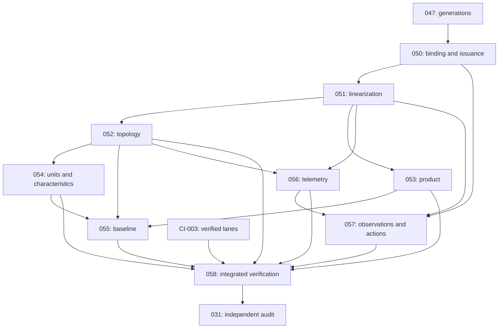

# HidraAPI — Ultimate Universal Platform Roadmap

## Development consolidation — authoritative prospective register, 2026-10-13

**Source baseline:** `8c173f4942371b377f9155e7d99af4e4c5fc288c`, tree
`23c35d20165dc35b53ebd3cd0790364a8d251691`. [Production #666](https://github.com/CHOUABBIA-AMINE/HidraAPI/actions/runs/38377242759)
and [Documentation #266](https://github.com/CHOUABBIA-AMINE/HidraAPI/actions/runs/38377242705)
SUCCESS on that exact SHA. Repository development version is `0.7.0-SNAPSHOT`;
latest formal release remains [v0.6.0](https://github.com/CHOUABBIA-AMINE/HidraAPI/releases/tag/v0.6.0)
at `09bf1cbf82c20f19c50ebb1ff9e27047c7f34856`. No release/deployment occurs here.

**Readiness: BASELINE CONDITIONALLY READY; NOT FROZEN.** Remaining approved requirements
are assigned below, but D1–D5 prevent claiming that every downstream task has a closed
implementation allowlist or fully decided contract. This is a complete prospective work
inventory with explicit resolution work, not proof of complete runtime coverage. Only
047 and the CI task have closed implementation scopes here; other new tasks remain
PLANNED / REGISTERED with code blocked until their own decision gate and exact scope
amendment are accepted. Owner approval of the final baseline is still required. Docs CI
alone does not grant that approval or close any engineering, security, PLATFORM or SITE gate.

This prospective register governs selection ahead of the older dated dashboard retained
below. It does not rename/reopen completed IDs, rewrite historical evidence or widen the
frozen 047 allowlist. Historical `NEXT`/PENDING language retains its original applicability.
The original history file remains byte-identical. All old active-roadmap text is retained
below, with current status corrections only in its dashboard. No implementation is selected
by this planning commit. Current planning commit message:
`docs(roadmap): consolidate development baseline and ci verification plan`.


### Current execution checkpoint — HPR-P25-051D direct-grant fixture repair, 2026-10-15

Owner Fail selects repair of exact main
`cb9cd9c9f97c1ec74493687a50f1d3694bc38fd0`.
[Full #692](https://github.com/CHOUABBIA-AMINE/HidraAPI/actions/runs/38679687575)
failed; Fast #25 and Docs #310 succeeded. Java compilation and unit/
architecture now passed. Reviewed PostgreSQL partition1 and unrestricted
oracle logs identify two errors in the new collector class:
completeTimedEstateIncludesInactiveFutureDeny and
nativeWriterCannotChangeCensusBeforeCommit violate ck_hmr088_status.
Oracle reports2023 tests, zero assertion failures, two errors and zero skips;
this is failed acceptance, not a successful collector proof.

Read immutable V20261006_013__hmr_088_direct_permission_bounds.sql:
direct UserPermissionGrant status allows ACTIVE/REVOKED/EXPIRED, while
SUSPENDED remains valid for other grant families. Replace SUSPENDED with
REVOKED ONLY in the three direct-grant fixture statements: future inactive
DENY, independent writer and overflow. Keep all role/membership fixture
statuses, production source, SQL constraints and existing migrations unchanged.

Also repair a latent false-positive in oversizedCensusRollsBackWithoutPartialResult:
an invalid overflow INSERT could previously satisfy generic transaction
rejection before the collector ran. Assert that1025 rows really exist inside
the provisional transaction, record the collector's exact reviewed-cap
rejection, and require that observation after rollback. Thus an INSERT failure
or unrelated early rejection cannot pass the census-cap proof. Retain full
rollback/no partial receipt/no final guard and positive collection after
release. All ten case identities, deadlines and security guarantees persist.

UPDATE only new collector test, its exact inventory source hash, this roadmap
and append-only reconciliation. CREATE/DELETE none. Same registered message:
`feat(identity): collect fenced temporal event candidates`.
No production, migration, dependency, workflow or unrelated test change.
New test source SHA256:
`794abcafdee37fbdce227a8e4a11797f5c678218722f166702846b3295ff5898`;
inventory digest:
`a443ca1f8ff18c160150dcf98c6a36e8c6b2e5e692873b3d6cab2d97257dfa04`.
Old case/lane/order/policy/timing inventory is unchanged.

Local syntax-only Java parsing and source inventory PASS; migrated status
contract and all targeted statements audited. Canonical docs/offline OpenAPI/
P1, exact four-path scope and append-only checks performed. No local Java21/
JUnit/PostgreSQL success is claimed. Publish guarded main, verify parent/
tree/blobs, observe actual exact-SHA Full/Fast/Docs START then STOP.
Separate Next/Fail must inspect actual aggregate and ten zero-skip PG cases
before051D acceptance. 051D remains IN PROGRESS / REPAIRED CANDIDATE /
HOSTED CI PENDING; parent051/D2/B2/B3 and real owner integration remain OPEN,
052 unselected. CI-003 oracle/fallback and optimized=false retained.
Gas-first/GZ2, own engine, steady/transient, versioned inputs/operator control;
synthetic development, owner calibration later, Simulation/P3 deferred;
no release/deployment.

### Current execution checkpoint — HPR-P25-051D assertion import repair, 2026-10-15

Owner Fail selects repair of exact main
`20a215807ce87d7bf1ee7021219e8bf4a1b0c835`, not a later task.
[Full #691](https://github.com/CHOUABBIA-AMINE/HidraAPI/actions/runs/38633902694)
and Fast #24 failed; Docs #309 succeeded. Reviewed unit/architecture,
PostgreSQL partition1 and unrestricted oracle logs show the same Java
test-compilation error: four unqualified fail(String) calls are ambiguous
between wildcard imports from AssertJ and JUnit Assertions. Report/evidence
and aggregate errors follow that compilation failure; no collector runtime
acceptance or successful PostgreSQL execution is inferred.

Remove ONLY the unused JUnit Assertions static wildcard import from
IdentityTemporalEventCollectorPostgresIntegrationTest. Its assertion calls
now resolve to the existing AssertJ import. All ten test identities, bodies,
timeouts, guards, native fixtures, production collector and acceptance
requirements remain unchanged. Update only its inventory source SHA256
plus this roadmap and append-only reconciliation. Same registered message:
`feat(identity): collect fenced temporal event candidates`.
CREATE/DELETE none; no workflow, dependency, migration or production change.

Local Java syntax parsing PASS, source import/use audit PASS and source
inventory validation PASS. These are not Java21 type checking or JUnit/
PostgreSQL execution; hosted verification is required. Canonical docs/
offline OpenAPI/P1 and exact four-path/append-only checks performed.
New test source SHA256:
`e3a8c684b6611288452415134741502e6ddce677c9a107812dadb8b3b2e02552`.
Inventory SHA256:
`273bf38a011886b1c930742b7ba8a9e65f2064a2ca5c54d63279efe718c4c77c`;
Fast299/unit300/PG37+43/oracle380/historical4 unchanged.

Publish directly to expected-head main, verify parent/tree/four-path scope,
observe automatic exact-SHA Full/Fast/Docs startup then STOP. Startup is not
success. 051D remains IN PROGRESS / REPAIRED CANDIDATE / HOSTED CI PENDING.
Separate Next/Fail must review successful exact-SHA aggregate and ten genuine
zero-skip PG cases before acceptance. Parent051/D2/B2/B3, static owner/
privilege/writer graph, universal lock ordering, paired permission/Party/
Topology exports and038 head/epoch remain OPEN; 052 unselected. CI-003
oracle/fallback and optimized=false persist. Gas-first/GZ2, own engine,
steady/transient, versioned inputs/operator control; synthetic development,
owner calibration later, Simulation/P3 deferred; no release/deployment.

### Current execution checkpoint — HPR-P25-051D fenced Identity event collector candidate, 2026-10-14

Owner Next selected only the five-path registered envelope after main
`f8da655277de327edf8782996d16095500bd74e7` and exact-SHA Docs #308 SUCCESS.
Exact message: `feat(identity): collect fenced temporal event candidates`.
**051D IN PROGRESS / IMPLEMENTED CANDIDATE / HOSTED CI PENDING.**

Created JdbcIdentityTemporalEventCollector and its ten-case real PostgreSQL
integration test. The private repository requires an existing writable Spring
transaction and actual READ COMMITTED/non-read-only PostgreSQL settings.
MANDATORY participation does not start another transaction. It locks the
eleven registered temporal/expression relations in one fixed lexical-order
SHARE ROW EXCLUSIVE SQL statement before owner reads or clock sampling.
It then takes one real DB clock/PID/XID sample, reads the exact selected
binding ID with parameterized SQL, and reads whole timed/condition/rule
supersets with fixed identifiers, deterministic ordering and LIMIT1025.
No ACTIVE/effect/claim/current-window or caller graph filter is used.

All twelve registered temporal projections are mapped to actual051C kinds,
including unrelated historical session/binding intervals and optional source
expiry as ordinary census facts. Selected native/source expiry inputs alone
are required B1 bounds. Reject absent/future selected issue time, expired/
malformed deadlines, >1024 combined temporal inputs or >1024 expression rows,
unsupported051B predicates and nonnull obligations; no silent truncation.
Actual051B dependencies and051C earliest/tied contributors become materialized
public records plus immutable Java lists, with diagnostic source counts.
There is no Optional, JDBC resource, lazy entity or unmodifiableSortedSet
escape in Candidate. A native tuple or constructed Candidate does not prove
producer origin, B1 eligibility, paired permission or full static owner
coverage. The component is private/dormant for business authorization.

The ten registered PostgreSQL test identities are implemented in source.
They use fresh real PostgreSQL16/Flyway/Hibernate validate, actual Spring
collector+051A, valid SQL-trigger fixtures, actual time and independent
native connections. Cases cover inactive/unmatched future DENY; tied role,
membership, policy and attribute starts; selected native/source/session
expiry and exact source-count increment; hidden clock/custom predicate and
obligation rejection; actual DB sample PID/XID; independent phantom writer
55P03/rollback and positive post-release commit; missing and genuinely expired
binding; 1025-row overflow/rollback; ambient/read-only/wrong-isolation rejection;
late last-relation lock failure with flushed JPA provisional state, receipt,
caught SQL error/no recovery/no returned result and positive post-release
collection. Latches/pg_blocking_pids and bounded joins retain original limits.
The real short expiry is observed by bounded DB-clock polling OUTSIDE protected
work; no sleep, fake clock, altered deadline or trigger bypass. Ordinary test
grant/policy/attribute rows are removed in FK order; guarded security identities
are retained. Test-local final receipt samples DB time once and checks s<=t<u,
never actual publication/head/permission authority.

**Local validation boundaries:** the earlier cached Java21/Maven toolchain
and dependency cache are no longer present. Attempting the focused Maven
environment failed because the exact cached Maven executable is missing;
current default Java is17. No Java21 compile, architecture/Fast/JUnit or
PostgreSQL execution is claimed. The genuine Java17 compiler parser passed
syntax-only parsing of both new files; this is NOT type analysis or tests.
Six unchanged Python suites PASS:102 cases. Source inventory, canonical docs,
offline OpenAPI and retained P1 checks PASS. Existing source Git-blob parity
outside the registered scope, exact headers/whitespace, old inventory raw-byte
preservation/cases/timing/policy and append-only reconciliation are checked.
Hosted Full/Fast/Docs are required for actual Java21/provider/test evidence;
no fabricated or locally skipped acceptance.

Inventory adds only the genuine source class/ten case identities, fast=false,
owning PG partition/oracle and explicitly unmeasured zero scheduling hint.
Fast299/unit300/PG37+43/oracle380/historical4.
Inventory SHA256: `41d9ae2249c031ab2729a7957c654973afa60145720735037d6289ddef380c7f`.
Collector source SHA256:
`71315b78acd2fd531033d4e77a6d45bb55556f3c2204dc67c7742809f9474a07`;
new test source SHA256:
`de2ffadc8baf4581692e22246f4daadda7286693b7de3a203dae05c1591ee37d`.
Only two Java CREATEs plus inventory/roadmap/append-only reconciliation UPDATEs;
no existing tests/source/migrations/workflows/dependencies or versions changed.

Publish directly to expected-head main with exact child message; verify
parent/tree/two-CREATE/three-UPDATE blobs and automatic Full/Fast/Docs START
on actual runtime SHA, then STOP. On a separate Next/Fail inspect exact-SHA
aggregate and all ten genuine zero-skip PG reports before051D acceptance
or repair. Parent051/D2/B2/B3, static owner/privilege/writer graph, universal
lock ordering, real paired permission/Party/Topology exports and038
head/epoch remain OPEN. 052 unselected. CI-003 oracle/fallback mandatory,
optimized=false; gas-first/GZ2, own engine, steady/transient, versioned
inputs/operator control persist. Synthetic development; owner calibration
later; Simulation/P3 deferred; no release/deployment.

### Current execution checkpoint — HPR-P25-051D Identity temporal event collector registration, 2026-10-14

Live main `f27937f5b9d8145e47e46071d8eb8d77f5a4a1a3` has exact-SHA
Docs #307 SUCCESS. Accepted runtime `f68a729594a9dd2a54911501396394af4eef17c7`
has Full #690/Fast #23/Docs #306 SUCCESS, with 051C real PostgreSQL4 and
unit12 accepted. 051A lifecycle, native-writer proof and051B syntax retain
their accepted scopes. Owner Next selects actual source-based Identity
event collection scope; this is one future same-ID 051D slice, not052.

#### Current source and chosen bounded strategy

Current JpaAuthorizationEvidenceAdapter.load filters ACTIVE/current windows
before role/group/mapping/attribute/policy traversal. Its private window uses
from<=at and at<to; future inactive/nonmatching DENY activation can therefore
be omitted from a current-evidence list. Existing AuthorizationEvidencePort
returns current grants/rules/facts only, not future-event coverage. Read these
exact files plus current temporal entities and V20261013_001 binding schema.

Choose an intentionally conservative **Identity-wide temporal superset**
for synthetic bounded datasets, rather than prematurely prune a graph by
current status, effect, claim match, scope or permission. This overcaptures
unrelated boundaries and may reject large or unsupported estates. That
availability cost is explicit; it is not a production scalability/readiness
claim. Query-based graph pruning can be authorized later only after an
independent coverage proof. No new public endpoint or foreign owner export.

Exact source-confirmed timed columns:
user_permission_grant(id,valid_from,valid_to) DIRECT_GRANT;
user_role_grant,group_role_grant,role_permission_grant,
user_group_membership(id,valid_from,valid_to) GRANT_OR_MEMBERSHIP;
authorization_policy_version(id,effective_from,effective_to) POLICY_VERSION;
subject_security_attribute(id,valid_from,valid_to) ATTRIBUTE;
user(id,locked_until) LOCKED_UNTIL;
login_session(id,started_at,expires_at) ATTRIBUTE for census purposes;
operation_binding(binding_id,issued_at,expires_at) DIRECT_GRANT plus
source_expires_at as an optional ATTRIBUTE boundary with a distinct source.
All names above have public.hidra_identity_ prefix. The selected binding's
expires_at and present source_expires_at separately become required
B1_EXPIRY inputs; unrelated historical sessions/bindings must NOT be treated
as required current B1 expiries. This maps known temporal columns, not full
B1 eligibility/producer-origin meaning.

Source-confirmed expression columns: role_permission_grant.condition_expression
and authorization_policy_rule subject/resource/action/context_expression plus
obligation_expression. All conditions/rules, including inactive/unmatched rows,
participate in the syntax gate. Each nonnull predicate must be accepted by the
actual051B compiler; a nonnull obligation rejects (existing evaluator already
treats unresolved obligations as indeterminate). Syntax acceptance alone never
permits the operation. Columns with no clock semantics are guarded against
writers in the later complete owner integration, not silently declared immutable.

#### Exact future 051D implementation

Eligible on SEPARATE owner Next after this registration Docs SUCCESS.
Exact message: `feat(identity): collect fenced temporal event candidates`.

| Operation | Exact path |
|---|---|
| CREATE | `src/main/java/dz/sh/hidra/modules/identity/infrastructure/persistence/adapter/JdbcIdentityTemporalEventCollector.java` |
| CREATE | `src/test/java/dz/sh/hidra/modules/identity/infrastructure/persistence/IdentityTemporalEventCollectorPostgresIntegrationTest.java` |
| UPDATE | `.github/ci-test-inventory.json` |
| UPDATE | `doc/roadmap/ULTIMATE_ROADMAP.md` |
| UPDATE | `doc/model-remediation/RECONCILIATION.md` — append-only |
| DELETE | None |

Two CREATE names absent from the exact recursive Git tree. Canonical headers,
Infrastructure/Identity Test layer and exact package required.
No old Java/test, port/evaluator/compiler, migrations, workflow/helper,
transaction component/configuration, dependencies, dictionary, version/history
or protected business API may change. Identity infrastructure may use its own
051B/051C domain classes plus existing Spring JDBC/transactions; no foreign
module internals/JPA import or Platform private attempt-state access.

#### Collector and transaction contract

One private Identity repository component exposes collect(String bindingId).
Result is a materialized immutable diagnostic Candidate record with sample,
earliestFuture, backendPid/transactionId and immutable contributor/fact-dependency
lists. Avoid Optional, unmodifiableSortedSet, JDBC resource, entity or lazy
data in the returned graph: current051A materialization accepts only supported
scalars/time/enums/public records and immutable Java collection implementations.
Candidate construction is not private producer attestation, permission or an
authenticated owner witness; no caller completeness Boolean/token.

Require an existing writable READ COMMITTED Spring transaction; no ambient
transaction, read-only or wrong isolation rejects without opening REQUIRES_NEW,
retry or independent connection. Use MANDATORY propagation and verify actual
database isolation/read-only setting on the participating JDBC connection.
Production tests invoke the actual051A bean chain; a matching ordinary writable
transaction can collect diagnostics but never establishes business authority.
Do not add a fabricated protected-context marker or stack-trace authorization.

Before any clock sample or owner data read, take SHARE ROW EXCLUSIVE on these
EXACT eleven relations in lexical table-name order, one fixed reviewed SQL
sequence: authorization_policy_rule, authorization_policy_version,
group_role_grant,login_session,operation_binding,role_permission_grant,
subject_security_attribute,user,user_group_membership,user_permission_grant,
user_role_grant (all public.hidra_identity_). No row-lock addition in this slice.
These fences cover the selected temporal/expression rows and insertion phantoms
until physical transaction completion; they do not prove the entire static
permission/provider/attribute-definition owner graph or privileged writer DAG.
Keep accepted051A 250ms lock/750ms statement/1000ms idle/500ms work limits,
no retries/grace/timeout widening. Any lock/SQL rejection aborts full protected
execution; swallowed errors cannot yield a candidate or resumed work.

After all selected fences, sample clock_timestamp plus actual backend PID/XID
ONCE on that same transaction. Retrieve the chosen immutable binding by exact
ID using parameterized SQL, require exactly one row, finite/microsecond bounds,
issued_at<=s and required expiry/source-expiry>s. Read only IDs/times/protocol
needed for bounds; do not expose private producer bytes/issuer/subject in results.
Do not assert B1 eligibility or origin from a native table tuple.

Read the WHOLE timed relation superset above, without ACTIVE/status/effect/claim/
scope/current-window filters or caller table names. A fixed bounded UNION ALL
projection is allowed, with deterministic table/id/endpoint ordering.
Cap temporal inputs at1024 INCLUDING selected-B1 supplemental inputs;
use LIMIT1025 and reject excess, never silently truncate. Similarly cap
expression row census at1024 using LIMIT1025; reject excess and every
unsupported expression/obligation. SQL is fixed owner-only identifiers;
source IDs must be unique bounded table-qualified identifiers compatible with
051C (<=160), with distinct suffixes for source/selected expiries.
Separate SQL statements at READ COMMITTED are safe only because selected
relations were already fenced; do not sample before locks or claim a cached
snapshot captured in a different transaction.

Apply actual051B syntax compiler and051C boundary compiler; reject malformed
source tuples, unsupported syntax or unsuccessful reduction with no partial
candidate. Required selected expiry ensures a finite future bound for a
successful candidate. Include deterministic immutable predicate dependencies
for later owner evaluation, but never evaluate a PERMIT here. Hold all locks
through explicit owner flush and the exact single final guard until physical
commit when called by051A. No SQL after that final guard or out-of-transaction
delivery; existing lifecycle mechanics remain authoritative.

#### Genuine PostgreSQL acceptance identities

Real PostgreSQL16 Testcontainers/fresh current Flyway/Hibernate validate and
actual Spring production collector+051A bean chain, independent native writers:
1. completeTimedEstateIncludesInactiveFutureDeny
2. roleMembershipPolicyAndAttributeFutureStartsAreRetained
3. selectedBindingAndSessionExpiryBoundCandidate
4. staticExpressionGateRejectsHiddenClockAndUnclassifiedAttribute
5. databaseSampleAndCandidateUseSameBackend
6. nativeWriterCannotChangeCensusBeforeCommit
7. missingBindingOrExpiredB1Rejects
8. oversizedCensusRollsBackWithoutPartialResult
9. readOnlyAndNoTransactionCallsReject
10. lateRelationLockFailureRollsBackAndCannotRecover

Names are planned report identities, not execution evidence.
Valid synthetic SQL-trigger binding fixtures (zero producer tags if needed)
must stay labeled structural only. Seed valid PK/FK/code/status/window rows;
preserve Flyway triggers. Prove future DENY/start boundaries even when inactive/
currently unmatched, current/past/unrelated overcapture, group/role/membership/
policy/attribute source rows, optional source expiry, actual sample PID/XID and
microsecond upper bound. Overflow must not contaminate later tests: seed excess
inside an explicitly rolled-back transaction or use an isolated fresh database;
never TRUNCATE/DELETE guarded provider/credential/link/binding rows.

Writer/lock tests require CountDownLatch barriers, pg_blocking_pids observation,
bounded joins, actual55P03 or40P01 fail-closed outcome, complete rollback/no
partial receipt/candidate and positive commit after release. A test-local
materialized DB-clock t statement checks s<=t<u once as the final guard;
no real publication/head/permission claim. Preserve actual operation-binding
normal trigger behavior and old51A/native-owner tests. Lock graph acceptance
is only this bounded collector, never universal deadlock freedom. Source
counts and positive uncontended collection are mandatory.

Inventory adds ONLY this genuine PG class/cases, fast=false PostgreSQL lane/
oracle, actual source SHA256, zero explicitly unmeasured scheduling hint.
Old entries/cases/hashes/order/timings/policies/raw formatting/archive unchanged.
Run focused Java21 new PG + ArchitectureGuardrailTest and retained native-owner/
051C parity cases; local Docker skips NOT acceptance. Reviewed Fast/report
equality, six unchanged Python suites, docs/offline OpenAPI/P1/source inventory,
header/exact2CREATE+3UPDATE/append-only checks. Hosted Full/Fast/Docs must START
on guarded actual implementation SHA then STOP; later acceptance needs exact-SHA
success and genuine zero-skip collector cases.

#### Current registration and STOP

051D PLANNED/REGISTERED, not implemented. Current UPDATE only two governance
files with registered `docs(security): select operation time fencing proof`;
CREATE/DELETE none. Validate canonical docs and exact append-only/two-file scope,
guard main at f27937f, verify parent/tree/blobs, observe automatic Docs startup
then STOP. Next executes only this five-path collector slice after Docs success.
No external owner port or052 selection. Parent051/D2/B2/B3, complete static
owner/writer/privilege graph, universal lock ordering, actual paired permission/
Party/Topology exports and038 head/epoch remain OPEN. CI-003 full oracle/fallback,
optimized=false persist. Gas-first/GZ2, own engine, steady/transient/versioned
inputs/operator control; synthetic development, owner calibration later,
Simulation/P3 deferred; no release/deployment.

### Current execution checkpoint — HPR-P25-051C CI acceptance, 2026-10-14

Owner Next recovered live main `f68a729594a9dd2a54911501396394af4eef17c7`,
parent `68757afa87d6f58c8609c2aca10185b03df9bdb1`, tree
`c87fb4528fdbbea33d0959856014b3dfef9e0e86`.
Exact-SHA [Full #690](https://github.com/CHOUABBIA-AMINE/HidraAPI/actions/runs/38600369907),
[Fast #23](https://github.com/CHOUABBIA-AMINE/HidraAPI/actions/runs/38600369794)
and [Docs #306](https://github.com/CHOUABBIA-AMINE/HidraAPI/actions/runs/38600370035)
are completed SUCCESS. All seven Full jobs, including both PostgreSQL
partitions, unrestricted oracle, runtime API/dictionary and authenticated
Full Verification Gate, are SUCCESS.

**HPR-P25-051C COMPLETED / SUPPLIED BOUNDARY REDUCTION CI ACCEPTED.**
Downloaded this exact attempt's unit-architecture artifact `11913183217`
and PostgreSQL partition-1 artifact `11912464814`. Genuine Surefire XML
contains all12 AuthorizationTemporalBoundaryCompilerTest identities and
all4 AuthorizationTemporalBoundaryPostgresIntegrationTest identities;
each suite has zero failures/errors/skips/flakes. Reported durations
0.020s and2.382s are observations, not scheduling baseline changes or
production latency SLOs. The formerly locally skipped PostgreSQL cases
now have actual hosted zero-skip evidence on this runtime SHA.

Authenticated aggregate:379 classes/2013 tests, zero failures/errors/skips,
same-run equivalence true, source SHA matching f68a729, inventory digest
`840d209a64a5f9414a09b23e3116cfdc74845fa77fb4e085120b915b878114a8`.
Oracle fallback remains required; optimized_adoption_eligible=false.
The current runtime/compiler source, inventory and migrations remain
unchanged by this acceptance checkpoint.

Acceptance covers pure reduction of supplied facts and real PostgreSQL
half-open/microsecond/timezone/infinity parity only. The dormant compiler
does not collect the owner event set, certify coverage, freeze authority
facts or grant permission. Parent051/D2/B2/B3 remain IN PROGRESS/OPEN.
The next same-ID source/scope closure must register actual Identity-owned
event collection from the complete graph (including future inactive/
nonmatching DENY, grant/membership/policy/attribute/B1 boundaries) and
its exact implementation/test paths. Do not substitute current-at-s JPA
filters or a caller completeness Boolean. No new runtime path or052
is admitted by this checkpoint. Global writer/privilege/lock ordering,
real protected Identity/Party/Topology exports, same database s/u/t
and038 publication head/epoch remain OPEN.

Current action uses registered same-ID governance message
`docs(security): select operation time fencing proof`; UPDATE only
roadmap and append-only reconciliation, CREATE/DELETE none. Preserve
all source/tests/inventory/migrations/workflows/history/version/release
blobs. Validate exact two-path append-only scope and canonical docs,
publish directly to expected-head main, verify parent/tree/blobs, observe
automatic exact-SHA Docs startup then STOP. Startup is not success;
accepted runtime stays anchored to f68a729.
Gas-first/GZ2, own engine, steady/transient, versioned inputs/operator
control persist; synthetic development, owner calibration later,
Simulation/P3 deferred; no release/deployment.

### Current execution checkpoint — HPR-P25-051C supplied temporal boundary candidate, 2026-10-14

Owner Next selected only the registered six-path envelope after
`68757afa87d6f58c8609c2aca10185b03df9bdb1` and exact-SHA Docs #305 SUCCESS.
Exact message: `feat(identity): reduce protected temporal boundaries`.
**051C IN PROGRESS / IMPLEMENTED CANDIDATE / HOSTED CI PENDING.**

Created AuthorizationTemporalBoundaryCompiler, its twelve-case unit test
and four-case real PostgreSQL16 timestamp parity test. The pure domain
compiler snapshots supplied immutable boundary inputs, validates six fixed
kinds and their required/nullable endpoints, finite PostgreSQL epoch range
and exact microsecond precision, source identities and duplicate source/kind
pairs, strict window ordering, count<=1024 and future required B1 expiry.
It collects BOTH future starts and ends without an active-status filter.
The result retains the earliest instant strictly after sample and all tied
contributors sorted by source/kind/endpoint in immutable output.
Unsupported facts yield a reason with no partial candidate. Empty/past-only
input yields NO_FUTURE_BOUNDARY without a fabricated infinite horizon.
No Clock, Instant.now, I/O, caller completeness Boolean or owner witness.

The unit suite proves future inactive-window starts, half-open equality,
past windows, nullable attribute/lock facts, required fields, expired B1,
source/grant intersection, invalid/duplicate/oversized input, microsecond
and finite bounds, deterministic ordering/immutable ties and no unlimited
authority conclusion. PostgreSQL tests use the actual compiler plus
independent JDBC connections and parameterized timestamptz SQL, checking
t==s, t==u and adjacent microseconds, actual microsecond round trips,
distinct backend PIDs, equivalent offset text across two session timezones,
and positive/negative database infinity rejection with a finite control.
No schema migration, Spring replacement, mock clock, sleep, protected owner
integration or trigger bypass was introduced.

**Actual local validation:** Java21.0.12.1/Maven3.9.11 offline focused
`-Dtest=AuthorizationTemporalBoundaryCompilerTest,AuthorizationTemporalBoundaryPostgresIntegrationTest,ArchitectureGuardrailTest test`
PASS for compilation plus 12 unit/16 architecture cases, zero failures/errors.
All four PostgreSQL identities are genuinely SKIPPED because Docker
executable/socket is unavailable; no real PG acceptance claimed.
Reviewed Fast Maven with workspace-only existing Mockito Java agent PASS:
299 classes/1374 tests, zero failures/errors/skips. Strict Fast report
equality PASS on its 299 source-selected raw report files. Initial report
check against the mixed focused/Fast directory rejected the four retained
PG skips; separate Fast evidence was checked while those focused skip
reports remain retained. This separation never accepts the DB lane.
Six unchanged Python policy suites PASS:102 cases; canonical docs/offline
OpenAPI/P1/source inventory checks PASS. Source Git-blob parity outside the
registered scope, canonical headers, immutable old inventory cases/order/
hashes/timings/policies/raw formatting and append-only scope checked.

Inventory adds only these two genuine test classes; unit Fast/unit/oracle,
PG fast=false/owning PostgreSQL partition/oracle, zero unmeasured timing
hints explicitly labeled. Fast299/unit300/PG37+42/oracle379/historical4.
Inventory SHA256:
`840d209a64a5f9414a09b23e3116cfdc74845fa77fb4e085120b915b878114a8`.
Production source SHA256:
`cf8051d005f5551b8f2b7fa5e9c86fb38cd47553be18c544d874a2c7921ff770`;
unit source SHA256:
`3d33b43adecd85019e3e51884782e4af877b5522f0eb44a57da2d8ba97299115`;
PG source SHA256:
`b4b0967d47e464def98c559240c53035573781b7f6b0eaa84c2e273ff7903b3a`.

Exact 3 Java CREATE/3 inventory-governance UPDATE/0 DELETE. All existing
production/tests/migrations/workflows/versions and release artifacts remain
unchanged. Compiler is dormant and supplied-boundary reduction is NOT
owner-event completeness, permission, fact freezing or final DB authority.
Parent051/D2/B2/B3, source-specific actual owner collection, writer/privilege
and global lock graph, protected Identity/Party/Topology exports and038
head/epoch plus common database s/u/t remain OPEN. 052 is not selected.

Publish directly to expected-head main, verify exact child message,
parent/tree/six-path blobs, observe automatic Full/Fast/Docs startup
on actual new runtime SHA, then STOP. Next/Fail requires successful
exact-SHA aggregate and genuine zero-skip PostgreSQL reports before
051C acceptance or repair. CI-003 oracle/fallback and optimized=false
persist. Gas-first/GZ2, own engine, steady/transient, versioned inputs/
operator control; synthetic development, owner calibration later,
Simulation/P3 deferred; no release/deployment.

### Current execution checkpoint — HPR-P25-051C temporal boundary reduction registration, 2026-10-14

Live main `ab2dbaee705325a7dfdc5406af58038022549227` has exact-SHA
Docs #304 SUCCESS. Accepted runtime `6c92406a37a132dd4b435c4ba9f36083985c2ad5`
retains Full #689/Fast #22/Docs #303 SUCCESS; 051A lifecycle, native-owner
compatibility slice and051B static syntax are accepted. Parent051/D2/B2/B3
remain OPEN. Owner Next selects source-based same-ID temporal contract
closure; this registration admits one bounded future 051C implementation.

#### Source-confirmed time inventory

At this exact SHA, Identity persistence entity paths under
`src/main/java/dz/sh/hidra/modules/identity/infrastructure/persistence/entity/`
show: UserPermissionGrantJpaEntity has nonnull validFrom AND validTo;
UserRoleGrantJpaEntity, GroupRoleGrantJpaEntity, RolePermissionGrantJpaEntity
and UserGroupMembershipJpaEntity have nonnull validFrom and nullable validTo;
AuthorizationPolicyVersionJpaEntity has nonnull effectiveFrom and nullable
effectiveTo; SubjectSecurityAttributeJpaEntity has nullable validFrom/validTo;
UserJpaEntity has nullable lockedUntil; LoginSessionJpaEntity has nullable
expiresAt. These mappings alone do not establish runtime eligibility.

`src/main/java/dz/sh/hidra/modules/identity/infrastructure/persistence/adapter/JdbcAuthenticationSecurityStateQueryAdapter.java`
tests current B1 eligibility with now >= issuedAt, now < expiresAt,
now < sourceExpiresAt when present, and lockedUntil <= now when present.
`src/main/java/dz/sh/hidra/modules/identity/domain/model/OperationAuthenticationBinding.java`
requires finite native issue/expiry whole seconds and finite OIDC source
expiry aligned to PostgreSQL microseconds, with native expiry <= source expiry.
The existing JPA evidence adapter uses half-open grant/version/attribute
windows, but selects current-active paths and does not produce an exhaustive
future event set. Future inactive/nonmatching DENY, membership, attribute,
policy and source changes remain required in later owner collection.

#### Exact future 051C scope

Eligible on a SEPARATE owner Next only after registration Docs success.
Exact implementation message:
`feat(identity): reduce protected temporal boundaries`.

| Operation | Exact path |
|---|---|
| CREATE | `src/main/java/dz/sh/hidra/modules/identity/domain/service/AuthorizationTemporalBoundaryCompiler.java` |
| CREATE | `src/test/java/dz/sh/hidra/modules/identity/domain/service/AuthorizationTemporalBoundaryCompilerTest.java` |
| CREATE | `src/test/java/dz/sh/hidra/modules/identity/infrastructure/persistence/AuthorizationTemporalBoundaryPostgresIntegrationTest.java` |
| UPDATE | `.github/ci-test-inventory.json` |
| UPDATE | `doc/roadmap/ULTIMATE_ROADMAP.md` |
| UPDATE | `doc/model-remediation/RECONCILIATION.md` — append-only |
| DELETE | None |

All three CREATE names were collision-scanned against the live recursive tree.
Canonical Java headers, exact package, Identity Domain/Test layers required.
Production dependencies: Java standard library only, within existing private
Identity domain. No Spring/JPA/Platform or foreign module imports.
No existing evaluator/compiler/adapter/port/test, migration, configuration,
workflow/helper, dependency, dictionary, version/history or API is writable.
No runtime owner coordinator is connected by this slice.

#### Closed reduction contract

Provide compile(Instant sampledAt, List<BoundaryInput> inputs), immutable
input/output records and fixed enums. This is **pure reduction of supplied
owner facts**, not an event query, completeness certificate, PERMIT or owner
witness. No caller Boolean claiming complete inventory, public authorization
port, Clock/Instant.now, DB/network/directory access or callback.

BoundaryInput retains a bounded nonblank sourceId (<=160 characters),
kind, from and to. Fixed kinds:
DIRECT_GRANT (required from/to); GRANT_OR_MEMBERSHIP (required from,
optional to); POLICY_VERSION (required from, optional to);
ATTRIBUTE (optional from/to); LOCKED_UNTIL (from absent, to optional);
B1_EXPIRY (from absent, to REQUIRED). Kind names are descriptive source
fact categories, not automatic extraction from a JPA entity.
For every window with both endpoints require from < to; never silently
repair empty/reversed ranges. B1_EXPIRY <= sampledAt rejects as already
expired; an expired grant/window alone does not imply B1 expiry.
Null lockedUntil/attribute endpoints mean no boundary supplied, not
absence of a writer or complete coverage.

Validate sampledAt and all present times as finite PostgreSQL timestamptz
values using existing binding's bounds [-210866803200,9224318016000)
epoch seconds AND nanoseconds divisible by1000. Reject finer precision,
do not round or floor a potentially unsafe sample/upper bound. Input
count bound1024 (synthetic engineering cap, not calibrated network size);
reject oversized/null collections, null elements, unknown/null kinds,
missing required endpoints, invalid identifiers or duplicate sourceId/kind
pairs. Distinct kinds may share one sourceId. No silent truncation.

Collect BOTH start/end boundaries, including from future/inactive/unmatched
windows; the pure compiler receives no active-status filter. Reduce to the
minimum endpoint STRICTLY > sampledAt; boundaries exactly at sampledAt
already belong to the current half-open evaluation and do not become a
future horizon. Past boundaries do not move sample or fabricate validity.
LOCKED_UNTIL contributes its future to; required B1 expiry must be future.
Keep all tied sourceId/kind/endpoint contributors in deterministic sorted
immutable output, with no mutable caller-list aliasing.

Output disposition BOUNDED_CANDIDATE (earliestFuture present),
NO_FUTURE_BOUNDARY (absent) or UNSUPPORTED (reason; no partial plan).
NO_FUTURE_BOUNDARY is NOT unlimited permission; never use Instant.MAX,
database infinity, a magic grace interval or arbitrary sample+duration.
Reason enum must distinguish missing/invalid input, invalid window,
unrepresentable time, duplicate source, excessive input and expired B1.
A later protected coordinator must separately establish coverage, evaluate
authority at database sample s, intersect all owner/B1 boundaries and work
limits, then enforce s <= t < u in its single final DB statement. Candidate
construction never grants access or closes that proof.

#### Acceptance identities and real PostgreSQL boundary parity

Unit identities (planned, must become genuine JUnit reports):
earliestFutureIncludesInactiveWindowStarts;
startAndEndEqualityUseHalfOpenSemantics;
pastWindowsDoNotInventFutureHorizon;
nullableAttributeAndLockBoundariesAreExplicit;
requiredGrantAndPolicyEndpointsAreValidated;
b1ExpiryAtOrBeforeSampleRejects;
futureB1ExpiryIntersectsOtherWindows;
duplicateAndOversizedInputsRejectWithoutPartialPlan;
postgresPrecisionAndFiniteRangeAreRequired;
tiedContributorsAndResultsAreImmutable;
inputOrderingCannotChangeReduction;
noFutureBoundaryIsNotUnlimitedAuthority.

Real PostgreSQL16 Testcontainers class, plain JUnit/JDBC with the actual
production compiler; no Spring replacement, mocked clock/database or schema
migration is needed for these timestamp-arithmetic fixtures. Genuine cases:
postgresHalfOpenEqualityMatchesCompiler;
postgresMicrosecondRoundTripsPreserveCandidate;
postgresSessionTimeZoneCannotChangeInstantBoundary;
postgresRejectsNonfiniteOwnerBoundariesAtCompilerBoundary.
Use independent real connections, parameterized timestamptz values and
positive SQL results; check t==s, t==u, one microsecond before/after, future
start versus expiry, equivalent offset representations, session zones and
database infinity mapped/rejected as unrepresentable Java facts. Fixtures
prove PostgreSQL timestamp/half-open parity ONLY, never actual owner coverage,
protected transaction fencing or full B2/B3 acceptance. No sleeps, stored
business head/function or administrative trigger bypass.

Inventory: add only two genuine classes with exact actual source SHA256 and
enumerated report cases. Unit reviewed Fast/unit/oracle; PG fast=false DB
lane/oracle; unmeasured baseline_seconds=0 labeled explicitly. Retain every
old entry/case/hash/order/timing/policy/archive, including raw formatting.
Focused Java21 Maven compiler unit/PG + ArchitectureGuardrailTest; real PG
local skips are NOT acceptance. Run reviewed Fast/raw report equality,
six unchanged Python policy suites, docs/offline OpenAPI/P1/source inventory,
headers/exact 3CREATE+3UPDATE/append-only checks. Publish implementation
guarded main, observe Full/Fast/Docs startup then STOP. Later acceptance
requires exact-SHA success and zero-skip genuine PostgreSQL cases.

#### Current registration and boundary

051C PLANNED/REGISTERED, not implemented. Current action UPDATE only
roadmap and append-only reconciliation, CREATE/DELETE none, with
`docs(security): select operation time fencing proof`. Validate two-path
scope and Docs; guard main at ab2dbae, observe automatic Docs startup
then STOP. Next executes ONLY this six-path implementation after Docs
success; Fail repairs current gates. The source-specific owner collection,
complete mutation/privilege graph, global relation/row ordering, real
Identity/Party/Topology exports, full database s/u/t and038 head/epoch
remain open under parent051; no052 or release selection. CI-003 full
oracle/fallback and optimized=false persist. Gas-first/GZ2, own engine,
steady/transient, versioned inputs/operator control; synthetic development,
owner calibration later, Simulation/P3 deferred; no release/deployment.

### Current execution checkpoint — HPR-P25-051B CI acceptance, 2026-10-14

Owner Next recovered live main `6c92406a37a132dd4b435c4ba9f36083985c2ad5`,
parent `8a6e304f92a6c4df7c76cd9e4bd95933582be137`, tree
`05f75d375b4a57dc498ce8d02ef974c9eeccb566`.
Exact-SHA [Full #689](https://github.com/CHOUABBIA-AMINE/HidraAPI/actions/runs/38593746474),
[Fast #22](https://github.com/CHOUABBIA-AMINE/HidraAPI/actions/runs/38593746463)
and [Docs #303](https://github.com/CHOUABBIA-AMINE/HidraAPI/actions/runs/38593746384)
are completed SUCCESS. All seven Full jobs, including both PostgreSQL
partitions, unrestricted oracle, runtime API/dictionary and authenticated
Full Verification Gate, are SUCCESS.

**HPR-P25-051B COMPLETED / STATIC SYNTAX SLICE CI ACCEPTED.**
Downloaded this exact attempt's unit-architecture artifact `11909675613`;
genuine Surefire XML for AuthorizationExpressionStabilityCompilerTest contains
all12 registered identities, zero failures/errors/skips/flakes, duration
0.024 seconds. This is hosted report observation, not a changed scheduling
baseline or production SLO. Authenticated Full aggregate reports 377 classes,
1997 tests, zero failures/errors/skips, exact source SHA, same-run equivalence
true and inventory digest
`d9caee4c1bb0fc81cedc4f883ccd2f81be44e13945402e163a3730e0089e481f`.
Oracle fallback remains required and optimized_adoption_eligible=false.

The completed compiler classifies syntax only; it remains dormant in the
ordinary authorization path. This does not establish PERMIT, a same-backend
owner witness, fact freezing, future transition completeness or a validity
interval [s,u). Parent051/D2/B2/B3 remain IN PROGRESS/OPEN.
The next same-ID D2 scope closure must source-register the future-event
interval contract and its exact implementation/test paths before integration;
no additional production path or 052 is admitted by this acceptance.
Real protected Identity/Party/Topology exports, complete writer/privilege and
global lock graph, common database s/u/t, and038 head/epoch remain OPEN.

Inventory retained all old numeric timing VALUES, entries/order, cases,
hashes, lanes and policies. The implementation's JSON serialization rendered
five pre-existing zero durations from `0.0` to `0`; this is a lexical
representation change only, not new measured timing or baseline calibration.
No inventory correction or policy change is selected here.

Current action UPDATEs only this roadmap and append-only reconciliation,
CREATE/DELETE none, with registered same-ID governance message
`docs(security): select operation time fencing proof`. Preserve every
source/test/migration/inventory/workflow/history/version/release blob.
Verify exact two-document append-only scope and parent/tree, publish directly
to expected-head main, observe automatic exact-SHA Docs startup then STOP.
Documentation startup is not success; the accepted runtime stays anchored
to 6c92406. Gas-first/GZ2, own engine, steady/transient, versioned inputs and
operator control persist; synthetic development, owner calibration later,
Simulation/P3 deferred; no release/deployment.

### Current execution checkpoint — HPR-P25-051B static syntax compiler candidate, 2026-10-14

Owner Next selects the registered five-path 051B envelope after
`8a6e304f92a6c4df7c76cd9e4bd95933582be137` and exact-SHA Docs #302 SUCCESS.
Exact implementation message:
`feat(identity): compile protected static expression syntax`.
**051B IN PROGRESS / IMPLEMENTED CANDIDATE / HOSTED CI PENDING.**

Created Identity-domain AuthorizationExpressionStabilityCompiler and its
12-case behavioral unit test. compile(String) uses the existing bounded
AuthorizationJson parser and validates exact grammar fields, all six
operators and all five literal types. It returns immutable sorted fact
dependencies for SUPPORTED_STATIC_SYNTAX, or UNSUPPORTED with a reason
and empty dependencies. Null expression is unconditional syntax; JSON
null, malformed/duplicate fields, empty arguments/lists, unsupported
operators/types, invalid literals, clock references and unclassified
facts reject. All/any analyze every branch independently of Boolean
outcome; unsupported children cannot hide behind a matching sibling.
DATE/DATETIME validation retains existing text equality semantics,
including unequal text for equivalent instants.

Only the ten exact adapter fact keys registered for 051B are supported.
Encoded or nested context.evaluatedAt and subject.attributes.* reject.
No caller-widened fact allowlist, callback, I/O or mutable parsed AST.
Compilation construction enforces consistent rejection/dependency state.
A supported classification is neither PERMIT nor a transaction/owner
witness or temporal interval; real missing/incorrectly typed evidence
still yields existing evaluator INDETERMINATE. The component is dormant:
no ordinary evaluator/adapter/coordinator or public API was changed.
Later protected integration must independently prove fact freezing,
full future-event census, common s/u/t and owner head/epoch meaning.

**Exact scope:** two registered Java CREATEs, inventory plus this roadmap
and append-only reconciliation UPDATEs; no DELETE. Old inventory entries
retain exact order/content, cases, hashes, lanes, timing, policies and
historical archives. New genuine class is fast=true, unit-architecture
and oracle; baseline_seconds=0 explicitly unmeasured. Inventory validates
Fast298/unit299/PG37+41/oracle377/historical4. Inventory SHA256:
`d9caee4c1bb0fc81cedc4f883ccd2f81be44e13945402e163a3730e0089e481f`.
Compiler source SHA256:
`8bcec30ee05c00157f8594367b664c65e8ae41d68866f0c4ecb0d95877927179`;
test source SHA256:
`d9cd68f1af7e30901edc18800f80d91b5fce495d6f41bc2eaf451fe3e8c3db6b`.

**Actual local validation:** found cached Temurin Java21.0.12.1 and Maven
3.9.11 after default PATH exposed only Java17/no javac/Maven. Reconstructed
current source from existing local Git plus exact-SHA connector blobs;
verified Git blob parity before drafting, including restored Windows
wrapper line endings. Java21 focused offline Maven
`-Dtest=AuthorizationExpressionStabilityCompilerTest,ArchitectureGuardrailTest test`
PASS: 12 compiler +16 architecture, zero failures/errors/skips. Independent
real JUnit-engine execution also passed all12. Reviewed Fast offline Maven
PASS: 298 classes/1362 tests, zero failures/errors/skips, strict source-linked
raw-report equality PASS. Initial Fast attempt failed on local Mockito
self-attachment; rerun supplied existing mockito-core5.23.0 as a command-line
Java agent, no project dependency/configuration changes. Six unchanged
Python suites PASS: 102 cases. Canonical docs/offline OpenAPI/P1 and source
inventory PASS; exact source/case/header/scope/old-entry and append-only
checks performed. No PostgreSQL test or full hosted acceptance is claimed
by local unit validation.

Publish directly to expected-head main with the exact child message;
verify two CREATE/three UPDATE paths, parent/tree/blob scope, observe
automatic Full/Fast/Docs startup on the actual runtime SHA, then STOP.
On separate Next/Fail inspect exact-SHA aggregate and regressions before
051B acceptance or repair. Parent051/D2/B2/B3, writer/privilege completeness,
global lock ordering, future-event interval compiler, real protected
Identity/Party/Topology exports and038 head/epoch remain OPEN. 052 is not
selected. CI-003 oracle/fallback remain mandatory and optimized=false.
Gas-first/GZ2, own engine, steady/transient, versioned inputs/operator
control persist; synthetic development, owner calibration later,
Simulation/P3 deferred; no release/deployment.

### Current execution checkpoint — HPR-P25-051B static expression compiler registration, 2026-10-14

Live main `83c58e975392befdd34392378843b43879effe44` has exact-SHA
Docs #301 SUCCESS. Accepted runtime `016d972725ac9a02a46f08ec024e0a4b0f95bda6`
retains Full #688/Fast #21/Docs #300 SUCCESS and six real native-owner
compatibility cases. Owner Next selects SAME-ID D2 scope closure;
this action registers one bounded production-domain slice, not 052.

#### Source evidence and purpose

Reviewed current production files:
`src/main/java/dz/sh/hidra/modules/identity/domain/service/AuthorizationExpressionEvaluator.java`,
`src/main/java/dz/sh/hidra/modules/identity/domain/service/AuthorizationPolicyEvaluator.java`,
`src/main/java/dz/sh/hidra/modules/identity/domain/policy/AuthorizationJson.java`,
`src/main/java/dz/sh/hidra/modules/identity/infrastructure/persistence/adapter/JpaAuthorizationEvidenceAdapter.java`
and the existing AuthorizationPolicyRule JPA entity/repository.
The evaluator accepts all/any/not/exists/eq/in; evaluates every branch;
supports STRING/NUMBER/BOOLEAN/DATE/DATETIME literal equality. The shared
JSON codec enforces 8192 characters, depth16, nodes256, duplicate-field
and numeric-scale bounds. Evidence supplies context.evaluatedAt from
the selected instant, plus request/subject/action facts; custom attribute
values may be JSON/LIST and come from independently filtered owner rows.
Current policy evaluation never computes future boundary u.

Register HPR-P25-051B as a **private Identity domain syntax compiler**.
It classifies a conservative static expression subset and returns immutable
referenced-fact dependencies plus an explicit unsupported reason. It does
NOT evaluate a request, mint permission, produce an owner fence witness,
choose a clock, or compute an interval. A supported result is only a
syntactic candidate; later owner integration must prove all referenced
facts frozen on the same physical transaction and enumerate every
future grant/policy/attribute/B1 transition. No caller-supplied stable-fact
Boolean/list may substitute for that evidence.

#### Exact future implementation envelope

Eligible ONLY on a separate owner Next after this registration Docs succeeds.
Exact child commit message:
`feat(identity): compile protected static expression syntax`.

| Operation | Exact path |
|---|---|
| CREATE | `src/main/java/dz/sh/hidra/modules/identity/domain/service/AuthorizationExpressionStabilityCompiler.java` |
| CREATE | `src/test/java/dz/sh/hidra/modules/identity/domain/service/AuthorizationExpressionStabilityCompilerTest.java` |
| UPDATE | `.github/ci-test-inventory.json` |
| UPDATE | `doc/roadmap/ULTIMATE_ROADMAP.md` |
| UPDATE | `doc/model-remediation/RECONCILIATION.md` — append-only |
| DELETE | None |

Both CREATE paths are absent in the exact live recursive Git tree.
Canonical Java headers, Identity Domain/Identity Test layers and exact
packages required. Domain uses Java standard library plus existing
Identity AuthorizationJson only; no Spring/JPA/Platform or foreign module
imports. No existing evaluator, evidence adapter, tests, JSON codec,
controller/port, SQL/Flyway, workflow, dependency, dictionary, version,
history or release file is writable. The compiler remains dormant until
a separately registered protected owner coordinator consumes it;
ordinary authorization compatibility is unchanged.

#### Required compiler contract

- Expose one bounded compile(String) entry point and immutable result
  (classification, sorted immutable referencedAttributes, reason enum).
  Distinguish SUPPORTED_STATIC_SYNTAX from UNSUPPORTED; neither means
  PERMIT, temporal safety or owner eligibility. Null expression follows
  the existing unconditional syntax; literal JSON null is unsupported.
  No parsed mutable object, caller callback or external I/O escapes.
- Reuse AuthorizationJson.parse and its bounds; enforce exact field sets
  and nonempty all/any args, exact not arg, exists attribute only and
  eq/in attribute/type/value. Visit ALL branches, including expressions
  hidden behind any/all/not; reject unsupported input without throwing
  to the calling coordinator. Do not accept missing/null leaf values,
  empty in lists, unknown operators/types or incorrectly typed constants.
- Conservative exact referenced-fact allowlist:
  subject.id, subject.type, subject.status, subject.groupIds,
  resource.type, resource.referenceId, action.permissionCode, action.name,
  context.scopeType, context.scopeReferenceId. Allowlist reflects current
  adapter facts, NOT proof they are presently available or time-stable.
  Reject context.evaluatedAt at any nesting level and all unclassified
  facts, including subject.attributes.*, other context keys and arbitrary
  resource/action attributes. No wildcard or caller-widened allowlist.
- STRING constants are strings; NUMBER uses parsed BigDecimal;
  BOOLEAN uses booleans; DATE validates LocalDate text and DATETIME
  validates Instant text, consistent with the existing evaluator's
  literal/string equality (never convert equal instants into a new
  normalized equality policy). For in validate EVERY literal. No
  comparisons, arithmetic, clock/date functions or custom grammar.
- Deterministic rejection categories cover malformed syntax/JSON,
  unsupported operator/type, clock-dependent reference, unclassified
  reference and invalid literal. Clear partial dependencies on rejection
  so no incomplete dependency list can be treated as a complete plan.
  Exact precedence among multiple rejection categories need not imply
  authorization priority. Never short-circuit into supported classification.
- Supported static syntax still requires actual evidence evaluation;
  absent/mismatched typed facts retain existing INDETERMINATE behavior.
  Static dates and booleans are not proof of a complete time interval.
  DENY precedence stays solely in existing AuthorizationPolicyEvaluator.

#### Behavioral acceptance and inventory

Register genuine unit identities (not current execution claims):
nullExpressionIsUnconditionalSyntax;
nestedStaticSyntaxCollectsAllDependencies;
clockReferenceIsRejectedAtEveryNestingLevel;
unclassifiedReferencesCannotBeCallerAdmitted;
malformedAndDuplicateFieldsAreRejected;
unknownOperatorsAndTypesAreRejected;
everyInLiteralMustMatchDeclaredType;
dateAndDatetimeConstantsKeepEvaluatorSemantics;
unsupportedBranchCannotHideBehindBooleanOutcome;
jsonResourceBoundsRemainEnforced;
resultsAreImmutableAndDeterministic;
supportedSyntaxDoesNotOverrideIndeterminateEvaluation.

Use JUnit5/AssertJ with real existing evaluator/JSON behavior, no Spring
context or mocked syntax parser. Include all five literal types and
all six operators, malformed fields/empty args/list/missing values,
encoded clock references, nested unknown branches, immutable results
and positive parity cases. Add ONLY this genuine test class to reviewed
Fast/unit and oracle inventory with actual source SHA256/case identities;
unmeasured baseline_seconds=0 explicitly labeled. Preserve all previous
cases/hashes/lanes/policies/timings and archives.

Run focused Java21 Maven new unit + ArchitectureGuardrailTest, reviewed
Fast suite/report checks, six existing Python policy suites, source
inventory, canonical docs/offline OpenAPI/P1, exact 2 CREATE/3 UPDATE scope,
headers and append-only reconciliation. Hosted Full/Fast/Docs must start
on the actual guarded implementation SHA, then STOP; acceptance requires
successful exact-SHA hosted results. No locally skipped test may count.

#### Current registration and STOP

Child 051B PLANNED / REGISTERED; implementation begins on the next turn
after Docs success. This current action UPDATEs only roadmap plus
append-only reconciliation, CREATE/DELETE none, using existing message
`docs(security): select operation time fencing proof`. Preserve every
other Git blob. Guard main at 83c58e9, verify parent/tree/two-path scope,
observe automatic Docs startup then STOP. Current registration performs
no runtime test and does not claim the compiler implemented.
Parent051/D2/B2/B3, complete writer/privilege graph, global lock ordering,
future-event interval compiler, actual Identity/Party/Topology exports
and 038 head/epoch remain OPEN. 052 unselected; CI-003 oracle/fallback
mandatory and optimized=false. Gas-first/GZ2, own engine, steady/transient,
versioned inputs/operator control persist; synthetic development only,
owner calibration later, Simulation/P3 deferred, no release/deployment.

### Current execution checkpoint — HPR-P25-051 D2 native-owner test acceptance, 2026-10-14

Owner Next inspected live main `016d972725ac9a02a46f08ec024e0a4b0f95bda6`,
parent `eddf03bbab9e179308a9f5ff139e0b8ab017e5ed`, tree
`c9510a3a0eb3ba5f8bd6605178863f669c7588f2`. Exact-SHA
[Full #688](https://github.com/CHOUABBIA-AMINE/HidraAPI/actions/runs/38587270668),
[Fast #21](https://github.com/CHOUABBIA-AMINE/HidraAPI/actions/runs/38587270665)
and [Docs #300](https://github.com/CHOUABBIA-AMINE/HidraAPI/actions/runs/38587270660)
are completed SUCCESS. All seven Full jobs, including both PostgreSQL
partitions, unrestricted oracle and authenticated Full Verification Gate,
are SUCCESS.

**Disposition: NATIVE-OWNER COMPATIBILITY TEST SLICE CI ACCEPTED.**
Downloaded exact-run PostgreSQL partition-1 artifact `11905469274`
and inspected genuine Surefire XML
`TEST-dz.sh.hidra.modules.identity.infrastructure.persistence.NativeOwnerFenceCompatibilityPostgresIntegrationTest.xml`:
six tests, zero failures, errors, skips and flakes; reported class duration
11.809 seconds. All six registered identities are present, including the
repaired phantom Permission writer fixture. This is observed hosted test
duration, not a new inventory scheduling baseline or production latency SLO.
The authenticated aggregate reports 376 classes / 1,985 tests,
zero failures/errors/skips, same-run oracle equivalence true,
inventory digest `90b44e82955a689e2ef1712e1a2c813866353d91f7e5518e944dbb0986ab6398`,
source SHA matching the repair, fallback required true and optimized
adoption eligible false. Runtime OpenAPI equality and compatibility passed.
Prior Full #687 failure remains historical; it is superseded only by
this exact repaired runtime evidence, never rewritten as success.

This acceptance closes only the six registered native-trigger/normal-writer
compatibility cases. Synthetic zero authenticators are still SQL-trigger
fixtures, never private producer-origin/B1/permission proof. No universal
deadlock-freedom, complete writer/privilege census, temporal expression
compiler, protected Identity/Party/Topology exports or 038 head/epoch
integration is accepted. HPR-P25-051/D2/B2/B3 remain IN PROGRESS/OPEN;
052 is not selected. The next same-ID D2 scope closure must recover actual
owner source and register exact runtime paths before production integration;
this checkpoint admits NO new production/test/migration path.

Current action uses the existing same-ID governance message
`docs(security): select operation time fencing proof`; UPDATE only
this roadmap and append-only reconciliation, CREATE/DELETE none.
All source, tests, inventory, migrations, workflows, historical archive,
versions and release artifacts remain unchanged. Validate exact two-document
scope and append-only reconciliation; publish directly to expected-head main,
observe automatic exact-SHA Docs startup, then STOP. New documentation CI
startup is not completion and does not replace the accepted runtime SHA.
Gas-first/GZ2, own engine, steady/transient direction, versioned inputs,
operator control and synthetic development persist; owner calibration later,
Simulation/P3 deferred, no release/deployment.

### Current execution checkpoint — HPR-P25-051 D2 fixture repair, 2026-10-14

Owner Fail selects repair of native-owner compatibility candidate
`eddf03bbab9e179308a9f5ff139e0b8ab017e5ed`, not a later task.
Full #687 PostgreSQL shard 1 failed: 348 tests, zero assertion failures,
one error and zero skips. The error is
`relationFenceBlocksPhantomPermissionWriter`: its synthetic Permission
code was a bare UUID, violating the existing
`ck_hmr011_identity_permission_code_format` constraint. The installed
V20261004_011 constraint requires three lowercase alphanumeric/hyphen
segments separated by colons. Fix only that fixture code to
`topology:facility:read-<synthetic UUID>`; preserve its unique ID and all
six test identities, collision assertions, timeouts and production constraints.

Same registered four-path repair scope and exact message:
`test(security): prove native owner fence compatibility`.
UPDATE the existing new test, its inventory source hash, this roadmap
and append-only reconciliation; CREATE/DELETE none. Existing migrations,
production code, other tests, workflows, inventory cases/lanes/timings/policies
and release files remain unchanged. New test source SHA-256:
`6d0a402fca090a13dd93f6f3ca900d5d011a53ad0375b46f7d8cb3a75b5bd881`.

Validation: source diff and constraint-regex compatibility checked;
no local Maven/PostgreSQL execution claimed for this repair. Hosted Full,
Fast and Docs must start on the guarded repair SHA, then STOP.
The failed prior run is not acceptance; require successful exact-SHA Full
aggregate and genuine zero-skip PostgreSQL reports on a separate Next/Fail.
Parent 051/D2/B2/B3 and 038 owner integration remain OPEN; 052 unselected.
No release/deployment, simulation advancement or constraint weakening.

### Current execution checkpoint — HPR-P25-051 D2 native-owner compatibility test candidate, 2026-10-14

Owner Next selects only the registered four-path test envelope after main
`f5f8776075ab287f8fa9890a5a6926a617082a03` and Documentation #298 SUCCESS.
Exact commit message: `test(security): prove native owner fence compatibility`.

**Disposition: IN PROGRESS / TEST CANDIDATE IMPLEMENTED / HOSTED CI PENDING.**
The new `NativeOwnerFenceCompatibilityPostgresIntegrationTest` contains the six
registered JUnit identities. Its real PostgreSQL16/Flyway/JPA configuration
validates the actual current migration inventory and the installed binding
trigger order; it compares JDBC/Hibernate PID and XID in one writable READ
COMMITTED protected transaction. Independent native connections exercise an
uncontended binding INSERT/replay, a phantom direct Permission grant INSERT,
the native binding trigger's preceding Provider row lock followed by the real
LoginSession port's PESSIMISTIC_WRITE collision, and Provider/LOCAL Credential/
ExternalIdentity generation revocation. Every writer wait is observed through
`pg_blocking_pids`, uses latch barriers and bounded joins, and requires actual
SQLSTATE `55P03` plus rollback and a positive commit after fence release.

The protected-abort case explicitly flushes a real User JPA provisional change,
adds a provisional test receipt, then encounters an independently held Credential
row through the native binding trigger. It requires a rejected result, failed
in-transaction recovery, no final guard, no surviving JPA change/binding/receipt,
and a positive native commit after release. The existing 250ms lock, 750ms
statement, 1000ms idle and 500ms protected-work limits are unchanged. Generation
revocation uses separate bounded protected attempts, never stacked waits inside
one work budget. No sleep, mocked lock, security-row TRUNCATE/DELETE, trigger
bypass or production source change was introduced.

Binding tuples use deliberately synthetic zero authenticator bytes and prove
**SQL-trigger structure only**, never private producer origin, B1 eligibility,
permission, general deadlock freedom or full owner integration. Receipt storage
is disposable test-local data, not the 038 publication head or an owner API.

**Exact scope:** CREATE only the registered Identity integration test; UPDATE
only `.github/ci-test-inventory.json`, this roadmap and append-only reconciliation.
All existing test bodies, source, migrations, workflows, dictionaries, versions,
CI baseline/timings/policies and historical archive remain unchanged. Inventory
adds only this class and its six source/report identities, `fast=false`, owning
PostgreSQL lane and unrestricted oracle. Its `baseline_seconds=0` is explicitly
an unmeasured scheduling hint, not an observed duration. Inventory digest:
`920354c088857d7ffde1572abebf09870e899224ff13bd99f37688f2bb32d413`;
Fast 297, unit/architecture 298, PostgreSQL partitions 37+41, oracle 376,
historical 4. Test source SHA-256:
`3e25d21afdff855e2a98d24fbbf2ba9b44cca24bc26d3cfa1692230857d0e768`.

**Local validation:** Java 21 Maven
`bash ./mvnw -o -B -q -Dtest=NativeOwnerFenceCompatibilityPostgresIntegrationTest,ArchitectureGuardrailTest test`
PASS: all source/test compilation and 16 architecture cases, zero failures/errors.
All six new PostgreSQL cases are SKIPPED because this workspace has no Docker
executable/socket; none was actually executed and no PostgreSQL acceptance is
claimed. Initial Maven attempts encountered DNS, proxy-certificate and stale
proxy failures; workspace-only proxy/trust-store configuration resolved dependency
retrieval, followed by the successful offline command. No project configuration
or dependencies changed. Six existing Python policy suites: 102 cases PASS.
Current-source inventory validation, canonical docs, offline OpenAPI snapshot,
retained P1 evidence and exact scope/append-only/whitespace checks PASS.

Publish directly to expected-head main; verify actual parent/tree/four-path blobs,
observe automatic Full/Fast/Docs CI START on the actual published SHA, then STOP.
Startup is not completion. On a separate Next/Fail, inspect exact-SHA hosted
results and genuine zero-skip PostgreSQL reports before acceptance or repair.
Parent 051/D2/B2/B3, complete writer/privilege graph, temporal expression compiler,
Identity/Party/Topology protected owner ports and 038 head/epoch integration remain
OPEN. 052 is not selected. CI-003 retains mandatory oracle/fallback and
optimized adoption false. Gas-first/GZ2, own engine, steady/transient direction,
versioned inputs and operator control persist; synthetic development data only,
owner deployment calibration later, Simulation/P3 deferred. No release/deployment.

### Current execution checkpoint — HPR-P25-051 D2 native-owner lock proof test registration, 2026-10-14

**Current source and CI:** Starting main `b0691face7e503d7aa596caff154661c460c9140` has exact-SHA
Documentation Validation #38581069770 SUCCESS. Runtime baseline
`76b14cda4520f1eff242bd474c02ce4db317d385` has Full #686,
Fast #19 and Docs #292 SUCCESS. Same-ID HPR-P25-051 is
IN PROGRESS; 051A technical lifecycle CI ACCEPTED and B2/B3,
complete D2 owner scope, 038 runtime head and 052 remain OPEN.

**Decision:** Register a single **test-only real PostgreSQL lock
collision proof** under the already selected HPR-P25-051 D2 scope.
This is a concrete future execution selected *after* this exact-head
Docs CI succeeds and a new user Next; this registration itself
changes documentation only. The proof shall not authorize a new
permission, dynamic policy, head write, migration, owner export or
protected Topology API. It isolates the known collision gate before
any production integration file list can be registered.

#### Source-anchored risk and test boundary

- `V20261013_001__p25_identity_operation_binding.sql` performs
  native immutable binding INSERT with Provider -> LOCAL Credential
  or ExternalIdentity -> User -> LoginSession `FOR UPDATE` order,
  and bound-session UPDATE/DELETE/TRUNCATE controls.
- `V20261012_001`, `V20261012_002` use normal-writer
  credential/provider/external-identity generation triggers;
  `V20261004_011` has grant/mapping ACTIVE Permission admission
  triggers. JPA `JpaLoginSessionRepositoryAdapter.findById`
  takes a PESSIMISTIC_WRITE owner row lock in writable transactions,
  while `save` flushes synchronously.
- Accepted `ProtectedTransactionExecutor` opens one writable
  READ COMMITTED physical transaction, sets 250ms lock timeout,
  750ms statement timeout, 1000ms idle-in-transaction timeout
  and bounded 500ms protected-work deadline; it forbids SQL
  after its exact final guard and delivery before observed COMMIT.
  `CrossOwnerOperationTemporalFencePostgresIntegrationTest` already
  proves a *synthetic* 6-relation fence and 22 mechanisms, not the
  compatibility of these actual Identity normal writers.
- The full D2 relation list, complete operator write privilege
  matrix and Party/Facility/038 head writer DAG remain unknown;
  no universal safe global lock order is selected from this
  isolated proof.

#### Registered future test-only execution

**Exact same-ID internal commit message:**
`test(security): prove native owner fence compatibility`.

| Operation | Exact file, exclusive |
|---|---|
| CREATE | `src/test/java/dz/sh/hidra/modules/identity/infrastructure/persistence/NativeOwnerFenceCompatibilityPostgresIntegrationTest.java` |
| UPDATE | `.github/ci-test-inventory.json` |
| UPDATE | `doc/roadmap/ULTIMATE_ROADMAP.md` |
| UPDATE | `doc/model-remediation/RECONCILIATION.md` — append-only |
| DELETE | None |

No other Java, existing test file, SQL/Flyway, datasource,
Spring configuration, workflow, API, production class, version,
dependency, dictionary, package or release change is authorized.
The test class must have the canonical `@Author : Abir MEDJERAB`
and `@CreatedOn : 2025-06-26` header, Identity Test layer
and exact matching package. Use real Testcontainers PostgreSQL 16,
Flyway validate/migrate, JPA validate and explicitly independent
connections/transactions. Never use a mocked lock/transaction or
treat a locally skipped PostgreSQL test as acceptance. The
new class has no public API and makes no runtime security change.

**Required genuine test identities (subject to actual JUnit
reports, not fabricated successes):**

1. `freshFlywayAndNativeTriggerLockOrderAreReal`: inspect actual
   migrated triggers/function and valid owner fixture, confirm
   same backend PID/XID for participating Spring JDBC/Hibernate
   within a single READ COMMITTED transaction.
2. `uncontendedNativeBindingWriterCommits`: independent valid
   normal owner/binding write completes and commits when no fence
   is held. A fabricated private HMAC or hand-built storage
   tuple may only be labeled a SQL-trigger fixture and never
   accepted as producer-origin proof.
3. `relationFenceBlocksPhantomPermissionWriter`: in a real
   independent writer transaction, an INSERT into an actual
   relevant grant relation while SHARE ROW EXCLUSIVE is held
   cannot overtake the fence. Assert SQLSTATE lock timeout,
   rollback and positive commit after fence release; seed
   valid existing User/Permission/PK/ FK identities.
4. `nativeBindingTriggerAndRelationFenceAbortSafely`: native
   binding/owner row lock encounter with coarse relation lock
   and PESSIMISTIC_WRITE session access resolves via bounded
   commit or fail-closed SQLSTATE; no hanging executor, unsafe
   resumed protected action or duplicate binding.
5. `generationRevocationWaitsOrFailsClosed`: Provider/
   ExternalIdentity or LOCAL Credential security-sensitive
   UPDATE on independent connection cannot silently pass a
   protected fence, and database-owned generation changes
   are observed after release; verify no credential/link
   deletion or old-generation rebinding.
6. `lockAbortLeavesNoPartialProtectedWrite`: independent
   connection collision within protected execution with
   real JPA provisional write and native SQL abort has
   zero persisted provisional changes/receipts, no result
   returned, no recovery inside aborted transaction.

Exact names above are planned source-test labels, not current
JUnit reports. Require deterministic CountDownLatch barriers,
strict bounded joins, SQLSTATE inspection, cleanup without
TRUNCATE of guarded Identity security rows, and positive
uncontended controls. If an actual acquired-lock graph produces
deadlock or test instability, record/fix the failing proof
WITHOUT weakening timeouts, security triggers or known test
cases. Do not claim general deadlock freedom from these cases.

**Inventory/verification controls:** add just this genuine
class and its actually executed case identities to the DB lane
and unrestricted oracle in `.github/ci-test-inventory.json`,
`fast=false` and actual source SHA-256; preserve old
baseline, timings, selection/policies, existing case bodies,
Fast set, skips, archive and all old classes. Record no
fabricated baseline durations; calculate digest from exact
committed test source. Run exact focused Java 21 Maven
compile/test and architecture checks if available, existing
Python policy/inventory checks, `git diff --check`,
then publish directly to expected-head `main`. Automatic
Full/Fast/Docs CI must START on the actual test SHA; STOP.
On a later turn inspect exact-SHA hosted results including
genuine zero-skip PostgreSQL executions before considering
the test complete. No runtime release-readiness claim.

**Selected NEXT after this docs commit:** execute ONLY the
four-path real-PG test envelope above; not an entire owner
implementation or additional D2 documentation census.
If Docs CI fails repair first. Completion of this test
does NOT close full source writer inventory, temporal
expression compilation, Identity B1/paired authorization
and Party/Topology 038 owner exports, global lock graph,
B2/B3 or 052.

#### Current documentation registration and STOP

CURRENT commit uses existing registered same-ID governance
message `docs(security): select operation time fencing proof`.
UPDATE only `doc/roadmap/ULTIMATE_ROADMAP.md` and append-only
`doc/model-remediation/RECONCILIATION.md`; CREATE/DELETE none.
Preserve every source, test, migration, current CI inventory,
history and release artifact. Guard main at `b0691face7e503d7aa596caff154661c460c9140`,
verify parent, tree and two-file scope, observe automatic Docs
workflow START then STOP. Do not execute the newly registered
test slice in this same turn.


### Current execution checkpoint — HPR-P25-051 complete migration lexical census and temporal expression gate, 2026-10-14

**Live gate:** main `89cf1f047b6315295cc15e06c69d0d6eb44935d1` passed exact-SHA
Docs run #38579434233. The latest runtime-bearing SHA remains
`76b14cda4520f1eff242bd474c02ce4db317d385`: Full #686, Fast #19
and Docs #292 are each SUCCESS. HPR-P25-051A is ACCEPTED as technical
transaction lifecycle only. Parent 051/D2/B2/B3 remain OPEN. The selected
work is a source-only SAME-ID D2 evidence checkpoint; not 052 or a runtime task.

#### All-148 Flyway lexical DML/trigger census

All **148** current `src/main/resources/db/migration/*.sql` Git blobs at
this immutable main tree were inspected by a read-only, case-insensitive
static search for explicit `INSERT INTO`, `UPDATE`, `DELETE FROM`,
`TRUNCATE`, `LOCK TABLE`, `ALTER TABLE` on `hidra_identity_*`,
`hidra_party_*` or `hidra_topology_*`, and for literal `CREATE TRIGGER
... ON` such relations. Initial schema-creation files were included.
This is an **all-file lexical census**, NOT a SQL parser, PostgreSQL
catalog/privilege audit, runtime trace, dynamic SQL proof, exhaustive
referenced-object graph, exhaustive DML classification or evidence that
an unmatched table has no writer. Baseline Flyway checksums remain unchanged.

Source-confirmed relevant results, supplementing the prior exact
relation/writer table:

| Migration family | Lexically observed effects and relevance |
|---|---|
| `V20260929_001__enforce_same_module_reference_integrity_a.sql` | Broad Identity/Party/Topology `ALTER TABLE` referential constraints; these are FK checks, not time-valid PERMIT or phantom protection |
| `V20260929_004__provision_organization_scope_permissions.sql` | Four migration-time Identity Permission INSERT statements; historical provisioning, not normal runtime grant owner fencing |
| `V20261004_011__hmr_011_identity_permission.sql` | Four grant/mapping admission triggers testing ACTIVE Permission; not reciprocal permission-transition enforcement |
| `V20261006_010/011/012/013` | User uniqueness, delegation, session and direct-grant ALTER constraints; no observed full relation permission fence |
| `V20261011_002__p25_topology_station_graph_revisions.sql` | Immutable station-graph UPDATE/DELETE/TRUNCATE triggers; append-only revision does not implement a publication head |
| `V20261012_001`, `V20261012_002` | LOCAL credential, Provider and ExternalIdentity write/security-generation and delete/truncate guard triggers |
| `V20261013_001__p25_identity_operation_binding.sql` | Binding and bound-session triggers, native Provider -> Credential/Link -> User -> Session row-lock order, READ COMMITTED; not a D2 transaction-wide lock protocol |

The scan additionally observed unrelated topology pipeline-system,
connection and pipeline migration-time INSERT/UPDATE, and immutable
physical-network revision guards. It did **not** establish a literal
`CREATE TRIGGER ... ON hidra_party_party` or `... ON
hidra_topology_facility` across the reviewed files. This is strictly
a negative lexical observation, not a conclusion about triggers created
indirectly/dynamically, other schemas, data privileges or cross-module
writers. The previous file-specific audits remain authoritative for
actual trigger bodies and method behavior.

#### Exact time-expression source evidence and conservative D2 proposal

`AuthorizationExpressionEvaluator` accepts nested `all`, `any`,
`not`, and leaf `exists`, `eq`, `in` over
`(subject|resource|action|context).*` attributes, with typed
STRING/NUMBER/BOOLEAN/DATE/DATETIME equality; unknown, malformed or
missing data become INDETERMINATE. All branches are intentionally
evaluated, not short-circuited.
`JpaAuthorizationEvidenceAdapter` supplies
`context.evaluatedAt=at.toString()` and selects currently active
grants/role/group membership, attributes and policy versions at `at`.
`AuthorizationPolicyEvaluator` implements DENY precedence and
INDETERMINATE for unresolved expressions; **none of these components
computes earliest future boundary u** for protected operations.

Therefore, **proposed for 051 owner integration only, not yet accepted or
implemented**: fail CLOSED for every condition/rule referring to
`context.evaluatedAt`, unsupported dynamic-time data, unclassified
custom attributes or a missing future-event census. A permitted static
leaf must have provably immutable facts throughout [s,u); all nested
branches (including a currently nonmatching DENY) must participate in
future-event extraction and be fully source-verified. Half-open
valid_from/to and effective_from/to transitions, B1 session/source
deadlines, clock-only lockedUntil changes and provider/attribute source
availability must be included, even when currently inactive or
unmatched. No fabricated upper bound or cached earlier Boolean is
eligible. A separate reviewed compiler/port contract and PostgreSQL
boundary tests are still required; no production rule grammar or
existing evaluator changes are authorized here.

#### Concrete remaining acceptance gates

1. Enumerate all **runtime Java/JPA/native/bulk/external normal-writer**
   entry points for the evaluated relation family, including inherited
   repository operations; static Flyway history alone cannot cover these.
2. Prove global relation/row lock ordering against the B1 native owner
   trigger (including session writes and Party/Facility transfers), with
   independent connection deadlock/phantom, lock timeout and no-retry tests.
3. Define precise same-backend immutable Identity B1 + paired permission,
   Party ACTIVE and Facility/head owner exports, and source-controlled
   temporal grammar/predicate compiler; their current Boolean,
   SecurityContext or REQUIRES_NEW methods are not substitutes.
4. Source-register one forward migration for actual Party/Facility
   owner epoch/transfer hold and Topology 038 head/predecessor CAS only
   after design/ownership/schema decisions; preserve all old migrations.
5. Register an EXACT production/test/file allowlist and prove with
   fresh PostgreSQL16/Flyway real JPA/JDBC tests: common s/u, t guard,
   no writes after final guard, observed commit, rollback, 8-way
   synthetic contention, admin p95<=1000ms and positive successes.
   Retain accepted 051A limits 250/750/1000ms and 500ms work budget.

**Disposition:** HPR-P25-051/D2 production owner integration remains
BLOCKED; no B2/B3 or release acceptance and 052 remains UNSELECTED.
Do not infer all migration/source writers are safe from this lexical
scan. This bounded current action UPDATEs only the Ultimate Roadmap
and append-only RECONCILIATION; CREATE/DELETE none. Reuse exactly
`docs(security): select operation time fencing proof`.
Preserve Java/tests, Flyway, old evidence, inventories and CI setup.
Publish with expected HEAD 89cf1f0, verify exact two-file parent/tree
and automatic Docs startup then STOP; do not poll completion or run
manual Full/Fast CI.


### Current execution checkpoint — HPR-P25-051 native writer and trigger audit, 2026-10-14

**Current evidence.** Main \`16004888feb3fa660694382d16ae4dade61c6a2a\` passed
Docs #38577867012. Last runtime \`76b14cda4520f1eff242bd474c02ce4db317d385\`
passed Full #686, Fast #19, Docs #292. Accepted HPR-P25-051A
was incorrectly still labeled "CI PENDING" in the prospective 051
status table; that single current-status cell is corrected below.
HPR-P25-051/D2/B2/B3 remain OPEN; do not select 052.

#### Source-reviewed trigger and writer audit

| Exact production source | Confirmed enforcement or write route | Remaining D2 obligation |
|---|---|---|
| \`V20261004_011__hmr_011_identity_permission.sql\` | \`hmr011_require_active_identity_permission()\` BEFORE INSERT/UPDATE OF permission_id,status on \`hidra_identity_role_permission_grant\`, \`hidra_identity_user_permission_grant\`, \`hidra_identity_authorization_delegation_grant\` and \`hidra_identity_external_permission_mapping\` requires ACTIVE referenced permission for an ACTIVE NEW grant/mapping | Trigger tests grant/mapping admission, not reciprocal permission UPDATE, future DENY, expiration, other-column mutation or phantom membership coverage |
| \`V20261012_001__p25_identity_local_credential_security_generation.sql\` | LOCAL credential BEFORE INSERT/UPDATE database-owned monotonic security generation; DELETE/TRUNCATE rejected for normal writes | No completeness proof for user/grant/owner authority or time interval |
| \`V20261012_002__p25_identity_provider_link_security_generations.sql\` | Provider and ExternalIdentity BEFORE INSERT/UPDATE increment generation on security-relevant changes; DELETE/TRUNCATE rejected | Mapping/claims, policy, future source deadlines and cross-owner writer fences remain separate |
| \`V20261013_001__p25_identity_operation_binding.sql\` | Immutable binding INSERT in READ COMMITTED takes FOR UPDATE owner row order Provider -> LocalCredential **or** ExternalIdentity -> User -> LoginSession; binding UPDATE/DELETE/TRUNCATE denied; bound-session INSERT/UPDATE/DELETE isolation and terminal guards | Owner B1 result is not a same-connection protected export; reconcile native row locks and relation fences, test actual deadlocks |
| \`V20261011_002__p25_topology_station_graph_revisions.sql\` | Immutable station graph revision UPDATE/DELETE/TRUNCATE rejected; JDBC adapter writes INSERT | No authoritative current head, owner epoch, hold or expected-predecessor CAS |
| \`V20260929_001__enforce_same_module_reference_integrity_a.sql\` | Foreign-key RESTRICT/validation for multiple Identity, Party and Topology owner references | Referential validity is not temporal/permissive authority or a complete absent-row fence |
| \`V20260929_004__provision_organization_scope_permissions.sql\` | Migration-time INSERTs \`hidra_identity_permission\` rows | Historical data provisioning is not an ongoing runtime writer registry |

**Confirmed application write routes (not an exhaustive inventory).**
\`IdentityAdministrationCommandApplicationService\` saves Role, Permission,
UserRoleGrant, RolePermissionGrant, UserPermissionGrant. Additional adapters
with JPA save paths include User, GroupRoleGrant,
AuthorizationDelegationGrant, ExternalRoleMapping and IdentityProvider.
\`AuthenticationSessionLifecycleApplicationService\` writes session
start/touch/logout/revoke/expire; \`JpaLoginSessionRepositoryAdapter.save\`
uses saveAndFlush, and its writable findById locks with PESSIMISTIC_WRITE.
\`AuthenticationCompletionApplicationService\` and
\`JdbcOperationAuthenticationBindingRepositoryAdapter.append\` perform
the bound completion/native binding INSERT path. Party/PartyRoleAssignment
application services call their respective JPA save adapters; Facility
application registration calls JpaFacilityRepositoryAdapter.save.
Station graph and physical network JDBC revision adapters each perform
native INSERT. These observations do not prove all reachable write routes
or privileged/direct SQL paths.

**Observed assertion-time dependence.** \`SpringAuthorizationContextAdapter\`
captures authorization mapping claim names from JPA before extracting
JWT claims; \`currentFor\` also reads external identity or returns
SecurityContext-carried assertion evidence. Neither is an accepted
protected same-backend B2 assertion contract. Mapping edits, provider/
link flips, missing claims and source expiry need explicit owner-side
participation, future boundary contribution or DENY/INDETERMINATE.

**Gate:** COMPLETE native/JPA/trigger INSERT/UPDATE/DELETE/bulk inventory
still UNPROVEN for UserGroupMembership, Group, Policy/Version/Rule,
SubjectSecurityAttribute/AttributeDefinition, external group/permission
mappings, issuance/source assertion families, Party transfer/status and
Facility ownership/epoch/head. The 148 current Flyway files are not all
behaviorally audited by the named-migration review. A source-mapped
relation and row lock DAG that is compatible with B1 trigger row locks,
a bounded supported temporal expression grammar, actual immutable
Identity/Party/Topology protected owner export signatures, versioned
head/epoch CAS schema, and zero-skip PostgreSQL owner tests must be
closed **before** an implementation allowlist or migration name is
authorized. Retain 051A's 250ms lock, 750ms statement, 1000ms idle and
500ms protected-work budgets; no weakening or inferred capacity.

**Current exact allowed change:** UPDATE ONLY this roadmap (new checkpoint
and current prospective 051 status) and append-only
\`doc/model-remediation/RECONCILIATION.md\`. CREATE/DELETE none;
keep source, tests, Flyway, CI inventory, archives and release unchanged.
Use registered same-ID message \`docs(security): select operation time fencing proof\`.
After guarded publication on this SHA, observe automatic Docs startup
and STOP. No Full/Fast manual dispatch, no 052 and no release.


### Current execution checkpoint — HPR-P25-051 D2 relation/writer matrix and protected owner-contract gate, 2026-10-14

**Baseline and boundary.** At exact main `7b2677809e177733fac3238bd20b9cdff3523d30` (tree
`e2cf988f449d5f8b907edc29cf2845d96b951afd`), Docs run #38574215863 is SUCCESS; runtime anchor
`76b14cda4520f1eff242bd474c02ce4db317d385` remains Full #686,
Fast #19 and Docs #292 SUCCESS. This is a bounded SAME-ID 051 D2
source-and-schema decision; **not** a completed mutation-wide writer audit,
owner integration, approved physical lock order or runtime implementation scope.
HPR-P25-051A is CI ACCEPTED, 051/D2/B2/B3 remain IN PROGRESS and 052 is blocked.

#### Exact evaluated relation-to-writer matrix (current production evidence)

The relation spelling below was checked against Identity JPA @Table mappings,
`JpaAuthorizationEvidenceAdapter`, the native B1 state query, Party/Facility
JPA mappings and registered Flyway. "JPA save" proves a reachable repository
write route, **not** all native INSERT/UPDATE/DELETE, bulk, trigger, direct SQL,
other-module writer or migration paths. "Unresolved" means none is established
by the targeted code search; it NEVER means the relation is immutable.
Every mutable row and absent matching row needs a compatible relation/phantom
fence until physical commit, even when its status is inactive at s.

| Exact database relation(s) | Evaluated evidence / candidate future boundary | Observed application/DB writer or inventory gap |
|---|---|---|
| `hidra_identity_user`, `hidra_identity_permission` | ACTIVE, locked_until; permission code/domain/resource and status | `JpaUserRepositoryAdapter.save`, `JpaPermissionRepositoryAdapter.save`; `IdentityAdministrationCommandApplicationService.createPermission`; other writes/native deletes unresolved |
| `hidra_identity_user_permission_grant` | effect including DENY, status, scope, valid_from/to | `JpaUserPermissionGrantRepositoryAdapter.save` via admin grant; INSERT/UPDATE/DELETE native/phantom census unresolved |
| `hidra_identity_user_role_grant` | status, role_id, scope, valid_from/to | `JpaUserRoleGrantRepositoryAdapter.save` via admin grant; other writes unresolved |
| `hidra_identity_role`, `hidra_identity_role_permission_grant` | role status; grant effect, condition_expression, valid_from/to and status | `JpaRoleRepositoryAdapter.save`, `JpaRolePermissionGrantRepositoryAdapter.save` via admin; condition temporal grammar not proven |
| `hidra_identity_user_group_membership`, `hidra_identity_group`, `hidra_identity_group_role_grant` | Membership status/window and source validity; group status; linked grant window/role | `JpaGroupRoleGrantRepositoryAdapter.save` exists; membership/group native/administration writer coverage unresolved |
| `hidra_identity_external_group_mapping` | provider/group, status, ASSERTION_ONLY or SYNC_MEMBERSHIP mode and claim mapping | Query path observed; complete writers/absence predicates unresolved |
| `hidra_identity_external_role_mapping`, `hidra_identity_external_permission_mapping` | DIRECT_GRANT, scope, status, effect, asserted claim | `JpaExternalRoleMappingRepositoryAdapter.save`; permission mapping writes/native writer set unresolved |
| `hidra_identity_external_identity`, `hidra_identity_provider` | LINKED/ACTIVE, external subject/provider status and generation; issuer/source A/B/A | `JpaIdentityProviderRepositoryAdapter.save`; normal-write generation triggers in `V20261012_002`; remaining link/provider writers unresolved |
| `hidra_identity_subject_security_attribute`, `hidra_identity_attribute_definition` | subject/source, valid_from/to, ACTIVE definition, type/value; arbitrary expression time dependency | Evidence reader observed; writer families/native DML unresolved |
| `hidra_identity_authorization_policy`, `hidra_identity_authorization_policy_version`, `hidra_identity_authorization_policy_rule` | Policy ACTIVE, version status/effective_from/to, rule DENY/PERMIT/status/expression | Evidence reader observed; status/version/rule writers and future DENY/phantom paths unresolved |
| `hidra_identity_login_session`, `hidra_identity_local_credential`, `hidra_identity_operation_binding` | Session started/expires/ended/status, credential security generation, binding identity/issuer/jti/source expiry | `JpaLoginSessionRepositoryAdapter.saveAndFlush`, lifecycle start/logout/revoke/expire; `JpaLocalCredentialRepositoryAdapter.save`, `JdbcOperationAuthenticationBindingRepositoryAdapter.append`; migration `V20261013_001` guards native binding writes |
| `hidra_party_party` | `Party.selectableForNewReference()` reads precisely status ACTIVE; absent party is ineligible | `JpaPartyRepositoryAdapter.save` via `PartyApplicationService.registerParty`; other transfers/status writes/native DML unresolved |
| `hidra_party_party_status_history` | Has historical status-change fields, but the current Topology eligibility resolver does **not** read it | Not an established live D2 eligibility predicate; decision needed before admitting history/holds as an authority source |
| `hidra_topology_facility` | `StationRevisionOwnerQueryService` uses owner_party_id from Facility then separate Party eligibility; Facility status/owner transition to inspect | `JpaFacilityRepositoryAdapter.save` via `FacilityApplicationService.registerFacility`; transfer/head/epoch writer paths unresolved |
| `hidra_topology_station_graph_revision` | Exact facility_id/revision_id immutable content, not current publish head or owner epoch | `JdbcStationInternalGraphRevisionRepositoryAdapter.append` INSERT; `V20261011_002` rejects UPDATE/DELETE/TRUNCATE. No authenticated current-head CAS established |

**Non-equivalence constraints.** `AuthorizationEvidencePort.load` reads
at a supplied Instant; `IdentityAuthorizationApplicationService.evaluate`
currently chooses `Instant.now()` and its separate calls cannot authorize
a later protected mutation. `TopologyScopedAccessContract.permitted`
returns one Boolean after sequential CUSTOM/FACILITY checks; it has no
same-transaction interval or head binding. `TopologyOperationAuthenticationContract`
is explicitly B1 point-in-time, and `OperationAuthenticationQueryApplicationService`
is read-only REQUIRES_NEW, so it cannot be invoked inside 051A to mint a
protected B2 result. Party's Boolean is new-reference eligibility, not a
company grant. The station-revision repository port expressly disclaims
predecessor enforcement or publication head CAS.

#### Candidate same-physical-transaction owner contract (NOT yet executable)

1. A trusted, server-compiled Topology coordinator calls the accepted
   `ProtectedTransactionExecutor.execute(provisionalWork, flush, finalGuard)`.
   Reject nested/ambient/REQUIRES_NEW, async, unmaterialized evidence, raw
   JDBC escape, retries and any failed/poisoned statement. No Identity/Party
   private entity import and no public/caller-supplied permit.
2. **Before any authority read**, obtain all requisite relation fences in
   a single globally documented order, including currently absent rows and
   future inactive/nonmatching DENY inserts. Candidate coarse technique is
   PostgreSQL `SHARE ROW EXCLUSIVE` on a source-verified, sorted set of
   relations. The accepted synthetic proof used precisely such relation
   fences, but its 6 synthetic relations do not prove this real schema list
   nor runtime writer compatibility.
3. Check participation on the same PostgreSQL backend PID/XID, writable
   READ COMMITTED connection for Identity B1 owner row/generation/source
   evidence, both scoped Identity decisions, Party ACTIVE eligibility and
   Topology Facility ownership/038 head and epoch. Owner contributions must
   return immutable scalar evidence and explicit earliest boundaries, not
   foreign repositories/entities, booleans or cached authority.
4. Capture database `clock_timestamp()` **after all fences** as shared
   decision time s; compute a strictly later u from every relevant
   half-open [from,to) transition (including potential future DENY/
   activation, provider/link/session/token/source expiry, policy and
   attribute transitions). If no sound finite u or no complete contributor
   family exists, DENY/INDETERMINATE. Evaluated expressions containing
   context.evaluatedAt or unproven temporal semantics must fail closed,
   not become artificially time-invariant.
5. Perform bounded provisional action, explicit owner flush and exactly
   ONE DB scalar final guard, which takes its own DB time t and atomically
   asserts s <= t < u, observed B1 generations and source validity,
   Facility/Party epoch/transfer/hold and 038 exact head/expected-predecessor
   predicates. No application SQL or callbacks after guard before physical
   commit. Deliver only after actual commit; uncertain acknowledgement is
   INDETERMINATE, never auto-retry.
6. Retain existing 051A lock_timeout=250ms, statement_timeout=750ms,
   idle-in-transaction=1000ms and work budget=500ms without enlargement.
   Commit/WAL/network tail is measured separately; these limits do not
   establish deployment throughput or a bounded external commit tail.

**Lock-order collision gate.** Existing
`V20261013_001__p25_identity_operation_binding.sql` takes FOR UPDATE
row locks in Provider -> LocalCredential OR ExternalIdentity -> User ->
LoginSession order, then reads the binding. The future coarse relation
fence order, writer row-order, any Party/Facility transfer path and
binding/session triggers must be jointly audited for cycles, not inferred
safe from lexicographic sorting or proof-fixture acquisition. No global
lock order is ACCEPTED yet; a candidate will become normative only after
reproduced native-write lock-wait, phantom, deadlock and abort outcomes on
actual source migrations.

**Required zero-skip PostgreSQL matrix before any runtime allowlist:**
native INSERT/UPDATE/DELETE on every participating family, inactive/future
DENY and policy activation, missing row and phantom creation, role/group
invalidation, provider/link/credential/user/session A/B/A and source clock
expiry, attribute/expression time dependencies, transfer/hold/epoch and
two-company separation, head replay and competing CAS, actual JPA flush
and JDBC same PID/XID, 250ms lock timeout, independent writer rollback,
beforeCommit late SQL, full pre-commit rollback, lost commit acknowledgment
and repeat 8-contender real-owner cohort with admin p95<=1000ms and
successful bounded work. The accepted prototype's 22 cases and 051A's
25 provider cases cannot be relabeled real-owner permission coverage.

**Decision: D2 contract remains OPEN / implementation BLOCKED.** The
table-level evaluated relation set and candidate technical method are now
documented, but writer coverage of all rows/absence predicates, provider/
assertion future transitions, physical owner export port signatures,
strict lock ordering and a concrete 038 head/epoch schema are not closed.
No exact production CREATE/UPDATE paths, migration filename, code/test
inventory changes, public API, release or 052 work are authorized.
Next SAME-ID 051 must perform a complete native/JPA writer and trigger
census across the listed relation families, decide supported temporal
predicate grammar and exact owner signatures/038 schema, then register a
strict file-by-file implementation/DB acceptance scope in another guarded
governance checkpoint if and only if evidence permits.

This execution UPDATEs ONLY `doc/roadmap/ULTIMATE_ROADMAP.md` and
appends to `doc/model-remediation/RECONCILIATION.md`; CREATE/DELETE none.
Retain historical roadmaps and accepted runtime/migrations/tests/inventory
byte-identically; use exactly
`docs(security): select operation time fencing proof`.
Publish with expected HEAD `7b2677809e177733fac3238bd20b9cdff3523d30`, verify commit parent/tree/two-path
scope and start of automatic Docs CI, then STOP (no polling or manual
Full/Fast dispatch).


### Current execution checkpoint — HPR-P25-051 D2 expanded contributor/writer census, 2026-10-14

Exact authoritative main `e25116ce1d72091c0410108fe98c9ca535a34005`, tree `cb64183e8cd133dd1f9c75f237f502eef47c473b`: Docs run
38572318998 SUCCESS (docs-only); last accepted production commit
`76b14cda4520f1eff242bd474c02ce4db317d385` has Full #686, Fast #19
and Docs #292 SUCCESS. This is the same-ID 051 source-only continuation;
051A is accepted, while parent 051, D2, B2/B3 and 052 remain OPEN.

Source-verified candidate contributors and observed mutable boundaries:

| Owner/read-set | Verified current source and effect | Required but not yet evidenced |
|---|---|---|
| Identity permission base | `JpaAuthorizationEvidenceAdapter` checks `UserJpaEntity` ACTIVE and `lockedUntil`, one ACTIVE `PermissionJpaEntity` by code/resource/scope | Fence both referenced owner rows and absence/uniqueness predicate; cover state and clock-only changes |
| Direct and role grants | Same adapter evaluates `UserPermissionGrantJpaEntity`, `UserRoleGrantJpaEntity`, `RoleJpaEntity`, `RolePermissionGrantJpaEntity` with status, validFrom/validTo and scoped matching | Native INSERT/UPDATE/DELETE/phantom DENY, future activation/revocation, role deactivation and grant condition dependencies |
| Group and external provenance | Same adapter reads `UserGroupMembershipJpaEntity`, `GroupJpaEntity`, `GroupRoleGrantJpaEntity`, `ExternalGroupMappingJpaEntity`, `ExternalRoleMappingJpaEntity`, `ExternalPermissionMappingJpaEntity`; sync membership depends on `IdentityProviderJpaEntity` and `ExternalIdentityJpaEntity` | Source mapping/provider/link flips and A/B/A, inactive/future mappings, grant and membership windows, all corresponding writer routes |
| Attributes and policy | Same adapter reads `SubjectSecurityAttributeJpaEntity`, `AttributeDefinitionJpaEntity`, `AuthorizationPolicyJpaEntity`, `AuthorizationPolicyVersionJpaEntity` and `AuthorizationPolicyRuleJpaEntity`. `AuthorizationExpressionEvaluator` handles bounded parsed expressions and returns INDETERMINATE for unsupported forms | All referenced attribute/provider/policy transitions; safe earliest-u extraction for temporal expressions, including future DENY/nonmatching evidence, otherwise deny/indeterminate |
| B1 owner state | `JdbcAuthenticationSecurityStateQueryAdapter.current` joins User, Provider, LoginSession, ExternalIdentity and LocalCredential. `OperationAuthenticationQueryApplicationService.query` uses read-only REQUIRES_NEW | Fresh B1 export in SAME protected backend, bound generations/source expiry and invalidation; do not invoke present REQUIRES_NEW path inside protected 051A |
| Party owner | `TopologyPartyEligibilityQueryService` calls PartyRepositoryPort.findById; `Party.selectableForNewReference()` is exactly `status == ACTIVE`. `PartyStatusHistoryJpaEntity` stores historical changes but is not queried in this eligibility method | Fence Party current status and all relevant writes/transfers; decide whether history/role/hold participates, with an explicit epoch or fail-closed predicate |
| Topology ownership | `StationRevisionOwnerQueryService` performs sequential Facility.ownerPartyId then Party eligibility; `FacilityJpaEntity` maps owner_party_id and status; `JpaFacilityRepositoryAdapter.save` is a writer surface | Authoritative Facility/Party owner epoch/hold, transfer writer fencing, sorted cross-owner locks; snapshots cannot establish permission |
| Revision storage | `JdbcStationInternalGraphRevisionRepositoryAdapter.append` inserts an immutable keyed station graph revision, and `V20261011_002__p25_topology_station_graph_revisions.sql` enforces no UPDATE/DELETE/TRUNCATE | 038 authoritative current head/expected-predecessor CAS, read/write linearization and epoch binding; append-only revision rows are not a publication head |

Additional source-linked writer entry points, NOT a complete writer inventory:
`IdentityAdministrationCommandApplicationService` saves Role, Permission,
UserRoleGrant, RolePermissionGrant and UserPermissionGrant;
`PartyApplicationService` saves Party through its repository;
`FacilityApplicationService` saves Facility; and
`JdbcStationInternalGraphRevisionRepositoryAdapter` executes native revision
INSERT. Existing Flyway `V20261012_001` and `V20261012_002` install
security-generation guards for local credentials, providers and external
identities; `V20261013_001` installs native operation-binding constraints
and ordered writer checks. These guards alone do not fence the above complete
D2 authorization read-set, and DDL/superuser bypass is outside normal-writer
coverage.

**Scope decision: NO runtime implementation allowlist is admitted.**
This census has traced concrete read dependencies and several mutation surfaces,
but it has NOT enumerated every Identity/Party/Topology writer (including
administrative, repository, native, bulk, transfer and migration paths), every
insert/delete phantom, every future activation and source assertion, nor the
physical same-backend owner contracts and single post-fence DB-clock t guard
for interval [s,u), epoch and head. A permission computed using the ordinary
current services cannot be upgraded by calling 051A alone. If any complete
writer or temporal dependency cannot be fenced, the operation must fail
closed, not reuse earlier PERMIT booleans.

Next SAME-ID 051 action must complete the table-by-table current/future
relation-to-writer matrix and explicit owners' physical transaction ports,
ordered relation/row fences, future-boundary algorithm, head/epoch CAS and
positive/negative actual PostgreSQL tests BEFORE registering exact production
CREATE/UPDATE paths. Preserve accepted 051A, B1, 038 proof, Flyway history,
CI inventory and all existing tests unchanged. Do not select 052, new API,
release/deployment, or treat this docs-only record as runtime acceptance.

Allowed current amendment: UPDATE ONLY `doc/roadmap/ULTIMATE_ROADMAP.md`
and append-only `doc/model-remediation/RECONCILIATION.md`;
CREATE/DELETE none. Exact reused same-ID governance message:
`docs(security): select operation time fencing proof`.
Guard main against this expected SHA, verify two-path diff/append-only integrity,
observe Docs startup and STOP. Full/Fast are not dispatched for docs-only scope.

### Current execution checkpoint — HPR-P25-051 D2 owner source census, 2026-10-14

Exact main `76b14cda4520f1eff242bd474c02ce4db317d385`: Full #686
(https://github.com/CHOUABBIA-AMINE/HidraAPI/actions/runs/38569456312),
Fast #19 and Docs #292 all SUCCESS. Full's unrestricted authenticated aggregate:
375 classes, 1,979 tests, zero failures/errors/skips. Both PostgreSQL shards,
API/dictionary and all seven Full jobs passed. HPR-P25-051A is COMPLETED /
CI ACCEPTED as a technical lifecycle prerequisite only. Parent HPR-P25-051
remains IN PROGRESS / D2 REAL OWNER SCOPE NOT CLOSED; B2/B3 remain OPEN.

Owner Next selects the same-ID 051/D2 source-contributor census and scope
decision, not 052 or another runtime commit. These observations are verified
against exact current production files but constitute a PARTIAL inventory,
not proof that all owner writers, tables and future predicates are enumerated.

| Owner | Exact source | Observed current boundary | Missing protected-operation obligation |
|---|---|---|---|
| Identity | `IdentityAuthorizationApplicationService`, `TopologyScopedAccessQueryService` | Permission evaluation uses a fresh `Instant.now()` and separate company CUSTOM and facility FACILITY queries | One common DB time s, complete contributor set and two valid decisions within the same physical fenced transaction |
| Identity | `JpaAuthorizationEvidenceAdapter`, `AuthorizationExpressionEvaluator` | Filters User/Permission, direct/role/group/membership grants, external mappings, attributes and active policy versions/rules at the selected instant | Enumerate all native writers and relevant inactive/nonmatching future DENY, grant, membership, attribute, version and rule transitions; unsupported expressions fail closed |
| Identity B1 | `TopologyOperationAuthenticationQueryAdapter`, `OperationAuthenticationQueryApplicationService` | Point-in-time native binding and current owner-state authentication evidence, not a protected participation port | Separate same-connection B1 owner export preserving identity, generation, source-deadline and security invalidation |
| Party | `TopologyPartyEligibilityQueryService`, `TopologyPartyEligibilityContract` | Current Party repository lookup returns Boolean eligibility | Protected Party row/history state and transfer-sensitive eligibility with native writer enumeration |
| Topology | `StationRevisionOwnerQueryService`, `FacilityRepositoryPort`, `FacilityJpaEntity` | Sequential Facility.ownerPartyId and Party-eligibility observations, explicitly no ownership epoch or access grant | Authoritative Facility/Party owner, epoch, transfer/hold and concrete 038 head/expected-predecessor/guarded read/write integration |
| Platform | `ProtectedTransactionExecutor`, `ProtectedOperationDataSource`, `ProtectedJpaTransactionManager` | Accepted 051A provides writable READ_COMMITTED lifecycle, explicit flush, one sealed final SQL and commit-before-result | Real-owner materialized inputs, interval u and scalar final-guard time t/epoch/head predicates; no caller-minted PERMIT |

Before 051 production CREATE/UPDATE authorization, complete an exhaustive
relation/INSERT/UPDATE/DELETE/transfer and head writer inventory for all
accepted Identity, Party and Topology contributors, sorted lock order,
temporal half-open boundaries including inactive/future evidence,
provider/link/credential A/B/A, policy and source-assertion dependencies.
Specify same physical backend/transaction owner exports, predicate
contribution to earliest u, final single DB time t and epoch/head CAS,
and operation-specific negative/rollback/concurrency tests. Source-verify
the owner contract and migration/schema before registering the exact runtime
file allowlist. Missing families, unsupported free-form temporal expressions,
or uncaptured native writers must return DENY/INDETERMINATE, not earlier
permission booleans. The current partial census is NOT a D2 closure,
production implementation, migration, 038 adoption, B2/B3 proof, or 052 gate.

This source-only same-ID 051/D2 amendment uses existing exact registered
message `docs(security): select operation time fencing proof`.
UPDATE only this roadmap and append-only reconciliation; CREATE/DELETE none.
All accepted Java, tests, SQL, workflows, inventory, dictionary, releases,
version and original history are preserved. CI-003 is still IN PROGRESS
with mandatory full oracle/fallback; simulation/P3 is DEFERRED.
After exact-head guarded publication, verify Docs startup and STOP.

### Current execution checkpoint — HPR-P25-051A implementation candidate, 2026-10-14

Docs #291 passed at ae9f639f; accepted runtime/prototype remains da4ce33e / Full #685.
Owner Next selects only 051A's registered 5 CREATE / 5 UPDATE envelope. Production
coordinator, datasource sealing and provider completion control are implemented candidates,
with exact technical JPA exceptions and new behavioral/real-provider tests. Local actual
unit/static validation is recorded below; PostgreSQL skips never establish acceptance.
051A and parent 051 remain IN PROGRESS / CI PENDING. Actual owner permission/contributor/
export/038 integration and final D2/B2/B3 remain gated. Publish guarded main, observe
Full/Fast/Docs startup and STOP; no 052 or additional owner implementation is selected.

### Current execution checkpoint — HPR-P25-051A lifecycle scope registration, 2026-10-14

Full #685/Fast #18/Docs #290 SUCCESS at da4ce33e. Isolated PostgreSQL proof is CI ACCEPTED:
22 actual cases, zero skips/failures/errors; production adoption is still gated. Owner
Next closes the exact technical lifecycle scope below: 051A will add protected execution,
datasource statement sealing and provider-controlled completion, before real-owner B2/B3.
This execution changes only governance, admits no runtime edits and stops after Docs startup.
A separate Next after Docs success executes ONLY 051A's five CREATE/five UPDATE envelope.
Parent 051 remains IN PROGRESS; real contributor/owner/038 integration and 052 stay blocked.

### Current execution checkpoint — HPR-P25-051 proof CI repair, 2026-10-14

Full #684 oracle failed one of 22 real PostgreSQL proof cases at e7c2e1d; Fast #17/Docs
#289 passed. Owner Fail selects only the four-file proof repair: open each independent
native writer before acquiring fences and give each negative probe its own owner transaction.
The 500 ms work budget and all 22 cases remain; no production runtime change is admitted.
051 remains IN PROGRESS / D2 PROOF REPAIR / CI PENDING. Publish guarded main, observe
Full/Fast/Docs startup and STOP. Hosted acceptance and production lifecycle/owner inventory/
exports/038 integration remain open; no 052 or B2/B3 implementation is selected.

### Current execution checkpoint — HPR-P25-051 isolated proof candidate, 2026-10-14

Docs #288 passed at 97c60fe; accepted B1 runtime remains 81d46bc. The registered single
PostgreSQL proof class and its DB-only inventory are prepared with 22 genuine JUnit case
identities. Fresh compilation succeeds, but all 22 cases skip locally without Docker;
zero-skip hosted Full proof remains mandatory. The datasource seal is a TEST-ONLY mechanism,
and ordinary Spring final guard alone has an explicit unsafe-lifecycle counterexample.
051 stays IN PROGRESS / D2 PROOF CANDIDATE / CI PENDING. Runtime lifecycle/contributor/export/
038 integration scope and D2/B2/B3 acceptance remain blocked. Publish this four-file proof
only, observe Full/Fast/Docs startup and STOP. No production edits or 052 selection.

### Current execution checkpoint — HPR-P25-051 D2 proof selection, 2026-10-14

050/A–D are COMPLETED / CI ACCEPTED at 81d46bc: Full #683/Fast #16/Docs #287 SUCCESS.
Owner Next selects 051's required D2 design boundary. A database-time stability interval
and final guarded linearization statement are selected candidates; exact next scope is
one isolated PostgreSQL proof class plus inventory/governance, registered below. No 051
production source/API is implemented here. D2 proof/real owner integration remain open;
052/B2/B3 adoption remains blocked. This two-document amendment stops after Docs startup.

### Current execution checkpoint — HPR-P25-050D B1 reader candidate, 2026-10-14

A/B/C are CI accepted; C passed Full #682/Fast #15/Docs #286 on 3facf12. Owner Next selects
D only. Argument-free native/after-commit B1 reader and fresh joined owner-state query are
implemented candidates. Focused unit/controller regressions pass; local Docker absence
skips all required PG cases, including D's new 26. D and parent 050 remain IN PROGRESS /
CI PENDING; 051/B2/B3 stay blocked. Guarded main publication observes Full/Fast/Docs startup
then STOP without completion polling. Exact implementation/proofs/limitations below.

### Current execution checkpoint — HPR-P25-050C candidate, 2026-10-14

050B is CI accepted on 04d6fbc (Full #681/Fast #14/Docs #285 SUCCESS). Owner Next selects
050C only. Real LOCAL/directory/OIDC receipts and atomic signed bound completion are
implemented candidates; 90 focused unit and 1,309 Fast cases pass. The 22 new PostgreSQL
cases compile but skip locally without Docker; actual four-provider/commit acceptance
requires hosted zero-skip CI. 050C is IN PROGRESS / IMPLEMENTED CANDIDATE / CI PENDING;
D/051 remain blocked. Observe Full/Fast/Docs starts after guarded main publication, STOP.

### Current execution checkpoint — HPR-P25-050B Fail repair, 2026-10-14

Full #680 failed on 778dd05: genuine physical dictionary drift and 31 synthetic-provider
fixture errors in both shard 1 and the oracle. Fast #13/Docs #284 passed. The fixture
now respects existing active-provider singletons; the reviewed dictionary is regenerated
from that run's genuine catalog. 050B remains IN PROGRESS / REPAIRED CANDIDATE / CI PENDING.
All 37 tests and physical/security gates remain; C/D/051 stay blocked. Full/Fast/Docs must
start on the guarded repair SHA, then execution stops pending owner feedback. Details below.

### Current execution checkpoint — HPR-P25-050A foundations, 2026-10-14

Owner Next selects 050A after split amendment Docs #282 SUCCESS at 545ec4e60a0c92099bedd36892b993ed6df2a4b9.
050A is IN PROGRESS / IMPLEMENTED / CI PENDING: immutable values, private consumed
producer receipts/persistent authenticator, dormant JDK-only B1 contract and UTC clock.
Local Java21 focused 52 and Fast 1,302 cases PASS; 102 Python policy cases PASS.
No SQL/provider/completion/issuer/reader implementation or deployment-data migration
occurs in A. Parent 050 remains IN PROGRESS; B/C/D/051 stay blocked on predecessors.
Exact 14 CREATE / 7 UPDATE and validation/limits are appended below. Publish guarded
main, observe Full/Fast/Docs startup on the actual SHA and STOP; success is not assumed.

### Current execution checkpoint — HPR-P25-050 staged development, 2026-10-14

Owner confirms development-only HidraAPI with no production deployment/data and authorizes
050A–050D subdivisions. The current prospective amendment at the end supersedes older
single-commit and deployed-data upgrade/preservation requirements. Fresh-schema Flyway,
database guards, trusted producer/commit and B1 security proof remain mandatory. Parent
050 is IN PROGRESS / STAGED / NOT IMPLEMENTED IN MAIN; 050A is next after this amendment's
Docs acceptance and separate owner Next. 050B/C/D and 051 remain blocked on predecessors.
Current main 3c6361215c3bb72d33993d052f02637e3baebce8 has Docs #281 SUCCESS;
latest runtime/workflow e1695a0848e005f3fac272dd80d2a80f03f5ce2c has Full #678/Fast #11
SUCCESS. Uploaded/local candidates are not published runtime evidence. CI-003 stays
IN PROGRESS; no simulation/P3, deployment or calibration request is selected.

### Current execution checkpoint — HPR-CI-003 oracle resource candidate, 2026-10-13

Owner returns to CI after the completed >9m feedback and requests analysis/optimization
before another run. Authoritative main is `29fa9e7ad8b4ae62a322d274cd298bd1ce461cba`,
Docs #278 SUCCESS; its last changed runtime/workflow is
`117d0d673a8ab8dcb069e95422ef52886a29f787`, [Production #677](https://github.com/CHOUABBIA-AMINE/HidraAPI/actions/runs/38406348730)
SUCCESS. This selects one bounded continuation of existing HPR-CI-003, with exact message
`ci: automate fast feedback and preserve full verification gates`; 050 is not advanced.

Completed #677 has a warm Maven cache and workflow elapsed **9m11s**. The mandatory
oracle job takes **8m53s**, including **6m23s** for clean verify and about **1m37s** for
current API/dictionary/base verification. The slower DB shard takes **5m55s**. Digest-checked
oracle artifact `11818329420` (SHA256
`7315b0cb251bbd1a76d4319bdb5a782b776a07c84987ce7970775800c74358cd`)
matches all **367 suites / 1,759 cases / zero failures/errors/skips** against current
source. Summed suite durations are 659.882s, including 610.399s in database/integration
classes; these sums are not workflow wall time. The oracle already uses two reused
forks and its logs report 15,988 MB runner memory. More unchanged reruns or DB shards
would not address this measured mandatory critical path.

The candidate keeps one unpartitioned clean-verify oracle and changes only its resource
budget: `min(4, detected CPUs, floor((RAM MiB - 3072) / 2048))` reused JVM forks,
2048 MiB maximum heap per fork and 1024 MiB Maven heap. At least one CPU/5120 MiB RAM
is required; insufficient resources fail before Maven. Four forks require four CPUs
and at least 11264 MiB RAM; smaller runners select fewer. JUnit method concurrency is
explicitly disabled. Existing per-class disposable PostgreSQL fixtures and every exact
class/case selection, shard, API/dictionary/base check, report and release gate remain.
The selected CPU/RAM/fork budget is printed in the hosted log and step summary.

Exact UPDATE scope: `.github/workflows/ci.yml`,
`.github/scripts/verify_ci_test_inventory.py`,
`.github/scripts/test_verify_ci_test_inventory.py`, `doc/testing/TEST_STRATEGY.md`,
this roadmap and append-only reconciliation; CREATE/DELETE none. All six files are
inside the frozen CI-003 envelope. The inventory/Java/SQL/POM and other workflows are
unchanged. Validation and publication evidence is appended to reconciliation.
CI-003 remains **IN PROGRESS / ORACLE RESOURCE CANDIDATE**,
`shadow-fallback-required`, mandatory greenfield oracle and
`optimized_adoption_eligible=false`. New-head runtime/performance acceptance is pending;
no <=7m, speedup, cold-cache or representative-revision PASS is claimed. Publish guarded
main, confirm automatic Full/Fast/Docs startup on the exact commit and STOP.

### Current execution checkpoint — HPR-P25-050 session TRUNCATE compatibility, 2026-10-13

Docs #277 accepted the producer-origin amendment at
`5d76e35cbc06986fcfacdf58b53c5cb242ce55ed`; owner Next selected 050 runtime.
Source recovery identified that the new restrictive binding-to-session FK changes
TRUNCATE behavior even with zero bindings. The same-ID amendment at the end explicitly
selects session-table TRUNCATE rejection for every binding-table cardinality; ordinary
unbound row/lifecycle semantics remain as registered. It does not weaken the FK or the
unconditional binding TRUNCATE guard. The 22 CREATE / 28 UPDATE union is unchanged.
050 remains IN PROGRESS / TRUNCATE COMPATIBILITY CORRECTED IN SOURCE / DOCS PENDING /
NOT IMPLEMENTED. Successful amendment Docs and a separate Next select runtime.
CI-003 remains IN PROGRESS; all runtime, B2/B3 and final acceptance gates remain open.

### Current execution checkpoint — HPR-P25-050 D1 persistent-origin correction, 2026-10-13

Docs #276 accepted exact directory-subject transport at 2d08794d2e445328c3f99e0664209e5aa080f6bf.
Owner Next selected corrected 050 implementation. Recovery and an isolated synthetic
cryptographic/value proof found that native/legacy bearer lookup cannot distinguish
trusted completion from an independently supplied valid structural binding tuple.
The same-ID amendment at the end adds private producer authentication of persistent
binding evidence within the unchanged 22 CREATE / 28 UPDATE union. No new HPR or path.
050 remains IN PROGRESS / ORIGIN CONTRACT CORRECTED IN SOURCE / DOCS PENDING /
NOT IMPLEMENTED. Successful correction Docs and a separate Next select runtime;
CI-003 remains IN PROGRESS with its required oracle and optimized adoption false.

### Current execution checkpoint — HPR-P25-050 D1 transport correction, 2026-10-13

Docs #275 accepted the initial D1 amendment at a847d4c3ee9cd10340c12364705f8ce6d388a8a5.
Owner Next selected implementation. Source recovery found lossy directory subject
transport in two files omitted from the former allowlist. The same-ID correction at
the end adds exactly those two files and the verifier test: future scope now totals
22 CREATE / 28 UPDATE. Runtime is NOT IMPLEMENTED. Correction Docs acceptance plus
a separate Next selects that corrected scope; CI-003 remains IN PROGRESS unchanged.

### Owner-selected parallel continuation — HPR-P25-050 D1, 2026-10-13

CI-003 remains IN PROGRESS with mandatory greenfield oracle and optimized adoption false.
Owner explicitly selects further development while CI-003 remains IN PROGRESS.
This permits the existing 050 D1 scope amendment, superseding old checkpoint-only
"do not start 050" language; it does not close CI-003 or relax any acceptance gate.
Current green main is 117d0d673a8ab8dcb069e95422ef52886a29f787 (Full #677/Fast #10/Docs #274).
HPR-P25-050 is IN PROGRESS / D1 CLOSED IN SOURCE / DOCS PENDING / NOT IMPLEMENTED.
The exact two-document amendment and separately selected future implementation list
are recorded at the end. No new HPR ID; 051 and later stages remain unselected.

### Current execution checkpoint — HPR-CI-003, 2026-10-13

Refreshed main `c1f25af77f2568c49db4fc740e3f502d3b43e6dc`, tree
`fef8b93c6bb72f0124f1db8a74577fb46b1582f3`: [Production #668](https://github.com/CHOUABBIA-AMINE/HidraAPI/actions/runs/38386171892)
and [Docs #268](https://github.com/CHOUABBIA-AMINE/HidraAPI/actions/runs/38386171956)
SUCCESS. HPR-P25-047 is accepted within its original area-B scope. Owner Next selects
HPR-CI-003, exact message `ci: automate fast feedback and preserve full verification gates`,
exclusive thirteen-file envelope below. CI-003 is IN PROGRESS / SHADOW IMPLEMENTED /
FIVE SAME-SHA HOSTED EQUIVALENCE RUNS PASSED; REPRESENTATIVE-REVISION, COLD-CACHE,
FAILURE-MODE AND FULL PERFORMANCE ACCEPTANCE REMAIN OPEN. The prospective architecture is installed
as a shadow transition with the unrestricted oracle REQUIRED; optimized acceptance is
disabled. The older Part D timings and source inventory retain their original date.
Current exact-source/report counts and implementation details are appended below.

### HPR-CI-003 hosted qualification checkpoint — 2026-10-13 (five runs; not closed)

**Verified exact source:** `d4a3d99d0840a8791eb79e5b25f86bd377470b54`, unchanged application/runtime/test
sources. Full GitHub Actions #669–#673 and Fast Feedback #2–#6 all returned
SUCCESS on this exact SHA. Full Verification Gate receipts for all five Full runs
validate **371 concrete suites / 1,776 test executions**, zero failures/errors/skips,
same-run disjoint partition versus unrestricted-oracle equivalence, and the required
API, migration/dictionary and provenance facts. The five runs verify *repeatability
on one workflow revision*, **not** the planned three distinct code/security,
migration and API representative revisions.

| Observation | Verified values | Disposition |
|---|---|---|
| Fast Feedback #2–#6 workflow elapsed | 1m22s, 1m14s, 1m24s, 1m24s, 1m56s; median **1m24s** | Five successes; observed median below 3m target, cold-cache conditions unqualified |
| Full CI #669–#673 workflow elapsed | 11m56s, 10m41s, 11m26s, 10m44s, 21m46s | Median **11m26s**, above 7m target; #673 includes same-SHA runner serialization/wait and is **not** an independent comparable end-to-end timing |
| Unrestricted oracle job elapsed | 11m32s, 10m19s, 11m05s, 10m23s, 10m55s | Median **10m55s**; presently the mandatory critical path |
| Slowest PostgreSQL shard elapsed | 6m21s, 7m13s, 7m07s, 7m05s, 7m20s | Median **7m07s** before aggregate overhead; reassess class-level timing/isolation before rebalancing |
| Exact raw equivalence | Full #669–#673 each: 371/1,776; 0 fail/error/skip; same-run equivalence true | **PASS within same-SHA shadow coverage**, not representative-change qualification |

**Fail-closed disposition:** the currently hosted receipt has
`mode=shadow-fallback-required`, `fallback_required=true` and
`optimized_adoption_eligible=false`. These MUST remain unchanged while
representative-revision qualification, verified cold-cache behavior, real hosted
negative/failure-mode acceptance and Full critical-path median <=7m remain open.
No release, delivery or PLATFORM/SITE acceptance is inferred.

**Bounded continuation under existing HPR-CI-003, not a new task ID:**
(1) review raw test-class and runner timings by shard before proposing a bounded
schedule/fork adjustment within its frozen CI/test allowlist; keep every required
class/case, isolation and unrestricted oracle;
(2) obtain representative same-revision oracle/partition proofs when authorized
code/security, migration and API revisions exist; do not manufacture unrelated
code changes solely for the benchmark;
(3) measure warm and cold-cache distributions and evidence of real failing/omitted/
cancelled/stale acceptance denial without unsafe production alterations;
(4) evaluate >=5 **comparable** hosted critical-path samples after each candidate
configuration, including scheduling/queue context, and record objective PASS/FAIL;
(5) only an accepted same-ID scope change may make optimized-only eligibility true,
with independent exact-SHA release-gate proof. No status closure, speedup or
scope expansion is claimed by this checkpoint. No CI dispatch, implementation or
new worktree/branch is part of this documentation checkpoint.

### HPR-CI-003 empirical PostgreSQL partition refresh — 2026-10-13 (candidate only)

**Predecessor:** five exact-SHA successes #669–#673 and Fast #2–#6 on
`d4a3d99d0840a8791eb79e5b25f86bd377470b54`, after the documentation-only
checkpoint `dab5e2522993358f875c5f89d2deebc8fbc889ec` (Docs #270 SUCCESS).
The ten authenticated lane evidence ZIP archives for both PostgreSQL shards
contain the raw `TEST-*.xml` suite timings. All **76 existing DB/integration
classes** were present once per run, with five valid measured class durations
each. The source/task membership, concrete class names, test invocation
identities and test source hashes are preserved.

**Only the `baseline_seconds` scheduling hints** of those 76 existing
`.github/ci-test-inventory.json` records are recalibrated from the median
of each class's five actual hosted durations (seconds, millisecond
precision). The existing deterministic longest-measured-class-first
assignment remains unchanged in algorithm. No test is added, dropped,
split by method or forced to a fixed shard. Old manifest estimated shard
weights 449.126/449.128 seconds using its earlier source-baseline timing;
the *new five-run medians applied to the old split* yield 327.792/375.875
seconds and to the **candidate** split 351.838/351.829 seconds. The candidate
moves 27 complete classes across isolated PostgreSQL runner jobs. These sums
are **test-suite duration estimates**, not hosted job wall times or proof of
speedup. Each existing real PostgreSQL16/18 test fixture and the unchanged
unrestricted-oracle job remain mandatory.

Acceptance requires the next actual main-push Fast/Docs/Full workflows
to pass under the candidate selection; specifically the Full Verification
Gate must reconcile every one of 371 class/1,776 invocation identities
(no failures/errors/skips) against the **same-run** unrestricted oracle,
API compatibility and physical dictionary. Record new shard job durations
before and after; if any isolation, coverage, selection or CI condition
fails, follow the roadmap's same-ID Fail repair protocol. No Full
<=7 minute target, code/security/migration/API representative revision,
cold-cache proof, hosted failure-injection proof or optimized-only
adoption is claimed. `optimized_adoption_eligible=false` and unrestricted
fallback remain unchanged. No application Java, tests, Flyway, Maven,
API snapshots, release workflow or deferred simulator work is changed.

**Scope of this calibrated candidate:** UPDATE only
`.github/ci-test-inventory.json`, this authoritative roadmap and
append-only `doc/model-remediation/RECONCILIATION.md`; CREATE/DELETE none.
All three files are already within HPR-CI-003's registered thirteen-file
envelope. Exact existing task commit message:
`ci: automate fast feedback and preserve full verification gates`.
The next guarded direct-main push must be followed only by observing
the triggered CI starts, then STOP; do not prematurely mark CI-003
completed or start HPR-P25-050.

### HPR-CI-003 greenfield-only routine migration-test policy — 2026-10-13

**Owner direction:** no active production database. This is an explicit
greenfield CI-only policy change, not evidence that no non-disposable
staging, pilot or other database exists. No migration SQL or Flyway history
is removed, rebased, squashed, edited, skipped at fresh application
startup or executed against real production data.

**Exact reviewed historical archive:** `OrganizationEmployeeContactBackfillMigrationTest`,
`OrganizationMultilingualCompatibilityRetirementMigrationTest`,
`OrganizationMultilingualMigrationTest`,
`OrganizationMultilingualTableRetirementMigrationTest` (4 classes, 17
historical backfill/translation/retirement cases). The source-linked
manifest retains their filenames, hashes, source identities and cases,
but routine Full CI only selects the **367 remaining concrete executable
test classes / 1,759 cases**. Exactly 15 other migration-named classes
remain required, including fresh provisioning, PK/FK/check/uniqueness
integrity, native SQL/ORM writes and rollback. The fresh PostgreSQL
Flyway chain, JPA schema validate, physical dictionary constraint
inventory, release checks and real DB application tests remain
mandatory. The four historical sources remain compiled and can be
re-run by explicit `--select historical` and strict PostgreSQL-backed
Surefire reports; additional excludes are denied by source-aware
selector validation.

**Same-ID scope amendment:** update exactly
`.github/ci-test-inventory.json`,
`.github/scripts/verify_ci_test_inventory.py`,
`.github/scripts/test_verify_ci_test_inventory.py`,
`.github/workflows/ci.yml`,
`doc/roadmap/ULTIMATE_ROADMAP.md`, `doc/testing/TEST_STRATEGY.md`,
`doc/model-remediation/RECONCILIATION.md`, and
`doc/database/FLYWAY_POLICY.md` (one explicitly admitted new CI-003
documentation file beyond its original thirteen). CREATE and DELETE none.
Java application and tests, Flyway SQL, POM, physical dictionary,
`.github/workflows/release.yml`, all other release/deployment artifacts,
and original roadmap history are read-only.

**Acceptance:** the mandatory unpartitioned *greenfield oracle* runs
`clean verify` with all 367 required exact classes, not a historical
all-source upgrade suite. Two isolated DB shards, full unit/architecture,
canonical API/history comparison and the fail-closed aggregate must
match the oracle's 1,759 cases on the **new exact SHA**, with zero
skips/errors/failures. The oracle job stays mandatory for the release
gate; `optimized_adoption_eligible=false` stays unchanged, and no
speedup, 7m target acceptance, cold-cache/representative-revision
qualification or platform/SITE closure is inferred. Existing full
371/1,776 acceptance remains valid for its historical SHA, not a new
full-greenfield acceptance claim. Greenfield results MUST NOT be used
as proof of upgrading any real legacy database. The original
unrestricted acceptance text below is dated reference and is
superseded only for routine CI's four explicitly archived classes.

**Stage:** HPR-CI-003 IN PROGRESS / GREENFIELD CANDIDATE; full new-head
Production, Fast and Docs startup/verification required. Stop after
observing exact-head workflow startup; do not start HPR-P25-050.

### Owner execution protocol — 2026-10-13 Fail correction

Use existing main directly with an expected-head guard. No pull requests or new local
or remote branches. No generated images or screenshots as proof. Observe exact-SHA CI
startup after an authorized main push, then STOP without waiting for completion or
selecting another task. Next selects one registered stage; Fail repairs failed CI first.
These owner instructions supersede prior validation-branch/browser-dispatch procedures
and govern future CI-003 work without changing its implementation scope.

If relevant CI needs manual dispatch and the connector cannot perform it, stop BEFORE
starting CI. Give the owner the verified workflow, main ref, expected full SHA, workflow
URL and browser steps; wait for owner feedback. Do not dispatch through the browser.
Current full workflow is **HidraAPI CI** (`.github/workflows/ci.yml`): open
[Actions / HidraAPI CI](https://github.com/CHOUABBIA-AMINE/HidraAPI/actions/workflows/ci.yml),
choose **Run workflow**, select **main**, verify main still has the stated SHA, then
click **Run workflow**. For required documentation validation, the same steps apply to
[HidraAPI Documentation Validation](https://github.com/CHOUABBIA-AMINE/HidraAPI/actions/workflows/docs.yml)
(`.github/workflows/docs.yml`). The current manual Fast Feedback workflow covers only
two station graph tests and cannot substitute for full Production acceptance. No release
workflow or deployment is selected. Existing historical validation branches are evidence,
not a target for further work; no PR was created.

### Part A — Remaining development sequence

The order is a valid topological order, not a mandatory artificial dependency between
independent workstreams. Each listed dependency requires its own actual acceptance.
CI-3 means current full `HidraAPI CI` until CI-003 is accepted; only then its verified
aggregate may replace it. D1–D5 are internal gates, never new HPR task IDs.

| Order | Code | Task | Module / owner | Status | Dependencies | Files | Testing | Acceptance | Track | Commit |
|---|---|---|---|---|---|---|---|---|---|---|
| 1 | HPR-CI-003 | Automatic fast suite and equivalent parallel full verification | CI / independent verification | IN PROGRESS / ORACLE RESOURCE CANDIDATE; prior 5x same-SHA equivalence retained; multi-revision/performance OPEN | Accepted 049; this Docs PASS; owner selection | CI-003 closed list | Selection/report/release negative tests; shadow full verification | No lost cases; mandatory gate fail-closed; repeatable timing | CI | `ci: automate fast feedback and preserve full verification gates` |
| 2 | HPR-P25-047 | Provider/link database security generations | Identity | COMPLETED / CI ACCEPTED | Accepted 046/048/049; existing registration Docs; separate Next | Existing seven-file list, unchanged | Real writers, Flyway fresh/upgrade, native/bulk/race/rollback | Exact implementation Production + Docs SUCCESS | F1 | `feat(identity): enforce provider and link security generations` |
| 3 | HPR-P25-050 | Immutable operation binding and trusted issuance/reader, staged 050A–050D | Identity; Platform technical wiring | COMPLETED / A–D AND B1 CI ACCEPTED AT 81d46bc | 047; accepted 044/045 design | Exact 050A/B/C/D lists executed; Full #683/Fast #16/Docs #287 SUCCESS | Fresh-schema LOCAL/LDAP/AD/OIDC, expiry, generation, rollback; no deployed-data migration | B1 provenance and storage proof across all four children; no inferred B2/B3 | F1 | Child messages registered below; original message retained by 050D |
| 4 | HPR-P25-051 | Cross-owner revocation/time/transaction linearization | Identity / Party / Topology; Platform mechanics | IN PROGRESS / 051A CI ACCEPTED; D2 OWNER SCOPE OPEN | 050; accepted 038/043; D2 | D2 then exact owner/export/fence list | Real PostgreSQL owner/race/expiry/connection tests | B2/B3 and writer ordering + bounded latency PASS | F1 | `feat(security): linearize cross owner protected operations` |
| 5 | HPR-P25-052 | Topology authoring, route/profile and revision publication APIs | Topology; read-only foreign owner contracts | PLANNED / REGISTERED; D3 contract/scope gate | 051; accepted 018/019/020/032/034/036/037/038; D3 | D3 closed authoring/storage/API list | Actual API round trips, epochs/CAS/history/import-export | F1-02/03/04 within explicit supported topology scope | F1 | `feat(topology): expose governed engineering revision workflows` |
| 6 | HPR-P25-053 | Product/property/method metadata authoring and history | Custody; source approval through Workflow | PLANNED / REGISTERED; D3 contract/scope gate | 051; accepted 018/022 design; D3 | D3 exact Custody/owner-export list | Multi-product metadata, unsupported shape, old GAS replay | F2-01 and product share of F2-03 | F2 | `feat(custody): govern versioned product engineering data` |
| 7 | HPR-P25-054 | Installed-unit/asset and manufacturer-characteristic history | Topology installed configuration; Assets lifecycle; Party manufacturer; existing Simulation data store | PLANNED / REGISTERED; D3 contract/scope gate | 052; accepted 020/021 design; D3 | D3 exact per-owner list | Nine distinct units; curve/table/units/lifecycle/history | F2-02 and equipment share of F2-03; data only | F2 | `feat(engineering): govern installed units and characteristic revisions` |
| 8 | HPR-P25-055 | Authoritative baseline freeze/read/compare and supported exchange | Topology coordinator; source owners retain authority | PLANNED / REGISTERED; D3 contract/scope gate | 052/053/054; accepted 028 design; D3 | D3 exact baseline/contracts/schema/test list | Frozen references, incomplete drafts, lossless exchange | F2-04; complete supported historical reconstruction | F2 | `feat(topology): freeze authoritative engineering baselines` |
| 9 | HPR-P25-056 | Telemetry sources/bindings, trust, temporal quality and replay | Telemetry; Integration transport; Topology reference | PLANNED / REGISTERED; D4 source/policy/scope gate | 051/052; accepted 029 design; D4 | D4 exact binding/ingest/history/API list | Duplicates, late/stale/unknown, source loss, tenant denial | F3-01/02; no real SCADA prerequisite | F3 | `feat(telemetry): govern source bindings quality and replay` |
| 10 | HPR-P25-057 | Monitoring observations and authenticated human action/outcome evidence | Monitoring / Workflow / Audit; Analytics consumer | PLANNED / REGISTERED; D4 observation/scope gate | 050/051/056; accepted 029 design; D4 | D4 exact per-owner evidence/API list | UNKNOWN/freshness, action vs observation, retry/rollback | F3-03/04; no causality/solver/OT inference | F3 | `feat(operations): separate observations actions and outcomes` |
| 11 | HPR-P25-058 | Synthetic integrated PLATFORM matrix and verification | Independent testing; all 24 module owners | PLANNED / REGISTERED; D5 exact test-scope gate | CI-003; 052–057; accepted 030 design; D5 | D5 concrete operator/API/test paths | Both acceptance namespaces; Java21/Postgres/OpenAPI/security | F4-01/02 actual cases, exact-SHA raw evidence | F4 | `test(platform): verify engineering and operational acceptance` |
| 12 | HPR-P25-031 | Independent engineering foundation closure audit | Independent governance; accountable source owners | PLANNED / REGISTERED; existing ID retained | 058; accepted F1–F3 scopes; explicit owner scope acceptance | Existing roadmap + append-only reconciliation | Read-only evidence audit; full CI on audited runtime SHA | F4-03 PASS/CLOSED only within proven foundation scope | F4 | `docs(roadmap): audit engineering foundation acceptance` |

047 is COMPLETED / CI ACCEPTED at c1f25af, Production #668 and Docs #268 SUCCESS. Owner Next selects CI-003 from the closed eligible sequence; no 050 code is selected.
CI-003 is scheduled early, and may be selected first after this registration Docs PASS
and explicit owner choice; it is not an artificial prerequisite that blocks 047.
This consolidation executes neither. New IDs 050–058 and CI-003 fill previously unregistered
implementation obligations; accepted design IDs 018–030 and accepted CI-002 are retained.
031 is reused rather than inventing another closure code. Further predictable discovery,
design, regression and repair work stays inside these tasks by controlled same-ID amendment.

### Decision gates and readiness limits

| Gate | Accountable owner / affected task | Required resolution before code | Current source reason / limitation | Output / failure rule |
|---|---|---|---|---|
| D1 | Identity / 050 | TRANSPORT CORRECTION CLOSED IN SOURCE / DOCS PENDING; 50-file union below | Initial 47-file allocation missed exact LDAP transport; runtime acceptance pending | Correction Docs + separate Next selects corrected 050 envelope; B2/B3 remain 051 |
| D2 | Identity + Topology + Party; technical transaction owner / 051 | Specify atomic head/read-time validity, all future DENY activation boundaries, same-connection transaction enforcement and bounded fence latency | Current evaluator uses per-call Instant.now; actor uses separate clock; transaction config only enables management | Independently reviewable B2 algorithm, B3 real DB proof and synthetic timing envelope; code BLOCKED if unsupported policy cannot fail closed |
| D3 | Existing source owners / 052–055 | Close draft/published schemas, supported product/equipment/geometry coverage, permissions, export packages, API names, migrations and exact paths | Existing 018–022/028 designs explicitly left endpoint/class/file allocation unresolved; GAS-only/characteristic format limits remain | Per-task same-ID exact scope/contract appendix, collision scan and input/output acceptance fixtures; no arbitrary future filename presented as approved |
| D4 | Telemetry / Integration / Monitoring / Workflow / Audit / 056–057 | Close configured freshness/clock-skew/binding time/units/trust and observation/action target policy, APIs and exact files | Existing trust service and Monitoring scalar lookup lack the complete approved monitoring/action contract | Explicit synthetic policies and UNKNOWN behavior; owner configuration at deployment; no assumed live protocol, physical threshold or causal truth |
| D5 | Independent verification / 058 and 031 | Close exact integrated test endpoints/fixtures after D3/D4 and reconcile the two acceptance label namespaces | Current PLATFORM A–I and historical foundation A–G use different meanings | Versioned mapping and concrete test allowlist; missing case/contract evidence prevents closure |

These are bounded internal acceptance steps, not additional preflight/registration task
chains. Technical owners resolve routine choices from accepted policy; only genuinely new
business policy requires owner approval. Amend exact allowlists before dependent mutation.
Until D1–D5 are resolved, it would be false to call the entire plan implementation-ready.
Conditional readiness means all known work is assigned, not that this baseline is frozen.

### Part B — Common binding task contract

Every new task below retains the same source baseline above, modular-monolith ownership,
strict public-contract imports and [canonical Java header](../../AGENTS.md). Existing
source snapshots, old SQL checksums and accepted evidence are read-only unless an exact
future UPDATE list explicitly admits a backward-compatible edit. No generic directory
allowlist, foreign JPA import, reflection Workbench write path or shared business kernel.

Requirements common to 047 and 050–058: explicit company/network ownership; authenticated
current actor; action-specific fail-closed authorization before resource existence/count/
payload disclosure; pin exact owner revisions; missing vs corrupt vs transient failure
kept distinct; no invented engineering defaults. Current eligibility is separate from
authorized historical facts. API additions preserve aliases and prior wire behavior;
new DTOs/validation/errors/security requirements and pagination must be in OpenAPI.

For every schema-changing task, reserve a unique normalized forward Flyway version only
after scanning live main and relevant parallel work. 047's already reserved
`V20261012_002__p25_identity_provider_link_security_generations.sql` is preserved. No
dates/versions are assigned speculatively to later schemas. Preserve 146 baseline SQL
files and checksums; validate the actual current inventory after each future addition.
Retain true pre-feature upgrade targets and captured prefix assertions, rather than
blindly replacing every historical count. Required fresh/upgrade proof includes seeded
synthetic old rows, actual Hibernate validation, immutable history/corruption/rollback,
concurrent/idempotent owner writes and existing constraints. Refresh dictionary from
authentic migrated PostgreSQL with unchanged generator unless CI-003 explicitly adds
diagnostics; never fabricate source identity, server build or catalog facts.

Ordinary failure aborts the protected owner transaction; no swallowed SQL errors, automatic
retry with changed identities/expected generations, half-published baseline or detached
authorization permit. Application rollback retains additive schema and old-format reads;
there is no down migration, production clean/repair, privileged deletion or deployment
authorization. Known migration-assertion corrections, export guardrails, dictionary,
OpenAPI and concurrency tests belong in the same task's approved amendment, not a new ID.

Task-local gates: unit/domain/application/policy/mapper/architecture tests appropriate to
the actual diff; real PostgreSQL/Flyway/JPA and actual API/filter path tests for affected
capabilities; exact source/environment/report identities; zero required skips; full
exact-SHA CI-3 + Docs SUCCESS before runtime acceptance. Fast PASS never substitutes.
Use synthetic multi-company/network/product fixtures; owner supplies deployment data and
calibration. Preserve gas-first/GZ2 and Hidra's own steady/transient direction. No simulator,
regulator algorithm, EOS, external engine, OT command or P3 development is selected.

Standard validation (task-specific test selections must be closed at its gate):

```bash
python3 .github/scripts/test_validate_docs.py
python3 .github/scripts/test_validate_openapi_snapshot.py
python3 .github/scripts/test_generate_data_dictionary.py
python3 .github/scripts/test_resolve_openapi_base.py
python3 .github/scripts/validate_docs.py
python3 .github/scripts/validate_openapi_snapshot.py
python3 .github/scripts/validate_p1_closure.py
bash ./mvnw -B -q -Dtest=<exact-task-test-class-list> test
bash ./mvnw -B -q clean verify -DforkCount=2 -DreuseForks=true
git diff --check
```

Placeholder class lists above are specification syntax, not executable commands or
reported test results. CI-003 closes real lane selection; D1–D5 close each future focused
list. Record local dependency/Docker limitations honestly. Every task is one registered
commit code, with expected-head publication, actual parent/tree/message/blob/scope checks,
required CI startup observation and STOP. Acceptance is separate from publication.

#### HPR-CI-003 — Closed implementation scope and Definition of Done

Owner: CI/test governance. Existing CI-001 two-fork optimization and CI-002 two-test manual
lane remain accepted within their scope. Neither is renamed or reopened. This one new
deliverable includes inventory, selection, automation, parallelization, release checks,
diagnostics and equivalence; there are no separate discovery/design/repair IDs.

Exact CREATE files (technical CI ownership is resolved):

1. `.github/ci-test-inventory.json` — exact executable class manifest, owner, lane,
   dependency reason and supporting/inherited-class associations; no name-pattern guesses.
2. `.github/scripts/verify_ci_test_inventory.py` — selection and fail-closed class/partition
   inventory verification, deterministic timing-balanced DB assignment and report checking.
3. `.github/scripts/test_verify_ci_test_inventory.py` — missing/extra/overlap/duplicate,
   inherited tests, unsupported source and wrong lane negative fixtures.
4. `.github/scripts/verify_full_ci_evidence.py` — exact-SHA aggregate/report/artifact and
   release eligibility verification, not a test PASS inferred from absent data.
5. `.github/scripts/test_verify_full_ci_evidence.py` — wrong SHA/attempt, missing/empty/
   skipped reports/jobs, cancelled runs, false fast acceptance and artifact mismatch.

Exact UPDATE files:

1. `.github/workflows/ci-fast-feedback.yml`
2. `.github/workflows/ci.yml`
3. `.github/workflows/docs.yml`
4. `.github/workflows/release.yml`
5. `doc/testing/TEST_STRATEGY.md`
6. `doc/operations/CI_CD_RELEASE_GUIDE.md` — append current design/behavior, preserve dated evidence.
7. `doc/roadmap/ULTIMATE_ROADMAP.md`
8. `doc/model-remediation/RECONCILIATION.md`

DELETE none. Application Java, test Java, SQL, ownership/dictionary, API/OpenAPI snapshots,
POM/dependencies, wrapper, releases and deployment scripts are read-only. The explicit
manifest selection uses existing Surefire `-Dtest` support, avoiding broad source tagging
or a new Maven profile. If this cannot preserve lifecycle/discovery, amend this same ID
before mutation rather than silently changing POM/tests or declaring equivalence.

Binding behavior is specified in Part D. Validation includes the five new/current CI
Python suites, all existing validators/base-resolver tests, shell/YAML parsing, exact
manifest-to-source/report coverage, simulated trigger predicates, release-gate negative
tests, real automatic push/PR/manual startup and actual full/fast shadow runs. CI3 retains
Java 21, Maven enforcer, clean verify, all 370 baseline executable classes/1,763 cases
(baseline counts, never fixed forever), PostgreSQL16 and existing18 tests, runtime
OpenAPI/security/equality/base compatibility, physical dictionary and all ops checks.

DoD: every discovered required class/case belongs once to the full-test partition;
new/unclassified/missing reports fail; no required Docker skips; same-SHA oracle comparison
passes before optimized acceptance becomes eligible; aggregate + release negative cases
pass; diagnostics retained on failure; timing objective supported by repeated actual runs.
Full verification fallback remains available and mandatory if equivalence/performance
fails. Initial shadow duplication is deliberate validation only, not perpetual overlap.
No assumed speedup, release or auto-deploy. Exact message is in Part A.

#### HPR-P25-047 — Existing frozen seven-file task

The complete original registration and acceptance requirements below remain binding.
Blockers 048/049 are resolved by accepted #665/#666; 047 is now COMPLETED / CI ACCEPTED
at c1f25af, exact-head Production #668 and Docs #268 SUCCESS. Exact CREATE: the registered generation SQL and
`src/test/java/dz/sh/hidra/modules/identity/infrastructure/persistence/ProviderLinkSecurityGenerationPostgresIntegrationTest.java`.
Exact UPDATE: the registered LOCAL generation test, `.github/database-dictionary-ownership.json`,
`doc/database/DATA_DICTIONARY.md`, this roadmap and reconciliation. DELETE none.
All production Java remains excluded. Preserve per-field generation/neutral classifications,
native/bulk/ORM/COPY/MERGE/UPSERT proofs, immutable IDs, overflow, FK/uniqueness, A/B/A,
concurrency, rollback and JSONB saves. The bounded LOCAL-test inventory/prefix correction
is already authorized; 049 preserves future JSONB full-chain compatibility.

Focused command remains exactly the seven-class registration selection below. DoD is
actual fresh/upgrade PostgreSQL16/JPA proof and authentic dictionary plus exact-head
full Production/Docs SUCCESS. Migration failure rolls back without partial guards; old
application rollback retains additive generated columns/guards. Generation transport,
bound token/session issuance and B2/B3 are 050/051, never bundled into 047.

#### HPR-P25-050 — Identity binding, issuance and operation reader

Source: accepted 044/045 policy; current `AuthenticationCompletionApplicationService`,
`AuthenticationSessionLifecycleApplicationService`, `AuthenticatedPrincipalInput`,
`IssuedAccessToken`, `HidraAccessTokenIssuer`, LOCAL/LDAP/OIDC provider paths and
`TopologyCurrentActorQueryAdapter`. Current token issuance precedes session save and
does not persist the selected immutable operation association. 046/047 generations alone
do not establish trustworthy transport or an authenticated session association.

Deliverable: the accepted `hidra_identity_operation_binding` format and DB tuple guards;
trusted monotonic version reads at successful authentication/completion; atomic logical
session + immutable issuer/jti binding issuance; Identity-owned exact operation reader;
session termination/immutable-field compatibility. LOCAL, LDAP, AD and OIDC provenance
and native audience/issuer/sub/jti/deadline agreement must follow 044/045 exactly.
Capture credentials/provider/link identity/generation from real trusted paths, not caller
JSON, profile snapshots, roles or correlationId. No retrospective binding of old tokens;
compatibility behavior for ordinary routes stays explicit, protected operations fail closed.

D1 closes exact new model/port/JDBC/migration/test paths and enumerates every affected
existing command/provider/session/issuer/reader/test file. Candidate UPDATE anchors are
the exact sources above, not authority to mutate them yet. CREATE list unresolved at D1;
UPDATE list unresolved at D1; DELETE none. Own immutable binding plus restrictive FKs,
canonical UUID and exact issuer/audience/time/nullability tuple validation, append/replay/
conflict and anti-mutation guards. Existing mapped sessions must not be merged into a
state that invalidates immutable binding evidence. No retention period invented.

Tests: authenticated paths for all four provider types, signature/issuer/audience/jti/sub
mismatch, expired/assertion-capped deadlines, ended/changed sessions, credential/provider/
link A/B/A, disabled/reactivated Users, duplicate same/different binding, native writer
tuple rejection, malformed storage, SQL NULL branches, deletion/truncate rejection,
completion/save/token failures and same transaction rollback. API regression covers
native result shape, legacy unbound-token compatibility boundary and denial without leak.
DoD: B1 real owner/SQL/JPA proof + common full gates; B2/B3 remain 051. Fail issuance
atomically; never deliver a token claiming a committed binding after failed commit.

#### HPR-P25-051 — Revocation, operation time and physical transaction fence

Source: accepted 043 coarse persisted-state fencing and 038 head-write linearization;
`IdentityAuthorizationApplicationService` currently selects separate Instants;
`TopologyScopedAccessQueryService` supplies paired evidence, not atomic validity proof;
`HidraTransactionConfiguration` merely enables transactions. Existing Identity/Party/
Topology exports are scalar owner observations, not transaction-bound authorization.

Deliverable: ordered owner fences covering inserts/deletes/updates/phantom DENY evidence;
one actual READ COMMITTED non-read-only physical transaction; fresh post-fence owner reads;
bound authentication and owner epoch; company+facility decisions valid at the guarded
write/read linearization point. No async, REQUIRES_NEW, partial-savepoint continuation,
cached permit, second-level evidence or private foreign JPA import. DB failures abort.

D2 must select/prove the time technique. A Java reread, transaction-start timestamp or
two earlier PERMITs is explicitly insufficient. Check all relevant future rule/DENY/
grant/membership/attribute/assertion/token boundaries; unsupported temporal predicates
deny/indeterminate. No grace interval is manufactured. Same backend/transaction/connection
and fence lifetime must be observed through actual JPA/JDBC providers and rollback.
Choose explicit timeout, maximum protected-work duration and synthetic contention
threshold before accepting coarse writer-blocking costs; production capacity is unproven.

CREATE/UPDATE exact paths are blocked pending D2 method/export/transaction design;
candidate anchors are current Identity/Party/Topology contracts/services and Platform
transaction mechanics. DELETE none. New DB fences/epoch storage only under exact forward
schema scope; no alterations to unrelated security/retention policy. Tests cover revocation
before/after fence, provider/link/User/grant/DENY insert/remove/A/B/A, clock-only expiry/
activation during work, owner transfer, two-company opacity, actual lock waits/barriers,
backend connection identity, lock timeout/deadlock/serialization and full rollback.
DoD: B2+B3 and source-state ordering independently proven, with bounded synthetic lock
hold/wait/auth-admin latency; unproven algorithm/participation blocks dependent APIs.

#### HPR-P25-052 — Topology operator path, geometry and publication

Source: accepted 018/019/020 designs; `FacilityApplicationService`,
`SpringTopologyController`, `TopologyPhysicalNetworkRevision`, `StationInternalGraph`,
`StationInternalGraphRevision`, their validators, repository ports/codecs/JDBC adapters,
and 038 ownership-epoch/publication contract. Immutable storage is implemented; complete
draft/history/publication/route-profile APIs are not established by that storage.

Deliverable: owner-scoped draft create/read/update/validate; physical networks, branches,
stations/ports and installed incidence; route/profile/physical sections with declared
CRS/vertical datum/units/chainage/precision/source/evidence; immutable revision publish,
exact read/history/effective lookup; expected predecessor/head CAS and immutable events/
requests/cursor-generation/owner-epoch/transfer-hold semantics from 038. Preserve canonical
V1/V2 bytes/readers and historical source identity. No mesh/numerical engine/PostGIS.

D3 must close draft/published type/schema, source formats and permissions, concrete
endpoint/error/DTO/export/write/test list and forward migration version. CREATE unresolved;
UPDATE candidates are the exact Topology sources above plus ownership/dictionary/OpenAPI/
architecture tests; no global write authorization. DELETE none. Keep strict immutable
published models; incomplete draft geometry/refs remains explicitly incomplete and
cannot become a complete publication. Assets/product/characteristic references use
pre-existing pinned owner revisions; 054/055 perform integrated qualification later.

Tests: two companies and networks; three station graphs, serial/parallel and invalid
incidence, owner transfer/hold, unauthenticated/opaque denial, stale expected head,
identical/conflicting replay, one concurrent CAS winner with full loser rollback,
intermediate elevations and section boundaries retained after revise/reload, wrong
CRS/datum/unit/chainage/date, hash-consistent corruption and exact history/list cursor.
Versioned supported import/export dry-run/replay is specified locally; aggregate exchange
is 055. DoD: actual configured API/filter path + persistent old/new history + common gates.

#### HPR-P25-053 — Supplied product and method metadata

Source: accepted 022; current `CustodyGasFluidRevision` (GAS-only, exact mole-fraction
sum, supplied method/evidence/governance), Custody immutable JDBC source/qualification
adapters and `CustodyGasFluidRevisionQueryService`; current planning product contract.
Do not relabel GAS storage or loosen its old validation to claim arbitrary product physics.

Deliverable: company-owned product identity/classification and independently versioned
supplied composition/properties/units/reference basis/method applicability/source
evidence; authorized draft/publish/read/history/effective selection and downstream data
query. Support declared product metadata with explicit representational eligibility;
unsupported composition/method/representation fails or remains incomplete. No EOS,
real-gas/H2/liquid property calculator, normalization of unsupplied fractions or solver.

D3 closes supported metadata schemas/formats and Custody owner exports plus exact
CREATE/UPDATE/migration/API/test files. Existing GAS source/codec/query/qualification
files are compatibility anchors, not a silent broad allowlist. DELETE none. Tests:
two companies, multiple explicit synthetic product definitions, old GAS exact replay,
revision/effective/provenance/hash preservation, wrong basis/units/unsupported method,
missing fraction/property/evidence, synthetic non-promotion, denied read/publish/export,
withdrawal vs historic read and parallel revision conflicts. DoD: supplied facts round
trip without computation + common real storage/API/full gates.

#### HPR-P25-054 — Installed units and manufacturer facts

Source: accepted 020/021; Topology `Equipment` and station graph incidence; Assets
`MaintainableAsset`/`AssetsApplicationService`; Party manufacturer/reference contracts;
existing `SimulationEquipmentParameterRevision` and characteristic source repository/
qualification stores. Simulation owns those accepted data bytes even while solver work
is deferred. Do not move ownership or force general vendor facts into synthetic formulas.

Deliverable: independently identified installed units and effective facility/configuration
membership, series/parallel connectivity, serial/model/manufacturer/lifecycle; supplied
manufacturer maps/tables/limits/units/reference conditions/origin/evidence as immutable
data revisions; exact versioned installed-characteristic links and authorized history.
D3 closes per-owner scalar contracts, accepted/supported data-shape coverage, schema/API/
write/test lists; CREATE/UPDATE unresolved until then; DELETE none. No execution method,
new interpolation physics, regulator behavior or automatic calibration.

Tests: nine distinct synthetic units across three stations with independent model/source
revision; manufacturer role/identity and wrong-kind rejection; install/retire/effective
date conflicts; missing curve/axis/units/source remains unknown/incomplete; changed source
does not alter previous station or baseline digest; malformed map/table, owner denial,
rollback/race/idempotency and old formats still decode. DoD: actual owner API save/read/
revise with precision/provenance/history and common full gates, without simulator calls.

#### HPR-P25-055 — Exact authoritative baseline and exchange

Source: accepted 028; reusable Topology physical/station, Custody fluid/method and existing
characteristic immutable revision stores, Workflow revision approval contract. Baseline
authority belongs to Topology, with no foreign authoritative record duplication.

Deliverable: freeze/read/compare/reconstruct supported engineering configuration using
exact route/profile/section/station/unit/characteristic/product/method/effective/source/
approval references and digests; configured import/export dry-run/version/conflict/size/
provenance rules. No numerical scenario overlay, calculation-run snapshot or provider state.
D3 closes baseline identity/schema/reference/approval/permission/export/API/test paths
and forward migration. CREATE/UPDATE unresolved; DELETE none. Publish only pre-existing
pinned revisions after all owner checks; no undisclosed distributed transaction or partly
complete baseline. Do not require a later baseline to author earlier owner sources.

Tests: reconstruct old exact baseline after all owners revise; missing/withdrawn/currently
ineligible vs authorized historical reference, wrong-effective/date/digest/owner,
corruption/outage, partial capture, stale head, identical/conflicting concurrent freeze,
versioned semantic exchange/precision/provenance, malformed/restricted/unknown-version
package, dry-run without writes and atomic owner rollback. DoD: complete supported
configuration round trip/replay; incomplete draft retains diagnostics and cannot freeze.

#### HPR-P25-056 — Telemetry binding, trust and deterministic quality/replay

Source: accepted 029 independent scope; `TelemetrySourceApplicationService`,
`TelemetryPointApplicationService`, `TrustedTelemetryReadingApplicationService`,
`MonitoringTrustedReadingReferenceQueryService`, actual MeasurementBinding entities,
Telemetry trust/evidence/repositories and Integration exchange/job/dead-letter sources.
Current trusted lookup exports only id/point/trust; source/reference/time quality is not
the complete configured monitoring interface.

Deliverable: configured company/network source adapter and point/tag/asset/unit bindings
with effective history, authorized ingest identity, raw immutable provenance, assessed
quality and trusted projection; configured freshness/clock-skew/out-of-order rules,
UNKNOWN/stale handling, explicit duplicate/idempotency conflict and deterministic replay,
source failure/recovery/dead-letter evidence. No prescribed SCADA protocol or live OT bridge.

D4 closes policy/configuration semantics and concrete owner contract/schema/API/test lists.
CREATE/UPDATE unresolved; DELETE none. Preserve optional reference/trust semantics from
accepted HMRs; no universal ACTIVE-only historical rule. Units/source time/ingest time/
effective binding must agree, and current authority is separate from historic attribution.
Tests: two isolated companies/sources, invalid or cross-owner tag/point/asset/binding,
unauthorized source, wrong units/time/skew, missing/stale/duplicate/late samples,
same identity/different content conflict, rebind and history replay, outage/recovery,
rollback/concurrent ingest and no trusted value from failed quality. DoD: actual API/DB
path and raw evidence + common full gates; no fixed industrial latency claim.

#### HPR-P25-057 — Monitoring, actions and observed outcomes

Source: accepted 029; `DeviationApplicationService`/`DeviationReferenceValidation`,
Telemetry monitoring exports, `WorkflowTargetTransitionApplicationService`, actual
Audit owner evidence and Analytics consumer contracts. Existing deviations and workflow
actions do not establish a complete independent observation/outcome pipeline.

Deliverable: explicit measured/declared/estimated/UNKNOWN support envelope; monitoring
condition/evidence read/history from eligible measurements and approved configurable
thresholds; authenticated operator action declaration distinct from observed later data;
observation window/source/quality/confounder metadata; owner-authorized audit/event/query
and idempotent failure/recovery. Physical inference unavailable in this scope stays UNKNOWN.
D4 closes target/action/observation authority and exact CREATE/UPDATE/schema/API/tests;
DELETE none. No unsupported causal success, solver recommendation, autonomous learning
promotion or OT execution. Existing Alarm/Incident/HSE/Risk integrations retain semantics.

Tests: stale/unknown data never certainty; withdrawn owner permission; actor spoofing,
allowed/denied transition; duplicate action/event, commit uncertainty and retry after
reauthorization; missing/delayed/confounded observation; action without outcome and
observation without action; denied cross-company history; all owner mutations roll back
on downstream failure. DoD: actual non-simulation path + factual evidence/common full gates.

#### HPR-P25-058 — Integrated synthetic verification and acceptance evidence

Source: accepted 030 design, current [PLATFORM criteria](PLATFORM_ACCEPTANCE.md), historical
foundation A–G and existing 24-module semantic/architecture/database tests. This task
absorbs F1-04 integrated qualification plus F4-01/02, not fresh implementation of passed HMRs.

Deliverable: versioned fixtures and actual operator/API/storage security/history/upgrade/
replay/rollback/reference/concurrency tests covering both namespaces; published supported
scope, exclusions and exact test/CI artifact traceability. D5 closes concrete endpoints,
test CREATE/UPDATE paths and case-to-contract mapping; no guessed test files. DELETE none.
Authorized canonical updates include PLATFORM_ACCEPTANCE, this roadmap/reconciliation;
new implementation tests require D5's closed file list. Production Java/SQL/workflows
read-only unless a same-ID defect amendment explicitly admits a necessary correction.

Case mapping: historical A provisioning -> current B plus C/D/I; historical B manufacturer
-> current D/H; historical C geography -> current B/D/H; historical D product -> current
C/D; historical E baseline -> current D/H; historical F measurement -> current E/F;
historical G invalid inputs -> current A/B/C/E/H/I. Current G additionally covers independent
action/outcomes. These are explicit planned mappings, not identical case meanings.

Tests must use actual supported owner APIs (SQL seeding alone is not an operator path),
two companies/networks, multiple products, three stations/nine units, independent profile/
section/source/manufacturer revisions, empty/incomplete/unknown cases, trusted/untrusted
readings, action/observations, current/revoked/historical access and complete rollback.
All 24 module baseline tests remain required non-regression; do not add a new feature
to an unrelated accepted module based on file counts. DoD: raw real Java21/Postgres16/
retained18 tests, Flyway/JPA/dictionary, full filter/API/OpenAPI/security and exact-SHA
CI artifacts; explicitly unsupported cases remain open. No SITE/physics certification.

#### HPR-P25-031 — Existing independent audit, prospectively clarified

Retain original code, two-document allowlist and exact message. CREATE none; UPDATE only
this roadmap and append-only reconciliation; DELETE none. Read actual accepted 052–058
implementations, owner approvals, raw artifacts and audited exact runtime SHA; do not
confuse this later documentation SHA with a full runtime run. Any closure requiring
full verification of the documentation SHA must dispatch the unchanged current/full
fallback explicitly and observe startup. Current planning performs no closure run.

DoD: all supported foundation cases have evidence/limitations and independently accepted
scope; no dangling/unowned contract, unsupported current-authority history, hidden partial
publication, fake/default facts, missing real DB tests or absent/cancelled/stale full gate.
Record PASS/CLOSED or BLOCKED with every exclusion. Foundation closure does not close
the deferred original P2.5 simulator cycle, create a release, authorize imports or claim SITE.

### Dependency and compatibility design



No baseline->source-authoring edge: owners publish pre-existing immutable revisions, then
Topology freezes references. This removes an avoidable cyclic engineering dependency.
Existing module import graph does contain owner-consumer cycles (for example Topology/
Party and Audit/Risk); import cycles are not proof of a runtime deadlock or a task cycle.
Keep exports one-way per interaction and prove fixed lock order in 051. Do not turn a
raw import graph into an invented business lifecycle. Gate DAG above has no cycle.

Schema publication is serialized on main; versions are reserved immediately before
the corresponding task's code and rechecked before publish. 052/053 may be designed
independently; never batch their SQL versions without an admitted batch envelope.
Shared dictionary, OpenAPI, architecture exports, test manifest and roadmap are explicit
overlap points: merge/refresh against accepted predecessor; forbid last-writer overwrites.
Each task must update the CI inventory when it adds tests, by same-ID scope amendment
admitting that technical manifest path after CI-003; this is a foreseeable prerequisite.

### Part C — Accepted and deferred history

Accepted P0/P1/P2 foundations, all 57 HMRs and 123 semantic subjects retain bounded
acceptance. HPR-CI-001/002 remain accepted in their focused scope. HPR-P25-032/034/036/037
and 039/040/041/042 are implemented with retained exact CI references; 038/043/044/045
are DESIGN COMPLETE, not runtime linearization. 046/048/049 are COMPLETED / ACCEPTED;
049 specifically passed 1,763 tests with zero failures/errors/skips plus all contract/
dictionary gates at #666. Historical failed #660/#661/#663/#664 retain original meaning.

Design/preflight 018/019/020/021/022/028/029/030/033/035 remain DESIGN COMPLETE within
recorded bounded scope. New implementation IDs deliver their unresolved work; no design
ID is reused as a disguised code task. 031 remains planned closure. Existing completed
input/solver subsets stay accepted within their synthetic evidence scope. Mixed parent
002/C, 003–017 and 023–027 remain incomplete/deferred where simulator-dependent; independent
data/monitoring obligations map to 052–058. No parent closed by successor planning.

SIM-DEF/P3-DEF remain DEFERRED: numerical continuation, regulator Slice B/C, transient
solver completion, internal/external provider registry, reference-engine studies, EOS,
calibration/learning/automatic recommendations, TimescaleDB/PostGIS and industrial scale.
Original IDs/messages/requirements survive in [history](history/ULTIMATE_ROADMAP_HISTORY.md).
Private HDP import eligibility/G1 and SITE deployment/calibration remain separate owner
workstreams; real datasets are not requirements for this synthetic PLATFORM plan.

### Part D — CI baseline and target verification contract

#### Actual current process and measured evidence

Only four workflow sources exist: [Docs](../../.github/workflows/docs.yml),
[Fast](../../.github/workflows/ci-fast-feedback.yml), [Full](../../.github/workflows/ci.yml)
and [Release](../../.github/workflows/release.yml). POM has Surefire but no Failsafe,
selection profiles, JUnit tags, JaCoCo or numeric coverage gate. All integration-named
Test classes run through Surefire; existing method parallelism is not configured.
Full CI uses two reused JVM forks and separate class containers, not parallel methods.
Maven dependency caching is configured; compiled target directories are not cached.

| Workflow | Verified triggers / execution | Current limitation |
|---|---|---|
| Docs | main push/PR doc/md/config/selected script/workflow paths + dispatch; Python only | Ref-level cancel-in-progress=true can cancel required Docs acceptance; no Maven/DB |
| Fast | workflow_dispatch only; StationInternalGraphTest and StationInternalGraphValidatorTest | Only two Topology tests, no automatic changes/24-module suite |
| Full | main push/PR except documentation-only paths + dispatch; single sequential job | cancel-in-progress=true on main; DB initialization before even static validation; all test/context/contract/dictionary/base stages sequential |
| Release | manual dispatch with exact source_sha/change/schema/rollback declarations; production environment and artifact digest | Current lookup accepts successful workflow name without checking future aggregate evidence/job manifest; environment approval settings are not verified by source |

Maven baseline #666 report ZIP artifact ID `11801709752`, digest
`sha256:7e7ab2c80e298bdaa14e4e77a2939f5bbee6e780502a0b6553be3fe35eec1fe2`
contains 370 XML suites, 1,763 executed cases, zero failures/errors/skips, each matched
to a current source class. 371 Java test sources include one abstract inherited-test
support class; inherited tests occur in three concrete Organization subclasses and
must not be excluded by a naive annotation scan. Current source-level candidate
partition: 291 fast classes/1,235 cases; 3 architecture classes/27 cases; 75 database/
integration classes/457 cases; one lightweight manual Spring context class/44 cases.
These are declared **candidate selections**, not a newly executed fast/parallel suite.
No semantic coverage percentage is inferred from executed case counts.

| Accepted run / exact SHA | Workflow start-to-updated | Job elapsed | Maven verification | Current API generation | Dictionary collect/check | Base API build/start |
|---|---|---|---|---|---|---|
| [#662](https://github.com/CHOUABBIA-AMINE/HidraAPI/actions/runs/38298596351) / `554f2a0` | 10m55s | 10m49s | 8m29s | 32s | 10s | 47s |
| [#665](https://github.com/CHOUABBIA-AMINE/HidraAPI/actions/runs/38307434183) / `99cae14` | 10m54s | 10m50s | 8m35s | 31s | 10s | 51s |
| [#666](https://github.com/CHOUABBIA-AMINE/HidraAPI/actions/runs/38377242759) / `8c173f4` | 9m49s | 9m45s | 7m31s | 29s | 9s | 47s |

Workflow timing uses GitHub run_started_at to updated_at, includes scheduling/finalization;
job/step times use actual start/end metadata, not inferred test CPU. #662 has 369 suites/
1,754 tests; #665/#666 have 370/1,763. Summed #666 XML class elapsed times: fast candidates
36.427s, architecture 12.282s, lightweight context 0.082s, database/integration 734.253s.
These sums overlap under two forks and are NOT wall time or a promised speedup.
OrganizationOperationalScopeSchemaMigrationTest (50.174s),
OrganizationMultilingualTableRetirementMigrationTest (49.394s), and
SimulationEquipmentParameterRevisionPostgresIntegrationTest (34.666s) lead #666.
Migration/container/context cost is measured; repeated compilation/base startup is a
smaller observable cost. Avoid risk-heavy cache redesign before measuring partitioning.

The newest 60-run retrieved sample contains 18 Full runs (11 success, 7 failure), 42 Docs
(38 success, 4 failure), includes validation branches, and is not an all-time or main-only
failure rate. Direct job evidence: #660/#663 failed repository verification; #661/#664
failed dictionary collection/check after repository verification passed. #663/664 are
temporary validation-branch results. Complete failure categorization beyond retrieved
job evidence is not claimed. No measured fast-workflow timing was recovered; current
manual Fast has no entry in that sample. Workflow collection API was rejected by the
connector; local workflow files and supported run/job endpoints are authoritative here.

#### Target CI architecture — specification, not installed

**CI-1 Docs:** retain current checks and documentation-only trigger behavior; additionally
verify the baseline/manifest/report-helper unit policies when their sources change.
Keep no Java/Postgres service. Preserve all existing doc script tests/checks. Update
triggers for new CI manifest/helpers to avoid untested selection-policy changes.

**CI-2 Fast:** automatic relevant pushes to main and PRs to main, plus dispatch. Relevant
paths: `src/main/**`, `src/test/**`, `pom.xml`, `.mvn/**`, `mvnw`, `mvnw.cmd`, CI manifest,
selection/evidence scripts and their tests, Fast/Full workflow sources. Include approved
fast domain/application/mapper/validation/security/controller-mock/source/reflection and
architecture classes across all applicable 24 modules, using exact FQCN manifest lists.
Do not select by *Integration* naming. Inherited helper and actual runtime dependencies
are checked. The lightweight context class is initially full-only until its isolation is
independently verified; MockMvc standalone/mocked LDAP tests are not live-service proof.
No Postgres/Docker/external source service; unusable service attempts fail the fast test.

Proposed command: selection script emits sorted exact FQCNs; run `bash ./mvnw -B -q
test -Dtest=<generated-fast-FQCN-list>` with Java21/Maven cache. Compile all sources;
no skipTests or quiet absence acceptance. Manifest validator compares all concrete test
classes, inherited cases and real reports against source; new unclassified class fails
until reviewed. No Java tag changes or POM/profile required in this chosen design.

**CI-3 Full:** keep the workflow identity `HidraAPI CI`; jobs static-validation,
unit-architecture, postgres-integration matrix (two timing-balanced isolated shards),
api-contract and an always-evaluated `Full Verification Gate`. Static runs all existing
docs/base-resolver/ops scripts plus new selector/aggregate tests. Unit+architecture runs
all exact manifest unit/source/architecture/lightweight-context cases. DB shards run
each complete class once (inheritance preserved), using isolated runner Docker/containers;
do not split methods or share mutable containers/databases. Preserve existing PostgreSQL16
and all existing18 fixtures; do not pretend the baseline is uniformly16. Independent
shards may not share host ports, persistent volumes or a mutable source/history catalog.

Each test-owning job runs `clean verify` with its exact manifest class selection and
retains POM enforcer/compiler/mapper/package/Boot lifecycle semantics. Start at one fork
per DB shard; measured safe scheduling may permit two after capacity checks. Method-level
JUnit concurrency remains off. Unit job needs no DB service. API job owns isolated
PostgreSQL16, exact current build/start/security/snapshot equality, actual physical
dictionary capture/check before base startup, compatibility-base resolution/tests,
independent historical build/start and backward compatibility/artifact publication.
It packages with tests explicitly omitted because test jobs own them; this omission
is not itself verification. Compare the union to unrestricted clean verify before
claiming equivalent lifecycle/test coverage. All existing non-test verify behavior must
be accounted for; a missing plugin side effect blocks adoption.

Current and historical app API boots use independent disposable DB state. Preserve the
existing verified order of current dictionary capture before historical migration/app
startup; if using separate DBs, prove identical intended current evidence. No shared
artifact from a different SHA/attempt; no stale catalog/source bundle. Dependency cache
may retain downloaded Maven artifacts keyed to actual build configuration; target jars,
class outputs, reports and migrated DBs are not reusable acceptance caches. Reuse a base
OpenAPI artifact only after independent provenance/integrity/base-selection verification;
initial design retains actual base build. Setup-java cache and clean fallback remain.

**Aggregate:** fail unless every mandatory job succeeds, exact SHA/run attempt/lane manifest
agree, every required report/class/case is present once, no failures/errors/required skips,
and required API/dictionary artifacts have verified provenance. `if: always()` evaluates
the aggregate even when dependencies fail; failed/skipped/cancelled/timed-out needs fail.
Missing reports fail rather than current warning-only upload/summary behavior. Preserve
raw test failure details/logs and diagnostic artifacts even when later contract stages
cannot run. A materialized evidence manifest contains SHA, attempt, classifier revision,
job/lane IDs, source/test identities, counts, timing and hashes. Static checks cannot be
replaced by Docs from an older SHA. No successful static or Fast badge substitutes.

**CI-4 Release:** dispatch/control/env/ancestry/schema/rollback/digest protections retained.
Retain `HidraAPI CI` identity; strengthen current inline release lookup with tested helper
requiring completed successful full verification on exact candidate SHA and all aggregate
jobs/evidence for that run/attempt. For pre-optimization candidates allow the recorded
successful legacy full run only under an explicit legacy workflow-format discriminator;
do not permit any same-name future fast/partial job. Pagination/ambiguous/missing/stale
results fail closed. Fast success, PR merge-ref success for a different SHA, source-tree
similarity or an earlier parent cannot qualify release. No automatic publication or
deployment. Actual environment reviewer settings require owner/service evidence.

**Cancellation:** mandatory main Full/Docs and release/exact-SHA dispatch never cancel
for a newer commit. Use per-SHA acceptance concurrency with cancel=false. Superseded PR
Fast/non-acceptance checks may cancel by PR/ref only; ordinary branch feedback is labelled
non-acceptance. Rerun attempts must aggregate their own reports. Explicit user cancellation
leaves acceptance unavailable; latest-fast feedback never erases required main evidence.

**Equivalence transition:** keep unrestricted `clean verify -DforkCount=2 -DreuseForks=true`
fallback. Before enabling partition aggregate as eligible, run same-SHA old/full oracle
and proposed lanes on at least three representative revisions (code/security, migration,
API) with identical dependency versions and fixtures. Compare all discovered suite/case
identities, pass/fail/error/skip counts, verify plugin/lifecycle outcomes, API security/
equality/base checks and dictionary evidence. Inject one omitted/failed/skipped/overlapping
case, stale artifact and cancelled job to prove denial. Deliberate oracle duplication is
only for transition/fallback; permanent full-test lane sets are disjoint. Deferred
Simulation code/tests remain in non-regression verification. Equivalence NOT ESTABLISHED
by this design, the current source partition or existing full acceptance.

**Performance acceptance:** proposed objective after measured baseline: warm Fast median
<=3 minutes; Full critical-path median <=7 minutes on comparable hosted runners. These
are targets/estimates, not achieved timings. Record at least five comparable same-SHA/
runner-class/cache-condition observations per configuration; publish range/median and
slow classes, cold-cache behavior and failure/flake distribution. Parallel runner minutes
may rise; no cost saving is asserted. Do not accept a favorable single run, excluded
coverage, more skips or unsafe cache as performance. If equivalence fails, retain fallback;
if speed target fails, amend scheduling within CI-003 and report unachieved objective.

#### Mandatory validation obligation matrix

| Obligation | Verified source/test location | Fast | Full owning job | Release exact-SHA | Isolation | Required evidence | Fail-closed behavior |
|---|---|---|---|---|---|---|---|
| Canonical docs/metadata/links | .github/scripts/validate_docs.py and tests | CI policy unit checks when relevant; Docs owns doc-only | static-validation | Yes for candidate full | Python/files | stdout + source SHA | Missing/error fails |
| Offline OpenAPI metadata | validate_openapi_snapshot.py and tests | Excluded runtime; static available | static-validation | Yes | Python/snapshot | operation/path/schema counts | Invalid/stale snapshot fails |
| P1 retained evidence consistency | validate_p1_closure.py | Excluded; not business unit | static-validation | Yes | Files | validator result; no new physical claim | Missing required retained evidence fails |
| App/PG HA/backup/release/observability/DB ops artifacts | all six ops validators retained by ci.yml | Excluded | static-validation | Yes | Shell/files | each existing command/result | Omission/error fails |
| Build/enforcer/mapstruct/Boot package lifecycle | pom.xml and mvnw | Java21 compile/test subset | every selected clean-verify test job; api package | Yes | clean JVM/workspace | commands/tool versions/exit | Skipped required verify behavior fails equivalence |
| Unit/application/policy/mapper/source cases | exact class table below, 291 candidates | Included only approved reviewed subset | unit-architecture | Yes | mocks/in-memory/files | every source suite/case XML | Unclassified/missing/extra/failed/skipped fails |
| Architecture/owner boundaries | exact three architecture sources below; source guardrails remain | Included after isolated proof | unit-architecture | Yes | ArchUnit/JVM/source | XML + export/source result | Boundary failure never waived |
| Lightweight context behavior | TopologyCurrentActorQueryAdapterTest | Initially excluded pending isolated fast proof | unit-architecture | Yes | local AnnotationConfigApplicationContext | 44 baseline cases XML | Missing context coverage fails |
| Database/Flyway/JPA/trust/race/rollback | exact 75 source classes below | Excluded; real DB cost | postgres-integration shards | Yes | own Postgres16/18 containers/connections | XML, history/checksum/race/error logs | No Docker/required skip/missing class fails |
| Runtime OpenAPI/security equality | ci.yml runtime /v3/api-docs and canonical validator | Excluded | api-contract | Yes | disposable Postgres16 + exact app | current SHA contract/start logs | Boot/security/equality failure fails |
| Physical dictionary/ownership/source drift | generate_data_dictionary.py; ownership.json; DATA_DICTIONARY | Python unit only, no catalog claim | api-contract | Yes | actual current migrated Postgres16 | schema.json/render/verification.json hashes | Wrong SHA/bundle/build/catalog or absent files fails |
| Compatibility base provenance | resolve_openapi_base.py, 14 unit tests | Pure resolver unit fixtures where included | static unit + api-contract real lookup | Yes | owner API/git ancestry + base worktree | selected base SHA and lookup record | Absent/unverified base fails |
| Historical OpenAPI compatibility | base package/start + openapi_compatibility.py | Excluded | api-contract | Yes | separate current/base app/DB | base/current JSON and diff | Break/failed generation fails |
| Complete test/report selection | proposed manifest/helper scripts | Required selection consistency | all jobs + Full Verification Gate | Yes | immutable lane manifest | all class/case identities, counts, artifacts | Missing/duplicate/overlap/stale/required skip fails |
| Release candidate eligibility | release.yml; proposed evidence helper | Never sufficient | Full Verification Gate; release prepare | Mandatory exact candidate | authenticated run metadata/ancestry/digest | eligible run+attempt+jobs+hashes | Fast/partial/absent/stale/ambiguous rejects |
| SITE/physical exercise/deployment review | owner operational commissioning | Excluded | Not established by generic CI | Separately required when deploying | real approved operator environment | operator approvals/actual site evidence | CI never fabricates site acceptance |

Full test-source and per-module inventories follow this consolidation block. Current
reports cover every concrete baseline class; proposed runtime isolation/partitioning
still requires the CI-003 campaign. No test exclusion is authorized by a table label.

### Part E — Approved requirement completeness mapping

| Approved requirement | Owner | Development task | Dependencies / gate | Files / contracts | Tests / CI | Acceptance |
|---|---|---|---|---|---|---|
| Provider/link ordinary-writer generations | Identity | 047 | 046/048/049 | Frozen seven paths | Generation PostgreSQL16/full | Registered full proof |
| Trusted operation provenance/session/jti and generation transport | Identity | 050 | 047/D1 | D1 exact binding/issuance/reader | Four auth types, rollback, real DB | B1 provenance |
| Revocation/phantom-DENY, common valid operation time, one connection | Identity/Party/Topology | 051 | 050/D2 | owner exports/fences/transaction boundary | real races/expiry/latency | B2/B3 fail-closed |
| Owner epochs/history/publication/CAS | Topology | 051/052 | 038/051/D3 | pinned revision/head/event/request APIs | concurrent opaque owner/history tests | F1-02 |
| Complete authoring, pipes/branches/route/profile/sections/ports | Topology | 052 | 018/019/020/D3 | draft/publish/geographic source formats | actual operator API round trip | F1-03/04; historical A/C/G |
| Manufacturer/model/lifecycle, distinct units and characteristics | Topology/Assets/Party/existing source owner | 054 | 052/020/021/D3 | per-owner source references, no foreign JPA | nine units, history/invalid units | F2-02/03; historical A/B/G |
| Company product/composition/supplied property/method facts | Custody | 053 | 022/051/D3 | supported metadata + immutable legacy GAS | multi-product, unsupported method, no compute | F2-01/03; historical D/G |
| Frozen authoritative manifest/effective historical reconstruct | Topology/source owners | 055 | 052/053/054/028/D3 | exact immutable referenced owner versions | history, missing/corrupt, compare | F2-04; historical E |
| Supported lossless import/export/dry-run | owner-local + Topology coordinator | 052/053/054/055 | D3; complete supported references | declared versions/units/evidence/permissions | malformed/conflict/replay/partial package | Actual supported exchange only |
| Multi-company/network authorization and no metadata leakage | Identity + every owner | 050–057/058 | 051 + each exact scope | current paired grants and owner references | denied lookup/count/cursor/action/export | Current A/I and historical G |
| Source/tag/point/asset/effective unit binding | Telemetry/Integration/Topology | 056 | 052/029/D4 | owner binding/ingest source contracts | cross-source/tenant/wrong unit/time | F3-01/E; historical F |
| Raw trust/time/quality/freshness/UNKNOWN/replay | Telemetry | 056 | D4 | raw/assessment/trusted binding history | stale/late/duplicate/outage/recovery | F3-02/F |
| Independent supported measured-state/condition evidence | Monitoring/Telemetry | 057 | 056/D4 | eligible non-solver observation view | unknown/stale/threshold/permission | F3-03/F |
| Authenticated action vs observed outcome/confounders | Workflow/Audit/Monitoring/Analytics | 057 | 050/051/056/D4 | owner action/event/observation contracts | absent/late/duplicate/noncausal evidence | F3-04/G |
| Domain lifecycle/invariants/ownership and all 123 accepted semantics | All 24 owners | CI-003/058 | existing accepted foundations | entire reviewed test inventory/owner exports | complete regression/architecture/full | Preserve accepted scope, no expansion |
| Events/idempotency/transaction/conflict/failure recovery | respective write owners | 050–058 | per-task dependencies | explicit request/event IDs and real rollback | replay/race/failure/full | No hidden partial success |
| Migration/API/dictionary/config/compatibility | schema/API/ops owners | each implementation + CI-003/058 | exact schema/order/collision gates | SQL/OpenAPI/ownership/genuine catalog | fresh/upgrade/JPA/API/base/ops | exact SHA evidence |
| Synthetic foundation A–G and current PLATFORM A–I | Independent verification | 058 | 052–057/D5 | versioned mapping and concrete test paths | actual API+database+full gate | F4-01/02 |
| Independent foundation closure | Independent governance | existing 031 | 058 + owner acceptance | roadmap/reconciliation read-only evidence audit | exact runtime SHA/full artifacts | F4-03 scoped closure |
| Automatic fast, parallel equivalent full, diagnostics | CI | CI-003 | accepted baseline + owner selection | exact 13-file scope | real shadow/negative/performance campaign | equivalent full before adoption |
| Controlled release eligibility and rollback safety | Release/ops owner | CI-003; existing retained release controls | exact full candidate evidence | release workflow/helper; unchanged deploy scripts | stale/fast/cancel/digest negative cases | Manual production controls retained |
| Simulator/calibration/P3/real import/SITE | Existing respective owners | DEFERRED/separate workstreams | explicit future authorization | preserved historical IDs/code/formats | preserved regression; no new field claim | Not foundation closure |

### Development Roadmap Baseline and Exceptional Change Control

Once the owner accepts this consolidation **after unresolved gates and scopes are closed**,
default is **no new development task IDs**. Implementation selects an eligible existing
task; predictable prerequisites, omitted tests, routine defects, inventory updates,
migration-aware assertion repairs, API/export/docs/dictionary changes stay within that
task by controlled exact-scope amendment. Never silently exceed a frozen allowlist.
Planning publication and Docs PASS are not retrospective owner baseline approval.

Every same-ID amendment records original scope, verified new evidence, precise change,
dependency/compatibility/security/CI impact, exact CREATE/UPDATE/DELETE list, migration
identity when relevant, acceptance commands and owner authorization where required.
Preserve accepted prior scope/evidence, do not reopen its history or fabricate approval.
047's existing scope is unchanged by this consolidation. D1–D5 use this mechanism,
not fresh discovery/registration/correction ID chains.

A genuinely exceptional new ID requires evidence of a new obligation absent from this
baseline; proof no existing unexecuted task can safely absorb it; impact/ownership/
dependency/cycle/CI/security evaluation; closed file/migration/rollback/test scope;
explicit repository-owner approval; and an explanation why amendment is insufficient.
New business scope, simulator reactivation, destructive migration or release requires
its own explicit authority. A failed CI alone is not a new product requirement.

Current activation: **conditional plan delivered, freeze NOT activated**. D1–D5 remain
explicit, prospective code scopes blocked. Next selection can execute the already
registered 047; CI-003 is available for explicit early selection after Docs acceptance.
This operation changes documentation only, verifies commit/Docs startup and STOPs.


### Verified module review and preservation inventory

All production Java and canonical documents were read by the inventory scan; imports, owner packages, service/API surfaces and executable test dependencies were recovered. Targeted semantic review used actual authentication/authorization, owner queries, immutable source models/codecs/stores, telemetry trust and monitoring writes plus accepted design/semantic obligations. This is source/evidence review, not proof that every possible business use case or undocumented requirement is complete. No new unrelated-module feature is inferred. Counts include package-info and support files where stated.

| Module | Production Java files | Executable classes / #666 cases | Current owner evidence | Remaining approved obligation |
|---|---|---|---|---|
| alarm | 145 | 22 / 72 | [Canonical current owner](../modules/alarm.md); actual API/service/domain/persistence/export source and all test classes below | Accepted lifecycle/invariants/exports retained; CI-003 + 058 regression, no new product scope |
| analytics | 180 | 7 / 25 | [Canonical current owner](../modules/analytics.md); actual API/service/domain/persistence/export source and all test classes below | 057 factual outcome consumer; no learning/solver expansion |
| assets | 156 | 6 / 24 | [Canonical current owner](../modules/assets.md); actual API/service/domain/persistence/export source and all test classes below | 054 lifecycle/model/installed associations |
| audit | 144 | 11 / 52 | [Canonical current owner](../modules/audit.md); actual API/service/domain/persistence/export source and all test classes below | 057 immutable action/event evidence; source owner audit exports |
| configuration | 125 | 3 / 9 | [Canonical current owner](../modules/configuration.md); actual API/service/domain/persistence/export source and all test classes below | Accepted lifecycle/invariants/exports retained; CI-003 + 058 regression, no new product scope |
| custody | 151 | 11 / 46 | [Canonical current owner](../modules/custody.md); actual API/service/domain/persistence/export source and all test classes below | 053 product/method; 055 exact source references |
| documents | 140 | 11 / 40 | [Canonical current owner](../modules/documents.md); actual API/service/domain/persistence/export source and all test classes below | Accepted lifecycle/invariants/exports retained; CI-003 + 058 regression, no new product scope |
| hse | 140 | 5 / 31 | [Canonical current owner](../modules/hse.md); actual API/service/domain/persistence/export source and all test classes below | Accepted lifecycle/invariants/exports retained; CI-003 + 058 regression, no new product scope |
| identity | 284 | 47 / 243 | [Canonical current owner](../modules/identity.md); actual API/service/domain/persistence/export source and all test classes below | 047/050/051; 058 tenant/security proof |
| incident | 117 | 6 / 35 | [Canonical current owner](../modules/incident.md); actual API/service/domain/persistence/export source and all test classes below | Accepted lifecycle/invariants/exports retained; CI-003 + 058 regression, no new product scope |
| integration | 159 | 5 / 31 | [Canonical current owner](../modules/integration.md); actual API/service/domain/persistence/export source and all test classes below | 056 adapter/exchange/failure evidence |
| integrity | 147 | 7 / 46 | [Canonical current owner](../modules/integrity.md); actual API/service/domain/persistence/export source and all test classes below | Accepted lifecycle/invariants/exports retained; CI-003 + 058 regression, no new product scope |
| leakdetection | 121 | 5 / 24 | [Canonical current owner](../modules/leakdetection.md); actual API/service/domain/persistence/export source and all test classes below | Accepted lifecycle/invariants/exports retained; CI-003 + 058 regression, no new product scope |
| monitoring | 110 | 4 / 17 | [Canonical current owner](../modules/monitoring.md); actual API/service/domain/persistence/export source and all test classes below | 057 observations/conditions |
| notification | 157 | 6 / 22 | [Canonical current owner](../modules/notification.md); actual API/service/domain/persistence/export source and all test classes below | Accepted lifecycle/invariants/exports retained; CI-003 + 058 regression, no new product scope |
| organization | 245 | 66 / 221 | [Canonical current owner](../modules/organization.md); actual API/service/domain/persistence/export source and all test classes below | Accepted lifecycle/invariants/exports retained; CI-003 + 058 regression, no new product scope |
| party | 159 | 6 / 18 | [Canonical current owner](../modules/party.md); actual API/service/domain/persistence/export source and all test classes below | 051 eligibility ordering; 054 manufacturer references |
| planning | 148 | 15 / 84 | [Canonical current owner](../modules/planning.md); actual API/service/domain/persistence/export source and all test classes below | Accepted lifecycle/invariants/exports retained; CI-003 + 058 regression, no new product scope |
| reporting | 159 | 6 / 39 | [Canonical current owner](../modules/reporting.md); actual API/service/domain/persistence/export source and all test classes below | Accepted lifecycle/invariants/exports retained; CI-003 + 058 regression, no new product scope |
| risk | 159 | 5 / 40 | [Canonical current owner](../modules/risk.md); actual API/service/domain/persistence/export source and all test classes below | Accepted lifecycle/invariants/exports retained; CI-003 + 058 regression, no new product scope |
| simulation | 206 | 26 / 227 | [Canonical current owner](../modules/simulation.md); actual API/service/domain/persistence/export source and all test classes below | 054 data-store compatibility only; numerical work DEFERRED |
| telemetry | 140 | 10 / 32 | [Canonical current owner](../modules/telemetry.md); actual API/service/domain/persistence/export source and all test classes below | 056 trust/binding/time/replay |
| topology | 183 | 31 / 171 | [Canonical current owner](../modules/topology.md); actual API/service/domain/persistence/export source and all test classes below | 052/054/055; 051 owner fence; 058 verification |
| workflow | 200 | 25 / 123 | [Canonical current owner](../modules/workflow.md); actual API/service/domain/persistence/export source and all test classes below | 050 session authority is Identity; 052–055 approval references; 057 authenticated actions |

Every 24-module test owner retains full CI even if it has no new feature task. Kernel/platform/bootstrap counts are outside the 24-module rows. Import edges remain approved exports; module-reference cycles are not scheduled task cycles. Current SQL inventory is 146 unique normalized versions ending 20261012.001; 470 mapped JPA sources and accepted dictionary/catalog evidence retain their existing owner authority. No SQL, ownership or physical dictionary mutation occurs in this planning task.

### Exact executable class / CI ownership inventory

This table is derived from the actual #666 XML ZIP and current source, not a filename guess. “Candidate” Fast labels require CI-003 isolation/equivalence acceptance. Current Full owning job for every row is Java 21 Maven verification. Proposed Full owners are unit-architecture or the isolated postgres-integration shard selected from recorded timing; these are not installed workflows. All rows require exact-SHA release full success. Evidence is source identity + XML suite/cases/time; DB rows additionally require real container/history/transaction evidence. Any missing/failed/error/required-skip/duplicate/overlap class fails the proposed aggregate.

| Exact source class path | Baseline cases | #666 elapsed seconds | Fast policy / isolation | Proposed Full owning job |
|---|---|---|---|---|
| `src/test/java/dz/sh/hidra/ArchitectureGuardrailTest.java` | 15 | 3.908 | Candidate included; ArchUnit/JVM/source | unit-architecture |
| `src/test/java/dz/sh/hidra/DomainInvariantGuardrailTest.java` | 1 | 0.257 | Candidate included; mocks/JVM/files, no external service | unit-architecture |
| `src/test/java/dz/sh/hidra/DomainPersistenceMirrorGuardrailTest.java` | 1 | 0.077 | Candidate included; mocks/JVM/files, no external service | unit-architecture |
| `src/test/java/dz/sh/hidra/ForensicRemediationClosureTest.java` | 5 | 0.478 | Candidate included; mocks/JVM/files, no external service | unit-architecture |
| `src/test/java/dz/sh/hidra/HidraApplicationTests.java` | 1 | 16.902 | Excluded; actual DB/container/transaction | postgres-integration |
| `src/test/java/dz/sh/hidra/InternalReferenceIntegrityMigrationTest.java` | 2 | 13.585 | Excluded; actual DB/container/transaction | postgres-integration |
| `src/test/java/dz/sh/hidra/modules/GeneratedBoundaryMapperContractTest.java` | 1 | 0.399 | Candidate included; mocks/JVM/files, no external service | unit-architecture |
| `src/test/java/dz/sh/hidra/modules/alarm/api/rest/AlarmSuppressionApiExceptionHandlerTest.java` | 1 | 0.001 | Candidate included; mocks/JVM/files, no external service | unit-architecture |
| `src/test/java/dz/sh/hidra/modules/alarm/api/rest/controller/AlarmSuppressionControllerTest.java` | 1 | 0.233 | Candidate included; mocks/JVM/files, no external service | unit-architecture |
| `src/test/java/dz/sh/hidra/modules/alarm/api/rest/controller/AlarmSuppressionRoutePermissionTest.java` | 1 | 0.202 | Candidate included; mocks/JVM/files, no external service | unit-architecture |
| `src/test/java/dz/sh/hidra/modules/alarm/api/rest/controller/SpringAlarmControllerActorAttributionTest.java` | 2 | 0.003 | Candidate included; mocks/JVM/files, no external service | unit-architecture |
| `src/test/java/dz/sh/hidra/modules/alarm/api/rest/mapper/AlarmRestMapperTest.java` | 2 | 0.004 | Candidate included; mocks/JVM/files, no external service | unit-architecture |
| `src/test/java/dz/sh/hidra/modules/alarm/application/service/AlarmSuppressionApprovalServiceTest.java` | 3 | 0.105 | Candidate included; mocks/JVM/files, no external service | unit-architecture |
| `src/test/java/dz/sh/hidra/modules/alarm/domain/policy/AlarmSuppressionPolicyTest.java` | 9 | 0.005 | Candidate included; mocks/JVM/files, no external service | unit-architecture |
| `src/test/java/dz/sh/hidra/modules/alarm/infrastructure/persistence/AlarmAcknowledgementSemanticPostgresIntegrationTest.java` | 3 | 3.218 | Excluded; actual DB/container/transaction | postgres-integration |
| `src/test/java/dz/sh/hidra/modules/alarm/infrastructure/persistence/AlarmClosureSemanticPostgresIntegrationTest.java` | 5 | 4.302 | Excluded; actual DB/container/transaction | postgres-integration |
| `src/test/java/dz/sh/hidra/modules/alarm/infrastructure/persistence/AlarmSemanticPostgresIntegrationTest.java` | 6 | 4.269 | Excluded; actual DB/container/transaction | postgres-integration |
| `src/test/java/dz/sh/hidra/modules/alarm/infrastructure/persistence/AlarmShelvingSemanticPostgresIntegrationTest.java` | 13 | 11.215 | Excluded; actual DB/container/transaction | postgres-integration |
| `src/test/java/dz/sh/hidra/modules/alarm/infrastructure/persistence/AlarmSuppressionPersistenceMigrationTest.java` | 1 | 9.454 | Excluded; actual DB/container/transaction | postgres-integration |
| `src/test/java/dz/sh/hidra/modules/alarm/infrastructure/scheduling/AlarmShelvingExpiryJobTest.java` | 1 | 0.079 | Candidate included; mocks/JVM/files, no external service | unit-architecture |
| `src/test/java/dz/sh/hidra/modules/alarm/infrastructure/scheduling/AlarmShelvingExpiryOrchestratorTest.java` | 2 | 0.197 | Candidate included; mocks/JVM/files, no external service | unit-architecture |
| `src/test/java/dz/sh/hidra/modules/alarm/infrastructure/scheduling/AlarmSuppressionExpiryJobTest.java` | 1 | 0.082 | Candidate included; mocks/JVM/files, no external service | unit-architecture |
| `src/test/java/dz/sh/hidra/modules/alarm/infrastructure/scheduling/AlarmSuppressionExpiryOrchestratorTest.java` | 3 | 0.387 | Candidate included; mocks/JVM/files, no external service | unit-architecture |
| `src/test/java/dz/sh/hidra/modules/alarm/infrastructure/security/AlarmLifecycleActorAdapterTest.java` | 2 | 0.121 | Candidate included; mocks/JVM/files, no external service | unit-architecture |
| `src/test/java/dz/sh/hidra/modules/alarm/infrastructure/service/AlarmSuppressionApplicationAdapterTest.java` | 2 | 0.577 | Candidate included; mocks/JVM/files, no external service | unit-architecture |
| `src/test/java/dz/sh/hidra/modules/alarm/semantic/AlarmAcknowledgementSemanticRemediationTest.java` | 3 | 0.214 | Candidate included; mocks/JVM/files, no external service | unit-architecture |
| `src/test/java/dz/sh/hidra/modules/alarm/semantic/AlarmClosureSemanticRemediationTest.java` | 3 | 0.196 | Candidate included; mocks/JVM/files, no external service | unit-architecture |
| `src/test/java/dz/sh/hidra/modules/alarm/semantic/AlarmSemanticRemediationTest.java` | 4 | 0.236 | Candidate included; mocks/JVM/files, no external service | unit-architecture |
| `src/test/java/dz/sh/hidra/modules/alarm/semantic/AlarmShelvingSemanticRemediationTest.java` | 4 | 0.122 | Candidate included; mocks/JVM/files, no external service | unit-architecture |
| `src/test/java/dz/sh/hidra/modules/analytics/api/rest/mapper/AnalyticsRestMapperTest.java` | 2 | 0.256 | Candidate included; mocks/JVM/files, no external service | unit-architecture |
| `src/test/java/dz/sh/hidra/modules/analytics/semantic/AnalyticsDatasetVersionSemanticRemediationTest.java` | 3 | 0.154 | Candidate included; mocks/JVM/files, no external service | unit-architecture |
| `src/test/java/dz/sh/hidra/modules/analytics/semantic/AnalyticsInsightSemanticRemediationTest.java` | 4 | 1.666 | Candidate included; mocks/JVM/files, no external service | unit-architecture |
| `src/test/java/dz/sh/hidra/modules/analytics/semantic/AnalyticsProjectionRunSemanticRemediationTest.java` | 5 | 0.216 | Candidate included; mocks/JVM/files, no external service | unit-architecture |
| `src/test/java/dz/sh/hidra/modules/analytics/semantic/DigitalTwinReadinessAssessmentSemanticRemediationTest.java` | 4 | 0.095 | Candidate included; mocks/JVM/files, no external service | unit-architecture |
| `src/test/java/dz/sh/hidra/modules/analytics/semantic/MetricEvaluationRunSemanticRemediationTest.java` | 5 | 2.168 | Candidate included; mocks/JVM/files, no external service | unit-architecture |
| `src/test/java/dz/sh/hidra/modules/analytics/semantic/MetricValueSemanticRemediationTest.java` | 2 | 0.091 | Candidate included; mocks/JVM/files, no external service | unit-architecture |
| `src/test/java/dz/sh/hidra/modules/assets/api/rest/AssetsApiExceptionHandlerTest.java` | 1 | 0.005 | Candidate included; mocks/JVM/files, no external service | unit-architecture |
| `src/test/java/dz/sh/hidra/modules/assets/application/service/AssetsApplicationServiceConcurrencyTest.java` | 2 | 0.163 | Candidate included; mocks/JVM/files, no external service | unit-architecture |
| `src/test/java/dz/sh/hidra/modules/assets/infrastructure/persistence/MaintenanceWorkOrderSemanticPostgresIntegrationTest.java` | 6 | 3.338 | Excluded; actual DB/container/transaction | postgres-integration |
| `src/test/java/dz/sh/hidra/modules/assets/semantic/HseWorkOrderReferenceContractTest.java` | 2 | 0.058 | Candidate included; mocks/JVM/files, no external service | unit-architecture |
| `src/test/java/dz/sh/hidra/modules/assets/semantic/MaintainableAssetSemanticRemediationTest.java` | 2 | 0.160 | Candidate included; mocks/JVM/files, no external service | unit-architecture |
| `src/test/java/dz/sh/hidra/modules/assets/semantic/MaintenanceWorkOrderSemanticRemediationTest.java` | 11 | 0.078 | Candidate included; mocks/JVM/files, no external service | unit-architecture |
| `src/test/java/dz/sh/hidra/modules/audit/infrastructure/integration/AlarmSuppressionAuditContractAdapterTest.java` | 2 | 0.005 | Candidate included; mocks/JVM/files, no external service | unit-architecture |
| `src/test/java/dz/sh/hidra/modules/audit/infrastructure/integration/OrganizationResponsibilityAuditContractAdapterTest.java` | 2 | 0.004 | Candidate included; mocks/JVM/files, no external service | unit-architecture |
| `src/test/java/dz/sh/hidra/modules/audit/infrastructure/integration/RiskAssessmentAuditContractAdapterTest.java` | 3 | 0.010 | Candidate included; mocks/JVM/files, no external service | unit-architecture |
| `src/test/java/dz/sh/hidra/modules/audit/infrastructure/integration/RiskRegisterAuditContractAdapterTest.java` | 1 | 0.281 | Candidate included; mocks/JVM/files, no external service | unit-architecture |
| `src/test/java/dz/sh/hidra/modules/audit/infrastructure/integration/SimulationRecommendationAuditContractAdapterTest.java` | 3 | 0.007 | Candidate included; mocks/JVM/files, no external service | unit-architecture |
| `src/test/java/dz/sh/hidra/modules/audit/infrastructure/persistence/AuditSemanticPostgresIntegrationTest.java` | 17 | 8.133 | Excluded; actual DB/container/transaction | postgres-integration |
| `src/test/java/dz/sh/hidra/modules/audit/semantic/AuditAccessRecordSemanticRemediationTest.java` | 3 | 0.005 | Excluded; actual DB/container/transaction | postgres-integration |
| `src/test/java/dz/sh/hidra/modules/audit/semantic/AuditBeforeAfterValueSemanticRemediationTest.java` | 6 | 0.077 | Excluded; actual DB/container/transaction | postgres-integration |
| `src/test/java/dz/sh/hidra/modules/audit/semantic/AuditEventSemanticRemediationTest.java` | 5 | 0.008 | Excluded; actual DB/container/transaction | postgres-integration |
| `src/test/java/dz/sh/hidra/modules/audit/semantic/AuditExportRequestSemanticRemediationTest.java` | 8 | 0.033 | Excluded; actual DB/container/transaction | postgres-integration |
| `src/test/java/dz/sh/hidra/modules/audit/semantic/CustodyTicketAuditReferenceContractTest.java` | 2 | 0.083 | Candidate included; mocks/JVM/files, no external service | unit-architecture |
| `src/test/java/dz/sh/hidra/modules/configuration/semantic/ConfigurationDefinitionSemanticRemediationTest.java` | 3 | 0.138 | Candidate included; mocks/JVM/files, no external service | unit-architecture |
| `src/test/java/dz/sh/hidra/modules/configuration/semantic/ConfigurationValueSemanticRemediationTest.java` | 3 | 0.002 | Candidate included; mocks/JVM/files, no external service | unit-architecture |
| `src/test/java/dz/sh/hidra/modules/configuration/semantic/FeatureFlagSemanticRemediationTest.java` | 3 | 0.003 | Candidate included; mocks/JVM/files, no external service | unit-architecture |
| `src/test/java/dz/sh/hidra/modules/custody/application/service/CustodyGasFluidQualificationServiceTest.java` | 2 | 0.275 | Candidate included; mocks/JVM/files, no external service | unit-architecture |
| `src/test/java/dz/sh/hidra/modules/custody/application/service/CustodyGasFluidRevisionQueryServiceTest.java` | 3 | 0.004 | Candidate included; mocks/JVM/files, no external service | unit-architecture |
| `src/test/java/dz/sh/hidra/modules/custody/domain/model/CustodyGasFluidRevisionTest.java` | 3 | 0.002 | Candidate included; mocks/JVM/files, no external service | unit-architecture |
| `src/test/java/dz/sh/hidra/modules/custody/infrastructure/integration/PlanningProductReferenceQueryAdapterTest.java` | 2 | 0.402 | Excluded; actual DB/container/transaction | postgres-integration |
| `src/test/java/dz/sh/hidra/modules/custody/infrastructure/integration/SimulationProductCandidateQueryAdapterTest.java` | 7 | 0.009 | Candidate included; mocks/JVM/files, no external service | unit-architecture |
| `src/test/java/dz/sh/hidra/modules/custody/infrastructure/persistence/CustodyGasFluidRevisionPostgresIntegrationTest.java` | 6 | 26.616 | Excluded; actual DB/container/transaction | postgres-integration |
| `src/test/java/dz/sh/hidra/modules/custody/infrastructure/persistence/CustodyTransferTicketSemanticPostgresIntegrationTest.java` | 4 | 2.869 | Excluded; actual DB/container/transaction | postgres-integration |
| `src/test/java/dz/sh/hidra/modules/custody/infrastructure/persistence/adapter/CustodyGasFluidRevisionCodecTest.java` | 3 | 0.024 | Candidate included; mocks/JVM/files, no external service | unit-architecture |
| `src/test/java/dz/sh/hidra/modules/custody/semantic/CustodyDiscrepancySemanticRemediationTest.java` | 2 | 0.002 | Candidate included; mocks/JVM/files, no external service | unit-architecture |
| `src/test/java/dz/sh/hidra/modules/custody/semantic/CustodyMeasurementPeriodSemanticRemediationTest.java` | 4 | 0.335 | Candidate included; mocks/JVM/files, no external service | unit-architecture |
| `src/test/java/dz/sh/hidra/modules/custody/semantic/CustodyTransferTicketSemanticRemediationTest.java` | 10 | 0.353 | Candidate included; mocks/JVM/files, no external service | unit-architecture |
| `src/test/java/dz/sh/hidra/modules/documents/api/rest/controller/SpringDocumentsControllerContentTransferTest.java` | 2 | 0.019 | Candidate included; mocks/JVM/files, no external service | unit-architecture |
| `src/test/java/dz/sh/hidra/modules/documents/application/service/AuditDocumentReferenceQueryServiceTest.java` | 1 | 0.004 | Candidate included; mocks/JVM/files, no external service | unit-architecture |
| `src/test/java/dz/sh/hidra/modules/documents/application/service/DocumentContentTransferServiceTest.java` | 6 | 0.013 | Candidate included; mocks/JVM/files, no external service | unit-architecture |
| `src/test/java/dz/sh/hidra/modules/documents/application/service/DocumentTargetLookupServiceTest.java` | 2 | 0.004 | Candidate included; mocks/JVM/files, no external service | unit-architecture |
| `src/test/java/dz/sh/hidra/modules/documents/application/service/ReportingDocumentReferenceQueryServiceTest.java` | 1 | 0.725 | Candidate included; mocks/JVM/files, no external service | unit-architecture |
| `src/test/java/dz/sh/hidra/modules/documents/infrastructure/persistence/DocumentsSemanticPostgresTest.java` | 12 | 7.716 | Excluded; actual DB/container/transaction | postgres-integration |
| `src/test/java/dz/sh/hidra/modules/documents/infrastructure/storage/LocalDocumentBinaryStorageAdapterTest.java` | 1 | 0.021 | Candidate included; mocks/JVM/files, no external service | unit-architecture |
| `src/test/java/dz/sh/hidra/modules/documents/semantic/DocumentSemanticRemediationTest.java` | 5 | 0.013 | Candidate included; mocks/JVM/files, no external service | unit-architecture |
| `src/test/java/dz/sh/hidra/modules/documents/semantic/DocumentStorageObjectSemanticRemediationTest.java` | 3 | 0.003 | Candidate included; mocks/JVM/files, no external service | unit-architecture |
| `src/test/java/dz/sh/hidra/modules/documents/semantic/DocumentTargetLinkSemanticRemediationTest.java` | 4 | 0.004 | Candidate included; mocks/JVM/files, no external service | unit-architecture |
| `src/test/java/dz/sh/hidra/modules/documents/semantic/DocumentVersionSemanticRemediationTest.java` | 3 | 0.004 | Candidate included; mocks/JVM/files, no external service | unit-architecture |
| `src/test/java/dz/sh/hidra/modules/hse/application/service/HseQueryApplicationServiceTest.java` | 3 | 0.130 | Candidate included; mocks/JVM/files, no external service | unit-architecture |
| `src/test/java/dz/sh/hidra/modules/hse/infrastructure/persistence/HseLifecycleSemanticPostgresIntegrationTest.java` | 13 | 7.125 | Excluded; actual DB/container/transaction | postgres-integration |
| `src/test/java/dz/sh/hidra/modules/hse/semantic/HseCaseSemanticRemediationTest.java` | 3 | 0.188 | Candidate included; mocks/JVM/files, no external service | unit-architecture |
| `src/test/java/dz/sh/hidra/modules/hse/semantic/HseClosureSemanticRemediationTest.java` | 4 | 0.348 | Excluded; actual DB/container/transaction | postgres-integration |
| `src/test/java/dz/sh/hidra/modules/hse/semantic/HseCorrectivePreventiveActionSemanticRemediationTest.java` | 8 | 0.486 | Excluded; actual DB/container/transaction | postgres-integration |
| `src/test/java/dz/sh/hidra/modules/identity/AuthenticationArchitectureAndSecretGuardrailTest.java` | 7 | 6.426 | Candidate included; ArchUnit/JVM/source | unit-architecture |
| `src/test/java/dz/sh/hidra/modules/identity/api/rest/controller/IdentityAuthenticationControllerLdapApiTest.java` | 2 | 0.002 | Candidate included; mocks/JVM/files, no external service | unit-architecture |
| `src/test/java/dz/sh/hidra/modules/identity/api/rest/controller/IdentityAuthenticationControllerLocalApiTest.java` | 1 | 0.213 | Candidate included; mocks/JVM/files, no external service | unit-architecture |
| `src/test/java/dz/sh/hidra/modules/identity/api/rest/controller/IdentityAuthenticationControllerOidcApiTest.java` | 2 | 0.003 | Candidate included; mocks/JVM/files, no external service | unit-architecture |
| `src/test/java/dz/sh/hidra/modules/identity/api/rest/controller/IdentityOidcAuthorizationControllerTest.java` | 2 | 0.004 | Candidate included; mocks/JVM/files, no external service | unit-architecture |
| `src/test/java/dz/sh/hidra/modules/identity/api/rest/controller/SpringIdentityControllerPermissionScopeApiTest.java` | 1 | 0.102 | Candidate included; mocks/JVM/files, no external service | unit-architecture |
| `src/test/java/dz/sh/hidra/modules/identity/api/rest/mapper/IdentityRestMapperPermissionScopeTest.java` | 4 | 0.003 | Candidate included; mocks/JVM/files, no external service | unit-architecture |
| `src/test/java/dz/sh/hidra/modules/identity/application/service/DocumentsActorQueryServiceTest.java` | 1 | 0.004 | Candidate included; mocks/JVM/files, no external service | unit-architecture |
| `src/test/java/dz/sh/hidra/modules/identity/application/service/IdentityAdministrationCommandApplicationServiceTest.java` | 4 | 0.772 | Candidate included; mocks/JVM/files, no external service | unit-architecture |
| `src/test/java/dz/sh/hidra/modules/identity/application/service/IntegrationResolverQueryServiceTest.java` | 1 | 0.003 | Candidate included; mocks/JVM/files, no external service | unit-architecture |
| `src/test/java/dz/sh/hidra/modules/identity/application/service/PlanningCreatorQueryServiceTest.java` | 1 | 0.002 | Candidate included; mocks/JVM/files, no external service | unit-architecture |
| `src/test/java/dz/sh/hidra/modules/identity/application/service/ReportingAccessAuthorizationQueryServiceTest.java` | 1 | 0.135 | Candidate included; mocks/JVM/files, no external service | unit-architecture |
| `src/test/java/dz/sh/hidra/modules/identity/application/service/RiskActorQueryServiceTest.java` | 2 | 0.005 | Candidate included; mocks/JVM/files, no external service | unit-architecture |
| `src/test/java/dz/sh/hidra/modules/identity/application/service/TopologyScopedAccessPostgresIntegrationTest.java` | 11 | 6.619 | Excluded; actual DB/container/transaction | postgres-integration |
| `src/test/java/dz/sh/hidra/modules/identity/application/service/TopologyScopedAccessQueryServiceTest.java` | 34 | 0.062 | Candidate included; mocks/JVM/files, no external service | unit-architecture |
| `src/test/java/dz/sh/hidra/modules/identity/infrastructure/persistence/IdentityProviderLinkJsonbPostgresIntegrationTest.java` | 9 | 16.588 | Excluded; actual DB/container/transaction | postgres-integration |
| `src/test/java/dz/sh/hidra/modules/identity/infrastructure/persistence/LocalCredentialSecurityGenerationPostgresIntegrationTest.java` | 8 | 16.855 | Excluded; actual DB/container/transaction | postgres-integration |
| `src/test/java/dz/sh/hidra/modules/identity/infrastructure/security/AuthorizationAssertionTrustTest.java` | 3 | 0.116 | Excluded; actual DB/container/transaction | postgres-integration |
| `src/test/java/dz/sh/hidra/modules/identity/infrastructure/security/HidraAuthorizationOwnershipTest.java` | 2 | 0.336 | Candidate included; mocks/JVM/files, no external service | unit-architecture |
| `src/test/java/dz/sh/hidra/modules/identity/infrastructure/security/IdentityAdministratorGrantServiceTest.java` | 8 | 0.229 | Candidate included; mocks/JVM/files, no external service | unit-architecture |
| `src/test/java/dz/sh/hidra/modules/identity/infrastructure/security/IdentityAuthenticationRequestRouterTest.java` | 5 | 0.011 | Candidate included; mocks/JVM/files, no external service | unit-architecture |
| `src/test/java/dz/sh/hidra/modules/identity/infrastructure/security/IdentityOidcJwtAuthenticationConverterTest.java` | 7 | 0.017 | Candidate included; mocks/JVM/files, no external service | unit-architecture |
| `src/test/java/dz/sh/hidra/modules/identity/infrastructure/security/LdapAuthenticationProviderTest.java` | 9 | 0.020 | Candidate included; mocks/JVM/files, no external service | unit-architecture |
| `src/test/java/dz/sh/hidra/modules/identity/infrastructure/security/LdapCredentialVerificationAdapterTest.java` | 4 | 0.185 | Candidate included; mocks/JVM/files, no external service | unit-architecture |
| `src/test/java/dz/sh/hidra/modules/identity/infrastructure/security/LocalAuthenticationIntegrationTest.java` | 1 | 19.542 | Excluded; actual DB/container/transaction | postgres-integration |
| `src/test/java/dz/sh/hidra/modules/identity/infrastructure/security/LocalAuthenticationProviderTest.java` | 7 | 1.352 | Candidate included; mocks/JVM/files, no external service | unit-architecture |
| `src/test/java/dz/sh/hidra/modules/identity/infrastructure/security/TopologyCurrentActorQueryAdapterTest.java` | 44 | 0.082 | Initially excluded; local Spring context | unit-architecture |
| `src/test/java/dz/sh/hidra/modules/identity/semantic/AuthorizationDecisionSemanticRemediationTest.java` | 10 | 0.009 | Candidate included; mocks/JVM/files, no external service | unit-architecture |
| `src/test/java/dz/sh/hidra/modules/identity/semantic/AuthorizationDelegationGrantIntegrityMigrationTest.java` | 2 | 2.409 | Excluded; actual DB/container/transaction | postgres-integration |
| `src/test/java/dz/sh/hidra/modules/identity/semantic/AuthorizationDelegationGrantSemanticRemediationTest.java` | 2 | 0.381 | Candidate included; mocks/JVM/files, no external service | unit-architecture |
| `src/test/java/dz/sh/hidra/modules/identity/semantic/AuthorizationEvidencePostgresTest.java` | 9 | 5.307 | Excluded; actual DB/container/transaction | postgres-integration |
| `src/test/java/dz/sh/hidra/modules/identity/semantic/CustodyTransferTicketActorReferenceContractTest.java` | 2 | 0.002 | Candidate included; mocks/JVM/files, no external service | unit-architecture |
| `src/test/java/dz/sh/hidra/modules/identity/semantic/HseActorContractTest.java` | 2 | 0.003 | Candidate included; mocks/JVM/files, no external service | unit-architecture |
| `src/test/java/dz/sh/hidra/modules/identity/semantic/IdentityProviderSemanticRemediationTest.java` | 6 | 0.007 | Candidate included; mocks/JVM/files, no external service | unit-architecture |
| `src/test/java/dz/sh/hidra/modules/identity/semantic/IncidentActorContractTest.java` | 2 | 0.003 | Candidate included; mocks/JVM/files, no external service | unit-architecture |
| `src/test/java/dz/sh/hidra/modules/identity/semantic/IntegrityAssessmentActorReferenceContractTest.java` | 2 | 0.001 | Candidate included; mocks/JVM/files, no external service | unit-architecture |
| `src/test/java/dz/sh/hidra/modules/identity/semantic/IntegrityCaseActorReferenceContractTest.java` | 2 | 0.002 | Candidate included; mocks/JVM/files, no external service | unit-architecture |
| `src/test/java/dz/sh/hidra/modules/identity/semantic/LoginSessionIntegrityMigrationTest.java` | 2 | 2.203 | Excluded; actual DB/container/transaction | postgres-integration |
| `src/test/java/dz/sh/hidra/modules/identity/semantic/LoginSessionSemanticRemediationTest.java` | 3 | 0.380 | Candidate included; mocks/JVM/files, no external service | unit-architecture |
| `src/test/java/dz/sh/hidra/modules/identity/semantic/MaintenanceWorkOrderActorReferenceContractTest.java` | 2 | 0.122 | Candidate included; mocks/JVM/files, no external service | unit-architecture |
| `src/test/java/dz/sh/hidra/modules/identity/semantic/PermissionSemanticRemediationTest.java` | 5 | 0.237 | Candidate included; mocks/JVM/files, no external service | unit-architecture |
| `src/test/java/dz/sh/hidra/modules/identity/semantic/RoleSemanticRemediationTest.java` | 1 | 0.002 | Candidate included; mocks/JVM/files, no external service | unit-architecture |
| `src/test/java/dz/sh/hidra/modules/identity/semantic/UserIntegrityMigrationTest.java` | 2 | 1.913 | Excluded; actual DB/container/transaction | postgres-integration |
| `src/test/java/dz/sh/hidra/modules/identity/semantic/UserPermissionGrantIntegrityMigrationTest.java` | 2 | 2.129 | Excluded; actual DB/container/transaction | postgres-integration |
| `src/test/java/dz/sh/hidra/modules/identity/semantic/UserPermissionGrantSemanticRemediationTest.java` | 2 | 0.003 | Candidate included; mocks/JVM/files, no external service | unit-architecture |
| `src/test/java/dz/sh/hidra/modules/identity/semantic/UserRoleGrantSemanticRemediationTest.java` | 2 | 0.110 | Candidate included; mocks/JVM/files, no external service | unit-architecture |
| `src/test/java/dz/sh/hidra/modules/identity/semantic/UserSemanticRemediationTest.java` | 2 | 0.111 | Candidate included; mocks/JVM/files, no external service | unit-architecture |
| `src/test/java/dz/sh/hidra/modules/incident/application/service/IncidentQueryApplicationServiceTest.java` | 2 | 0.090 | Candidate included; mocks/JVM/files, no external service | unit-architecture |
| `src/test/java/dz/sh/hidra/modules/incident/infrastructure/persistence/IncidentSemanticPostgresIntegrationTest.java` | 17 | 11.004 | Excluded; actual DB/container/transaction | postgres-integration |
| `src/test/java/dz/sh/hidra/modules/incident/semantic/IncidentClosureSemanticRemediationTest.java` | 5 | 0.531 | Candidate included; mocks/JVM/files, no external service | unit-architecture |
| `src/test/java/dz/sh/hidra/modules/incident/semantic/IncidentRelatedIncidentSemanticRemediationTest.java` | 3 | 0.007 | Candidate included; mocks/JVM/files, no external service | unit-architecture |
| `src/test/java/dz/sh/hidra/modules/incident/semantic/IncidentResponseActionSemanticRemediationTest.java` | 3 | 0.237 | Candidate included; mocks/JVM/files, no external service | unit-architecture |
| `src/test/java/dz/sh/hidra/modules/incident/semantic/IncidentSemanticRemediationTest.java` | 5 | 0.130 | Candidate included; mocks/JVM/files, no external service | unit-architecture |
| `src/test/java/dz/sh/hidra/modules/integration/infrastructure/persistence/IntegrationSemanticPostgresIntegrationTest.java` | 10 | 7.584 | Excluded; actual DB/container/transaction | postgres-integration |
| `src/test/java/dz/sh/hidra/modules/integration/semantic/ExternalSystemSemanticRemediationTest.java` | 2 | 0.241 | Candidate included; mocks/JVM/files, no external service | unit-architecture |
| `src/test/java/dz/sh/hidra/modules/integration/semantic/IntegrationDeadLetterRecordSemanticRemediationTest.java` | 8 | 0.735 | Candidate included; mocks/JVM/files, no external service | unit-architecture |
| `src/test/java/dz/sh/hidra/modules/integration/semantic/IntegrationExchangeMessageSemanticRemediationTest.java` | 5 | 0.328 | Candidate included; mocks/JVM/files, no external service | unit-architecture |
| `src/test/java/dz/sh/hidra/modules/integration/semantic/IntegrationJobRunSemanticRemediationTest.java` | 6 | 0.447 | Candidate included; mocks/JVM/files, no external service | unit-architecture |
| `src/test/java/dz/sh/hidra/modules/integrity/infrastructure/persistence/IntegrityAssessmentSemanticPostgresIntegrationTest.java` | 4 | 2.895 | Excluded; actual DB/container/transaction | postgres-integration |
| `src/test/java/dz/sh/hidra/modules/integrity/infrastructure/persistence/IntegrityCaseSemanticPostgresIntegrationTest.java` | 12 | 7.056 | Excluded; actual DB/container/transaction | postgres-integration |
| `src/test/java/dz/sh/hidra/modules/integrity/semantic/IntegrityAssessmentSemanticRemediationTest.java` | 9 | 0.123 | Candidate included; mocks/JVM/files, no external service | unit-architecture |
| `src/test/java/dz/sh/hidra/modules/integrity/semantic/IntegrityCaseSemanticRemediationTest.java` | 12 | 0.590 | Excluded; actual DB/container/transaction | postgres-integration |
| `src/test/java/dz/sh/hidra/modules/integrity/semantic/IntegrityProgramSemanticRemediationTest.java` | 4 | 0.759 | Candidate included; mocks/JVM/files, no external service | unit-architecture |
| `src/test/java/dz/sh/hidra/modules/integrity/semantic/MaintenanceRecommendationReferenceContractTest.java` | 1 | 0.125 | Candidate included; mocks/JVM/files, no external service | unit-architecture |
| `src/test/java/dz/sh/hidra/modules/integrity/semantic/PipelineDefectSemanticRemediationTest.java` | 4 | 0.242 | Candidate included; mocks/JVM/files, no external service | unit-architecture |
| `src/test/java/dz/sh/hidra/modules/leakdetection/application/service/LeakDetectionQueryApplicationServiceTest.java` | 3 | 0.152 | Candidate included; mocks/JVM/files, no external service | unit-architecture |
| `src/test/java/dz/sh/hidra/modules/leakdetection/semantic/LeakCandidateSemanticRemediationTest.java` | 7 | 0.508 | Candidate included; mocks/JVM/files, no external service | unit-architecture |
| `src/test/java/dz/sh/hidra/modules/leakdetection/semantic/LeakDetectionCaseSemanticRemediationTest.java` | 9 | 0.250 | Candidate included; mocks/JVM/files, no external service | unit-architecture |
| `src/test/java/dz/sh/hidra/modules/leakdetection/semantic/LeakEscalationReferenceIntegrityMigrationTest.java` | 2 | 1.781 | Excluded; actual DB/container/transaction | postgres-integration |
| `src/test/java/dz/sh/hidra/modules/leakdetection/semantic/LeakEscalationReferenceSemanticRemediationTest.java` | 3 | 0.097 | Candidate included; mocks/JVM/files, no external service | unit-architecture |
| `src/test/java/dz/sh/hidra/modules/monitoring/infrastructure/persistence/PlanActualDeviationSemanticPostgresIntegrationTest.java` | 8 | 4.886 | Excluded; actual DB/container/transaction | postgres-integration |
| `src/test/java/dz/sh/hidra/modules/monitoring/infrastructure/query/JpaMonitoringQueryAdapterTest.java` | 1 | 0.105 | Excluded; actual DB/container/transaction | postgres-integration |
| `src/test/java/dz/sh/hidra/modules/monitoring/semantic/MonitoringRuleSemanticRemediationTest.java` | 2 | 0.013 | Candidate included; mocks/JVM/files, no external service | unit-architecture |
| `src/test/java/dz/sh/hidra/modules/monitoring/semantic/PlanActualDeviationSemanticRemediationTest.java` | 6 | 0.334 | Candidate included; mocks/JVM/files, no external service | unit-architecture |
| `src/test/java/dz/sh/hidra/modules/notification/semantic/NotificationDeliveryAttemptIntegrityMigrationTest.java` | 4 | 2.034 | Excluded; actual DB/container/transaction | postgres-integration |
| `src/test/java/dz/sh/hidra/modules/notification/semantic/NotificationDeliveryAttemptSemanticRemediationTest.java` | 4 | 0.359 | Excluded; actual DB/container/transaction | postgres-integration |
| `src/test/java/dz/sh/hidra/modules/notification/semantic/NotificationMessageIntegrityMigrationTest.java` | 5 | 2.434 | Excluded; actual DB/container/transaction | postgres-integration |
| `src/test/java/dz/sh/hidra/modules/notification/semantic/NotificationMessageSemanticRemediationTest.java` | 3 | 0.307 | Candidate included; mocks/JVM/files, no external service | unit-architecture |
| `src/test/java/dz/sh/hidra/modules/notification/semantic/NotificationRequestSemanticRemediationTest.java` | 2 | 0.003 | Candidate included; mocks/JVM/files, no external service | unit-architecture |
| `src/test/java/dz/sh/hidra/modules/notification/semantic/NotificationTemplateSemanticRemediationTest.java` | 4 | 0.461 | Candidate included; mocks/JVM/files, no external service | unit-architecture |
| `src/test/java/dz/sh/hidra/modules/organization/OperationalScopeEvidenceInventoryTest.java` | 3 | 0.017 | Candidate included; mocks/JVM/files, no external service | unit-architecture |
| `src/test/java/dz/sh/hidra/modules/organization/OrganizationEmbeddedMultilingualIntegrityTest.java` | 5 | 1.948 | Candidate included; ArchUnit/JVM/source | unit-architecture |
| `src/test/java/dz/sh/hidra/modules/organization/OrganizationModelValueIntegrityTest.java` | 7 | 0.020 | Candidate included; mocks/JVM/files, no external service | unit-architecture |
| `src/test/java/dz/sh/hidra/modules/organization/OrganizationPersistenceDriftGuardrailTest.java` | 5 | 0.008 | Candidate included; mocks/JVM/files, no external service | unit-architecture |
| `src/test/java/dz/sh/hidra/modules/organization/OrganizationTypedDependencyIntegrityTest.java` | 6 | 0.047 | Candidate included; mocks/JVM/files, no external service | unit-architecture |
| `src/test/java/dz/sh/hidra/modules/organization/api/rest/controller/OrganizationResponsibilityControllerTest.java` | 4 | 0.937 | Candidate included; mocks/JVM/files, no external service | unit-architecture |
| `src/test/java/dz/sh/hidra/modules/organization/api/rest/mapper/OrganizationRestMapperEmployeePersonalDataTest.java` | 2 | 0.003 | Candidate included; mocks/JVM/files, no external service | unit-architecture |
| `src/test/java/dz/sh/hidra/modules/organization/application/command/CreateOrganizationUnitCommandTest.java` | 3 | 0.003 | Candidate included; mocks/JVM/files, no external service | unit-architecture |
| `src/test/java/dz/sh/hidra/modules/organization/application/mapper/OrganizationApplicationMapperEmployeeDisplayNameTest.java` | 2 | 0.002 | Candidate included; mocks/JVM/files, no external service | unit-architecture |
| `src/test/java/dz/sh/hidra/modules/organization/application/port/out/OperationalScopeTargetResolverPortTest.java` | 3 | 0.008 | Candidate included; mocks/JVM/files, no external service | unit-architecture |
| `src/test/java/dz/sh/hidra/modules/organization/application/service/AssetsOrganizationUnitReferenceQueryServiceTest.java` | 1 | 0.001 | Candidate included; mocks/JVM/files, no external service | unit-architecture |
| `src/test/java/dz/sh/hidra/modules/organization/application/service/EmployeeApplicationServicePersonalDataTest.java` | 1 | 0.004 | Candidate included; mocks/JVM/files, no external service | unit-architecture |
| `src/test/java/dz/sh/hidra/modules/organization/application/service/IntegrationOrganizationUnitReferenceQueryServiceTest.java` | 1 | 0.195 | Candidate included; mocks/JVM/files, no external service | unit-architecture |
| `src/test/java/dz/sh/hidra/modules/organization/application/service/OperationalScopeApplicationServiceTest.java` | 3 | 0.004 | Candidate included; mocks/JVM/files, no external service | unit-architecture |
| `src/test/java/dz/sh/hidra/modules/organization/application/service/OperationalScopeQueryApplicationServiceTest.java` | 2 | 0.150 | Candidate included; mocks/JVM/files, no external service | unit-architecture |
| `src/test/java/dz/sh/hidra/modules/organization/application/service/OperationalScopeRegistrationValidatorTest.java` | 5 | 0.005 | Candidate included; mocks/JVM/files, no external service | unit-architecture |
| `src/test/java/dz/sh/hidra/modules/organization/application/service/OrganizationContactPointApplicationServiceTest.java` | 2 | 0.002 | Candidate included; mocks/JVM/files, no external service | unit-architecture |
| `src/test/java/dz/sh/hidra/modules/organization/application/service/OrganizationContactPointTargetValidatorTest.java` | 3 | 0.151 | Candidate included; mocks/JVM/files, no external service | unit-architecture |
| `src/test/java/dz/sh/hidra/modules/organization/application/service/OrganizationOperationalScopeEndToEndTest.java` | 2 | 0.007 | Candidate included; mocks/JVM/files, no external service | unit-architecture |
| `src/test/java/dz/sh/hidra/modules/organization/application/service/ReportingOrganizationUnitReferenceQueryServiceTest.java` | 1 | 0.001 | Candidate included; mocks/JVM/files, no external service | unit-architecture |
| `src/test/java/dz/sh/hidra/modules/organization/application/service/ResponsibilityAssignmentApplicationServiceTest.java` | 9 | 0.014 | Candidate included; mocks/JVM/files, no external service | unit-architecture |
| `src/test/java/dz/sh/hidra/modules/organization/application/service/ResponsibilityQueryApplicationServiceTest.java` | 2 | 0.068 | Candidate included; mocks/JVM/files, no external service | unit-architecture |
| `src/test/java/dz/sh/hidra/modules/organization/application/service/ResponsibilityReconciliationApplicationServiceTest.java` | 6 | 0.011 | Candidate included; mocks/JVM/files, no external service | unit-architecture |
| `src/test/java/dz/sh/hidra/modules/organization/application/service/ResponsibilityRevocationApplicationServiceTest.java` | 8 | 0.007 | Candidate included; mocks/JVM/files, no external service | unit-architecture |
| `src/test/java/dz/sh/hidra/modules/organization/application/service/RiskOrganizationReferenceQueryServiceTest.java` | 1 | 0.005 | Candidate included; mocks/JVM/files, no external service | unit-architecture |
| `src/test/java/dz/sh/hidra/modules/organization/domain/model/EmployeeContactOwnershipTest.java` | 3 | 0.004 | Candidate included; mocks/JVM/files, no external service | unit-architecture |
| `src/test/java/dz/sh/hidra/modules/organization/domain/model/EmployeeDisplayNameSemanticsTest.java` | 4 | 0.007 | Candidate included; mocks/JVM/files, no external service | unit-architecture |
| `src/test/java/dz/sh/hidra/modules/organization/domain/model/EmployeeTest.java` | 6 | 0.010 | Candidate included; mocks/JVM/files, no external service | unit-architecture |
| `src/test/java/dz/sh/hidra/modules/organization/domain/model/OperationalScopeTest.java` | 5 | 0.004 | Candidate included; mocks/JVM/files, no external service | unit-architecture |
| `src/test/java/dz/sh/hidra/modules/organization/domain/model/OrganizationDomainInvariantTest.java` | 8 | 0.012 | Candidate included; mocks/JVM/files, no external service | unit-architecture |
| `src/test/java/dz/sh/hidra/modules/organization/domain/model/ResponsibilityAssignmentTest.java` | 3 | 0.003 | Candidate included; mocks/JVM/files, no external service | unit-architecture |
| `src/test/java/dz/sh/hidra/modules/organization/domain/value/ContactPointTargetReferenceTest.java` | 2 | 0.002 | Candidate included; mocks/JVM/files, no external service | unit-architecture |
| `src/test/java/dz/sh/hidra/modules/organization/domain/value/OperationalScopeReferenceTest.java` | 6 | 0.005 | Candidate included; mocks/JVM/files, no external service | unit-architecture |
| `src/test/java/dz/sh/hidra/modules/organization/domain/value/OrganizationCodeAdoptionTest.java` | 2 | 0.003 | Candidate included; mocks/JVM/files, no external service | unit-architecture |
| `src/test/java/dz/sh/hidra/modules/organization/domain/value/OrganizationIdTest.java` | 4 | 0.004 | Candidate included; mocks/JVM/files, no external service | unit-architecture |
| `src/test/java/dz/sh/hidra/modules/organization/domain/value/ReportingSubjectReferenceTest.java` | 2 | 0.002 | Candidate included; mocks/JVM/files, no external service | unit-architecture |
| `src/test/java/dz/sh/hidra/modules/organization/domain/value/ResponsibilityAssigneeTypeTest.java` | 2 | 0.002 | Candidate included; mocks/JVM/files, no external service | unit-architecture |
| `src/test/java/dz/sh/hidra/modules/organization/infrastructure/adapter/AuthoritativeOperationalScopeTargetResolverAdapterTest.java` | 5 | 0.005 | Candidate included; mocks/JVM/files, no external service | unit-architecture |
| `src/test/java/dz/sh/hidra/modules/organization/infrastructure/persistence/OrganizationCanonicalScopePersistenceMappingTest.java` | 3 | 0.008 | Candidate included; mocks/JVM/files, no external service | unit-architecture |
| `src/test/java/dz/sh/hidra/modules/organization/infrastructure/persistence/OrganizationEmployeeBirthDataMigrationTest.java` | 2 | 21.286 | Excluded; actual DB/container/transaction | postgres-integration |
| `src/test/java/dz/sh/hidra/modules/organization/infrastructure/persistence/OrganizationEmployeeContactBackfillMigrationTest.java` | 3 | 31.309 | Excluded; actual DB/container/transaction | postgres-integration |
| `src/test/java/dz/sh/hidra/modules/organization/infrastructure/persistence/OrganizationGreenfieldScopePersistenceTest.java` | 2 | 21.119 | Excluded; actual DB/container/transaction | postgres-integration |
| `src/test/java/dz/sh/hidra/modules/organization/infrastructure/persistence/OrganizationInternalReferenceIntegrityMigrationTest.java` | 3 | 21.231 | Excluded; actual DB/container/transaction | postgres-integration |
| `src/test/java/dz/sh/hidra/modules/organization/infrastructure/persistence/OrganizationMultilingualCompatibilityRetirementMigrationTest.java` | 4 | 32.761 | Excluded; actual DB/container/transaction | postgres-integration |
| `src/test/java/dz/sh/hidra/modules/organization/infrastructure/persistence/OrganizationMultilingualMigrationTest.java` | 5 | 34.641 | Excluded; actual DB/container/transaction | postgres-integration |
| `src/test/java/dz/sh/hidra/modules/organization/infrastructure/persistence/OrganizationMultilingualTableRetirementMigrationTest.java` | 5 | 49.394 | Excluded; actual DB/container/transaction | postgres-integration |
| `src/test/java/dz/sh/hidra/modules/organization/infrastructure/persistence/OrganizationOperationalScopeSchemaMigrationTest.java` | 5 | 50.174 | Excluded; actual DB/container/transaction | postgres-integration |
| `src/test/java/dz/sh/hidra/modules/organization/infrastructure/persistence/OrganizationResponsibilityApiProvisioningMigrationTest.java` | 1 | 9.497 | Excluded; actual DB/container/transaction | postgres-integration |
| `src/test/java/dz/sh/hidra/modules/organization/infrastructure/persistence/mapper/OperationalScopePersistenceMapperTest.java` | 2 | 0.002 | Candidate included; mocks/JVM/files, no external service | unit-architecture |
| `src/test/java/dz/sh/hidra/modules/organization/infrastructure/persistence/mapper/OrganizationContactPointPersistenceMapperTest.java` | 1 | 0.002 | Candidate included; mocks/JVM/files, no external service | unit-architecture |
| `src/test/java/dz/sh/hidra/modules/organization/infrastructure/persistence/mapper/OrganizationEmbeddedMultilingualPersistenceMapperTest.java` | 3 | 0.005 | Candidate included; mocks/JVM/files, no external service | unit-architecture |
| `src/test/java/dz/sh/hidra/modules/organization/infrastructure/persistence/mapper/OrganizationPersistenceMapperEmployeeTest.java` | 1 | 0.004 | Candidate included; mocks/JVM/files, no external service | unit-architecture |
| `src/test/java/dz/sh/hidra/modules/organization/infrastructure/persistence/mapper/ReportingLinePersistenceMapperTest.java` | 1 | 0.003 | Candidate included; mocks/JVM/files, no external service | unit-architecture |
| `src/test/java/dz/sh/hidra/modules/organization/infrastructure/query/PlanningResponsibleUnitQueryAdapterTest.java` | 1 | 0.003 | Candidate included; mocks/JVM/files, no external service | unit-architecture |
| `src/test/java/dz/sh/hidra/modules/organization/infrastructure/reference/JpaAnalyticsOrganizationScopeContractAdapterTest.java` | 1 | 0.077 | Candidate included; mocks/JVM/files, no external service | unit-architecture |
| `src/test/java/dz/sh/hidra/modules/organization/semantic/EmployeeAssignmentSemanticRemediationTest.java` | 8 | 0.110 | Candidate included; mocks/JVM/files, no external service | unit-architecture |
| `src/test/java/dz/sh/hidra/modules/organization/semantic/HseOrganizationReferenceContractTest.java` | 2 | 0.237 | Candidate included; mocks/JVM/files, no external service | unit-architecture |
| `src/test/java/dz/sh/hidra/modules/organization/semantic/IncidentOrganizationContractTest.java` | 1 | 0.002 | Candidate included; mocks/JVM/files, no external service | unit-architecture |
| `src/test/java/dz/sh/hidra/modules/organization/semantic/IntegrityOrganizationUnitReferenceContractTest.java` | 2 | 0.003 | Candidate included; mocks/JVM/files, no external service | unit-architecture |
| `src/test/java/dz/sh/hidra/modules/organization/semantic/OrganizationDelegationSemanticRemediationTest.java` | 3 | 1.750 | Excluded; actual DB/container/transaction | postgres-integration |
| `src/test/java/dz/sh/hidra/modules/organization/semantic/OrganizationHierarchySnapshotSemanticRemediationTest.java` | 3 | 1.858 | Excluded; actual DB/container/transaction | postgres-integration |
| `src/test/java/dz/sh/hidra/modules/organization/semantic/OrganizationUnitSemanticRemediationTest.java` | 4 | 0.117 | Candidate included; mocks/JVM/files, no external service | unit-architecture |
| `src/test/java/dz/sh/hidra/modules/organization/semantic/PositionSemanticRemediationTest.java` | 3 | 0.004 | Candidate included; mocks/JVM/files, no external service | unit-architecture |
| `src/test/java/dz/sh/hidra/modules/organization/semantic/ReportingLineSemanticRemediationTest.java` | 5 | 0.292 | Candidate included; mocks/JVM/files, no external service | unit-architecture |
| `src/test/java/dz/sh/hidra/modules/organization/semantic/ShiftAssignmentSemanticRemediationTest.java` | 3 | 1.896 | Excluded; actual DB/container/transaction | postgres-integration |
| `src/test/java/dz/sh/hidra/modules/organization/semantic/ShiftSemanticRemediationTest.java` | 5 | 0.006 | Candidate included; mocks/JVM/files, no external service | unit-architecture |
| `src/test/java/dz/sh/hidra/modules/party/application/service/AssetsPartyReferenceQueryServiceTest.java` | 1 | 0.152 | Candidate included; mocks/JVM/files, no external service | unit-architecture |
| `src/test/java/dz/sh/hidra/modules/party/application/service/TopologyPartyEligibilityQueryServiceTest.java` | 9 | 0.014 | Candidate included; mocks/JVM/files, no external service | unit-architecture |
| `src/test/java/dz/sh/hidra/modules/party/application/service/TopologyPartyReferenceQueryServiceTest.java` | 1 | 0.002 | Candidate included; mocks/JVM/files, no external service | unit-architecture |
| `src/test/java/dz/sh/hidra/modules/party/infrastructure/integration/PlanningPartyReferenceQueryAdapterTest.java` | 2 | 0.182 | Candidate included; mocks/JVM/files, no external service | unit-architecture |
| `src/test/java/dz/sh/hidra/modules/party/semantic/PartyRoleAssignmentSemanticRemediationTest.java` | 2 | 0.003 | Candidate included; mocks/JVM/files, no external service | unit-architecture |
| `src/test/java/dz/sh/hidra/modules/party/semantic/PartySemanticRemediationTest.java` | 3 | 0.004 | Candidate included; mocks/JVM/files, no external service | unit-architecture |
| `src/test/java/dz/sh/hidra/modules/planning/api/rest/PlanningRevisionApiExceptionHandlerTest.java` | 1 | 0.006 | Candidate included; mocks/JVM/files, no external service | unit-architecture |
| `src/test/java/dz/sh/hidra/modules/planning/api/rest/controller/PlanRevisionCommandControllerTest.java` | 1 | 0.003 | Candidate included; mocks/JVM/files, no external service | unit-architecture |
| `src/test/java/dz/sh/hidra/modules/planning/application/service/DocumentsPlanningTargetLookupTest.java` | 1 | 0.004 | Candidate included; mocks/JVM/files, no external service | unit-architecture |
| `src/test/java/dz/sh/hidra/modules/planning/application/service/PlanRevisionUpdateApplicationServiceTest.java` | 3 | 0.105 | Candidate included; mocks/JVM/files, no external service | unit-architecture |
| `src/test/java/dz/sh/hidra/modules/planning/application/service/PlanningApprovalApplicationServiceTest.java` | 4 | 0.018 | Candidate included; mocks/JVM/files, no external service | unit-architecture |
| `src/test/java/dz/sh/hidra/modules/planning/application/service/PlanningQueryApplicationServiceTest.java` | 3 | 0.006 | Candidate included; mocks/JVM/files, no external service | unit-architecture |
| `src/test/java/dz/sh/hidra/modules/planning/infrastructure/persistence/NominationSemanticPostgresIntegrationTest.java` | 13 | 28.282 | Excluded; actual DB/container/transaction | postgres-integration |
| `src/test/java/dz/sh/hidra/modules/planning/infrastructure/persistence/PlanTargetSemanticPostgresIntegrationTest.java` | 10 | 6.264 | Excluded; actual DB/container/transaction | postgres-integration |
| `src/test/java/dz/sh/hidra/modules/planning/infrastructure/persistence/PlanningSemanticPostgresTest.java` | 9 | 4.950 | Excluded; actual DB/container/transaction | postgres-integration |
| `src/test/java/dz/sh/hidra/modules/planning/semantic/MonitoringPlanTargetReferenceContractTest.java` | 1 | 0.061 | Candidate included; mocks/JVM/files, no external service | unit-architecture |
| `src/test/java/dz/sh/hidra/modules/planning/semantic/NominationSemanticRemediationTest.java` | 11 | 0.756 | Candidate included; mocks/JVM/files, no external service | unit-architecture |
| `src/test/java/dz/sh/hidra/modules/planning/semantic/OperationalPlanSemanticRemediationTest.java` | 8 | 0.027 | Candidate included; mocks/JVM/files, no external service | unit-architecture |
| `src/test/java/dz/sh/hidra/modules/planning/semantic/PlanRevisionSemanticRemediationTest.java` | 4 | 0.005 | Candidate included; mocks/JVM/files, no external service | unit-architecture |
| `src/test/java/dz/sh/hidra/modules/planning/semantic/PlanTargetSemanticRemediationTest.java` | 7 | 0.350 | Candidate included; mocks/JVM/files, no external service | unit-architecture |
| `src/test/java/dz/sh/hidra/modules/planning/semantic/PlanningPeriodSemanticRemediationTest.java` | 8 | 0.062 | Candidate included; mocks/JVM/files, no external service | unit-architecture |
| `src/test/java/dz/sh/hidra/modules/reporting/infrastructure/persistence/ReportingSemanticPostgresIntegrationTest.java` | 14 | 9.406 | Excluded; actual DB/container/transaction | postgres-integration |
| `src/test/java/dz/sh/hidra/modules/reporting/semantic/ReportDefinitionSemanticRemediationTest.java` | 5 | 0.229 | Candidate included; mocks/JVM/files, no external service | unit-architecture |
| `src/test/java/dz/sh/hidra/modules/reporting/semantic/ReportOutputArtifactSemanticRemediationTest.java` | 6 | 0.076 | Candidate included; mocks/JVM/files, no external service | unit-architecture |
| `src/test/java/dz/sh/hidra/modules/reporting/semantic/ReportQueueEvidenceSemanticTest.java` | 4 | 0.481 | Candidate included; mocks/JVM/files, no external service | unit-architecture |
| `src/test/java/dz/sh/hidra/modules/reporting/semantic/ReportRequestSemanticRemediationTest.java` | 2 | 0.006 | Candidate included; mocks/JVM/files, no external service | unit-architecture |
| `src/test/java/dz/sh/hidra/modules/reporting/semantic/ReportRunSemanticRemediationTest.java` | 8 | 0.268 | Candidate included; mocks/JVM/files, no external service | unit-architecture |
| `src/test/java/dz/sh/hidra/modules/risk/infrastructure/persistence/RiskGovernancePostgresIntegrationTest.java` | 10 | 18.264 | Excluded; actual DB/container/transaction | postgres-integration |
| `src/test/java/dz/sh/hidra/modules/risk/semantic/RiskAssessmentSemanticRemediationTest.java` | 7 | 1.145 | Excluded; actual DB/container/transaction | postgres-integration |
| `src/test/java/dz/sh/hidra/modules/risk/semantic/RiskEvidenceLinkSemanticRemediationTest.java` | 15 | 1.141 | Candidate included; mocks/JVM/files, no external service | unit-architecture |
| `src/test/java/dz/sh/hidra/modules/risk/semantic/RiskMatrixCellSemanticRemediationTest.java` | 5 | 0.039 | Candidate included; mocks/JVM/files, no external service | unit-architecture |
| `src/test/java/dz/sh/hidra/modules/risk/semantic/RiskRegisterSemanticRemediationTest.java` | 3 | 0.007 | Candidate included; mocks/JVM/files, no external service | unit-architecture |
| `src/test/java/dz/sh/hidra/modules/simulation/application/port/out/SimulationTrustedReadingEvidencePortTest.java` | 2 | 0.009 | Candidate included; mocks/JVM/files, no external service | unit-architecture |
| `src/test/java/dz/sh/hidra/modules/simulation/application/service/SimulationApplicationServiceTest.java` | 3 | 0.269 | Candidate included; mocks/JVM/files, no external service | unit-architecture |
| `src/test/java/dz/sh/hidra/modules/simulation/application/service/SimulationEquipmentParameterQualificationServiceTest.java` | 2 | 0.073 | Candidate included; mocks/JVM/files, no external service | unit-architecture |
| `src/test/java/dz/sh/hidra/modules/simulation/application/service/SimulationEquipmentParameterRevisionQueryServiceTest.java` | 5 | 0.268 | Candidate included; mocks/JVM/files, no external service | unit-architecture |
| `src/test/java/dz/sh/hidra/modules/simulation/domain/model/SimulationEquipmentParameterRevisionTest.java` | 6 | 0.009 | Candidate included; mocks/JVM/files, no external service | unit-architecture |
| `src/test/java/dz/sh/hidra/modules/simulation/domain/model/SimulationFluidEquipmentInputTest.java` | 20 | 0.027 | Candidate included; mocks/JVM/files, no external service | unit-architecture |
| `src/test/java/dz/sh/hidra/modules/simulation/domain/model/SimulationInputManifestTest.java` | 14 | 0.017 | Candidate included; mocks/JVM/files, no external service | unit-architecture |
| `src/test/java/dz/sh/hidra/modules/simulation/domain/model/SimulationPhysicalInputPayloadTest.java` | 21 | 0.040 | Candidate included; mocks/JVM/files, no external service | unit-architecture |
| `src/test/java/dz/sh/hidra/modules/simulation/domain/model/SimulationPhysicalNetworkInputTest.java` | 13 | 0.035 | Candidate included; mocks/JVM/files, no external service | unit-architecture |
| `src/test/java/dz/sh/hidra/modules/simulation/domain/model/SimulationRegulatorCharacteristicRevisionTest.java` | 5 | 0.014 | Candidate included; mocks/JVM/files, no external service | unit-architecture |
| `src/test/java/dz/sh/hidra/modules/simulation/domain/model/SimulationStateBoundaryInputTest.java` | 19 | 0.031 | Candidate included; mocks/JVM/files, no external service | unit-architecture |
| `src/test/java/dz/sh/hidra/modules/simulation/domain/model/SimulationSyntheticEquipmentNetworkInputTest.java` | 10 | 0.023 | Candidate included; mocks/JVM/files, no external service | unit-architecture |
| `src/test/java/dz/sh/hidra/modules/simulation/domain/service/SimulationEquipmentBehaviorEvaluatorTest.java` | 8 | 0.022 | Candidate included; mocks/JVM/files, no external service | unit-architecture |
| `src/test/java/dz/sh/hidra/modules/simulation/domain/service/SteadyStateGasSolverTest.java` | 32 | 0.063 | Candidate included; mocks/JVM/files, no external service | unit-architecture |
| `src/test/java/dz/sh/hidra/modules/simulation/infrastructure/integration/CustodyProductCandidateEvidenceQueryAdapterTest.java` | 7 | 0.010 | Candidate included; mocks/JVM/files, no external service | unit-architecture |
| `src/test/java/dz/sh/hidra/modules/simulation/infrastructure/integration/QualifiedFluidEquipmentDeliveryIntegrationTest.java` | 2 | 30.687 | Excluded; actual DB/container/transaction | postgres-integration |
| `src/test/java/dz/sh/hidra/modules/simulation/infrastructure/integration/TelemetryTrustedReadingEvidenceQueryAdapterTest.java` | 7 | 0.007 | Candidate included; mocks/JVM/files, no external service | unit-architecture |
| `src/test/java/dz/sh/hidra/modules/simulation/infrastructure/integration/TopologyScopeEvidenceQueryAdapterTest.java` | 8 | 0.008 | Candidate included; mocks/JVM/files, no external service | unit-architecture |
| `src/test/java/dz/sh/hidra/modules/simulation/infrastructure/persistence/SimulationEquipmentParameterRevisionPostgresIntegrationTest.java` | 11 | 34.666 | Excluded; actual DB/container/transaction | postgres-integration |
| `src/test/java/dz/sh/hidra/modules/simulation/infrastructure/persistence/SimulationSemanticPostgresIntegrationTest.java` | 8 | 8.633 | Excluded; actual DB/container/transaction | postgres-integration |
| `src/test/java/dz/sh/hidra/modules/simulation/infrastructure/persistence/adapter/SimulationEquipmentParameterRevisionCodecTest.java` | 6 | 0.322 | Candidate included; mocks/JVM/files, no external service | unit-architecture |
| `src/test/java/dz/sh/hidra/modules/simulation/semantic/SimulationCandidateChangeSemanticRemediationTest.java` | 4 | 0.222 | Candidate included; mocks/JVM/files, no external service | unit-architecture |
| `src/test/java/dz/sh/hidra/modules/simulation/semantic/SimulationModelSemanticRemediationTest.java` | 4 | 0.003 | Candidate included; mocks/JVM/files, no external service | unit-architecture |
| `src/test/java/dz/sh/hidra/modules/simulation/semantic/SimulationRecommendationSemanticRemediationTest.java` | 5 | 0.858 | Excluded; actual DB/container/transaction | postgres-integration |
| `src/test/java/dz/sh/hidra/modules/simulation/semantic/SimulationRunSemanticRemediationTest.java` | 2 | 0.004 | Candidate included; mocks/JVM/files, no external service | unit-architecture |
| `src/test/java/dz/sh/hidra/modules/simulation/semantic/SimulationScenarioSemanticRemediationTest.java` | 3 | 0.006 | Candidate included; mocks/JVM/files, no external service | unit-architecture |
| `src/test/java/dz/sh/hidra/modules/telemetry/application/service/MonitoringTelemetryPointReferenceQueryServiceTest.java` | 1 | 0.211 | Candidate included; mocks/JVM/files, no external service | unit-architecture |
| `src/test/java/dz/sh/hidra/modules/telemetry/application/service/SimulationTrustedReadingQueryServiceTest.java` | 7 | 0.028 | Candidate included; mocks/JVM/files, no external service | unit-architecture |
| `src/test/java/dz/sh/hidra/modules/telemetry/infrastructure/integration/PlanningUnitReferenceQueryAdapterTest.java` | 3 | 0.530 | Excluded; actual DB/container/transaction | postgres-integration |
| `src/test/java/dz/sh/hidra/modules/telemetry/semantic/MonitoringTrustedReadingReferenceContractTest.java` | 1 | 0.147 | Candidate included; mocks/JVM/files, no external service | unit-architecture |
| `src/test/java/dz/sh/hidra/modules/telemetry/semantic/PlanningTelemetryPointReferenceContractTest.java` | 1 | 0.010 | Candidate included; mocks/JVM/files, no external service | unit-architecture |
| `src/test/java/dz/sh/hidra/modules/telemetry/semantic/TelemetryPointSemanticRemediationTest.java` | 2 | 0.002 | Candidate included; mocks/JVM/files, no external service | unit-architecture |
| `src/test/java/dz/sh/hidra/modules/telemetry/semantic/TelemetryReadingSemanticRemediationTest.java` | 4 | 0.005 | Candidate included; mocks/JVM/files, no external service | unit-architecture |
| `src/test/java/dz/sh/hidra/modules/telemetry/semantic/TelemetrySourceSemanticRemediationTest.java` | 4 | 0.091 | Candidate included; mocks/JVM/files, no external service | unit-architecture |
| `src/test/java/dz/sh/hidra/modules/telemetry/semantic/TrustedTelemetryReadingIntegrityMigrationTest.java` | 5 | 2.354 | Excluded; actual DB/container/transaction | postgres-integration |
| `src/test/java/dz/sh/hidra/modules/telemetry/semantic/TrustedTelemetryReadingSemanticRemediationTest.java` | 4 | 0.102 | Candidate included; mocks/JVM/files, no external service | unit-architecture |
| `src/test/java/dz/sh/hidra/modules/topology/application/contract/simulation/SimulationPhysicalNetworkRevisionContractTest.java` | 5 | 0.024 | Candidate included; mocks/JVM/files, no external service | unit-architecture |
| `src/test/java/dz/sh/hidra/modules/topology/application/port/out/StationInternalGraphRevisionRepositoryPortTest.java` | 3 | 0.011 | Candidate included; mocks/JVM/files, no external service | unit-architecture |
| `src/test/java/dz/sh/hidra/modules/topology/application/service/AssetsTopologyReferenceQueryServiceTest.java` | 1 | 0.197 | Candidate included; mocks/JVM/files, no external service | unit-architecture |
| `src/test/java/dz/sh/hidra/modules/topology/application/service/DocumentsTopologyTargetLookupTest.java` | 2 | 0.011 | Candidate included; mocks/JVM/files, no external service | unit-architecture |
| `src/test/java/dz/sh/hidra/modules/topology/application/service/PlanningTopologyScopeQueryServiceTest.java` | 2 | 0.008 | Candidate included; mocks/JVM/files, no external service | unit-architecture |
| `src/test/java/dz/sh/hidra/modules/topology/application/service/RiskTopologyScopeReferenceQueryServiceTest.java` | 1 | 0.006 | Candidate included; mocks/JVM/files, no external service | unit-architecture |
| `src/test/java/dz/sh/hidra/modules/topology/application/service/StationRevisionOwnerQueryServiceTest.java` | 42 | 0.239 | Candidate included; mocks/JVM/files, no external service | unit-architecture |
| `src/test/java/dz/sh/hidra/modules/topology/application/service/TopologyOperationalScopeTargetQueryServiceTest.java` | 2 | 0.007 | Candidate included; mocks/JVM/files, no external service | unit-architecture |
| `src/test/java/dz/sh/hidra/modules/topology/application/service/TopologySimulationPhysicalNetworkRevisionQueryServiceTest.java` | 5 | 0.075 | Candidate included; mocks/JVM/files, no external service | unit-architecture |
| `src/test/java/dz/sh/hidra/modules/topology/application/service/TopologySimulationScopeQueryServiceTest.java` | 2 | 0.007 | Candidate included; mocks/JVM/files, no external service | unit-architecture |
| `src/test/java/dz/sh/hidra/modules/topology/domain/model/StationInternalGraphRevisionTest.java` | 3 | 0.009 | Candidate included; mocks/JVM/files, no external service | unit-architecture |
| `src/test/java/dz/sh/hidra/modules/topology/domain/model/StationInternalGraphTest.java` | 2 | 0.005 | Candidate included; mocks/JVM/files, no external service | unit-architecture |
| `src/test/java/dz/sh/hidra/modules/topology/domain/model/TopologyPhysicalNetworkRevisionTest.java` | 20 | 0.053 | Candidate included; mocks/JVM/files, no external service | unit-architecture |
| `src/test/java/dz/sh/hidra/modules/topology/domain/service/StationInternalGraphRevisionValidatorTest.java` | 3 | 0.006 | Candidate included; mocks/JVM/files, no external service | unit-architecture |
| `src/test/java/dz/sh/hidra/modules/topology/domain/service/StationInternalGraphValidatorTest.java` | 3 | 0.008 | Candidate included; mocks/JVM/files, no external service | unit-architecture |
| `src/test/java/dz/sh/hidra/modules/topology/infrastructure/integration/IntegrityCaseTopologyReferenceContractTest.java` | 3 | 0.020 | Candidate included; mocks/JVM/files, no external service | unit-architecture |
| `src/test/java/dz/sh/hidra/modules/topology/infrastructure/integration/PlanningTargetTopologyReferenceContractTest.java` | 1 | 0.244 | Candidate included; mocks/JVM/files, no external service | unit-architecture |
| `src/test/java/dz/sh/hidra/modules/topology/infrastructure/integration/SimulationTopologyTargetContractAdapterTest.java` | 1 | 0.005 | Candidate included; mocks/JVM/files, no external service | unit-architecture |
| `src/test/java/dz/sh/hidra/modules/topology/infrastructure/persistence/StationInternalGraphRevisionPostgresIntegrationTest.java` | 14 | 13.812 | Excluded; actual DB/container/transaction | postgres-integration |
| `src/test/java/dz/sh/hidra/modules/topology/infrastructure/persistence/TopologyPhysicalNetworkRevisionPostgresIntegrationTest.java` | 10 | 22.708 | Excluded; actual DB/container/transaction | postgres-integration |
| `src/test/java/dz/sh/hidra/modules/topology/infrastructure/persistence/adapter/StationInternalGraphRevisionCodecTest.java` | 17 | 0.182 | Candidate included; mocks/JVM/files, no external service | unit-architecture |
| `src/test/java/dz/sh/hidra/modules/topology/infrastructure/persistence/adapter/TopologyPhysicalNetworkRevisionCodecTest.java` | 7 | 0.036 | Candidate included; mocks/JVM/files, no external service | unit-architecture |
| `src/test/java/dz/sh/hidra/modules/topology/infrastructure/reference/JpaAnalyticsTopologyScopeContractAdapterTest.java` | 1 | 0.043 | Candidate included; mocks/JVM/files, no external service | unit-architecture |
| `src/test/java/dz/sh/hidra/modules/topology/infrastructure/reference/JpaLeakDetectionTopologyAssetContractAdapterTest.java` | 2 | 0.237 | Candidate included; mocks/JVM/files, no external service | unit-architecture |
| `src/test/java/dz/sh/hidra/modules/topology/semantic/EquipmentIntegrityMigrationTest.java` | 4 | 2.120 | Excluded; actual DB/container/transaction | postgres-integration |
| `src/test/java/dz/sh/hidra/modules/topology/semantic/EquipmentSemanticRemediationTest.java` | 3 | 0.083 | Candidate included; mocks/JVM/files, no external service | unit-architecture |
| `src/test/java/dz/sh/hidra/modules/topology/semantic/FacilitySemanticRemediationTest.java` | 1 | 0.002 | Candidate included; mocks/JVM/files, no external service | unit-architecture |
| `src/test/java/dz/sh/hidra/modules/topology/semantic/IncidentTopologyContractTest.java` | 1 | 0.010 | Candidate included; mocks/JVM/files, no external service | unit-architecture |
| `src/test/java/dz/sh/hidra/modules/topology/semantic/PipelineSemanticRemediationTest.java` | 2 | 0.006 | Candidate included; mocks/JVM/files, no external service | unit-architecture |
| `src/test/java/dz/sh/hidra/modules/topology/semantic/PipelineSystemSemanticRemediationTest.java` | 4 | 0.007 | Candidate included; mocks/JVM/files, no external service | unit-architecture |
| `src/test/java/dz/sh/hidra/modules/topology/semantic/TopologyConnectionSemanticRemediationTest.java` | 4 | 0.067 | Candidate included; mocks/JVM/files, no external service | unit-architecture |
| `src/test/java/dz/sh/hidra/modules/workflow/api/rest/controller/WorkflowTransitionControllerTest.java` | 1 | 0.087 | Candidate included; mocks/JVM/files, no external service | unit-architecture |
| `src/test/java/dz/sh/hidra/modules/workflow/application/service/AlarmSuppressionWorkflowContractAdapterTest.java` | 2 | 0.004 | Candidate included; mocks/JVM/files, no external service | unit-architecture |
| `src/test/java/dz/sh/hidra/modules/workflow/application/service/AuditWorkflowReferenceQueryServiceTest.java` | 1 | 0.192 | Candidate included; mocks/JVM/files, no external service | unit-architecture |
| `src/test/java/dz/sh/hidra/modules/workflow/application/service/DocumentsApprovalReferenceQueryServiceTest.java` | 1 | 0.003 | Candidate included; mocks/JVM/files, no external service | unit-architecture |
| `src/test/java/dz/sh/hidra/modules/workflow/application/service/OrganizationResponsibilityWorkflowContractAdapterTest.java` | 3 | 0.004 | Candidate included; mocks/JVM/files, no external service | unit-architecture |
| `src/test/java/dz/sh/hidra/modules/workflow/application/service/ReportingWorkflowApprovalQueryServiceTest.java` | 1 | 0.100 | Candidate included; mocks/JVM/files, no external service | unit-architecture |
| `src/test/java/dz/sh/hidra/modules/workflow/application/service/RevisionApprovalEvidenceQueryServiceTest.java` | 19 | 0.291 | Candidate included; mocks/JVM/files, no external service | unit-architecture |
| `src/test/java/dz/sh/hidra/modules/workflow/application/service/RiskAssessmentApprovalServiceTest.java` | 3 | 0.279 | Candidate included; mocks/JVM/files, no external service | unit-architecture |
| `src/test/java/dz/sh/hidra/modules/workflow/application/service/WorkflowTransitionApplicationServiceTest.java` | 5 | 0.929 | Candidate included; mocks/JVM/files, no external service | unit-architecture |
| `src/test/java/dz/sh/hidra/modules/workflow/infrastructure/persistence/RevisionApprovalEvidencePostgresIntegrationTest.java` | 1 | 28.263 | Excluded; actual DB/container/transaction | postgres-integration |
| `src/test/java/dz/sh/hidra/modules/workflow/semantic/CustodyTransferTicketWorkflowReferenceContractTest.java` | 7 | 0.010 | Candidate included; mocks/JVM/files, no external service | unit-architecture |
| `src/test/java/dz/sh/hidra/modules/workflow/semantic/HseWorkflowReferenceContractTest.java` | 9 | 0.036 | Candidate included; mocks/JVM/files, no external service | unit-architecture |
| `src/test/java/dz/sh/hidra/modules/workflow/semantic/IncidentWorkflowContractTest.java` | 2 | 0.607 | Candidate included; mocks/JVM/files, no external service | unit-architecture |
| `src/test/java/dz/sh/hidra/modules/workflow/semantic/IntegrityAssessmentWorkflowReferenceContractTest.java` | 7 | 0.010 | Candidate included; mocks/JVM/files, no external service | unit-architecture |
| `src/test/java/dz/sh/hidra/modules/workflow/semantic/IntegrityCaseWorkflowReferenceContractTest.java` | 7 | 0.023 | Candidate included; mocks/JVM/files, no external service | unit-architecture |
| `src/test/java/dz/sh/hidra/modules/workflow/semantic/MaintenanceWorkOrderWorkflowReferenceContractTest.java` | 7 | 0.022 | Candidate included; mocks/JVM/files, no external service | unit-architecture |
| `src/test/java/dz/sh/hidra/modules/workflow/semantic/WorkflowActionSemanticRemediationTest.java` | 5 | 0.017 | Candidate included; mocks/JVM/files, no external service | unit-architecture |
| `src/test/java/dz/sh/hidra/modules/workflow/semantic/WorkflowDefinitionSemanticRemediationTest.java` | 6 | 0.194 | Candidate included; mocks/JVM/files, no external service | unit-architecture |
| `src/test/java/dz/sh/hidra/modules/workflow/semantic/WorkflowExecutionPostgresTest.java` | 10 | 8.734 | Excluded; actual DB/container/transaction | postgres-integration |
| `src/test/java/dz/sh/hidra/modules/workflow/semantic/WorkflowInstanceSemanticRemediationTest.java` | 8 | 0.008 | Candidate included; mocks/JVM/files, no external service | unit-architecture |
| `src/test/java/dz/sh/hidra/modules/workflow/semantic/WorkflowStateHistorySemanticRemediationTest.java` | 4 | 0.020 | Excluded; actual DB/container/transaction | postgres-integration |
| `src/test/java/dz/sh/hidra/modules/workflow/semantic/WorkflowStepAssignmentRuleSemanticRemediationTest.java` | 2 | 0.007 | Candidate included; mocks/JVM/files, no external service | unit-architecture |
| `src/test/java/dz/sh/hidra/modules/workflow/semantic/WorkflowStepSemanticRemediationTest.java` | 2 | 0.003 | Candidate included; mocks/JVM/files, no external service | unit-architecture |
| `src/test/java/dz/sh/hidra/modules/workflow/semantic/WorkflowTaskSemanticRemediationTest.java` | 7 | 0.014 | Candidate included; mocks/JVM/files, no external service | unit-architecture |
| `src/test/java/dz/sh/hidra/modules/workflow/semantic/WorkflowTransitionSemanticRemediationTest.java` | 3 | 0.007 | Excluded; actual DB/container/transaction | postgres-integration |
| `src/test/java/dz/sh/hidra/platform/configuration/HidraAdministratorJwtAuthorizationTest.java` | 2 | 0.256 | Candidate included; mocks/JVM/files, no external service | unit-architecture |
| `src/test/java/dz/sh/hidra/platform/configuration/HidraAuthenticationManagerConfigurationTest.java` | 4 | 0.232 | Candidate included; mocks/JVM/files, no external service | unit-architecture |
| `src/test/java/dz/sh/hidra/platform/configuration/HidraLdapSecurityConfigurationTest.java` | 5 | 0.039 | Candidate included; mocks/JVM/files, no external service | unit-architecture |
| `src/test/java/dz/sh/hidra/platform/configuration/HidraOpenApiSecurityConfigurationTest.java` | 4 | 0.007 | Candidate included; mocks/JVM/files, no external service | unit-architecture |
| `src/test/java/dz/sh/hidra/platform/configuration/HidraProductionStartupGuardTest.java` | 10 | 0.011 | Excluded; actual DB/container/transaction | postgres-integration |
| `src/test/java/dz/sh/hidra/platform/configuration/HidraSecurityConfigurationTest.java` | 1 | 0.005 | Candidate included; mocks/JVM/files, no external service | unit-architecture |
| `src/test/java/dz/sh/hidra/platform/configuration/HidraUnifiedJwtCompatibilityTest.java` | 4 | 0.021 | Candidate included; mocks/JVM/files, no external service | unit-architecture |
| `src/test/java/dz/sh/hidra/platform/exception/HidraGlobalExceptionHandlerTest.java` | 2 | 0.002 | Candidate included; mocks/JVM/files, no external service | unit-architecture |
| `src/test/java/dz/sh/hidra/platform/permissions/HidraRouteAuthorizationInterceptorTest.java` | 5 | 0.005 | Candidate included; mocks/JVM/files, no external service | unit-architecture |
| `src/test/java/dz/sh/hidra/platform/realtime/HidraRealtimeConfigurationTest.java` | 1 | 0.001 | Candidate included; mocks/JVM/files, no external service | unit-architecture |
| `src/test/java/dz/sh/hidra/platform/realtime/HidraRealtimeRestControllerTest.java` | 1 | 0.001 | Candidate included; mocks/JVM/files, no external service | unit-architecture |
| `src/test/java/dz/sh/hidra/platform/security/HidraEffectivePermissionResolverTest.java` | 5 | 0.004 | Candidate included; mocks/JVM/files, no external service | unit-architecture |
| `src/test/java/dz/sh/hidra/platform/security/HidraOidcContractControllerTest.java` | 2 | 0.002 | Candidate included; mocks/JVM/files, no external service | unit-architecture |
| `src/test/java/dz/sh/hidra/platform/web/HidraRequestContextFilterTest.java` | 2 | 0.003 | Candidate included; mocks/JVM/files, no external service | unit-architecture |
| `src/test/java/dz/sh/hidra/platform/workbench/HidraOperationalWorkbenchExposurePolicyTest.java` | 5 | 0.005 | Candidate included; mocks/JVM/files, no external service | unit-architecture |
| `src/test/java/dz/sh/hidra/platform/workbench/HidraOperationalWorkbenchHttpExposureTest.java` | 5 | 1.091 | Excluded; actual DB/container/transaction | postgres-integration |
| `src/test/java/dz/sh/hidra/platform/workbench/HidraOperationalWorkbenchServiceTest.java` | 7 | 0.022 | Excluded; actual DB/container/transaction | postgres-integration |

`src/test/java/dz/sh/hidra/modules/organization/semantic/OrganizationMandatoryReferenceMigrationSupport.java` is abstract support, not an independently discovered suite. Its three inherited test methods execute in OrganizationDelegationSemanticRemediationTest, OrganizationHierarchySnapshotSemanticRemediationTest and ShiftAssignmentSemanticRemediationTest; all three are owned by postgres-integration. This explains 371 test-tree Java sources vs 370 actual executable suites. New classes/cases must refresh the manifest and this evidence; do not freeze 1,763 as a future total.

### Existing HPR identity disposition inventory

The table classifies every recovered numerical HPR identifier. Objective/message/allowlist/commit and exact historical acceptance remain in the unmodified source records; this index does not invent an exact commit for a design-only or placeholder row. “Recorded accepted” refers to the retained evidence scope, not a fresh audit of each historic CI artifact. All current source is additionally accepted by #666 full regression. Completed identifiers are never reopened.

| Existing identifier | Prospective classification | Preserved evidence / remaining disposition |
|---|---|---|
| HPR-CI-001 | COMPLETED / ACCEPTED (recorded bounded scope) | P0/P1/P2/CI/release retained; original exact message/evidence, no reopening |
| HPR-CI-002 | COMPLETED / ACCEPTED (recorded bounded scope) | P0/P1/P2/CI/release retained; original exact message/evidence, no reopening |
| HPR-P0-001 | COMPLETED / ACCEPTED (recorded bounded scope) | P0/P1/P2/CI/release retained; original exact message/evidence, no reopening |
| HPR-P0-002 | COMPLETED / ACCEPTED (recorded bounded scope) | P0/P1/P2/CI/release retained; original exact message/evidence, no reopening |
| HPR-P0-003 | COMPLETED / ACCEPTED (recorded bounded scope) | P0/P1/P2/CI/release retained; original exact message/evidence, no reopening |
| HPR-P0-004 | COMPLETED / ACCEPTED (recorded bounded scope) | P0/P1/P2/CI/release retained; original exact message/evidence, no reopening |
| HPR-P0-005 | COMPLETED / ACCEPTED (recorded bounded scope) | P0/P1/P2/CI/release retained; original exact message/evidence, no reopening |
| HPR-P0-006 | COMPLETED / ACCEPTED (recorded bounded scope) | P0/P1/P2/CI/release retained; original exact message/evidence, no reopening |
| HPR-P0-007 | COMPLETED / ACCEPTED (recorded bounded scope) | P0/P1/P2/CI/release retained; original exact message/evidence, no reopening |
| HPR-P0-008 | COMPLETED / ACCEPTED (recorded bounded scope) | P0/P1/P2/CI/release retained; original exact message/evidence, no reopening |
| HPR-P0-009 | COMPLETED / ACCEPTED (recorded bounded scope) | P0/P1/P2/CI/release retained; original exact message/evidence, no reopening |
| HPR-P0-010 | COMPLETED / ACCEPTED (recorded bounded scope) | P0/P1/P2/CI/release retained; original exact message/evidence, no reopening |
| HPR-P0-011 | COMPLETED / ACCEPTED (recorded bounded scope) | P0/P1/P2/CI/release retained; original exact message/evidence, no reopening |
| HPR-P0-012 | COMPLETED / ACCEPTED (recorded bounded scope) | P0/P1/P2/CI/release retained; original exact message/evidence, no reopening |
| HPR-P0-013 | COMPLETED / ACCEPTED (recorded bounded scope) | P0/P1/P2/CI/release retained; original exact message/evidence, no reopening |
| HPR-P0-014 | COMPLETED / ACCEPTED (recorded bounded scope) | P0/P1/P2/CI/release retained; original exact message/evidence, no reopening |
| HPR-P0-015 | COMPLETED / ACCEPTED (recorded bounded scope) | P0/P1/P2/CI/release retained; original exact message/evidence, no reopening |
| HPR-P1-001 | COMPLETED / ACCEPTED (recorded bounded scope) | P0/P1/P2/CI/release retained; original exact message/evidence, no reopening |
| HPR-P1-002 | COMPLETED / ACCEPTED (recorded bounded scope) | P0/P1/P2/CI/release retained; original exact message/evidence, no reopening |
| HPR-P1-003 | COMPLETED / ACCEPTED (recorded bounded scope) | P0/P1/P2/CI/release retained; original exact message/evidence, no reopening |
| HPR-P1-004 | COMPLETED / ACCEPTED (recorded bounded scope) | P0/P1/P2/CI/release retained; original exact message/evidence, no reopening |
| HPR-P1-005 | COMPLETED / ACCEPTED (recorded bounded scope) | P0/P1/P2/CI/release retained; original exact message/evidence, no reopening |
| HPR-P1-006 | COMPLETED / ACCEPTED (recorded bounded scope) | P0/P1/P2/CI/release retained; original exact message/evidence, no reopening |
| HPR-P1-007 | COMPLETED / ACCEPTED (recorded bounded scope) | P0/P1/P2/CI/release retained; original exact message/evidence, no reopening |
| HPR-P1-008 | COMPLETED / ACCEPTED (recorded bounded scope) | P0/P1/P2/CI/release retained; original exact message/evidence, no reopening |
| HPR-P1-009 | COMPLETED / ACCEPTED (recorded bounded scope) | P0/P1/P2/CI/release retained; original exact message/evidence, no reopening |
| HPR-P1-010 | COMPLETED / ACCEPTED (recorded bounded scope) | P0/P1/P2/CI/release retained; original exact message/evidence, no reopening |
| HPR-P1-011 | COMPLETED / ACCEPTED (recorded bounded scope) | P0/P1/P2/CI/release retained; original exact message/evidence, no reopening |
| HPR-P1-012 | COMPLETED / ACCEPTED (recorded bounded scope) | P0/P1/P2/CI/release retained; original exact message/evidence, no reopening |
| HPR-P1-013 | COMPLETED / ACCEPTED (recorded bounded scope) | P0/P1/P2/CI/release retained; original exact message/evidence, no reopening |
| HPR-P1-014 | COMPLETED / ACCEPTED (recorded bounded scope) | P0/P1/P2/CI/release retained; original exact message/evidence, no reopening |
| HPR-P1-015 | COMPLETED / ACCEPTED (recorded bounded scope) | P0/P1/P2/CI/release retained; original exact message/evidence, no reopening |
| HPR-P1-016 | COMPLETED / ACCEPTED (recorded bounded scope) | P0/P1/P2/CI/release retained; original exact message/evidence, no reopening |
| HPR-P1-017 | COMPLETED / ACCEPTED (recorded bounded scope) | P0/P1/P2/CI/release retained; original exact message/evidence, no reopening |
| HPR-P1-018 | COMPLETED / ACCEPTED (recorded bounded scope) | P0/P1/P2/CI/release retained; original exact message/evidence, no reopening |
| HPR-P1-019 | COMPLETED / ACCEPTED (recorded bounded scope) | P0/P1/P2/CI/release retained; original exact message/evidence, no reopening |
| HPR-P1-020 | COMPLETED / ACCEPTED (recorded bounded scope) | P0/P1/P2/CI/release retained; original exact message/evidence, no reopening |
| HPR-P1-021 | COMPLETED / ACCEPTED (recorded bounded scope) | P0/P1/P2/CI/release retained; original exact message/evidence, no reopening |
| HPR-P1-022 | COMPLETED / ACCEPTED (recorded bounded scope) | P0/P1/P2/CI/release retained; original exact message/evidence, no reopening |
| HPR-P1-023 | COMPLETED / ACCEPTED (recorded bounded scope) | P0/P1/P2/CI/release retained; original exact message/evidence, no reopening |
| HPR-P1-024 | COMPLETED / ACCEPTED (recorded bounded scope) | P0/P1/P2/CI/release retained; original exact message/evidence, no reopening |
| HPR-P1-025 | COMPLETED / ACCEPTED (recorded bounded scope) | P0/P1/P2/CI/release retained; original exact message/evidence, no reopening |
| HPR-P1-026 | COMPLETED / ACCEPTED (recorded bounded scope) | P0/P1/P2/CI/release retained; original exact message/evidence, no reopening |
| HPR-P1-027 | COMPLETED / ACCEPTED (recorded bounded scope) | P0/P1/P2/CI/release retained; original exact message/evidence, no reopening |
| HPR-P1-028 | COMPLETED / ACCEPTED (recorded bounded scope) | P0/P1/P2/CI/release retained; original exact message/evidence, no reopening |
| HPR-P1-029 | COMPLETED / ACCEPTED (recorded bounded scope) | P0/P1/P2/CI/release retained; original exact message/evidence, no reopening |
| HPR-P2-001 | COMPLETED / ACCEPTED (recorded bounded scope) | P0/P1/P2/CI/release retained; original exact message/evidence, no reopening |
| HPR-P2-002 | COMPLETED / ACCEPTED (recorded bounded scope) | P0/P1/P2/CI/release retained; original exact message/evidence, no reopening |
| HPR-P2-003 | COMPLETED / ACCEPTED (recorded bounded scope) | P0/P1/P2/CI/release retained; original exact message/evidence, no reopening |
| HPR-P2-004 | COMPLETED / ACCEPTED (recorded bounded scope) | P0/P1/P2/CI/release retained; original exact message/evidence, no reopening |
| HPR-P2-005 | COMPLETED / ACCEPTED (recorded bounded scope) | P0/P1/P2/CI/release retained; original exact message/evidence, no reopening |
| HPR-P2-006 | COMPLETED / ACCEPTED (recorded bounded scope) | P0/P1/P2/CI/release retained; original exact message/evidence, no reopening |
| HPR-P2-007 | COMPLETED / ACCEPTED (recorded bounded scope) | P0/P1/P2/CI/release retained; original exact message/evidence, no reopening |
| HPR-P2-008 | COMPLETED / ACCEPTED (recorded bounded scope) | P0/P1/P2/CI/release retained; original exact message/evidence, no reopening |
| HPR-P2-009 | COMPLETED / ACCEPTED (recorded bounded scope) | P0/P1/P2/CI/release retained; original exact message/evidence, no reopening |
| HPR-P2-010 | COMPLETED / ACCEPTED (recorded bounded scope) | P0/P1/P2/CI/release retained; original exact message/evidence, no reopening |
| HPR-P2-011 | COMPLETED / ACCEPTED (recorded bounded scope) | P0/P1/P2/CI/release retained; original exact message/evidence, no reopening |
| HPR-P2-012 | COMPLETED / ACCEPTED (recorded bounded scope) | P0/P1/P2/CI/release retained; original exact message/evidence, no reopening |
| HPR-P2-013 | COMPLETED / ACCEPTED (recorded bounded scope) | P0/P1/P2/CI/release retained; original exact message/evidence, no reopening |
| HPR-P25-000 | COMPLETED / ACCEPTED (recorded bounded scope) | 049 directly confirmed #666/#266; other accepted subsets retain original source/CI limits |
| HPR-P25-001 | COMPLETED / ACCEPTED (recorded bounded scope) | 049 directly confirmed #666/#266; other accepted subsets retain original source/CI limits |
| HPR-P25-002 | DEFERRED / retained incomplete mixed parent | Independent engineering/monitoring share mapped 052–058; original simulator remainder not closed |
| HPR-P25-002A | COMPLETED / ACCEPTED (recorded bounded scope) | 049 directly confirmed #666/#266; other accepted subsets retain original source/CI limits |
| HPR-P25-002B | COMPLETED / ACCEPTED (recorded bounded scope) | 049 directly confirmed #666/#266; other accepted subsets retain original source/CI limits |
| HPR-P25-002B1 | COMPLETED / ACCEPTED (recorded bounded scope) | 049 directly confirmed #666/#266; other accepted subsets retain original source/CI limits |
| HPR-P25-002B2 | COMPLETED / ACCEPTED (recorded bounded scope) | 049 directly confirmed #666/#266; other accepted subsets retain original source/CI limits |
| HPR-P25-002B3 | COMPLETED / ACCEPTED (recorded bounded scope) | 049 directly confirmed #666/#266; other accepted subsets retain original source/CI limits |
| HPR-P25-002B4 | COMPLETED / ACCEPTED (recorded bounded scope) | 049 directly confirmed #666/#266; other accepted subsets retain original source/CI limits |
| HPR-P25-002C | DEFERRED / retained incomplete mixed parent | Independent engineering/monitoring share mapped 052–058; original simulator remainder not closed |
| HPR-P25-002C1 | COMPLETED / ACCEPTED (recorded bounded scope) | 049 directly confirmed #666/#266; other accepted subsets retain original source/CI limits |
| HPR-P25-002C2 | COMPLETED / ACCEPTED (recorded bounded scope) | 049 directly confirmed #666/#266; other accepted subsets retain original source/CI limits |
| HPR-P25-002C3 | DEFERRED / retained partial delivery | Use original per-slice source/CI disposition; no aggregate acceptance inferred from source presence |
| HPR-P25-002C3A | COMPLETED / ACCEPTED (recorded bounded scope) | 049 directly confirmed #666/#266; other accepted subsets retain original source/CI limits |
| HPR-P25-002C3B | COMPLETED / ACCEPTED (recorded bounded scope) | 049 directly confirmed #666/#266; other accepted subsets retain original source/CI limits |
| HPR-P25-002C3C | COMPLETED / ACCEPTED (recorded bounded scope) | 049 directly confirmed #666/#266; other accepted subsets retain original source/CI limits |
| HPR-P25-002C3D | COMPLETED / ACCEPTED (recorded bounded scope) | 049 directly confirmed #666/#266; other accepted subsets retain original source/CI limits |
| HPR-P25-002C3E | BLOCKED / retained simulator remainder DEFERRED | Qualified operating-state blocker retained; independent measurement/trust obligation assigned 056, no original aggregate completion |
| HPR-P25-002C3F | DEFERRED / retained partial delivery | Use original per-slice source/CI disposition; no aggregate acceptance inferred from source presence |
| HPR-P25-002D | DEFERRED / retained incomplete mixed parent | Independent engineering/monitoring share mapped 052–058; original simulator remainder not closed |
| HPR-P25-002X | PLANNING REFERENCE | Illustrative decomposition marker; no independent implementation authority inferred |
| HPR-P25-003 | DEFERRED / retained incomplete mixed parent | Independent engineering/monitoring share mapped 052–058; original simulator remainder not closed |
| HPR-P25-004 | DEFERRED / retained incomplete mixed parent | Independent engineering/monitoring share mapped 052–058; original simulator remainder not closed |
| HPR-P25-005 | DEFERRED / retained incomplete mixed parent | Independent engineering/monitoring share mapped 052–058; original simulator remainder not closed |
| HPR-P25-006 | DEFERRED / retained incomplete mixed parent | Independent engineering/monitoring share mapped 052–058; original simulator remainder not closed |
| HPR-P25-007 | DEFERRED / retained incomplete mixed parent | Independent engineering/monitoring share mapped 052–058; original simulator remainder not closed |
| HPR-P25-008 | DEFERRED / retained incomplete mixed parent | Independent engineering/monitoring share mapped 052–058; original simulator remainder not closed |
| HPR-P25-008A | DESIGN COMPLETE / ACCEPTED within numerical-design scope | Original numerical design/evidence retained; no runtime functionality inferred from design |
| HPR-P25-008B | COMPLETED / ACCEPTED (recorded bounded scope) | 049 directly confirmed #666/#266; other accepted subsets retain original source/CI limits |
| HPR-P25-008C | DEFERRED / retained incomplete mixed parent | Independent engineering/monitoring share mapped 052–058; original simulator remainder not closed |
| HPR-P25-008D | DEFERRED / retained incomplete mixed parent | Independent engineering/monitoring share mapped 052–058; original simulator remainder not closed |
| HPR-P25-008E | DEFERRED / retained incomplete mixed parent | Independent engineering/monitoring share mapped 052–058; original simulator remainder not closed |
| HPR-P25-008F | DEFERRED / retained incomplete mixed parent | Independent engineering/monitoring share mapped 052–058; original simulator remainder not closed |
| HPR-P25-008X | PLANNING REFERENCE | Illustrative decomposition marker; no independent implementation authority inferred |
| HPR-P25-009 | DEFERRED / retained incomplete mixed parent | Independent engineering/monitoring share mapped 052–058; original simulator remainder not closed |
| HPR-P25-010 | DEFERRED / retained incomplete mixed parent | Independent engineering/monitoring share mapped 052–058; original simulator remainder not closed |
| HPR-P25-011 | DEFERRED / retained incomplete mixed parent | Independent engineering/monitoring share mapped 052–058; original simulator remainder not closed |
| HPR-P25-012 | DEFERRED / retained incomplete mixed parent | Independent engineering/monitoring share mapped 052–058; original simulator remainder not closed |
| HPR-P25-013 | DEFERRED / retained incomplete mixed parent | Independent engineering/monitoring share mapped 052–058; original simulator remainder not closed |
| HPR-P25-014 | DEFERRED / retained incomplete mixed parent | Independent engineering/monitoring share mapped 052–058; original simulator remainder not closed |
| HPR-P25-015 | DEFERRED / retained incomplete mixed parent | Independent engineering/monitoring share mapped 052–058; original simulator remainder not closed |
| HPR-P25-016 | DEFERRED / retained incomplete mixed parent | Independent engineering/monitoring share mapped 052–058; original simulator remainder not closed |
| HPR-P25-017 | DEFERRED / retained incomplete mixed parent | Independent engineering/monitoring share mapped 052–058; original simulator remainder not closed |
| HPR-P25-018 | DESIGN COMPLETE | Future runtime assigned 050–058; design is not executable completion |
| HPR-P25-019 | DESIGN COMPLETE | Future runtime assigned 050–058; design is not executable completion |
| HPR-P25-020 | DESIGN COMPLETE | Future runtime assigned 050–058; design is not executable completion |
| HPR-P25-021 | DESIGN COMPLETE | Future runtime assigned 050–058; design is not executable completion |
| HPR-P25-022 | DESIGN COMPLETE | Future runtime assigned 050–058; design is not executable completion |
| HPR-P25-023 | DEFERRED / retained incomplete mixed parent | Independent engineering/monitoring share mapped 052–058; original simulator remainder not closed |
| HPR-P25-024 | DEFERRED / retained incomplete mixed parent | Independent engineering/monitoring share mapped 052–058; original simulator remainder not closed |
| HPR-P25-025 | DEFERRED / retained incomplete mixed parent | Independent engineering/monitoring share mapped 052–058; original simulator remainder not closed |
| HPR-P25-026 | DEFERRED / retained incomplete mixed parent | Independent engineering/monitoring share mapped 052–058; original simulator remainder not closed |
| HPR-P25-027 | DEFERRED / retained incomplete mixed parent | Independent engineering/monitoring share mapped 052–058; original simulator remainder not closed |
| HPR-P25-028 | DESIGN COMPLETE | Future runtime assigned 050–058; design is not executable completion |
| HPR-P25-029 | DESIGN COMPLETE | Future runtime assigned 050–058; design is not executable completion |
| HPR-P25-030 | DESIGN COMPLETE | Future runtime assigned 050–058; design is not executable completion |
| HPR-P25-031 | PLANNED / REGISTERED | Existing independent closure ID and two-doc scope; after 058/owner scope acceptance |
| HPR-P25-032 | COMPLETED / ACCEPTED (recorded bounded scope) | 049 directly confirmed #666/#266; other accepted subsets retain original source/CI limits |
| HPR-P25-033 | DESIGN COMPLETE | Future runtime assigned 050–058; design is not executable completion |
| HPR-P25-034 | COMPLETED / ACCEPTED (recorded bounded scope) | 049 directly confirmed #666/#266; other accepted subsets retain original source/CI limits |
| HPR-P25-035 | DESIGN COMPLETE | Future runtime assigned 050–058; design is not executable completion |
| HPR-P25-036 | COMPLETED / ACCEPTED (recorded bounded scope) | 049 directly confirmed #666/#266; other accepted subsets retain original source/CI limits |
| HPR-P25-037 | COMPLETED / ACCEPTED (recorded bounded scope) | 049 directly confirmed #666/#266; other accepted subsets retain original source/CI limits |
| HPR-P25-038 | DESIGN COMPLETE | Future runtime assigned 050–058; design is not executable completion |
| HPR-P25-039 | COMPLETED / ACCEPTED (recorded bounded scope) | 049 directly confirmed #666/#266; other accepted subsets retain original source/CI limits |
| HPR-P25-040 | COMPLETED / ACCEPTED (recorded bounded scope) | 049 directly confirmed #666/#266; other accepted subsets retain original source/CI limits |
| HPR-P25-041 | COMPLETED / ACCEPTED (recorded bounded scope) | 049 directly confirmed #666/#266; other accepted subsets retain original source/CI limits |
| HPR-P25-042 | COMPLETED / ACCEPTED (recorded bounded scope) | 049 directly confirmed #666/#266; other accepted subsets retain original source/CI limits |
| HPR-P25-043 | DESIGN COMPLETE | Future runtime assigned 050–058; design is not executable completion |
| HPR-P25-044 | DESIGN COMPLETE | Future runtime assigned 050–058; design is not executable completion |
| HPR-P25-045 | DESIGN COMPLETE | Future runtime assigned 050–058; design is not executable completion |
| HPR-P25-046 | COMPLETED / ACCEPTED (recorded bounded scope) | 049 directly confirmed #666/#266; other accepted subsets retain original source/CI limits |
| HPR-P25-047 | COMPLETED / CI ACCEPTED | Production #668 and Docs #268 SUCCESS at c1f25af; generation transport remains later |
| HPR-P25-048 | COMPLETED / ACCEPTED (recorded bounded scope) | 049 directly confirmed #666/#266; other accepted subsets retain original source/CI limits |
| HPR-P25-049 | COMPLETED / ACCEPTED (recorded bounded scope) | 049 directly confirmed #666/#266; other accepted subsets retain original source/CI limits |
| HPR-P3-001 | DEFERRED | Original P3 objective/message preserved; no foundation dependency |
| HPR-P3-002 | DEFERRED | Original P3 objective/message preserved; no foundation dependency |
| HPR-P3-003 | DEFERRED | Original P3 objective/message preserved; no foundation dependency |
| HPR-P3-004 | DEFERRED | Original P3 objective/message preserved; no foundation dependency |
| HPR-P3-005 | DEFERRED | Original P3 objective/message preserved; no foundation dependency |
| HPR-P3-006 | DEFERRED | Original P3 objective/message preserved; no foundation dependency |
| HPR-P3-007 | DEFERRED | Original P3 objective/message preserved; no foundation dependency |
| HPR-P3-008 | DEFERRED | Original P3 objective/message preserved; no foundation dependency |
| HPR-REL-001 | COMPLETED / ACCEPTED (recorded bounded scope) | P0/P1/P2/CI/release retained; original exact message/evidence, no reopening |
| HPR-REL-002 | COMPLETED / ACCEPTED (recorded bounded scope) | P0/P1/P2/CI/release retained; original exact message/evidence, no reopening |

Planning references F1-02/03/04 map to 051/052/058; F2-01/02/03/04 map to 053/054/055; F3-01/02/03/04 map to 056/057; F4-01/02/03 map to 058/existing031. SIM-DEF/P3-DEF/HIST-REQ preserve the original deferred/parent obligations. Symbolic HPR-P25-NNN is an example, not a registered code. HMR identities/123 semantic rules remain unchanged in their permanent register and reconciliation; no renumbering occurs.

## Preserved pre-consolidation dashboard and exact task records

The dated records below retain their original acceptance scope. The prospective consolidation above governs current selection; prior unregistered F references are now mapped to its fixed implementation IDs, subject to their explicit scope gates. Detailed original 047/049 registrations and accepted history are unchanged.


> **Authoritative active execution document.** Complete CURRENT task table first, detailed REMAINING task descriptions second. Full completed-task actions, earlier exact task messages, historical tables, preflight records and CI evidence are preserved **verbatim** in [history/ULTIMATE_ROADMAP_HISTORY.md](history/ULTIMATE_ROADMAP_HISTORY.md). Live code, migrations, tests, `AGENTS.md` and exact-head CI outrank stale historical claims.

## 1. Control Status

| Field | Value |
|---|---|
| Status | ACTIVE |
| Purpose | Universal platform task register with detail and dependencies |

## 1.1 Development execution progress — 2026-10-11

This is an execution-status summary of the authoritative task table below, **not** a module functional-gap review, new HPR registration, or claim of release/site acceptance. Detailed completed-task history remains in [history/ULTIMATE_ROADMAP_HISTORY.md](history/ULTIMATE_ROADMAP_HISTORY.md).

| Development stage | Recorded execution status | Boundary / next step |
|---|---|---|
| P0 / P1 / P2 platform foundation, security, governance and remediation | CLOSED within the roadmap's recorded acceptance scope | No reopening inferred |
| P2.5 topology groundwork HPR-P25-032, 034, 036, 037 | CODE IMPLEMENTED; recorded production CI successful | Immutable station graph storage does not yet establish publication REST APIs |
| HPR-P25-038 revision publication/history policy | COMPLETED as design / documentation | Runtime history/publication remains future implementation |
| HPR-P25-039, 040, 041 owner, actor and paired scoped permission exports | CODE IMPLEMENTED; recorded production CI successful | No implication of complete cross-owner publication/authorization |
| **HPR-P25-042 live Facility/Party owner-reference query** | **COMPLETED / PRODUCTION #659 AND DOCS #251 SUCCESS** | Accepted owner observation only; no publication authority |
| **HPR-P25-043 cross-owner access linearization preflight** | **DESIGN COMPLETED / DOCS #253 SUCCESS** | Runtime B1/B2/B3 and race/performance gates remain OPEN |
| **HPR-P25-044 B1 operation-authentication provenance policy** | **DESIGN COMPLETED / DOCS #255 SUCCESS** | Dedicated issuer/jti session binding selected; runtime storage/issuance/reader and B2/B3 remain OPEN |
| **HPR-P25-045 B1 storage preflight** | **DESIGN COMPLETED / DOCS #257 SUCCESS** | DB security generations and immutable binding design selected; runtime OPEN |
| **HPR-P25-046 LOCAL credential generation** | **COMPLETED / PRODUCTION #662 AND DOCS #261 SUCCESS** | Accepted at repaired `554f2a0`; operation provenance runtime still OPEN |
| **HPR-P25-047 provider/link generations** | **COMPLETED / CI ACCEPTED** | Exact-main Production #668 and Docs #268 SUCCESS at c1f25af |
| **HPR-P25-048 provider/link jsonb correction** | **COMPLETED / PRODUCTION #665 AND DOCS #264 SUCCESS** | Accepted at `99cae14`; forward-migration test correction is separately registered as 049 |
| **HPR-P25-049 JSONB test migration compatibility** | **COMPLETED / ACCEPTED** | Exact-head Production #666 and Docs #266 SUCCESS at 8c173f4; separate owner Next may select 047 |
| F1-02 through F1-04 publication, APIs and topology verification | PLANNED; subsequent implementation slices not registered | Register bounded HPRs before execution |
| F2-01 through F2-04 product/equipment/engineering history | PLANNED; not registered | Dependent F1 ownership and history work |
| F3-01 through F3-04 telemetry/monitoring/action evidence | PLANNED; not registered | Dependent topology and source-scope contracts |
| F4-01 through F4-03 synthetic acceptance and platform gate | PLANNED; not registered | Dependent F1–F3 verifications |
| Numerical simulation; P3 industrial extensions | DEFERRED | Explicit future authorization / gates required |

**Status source:** Current consolidated task table and recorded exact-head CI references below. Completion counts across all historical tasks or a percentage of overall platform delivery are **not** inferred from this planning table. No production code, migrations, API contract or implementation status is changed by this documentation correction.

## 2. Consolidated task table — statuses and dependencies

**Product policy:** Hidra is universal, configurable and company/network/product independent. No real customer data, P&IDs, vendor curves or live SCADA are prerequisites for generic development. PLATFORM software testing uses explicit synthetic data; customer SITE commissioning is an entirely separate gate. Numerical simulation work is deferred.

**Code discipline:** `HPR-P25-037` is implemented and CI accepted; `HPR-P25-038` policy design is accepted; `HPR-P25-039` Party eligibility is accepted; `HPR-P25-040` trusted Topology actor export is CI accepted; `HPR-P25-041` paired scoped permission export is CI accepted; `HPR-P25-042` live Facility/Party owner-reference query is CI accepted; `HPR-P25-043` cross-owner access linearization design is Docs accepted; `HPR-P25-044` B1 operation-authentication provenance policy is completed as design below; policy Docs #255 SUCCESS. `HPR-P25-045` additive binding/credential-security storage policy is completed as design below; policy Docs #257 SUCCESS. `HPR-P25-046` LOCAL credential generations and bounded CI repairs are accepted at repaired `554f2a0`: exact-head Production #662 and Docs #261 SUCCESS. `HPR-P25-048` is accepted at `99cae14`: exact-head Production #665 and Docs #264 SUCCESS. Its original JSONB count/tail blocker is resolved by HPR-P25-049 at `8c173f4`, exact-head Production #666 and Docs #266 SUCCESS. `HPR-P25-047` is COMPLETED / CI ACCEPTED at c1f25af: Production #668 and Docs #268 SUCCESS. Database generations alone do not close trusted issuance or B2/B3. Runtime provenance, common-time and transaction-participation gates remain OPEN. Subsequent runtime obligations are prospectively registered as 050–058 above, with code blocked until D1–D5 close exact contracts/scopes. Codes `F1-02` etc. remain **planning references only**, mapped to the prospective HPR IDs above. Select those HPR IDs only after their accepted exact create/update/delete scope and gate; a planning reference alone cannot authorize code. Dependencies are minimum known gates, not blanket permission.

| Order | Code / planning reference | Task | Current status | Dependencies / gate | Track |
|---|---|---|---|---|---|
| 1 | HPR-P25-037 | Immutable station-graph PostgreSQL persistence | COMPLETED — exact-head Production #654 and Docs #237 SUCCESS | Accepted at `0868f2d17ce0eaefc53902ce36fa711681cd406b` after bounded #653 repair | F1 |
| 2 | HPR-P25-038 / F1-02 preflight | Station revision publication/history policy and implementation decomposition | COMPLETED — policy Docs #239 SUCCESS | Accepted at `34222374ef5451144766bc07dfe5957d67b4c5fb` | F1 |
| 2.1 | HPR-P25-039 | Party-owned eligibility contract exported to Topology | COMPLETED — exact-head Production #655 and Docs #240 SUCCESS | Accepted at `5a279f27cd3058c909629f78b67b417a7e607e18` | F1 |
| 2.2 | HPR-P25-040 | Identity-owned trusted current human actor export to Topology | COMPLETED — exact-head Production #656 and Docs #242 SUCCESS | Accepted at `d96e420757f79aaf04e28b3f65c719f12e3029a0` | F1 |
| 2.3 | HPR-P25-041 | Identity-owned paired company/facility permission export | COMPLETED — exact-head Production #657 and Docs #244 SUCCESS | Accepted at `6429b8dc0e449b54db89d520ba14c22ce424db1c` | F1 |
| 2.4 | HPR-P25-042 | Topology live Facility/Party owner-reference query | COMPLETED — exact-head Production #659 and Docs #251 SUCCESS | Accepted at `ed6ec83f1b2163fc32a15f2f3c6964cf6758a025` | F1 |
| 2.5 | HPR-P25-043 | Cross-owner access linearization design preflight | COMPLETED — design only; exact-head Docs #253 SUCCESS | Accepted at `f6dabb6a4585c7c30203352f9f96a2892aa79a84`; runtime B1/B2/B3 OPEN | F1 |
| 2.6 | HPR-P25-044 | B1 operation-authentication provenance and session-binding policy preflight | COMPLETED — design only; exact-head Docs #255 SUCCESS | Accepted at `8a2c692825f0466441ae23d49ecc24324de89775`; B1 runtime/B2/B3 OPEN | F1 |
| 2.7 | HPR-P25-045 | B1 binding and credential-security storage preflight | COMPLETED — design only; Docs #257 SUCCESS | Accepted at `8cb9c8560b57da14de43b3e391ec1808d2eb1395`; runtime A/B/C and B2/B3 OPEN | F1 |
| 2.8 | HPR-P25-046 | LOCAL credential database security generation | COMPLETED — exact-head Production #662 and Docs #261 SUCCESS | Accepted at repaired `554f2a07c2ddb1147ea1517f331ac6b7b87652b6`; B1 runtime still OPEN | F1 |
| 2.8a | HPR-P25-048 | Correct provider/link existing jsonb ORM binding | COMPLETED — exact-head Production #665 and Docs #264 SUCCESS | Accepted at `99cae14ab2aa1b752dca34686fb76cf76d666a27`; JSONB writer compatibility retained | F1 |
| 2.8b | HPR-P25-049 | Make JSONB fresh-chain proof forward compatible | COMPLETED — Production #666 / Docs #266 SUCCESS | Accepted at 8c173f4942371b377f9155e7d99af4e4c5fc288c; preserve nine real tests | F1 |
| 2.9 | HPR-P25-047 | Provider and external-link database security generations | COMPLETED / CI ACCEPTED | Production #668 and Docs #268 SUCCESS at c1f25af | F1 |
| 2a | F1-02 implementation | Station revision history / transactional publication | PLANNED — not registered or implemented | HPR-P25-038 policy design; exact implementation allowlist and subsequent owner Next | F1 |
| 3 | F1-03 | Company-scoped authoring, topology APIs and exact-history access | PLANNED — needs HPR registration | F1-02; authorization/API contracts | F1 |
| 4 | F1-04 | Synthetic multi-company topology validation | PLANNED — needs HPR registration | F1-03; registered acceptance test envelope | F1 |
| 5 | F2-01 | Company-owned product/property/method configuration | PLANNED — needs HPR registration | F1 owner and scope model; property-method policy | F2 |
| 6 | F2-02 | Equipment characteristics and source references | PLANNED — needs HPR registration | F2-01; equipment ownership model | F2 |
| 7 | F2-03 | Immutable engineering revisions and effective history | PLANNED — needs HPR registration | F2-01/02; owner/revision contracts | F2 |
| 8 | F2-04 | Frozen authoritative engineering baseline manifests | PLANNED — needs HPR registration | F1-02; F2-03 | F2 |
| 9 | F3-01 | Configurable telemetry sources and tag mappings | PLANNED — needs HPR registration | F1-03; source security/ownership policy | F3 |
| 10 | F3-02 | Telemetry quality, freshness, UNKNOWN and replay | PLANNED — needs HPR registration | F3-01; timestamp/idempotency contract | F3 |
| 11 | F3-03 | Monitoring evidence independent of simulation | PLANNED — needs HPR registration | F3-02; monitoring/alarm contracts | F3 |
| 12 | F3-04 | Authenticated action and actual observed outcome records | PLANNED — needs HPR registration | F3-03; audit/workflow ownership | F3 |
| 13 | F4-01 | Versioned synthetic PLATFORM acceptance matrix A–I | PLANNED — incrementally develop | HPR-P25-030 cases; F1–F3 features | F4 |
| 14 | F4-02 | Tenant/security/database/replay/OpenAPI full verification | PLANNED — needs HPR registration | F4-01; implementable F1–F3 slices | F4 |
| 15 | F4-03 | Independent PLATFORM gate review and closure | PLANNED — needs HPR registration | F4-02; accepted full exact-head CI | F4 |
| — | SIM-DEF | Numerical simulator, calibration and regulator Slice B/C | DEFERRED | Fresh explicit owner authorization | Simulator |
| — | P3-DEF | Industrial scale/TimescaleDB/PostGIS extensions | DEFERRED | Approved business requirements and new gates | P3 |
| — | HIST-REQ | Old mixed/parent P2.5 pending proposals | HISTORICAL — not directly executable | Reconcile independent needs into F1–F4; simulation stays deferred | Governance |

### Completed work and historical navigation

| Completed evidence group | Status | Historical location |
|---|---|---|
| P0 / P1 / P2 security, survivability, governance, semantic remediation | CLOSED within recorded acceptance scope | [Original task registry and actions](history/ULTIMATE_ROADMAP_HISTORY.md) |
| HPR-CI-001 / HPR-CI-002 | COMPLETED within focused scope | [Historical CI evidence](history/ULTIMATE_ROADMAP_HISTORY.md) |
| HPR-P25-032, HPR-P25-034, HPR-P25-036 | CODE IMPLEMENTED with recorded full CI #646/#648/#649 | [Historical implementation and tests](history/ULTIMATE_ROADMAP_HISTORY.md) |
| P2.5 design/preflight 018–030, 033, 035 | DESIGN/PREFLIGHT DELIVERED only; no implied runtime acceptance | [Historical definitions](history/ULTIMATE_ROADMAP_HISTORY.md) |
| Formal v0.6.0 / development 0.7.0-SNAPSHOT | RETAINED release and development state | [Historical release evidence](history/ULTIMATE_ROADMAP_HISTORY.md) |

## 3. Remaining-task execution rules

1. The table above governs selection, never a historical `NEXT` note. Only registered exact HPR tasks may change code; check prerequisites, required full CI, migration authorization, exclusive file allowlist and commit message in their detailed registration.
2. At each step recheck live `main` SHA, `AGENTS.md`, `PROJECT_STATE.md`, reconciliation, production code, migrations, tests and CI. Commit guarded by expected-head and STOP after one registered code.
3. Do not alter accepted historic records or claim documentation-only design as executable functionality. All original records are in the historical snapshot, including originally pending entries.
4. Generic PLATFORM tests are synthetic and can establish only software behavior; SITE acceptance needs real operator-specific provenance and competent approval and is not implied by full CI.
5. Proposed files for unregistered tasks are **candidate ownership areas**, not exact permitted mutations; names should not be fabricated prematurely. Deletions: **none authorized** unless a future registered task expressly lists them.

## 4. Detailed descriptions of remaining tasks

### HPR-P25-037 — Immutable station-graph PostgreSQL append and exact read

**State:** COMPLETED within immutable storage scope. Implementation `4e7ac44f9eb917fa6eee42aaf858e2e6b0886fa4` plus corrective test commit `0868f2d17ce0eaefc53902ce36fa711681cd406b`; exact-head Production #654 and Documentation #237 SUCCESS. The complete original registration below remains historical and binding for its delivered scope.

**Exact approved implementation commit:** `feat(topology): persist immutable station graph revisions`

**Prerequisites:** successful registration-documentation CI, separate owner Next, refreshed `main`, migration/path collision check; HPR-P25-032/034/035/036 accepted foundations.

**Exact exclusive future implementation files:**

| Operation | Path |
|---|---|
| CREATE | `src/main/java/dz/sh/hidra/modules/topology/infrastructure/persistence/adapter/JdbcStationInternalGraphRevisionRepositoryAdapter.java` |
| CREATE | `src/main/resources/db/migration/V20261011_002__p25_topology_station_graph_revisions.sql` |
| CREATE | `src/test/java/dz/sh/hidra/modules/topology/infrastructure/persistence/StationInternalGraphRevisionPostgresIntegrationTest.java` |
| UPDATE | `.github/database-dictionary-ownership.json` |
| UPDATE | `doc/database/DATA_DICTIONARY.md` |
| UPDATE | `doc/roadmap/ULTIMATE_ROADMAP.md` |
| UPDATE | `doc/model-remediation/RECONCILIATION.md` |
| DELETE | **None authorized** |

**Engineering contract:** Store V1 canonical byte payload and verified digest under exact (facility, revision) identity; identical replays succeed; differing payload at same key conflicts; invalid format/digest/canonical encoding or altered identity raises error; immutable SQL mutation guards; concurrency, rollback and actual PostgreSQL 16 fresh/upgrade tests. Owner-private persistence does **not** establish company authorization, REST publication, approval/head CAS or SITE acceptance. The complete original exact approved specifications, SQL constraints, test commands, source references and limitations appear next in the **verbatim 037 registration** section; these remain binding, not replaced by this summary.

### F1-02 — Govern revision history and publication

**Scope:** Define owner-controlled predecessor/head CAS, concurrent publication and exact immutable historical access; company authorization must be designed separately from the owner-private port.

**Files to create/update:** Topology application/service, persistence, authorization and tests — exact create/update paths to be selected by live source preflight. **Files to delete:** None authorized. Any actual exclusive allowlist/migration must be approved through a separate HPR registration.

**Acceptance:** Concurrency, authenticated ownership, rollback, reproducible revision retrieval.

### F1-03 — Expose configurable topology and authorized APIs

**Scope:** Implement configuration of networks/stations/equipment/ports and scoped authoring/query contracts without site defaults.

**Files to create/update:** Topology domain, application, API/controller/DTO, adapter and integration tests — exact paths TBD. **Files to delete:** None authorized. Any actual exclusive allowlist/migration must be approved through a separate HPR registration.

**Acceptance:** Invalid graphs, cross-company denial, access logs, OpenAPI compatibility.

### F1-04 — Qualify universal topology

**Scope:** Verify distinct synthetic organizations and network graphs, disconnected/unknown structures and immutability.

**Files to create/update:** Topology and integration test/fixture paths — exact filenames TBD. **Files to delete:** None authorized. Any actual exclusive allowlist/migration must be approved through a separate HPR registration.

**Acceptance:** Isolation, valid/invalid inputs, deterministic replay and recorded gaps.

### F2-01 — Configure product and property methods

**Scope:** Allow different company product definitions and property/method metadata; unsupported combinations must fail.

**Files to create/update:** Existing product/custody/topology owner modules to be determined; domain/application/persistence/API/tests and migration only after authorization. **Files to delete:** None authorized. Any actual exclusive allowlist/migration must be approved through a separate HPR registration.

**Acceptance:** Independent multi-product fixtures, restrictions and negative cases.

### F2-02 — Manage equipment characteristics

**Scope:** Support configurable characteristics and qualified manufacturer/source references; real equipment curves are not needed for software tests.

**Files to create/update:** Existing equipment/assets and topology ownership to be verified; precise classes/tests/migrations TBD. **Files to delete:** None authorized. Any actual exclusive allowlist/migration must be approved through a separate HPR registration.

**Acceptance:** Versioned source provenance and missing-data behavior.

### F2-03 — Persist immutable engineering history

**Scope:** Implement declared/effective versions, authoritative ownership, exact retrieval and comparisons.

**Files to create/update:** Engineering owner modules and database/test paths TBD. **Files to delete:** None authorized. Any actual exclusive allowlist/migration must be approved through a separate HPR registration.

**Acceptance:** History immutability, idempotency, conflicting revisions and permissions.

### F2-04 — Freeze engineering baselines

**Scope:** Freeze manifests of topology and equipment/product/property revisions, with diagnostics for missing references.

**Files to create/update:** Owner application/services, persistence, API and tests TBD. **Files to delete:** None authorized. Any actual exclusive allowlist/migration must be approved through a separate HPR registration.

**Acceptance:** Verifiable immutable freeze, compare, provenance and recovery.

### F3-01 — Configure telemetry source/tag bindings

**Scope:** Implement adapter/source registration, asset mapping, units and trust policy without fixed SCADA protocols.

**Files to create/update:** Telemetry/integration modules, contracts, mapping/persistence/API/tests TBD. **Files to delete:** None authorized. Any actual exclusive allowlist/migration must be approved through a separate HPR registration.

**Acceptance:** Multi-company source isolation, invalid mapping and unauthorized ingest.

### F3-02 — Enforce quality/freshness and replay

**Scope:** Handle duplicates, out-of-order, missing and stale samples, UNKNOWN values, temporal provenance and deterministic replay.

**Files to create/update:** Telemetry application/infrastructure and database integration test paths TBD. **Files to delete:** None authorized. Any actual exclusive allowlist/migration must be approved through a separate HPR registration.

**Acceptance:** Idempotency, time coherence, quality preservation and negative cases.

### F3-03 — Capture independent monitoring evidence

**Scope:** Capture verifiable monitoring conditions without requiring a physical simulator.

**Files to create/update:** Monitoring, telemetry, alarm application/persistence/tests TBD. **Files to delete:** None authorized. Any actual exclusive allowlist/migration must be approved through a separate HPR registration.

**Acceptance:** No inferred certainty from stale/UNKNOWN measurements.

### F3-04 — Separate decisions from outcomes

**Scope:** Record authenticated human actions, declared interventions and actual observed changes separately.

**Files to create/update:** Workflow/audit/monitoring application, persistence and authorization tests TBD. **Files to delete:** None authorized. Any actual exclusive allowlist/migration must be approved through a separate HPR registration.

**Acceptance:** Actor provenance, immutable evidence, non-attribution and absent observations.

### F4-01 — Implement A–I acceptance matrix

**Scope:** Define and implement reusable, versioned synthetic cross-company scenarios, aligned with original HPR-P25-030 acceptance obligations.

**Files to create/update:** `doc/roadmap/PLATFORM_ACCEPTANCE.md` and authorized automated acceptance test files. **Files to delete:** None authorized. Any actual exclusive allowlist/migration must be approved through a separate HPR registration.

**Acceptance:** No SITE or numerical accuracy implication.

### F4-02 — Verify end-to-end PLATFORM quality

**Scope:** Verify tenant/role boundaries, PostgreSQL/Flyway integrity, rollback, replay, history, OpenAPI and full exact-head CI.

**Files to create/update:** Architecture/integration/API tests, CI and docs only if registered. **Files to delete:** None authorized. Any actual exclusive allowlist/migration must be approved through a separate HPR registration.

**Acceptance:** Exact-SHA evidence with explicit gaps and executed tests.

### F4-03 — Independently close PLATFORM gate

**Scope:** Audit the accepted F1–F4 scopes and record remaining unsupported cases.

**Files to create/update:** `doc/roadmap/ULTIMATE_ROADMAP.md`, `doc/roadmap/PLATFORM_ACCEPTANCE.md`, reconciliation if separately admitted. **Files to delete:** None authorized. Any actual exclusive allowlist/migration must be approved through a separate HPR registration.

**Acceptance:** Do not mark SITE or physical certification as passed.

### SIM-DEF — Deferred numerical simulation

**State:** DEFERRED. Preserve prior engines, tests, SQL, contracts and historical P2.5 obligations. **Files create/update/delete:** None authorized. Reopen only on explicit owner approval.

### P3-DEF — Deferred industrial extensions

**State:** DEFERRED. Original HPR-P3-001..008 requirements, dependencies and commit messages are preserved in [history](history/ULTIMATE_ROADMAP_HISTORY.md). **Files create/update/delete:** None authorized.

### HIST-REQ — Unresolved historical requirements

Parent P2.5 002–017, 008C–F, mixed 020–031 and other old `PENDING` rows are preserved as historical requirements, not a second queue. Reconcile independent engineering/configuration/monitoring requirements into explicitly registered F1–F4 tasks; simulator-dependent work remains deferred. **Files create/update/delete:** None authorized by this classification.

## 5. Full authoritative HPR-P25-037 registration — preserved verbatim

> The following is copied exactly from the previously committed HPR-P25-037 registration. It preserves the authorized SQL design, immutable storage constraints, exact test and file rules. Its historical baseline/CI-pending language refers to the time of registration, not an assertion about current CI status.

## 2026-10-11 — Register HPR-P25-037 immutable station graph PostgreSQL persistence

### Active selection, baseline and registration scope

This is the next bounded **P35-B registration stage** selected by the owner's continuation
instruction and the active Universal Hidra Platform dashboard. It supersedes that dashboard's
"NOT REGISTERED" persistence disposition only after this registration is published; it does
not select its future implementation or P35-C. Supporting registration message:
`docs(topology): register immutable station graph sql persistence`.
Only this roadmap and `doc/model-remediation/RECONCILIATION.md` change, append-only.

Starting main `da0f0836ed8d1f6dbbaa447d711b9c63be469b05`, tree
`c916981506f0250c69b81dd58c89701aa8f54ca8`; Documentation #229/run 38146884638
SUCCESS on that exact SHA. HPR-P25-036 implementation at
`a8f34638b31ca18ead266450c1f91a57d693d914` passed full Production #649/run
38145851093 and Documentation #228/run 38145851090. Git comparison shows only the
two governance files changed between that production baseline and starting main.
Source equivalence is not a production run on the documentation-only head.
AGENTS.md, PROJECT_STATE.md, active execution view and reconciliation were read.

### Recovered implementation and governance anchors

- `src/main/java/dz/sh/hidra/modules/topology/application/port/out/StationInternalGraphRevisionRepositoryPort.java`
  already defines append/find/findStored, exact facility/revision identity, canonical replay,
  conflicting-content rejection and stored metadata. It exports no foreign-module API.
- `src/main/java/dz/sh/hidra/modules/topology/infrastructure/persistence/adapter/StationInternalGraphRevisionCodec.java`
  supplies V1 canonical bytes, strict decode/re-encode, SHA-256 and bounded payload handling.
  All source/time/evidence/predecessor/qualification fields remain inside those exact bytes.
- `src/main/java/dz/sh/hidra/modules/topology/infrastructure/persistence/adapter/JdbcTopologyPhysicalNetworkRevisionRepositoryAdapter.java`
  supplies the existing JdbcTemplate/transaction/insert-on-conflict/exact verified read pattern.
  Its physical revision data, codec and SQL are read-only precedents.
- `src/main/resources/db/migration/V20261009_001__p25_topology_physical_network_revisions.sql`
  demonstrates composite identity, bytea/digest constraints and immutable mutation triggers.
  `doc/database/FLYWAY_POLICY.md` requires forward-only allocation, fresh/upgrade validation,
  actual-catalog dictionary regeneration and no applied-migration edits.
- `.github/scripts/generate_data_dictionary.py`, `.github/database-dictionary-ownership.json`
  and `.github/workflows/ci.yml` make source/catalog/ownership drift a full-CI gate. The
  dictionary must be regenerated from actual migrated PostgreSQL, never guessed from SQL.
- `src/test/java/dz/sh/hidra/modules/topology/infrastructure/persistence/TopologyPhysicalNetworkRevisionPostgresIntegrationTest.java`
  supplies PostgreSQL 16, transactional proxies, race/rollback tests and full-chain catalog
  capture precedent; `src/test/java/dz/sh/hidra/ArchitectureGuardrailTest.java` preserves
  application-port and private module boundaries.
- `src/main/java/dz/sh/hidra/modules/topology/domain/model/Facility.java` carries ownerPartyId;
  `src/main/java/dz/sh/hidra/modules/topology/application/service/FacilityApplicationService.java`
  verifies supplied Party references. Neither grants access to an arbitrary revision identity.
  `src/main/java/dz/sh/hidra/platform/security/TenantContext.java` is a thread-local holder,
  not proof of database isolation; `src/main/java/dz/sh/hidra/platform/configuration/HidraSecurityConfiguration.java`
  supplies JWT authentication, not station-history authorization.
  Existing `src/main/java/dz/sh/hidra/modules/topology/api/rest/controller/SpringTopologyController.java`
  exposes facility/pipeline-system operations, no station revision publication.

### Registered future task and exclusive write contract

| Field | Binding contract |
|---|---|
| Code / owner | HPR-P25-037 / Topology |
| Objective | Implement owner-private immutable PostgreSQL station graph append and exact verified read |
| Exact implementation message | `feat(topology): persist immutable station graph revisions` |
| Initial status | REGISTERED / PLANNED — NOT SELECTED, NOT IMPLEMENTED |
| Prerequisites | Successful exact-head Documentation CI for this registration; separate owner Next; refreshed main/source/CI; migration/path collision recheck |
| Existing accepted contract | HPR-P25-032 graph, 034 envelope, 036 codec/port; preserve all bytes and signatures |
| Future implementation acceptance | Java 21, PostgreSQL 16 fresh and upgrade tests, architecture checks, dictionary drift check, full exact-head production CI |
| Excluded | REST/API/export/Workbench exposure, company authorization, publication/head selection, numerical engines, release or phase closure |

Exclusive **future implementation** allowlist (this registration creates none of these files):

1. NEW `src/main/java/dz/sh/hidra/modules/topology/infrastructure/persistence/adapter/JdbcStationInternalGraphRevisionRepositoryAdapter.java`
2. NEW `src/main/resources/db/migration/V20261011_002__p25_topology_station_graph_revisions.sql`
3. NEW `src/test/java/dz/sh/hidra/modules/topology/infrastructure/persistence/StationInternalGraphRevisionPostgresIntegrationTest.java`
4. EXISTING `.github/database-dictionary-ownership.json` — add only the new table's source-backed Topology ownership entry.
5. EXISTING `doc/database/DATA_DICTIONARY.md` — deterministic actual-catalog regeneration for the additive migration, preserving reviewed existing ownership.
6. EXISTING `doc/roadmap/ULTIMATE_ROADMAP.md` — append task status and evidence.
7. EXISTING `doc/model-remediation/RECONCILIATION.md` — append matching evidence.

No other file is writable: domain/port/codec, existing tests/migrations, security, dependencies,
workflow, exports and version stay unchanged. Preserve canonical Java headers. Stop and
re-register if the implementation requires a broader contract, catalog-owner correction or
additional source file. No migration or PostgreSQL execution occurs in this registration.

### Migration reservation, storage and integrity

The exact main tree contains **144** SQL migration files and 144 unique normalized versions;
actual tail is `V20261011_001__p25_simulation_regulator_parameter_revision_format.sql`.
HPR-P25-037 code and all three new paths were absent. Reserve normalized **20261011.002**
for the named additive migration. Relevant remote candidate branch snapshots
`codex/p25-fluid-equipment-candidate` at `aa100e90d35673510ac5ca87dc0ec334e24abd47`
and `codex/p25-network-revision-candidate` at `570e3b816e5b04c56c6e2c25969461c79e63a998`
contain neither that version nor a station-graph migration. This is a bounded collision
check, not a lock over every external branch; re-scan live main/relevant parallel work
before implementation and publication. Any collision requires a new registration, not
silent reassignment. Historical counts in Flyway policy retain their recorded applicability.

New table `hidra_topology_station_graph_revision`: nonblank normalized text facility_id
and revision_id as composite primary key; payload_format text; canonical_payload bytea;
sha256 varchar(64); all NOT NULL. Admit only `HIDRA_TOPOLOGY_STATION_GRAPH_REVISION_V1`,
1..1048576 payload bytes and lowercase 64-hex digest equal to PostgreSQL SHA-256 of those
bytes. Identity checks reject surrounding ASCII trim characters and whitespace-only values
following the existing physical-table convention. No default organization, fabricated site,
recorded-time replacement, projection timestamp truncation or seeded station is permitted.
All supplied metadata/Instant nanoseconds are authoritative in V1 bytes; this task introduces
no duplicate mutable metadata columns, facility FK or authoritative master-data eligibility.
Synthetic declarations can be stored without provisioning a live installation.

Use dedicated Topology function `hidra_topology_reject_station_graph_revision_mutation`
and triggers `topology_station_graph_revision_no_update_delete` /
`topology_station_graph_revision_no_truncate` to reject UPDATE/DELETE/TRUNCATE. They are
append-only application safeguards, not protection against privileged administrative bypass.
Verify bytes, format, digest and row/payload identities on **every** read; use existing strict
codec so hash-consistent malformed/noncanonical bytes fail. Corruption is an error, never
Optional.empty. Exact facility/revision absence alone returns empty; no latest fallback.

### Append, transaction and security boundary

The adapter implements the existing port using JdbcTemplate and Spring transactions.
Encode first; insert with ON CONFLICT (facility_id,revision_id) DO NOTHING; exact read
within the same transaction and compare format, digest and complete canonical bytes.
Same bytes, including reordered equivalent graph members, return the canonical stored
revision without mutation. Different bytes at the same key fail under existing
InvalidTopologyValueException conventions. Distinct facility keys may reuse revision IDs.

Test concurrent identical and conflicting appends through actual transaction proxies under
PostgreSQL READ COMMITTED: one durable row, both identical calls succeed; conflicting
calls have one winner and one domain conflict. Exceptions and outer-transaction failure
must roll back new appends. Stricter ambient transaction isolation may produce database
serialization failures which propagate; no retry/idempotency claim beyond the tested
contract and no caught-and-ignored database failure is authorized.

Predecessor remains supplied intent only. No existence lookup, current head, expected-head
compare-and-set, withdrawal, source verification, Workflow approval, actor attribution or
published graph is created. Only owner-private internal persistence is exposed. No new
permissions/grants, controller, cross-module contract or Workbench resource are admitted.
Facility-key separation is **not company/tenant access isolation**. P35-C must separately
register authenticated company/facility scope and historical access checks before user-facing
reads/writes; F1/F4 company-isolation gates remain OPEN. Real site data is optional deployment
input, never a dependency of this synthetic storage slice.

Migration is additive and unseeded. Test fresh complete Flyway chain and upgrade from the
actual 144-file predecessor chain with retained existing records/catalog evidence. Verify
new empty store, applied history, validate(), immutable old checksums and unchanged physical
V1/V2 retrieval. Application rollback retains the new unused table and applied migration;
no down migration, production DROP/TRUNCATE, Flyway clean/repair or database restore is
authorized. SQL failure must leave no partial table/functions/triggers when transactional
migration execution fails. Production backup/PITR operations remain separate.

### Future validation and stop boundary

Focused future command:
`bash mvnw -B -q -Dtest=StationInternalGraphRevisionPostgresIntegrationTest,StationInternalGraphRevisionCodecTest,StationInternalGraphRevisionRepositoryPortTest,ArchitectureGuardrailTest test`.

Integration tests must execute, not merely skip for absent Docker. Cover labelled synthetic
serial/parallel and DRAFT/qualified declarations; original exact historical bytes after newer
appends; two distinct facility namespaces; exact absence/blank lookup; canonical permutation
replay; conflicting content; actual concurrent races and transaction rollback; empty/oversized
payload, invalid identity/format/digest; duplicate key and mutation guards; hash-consistent
malformed/noncanonical and mismatched identity payload; privileged digest-bypass read rejection
in disposable schema only. Check source/evidence/predecessor/time/qualification round trips;
supplied VERIFIED is not independent attestation. No manufacturer or live SCADA inputs.

Generate the dictionary through the existing collector/renderer against the actual full
migrated PostgreSQL 16 catalog and reviewed new ownership entry; verify only expected
additive catalog/source changes. Run canonical documentation/OpenAPI validators and
`bash mvnw -B -q clean verify` (or full CI's equivalent two-fork command), JPA validation
and generated OpenAPI equality/compatibility. If local dependencies/database cannot run,
report exact limitations and leave acceptance pending; never hand-author physical catalog
facts or count skipped integration tests as a pass.

| Updated active disposition | Status / next action |
|---|---|
| P35-B / HPR-P25-037 registration | Published documentation contract; exact-head Documentation CI acceptance PENDING |
| HPR-P25-037 implementation | PLANNED — separate owner Next after accepted registration |
| P35-C lifecycle / API | NOT REGISTERED — separate company-scope/actor/publication contract required |
| F1–F4 PLATFORM / SITE | End-to-end PLATFORM outcomes OPEN; no SITE or industrial acceptance granted |
| Simulator / P3 | DEFERRED; gas-first, optional GZ2 pilot, own-engine steady/transient direction preserved in history |

Stop after this registration's exact-head Documentation Validation starts. No implementation,
release, version change, closure, deployment or automatic next stage.

### Registration validation actually completed

- `python3 .github/scripts/test_validate_docs.py`: 10 tests PASS.
- `python3 .github/scripts/test_validate_openapi_snapshot.py`: 10 tests PASS.
- `python3 .github/scripts/test_generate_data_dictionary.py`: 17 tests PASS.
- `python3 .github/scripts/validate_docs.py`: PASS — 95 documents, 5,286 relative links, 24 modules, 13 P2 rows.
- `python3 .github/scripts/validate_openapi_snapshot.py`: PASS — offline snapshot only, 263 operations, 244 paths, 231 schemas.
- `git diff --check`: PASS after removing added blank EOF lines.
- Exact two-document allowlist, unchanged original prefixes and unchanged remaining Git tree checked before publication.
No Maven, JUnit, PostgreSQL, migration or industrial test execution is claimed for this documentation-only stage.


## 6. Governance and history

- [Full original task registry, completed actions, evidence and superseded proposals](history/ULTIMATE_ROADMAP_HISTORY.md) (unaltered original roadmap snapshot, `91e74c80c9ad327150174ddada08de058e5de7f7`).
- [PLATFORM acceptance matrix](PLATFORM_ACCEPTANCE.md): synthetic verification; no SITE certification.
- [Reconciliation history](../model-remediation/RECONCILIATION.md): independent source-backed records.
- [Agent governance](../../AGENTS.md): canonical task, commit, scope and header rules.

**Current execution selection:** Registered HPR-P25-037 implementation only after its acceptance prerequisites and separate owner Next. No code, migration, release, deployment or simulator implementation is approved by this documentation-only restructure.

## Legacy heading anchors — links retained for historical references

The corresponding full content is preserved in [the historical roadmap](history/ULTIMATE_ROADMAP_HISTORY.md). These anchors keep older document links resolvable without restoring the interleaved historical narrative.

<a id="hidraapi-ultimate-platform-finalization-roadmap"></a>
<a id="current-execution-roadmap--universal-hidra-platform-2026-10-11"></a>
<a id="product-invariant-and-two-independent-acceptance-gates"></a>
<a id="what-f1f4-mean-for-platform"></a>
<a id="compact-live-task-dashboard"></a>
<a id="clean-delivery-sequence--not-blanket-implementation-authorization"></a>
<a id="1-control-status"></a>
<a id="2-governing-rules"></a>
<a id="3-in-flight-semantic-remediation-disposition"></a>
<a id="4-state-of-the-platform-gate"></a>
<a id="5-execution-registry"></a>
<a id="phase-p0--security--code-defect-resolution"></a>
<a id="phase-p1--production-infrastructure--survivability"></a>
<a id="p1-independent-audit-remediation-baseline--2026-10-05"></a>
<a id="p1-independent-survivability-re-audit--2026-10-06"></a>
<a id="p1-final-survivability-closure--2026-10-06"></a>
<a id="phase-p2--canonical-governance-api-contracts--semantic-integration"></a>
<a id="phase-p25--operational-digital-twin-and-decision-feedback"></a>
<a id="verified-foundation-and-missing-execution-boundary"></a>
<a id="hpr-p25-001-requirements-and-execution-preflight--2026-10-09"></a>
<a id="exact-source-gap-and-ownership-matrix"></a>
<a id="required-product-and-physical-input-contract"></a>
<a id="decision-register--no-fabricated-operational-policy"></a>
<a id="acceptance-fixture-register--specifications-not-executed-tests"></a>
<a id="bounded-implementation-envelopes-and-next-selection"></a>
<a id="approved-direction-and-dynamic-input-decision-record--2026-10-09"></a>
<a id="dynamic-data-lifecycle"></a>
<a id="own-engine-decomposition-under-hpr-p25-008"></a>
<a id="next-bounded-preflight"></a>
<a id="hpr-p25-002-input-contract-execution-preflight--2026-10-09"></a>
<a id="source-revalidation-and-selected-technical-boundaries"></a>
<a id="input-decomposition-and-version-semantics"></a>
<a id="bounded-hpr-p25-002-implementation-stages"></a>
<a id="hpr-p25-002a-exact-implementation-envelope"></a>
<a id="hpr-p25-002b-physical-input-payload-preflight--2026-10-09"></a>
<a id="source-and-data-contract-findings"></a>
<a id="physical-payload-stages"></a>
<a id="hpr-p25-002b1-exact-next-implementation-envelope"></a>
<a id="execution-registry"></a>
<a id="boundaries-acceptance-gates-and-unresolved-decisions"></a>
<a id="bounded-task-selection-and-write-authorization"></a>
<a id="phase-p3--deferred-industrial-scale--future-capabilities"></a>
<a id="governed-release-preparation--separate-from-p3"></a>
<a id="owner-selected-production-ci-optimization--2026-10-09"></a>
<a id="6-immediate-next-execution"></a>
<a id="retained-p2-closure-disposition"></a>
<a id="hpr-p2-013-renewed-audit-and-closure-metadata-implementation--2026-10-09"></a>
<a id="hpr-p2-006-verification-and-renewed-hpr-p2-013-preflight--2026-10-09"></a>
<a id="renewed-bounded-execution"></a>
<a id="future-closure-metadata-allowlist--fifteen-existing-paths"></a>
<a id="this-supporting-publication"></a>
<a id="hpr-p2-006-stage-b-implementation--2026-10-09"></a>
<a id="hpr-p2-006-stage-a-implementation--2026-10-09"></a>
<a id="hpr-p2-006-concrete-database-correction-preflight--2026-10-09"></a>
<a id="verified-evidence-and-execution-limitation"></a>
<a id="ordered-two-stage-hpr-p2-006-execution-envelope"></a>
<a id="stage-a-exact-write-allowlist--six-paths"></a>
<a id="stage-a-extraction-protocol-and-acceptance"></a>
<a id="stage-b-exact-write-allowlist--eight-paths"></a>
<a id="stage-b-dictionarypolicy-acceptance-and-drift-verification"></a>
<a id="hpr-p2-005-api-correction-implementation--2026-10-09"></a>
<a id="hpr-p2-005-concrete-api-correction-preflight--2026-10-09"></a>
<a id="exact-implementation-write-allowlist"></a>
<a id="concrete-source-to-document-mapping"></a>
<a id="test-evidence-and-claim-limits"></a>
<a id="implementation-acceptance-and-validation"></a>
<a id="independent-p2-audit-analysis-and-bounded-correction-plan--2026-10-09"></a>
<a id="hpr-p2-005-bounded-correction--audit-check-9"></a>
<a id="hpr-p2-006-bounded-correction--audit-checks-10-and-11"></a>
<a id="hpr-p2-013-renewed-closure-gate"></a>
<a id="p1-evidence-block-parallel-progression-authorization--2026-10-06"></a>
<a id="hpr-p1-029-completion-evidence--2026-10-06"></a>
<a id="hpr-p1-029-initial-blocked-execution-evidence--2026-10-06-historical"></a>
<a id="hpr-p1-028-retention-enforcement-evidence"></a>
<a id="hpr-p1-027-database-operations-completion-evidence"></a>
<a id="hpr-p1-026-observability-wiring-evidence"></a>
<a id="hpr-p1-025-availability-preserving-rollout-evidence"></a>
<a id="hpr-p1-024-application-failover-recovery-evidence"></a>
<a id="hpr-p1-023-application-ha-exercise-hardening-evidence"></a>
<a id="hpr-p1-022-patronihaproxy-tls-alignment-evidence"></a>
<a id="hpr-p1-021-backuppitr-binding-evidence"></a>
<a id="hpr-p1-017-exact-head-verification-evidence"></a>
<a id="hpr-p1-017-retention-binding-repair-evidence"></a>
<a id="hpr-p1-017-monthly-retention-binding-evidence"></a>
<a id="p1-owner-value-approval-evidence--2026-10-05"></a>
<a id="hpr-p1-020-database-operations-implementation-evidence"></a>
<a id="hpr-p1-019-production-alerting-implementation-evidence"></a>
<a id="hpr-p1-018-controlled-release-implementation-evidence"></a>
<a id="hpr-p1-017-backupwalpitr-implementation-evidence"></a>
<a id="hpr-p1-016-postgresql-failover-implementation-evidence"></a>
<a id="hpr-p1-015-application-ha-implementation-evidence"></a>
<a id="hpr-p1-014-production-startup-safety-evidence"></a>
<a id="hpr-p1-013-production-infrastructure-decision-evidence"></a>
<a id="p1-independent-audit-ingestion-evidence"></a>
<a id="final-p0-closure-evidence"></a>
<a id="hpr-p1-001-runtime-architecture-evidence"></a>
<a id="hpr-p1-002-application-ha-decision-evidence"></a>
<a id="hpr-p1-003-postgresql-ha-decision-evidence"></a>
<a id="ci-documentation-validation-protocol-adjustment"></a>
<a id="hpr-p1-004-disaster-recovery-objective-evidence"></a>
<a id="hpr-p1-005-disaster-recovery-runbook-evidence"></a>
<a id="hpr-p1-006-high-availability-architecture-evidence"></a>
<a id="hpr-p1-007-production-deployment-documentation-evidence"></a>
<a id="hpr-p1-008-openapi-compatibility-evidence"></a>
<a id="hpr-p1-010-observabilitysre-evidence"></a>
<a id="hpr-p1-011-database-operations-runbook-evidence"></a>
<a id="7-original-p0-closure-evidence"></a>
<a id="8-independent-p0-verification-audit--gap-reconciliation"></a>
<a id="81-disposition-by-failed-check"></a>
<a id="82-gate-semantics"></a>
<a id="9-independent-p0-re-audit-closure"></a>
<a id="user-authorized-p2-batch-1--2026-10-06"></a>
<a id="user-authorized-p2-batch-2--2026-10-06"></a>
<a id="batch-2-regression-repair--hmr-052--ci-571"></a>
<a id="hpr-p2-008-solo-execution-admission--hmr-053--2026-10-06"></a>
<a id="hpr-p2-008-solo-execution-admission--hmr-054--2026-10-06"></a>
<a id="hmr-054-ci-574-guardrail-inventory-correction"></a>
<a id="hpr-p2-008-batch-5-execution-admission--2026-10-06"></a>
<a id="hpr-p2-008-batch-5-execution-result--2026-10-06"></a>
<a id="hpr-p2-008-batch-6-preflight-disposition--hmr-085--2026-10-06"></a>
<a id="hpr-p2-008-batch-6-scope-admission--hmr-085--2026-10-06"></a>
<a id="hpr-p2-008-batch-6-implementation--2026-10-06"></a>
<a id="hpr-p2-008-batch-6-ci-577-repair--hmr-085--2026-10-06"></a>
<a id="hpr-p2-008-batch-6-ci-578-repair--2026-10-06"></a>
<a id="hpr-p2-008-batch-7-preflight-disposition--2026-10-06"></a>
<a id="hpr-p2-008-batch-7-contract-and-scope-admission--2026-10-06"></a>
<a id="hmr-055-additional-exact-allowlist"></a>
<a id="hmr-061-additional-exact-allowlist"></a>
<a id="hmr-066-additional-exact-allowlist"></a>
<a id="hmr-081-additional-exact-allowlist"></a>
<a id="hmr-099-additional-exact-allowlist"></a>
<a id="batch-7-hmr-055--implemented-ci-pending"></a>
<a id="batch-7-hmr-061--implemented-ci-pending"></a>
<a id="batch-7-hmr-066--implemented-ci-pending"></a>
<a id="batch-7-hmr-081-fixture-scope-extension"></a>
<a id="batch-7-hmr-081--implemented-ci-pending"></a>
<a id="batch-7-hmr-099--implemented-ci-pending"></a>
<a id="hpr-p2-008-batch-7-implementation-and-validation-disposition--2026-10-06"></a>
<a id="hpr-p2-008-batch-7-ci-580-guardrail-repair-admission--2026-10-07"></a>
<a id="batch-7-ci-580-repair-implementation--2026-10-07"></a>
<a id="hpr-p2-008-batch-8-preflight-split--2026-10-07"></a>
<a id="hpr-p2-008-batch-8-contract-and-scope-admission--2026-10-07"></a>
<a id="hmr-064-admitted-files"></a>
<a id="hmr-065-admitted-files"></a>
<a id="batch-8-hmr-064--implemented-ci-pending"></a>
<a id="batch-8-hmr-065--implemented-ci-pending"></a>
<a id="hpr-p2-008-batch-8-final-disposition--2026-10-07"></a>
<a id="hpr-p2-008-batch-9-preflight-split--2026-10-07"></a>
<a id="hpr-p2-008-batch-9-accepted-contract-and-exact-scope--2026-10-07"></a>
<a id="hmr-067-exact-files"></a>
<a id="hmr-068-exact-files"></a>
<a id="hmr-084-exact-files"></a>
<a id="batch-9-hmr-067--implemented-ci-pending"></a>
<a id="batch-9-hmr-068--implemented-ci-pending"></a>
<a id="batch-9-hmr-084--implemented-ci-pending"></a>
<a id="hpr-p2-008-batch-9-final-disposition--2026-10-07"></a>
<a id="hpr-p2-008-batch-10-preflight-split--2026-10-07"></a>
<a id="hpr-p2-008-batch-10-accepted-policy-and-exact-scope--2026-10-07"></a>
<a id="hmr-083-admitted-files"></a>
<a id="hmr-095-admitted-files"></a>
<a id="hmr-101-admitted-files"></a>
<a id="hmr-102-admitted-files"></a>
<a id="batch-10-hmr-083--implemented-ci-pending"></a>
<a id="batch-10-hmr-095--implemented-ci-pending"></a>
<a id="batch-10-hmr-101--implemented-ci-pending"></a>
<a id="batch-10-hmr-102--implemented-ci-pending"></a>
<a id="hpr-p2-008-batch-10-final-disposition--2026-10-07"></a>
<a id="hpr-p2-008-batch-11-preflight-split--2026-10-07"></a>
<a id="hpr-p2-008-batch-11-accepted-resolver-and-exact-scope--2026-10-07"></a>
<a id="hmr-056-admitted-files"></a>
<a id="hmr-071-admitted-files"></a>
<a id="batch-11-hmr-056--implemented-ci-pending"></a>
<a id="batch-11-hmr-071--implemented-ci-pending"></a>
<a id="hpr-p2-008-batch-11-final-disposition--2026-10-07"></a>
<a id="hpr-p2-008-batch-12-reporting-prerequisite-preflight--2026-10-07"></a>
<a id="live-evidence-and-prerequisite-rep-prereq-01"></a>
<a id="concrete-decision-proposed-for-owner-acceptance"></a>
<a id="hpr-p2-008-batch-12-accepted-execution-and-exact-scope--2026-10-07"></a>
<a id="hmr-57-admitted-paths"></a>
<a id="hmr-93-admitted-paths"></a>
<a id="batch-12-hmr-057--implemented-ci-pending"></a>
<a id="batch-12-hmr-093--implemented-ci-pending"></a>
<a id="hpr-p2-008-batch-12-final-disposition--2026-10-07"></a>
<a id="batch-12-ci-586-regression-repair--2026-10-08"></a>
<a id="batch-12-ci-587-parameter-fixture-repair--2026-10-08"></a>
<a id="hpr-p2-008-batch-13-simulation-prerequisite-preflight--2026-10-08"></a>
<a id="sim-prereq-01--concrete-live-owner-boundary-and-write-scope-gap"></a>
<a id="concrete-proposal-for-owner-acceptance"></a>
<a id="hpr-p2-008-batch-13-accepted-execution-envelope--2026-10-08"></a>
<a id="exhaustive-hmr-078-write-scope"></a>
<a id="exhaustive-hmr-079-write-scope"></a>
<a id="batch-13-hmr-078-implementation-result--2026-10-08"></a>
<a id="batch-13-hmr-079-implementation-result--2026-10-08"></a>
<a id="hpr-p2-008-batch-13-ci-589-migration-fixture-repair--2026-10-08"></a>
<a id="ci-589-repair-result"></a>
<a id="hpr-p2-008-batch-14-risk-prerequisite-preflight--2026-10-08"></a>
<a id="risk-prereq-01--live-unregistered-ownerlifecycle-prerequisites"></a>
<a id="concrete-proposal-for-owner-acceptance-1"></a>
<a id="hpr-p2-008-batch-14-accepted-execution-envelope--2026-10-08"></a>
<a id="exhaustive-hmr-077-scope"></a>
<a id="exhaustive-hmr-058-scope"></a>
<a id="hmr-077-implementation--owner-validated-risk-evidence"></a>
<a id="hpr-p2-008-batch-14-implementation-result--2026-10-08"></a>
<a id="assessment-obligations-and-enforcement"></a>
<a id="forward-migrations-and-api"></a>
<a id="actual-local-validation-and-limits"></a>
<a id="hpr-p2-008-batch-14--ci-591-repair-admission--2026-10-08"></a>
<a id="ci-591-repair-result"></a>
<a id="hpr-p2-008-batch-14--ci-592-compatibility-base-repair--2026-10-08"></a>
<a id="ci-592-repair-result"></a>
<a id="hpr-p2-008-batch-15-incident-execution-preflight--2026-10-08"></a>
<a id="inc-prereq-01--independently-recovered-live-gaps"></a>
<a id="concrete-execution-proposal-for-acceptance"></a>
<a id="current-disposition-and-validation"></a>
<a id="hpr-p2-008-batch-15-accepted-execution-envelope--2026-10-08"></a>
<a id="exhaustive-hmr-062-scope"></a>
<a id="exhaustive-hmr-091-scope"></a>
<a id="exhaustive-hmr-092-scope"></a>
<a id="exhaustive-hmr-090-scope"></a>
<a id="batch-15-hmr-062-implementation-result--2026-10-08"></a>
<a id="batch-15-hmr-091-implementation-result--2026-10-08"></a>
<a id="batch-15-hmr-092-implementation-result--2026-10-08"></a>
<a id="batch-15-hmr-090-implementation-result--2026-10-08"></a>
<a id="hpr-p2-008-batch-15-final-implementation-disposition--2026-10-08"></a>
<a id="hpr-p2-008-batch-15-ci-594-repair-admission--2026-10-08"></a>
<a id="hpr-p2-008-batch-16-execution-preflight--2026-10-08"></a>
<a id="work-prereq-01--live-owner-contract-and-migration-order-gaps"></a>
<a id="concrete-batch-16-execution-proposal-for-acceptance"></a>
<a id="proposed-exhaustive-per-hmr-write-scopes"></a>
<a id="hmr-069-proposed-scope"></a>
<a id="hmr-070-proposed-scope"></a>
<a id="hmr-072-proposed-scope"></a>
<a id="preflight-disposition"></a>
<a id="hpr-p2-008-batch-16-accepted-execution-envelope--2026-10-08"></a>
<a id="batch-16-hmr-069-implementation-result--2026-10-08"></a>
<a id="batch-16-hmr-070-implementation-result--2026-10-08"></a>
<a id="batch-16-hmr-072-implementation-result--2026-10-08"></a>
<a id="hpr-p2-008-batch-16-final-implementation-disposition--2026-10-08"></a>
<a id="hpr-p2-008-batch-17-hse-execution-preflight--2026-10-08"></a>
<a id="hse-prereq-01--independently-recovered-live-scope-and-policy-gaps"></a>
<a id="concrete-coordinated-execution-proposal-for-acceptance"></a>
<a id="proposed-exhaustive-per-hmr-write-scopes-1"></a>
<a id="hmr-082-proposed-scope"></a>
<a id="hmr-096-proposed-scope"></a>
<a id="hmr-097-proposed-scope"></a>
<a id="current-disposition-and-preflight-validation"></a>
<a id="hpr-p2-008-batch-17-accepted-execution-envelope--2026-10-08"></a>
<a id="batch-17-hmr-082-implementation-result--2026-10-08"></a>
<a id="batch-17-hmr-096-implementation-result--2026-10-08"></a>
<a id="batch-17-hmr-097-implementation-result--2026-10-08"></a>
<a id="hpr-p2-008-batch-18-integritycase-execution-preflight--2026-10-08"></a>
<a id="ic-prereq-01--independently-recovered-scope-and-taxonomy-gaps"></a>
<a id="concrete-solo-execution-proposal-for-acceptance"></a>
<a id="exhaustive-proposed-hmr-098-write-scope"></a>
<a id="current-disposition-and-preflight-validation-1"></a>
<a id="hpr-p2-008-batch-18-accepted-execution-envelope--2026-10-08"></a>
<a id="batch-18-hmr-098-implementation-result--2026-10-08"></a>
<a id="hpr-p2-008-batch-19-planning-targets-and-monitoring-execution-preflight--2026-10-08"></a>
<a id="ptmd-prereq-01--independently-recovered-write-policy-and-owner-contract-gaps"></a>
<a id="concrete-proposed-two-commit-execution-envelope"></a>
<a id="exhaustive-proposed-hmr-094-scope"></a>
<a id="exhaustive-proposed-hmr-103-scope"></a>
<a id="current-disposition-and-preflight-validation-2"></a>
<a id="hpr-p2-008-batch-19-accepted-execution--hmr-094--2026-10-08"></a>
<a id="hpr-p2-008-batch-19-independent-execution--hmr-103--2026-10-08"></a>
<a id="hpr-p2-008-batch-19-ci-599-repair--hmr-094--2026-10-08"></a>
<a id="hpr-p2-008-batch-19-ci-closure-and-batch-20-execution-preflight--2026-10-08"></a>
<a id="verified-position-and-attached-selection"></a>
<a id="live-hmsr-recovery-and-prerequisite-disposition"></a>
<a id="concrete-proposed-four-commit-design"></a>
<a id="independent-exact-scopes-and-semantic-messages"></a>
<a id="hmr-100--fixalarm-remediate-semantic-review-alarm"></a>
<a id="hmr-104--fixalarm-remediate-semantic-review-alarmacknowledgement"></a>
<a id="hmr-105--fixalarm-remediate-semantic-review-alarmclosure"></a>
<a id="hmr-106--fixalarm-remediate-semantic-review-alarmshelving"></a>
<a id="forward-migration-authorization-proposed"></a>
<a id="admitted-validation-proposal"></a>
<a id="publication-and-next-owner-action"></a>
<a id="hpr-p2-008-batch-20-acceptance--2026-10-08"></a>
<a id="hpr-p2-008-batch-20-independent-execution--hmr-100--2026-10-08"></a>
<a id="hpr-p2-008-batch-20-independent-execution--hmr-104--2026-10-08"></a>
<a id="hpr-p2-008-batch-20-independent-execution--hmr-105--2026-10-08"></a>
<a id="hpr-p2-008-batch-20-independent-execution--hmr-106--2026-10-08"></a>
<a id="final-tree-validation-and-truthful-limits"></a>
<a id="hpr-p2-008-batch-20-ci-601-repair-admission--2026-10-08"></a>
<a id="repair-validation-and-publication-disposition"></a>
<a id="hpr-p2-008-batch-20-confirmation-and-nomination-ownership-preflight--2026-10-08"></a>
<a id="solo-hmr-080-live-prerequisite-recovery"></a>
<a id="documentation-publication"></a>
<a id="hpr-p2-008-solo-hmr-080-ownership-acceptance-and-execution-preflight--2026-10-08"></a>
<a id="prerequisite-disposition-and-next-registered-execution"></a>
<a id="complete-proposed-design"></a>
<a id="exact-independent-hmr-080-write-scope"></a>
<a id="forward-migration-design-and-historical-transition"></a>
<a id="admitted-implementation-validation"></a>
<a id="preflight-publication-and-next-action"></a>
<a id="hpr-p2-008-solo-hmr-080-execution-acceptance--2026-10-08"></a>
<a id="hpr-p2-008-solo-hmr-080-implementation--2026-10-08"></a>
<a id="hpr-p2-008-solo-hmr-080-ci-603-repair--2026-10-08"></a>
<a id="hpr-p2-008-solo-hmr-080-ci-confirmation--2026-10-09"></a>
<a id="hpr-p2-008-final-reconciliation-preflight--2026-10-09"></a>
<a id="bounded-current-source-reconciliation"></a>
<a id="canonical-drift-corrected"></a>
<a id="remaining-closure-and-deployment-boundaries"></a>
<a id="supporting-publication-scope-and-checks"></a>
<a id="hpr-p2-008-owner-authorized-closure--2026-10-09"></a>
<a id="hpr-p2-009-semantic-canonicalization-preflight--2026-10-09"></a>
<a id="selection-gates-and-publication-boundary"></a>
<a id="recovered-evidence-and-reason-for-the-envelope"></a>
<a id="complete-implementation-design"></a>
<a id="exhaustive-future-implementation-write-scope--37-paths"></a>
<a id="admitted-validation-and-completion-evidence"></a>
<a id="this-preflights-narrow-supporting-publication"></a>
<a id="hpr-p2-009-accepted-execution--2026-10-09"></a>
<a id="completed-transfer-and-validation"></a>
<a id="hpr-p2-010-data-governance-preflight--2026-10-09"></a>
<a id="selection-and-verified-gates"></a>
<a id="current-source-findings"></a>
<a id="complete-proposed-documentation-design"></a>
<a id="exhaustive-future-implementation-write-scope--nine-paths"></a>
<a id="admitted-validation-and-publication"></a>
<a id="this-preflights-supporting-scope"></a>
<a id="hpr-p2-010-accepted-execution--2026-10-09"></a>
<a id="hpr-p2-010-completed-governance-baseline--2026-10-09"></a>
<a id="implementation-and-evidence-limits"></a>
<a id="actual-local-validation"></a>
<a id="hpr-p2-011-verification-documentation-preflight--2026-10-09"></a>
<a id="selection-and-exact-baseline"></a>
<a id="current-evidence-recovered"></a>
<a id="proposed-implementation-design--ten-parts"></a>
<a id="exhaustive-future-implementation-write-scope--ten-paths"></a>
<a id="admitted-implementation-validation-and-publication"></a>
<a id="this-preflights-supporting-execution"></a>
<a id="actual-preflight-validation"></a>
<a id="hpr-p2-011-accepted-execution--2026-10-09"></a>
<a id="hpr-p2-011-completed-verification-documentation--2026-10-09"></a>
<a id="actual-implementation-and-limits"></a>
<a id="actual-local-validation-1"></a>
<a id="hpr-p2-012-canonical-validation-preflight--2026-10-09"></a>
<a id="selection-and-verified-baseline"></a>
<a id="current-validation-and-concrete-drift-recovered"></a>
<a id="accepted-on-next-proposed-design--twelve-parts"></a>
<a id="exhaustive-future-implementation-write-scope--21-paths"></a>
<a id="admitted-validation-and-publication-1"></a>
<a id="this-preflights-supporting-execution-and-actual-checks"></a>
<a id="actual-supporting-validation-result"></a>
<a id="hpr-p2-012-accepted-execution--2026-10-09"></a>
<a id="hpr-p2-012-actual-implementation-checks--2026-10-09"></a>
<a id="hpr-p2-013-canonical-governance-closure-preflight--2026-10-09"></a>
<a id="selection-and-verified-baseline-1"></a>
<a id="actual-read-only-review-and-concrete-closure-defect"></a>
<a id="proposed-accepted-on-next-bounded-design"></a>
<a id="exhaustive-future-implementation-write-scope--thirteen-existing-paths"></a>
<a id="supporting-preflight-publication-and-actual-validation"></a>
<a id="hpr-p2-013-closure-scope-re-preflight--2026-10-09"></a>
<a id="accepted-selection-verified-gates-and-responsible-scope-stop"></a>
<a id="additional-current-source-evidence"></a>
<a id="revised-accepted-on-next-proposal"></a>
<a id="exhaustive-revised-future-implementation-scope--sixteen-existing-paths"></a>
<a id="actual-checks-and-supporting-publication"></a>
<a id="hpr-p2-013-accepted-implementation--2026-10-09"></a>
<a id="hpr-p2-013-actual-implementation-validation"></a>
<a id="hpr-p2-013-final-exact-head-verification--2026-10-09"></a>
<a id="hpr-p2-013-renewed-final-exact-head-verification--2026-10-09"></a>
<a id="hpr-rel-001-bounded-release-alignment-preparation--2026-10-09"></a>
<a id="hpr-rel-001-exact-candidate-verification--2026-10-09"></a>
<a id="hpr-rel-002-published-release-record-and-development-transition--2026-10-09"></a>
<a id="hpr-rel-002-final-exact-transition-verification--2026-10-09"></a>
<a id="hpr-p25-002a-immutable-input-manifest-implementation--2026-10-09"></a>
<a id="hpr-ci-001-verified-optimization-result--2026-10-09"></a>
<a id="hpr-p25-002b-physical-payload-preflight--2026-10-09"></a>
<a id="hpr-p25-002b1-physical-network-input-implementation--2026-10-09"></a>
<a id="hpr-p25-002b2-fluid-and-equipment-input-preflight--2026-10-09"></a>
<a id="current-source-and-engineering-boundary"></a>
<a id="exact-b2-implementation-envelope-for-a-later-owner-next"></a>
<a id="assembly-and-graph-limits"></a>
<a id="required-meaningful-synthetic-tests-and-checks"></a>
<a id="hpr-p25-002b2-fluid-and-equipment-input-implementation--2026-10-09"></a>
<a id="hpr-p25-002b3-state-and-boundary-timeline-preflight--2026-10-09"></a>
<a id="source-findings-and-boundary"></a>
<a id="exact-later-b3-implementation-envelope"></a>
<a id="missing-data-completeness-and-follow-up-gates"></a>
<a id="meaningful-synthetic-tests-and-validation"></a>
<a id="hpr-p25-002b3-state-and-boundary-timeline-implementation--2026-10-09"></a>
<a id="hpr-p25-002b4-consistent-physical-payload-preflight--2026-10-09"></a>
<a id="source-backed-design-and-graph-prerequisite-resolution"></a>
<a id="exact-b4-implementation-envelope-for-a-later-owner-next"></a>
<a id="meaningful-synthetic-tests-and-required-verification"></a>
<a id="hpr-p25-002b4-consistent-physical-payload-implementation--2026-10-09"></a>
<a id="hpr-p25-002c-owner-query-and-adapter-preflight--2026-10-09"></a>
<a id="owner-evidence-and-missing-data-boundary"></a>
<a id="bounded-c-stages"></a>
<a id="c1-exact-next-implementation-envelope"></a>
<a id="required-c1-validation-and-stop-boundary"></a>
<a id="hpr-p25-002c1-trusted-reading-evidence-implementation--2026-10-09"></a>
<a id="hpr-p25-002c1-r1-failed-ci-export-registry-repair--2026-10-09"></a>
<a id="hpr-p25-002c2-topology-and-product-evidence-preflight--2026-10-09"></a>
<a id="revalidated-source-and-eligibility-boundary"></a>
<a id="c2-exact-next-implementation-envelope"></a>
<a id="exact-contract-adapter-and-missing-input-semantics"></a>
<a id="meaningful-tests-and-validation"></a>
<a id="hpr-p25-002c2-owner-eligibility-evidence-implementation--2026-10-09"></a>
<a id="hpr-p25-002c3-qualified-physical-source-preflight--2026-10-09"></a>
<a id="source-backed-gaps-and-qualification-disposition"></a>
<a id="source-storage-and-approval-design-decisions"></a>
<a id="bounded-c3-execution-registry"></a>
<a id="c3a-exact-next-implementation-envelope"></a>
<a id="c3a-meaningful-validation-and-stop-boundary"></a>
<a id="hpr-p25-002-consolidated-delivery-plan--2026-10-09"></a>
<a id="four-delivery-outcomes-and-acceptance-evidence"></a>
<a id="consolidated-execution-protocol"></a>
<a id="next-registered-selection"></a>
<a id="engine-work-and-phase-25-position"></a>
<a id="hpr-p25-002-shared-network-revision-delivery-preflight--2026-10-09"></a>
<a id="selection-evidence-and-retained-tasks"></a>
<a id="source-review-and-representation-choice"></a>
<a id="c3a-retained-exact-scope-and-requirements"></a>
<a id="c3b-exact-write-allowlist"></a>
<a id="exact-owner-ports-and-public-query-boundary"></a>
<a id="canonical-bytes-and-digest"></a>
<a id="authorized-forward-migration-and-append-semantics"></a>
<a id="acceptance-tests-and-complete-verification"></a>
<a id="current-validation-and-next-control"></a>
<a id="hpr-p25-002c3a-local-candidate--2026-10-09"></a>
<a id="hpr-p25-002c3b-network-delivery-candidate--2026-10-09"></a>
<a id="hpr-p25-002-network-candidate-java-21-validation--2026-10-09"></a>
<a id="hpr-p25-002-network-candidate-postgresql-evidence--2026-10-09"></a>
<a id="hpr-p25-002-network-candidate-dictionary-regeneration--2026-10-09"></a>
<a id="hpr-p25-002-network-revision-delivery-publication--2026-10-10"></a>
<a id="hpr-p25-002-shared-fluid-equipment-delivery-preflight--2026-10-10"></a>
<a id="authority-verified-base-and-owner-approved-boundary"></a>
<a id="current-source-evidence-and-honest-qualification-meaning"></a>
<a id="c3c-exact-content-and-validation"></a>
<a id="shared-workflow-approval-evidence-implemented-once-in-c3c"></a>
<a id="c3d-exact-engineering-parameter-content-and-validation"></a>
<a id="separate-append-only-schema-and-canonical-persistence"></a>
<a id="binding-c3c-file-allowlist"></a>
<a id="binding-c3d-file-allowlist"></a>
<a id="acceptance-and-exact-validation"></a>
<a id="publication-protocol-and-retained-position"></a>
<a id="hpr-p25-002-shared-fluid-equipment-delivery-preflight--characteristic-provenance-correction--2026-10-10"></a>
<a id="verified-position-and-material-gap"></a>
<a id="binding-replacement-fields-and-qualification-rules"></a>
<a id="acceptance-and-unchanged-execution-envelope"></a>
<a id="hpr-p25-002c3c-fluid-source-candidate--2026-10-10"></a>
<a id="hpr-p25-002c3c-actual-postgresql-candidate-evidence--2026-10-10"></a>
<a id="hpr-p25-002c3c-accepted-gas-fluid-revision-delivery--2026-10-10"></a>
<a id="hpr-p25-002c3d-equipment-parameter-revision-candidate--2026-10-10"></a>
<a id="c3d-candidate-629-dictionary-repair--2026-10-10"></a>
<a id="hpr-p25-002c3d-accepted-equipment-parameter-delivery--2026-10-10"></a>
<a id="hpr-p25-002-shared-operating-state-delivery-preflight--2026-10-10"></a>
<a id="selection-and-immutable-baseline"></a>
<a id="exact-source-observations-and-unresolved-qualification-boundary"></a>
<a id="hpr-p25-002c3e-delivery-contract--blocked-implementation-authorization"></a>
<a id="acceptance-and-next-state-control"></a>
<a id="hpr-p25-pilot-selection-amendment--gz4-first-gas-demonstrator-2026-10-10"></a>
<a id="owner-selection-and-scope"></a>
<a id="qualification-and-evidence-gates"></a>
<a id="hpr-p25-002c3e-synthetic-gz4-fixture-evidence-admission--2026-10-10"></a>
<a id="decision-and-provenance"></a>
<a id="admissible-synthetic-only-verification-coverage"></a>
<a id="c3e-gates-preserved-no-implementation-allowlist"></a>
<a id="hpr-p25-002c3e--synthetic-fixture-to-contract-specification-2026-10-10"></a>
<a id="authorization-and-exact-reference-head"></a>
<a id="verified-contracts-and-fixture-admissibility"></a>
<a id="bounded-target-behavior--not-implementation-authorization"></a>
<a id="required-remaining-source-policy-approvals-and-exact-file-preflight"></a>
<a id="hpr-p25-008a--internal-gas-numerical-design-execution-preflight-2026-10-10"></a>
<a id="selected-task-and-verified-evidence"></a>
<a id="hpr-p25-008a-next-design-envelope-requires-separate-owner-next-after-passing-documentation-ci"></a>
<a id="exact-design-output-ownership-and-gates"></a>
<a id="hpr-p25-008a--exact-design-document-allowlist-resolution-2026-10-10"></a>
<a id="hpr-p25-008a--numerical-design-delivery-2026-10-10"></a>
<a id="hpr-p25-008b--steady-state-gas-solver-execution-preflight-2026-10-10"></a>
<a id="exact-source-prerequisites-and-bounded-selection"></a>
<a id="preflight-only-filecommit-boundary"></a>
<a id="required-exact-file-implementation-authorization-before-any-008b-code"></a>
<a id="hpr-p25-008b--exact-javatest-write-allowlist-authorization-2026-10-10"></a>
<a id="evidence-and-scope-of-owner-next"></a>
<a id="exact-authorized-later-implementation-file-set"></a>
<a id="physical-and-numerical-admissibility-limitations"></a>
<a id="later-validation-and-progress-control"></a>
<a id="hpr-p25-008b-implementation-candidate--2026-10-10"></a>
<a id="hpr-p25-008b-ci-632-forensic-repair--2026-10-10"></a>
<a id="hpr-p25-008b--post-repair-acceptance-adequacy-review-2026-10-10"></a>
<a id="code-backed-coverage"></a>
<a id="unmet-original-hpr-p25-008b-acceptance-gates"></a>
<a id="exact-next-step-rule"></a>
<a id="hpr-p25-008b--acceptance-remediation-execution-preflight-2026-10-10"></a>
<a id="exact-selection-and-verification"></a>
<a id="required-source-and-mathematical-review-for-the-next-separate-authorization"></a>
<a id="sequential-gate"></a>
<a id="hpr-p25-008b--remediation-exact-file-and-independent-benchmark-authorization-2026-10-10"></a>
<a id="selection-source-review-and-status"></a>
<a id="independent-equation-and-dimensional-review"></a>
<a id="minimum-mixed-boundary-connected-network-formulation"></a>
<a id="independently-calculated-benchmark-inputs-and-machine-acceptance"></a>
<a id="exact-future-implementation-allowlist-and-owner-contracts"></a>
<a id="future-validation-and-publication-gates"></a>
<a id="hpr-p25-008b--connected-synthetic-gas-network-remediation-delivery-2026-10-10"></a>
<a id="hpr-p25-008b--verified-synthetic-numerical-acceptance-2026-10-10"></a>
<a id="hpr-p25-008c--equipment-execution-preflight-2026-10-10"></a>
<a id="binding-owner-clarification-use-available-data-optional-requests"></a>
<a id="source-findings-and-reusable-evidence"></a>
<a id="material-methodschema-gaps-and-bounded-disposition"></a>
<a id="candidate-implementation-envelope-and-independent-acceptance"></a>
<a id="next-selection-validation-and-publication"></a>
<a id="hpr-p25-008c--synthetic-equipment-methods-and-implementation-authorization-2026-10-10"></a>
<a id="revalidated-source-ownership-and-primary-technical-basis"></a>
<a id="named-executable-synthetic-semantics"></a>
<a id="union-network-input-equations-and-result-design"></a>
<a id="independently-derived-references-and-fixed-numerical-acceptance"></a>
<a id="final-exact-file-implementation-allowlist-and-outstanding-regulator-obligation"></a>
<a id="current-documentation-validation-and-stop-condition"></a>
<a id="hpr-p25-008c--synthetic-compressorvalve-code-candidate-2026-10-10"></a>
<a id="hpr-p25-008c--synthetic-equipment-candidate-numerical-acceptance-review-2026-10-10"></a>
<a id="verified-head--ci--exact-prior-scope"></a>
<a id="contract-and-mathematical-implementation-evidence"></a>
<a id="exact-outstanding-numerical-acceptance-gaps"></a>
<a id="remaining-equipment-family-obligation-and-next-gate"></a>
<a id="hpr-p25-008c--independent-numerical-test-coverage-remediation-authorization-2026-10-10"></a>
<a id="one-bounded-owner-next-verified-evidence-and-commit"></a>
<a id="subsequent-separately-selected-008c-test-only-write-allowlist"></a>
<a id="frozen-independent-reference-cases-and-tolerances"></a>
<a id="gates-exclusions-and-next-permissible-selection"></a>
<a id="hpr-p25-008c--bounded-independent-numerical-test-remediation-candidate-2026-10-10"></a>
<a id="hpr-p25-008c--independent-post-repair-numerical-acceptance-review-2026-10-10"></a>
<a id="hpr-p25-008c--numerical-acceptance-completion-test-scope-authorization-2026-10-10"></a>
<a id="owner-next-evidence-and-exact-one-task-boundary"></a>
<a id="separate-future-test-only-continuation-exactly-five-allowed-update-paths"></a>
<a id="frozen-evidence-and-non-negotiable-acceptance"></a>
<a id="hpr-p25-008c--remaining-independent-numerical-matrix-test-candidate-2026-10-10"></a>
<a id="hpr-p25-008c--independent-numerical-acceptance-disposition-after-exact-head-ci-639-2026-10-10"></a>
<a id="independent-numerical-reference-and-coverage-assessment"></a>
<a id="remaining-bounded-reasons-not-to-assert-complete-compressorvalve-numerical-acceptance"></a>
<a id="hpr-p25-008c--final-narrow-compressorvalve-acceptance-test-preflight-2026-10-10"></a>
<a id="selection-and-verified-baseline-2"></a>
<a id="next-separately-selected-narrower-three-file-test-only-correction"></a>
<a id="fixed-mathematical-acceptance-and-ci-gates"></a>
<a id="hpr-p25-008c--final-narrow-numerical-acceptance-test-candidate-2026-10-10"></a>
<a id="hpr-p25-008c--compressorvalve-synthetic-numerical-acceptance-disposition-2026-10-10"></a>
<a id="actual-exact-commit-ci-and-independent-mathematical-evidence"></a>
<a id="explicit-acceptance-boundary-and-residual-obligations"></a>
<a id="hpr-p25-008c--regulator-cross-module-sourceschemaownership-preflight-2026-10-10"></a>
<a id="one-action-selection-and-immutable-baseline"></a>
<a id="verified-active-source-contracts-and-owner-boundaries"></a>
<a id="regulator-method-decision-that-must-be-made-before-code"></a>
<a id="candidate-readreview-scope-for-the-next-authorization-not-a-production-write-allowlist"></a>
<a id="disposition-and-next-authorized-gate"></a>
<a id="hpr-p25-008c--regulator-synthetic-methodcontract-authorization-2026-10-10"></a>
<a id="selection-exact-scope-and-stop-rule"></a>
<a id="source-derived-ownership-and-compatibility-boundary"></a>
<a id="selected-development-only-mathematical-candidate-not-a-field-law"></a>
<a id="independent-frozen-synthetic-design-oracles-and-future-gates"></a>
<a id="future-work-partition-no-java-authorization-granted"></a>
<a id="p25--three-engine-independent-numerical-reference-evaluation-amendment-2026-10-10"></a>
<a id="owner-selection-evidence-classification-exact-scope"></a>
<a id="candidate-versions-ownership-strengths-and-compatibility-traps"></a>
<a id="ordered-researchverification-workstream--no-implementation-authorization"></a>
<a id="preservation-of-roadmap-gates-next-execution"></a>
<a id="hpr-p25-008c--regulator-slice-a-topology-contract-implementation-preflight-2026-10-10"></a>
<a id="selected-action-exact-baseline-and-documentation-only-write-scope"></a>
<a id="source-backed-topology-findings-and-consequential-versioning-decision"></a>
<a id="exact-closed-allowlist-for-a-separately-selected-slice-a-implementation"></a>
<a id="future-implementation-acceptance-gates-present-disposition"></a>
<a id="hpr-p25-008c--regulator-slice-a-topology-implementation-candidate-2026-10-10"></a>
<a id="selected-bounded-code-execution-exact-upstream-evidence"></a>
<a id="implemented-topology-only-candidate-compatibility-invariants"></a>
<a id="deliberate-slice-b-boundary-and-acceptance-gate"></a>
<a id="hpr-p25-008c--regulator-slice-a-database-dictionary-ci-remediation-preflight-2026-10-11"></a>
<a id="selection-current-failure-and-bounded-action"></a>
<a id="sourceprecedent-review-and-selected-future-repair-procedure-not-executed-here"></a>
<a id="status-and-stop"></a>
<a id="hpr-p25-008c--regulator-slice-a-authenticated-physical-dictionary-synchronization-2026-10-11"></a>
<a id="owner-selection-exact-scope-previous-blockers"></a>
<a id="authenticated-exact-head-postgresql--maintained-generator-evidence"></a>
<a id="pending-exact-head-final-verification-and-scope-boundary"></a>
<a id="hpr-p25-008c--regulator-slice-a-verified-acceptance-disposition-2026-10-11"></a>
<a id="selected-action-and-exact-evidence-baseline"></a>
<a id="independent-sourcescope-review-and-accepted-boundary"></a>
<a id="remaining-work-and-next-selected-action"></a>
<a id="hpr-p25-008c--regulator-slice-b-simulation-source-and-storage-preflight-2026-10-11"></a>
<a id="selection-baseline-and-current-write-boundary"></a>
<a id="recovered-source-findings"></a>
<a id="concrete-bounded-slice-b-design-for-subsequent-owner-selection"></a>
<a id="registered-future-implementation-scope-and-verification"></a>
<a id="present-status-and-stop"></a>
<a id="hpr-p25-008c-regulator-slice-b-candidate--compile-blocker-and-scope-correction-2026-10-11"></a>
<a id="prepared-candidate-and-actual-validation"></a>
<a id="concrete-newly-discovered-compile-prerequisite"></a>
<a id="current-disposition"></a>
<a id="hpr-p25-008c-regulator-slice-b-implementation-candidate-and-ci-handoff-2026-10-11"></a>
<a id="actual-local-validation-and-its-limits"></a>
<a id="publication-disposition-and-mandatory-remaining-reconciliation"></a>
<a id="2026-10-11--ci-643-repair-authentic-slice-b-regulator-dictionary-reconciliation"></a>
<a id="2026-10-11--flexible-operator-configured-simulation-roadmap-realignment"></a>
<a id="authorization-exact-baseline-and-current-execution-gate"></a>
<a id="audit-method-and-evidence-limitations"></a>
<a id="engineering-data-persistence-and-provisioning-audit"></a>
<a id="numerical-and-execution-architecture-assessment"></a>
<a id="binding-target-architecture-decisions"></a>
<a id="externalreference-provider-research-disposition--checked-2026-10-11"></a>
<a id="dependency-realignment-and-foundation-milestones"></a>
<a id="newly-admitted-bounded-task-registry"></a>
<a id="hpr-p25-018--complete-supported-engineering-authoring-before-operational-use"></a>
<a id="hpr-p25-019--authoritative-route-geodesy-and-sectionprofile-preservation"></a>
<a id="hpr-p25-020--independent-installed-units-and-station-hydraulic-configurations"></a>
<a id="hpr-p25-021--manufacturer-evidence-as-reusable-versioned-engineering-data"></a>
<a id="hpr-p25-022--product-definitions-and-property-methods-with-explicit-applicability"></a>
<a id="hpr-p25-023--baseline-manifests-scenario-overlays-and-historical-retrieval"></a>
<a id="hpr-p25-024--configurable-models-and-eligible-internalexternal-providers"></a>
<a id="hpr-p25-025--one-validated-request-lifecycle-for-manual-and-proactive-modes"></a>
<a id="hpr-p25-026--calibration-ready-correspondence-without-changing-asset-facts"></a>
<a id="hpr-p25-027--independent-end-to-end-engineering-and-productmode-acceptance"></a>
<a id="independent-future-acceptance-cases-ai"></a>
<a id="preservation-and-next-action"></a>
<a id="exact-source-evidence-index"></a>
<a id="actual-amendment-validation-and-publication-disposition"></a>
<a id="2026-10-11--owner-decision-defer-simulator-and-prioritize-engineering-foundations"></a>
<a id="current-authority-live-baseline-and-selected-scope"></a>
<a id="truthful-regulator-and-pending-source-disposition"></a>
<a id="source-and-ownership-findings-supporting-the-split"></a>
<a id="classification-rules-and-complete-inventory-coverage"></a>
<a id="binding-scope-and-dependency-changes-for-engineering-design-tasks"></a>
<a id="track-a--active-engineering-and-operational-foundation-milestones"></a>
<a id="dependency-graph-and-hidden-edge-disposition"></a>
<a id="new-independently-executable-split-tasks"></a>
<a id="hpr-p25-028--authoritative-engineering-baseline-management-preflight"></a>
<a id="hpr-p25-029--independent-operational-state-and-action-evidence-preflight"></a>
<a id="hpr-p25-030--engineering-foundation-acceptance-design-preflight"></a>
<a id="hpr-p25-031--independent-engineering-foundation-closure-audit"></a>
<a id="active-foundation-acceptance-cases--independent-of-simulation"></a>
<a id="track-b--deferred-simulator-registry-and-reactivation"></a>
<a id="preservation-and-single-next-eligible-task"></a>
<a id="complete-affected-task-disposition-matrix"></a>
<a id="complete-remaining-roadmap-inventory--preserved-and-independent-obligations"></a>
<a id="amendment-validation-and-publication-boundary"></a>
<a id="2026-10-11--hpr-p25-018-engineering-provisioning-and-canonical-ownership-preflight"></a>
<a id="selection-source-authority-and-scope"></a>
<a id="source-backed-existing-capability-and-gap-inventory"></a>
<a id="canonical-ownership-and-reference-contract"></a>
<a id="operator-authoring-lifecycle-and-completeness-semantics"></a>
<a id="api-persistence-and-failure-behavior-design"></a>
<a id="owner-separated-implementation-envelopes--design-only-not-executable-tasks"></a>
<a id="required-acceptance-mapping-and-negative-cases"></a>
<a id="current-task-disposition-and-next-selection-boundary"></a>
<a id="executed-hpr-p25-018-validation"></a>
<a id="2026-10-11--hpr-p25-019-revisioned-route-elevation-profile-and-pipe-engineering-preflight"></a>
<a id="live-baseline-prior-acceptance-and-selected-scope"></a>
<a id="current-source-findings-and-evidence-anchors"></a>
<a id="canonical-ownership-and-p3-overlap-resolution"></a>
<a id="proposed-semantic-model--independent-of-storage-technology"></a>
<a id="coordinates-elevation-chainage-and-dimensions"></a>
<a id="authoring-revision-and-owner-api-design"></a>
<a id="persistence-integrity-compatibility-and-proposed-envelopes"></a>
<a id="required-future-acceptance-and-negative-evidence"></a>
<a id="deferred-numerical-consumption-and-future-compatibility"></a>
<a id="current-status-and-next-task"></a>
<a id="executed-hpr-p25-019-validation-and-publication-boundary"></a>
<a id="2026-10-11--hpr-p25-020-station-and-installed-unit-engineering-provisioning-preflight"></a>
<a id="acceptance-boundary-and-disposition"></a>
<a id="inspected-live-ownership-and-compatibility"></a>
<a id="canonical-engineering-objects-and-invariants"></a>
<a id="graph-and-configuration-semantics"></a>
<a id="authorized-workflows-validation-and-negative-cases"></a>
<a id="bounded-implementation-envelopes--not-authorized-by-this-preflight"></a>
<a id="task-status-and-evidence-boundary"></a>
<a id="2026-10-11--hpr-p25-021-independent-manufacturer-characteristic-provisioning-preflight"></a>
<a id="live-prerequisites-selection-and-scope-control"></a>
<a id="current-source-evidence-and-non-invented-capability-boundary"></a>
<a id="canonical-source-revision-and-provenance-model"></a>
<a id="operator-controlled-workflow-and-cross-owner-guards"></a>
<a id="compatibility-and-bounded-future-implementation-envelopes"></a>
<a id="required-future-acceptance-and-negative-evidence-design-cases-only"></a>
<a id="outcome-and-next-design-task"></a>
<a id="2026-10-11--hpr-p25-022-multi-product-and-property-method-provisioning-preflight"></a>
<a id="authorization-prerequisite-acceptance-and-non-goals"></a>
<a id="inspected-source-and-compatibility-inventory"></a>
<a id="canonical-product-and-property-source-semantics-proposed-not-implemented"></a>
<a id="ownership-and-authorized-workflow-preflight"></a>
<a id="proposed-bounded-implementation-envelopes--not-authorized"></a>
<a id="future-positivenegative-acceptance-design-not-executed"></a>
<a id="status-sequence-and-stopping-rule"></a>
<a id="2026-10-11--hpr-p25-028-authoritative-engineering-baseline-management-preflight"></a>
<a id="prerequisite-acceptance-registered-scope-and-evidence-boundary"></a>
<a id="live-source-anchors-and-authority"></a>
<a id="canonical-baseline-manifest-and-revision-requirements"></a>
<a id="owner-contracts-and-operator-workflows"></a>
<a id="persistence-compatibility-and-bounded-implementation-envelopes--not-authorized"></a>
<a id="required-future-data-only-acceptance-and-negative-cases"></a>
<a id="status-and-next-task"></a>
<a id="2026-10-11--hpr-p25-029-independent-operational-monitoring-and-human-action-evidence-preflight"></a>
<a id="task-selection-and-acceptance-boundary"></a>
<a id="source-backed-module-contracts-and-non-claims"></a>
<a id="independent-measured-state-association-contract"></a>
<a id="authenticated-human-applied-action-and-observed-outcome-contracts"></a>
<a id="persistenceapi-authorization-and-integrity-boundaries"></a>
<a id="bounded-future-implementation-envelopes--not-executable-authorization"></a>
<a id="future-acceptance-design--cases-fg-and-negatives-not-executed"></a>
<a id="next-recommended-work"></a>
<a id="2026-10-11--hpr-p25-030-independent-engineering-foundation-acceptance-design"></a>
<a id="prerequisite-and-execution-envelope"></a>
<a id="evidence-classes-and-acceptance-rules"></a>
<a id="canonical-ag-case-to-ownertestcontract-matrix"></a>
<a id="test-environment-negative-and-migration-matrix"></a>
<a id="separate-implementation-acceptance-envelopes"></a>
<a id="status-and-next-boundary"></a>
<a id="2026-10-11--first-f1-implementation-registration-after-hpr-p25-030"></a>
<a id="live-gate-decision-and-disposition"></a>
<a id="registered-next-executable-implementation-not-executed"></a>
<a id="2026-10-11--hpr-ci-002-fast-feedback-test-execution-registration-documentation-only"></a>
<a id="live-prerequisites-and-execution-authorization"></a>
<a id="registered-future-execution--hpr-ci-002"></a>
<a id="2026-10-11--hpr-p25-033-station-graph-revision-persistence-design-registration"></a>
<a id="authority-scope-and-gate"></a>
<a id="registered-next-work--hpr-p25-033-design-preflight-only-not-executed"></a>
<a id="stop-and-disposition"></a>
<a id="2026-10-11--hpr-p25-033-topology-station-graph-revision-persistence-contract-design"></a>
<a id="verified-gate-execution-boundary"></a>
<a id="source-reality-and-ownership"></a>
<a id="proposed-persistence-protocol-for-separately-authorized-implementation"></a>
<a id="applicationapi-and-security-contract-design-gates"></a>
<a id="future-evidence-matrix-not-performed"></a>
<a id="execution-disposition"></a>
<a id="2026-10-11--hpr-p25-034-immutable-station-graph-revision-envelope-registration"></a>
<a id="2026-10-11--hpr-p25-035-topology-station-graph-persistence-implementation-preflight-registration"></a>
<a id="live-evidence-and-authorized-registration"></a>
<a id="hpr-p25-035--preflight-not-implementation"></a>
<a id="governance-and-stop"></a>
<a id="2026-10-11--hpr-p25-035-station-graph-persistence-prerequisite-inventory-documentation-only"></a>
<a id="verified-implementation-anchors"></a>
<a id="required-separate-implementation-decomposition"></a>
<a id="explicit-future-file-candidates--not-an-implementation-allowlist"></a>
<a id="2026-10-11--register-hpr-p25-036-station-graph-codec-and-repository-contract"></a>
<a id="live-recovery-and-selected-registration"></a>
<a id="source-backed-decomposition-and-ownership"></a>
<a id="registered-future-task--hpr-p25-036"></a>
<a id="exclusive-future-implementation-write-allowlist"></a>
<a id="canonical-station-revision-wire-contract--v1"></a>
<a id="owner-private-repository-port-contract--no-implementation-yet"></a>
<a id="focused-tests-and-validation-gates"></a>
<a id="current-disposition-and-stop-boundary"></a>
<a id="registration-validation-actually-executed"></a>
<a id="2026-10-11--execute-hpr-p25-036-station-graph-codec-and-repository-contract"></a>
<a id="selection-and-baseline"></a>
<a id="implementation-and-closed-scope"></a>
<a id="validation-actually-performed-and-limitations"></a>
<a id="updated-execution-disposition"></a>


## 2026-10-11 — Execute HPR-P25-037 immutable station graph persistence

### Selection and current disposition

Owner Next selects exactly registered HPR-P25-037, message
`feat(topology): persist immutable station graph revisions`.
Starting main `b0da4134248949b922af3e46904f2a8d27a66726`, tree
`f99f1d1171aa8e06a2cf3122a1711bbac691c5d2`, full Production CI #652/run
38149648448 SUCCESS. Original registration `91e74c80c9ad327150174ddada08de058e5de7f7`
passed exact-head Documentation #230/run 38148494634. Subsequent owner roadmap/history
reorganization preserved the complete 037 contract. Current AGENTS.md, active roadmap,
PROJECT_STATE.md, reconciliation, codec/port, physical persistence and test conventions
were recovered. Reserved 20261011.002 and all three CREATE paths remained absent; 144
predecessor versions remained unique. Relevant p25 candidate branches retained their
previous inspected heads without a reserved-version collision.

This appended status table supersedes the earlier registration-only 037 selection/status
summaries while preserving the verbatim registration and original history:

| Task | Current status | Next action / acceptance boundary |
|---|---|---|
| HPR-P25-037 registration | Completed — Documentation #230 SUCCESS | Registered seven-file contract accepted by owner Next |
| HPR-P25-037 implementation | Completed — source and local focused validation; exact-head production CI acceptance PENDING | Stop at publication-head CI startup; full CI acceptance still required |
| F1-02 / P35-C history/publication policy | PLANNED — NOT REGISTERED / NOT IMPLEMENTED | After accepted 037 full CI and separate Next, recover and register bounded actor/company/CAS/history contract |
| F1–F4 / P2.5 | OPEN — end-to-end PLATFORM acceptance not established | No company-isolation, publication, SITE or numerical acceptance |
| Simulator / P3 | DEFERRED | No new engine/calibration work, version, release, deployment or phase closure |

### Implementation and exact scope

Only the seven registered files change. The new Topology JDBC adapter implements existing
append/find/findStored without changing port/domain/codec. V1 canonical bytes preserve every
supplied field and Instant nanosecond. Same identity/bytes replay returns stored canonical
content; differing bytes conflict. Every exact read verifies format, nonempty bounded payload,
SHA-256, strict canonical decode and row/envelope identity. Absent exact keys return empty;
corruption propagates an error. Spring transactions retain atomic append/outer rollback and
database failure propagation. No retries, latest fallback, head CAS or predecessor enforcement.

New additive Flyway `V20261011_002__p25_topology_station_graph_revisions.sql` creates the
unseeded composite-key table, NOT NULL/normalized key/V1 format/1 MiB size/digest constraints
and dedicated UPDATE/DELETE/TRUNCATE rejection triggers. No master-data FK or company
default is introduced. One source-backed ownership JSON entry is added. The dictionary is
generator-produced from actual migrated PostgreSQL, not handwritten schema facts.
Existing physical V1/V2 bytes, all 144 migration files, other ownership entries, current
domain/codec/API/security/Workbench/export/version and historical roadmap snapshot remain
unchanged. Facility/revision namespace separation is not company authorization; storage
does not independently attest supplied VERIFIED evidence or publish an operator decision.

### Validation actually executed

- Exact committed production/test sources compiled with local OpenJDK 21.0.12 and the
  repository-managed Spring 7.0.9, JDBC 42.7.13, Flyway 12.4.0 and JUnit 6.0.3 dependencies.
- Local JUnit Platform execution: **34 tests PASS, 0 failures/errors/skips**: 14 new PostgreSQL
  integration methods, 17 existing codec methods and 3 existing port-metadata methods.
  Initial PostgreSQL 16.11 run passed; repeated only to qualify the CI-matching
  **16.15 (Debian 16.15-1.pgdg13+2)** database and catalog capture, again all 34 passed.
- Docker is absent locally. Temporary test-source copy replaces only Testcontainers transport
  with the disposable native database endpoint; committed test methods and Spring transaction
  proxies are unchanged. Committed Testcontainers code compiled; Docker execution remains
  an exact-head CI gate. The UID-0-only local namespace required disabling only startup root
  checks in temporary native PostgreSQL tools; no catalog/SQL/transaction engine logic or
  version metadata was altered. This is focused local validation, not full Maven/CI acceptance.
- Exercised fresh full 145-migration Flyway chain and validation; actual 144-file predecessor
  upgrade adds one migration and preserves prior Flyway checksums plus physical V1/V2 bytes.
  Tests also cover supplied provenance/time/qualification, DRAFT and unprovisioned fixtures,
  serial/parallel graphs, canonical replay/history, separate facility keys, conflicting and
  identical races, outer/database failure rollback, invalid SQL inputs and immutable guards,
  hash-consistent malformed/noncanonical/mismatched identity, privileged constraint-bypass
  read failure, and transactional migration failure without partial table/triggers.
- Actual read-only catalog query and existing generator/renderer/check PASS:
  **145 migrations / 470 JPA mappings / 490 relations / zero unresolved owners**.
  Source bundle SHA-256 `78811d82a24ae8c1aee2cd3597f8d653c1bac78734ff07b7ec244701dcab4885`;
  generated dictionary SHA-256 `74aa1b71d3a9f0841073986d3ac182fda6cf50850186f66a73cec69049ac12e0`.
  Capture SHA identifies the starting checkout; bundle hashes identify the candidate source
  including the new migration. Dictionary diff contains only new relation and capture metadata.
  Full CI must independently collect/check the actual implementation publication head.
- Documentation/OpenAPI/dictionary validator unit commands: **10 + 10 + 17 PASS**.
- Registered Maven focused invocation could not resolve Spring Boot parent 4.1.1 because
  Java direct Maven Central DNS failed; proxy retry was unavailable. Java-21 offline
  `bash mvnw -o -B -q clean verify` also failed on that uncached parent. No full Maven,
  ArchUnit, Hibernate startup or generated OpenAPI pass is claimed locally.
- Final canonical documentation, offline OpenAPI, P1 closure consistency, whitespace,
  preserved-prefix, ownership/dictionary delta and exclusive seven-file checks are recorded
  at publication. They do not imply operational, industrial or production deployment approval.

Publish one guarded direct-main commit on the recovered expected head, verify its exact
tree/parent/scope and new-head production/documentation CI startup, then STOP. No PR or
automatic successor implementation.


## 2026-10-11 — HPR-P25-037 CI #653 repair: bounded regulator upgrade target

Owner Fail selects only the failed-CI repair on main
`4e7ac44f9eb917fa6eee42aaf858e2e6b0886fa4`, tree
`f5ae80a8f0eecdc127161bc8d9e6fe61db031ea0`. Production #653/run 38152092321
FAILED; exact-head Documentation #236/run 38152092327 SUCCESS. Current
AGENTS.md, active roadmap and reconciliation were recovered before the repair.

The Maven log reports 1,606 tests, one failure, zero errors/skips. The sole failure
is `SimulationEquipmentParameterRevisionPostgresIntegrationTest` method
`forwardMigrationPreservesHistoricalPayloadBytesAndImmutability`, line 270:
expected one migration, observed two. The test starts at 20261010.003 and migrates
to latest, so the additive 20261011.002 station-graph migration joins its intended
20261011.001 regulator upgrade. This is a stale test boundary, not evidence of
lost historical bytes or a production persistence failure.

The existing regulator test now explicitly targets `20261011.001`, retaining the
exact one-migration assertion, Flyway validation, historical byte/hash/format
checks and UPDATE/DELETE/TRUNCATE rejection checks. The unchanged station-graph
integration suite independently covers the full fresh chain and real predecessor
to latest upgrade, including preserved Flyway checksums and physical V1/V2 bytes.
No assertion is weakened to accept an arbitrary migration count.

Exact repair message: `test(simulation): bound regulator upgrade migration target`.
Closed repair write scope, admitted by owner Fail: UPDATE only
`src/test/java/dz/sh/hidra/modules/simulation/infrastructure/persistence/SimulationEquipmentParameterRevisionPostgresIntegrationTest.java`,
`doc/roadmap/ULTIMATE_ROADMAP.md` and
`doc/model-remediation/RECONCILIATION.md`. No new/deleted file, production source,
SQL migration, dictionary, dependency, workflow, API, version or historical
snapshot changes. This corrective admission does not authorize another roadmap task.

Validation: migration-version inventory confirms exactly one migration between
20261010.003 and bounded 20261011.001; 20261011.002 remains its separate successor.
Focused Java-21 Maven invocation was attempted:
`bash mvnw -B -q '-Dtest=SimulationEquipmentParameterRevisionPostgresIntegrationTest#forwardMigrationPreservesHistoricalPayloadBytesAndImmutability,StationInternalGraphRevisionPostgresIntegrationTest' test`.
It is BLOCKED before compilation by Spring Boot parent 4.1.1 resolution:
`repo.maven.apache.org: Temporary failure in name resolution`. Local Docker is
also absent. No local Java/PostgreSQL test pass is claimed for this repair.
Documentation/OpenAPI validator tests, canonical documentation, offline OpenAPI,
P1 evidence consistency, whitespace and closed-scope checks are run before
publication and reported with their actual outcomes.

| Task | Current disposition | Gate |
|---|---|---|
| HPR-P25-037 source implementation | Completed; full CI acceptance BLOCKED by #653 test boundary | Corrective commit prepared; exact-head full CI acceptance still required |
| CI #653 repair | Completed in source; CI acceptance PENDING | Publish one guarded main commit, confirm exact-head CI starts, STOP |
| F1-02 / P35-C | PLANNED / NOT REGISTERED / NOT IMPLEMENTED | Passing repaired full CI and separate owner Next before registration |
| F1–F4 / P2.5 | OPEN | No PLATFORM or SITE acceptance/closure inferred |
| Simulator / P3 | DEFERRED | No numerical continuation selected |

Repair publication checks actually completed: 10 documentation validator tests and
10 OpenAPI validator tests PASS; canonical docs PASS (97 documents, 5,302 links,
24 modules, 13 P2 rows); offline OpenAPI PASS (263 operations, 244 paths, 231 schemas);
existing P1 closure evidence consistency PASS. These are not full Java CI acceptance.


## 2026-10-11 — Register HPR-P25-038 station revision publication/history policy preflight

### Selected registration and accepted prerequisite

Owner Next selects the active F1-02 prerequisite recovery and registration after
HPR-P25-037 acceptance. Current main `0868f2d17ce0eaefc53902ce36fa711681cd406b`,
tree `c1ad7d374fa19a7529b6aef741acb13ca73badbb`. Exact-head
[Production #654](https://github.com/CHOUABBIA-AMINE/HidraAPI/actions/runs/38155023632)
and [Documentation #237](https://github.com/CHOUABBIA-AMINE/HidraAPI/actions/runs/38155023649)
completed SUCCESS. Production job 114516116736 completed repository verification,
OpenAPI publication/snapshot/compatibility and actual database dictionary gates.
Its test summary reports **1,606 tests, zero failures/errors/skips**. Actual PostgreSQL
16.15 capture checks 145 migrations, 470 JPA mappings, 490 relations and no unresolved
owners. This accepts owner-private station storage and the bounded regulator test
repair; it does not establish publication authority or multi-company isolation.

Current AGENTS.md, active roadmap, reconciliation and current production source were
read. HPR-P25-038 was absent from the active/history registry. Only two governance
files change in this registration; the active dashboard now records accepted 037
and next registered 038. Original verbatim 037 registration and the immutable
historical snapshot are retained. Registration message:
`docs(topology): register station revision publication preflight`.

### Recovered source and unresolved contract boundaries

| Source | Observed implementation | Consequence for 038 |
|---|---|---|
| `src/main/java/dz/sh/hidra/modules/topology/domain/model/StationInternalGraphRevision.java` | Immutable declaration with supplied predecessor, qualification and provenance; no company or authenticated publisher | Keep V1 bytes stable; publication metadata must be separate |
| `src/main/java/dz/sh/hidra/modules/topology/application/port/out/StationInternalGraphRevisionRepositoryPort.java` and `src/main/java/dz/sh/hidra/modules/topology/infrastructure/persistence/adapter/JdbcStationInternalGraphRevisionRepositoryAdapter.java` | Exact facility/revision append/read and integrity verification; no head, grant or predecessor enforcement | Do not turn this storage port into an authorization oracle |
| `src/main/java/dz/sh/hidra/modules/topology/domain/model/Facility.java`, `src/main/java/dz/sh/hidra/modules/topology/infrastructure/persistence/entity/FacilityJpaEntity.java` and `src/main/java/dz/sh/hidra/modules/topology/application/service/FacilityApplicationService.java` | Optional ownerPartyId plus descriptive snapshots; registration checks Party existence | Party existence and mutable owner reference are insufficient for company grants or historical access |
| `src/main/java/dz/sh/hidra/modules/party/application/contract/topology/TopologyPartyReferenceContract.java` | Public existence-only export | Company semantics need an explicit owner contract; no importing private Party domain/persistence |
| `src/main/java/dz/sh/hidra/platform/security/CurrentActorResolver.java`, `src/main/java/dz/sh/hidra/platform/security/SpringSecurityCurrentSecurityContext.java` and `src/main/java/dz/sh/hidra/platform/security/AuthenticatedPrincipal.java` | Technical authenticated actor/name resolution with anonymous fallback | Derive actor from trusted current context; reject anonymous publisher and caller-supplied identity |
| `src/main/java/dz/sh/hidra/platform/security/TenantContext.java` | Optional thread-local string, including currentOrDefault | A technical tenant string/default is not proof of company membership or facility access |
| `src/main/java/dz/sh/hidra/modules/identity/application/service/IdentityAuthorizationApplicationService.java` and `src/main/java/dz/sh/hidra/modules/identity/domain/value/ScopeType.java` | Evidence-backed permission evaluation; scopes include FACILITY and CUSTOM, not COMPANY | Review reuse through an Identity-owned public export; do not invent a COMPANY enum or bypass policy evaluation |
| `src/test/java/dz/sh/hidra/ArchitectureGuardrailTest.java` | Explicit exported cross-module packages; no Identity-to-Topology authorization export currently listed | Any later new export and architecture allowlist amendment need exact registration |
| `src/main/java/dz/sh/hidra/modules/topology/api/rest/TopologyRestApi.java` | REST marker interface only; no station publication operation is declared there | REST/OpenAPI changes are separate future F1-03 implementation |

These are source-backed findings, not new permission grants or an executed policy.
No default company, Sonatrach-specific access, automatic owner transfer or arbitrary
JWT/header company assertion is selected. Synthetic companies/facilities/actors are
sufficient for all generic design and later software acceptance cases.

### Registered next executable task — HPR-P25-038

**Exact future execution message:**
`docs(topology): define station revision publication and history policy`.

**Task type:** documentation-only design preflight. A separate owner Next after this
registration's successful exact-head Documentation CI selects 038. It does not select
publication Java, SQL, company grants, API or closure in the same instruction.

**Exclusive execution write allowlist:**

| Operation | Exact path |
|---|---|
| UPDATE | `doc/roadmap/ULTIMATE_ROADMAP.md` — current statuses plus detailed source-backed policy and bounded future implementation registration |
| UPDATE | `doc/model-remediation/RECONCILIATION.md` — matching policy, acceptance gaps and validation evidence |
| CREATE / DELETE | None authorized |

All other paths, including `doc/roadmap/history/ULTIMATE_ROADMAP_HISTORY.md`, Java,
SQL, dictionary, OpenAPI, frontend, dependencies, security settings, versions and
release artifacts are read-only in 038. No migration version is reserved or authorized
by this preflight. Later migration numbers must be selected from refreshed live source.

### Binding preflight outputs and decisions to resolve

1. **Identity and ownership:** distinguish technical tenant, Company/Party identity,
   authenticated Identity actor, facility ownership and access grant. Choose the
   authoritative company representation using existing Party/Identity contracts and
   evidence-backed grants. Specify rejection of absent/unowned facilities, absent
   authenticated actor, ambiguous owner, default tenant and unverified supplied company.
   Document delegation/administrative access separately from ownership. Existing V1
   stored synthetic revisions stay intact; storage alone never grants access.
2. **Authorized history:** define separate append/author, publish, current-head,
   exact-history and list-history operations, with authorization before existence or
   payload disclosure. Freeze authoritative ownership attribution in publication
   evidence and resolve transfer semantics explicitly: historical ownership cannot
   silently grant current access to either old or new owner. Specify not-found versus
   access-denied disclosure, bounded deterministic pagination and corrupt-read failure.
   Access checks apply even to identical replay and old revisions.
3. **Publication semantics:** separate stored DRAFT, structural qualification, declared
   VERIFIED evidence and actual authenticated publication. Define first publication,
   expected predecessor/head, conflicts and immutable predecessor existence under the
   same authorized facility. Explicitly decide whether STRUCTURALLY_QUALIFIED is a
   publication eligibility condition; it cannot stand in for human/operational approval.
   No source attestation or workflow approval may be invented from a classification.
4. **Atomic compare-and-set:** define a monotonic head generation plus exact predecessor
   comparison so stale requests and ABA-style reuse cannot pass. Choose one transaction
   boundary for validated stored revision, immutable publication evidence and head CAS;
   initial-head and competing publication races have one winner, and losers leave no
   head/event/aggregate side effects. No retry may silently substitute a newer head.
5. **Replay and corrections:** define bounded request identity scoped by authoritative
   company/facility/operation, digest and authenticated actor. Identical retry must not
   increment generation or duplicate events; changed request content/actor/scope conflicts.
   Reauthorization precedes returning any replay result. Corrections, withdrawal and
   reactivation are explicit immutable events; define whether withdrawn state retains
   generation and how subsequent expected-head rules work. Existing revision bytes are
   never rewritten or deleted. Transport outcomes must distinguish rejection from
   absence and storage/integrity failures.
6. **Persistence and boundaries:** propose separate owner/publication/head metadata,
   constraints, foreign references, locks/CAS and transaction ownership without
   modifying V1 serialization. State owner-transfer and grant-revocation races and
   how reads/publication fail closed. Reuse only public owner contracts; enumerate
   any required Identity/Party export and architecture allowlist prerequisite. Do not
   smuggle cross-module private imports into a Topology implementation.
7. **Executable decomposition:** produce dependency-ordered small implementation
   slices and register at most the first resolved slice, with an exact unique HPR code,
   message, CREATE/UPDATE/DELETE paths, migration authorization only if needed,
   focused tests and full CI/dictionary gates. Candidates are not permission until
   registered. If an ownership/security contract is unresolved, record the concrete
   prerequisite and register its bounded resolution instead of broad publication code.

The expected next design yields an implementable policy, not another generic inventory.
Every consequential decision must cite current source, identify newly proposed behavior,
and distinguish PLATFORM acceptance from optional SITE commissioning. No real deployment
calibration or manufacturer data is required for this policy.

### Required future acceptance matrix and current validation

The 038 design must map each future test to an owner and proposed implementation slice:
first publication; exact historical retrieval; two authorized synthetic companies;
cross-company/anonymous/forged-actor/default-tenant denial; unowned/missing facility;
revoked grant and owner transfer; stale/absent/wrong-facility predecessor; concurrent
first/head updates; ABA protection; same/different request replay; transaction failure
without publication side effects; corrupt bytes/digest; effective versus recorded and
publication instants; corrections/withdrawal without rewriting old payload; bounded
history ordering; fresh/actual-predecessor migrations and OpenAPI compatibility where
API is later introduced. Do not claim those future tests have executed in registration.

Exact present registration and future 038 documentation checks:
`python3 .github/scripts/test_validate_docs.py`,
`python3 .github/scripts/test_validate_openapi_snapshot.py`,
`python3 .github/scripts/validate_docs.py`,
`python3 .github/scripts/validate_openapi_snapshot.py`,
`python3 .github/scripts/validate_p1_closure.py`, `git diff --check`, exact two-document
scope and unchanged historical/verbatim registration checks. Maven/database execution
is not applicable to a documentation-only registration or design.

| Task | Current status | Next authorized selection |
|---|---|---|
| HPR-P25-037 and #653 correction | Completed — exact-head Production #654 and Docs #237 SUCCESS | Retain accepted owner-private storage scope |
| HPR-P25-038 registration | Completed in source; exact-head Docs CI PENDING | Publish `docs(topology): register station revision publication preflight` |
| HPR-P25-038 execution | Planned / NOT EXECUTED | Passing registration Docs CI and separate owner Next select only the two-document policy preflight |
| F1-02 runtime publication and F1-03 API | Planned / NOT REGISTERED / NOT IMPLEMENTED | Exact later implementation contract and subsequent owner selection required |
| F1–F4 / P2.5 | OPEN | No end-to-end PLATFORM or SITE gate/closure implied |
| Simulator / P3 | DEFERRED | Prior gas-first/GZ2/own-engine steady/transient direction retained; no numerical execution selected |

Publish only this two-document registration directly to main with guarded expected
head; verify new commit/tree/parent/scope and exact-head Documentation CI starts,
then STOP without waiting for completion or executing 038. Version unchanged.


Registration validation actually completed: 10 documentation-validator tests and 10
OpenAPI-validator tests PASS; canonical documentation PASS (97 documents, 5,302 links,
24 modules, 13 P2 rows); offline OpenAPI PASS (263 operations, 244 paths, 231 schemas);
existing P1 closure evidence consistency PASS. Exact two-document scope, unchanged
verbatim 037 registration/history and whitespace checks PASS before publication.
No new Java/database execution is claimed by this registration.


## 2026-10-11 — Execute HPR-P25-038 station revision publication/history policy

### Selection, evidence and current scope

Owner Next selects registered HPR-P25-038 and exact message
`docs(topology): define station revision publication and history policy`.
Starting main `e2bec053214f1f4696c32fe4b0885f36def6572c`, tree
`395617f0aa0e3c424a1c43bc3ac428e8ad8d9782`;
[registration Documentation #238](https://github.com/CHOUABBIA-AMINE/HidraAPI/actions/runs/38156075810)
SUCCESS. Last code baseline `0868f2d17ce0eaefc53902ce36fa711681cd406b` passed
Production #654 and Docs #237. Only the two governance documents changed between
that accepted code and current main; no production run on the docs head is claimed.
Current AGENTS.md, roadmap, reconciliation, PROJECT_STATE.md and source were reread.
Only these two documents change now. All policies below are selected target design,
not deployed authorization, head storage, transfer or publication functionality.

### Source-backed ownership and authorization decisions

Company context is a configured **Party identity**, never a name, Party code snapshot,
organization-unit name, tenant header or provider claim. A facility's authoritative
ownerPartyId must resolve through a Party-owned public contract. Generic ownership
uses stable Party.id and a separate publication ownership epoch; it does not infer
legal-company classification from arbitrary partyTypeId/catalog labels. Party is
already the master record for legal entities/business actors. Provisioning selects
the owning Party explicitly; no operator/company default or seeded Sonatrach record.

Source: `src/main/java/dz/sh/hidra/modules/party/domain/model/Party.java` already
implements `selectableForNewReference()` as status ACTIVE. `PartyStatus` contains
DRAFT, ACTIVE, SUSPENDED, BLOCKED, RETIRED. Existing
`src/main/java/dz/sh/hidra/modules/party/application/service/TopologyPartyReferenceQueryService.java`
checks only existence; existing optional Facility.ownerPartyId is not membership.
Selected prerequisite: export active-reference eligibility separately, preserving
existence-only behavior for historical/existing consumers. Eligibility is neither
company membership nor publication permission. Non-active/unresolved owner denies
new publication and user-facing publication history; privileged forensic retention
access requires a separately registered administrative path, never implicit fallback.

Publisher identity is the current authenticated **Identity User.id**. Do not copy
`Authentication.getName()` or technical CurrentActorResolver actor into User.id without
Identity binding. Source: `SpringSecurityCurrentSecurityContext` resolves a technical
name; `src/main/java/dz/sh/hidra/modules/identity/infrastructure/security/IdentityOidcJwtAuthenticationConverter.java`
resolves an external issuer/subject to active local User and `HidraPrincipal`;
`src/main/java/dz/sh/hidra/modules/identity/infrastructure/security/SpringAuthorizationContextAdapter.java`
binds assertions to the current HidraPrincipal.userId. A future Identity-owned
Topology export must resolve the current authenticated user and evaluate permissions;
its request cannot accept a caller-chosen actor. Native-token User binding must be
reviewed and tested in that export's separate preflight; unsupported principal shapes,
anonymous/system actors, inactive/locked users and invalid assertions deny access.

Selected access policy requires **both** an operation-specific company-context decision
and a facility-context decision from Identity's current evidence-backed evaluator.
Company context uses CUSTOM scope with exact reference `topology-company:<Party.id>`;
facility uses FACILITY with Facility.id, resource type `STATION_GRAPH_REVISION`.
No COMPANY enum or direct imports of Identity private models in Topology. Each future
operation has a distinct permission code under `topology.station-revision.`:
`author`, `publish`, `read-current`, `read-history`, `list-history`, `withdraw`,
`reactivate`, `transfer`. These are proposed codes, not registered/seeded permissions.
No GLOBAL scope request or null-scope default. Source
`src/main/java/dz/sh/hidra/modules/identity/infrastructure/persistence/adapter/JpaAuthorizationEvidenceAdapter.java`
allows an explicitly provisioned GLOBAL grant to cover a scoped request; that is
existing policy behavior, not proof of company membership. Administrative/delegated
access is permitted only by explicit active Identity evidence satisfying both decisions;
no role-name, owner equality or JWT-authority shortcut. DENY/INDETERMINATE wins.

Grant revocation and owner-change race semantics are mandatory implementation gates.
A plain boolean authorization call plus a later JDBC append cannot promise atomic
revocation. The future export/transaction design must define an evidence generation
or consistent database lock/version protocol covering grant/policy/user/Party/facility
changes and validate it at the operation's linearization point. Until tested, there
is no claim of atomic cross-owner authorization. This concrete prerequisite follows
Party eligibility and precedes user-facing reads/writes; no broad publication service
is authorized here.

### Exact historical access, ownership epochs and disclosure

Each facility has one publication binding `(facilityId, companyPartyId, ownershipEpoch)`
validated against live Facility.ownerPartyId. Existing unprovisioned synthetic V1 rows
remain private historical storage, never automatically adopted or published. Null,
missing/inactive/mismatched owner fails closed; arbitrary company argument cannot choose
another namespace. Party/company IDs and Facility IDs are normalized by their owners;
new public identity lengths must match underlying master storage limits, not silently
truncate. Revisions retain their original global facility/revision keys and V1 bytes.

Every public append, publish, head read, exact-history read, history list and replay
first resolves trusted actor and authorized company/facility. Before authorization,
missing and out-of-scope targets have the same opaque `ACCESS_DENIED` outcome; payload,
revision existence, digest and count are not exposed. Once authorized, absent exact
revision is NOT_FOUND; corrupt stored content is INTEGRITY_FAILURE and never absence
or a latest fallback. Draft access is limited to the author operation's explicit scope;
publication history cannot silently expose unpublished stored drafts.

Immutable publication evidence freezes companyPartyId, ownershipEpoch, actor User.id,
revision key/digest/format, previous head key, expected/result generation, operation,
request key and server publication Instant. Original recorded/effective instants remain
in V1. A later owner reference change places publication access on hold until explicit
transfer succeeds; it does not alter old evidence. Transfer is a separately authorized
action requiring both company contexts, facility permission and immutable transfer
evidence; it increments ownership epoch and head generation. No transfer is implemented
or automatically triggered by a master-data update. New owner sees only its epoch's
publication history; prior company loses ordinary facility access after transfer.
Cross-epoch historical access requires an explicit historical delegation/retention
policy and separately registered implementation. Neither prior ownership nor current
ownership alone grants past-epoch access. Initial publication in a new epoch creates
an explicit new publication of a new revision; no silent inheritance of old active head.

List-history requires the list permission and returns only the authorized epoch,
ordered by unique monotonic event generation. Selected bounds: page size 1..100,
opaque continuation bound to facility/company/epoch and frozen maximum generation;
subsequent pages exclude events appended after that snapshot. Generation cursor is
validated, not trusted for scope. Exact reads require their own history permission.
No unbounded all-companies search, cross-owner count, guessed revision lookup or
client-defined sort. Withdrawn events remain available under authorized history.

### Publication, head compare-and-set and immutable event protocol

A published revision must be STRUCTURALLY_QUALIFIED, graph COMPLETE, and pass existing
structural/codec integrity checks. Stored DRAFT is admissible authoring but cannot
publish. SYNTHETIC or DECLARED evidence can publish in a synthetic PLATFORM deployment;
VERIFIED remains supplied provenance and is never elevated into source authenticity,
Workflow approval, engineering certification or operating authorization. Publication
means an authorized declaration, not a command to OT equipment. Qualification/evidence
must not be fabricated by the publication service.

Head metadata has a persistent facility generation, ownership epoch, last declared
revision and state `UNPUBLISHED`, `PUBLISHED` or `WITHDRAWN`. Generation begins at 0;
no deleting/reinitializing it after withdrawal or transfer. First publication requires
expected generation 0 and null predecessor. Subsequent publication/correction requires
exact current generation and last revision, matching the candidate V1 supplied
expectedPredecessorRevisionId. A predecessor must be verified stored content at the
same facility and the last publication in this epoch. Cannot branch from an older
head, another facility, unpublished revision or previous ownership epoch. Generation
overflow fails, never wraps. No stale request retry substitutes a new expected head.

Selected linearization point is a successful guarded head write under one database
transaction containing scope/evidence recheck, canonical revision append/conflict
check, immutable publication/request evidence, and compare-and-set. Competing initial
publications or updates from the same generation have exactly one winner; losers
rollback all newly inserted revision/event/request rows. Previously stored private
revisions remain intact. Exact PostgreSQL locking/unique-key/CAS technique must be
registered with its future SQL slice. Integrity/storage failures propagate; no partial
success, external side effect or guessed transaction retry. A repeatable authorized
history snapshot must read ownership/access evidence and result consistently under
that same documented protocol.

| Operation | State and supplied expectation | Successful result |
|---|---|---|
| Initial publish | UNPUBLISHED in current epoch; expected current generation, no epoch predecessor | New immutable revision/event; PUBLISHED; generation +1 |
| Publish/correct | Exact generation and last revision; new never-published revision ID in this epoch; candidate predecessor matches | New immutable revision/event; PUBLISHED; generation +1 |
| Withdraw | PUBLISHED; exact generation and revision; distinct withdraw permission | WITHDRAWN event; retain last revision and payload; generation +1 |
| Reactivate | WITHDRAWN; exact generation and retained revision; distinct reactivate permission | PUBLISHED event for retained revision; no append or qualification rewrite; generation +1 |
| Transfer | Explicit transfer policy plus exact generation/epoch; no implicit owner update | Transfer event; epoch +1; generation +1; UNPUBLISHED for new epoch |

For new-epoch initial publication generation is the retained facility generation,
not 0; absence of an epoch predecessor is explicit. Ordinary first-ever publication
is the only generation-0 case. Transfer details/security are a later separate slice.
Reactivate cannot select arbitrary older content; publishing a new corrected revision
is a different operation. Reusing a previously published revision as a correction is
rejected, preventing revision-head ABA; generation also protects withdrawal/reactivation.
New effective intervals do not retroactively rewrite history. The head represents the
last published declaration, not necessarily the hydraulically/temporally applicable
operating configuration. Effective-at selection needs a separately registered contract;
publication timestamps never replace declared effective/recorded instants.

### Bounded replay and time rules

Request key is a nonblank opaque UTF-8 token of at most 128 bytes. Its uniqueness scope
is `(companyPartyId, facilityId, ownershipEpoch, operation, requestKey)`; immutable
request content additionally binds authenticated actor, candidate canonical digest,
expected generation/predecessor and any withdrawal/reactivation reason. Selected retry
window is 24 hours from server-recorded commit time, including nanoseconds. Do not trust
a client expiry or clock to extend it. Replay lookup is a bounded exact key query.
Authorization and live ownership recheck precede replay disclosure even inside the window.
Identical actor/content retry within window returns the original result without another
event or generation increment, even when head advanced later; it does not assert that
old result is the current head. Changed actor/content conflicts. After expiry return
REQUEST_EXPIRED; retain immutable key/evidence so expiry never permits key reuse.
There is no automatic history/tombstone deletion. Rate/retention administration is a
separate policy, not an in-memory unbounded replay map or silently evicted request key.

Record server publication time independently from domain recordedAt/effectiveFrom/end;
use Instant nanosecond-safe serialization in immutable evidence. A revision can describe
past/future effects without triggering real-time execution. History order is generation,
not timestamp ties; no overwriting supplied origin/evidence on retry.

### Owner-separated implementation decomposition and acceptance mapping

| Ordered slice | Responsibility and gate | Required synthetic acceptance |
|---|---|---|
| HPR-P25-039 — registered below | Party-only active-reference eligibility export; no grant or Topology call site | ACTIVE true, all other PartyStatus false, unknown/blank false, exact identity, errors propagate; old existence behavior preserved |
| Identity authorization export — NOT REGISTERED | Current User.id binding, paired company/facility decisions, permission/evidence protocol, new exported package and architecture entry | Two companies, anonymous/forged/name-only/default-tenant denial, inactive/locked/revoked evidence, explicit admin/delegation, deny/indeterminate; cross-owner linearization |
| Topology scope binding/transfer — NOT REGISTERED | Live Facility/Party scope, epoch evidence, explicit transfer/hold, coordinated authorization | Missing/unowned/inactive/mismatched facility; transfer races; no inherited access; scoped drafts and history |
| Publication domain/application/SQL — NOT REGISTERED | V1-stable request/event/head models; one transactional append/CAS/replay operation; immutable SQL guards | First/competing/stale/wrong-facility predecessor, generation/ABA, same/different/expired replay, rollback and corrupt bytes; recorded/effective/publication instants |
| History/correction/withdrawal — NOT REGISTERED | Scoped exact/snapshot list and event lifecycle using accepted authority protocol | Bounded stable pagination, revoked/transfer access, retained old bytes, withdraw/reactivate, no automatic latest/effective fallback |
| F1-03 API — NOT REGISTERED | Authenticated transport, safe outcomes and owner adapters | OpenAPI backward compatibility, opaque denial/not-found distinction, invalid inputs and cross-company disclosure tests |

SQL-bearing slices must separately register their actual files/version and constraints,
exercise fresh full Flyway plus actual predecessor/checksum/payload upgrade, regenerate
owner-backed dictionary from the migrated catalog and pass exact-head full CI. All slices
remain independently selectable; no deferred provider/simulator/calibration implementation.
The company/Identity evidence concurrency prerequisite is concrete and remains unimplemented;
register only the resolved Party slice now, not a pretend all-owner solution.

### Registered next implementation — HPR-P25-039

**Exact message:** `feat(party): export topology party reference eligibility`.
**Selection gate:** successful 038 exact-head Docs CI and separate owner Next, refreshed
main/source and path collision check. The implementation is NOT executed in 038.

| Operation | Exact allowed path |
|---|---|
| CREATE | `src/main/java/dz/sh/hidra/modules/party/application/contract/topology/TopologyPartyEligibilityContract.java` |
| CREATE | `src/main/java/dz/sh/hidra/modules/party/application/service/TopologyPartyEligibilityQueryService.java` |
| CREATE | `src/test/java/dz/sh/hidra/modules/party/application/service/TopologyPartyEligibilityQueryServiceTest.java` |
| UPDATE | `doc/roadmap/ULTIMATE_ROADMAP.md` |
| UPDATE | `doc/model-remediation/RECONCILIATION.md` |
| DELETE | None authorized |

Public Party-owned interface defines only
`boolean eligibleForNewReference(String partyId)`; the service implements it using
existing PartyRepositoryPort.findById and Party.selectableForNewReference. Null/blank
returns false without repository access; trimmed exact identity lookup; absent or
non-ACTIVE returns false. Resolved Party.id must match the trimmed requested id; a
mismatched returned identity fails closed with false. Repository exceptions propagate
rather than masquerading as absence. No exposed Party domain/JPA object, cache, fallback,
Party type inference, company membership, facility permission, actor, default tenant,
new database table, migration or permission seed. Existing exists contract/service remain
unchanged for all statuses. New service is a Party Spring @Service, constructor null
repository rejected, stateless and explicitly documented as eligibility only.
Existing exported Party application.contract.topology package already permits this public
contract; no architecture-rule change or Topology caller is authorized. Canonical Java
headers required on all three new files with author/date per AGENTS.md.

The new test must use real synthetic Party records for ACTIVE and each non-ACTIVE status,
two independent Party identities, whitespace lookup, null/blank no repository invocation,
missing reference, mismatched repository identity, constructor null and repository failure.
Existing TopologyPartyReferenceQueryServiceTest must pass unchanged. Future validation:
`bash mvnw -B -q -Dtest=TopologyPartyEligibilityQueryServiceTest,TopologyPartyReferenceQueryServiceTest,PartySemanticRemediationTest,ArchitectureGuardrailTest test`,
`bash mvnw -B -q clean verify`, registered docs validators and exact five-file diff checks.
If local Maven is blocked, disclose actual cause; exact-head Production CI remains the
acceptance gate. No database/dictionary regeneration applies to this schema-free slice.

### Executed disposition and stop

| Task | Status | Next |
|---|---|---|
| HPR-P25-038 registration | Completed — Docs #238 SUCCESS | Accepted exact registered scope |
| HPR-P25-038 policy | Completed in source; new-head Docs acceptance PENDING | Publish exact registered message and STOP at CI startup |
| HPR-P25-039 Party eligibility | Registered / Planned / NOT IMPLEMENTED | After successful 038 Docs CI, separate owner Next implements only five allowed files |
| Remaining Identity/Topology publication/history/API slices | Planned / NOT REGISTERED / NOT IMPLEMENTED | Dependency-specific contracts, files and exact CI acceptance required |
| F1–F4/P2.5 | OPEN | No PLATFORM/SITE closure |
| Simulator/P3 | DEFERRED | Preserve prior gas-first/GZ2/own-engine steady/transient direction; no numerical execution |

No code, migration, permission or API is changed in this policy task. Version/release,
industrial/source authenticity and closure remain unchanged. Two-document guarded direct
main publication, exact parent/tree/scope and new-head Docs startup, then STOP.


HPR-P25-038 validation actually completed: 10 documentation-validator tests and 10
OpenAPI-validator tests PASS; canonical docs PASS (97 documents, 5,302 links, 24 modules,
13 P2 rows); offline OpenAPI PASS (263 operations, 244 paths, 231 schemas); existing
P1 closure evidence consistency PASS. Two-document/retained-record/source-path/collision
and whitespace checks PASS. No new Java, PostgreSQL or authorization acceptance run
is claimed by this documentation-only policy design.


## 2026-10-11 — Execute HPR-P25-039 Party eligibility export

Owner Next selects exactly registered message
`feat(party): export topology party reference eligibility` on main
`34222374ef5451144766bc07dfe5957d67b4c5fb`, tree
`fcde730e5aebeb01d28e1040fdb55d58baf553ae`.
[HPR-P25-038 Docs #239](https://github.com/CHOUABBIA-AMINE/HidraAPI/actions/runs/38156540664)
SUCCESS on that exact SHA. Last full accepted code baseline
`0868f2d17ce0eaefc53902ce36fa711681cd406b` passed Production #654 and Docs #237;
intervening commits change only the two governance documents. Current AGENTS.md,
roadmap, reconciliation, Party model/status/repository, public export conventions,
existing existence service/tests and architecture exported-package rule were reread.
Three CREATE paths were absent. Exact five-file allowlist retained; no added prerequisite.

Three new files deliver the Party-owned `TopologyPartyEligibilityContract`, stateless
Spring `TopologyPartyEligibilityQueryService`, and focused test. Only the roadmap and
reconciliation are updated. The public method eligibleForNewReference(String) uses
trimmed exact lookup, verifies returned identity and delegates the ACTIVE rule to
existing Party.selectableForNewReference. Blank/null avoids repository access;
missing/non-ACTIVE/mismatched identity returns false. Repository failures propagate,
constructor null is rejected, each query observes current repository state. No cache,
Party domain/JPA object exported, caller actor/company default, permission or source
attestation. Existing exists behavior stays unchanged for every stored status.

Nine new tests use actual synthetic Party records for all five statuses, two identities,
whitespace/case preservation, blank/no interaction, missing and mismatched identity,
status change/no caching, repository error and null constructor. They also exercise
existing existence behavior alongside eligibility for every status. No Spring context,
database or real deployment data is needed for this slice. Existing exported
Party application.contract.topology package already covers the new interface;
ArchitectureGuardrailTest and its allowlist are unchanged. All new Java headers
retain canonical author Abir MEDJERAB and CreatedOn 2025-06-26.

Validation actually executed:

- Registered Java-21 focused Maven command attempted:
  `bash mvnw -B -q -Dtest=TopologyPartyEligibilityQueryServiceTest,TopologyPartyReferenceQueryServiceTest,PartySemanticRemediationTest,ArchitectureGuardrailTest test`.
  BLOCKED before compilation: parent Spring Boot 4.1.1 cannot resolve due to Maven
  Central `Temporary failure in name resolution`. Java-21
  `bash mvnw -o -B -q clean verify` also attempted, blocked by the uncached same parent.
  No full Maven/ArchUnit/whole-application success is claimed locally.
- Actual final production/test sources compiled with OpenJDK 21.0.12 using downloaded
  repository-managed dependencies from Boot 4.1.1 BOM: Spring 7.0.9, JUnit 6.0.3,
  Mockito 5.23.0, Byte Buddy 1.18.11, AssertJ 3.27.7 and Mockito's Objenesis 3.3.
  No stub/edited test sources or substitute assertions. Local JUnit Platform execution
  **13 tests PASS, zero failures/errors/skips**: 9 new eligibility tests, unchanged
  TopologyPartyReferenceQueryServiceTest (1) and PartySemanticRemediationTest (3).
  This is focused direct Java/JUnit execution; it does not substitute for the pending
  full architecture/CI gates. Final rerun follows the test-source cleanup only.
- Registered documentation validator units, canonical docs/offline OpenAPI, existing
  P1 evidence consistency and exact five-file/retained-record/header/whitespace checks
  are completed before publication and reported with actual results.

No old production/test source, application caller, Party existence contract, domain,
JPA mapping, migration, dictionary, API/export route, dependency, architecture rule,
version/release or historical snapshot is changed. Source bundle for migration/JPA
catalog stays unchanged; full CI independently verifies dictionary/OpenAPI gates.
Party eligibility remains a prerequisite only, not authenticated company access.

| Task | Current status | Next gate |
|---|---|---|
| HPR-P25-038 | Completed — exact-head Docs #239 SUCCESS | Retain target policy, no runtime authority inferred |
| HPR-P25-039 | Completed in source — full exact-head CI acceptance PENDING | Guarded main publication, verify full/Docs startup, STOP |
| Identity authorization export | Planned / NOT REGISTERED / NOT IMPLEMENTED | After accepted 039 full CI and separate Next, recover current-user binding/paired scoped decisions/revocation protocol and register the first bounded prerequisite |
| Topology owner/epoch/publication/history/API | Planned / NOT REGISTERED / NOT IMPLEMENTED | Depends on accepted Identity contract and individually registered scopes |
| F1–F4/P2.5 | OPEN | No PLATFORM or SITE closure |
| Simulator/P3 | DEFERRED | Prior gas-first/GZ2/own-engine steady/transient direction retained without numerical work |

One exact commit, direct main with expected-head lease; verify parent/tree/five paths
and exact-head Production/Documentation CI startup then STOP. No PR, CI-completion
wait, automatic next slice, release, version or closure.


HPR-P25-039 publication validation: 10 documentation-validator and 10 OpenAPI-validator
unit tests PASS; canonical docs PASS (97 documents, 5,302 links, 24 modules, 13 P2 rows);
offline OpenAPI PASS (263 operations, 244 paths, 231 schemas); existing P1 closure evidence
consistency PASS. Exact five-file scope, retained records/history, canonical Java headers
and whitespace checks PASS before publishing. Full Maven/ArchUnit acceptance remains pending.


## 2026-10-11 — Register HPR-P25-040 trusted Topology actor export

### Selection and accepted evidence

Owner Next selects one bounded Identity prerequisite registration following accepted
HPR-P25-039. Current main `5a279f27cd3058c909629f78b67b417a7e607e18`, tree
`2ee33701a94212719bba9ce09080881ba0b450da`;
[Production #655](https://github.com/CHOUABBIA-AMINE/HidraAPI/actions/runs/38157165810)
and [Docs #240](https://github.com/CHOUABBIA-AMINE/HidraAPI/actions/runs/38157165726)
SUCCESS on that exact SHA. Production job 114522415052 passes repository verification,
OpenAPI publication/snapshot/backward compatibility and migrated catalog/dictionary.
Its summary reports **1,615 tests, zero failures/errors/skips**. Actual PostgreSQL 16.15
capture: 145 migrations, 470 JPA mappings, 490 relations, zero unresolved owners;
source bundle `78811d82a24ae8c1aee2cd3597f8d653c1bac78734ff07b7ec244701dcab4885`.
This accepts Party eligibility only, not company authorization or publication authority.

AGENTS.md, active roadmap, reconciliation and current identity/security source were
recovered. HPR-P25-040 and its three CREATE paths are absent. Current registration
message `docs(identity): register trusted topology actor export` changes only the
two governance files, records accepted 039 and registers the first resolved Identity
slice. No Java, policy grant, SQL, API or architecture test is changed in registration.

### Recovered actor-binding source and design boundary

| Source | Observed contract | Selected consequence |
|---|---|---|
| `src/main/java/dz/sh/hidra/modules/identity/infrastructure/security/HidraAccessTokenIssuer.java` | Common bearer subject is principal.userId; optional configured principal claim also carries that ID; username is separate | Native bearer actor comes from revalidated sub, never configurable getName/username claim |
| `src/main/java/dz/sh/hidra/platform/configuration/HidraJwtDecoderConfiguration.java` | Qualified hidraJwtDecoder validates own HS256 issuer/time and configured audience; external decoder is separate | Reuse this exact local-token decoder for native-token binding; no manual claim/signature shortcut |
| `src/main/java/dz/sh/hidra/modules/identity/domain/model/HidraPrincipal.java` | Stable userId distinct from username; getName returns userId | A normalized provider principal supplies userId only after trusted authenticated context |
| `src/main/java/dz/sh/hidra/modules/identity/infrastructure/security/LocalAuthenticationProvider.java` and `src/main/java/dz/sh/hidra/modules/identity/infrastructure/security/LdapAuthenticationProvider.java` | Verified local/directory credentials yield authenticated UsernamePasswordAuthenticationToken with HidraPrincipal | Permit these concrete normalized provider contexts, not arbitrary string principals |
| `src/main/java/dz/sh/hidra/modules/identity/infrastructure/security/IdentityOidcJwtAuthenticationConverter.java` and `src/main/java/dz/sh/hidra/modules/identity/infrastructure/security/HidraOidcAuthenticationToken.java` | External issuer/subject is resolved to local User and normalized OIDC token; this is distinct from ordinary native bearer | Support normalized OIDC token binding; do not parse raw external JWT as a native User.id |
| `src/main/java/dz/sh/hidra/modules/identity/application/port/out/UserRepositoryPort.java` and `src/main/java/dz/sh/hidra/modules/identity/domain/model/User.java` | findById/findByUsername; active and locked(Instant) domain rules | Use exact findById only; recheck current ACTIVE, unlocked HUMAN user each invocation |
| `src/main/java/dz/sh/hidra/platform/security/SpringSecurityCurrentSecurityContext.java` | Technical name resolver without User lookup | Do not equate technical ActorId/name with publication User.id or reuse anonymous fallback |
| `src/main/java/dz/sh/hidra/modules/identity/infrastructure/security/SpringAuthorizationContextAdapter.java` | Authorization assertion binds to current normalized User.id; native bearer has no HidraPrincipal | Actor resolution is separate from later scoped permission and external evidence adaptation; no permission shortcut from token roles |
| `src/test/java/dz/sh/hidra/ArchitectureGuardrailTest.java` | Public module exports are explicitly listed; no Identity contract.topology currently | Register exactly one new export package with its public contract, preserving all other guard rules |

The first slice exposes only a stable authenticated human actor reference. It does
not resolve company/facility ownership, check permissions, carry authorization claims,
prove token/provider revocation, grant publication or serialize concurrent revocation.
UserType.HUMAN is selected for this operator-facing contract; SERVICE, SYSTEM,
INTEGRATION and BREAK_GLASS are not eligible. Administrative/break-glass or automated
actors require their own registered semantics rather than anonymous/system fallback.
Local/directory/OIDC normalized tokens are trusted authentication-context inputs,
not caller-created REST DTOs. This adapter does not reauthenticate provider credentials
or independently validate every upstream provider/link status; those remain owner
permission/evidence gates before any user-facing publication or history access.

### Registered next executable implementation — HPR-P25-040

**Exact message:** `feat(identity): export trusted current topology actor`.
**Gate:** passing current registration exact-head Docs CI, separate owner Next,
refreshed source/path checks, accepted HPR-P25-039. NOT implemented by registration.

| Operation | Exact authorized implementation path |
|---|---|
| CREATE | `src/main/java/dz/sh/hidra/modules/identity/application/contract/topology/TopologyCurrentActorContract.java` |
| CREATE | `src/main/java/dz/sh/hidra/modules/identity/infrastructure/security/TopologyCurrentActorQueryAdapter.java` |
| CREATE | `src/test/java/dz/sh/hidra/modules/identity/infrastructure/security/TopologyCurrentActorQueryAdapterTest.java` |
| UPDATE | `src/test/java/dz/sh/hidra/ArchitectureGuardrailTest.java` — add only `dz.sh.hidra.modules.identity.application.contract.topology` to existing explicit exported-package set |
| UPDATE | `doc/roadmap/ULTIMATE_ROADMAP.md` |
| UPDATE | `doc/model-remediation/RECONCILIATION.md` |
| DELETE | None authorized |

No migration, permission seed, controller, dependency, configuration, existing actor
contract/adapter, JWT issuer/decoder/converter or domain mutation is authorized. No
Topology consumer is added early. Three new Java files use canonical AGENTS.md headers.
The public contract imports only JDK types, exposes `Optional<Actor> currentActor()`
and nested immutable `record Actor(String userId)`. Actor rejects null/blank IDs,
normalizes outer whitespace consistently with Identity and exposes only User.id;
no username, employee, provider claim, credentials, permission, company or JPA type.
No input argument allows a caller to choose user identity.

The new Identity infrastructure @Component adapter owns Spring Security integration.
Its injected production constructor takes UserRepositoryPort and
`@Qualifier("hidraJwtDecoder") JwtDecoder`, rejects null, and delegates to a same-package
constructor with Clock.systemUTC for fixed-clock tests; use explicit @Autowired on the
production constructor if necessary for unambiguous Spring selection. No new global
Clock bean. Resolve current SecurityContextHolder.Authentication once per call, require
non-null authenticated context and exclude AnonymousAuthenticationToken regardless
of flags. Do not write/clear/replace caller SecurityContext or token details.

Supported identity extraction is closed:

1. **JwtAuthenticationToken:** re-decode its original bearer value through the injected
   hidraJwtDecoder. Derive candidate from returned validated JWT sub, not the possibly
   forged/cached Jwt object or Authentication.getName/roles/details. Missing/blank
   token or subject denies without User lookup. Require subject already canonical
   (no outer-whitespace alternate User identity). JwtException means no eligible actor;
   do not swallow unrelated decoder/runtime or repository failures. Raw external
   issuer tokens are rejected by the own-issuer decoder. Do not log/copy bearer values.
2. **Authenticated UsernamePasswordAuthenticationToken + HidraPrincipal:** accept only
   LOCAL, LDAP or ACTIVE_DIRECTORY authenticationType. Extract principal.userId;
   generic string/custom principal, OIDC-shaped password token and unsupported provider
   types deny. Local/directory authentication remains the existing providers' job.
3. **Authenticated HidraOidcAuthenticationToken:** require HidraPrincipal.authenticationType
   OIDC and extract its userId. Do not convert raw external subject into local User ID
   or use arbitrary Authentication subclasses just because their principal looks similar.

For a valid extracted ID, capture trusted clock Instant once, exact repository findById,
require returned User.id equals candidate, User.active(), !User.locked(now), and
userType HUMAN. Return only fresh Actor(user.id). Missing, mismatched, non-active,
time-locked or nonhuman user gives empty. Do not findByUsername, reuse role claims,
use ThreadLocal tenant/company defaults, cache User status, or treat repository failure
as absence. At lockedUntil equality the existing User.locked rule no longer time-locks
an ACTIVE user; status LOCKED still denies. Constructor clock null is rejected.

### Required tests and exact validation

New tests use synthetic real User/HidraPrincipal records and clear SecurityContext in
@AfterEach. Fixed Clock isolates temporal boundaries. Required matrix:

- Trusted native bearer subject resolves ACTIVE HUMAN even when token authentication
  name, username, roles, details and other actor-like claims disagree; use redecoded
  subject as sole candidate and verify decoder receives original token exactly.
- Forged cached JWT sub cannot override decoder result; missing/noncanonical subject,
  expired/wrong-issuer/tampered token (JwtException) denies before User repository access.
  Include at least one real HS256 issuer/time/signature test with disposable test-only
  key/Nimbus decoder, complementing existing HidraUnifiedJwtCompatibilityTest. Do not
  replace production decoder behavior with a permissive test stub in that case.
- Normalized LOCAL/LDAP/ACTIVE_DIRECTORY and OIDC contexts resolve local User.id without
  username fallback. Unsupported provider/principal/token, missing/anonymous/unauthenticated
  contexts deny and do not access repositories/decoder. Supplied details/authorities
  alone never produce identity. Include OIDC external subject != internal User.id.
- Missing, mismatched ID, each non-ACTIVE UserStatus, active future lock and all non-HUMAN
  UserType values deny; exact lock expiry is tested; status/lock changes are observed
  on new invocation. Two different User IDs remain independent.
- Repository failure and unrelated decoder failure propagate; null dependencies and
  contract blank Actor ID reject; existing SecurityContext is unchanged by resolution.
  Reflection/type checks ensure contract remains framework/domain/JPA-free as needed
  by ArchitectureGuardrailTest. These are future tests, not executed here.

Future focused command:
`bash mvnw -B -q -Dtest=TopologyCurrentActorQueryAdapterTest,HidraUnifiedJwtCompatibilityTest,AuthorizationAssertionTrustTest,ArchitectureGuardrailTest test`;
then `bash mvnw -B -q clean verify`, existing documentation/OpenAPI checks and exact
six-file/header/export-delta validation. Full exact-head Production CI including
architecture, Spring bean wiring, dictionary and OpenAPI gates is mandatory. Local
Maven failure must be disclosed rather than represented as acceptance. No database
schema changes imply no authorized dictionary rewrite. Export prefix addition must
not weaken any forbidden private cross-module import or other architecture rule.

### Deferred obligations and present disposition

Next after this actor slice passes full CI is a separately registered paired
company/facility permission export and current authorization-evidence/revocation
protocol. Actor identity alone never satisfies either HPR-P25-038 scoped decision.
Provider/link/user/grant/Party/facility races and transaction linearization remain
unimplemented, as do ownership epoch, transfer, CAS publication, replay and history API.
No broad publish/permission service is admitted by the current narrow contract.

| Task | Current status | Next |
|---|---|---|
| HPR-P25-039 | Completed — exact-head Production #655 / Docs #240 SUCCESS | Retain Party eligibility-only boundary |
| HPR-P25-040 registration | Completed in source; Docs acceptance PENDING | Publish `docs(identity): register trusted topology actor export` and stop |
| HPR-P25-040 implementation | Planned / NOT SELECTED / NOT IMPLEMENTED | Successful registration Docs CI and separate owner Next select exact six files |
| Scoped Identity permissions / revocation and Topology lifecycle | Planned / NOT REGISTERED / NOT IMPLEMENTED | Separate contract, allowlist and acceptance gates |
| F1–F4/P2.5 | OPEN | No PLATFORM/SITE closure |
| Simulator/P3 | DEFERRED | Prior gas-first/GZ2/own-engine steady/transient direction retained without numerical work |

Present registration validation is documentation-only: registered doc-validator unit
commands, canonical docs/offline OpenAPI, existing P1 closure evidence consistency,
exact two-document diff and preserved registration/history checks. No current Java
or security execution is claimed. Guarded direct-main commit; verify exact parent,
tree/two paths and new-head Docs CI startup, then STOP without waiting for completion.
No PR, next implementation, version, release, deployment, real-data requirement or closure.


HPR-P25-040 registration publication validation: 10 documentation-validator and 10
OpenAPI-validator unit tests PASS; canonical docs PASS (97 documents, 5,302 relative
links, 24 modules, 13 P2 rows); offline OpenAPI PASS (263 operations, 244 paths,
231 schemas); existing P1 closure evidence consistency PASS. Exact two-document
scope, absent future CREATE paths, preserved historical registrations/reconciliation
and whitespace checks PASS. No Java/Maven execution or closure performed.


## 2026-10-11 — HPR-P25-040 trusted current Topology actor implementation

Owner Next selects the registered implementation after exact-head
[Docs #241](https://github.com/CHOUABBIA-AMINE/HidraAPI/actions/runs/38158841101)
SUCCESS on main `55e1e929f859b0512a7fa4e3ec45123ec7246185`, tree
`d8027cb598820522f7df3f5cd6e1453990c46ba1`. Latest Production #655 on accepted
`5a279f27cd3058c909629f78b67b417a7e607e18` remains SUCCESS. Refreshed AGENTS.md,
roadmap/reconciliation, Identity owner source and CREATE-path absence before mutation.
Exact message: `feat(identity): export trusted current topology actor`.

Executed exactly the registered six-file allowlist: three new canonical-header Java
files (TopologyCurrentActorContract, TopologyCurrentActorQueryAdapter and its test),
the single ArchitectureGuardrailTest export-prefix addition, and these two governance
documents. No dependency/configuration, existing decoder/issuer/provider/domain,
Topology consumer, controller, SQL, migration or dictionary artifact mutation.

The JDK-only no-argument Optional<Actor(userId)> contract validates/normalizes its
sole stable reference. Identity's infrastructure adapter snapshots authentication,
rejects anonymous/unauthenticated and unsupported contexts, revalidates the original
native bearer through qualified hidraJwtDecoder, and trusts only returned canonical
sub. It ignores cached JWT subject, configured name, username, roles and details.
Explicit normalized LOCAL/LDAP/ACTIVE_DIRECTORY password contexts and normalized
OIDC contexts use HidraPrincipal.userId. Every call reads exact findById and requires
matching ACTIVE, currently unlocked HUMAN User. One captured clock Instant, no
username fallback/cache/default company/context mutation; invalid JWT denies while
unrelated decoder and repository runtime failures propagate. Two-argument @Autowired
constructor selects native decoder without a new global Clock bean.

Synthetic test coverage: 44 actor tests including parameterized provider/status/type
matrix, cached subject/name/details rejection, actual HS256 wrong issuer/expiry/signature,
OIDC external-subject separation, current locks/status changes and exact lock expiry,
independent identities, missing/mismatched records, exception propagation, public
reference validation and Spring wiring with both decoder beans. Bearer fixtures use
the authenticated authorities constructor; one-argument Spring bearer tokens are
unauthenticated and remain denied.

Validation: registered focused Maven test selection PASS — 66 tests, zero
failures/errors/skips: actor 44, unified JWT compatibility 4, assertion trust 3,
architecture guardrails 15. Java 21; runtime-only Maven proxy settings resolve the
initial Central DNS failure; runtime-only `-DargLine=-javaagent:<local mockito-core
5.23.0 jar>` avoids this environment's Mockito self-attachment restriction. No build
configuration change. Documentation-validator 10 and OpenAPI-validator 10 tests PASS;
canonical docs PASS (97 documents, 5,302 relative links, 24 modules, 13 P2 rows),
offline OpenAPI PASS (263 operations, 244 paths, 231 schemas); existing P1 closure
evidence consistency PASS. This validates existing evidence, not execution of closure.

Actor identity is not a company/facility permission, provider-link revocation proof
or publication authority. Those paired owner decisions and transaction/evidence
linearization remain unregistered; no publication/history API is enabled. After full
exact-head CI succeeds and a separate owner Next, recover/register that bounded
permission/revocation prerequisite before any lifecycle implementation. F1–F4/P2.5
OPEN; simulator/P3 DEFERRED with prior gas-first/GZ2 own-engine steady/transient
direction retained. Version/release, deployment, real-data calibration and closure
unchanged. Source implementation Completed, full exact-head CI acceptance PENDING.
Publish direct main with expected-head guard; confirm exact commit/tree/six paths and
Production/Docs CI startup, then STOP without waiting or advancing.


HPR-P25-040 final local verification: `bash mvnw -B -q clean verify` with the same
runtime-only proxy settings and explicit Mockito Java agent completed successfully
(exit 0), produced the executable jar, and reported 1,659 tests: **1,330 passed,
329 skipped, zero failures/errors** across 365 reports. The 329 skips in 53 suites
are Docker-dependent integrations; this environment has no Docker socket. These
skips are not full PostgreSQL/dictionary/OpenAPI runtime acceptance; exact-head
Production CI must execute those gates. All 44 new actor tests and the other focused
tests passed in the full run too. Exact six-file create/update scope, canonical new
Java headers, JDK-only contract, sole architecture export addition, preserved
historical roadmap/reconciliation and whitespace checks PASS. No other files changed.


## 2026-10-11 — Register HPR-P25-041 paired Topology scoped permission export

### Selection and accepted evidence

Owner Next selects the bounded registration following accepted HPR-P25-040.
Current main `d96e420757f79aaf04e28b3f65c719f12e3029a0`, tree
`9fdcffd5de33c1c924aa10d75bfc77cd7f9a4d58`;
[Production #656](https://github.com/CHOUABBIA-AMINE/HidraAPI/actions/runs/38163429403)
and [Docs #242](https://github.com/CHOUABBIA-AMINE/HidraAPI/actions/runs/38163429395)
SUCCESS on that exact SHA. Production job 114540937978 reports **1,659 tests,
zero failures/errors/skips**, 365 reports, and passes full verification, runtime
OpenAPI/snapshot/backward compatibility and migrated PostgreSQL dictionary gates.
PostgreSQL 16.15: 145 migrations, 470 JPA mappings, 490 relations, no unresolved
owners; source bundle `78811d82a24ae8c1aee2cd3597f8d653c1bac78734ff07b7ec244701dcab4885`.
This accepts trusted actor resolution only, not company membership or publication.

AGENTS.md, current roadmap/reconciliation and Identity owner/evaluator/persistence
source were recovered before mutation. HPR-P25-041 and four future CREATE paths
were absent. Current exact registration message:
`docs(identity): register paired topology permission export`.
Current changes are restricted to this roadmap and reconciliation. No Java, grant,
permission seed, SQL, domain, architecture guard or API implementation occurs here.

### Source recovery and resolved boundary

| Current source | Observation | Registered consequence |
|---|---|---|
| `src/main/java/dz/sh/hidra/modules/identity/application/contract/topology/TopologyCurrentActorContract.java` | Accepted no-argument trusted human User.id export | Resolve once; never accept caller-selected actor or technical name |
| `src/main/java/dz/sh/hidra/modules/identity/application/port/in/EvaluatePermissionUseCase.java` and `src/main/java/dz/sh/hidra/modules/identity/application/service/IdentityAuthorizationApplicationService.java` | Existing evidence-backed owner evaluation; each call has its own time/transaction and optional decision persistence | Delegate two explicit scoped requests; no new evidence engine or atomicity claim |
| `src/main/java/dz/sh/hidra/modules/identity/domain/value/AuthorizationScope.java` and `src/main/java/dz/sh/hidra/modules/identity/domain/value/ScopeType.java` | CUSTOM/FACILITY available; null scopeType defaults GLOBAL | Construct explicit CUSTOM and FACILITY, never null/GLOBAL requests |
| `src/main/java/dz/sh/hidra/modules/identity/domain/model/Permission.java` and `src/main/resources/db/migration/V20261004_011__hmr_011_identity_permission.sql` | Both require `^[a-z0-9-]+:[a-z0-9-]+:[a-z0-9-]+$` | Supersede unregistered dotted proposal with valid colon-delimited codes |
| `src/main/java/dz/sh/hidra/modules/identity/infrastructure/persistence/adapter/JpaAuthorizationEvidenceAdapter.java` | Current user/permission, scope grants, provider/link/assertion and policy evidence; existing GLOBAL covering semantics | Reuse unchanged; no roles/details/company-label shortcut, no added delegation or membership semantics |
| `src/main/java/dz/sh/hidra/modules/identity/domain/service/AuthorizationPolicyEvaluator.java` | DENY precedence, INDETERMINATE never permits | Require both DTO.permitted and decision PERMIT for each result |
| `src/main/java/dz/sh/hidra/modules/identity/infrastructure/security/SpringAuthorizationContextAdapter.java` | Assertion bound to normalized principal; ordinary native bearer carries no trusted external assertion | Never reconstruct permissions from native token roles or cached claims |
| `src/test/java/dz/sh/hidra/ArchitectureGuardrailTest.java` | Identity application.contract.topology already explicitly exported by 040 | No architecture-file update needed or allowed |

The historical HPR-P25-038 dotted `topology.station-revision.<action>` proposal
was not implemented/seeded and is invalid against current owner source. The exact
registered replacement is `topology:station-revision:<action>` below. This corrects
syntax only, retaining distinct actions and paired company/facility decisions;
no migration, relaxed regex, compatibility alias or permission provisioning.

| Public Operation | Exact permission code |
|---|---|
| AUTHOR | `topology:station-revision:author` |
| PUBLISH | `topology:station-revision:publish` |
| READ_CURRENT | `topology:station-revision:read-current` |
| READ_HISTORY | `topology:station-revision:read-history` |
| LIST_HISTORY | `topology:station-revision:list-history` |
| WITHDRAW | `topology:station-revision:withdraw` |
| REACTIVATE | `topology:station-revision:reactivate` |
| TRANSFER | `topology:station-revision:transfer` |

### Registered next executable implementation — HPR-P25-041

**Exact message:** `feat(identity): export paired topology scoped permission checks`.
**Gate:** successful current registration exact-head Docs CI, separate owner Next,
refreshed source/path checks, accepted HPR-P25-040. NOT selected/implemented here.

| Operation | Exact authorized implementation path |
|---|---|
| CREATE | `src/main/java/dz/sh/hidra/modules/identity/application/contract/topology/TopologyScopedAccessContract.java` |
| CREATE | `src/main/java/dz/sh/hidra/modules/identity/application/service/TopologyScopedAccessQueryService.java` |
| CREATE | `src/test/java/dz/sh/hidra/modules/identity/application/service/TopologyScopedAccessQueryServiceTest.java` |
| CREATE | `src/test/java/dz/sh/hidra/modules/identity/application/service/TopologyScopedAccessPostgresIntegrationTest.java` |
| UPDATE | `doc/roadmap/ULTIMATE_ROADMAP.md` |
| UPDATE | `doc/model-remediation/RECONCILIATION.md` |
| DELETE | None authorized |

Four new Java files use canonical AGENTS.md headers. No dependency, configuration,
existing actor/authorization/evidence adapter/domain, architecture test, migration,
production data/permission, dictionary, Topology consumer/controller/API mutation.

Public JDK-only contract exposes `boolean permitted(Request request)` with nested
`Operation` enum from the exact table and immutable `Request(Operation operation,
String companyPartyId, String facilityId)`. Request rejects null operation and
null/blank references with IllegalArgumentException; trims references consistently
with owners. No user ID, arbitrary permission code, scope type, roles, claim,
company default, epoch or authorization-model/JPA/framework type is accepted.
The references are scope inputs, not evidence of Facility ownership or Party eligibility.

New Identity application @Service implements this contract. Its public constructor
injects non-null TopologyCurrentActorContract and EvaluatePermissionUseCase. Null
request returns false without accessing either dependency. Resolve currentActor once;
absent actor returns false without evaluator calls. Use that single trusted User.id
for both evaluations, never resolve a second actor or use caller identity.

Map Operation through closed exact mapping. Both queries use that permission code,
resource type `STATION_GRAPH_REVISION`, resourceReferenceId = normalized facilityId.
First query: explicit `AuthorizationScope(ScopeType.CUSTOM,
"topology-company:" + normalized companyPartyId, null)`.
Second query: explicit `AuthorizationScope(ScopeType.FACILITY,
normalized facilityId, null)`. No GLOBAL/null-scope request, prefix parsing,
username/owner equality, display-name or configured-claim fallback. The same target
resource ID binds both permission queries; distinct scopes remain separate decisions.

Evaluate company first; unless non-null result has permitted=true and decision=PERMIT,
return false and do not evaluate facility. Facility result must satisfy the same
conjunction. DENY, INDETERMINATE, null/inconsistent DTO deny; no debug/reason/claims
or partial result is exposed. Dependency/infrastructure failures propagate, never
become permits or silently synthesized denials. No caching/context mutation or
new transaction/lock wrapper; owner use-case persistence behavior remains unchanged.
Absent/inactive permissions deny through the owner evaluator; production permission
seeding/provisioning is not authorized. Explicit eligible GLOBAL grants retain the
existing evaluator's coverage behavior; they do not prove company membership.

### Required future validation and acceptance

Unit tests: all eight operation mappings and owner-valid Permission construction;
exact actor/resource/scope/reference on both queries; trimming/invalid Request fields;
null request and absent actor no evaluator; actor captured once/two different users;
company-only/facility-only grant insufficient; each DENY/INDETERMINATE, null result,
permitted=false+PERMIT and permitted=true+non-PERMIT deny; company rejection short
circuits; evaluator/actor failures propagate; no implicit/global/default-company
request; no actor/scope/permission field in public request; dependency null guards.
Use real DTOs and synthetic IDs; capture actual queries, not implementation-only mocks.

New PostgreSQL integration test uses synthetic isolated fixtures and real
TopologyScopedAccessQueryService -> IdentityAuthorizationApplicationService ->
JpaAuthorizationEvidenceAdapter -> AuthorizationPolicyEvaluator, with existing owner
schema/migrations and explicit CUSTOM/FACILITY grants for the canonical permission.
Use real current evidence, not stubbed permit results. Trusted actor stub isolates
this pair export (actual authentication already covered by 040); assertion port null
and persistence settings false isolate internal grants without credentials. Cover:
both grants required; two companies/two facilities and two users remain independent;
wrong action/resource, missing/inactive Permission, revoked/expired/future grant,
explicit denial on either scope and inactive/locked User deny; revocation/status changes
are observed on subsequent calls. Verify Permission regex/SQL accepts exact code.
Use bounded synthetic grant time windows; same established isolated Testcontainers
PostgreSQL pattern with disabledWithoutDocker=true, honestly report local skips and
require exact-head CI execution. No concurrent atomic-revocation claim from these tests.

Focused command:
`bash mvnw -B -q -Dtest=TopologyScopedAccessQueryServiceTest,TopologyScopedAccessPostgresIntegrationTest,TopologyCurrentActorQueryAdapterTest,AuthorizationAssertionTrustTest,AuthorizationEvidencePostgresTest,ArchitectureGuardrailTest test`;
then `bash mvnw -B -q clean verify`, existing docs/OpenAPI validators and exact
six-file/header/export-unchanged checks. Runtime-only local proxy/Mockito agent
adaptation may be disclosed without changing repository configuration. Production
CI must run database integrations without skips and runtime OpenAPI/dictionary gates.

### Deferred mandatory gates and present disposition

A pair of sequential current-evidence evaluations is not atomic with later reads,
JDBC publication or revocation. Both may observe different times/transactions.
HPR-P25-041 is an owner permission-query prerequisite only: no ownership/epoch,
Party/company eligibility, provider-link revocation proof for every native context,
evidence generation/locks, transfer across both companies, delegation extension,
publication/history/API or permission seed. No user-facing access is enabled by it.
Topology must later bind live authoritative Facility.ownerPartyId and active Party;
transfer requires both old/new company contexts and its distinct facility decision.
Cross-owner linearization covering user/grant/policy/provider/Party/Facility changes
remains a separately registered mandatory prerequisite before those operations.
Never retain/use a returned boolean as later publication authority or concurrency proof.

| Task | Current status | Next |
|---|---|---|
| HPR-P25-040 | Completed — Production #656 / Docs #242 SUCCESS | Retain trusted human actor-only boundary |
| HPR-P25-041 registration | Completed in source; Docs acceptance PENDING | Publish exact two docs and stop |
| HPR-P25-041 implementation | Planned / NOT SELECTED / NOT IMPLEMENTED | Passing registration Docs and separate owner Next select exact six files |
| Cross-owner revocation/linearization and Topology owner/epoch/lifecycle/API | Planned / NOT REGISTERED / NOT IMPLEMENTED | Source-backed separate allowlists/gates required |
| F1–F4/P2.5 | OPEN | No closure or PLATFORM/SITE acceptance |
| Simulator/P3 | DEFERRED | Retain gas-first/GZ2 own-engine steady/transient direction |

Current stage validation is docs-only; no future Java/Maven/database tests are claimed.
Guarded direct-main commit, verify exact parent/tree/two paths and exact-head Docs
startup, then STOP without waiting or advancing. Version/release, deployment,
operator control, real-data calibration requirements and closure unchanged.


HPR-P25-041 registration publication validation: 10 documentation-validator and 10
OpenAPI-validator unit tests PASS; canonical docs PASS (97 documents, 5,302 relative
links, 24 modules, 13 P2 rows); offline OpenAPI PASS (263 operations, 244 paths,
231 schemas); existing P1 closure evidence consistency PASS. Exact two-document
scope, four absent future CREATE paths, existing source references, eight owner-valid
permission-code formats, historical registration/reconciliation preservation and
whitespace checks PASS. No Java/Maven/database execution or closure performed.


## 2026-10-11 — HPR-P25-041 paired scoped Topology permission implementation

Owner Next selects the registered implementation after exact-head
[Docs #243](https://github.com/CHOUABBIA-AMINE/HidraAPI/actions/runs/38164933070)
SUCCESS on current main `096272b2fa8e0cb11711f5942d99402ed368d944`, tree
`59d2b293e479c26d8145334d1b8434563a249b47`. Latest Production #656 and Docs #242
on accepted HPR-P25-040 remain SUCCESS. AGENTS.md, roadmap/reconciliation and live
Identity contracts/application/evidence/domain/migration/test source were recovered;
four CREATE paths were absent. Exact message:
`feat(identity): export paired topology scoped permission checks`.

Executed the exact six-file allowlist: CREATE TopologyScopedAccessContract,
TopologyScopedAccessQueryService, its unit test and its PostgreSQL integration test;
UPDATE these two governance documents. Existing export prefix and guardrails unchanged.
No dependencies/configuration, existing authentication/authorization/evidence/domain,
SQL/migrations/production permissions, dictionary artifacts, Topology consumer/API,
version/release, deployment or closure mutation.

The public contract contains only boolean permitted(Request), eight Operation values
and immutable operation/companyPartyId/facilityId references. Null operation or blank
references reject; owner-style trimming; no caller actor, permission or scope field.
The service captures accepted currentActor once, denies absence/null request without
evaluator access, and maps the exact colon-delimited operation code. Both queries
use trusted User.id, STATION_GRAPH_REVISION and the same facility resource ID.
Company CUSTOM topology-company:<Party.id> is evaluated first; facility FACILITY
<Facility.id> only follows an explicit company permit. Each result must be non-null,
permitted=true and decision=PERMIT. Null/inconsistent/DENY/INDETERMINATE outcomes
deny; runtime failures propagate. No cache, GLOBAL/null-scope request, arbitrary
claims/name/owner shortcut, context mutation or additional transaction wrapper.

Synthetic unit matrix covers all operation mappings and real owner Permission
construction, both exact resource/scope queries, one fresh actor per invocation,
independent user/company/facility inputs, absent actor/null request, malformed public
references, constructor guards, each null/contradictory/non-PERMIT result, short circuit
and dependency failure. New isolated PostgreSQL tests use the real owner application,
JPA evidence and policy evaluator with existing schema/migrations, bounded synthetic
direct CUSTOM/FACILITY grants, null assertion and disabled decision persistence.
They cover both scopes required, two companies/facilities/users, explicit denial,
revocation/subsequent state, expiry/future bounds, inactive/locked users, missing or
inactive/wrong-action/resource permission and SQL rejection of the dotted proposal.
The trusted actor stub isolates permission evidence only; actual authentication is
covered by accepted 040. No concurrent atomic-revocation assertion is made.

This owner-query prerequisite does not enable user-facing publication/history/API
or prove company membership/Facility ownership. Existing owner evaluator/global grant
coverage and persistence behavior remain unchanged; no new delegation/provisioning.
Sequential permission checks do not authorize a later transaction, freeze grant or
provider/Party/Facility status, validate ownership epoch, or perform both-company
transfer. Live authoritative Facility/Party binding and cross-owner evidence
linearization remain separate mandatory unregistered prerequisites. After exact-head
full CI succeeds and separate owner Next, recover/register that bounded prerequisite.
F1–F4/P2.5 OPEN; simulator/P3 DEFERRED, prior gas-first/GZ2 own-engine steady/transient
and operator-controlled direction retained. Synthetic development and owner-supplied
deployment calibration retained; no real-data requirement or closure introduced.
Source Completed; full exact-head acceptance PENDING. Publish direct main, verify
exact parent/tree/six paths and Production/Docs startup, then STOP without waiting
or advancing.


HPR-P25-041 focused validation: registered Maven selection completed successfully
(exit 0), **96 passed, 17 skipped, zero failures/errors**: new unit 34, trusted actor
44, assertion trust 3, architecture guardrails 15; existing PostgreSQL evidence 9
and new PostgreSQL suite 8 local skipped entries. Testcontainers disables these suites
because /var/run/docker.sock is absent. The new suite includes three parameterized
methods whose invocations require Docker; skipped templates do not prove database
acceptance. CI must execute the actual integrations without skips. Java 21, runtime-only
Maven proxy settings and explicit `-DargLine=-javaagent:<local mockito-core 5.23.0 jar>`
were used; no repository build configuration change. Exact six-file scope, new Java
canonical headers, JDK-only contract, unchanged architecture/export guards and preserved
historical roadmap/reconciliation checks PASS. Documentation-validator 10 and
OpenAPI-validator 10 unit tests PASS; canonical docs PASS (97 documents, 5,302 relative
links, 24 modules, 13 P2 rows), offline OpenAPI PASS (263 operations, 244 paths,
231 schemas); existing P1 closure evidence consistency PASS, without executing closure.


HPR-P25-041 final local verification: registered `bash mvnw -B -q clean verify`
with the same runtime-only proxy settings and Mockito Java agent completed successfully
(exit 0), produced the executable jar and reported 1,701 tests: **1,364 passed,
337 skipped, zero failures/errors**, 367 reports. Docker-dependent integrations remain
skipped locally; this is not full PostgreSQL/runtime dictionary/OpenAPI acceptance.
Exact-head Production CI must execute those gates. All 34 new unit cases passed
in the full run. Final exact-scope/header/history/whitespace checks and canonical
docs/offline OpenAPI validation passed before publication; no version/closure change.


## 2026-10-11 — Register HPR-P25-042 live Facility/Party owner-reference query

### Selected documentation stage and accepted evidence

Owner Next selects prerequisite recovery and registration following accepted 041.
Current main is `3b6fc769f9362bc394f9de732cab82f49207be2e`, tree
`be86de5cc1bbfbb1c72213adc32a7ff659b53146`. Main advanced during preparation from
`74d0d222c470fcb16402db41aec3de0c57836d0a` through a gap-register-only Organization
review; that prior commit added the gap register, document-register entry and docs
configuration. Both commits leave Java, migrations, runtime and active roadmap/
reconciliation unchanged. Current exact-head
[Docs #246](https://github.com/CHOUABBIA-AMINE/HidraAPI/actions/runs/38169890562)
is SUCCESS; earlier Docs #245 is SUCCESS. Production #658 on 74d0d222 was observed
IN_PROGRESS and is not claimed accepted; 3b6fc769 has only its Docs run.
This documentation-only stage uses green registration/docs evidence and unchanged
runtime source accepted on 041; it does not bypass a failed runtime gate. Before
future code execution recheck then-current main and latest Production/Docs evidence.

HPR-P25-041 implementation `6429b8dc0e449b54db89d520ba14c22ce424db1c` has exact-head
[Production #657](https://github.com/CHOUABBIA-AMINE/HidraAPI/actions/runs/38168669849)
and [Docs #244](https://github.com/CHOUABBIA-AMINE/HidraAPI/actions/runs/38168669827)
SUCCESS. Production job `114556451251` reports 1,704 tests, zero failures/errors/skips,
367 reports. PostgreSQL 16.15 actual-catalog dictionary verification covers 145
migrations, 470 JPA mappings and 490 relations with no unresolved owners; runtime
OpenAPI and repository gates passed. Source bundle SHA-256 is
`78811d82a24ae8c1aee2cd3597f8d653c1bac78734ff07b7ec244701dcab4885`.
This accepts only 041's paired permission query, not membership, live ownership,
linearization, publication or PLATFORM/SITE completion.

Read AGENTS.md, PROJECT_STATE.md, current roadmap/reconciliation and
[gap register](gaps.md). Gap findings do not authorize execution: ID-GAP-001 first-use
activation still needs onboarding policy; ID-GAP-002 organization/station scope is
not company membership; ID-GAP-003 directory source implementation is not SITE
qualification. ORG-GAP-001 country-reference qualification, ORG-GAP-002 hierarchy/reorganization
qualification and ORG-GAP-003 assignment lifecycle remain separate reviews. No duplicate
Organization country field or unrelated lifecycle implementation is selected. This
stage follows the active F1 order and preserves the owner's concurrent findings.
Exact current-stage message:
`docs(topology): register live station revision owner query`.
Current-stage exclusive UPDATE allowlist is these two governance documents only:
`doc/roadmap/ULTIMATE_ROADMAP.md` and `doc/model-remediation/RECONCILIATION.md`.
CREATE/DELETE: none. No future implementation is selected in this registration commit.

### Source recovery and bounded decomposition

- `src/main/java/dz/sh/hidra/modules/topology/domain/model/Facility.java` exposes
  normalized optional ownerPartyId and descriptive owner code/name snapshots. Identity
  is Facility.id, not its code, facility type, tenant or display name.
- `src/main/java/dz/sh/hidra/modules/topology/application/port/out/FacilityRepositoryPort.java`
  and `src/main/java/dz/sh/hidra/modules/topology/infrastructure/persistence/adapter/JpaFacilityRepositoryAdapter.java`
  provide current exact-ID lookup. Registration checks Party existence only; no accepted
  query currently derives a station revision's live company context.
- `src/main/java/dz/sh/hidra/modules/party/application/contract/topology/TopologyPartyEligibilityContract.java`
  and its owner `TopologyPartyEligibilityQueryService` deny absent, mismatched or
  non-ACTIVE Party references. Existing exported prefix is already accepted by
  `src/test/java/dz/sh/hidra/ArchitectureGuardrailTest.java`; no new export is needed.
- Facility and Party JPA identity columns and Facility.owner_party_id are length 80.
  The new query must normalize and validate bounded references without truncation.
  PostgreSQL character limits mean 80 Unicode code points, not 80 UTF-16 code units.
- `src/main/java/dz/sh/hidra/modules/topology/domain/value/FacilityStatus.java` and
  `FacilityKind.java` are descriptive master state/type. This owner-reference-only
  query introduces no new facility lifecycle or station-kind permission policy.
  Publication eligibility and historical access still require their later gates.
- Accepted Identity actor/paired permission exports are read-only prerequisites. A
  company supplied to 041 is not proof that Facility belongs to it. First resolve
  Topology's live owner; later permission evaluation must use that derived reference.

### Registered next executable task — HPR-P25-042

Exact implementation message:
`feat(topology): resolve live station revision owner references`.
State: PLANNED / REGISTERED / NOT IMPLEMENTED. Separate owner Next after passing
registration Docs selects only this bounded query. Recheck source and latest CI first;
failed CI must be repaired before feature execution.

Exclusive implementation allowlist (four files):

| Action | Exact path |
|---|---|
| CREATE | `src/main/java/dz/sh/hidra/modules/topology/application/service/StationRevisionOwnerQueryService.java` |
| CREATE | `src/test/java/dz/sh/hidra/modules/topology/application/service/StationRevisionOwnerQueryServiceTest.java` |
| UPDATE | `doc/roadmap/ULTIMATE_ROADMAP.md` |
| UPDATE | `doc/model-remediation/RECONCILIATION.md` |

DELETE: none. No migration, repository/mapper/entity/domain mutation, public cross-module
export, architecture allowlist, permission seed, configuration, dependency, API,
dictionary, gap-register, release/version, deployment or closure changes authorized.
Both CREATE paths were checked absent. Canonical Java headers preserve Author Abir
MEDJERAB and CreatedOn 2025-06-26; Application and appropriate Test layers.

Register a final Spring @Service with constructor-required FacilityRepositoryPort and
accepted TopologyPartyEligibilityContract. Provide
`Optional<OwnerReference> resolve(String facilityId)` with a nested immutable public
JDK-only `OwnerReference(String facilityId, String companyPartyId)` record. This is
Topology-private application data, not a newly exported consumer contract. Record
references are trimmed, nonblank and bounded to 80 code points; reject invalid record
construction with IllegalArgumentException. No actor, caller company, snapshot,
permission, epoch, generation, grant flag, payload or revision lookup in this interface.

Null/blank/overlong query identity returns Optional.empty without repository access.
Find the trimmed exact Facility.id once. Missing or differently identified result,
blank/overlong live ownerPartyId, or an ineligible Party returns Optional.empty.
Only call Party eligibility for that derived owner after Facility identity validation.
Return the normalized exact facility/owner pair only if eligibility is true. Do not
consult caller company, owner snapshots, code/name, authentication claims or defaults.
No save/mutation, Identity evaluation, cache, transaction wrapper or retained authority.
Every invocation rereads the Facility and owner eligibility; repository/Party failures
propagate, never become an empty successful lookup. Existing Facility statuses/kinds
are not additional filters here: returning a reference is not granting any operation.

### Focused validation and mandatory deferred gates

Use synthetic fixtures, deterministic repository/Party fakes and captured inputs.
Tests must cover null/blank/overlong input and no dependencies invoked; exact trimmed
lookup; absent/mismatched Facility; missing/overlong owner despite plausible snapshots;
Party false/true and exact derived identity; independent facilities/owners; fresh owner
and Party eligibility on subsequent calls; no save; both dependency failures and null
constructor guards. Cover the nested record's normalization, null/blank/length bounds
and Unicode 80-code-point boundary. Parameterize all FacilityStatus/FacilityKind values
to prove the query introduces no implicit lifecycle/type access rule. No real data,
Spring context or database-specific behavior is introduced by this small application
query; existing database suites remain mandatory in full CI.

Focused command:
`bash mvnw -B -q -Dtest=StationRevisionOwnerQueryServiceTest,TopologyPartyEligibilityQueryServiceTest,TopologyScopedAccessQueryServiceTest,ArchitectureGuardrailTest test`;
then `bash mvnw -B -q clean verify`, documentation/OpenAPI validators and exact
four-file/header/unchanged-export/history checks. Report Docker skips honestly; full
exact-head Production CI must execute PostgreSQL/runtime dictionary/OpenAPI gates.
Runtime-only proxy/Mockito agent adaptation may be disclosed without repository edits.

OwnerReference is an observation, not permission, legal-company classification,
membership, an ownership epoch, publication binding or transfer evidence. A later
owner/Party change invalidates assumptions based on it; a prior result cannot authorize
later work. Party eligibility and Facility lookup are sequential, not atomic. Cross-owner
revocation/linearization across user/grant/policy/provider/Party/Facility remains a
mandatory separately registered prerequisite before public reads/writes. Snapshotting
Party.id cannot replace that protocol. 042 neither calls the paired permission export
nor turns its boolean into transaction authority. No user-facing operation is enabled.

| Task | Current status | Next |
|---|---|---|
| HPR-P25-041 | Completed — Production #657 / Docs #244 SUCCESS | Retain paired owner-query-only evidence scope |
| HPR-P25-042 registration | Completed in source; exact-head Docs acceptance PENDING | Publish exact two docs; verify Docs startup and STOP |
| HPR-P25-042 implementation | Planned / REGISTERED / NOT IMPLEMENTED | Passing registration Docs, current CI recheck and separate owner Next select exact four files |
| Cross-owner linearization, ownership epoch/transfer and publication/history/API | Planned / NOT REGISTERED / NOT IMPLEMENTED | Recover and register separate bounded owner protocols |
| F1–F4 / P2.5 | OPEN | No closure or PLATFORM/SITE acceptance |
| Simulator / P3 | DEFERRED | Retain gas-first/GZ2 own-engine steady/transient and operator control |

Synthetic development and owner-supplied deployment calibration remain the policy.
Current version and formal release remain unchanged. This stage validates documents
only; no future Java/Maven/database results are claimed. Publish one guarded direct-main
commit, verify exact parent/tree/two paths and exact-head Docs startup, then STOP
without waiting for CI completion or selecting another stage.


HPR-P25-042 registration publication validation: documentation-validator 10 and
OpenAPI-validator 10 unit tests PASS; canonical docs PASS (98 documents, 5,305
relative links, 24 modules, 13 P2 rows); offline OpenAPI PASS (263 operations,
244 paths, 231 schemas); existing P1 closure evidence consistency PASS without
executing closure. Exact two-document scope, both future CREATE paths absent,
existing source references, preserved historical roadmap/reconciliation and
whitespace checks PASS. No Java/Maven/database execution in this docs-only stage.


## 2026-10-11 — HPR-P25-042 live Facility/Party owner-reference implementation

Owner Next selects the registered four-file implementation after exact-head
[Docs #247](https://github.com/CHOUABBIA-AMINE/HidraAPI/actions/runs/38170018239)
SUCCESS on registration `14cb079832da0781858d5b224b578a73e6c47b7c`.
Current main `58f1b3b70adc13053f7427bb130125ededea7854`, tree
`ec2746a52d12f8807b7fd1396022154ef5f16ddf`, includes concurrent documentation-only
Organization gap review, roadmap progress tracking and the owner's execution-summary
correction. All were recovered. Current section 1.1 is preserved except the selected
042 row now records implementation complete in source and pending exact-head CI.
Registration, execution order, four-file allowlist and runtime source are unchanged.
[Docs #250](https://github.com/CHOUABBIA-AMINE/HidraAPI/actions/runs/38170636571)
is SUCCESS on this current head; Docs #249 is also SUCCESS. Latest
[Production #658](https://github.com/CHOUABBIA-AMINE/HidraAPI/actions/runs/38169424558)
is SUCCESS on `74d0d222c470fcb16402db41aec3de0c57836d0a`; Docs #248 was observed
queued at initial recovery and subsequently recorded SUCCESS in the owner's section 1.1. Registration Docs and full runtime prerequisite
gates are green; no failed CI is bypassed. AGENTS.md, current roadmap/reconciliation,
Facility/domain/port, accepted Party export, storage limits and architecture rules
were reread; both CREATE paths absent before mutation. Concurrent gap review remains
unchanged and does not select unrelated remediation.
Exact message: `feat(topology): resolve live station revision owner references`.

Executed only the four-file allowlist: CREATE StationRevisionOwnerQueryService and
its unit test; UPDATE these two governance documents. The final Spring service
constructor requires FacilityRepositoryPort and accepted TopologyPartyEligibilityContract.
Its Optional<OwnerReference> resolve(String facilityId) returns a nested immutable
record of facilityId/companyPartyId. Records trim and reject blank/null or over-80
code-point references with IllegalArgumentException; query invalid input returns empty
without touching either dependency. Bounds use Unicode code points without truncation.

Each call finds the trimmed exact Facility.id once, rejects absence or mismatched
identity before querying Party, derives only live Facility.ownerPartyId, rejects
missing/overlong owner and requires accepted Party active-reference eligibility.
Success returns only those exact identities. Populated owner snapshots, names,
facility code/type, tenant/default/company arguments and actor claims do not supply
ownership. Every call rereads current owner and eligibility; failures propagate.
No save, cache, Identity permission query or transaction wrapper is introduced.
FacilityKind/FacilityStatus are not extra query filters; an owner reference grants
no lifecycle/type access. Existing owner contracts/guardrails remain unchanged.

Synthetic deterministic tests capture actual Facility/Party lookups and prohibit saves.
They cover invalid/no-access input, normalization with case preservation, absent and
mismatched facility, plausible snapshots with invalid owner, eligible/ineligible owner,
independent facilities/owners, owner/eligibility/removal changes across calls, every
FacilityStatus/FacilityKind, ASCII/supplementary Unicode 80/81-code-point boundaries,
immutable prior observation, both dependency failures and constructor/record guards.
No new Spring context or database-specific behavior is claimed for these tests.

OwnerReference remains a sequential observation only: no permission, membership,
legal-company classification, ownership epoch/publication binding, atomic revocation
or transfer evidence. No user-facing operation is enabled. Accepted 041 permissions
must later be evaluated using authoritative derived owner under a separately registered
cross-owner evidence protocol; no previous reference/boolean authorizes a later
transaction. User/grant/policy/provider/Party/Facility linearization remains mandatory
before public publication/history/API; owner epoch, transfer and publication services
remain unregistered. After full exact-head CI succeeds and separate owner Next,
recover/register that bounded protocol; do not execute it in this stage.

F1–F4/P2.5 OPEN and simulator/P3 DEFERRED. Gas-first/GZ2 own-engine steady/transient,
dynamic versioned inputs, operator-controlled recommendations, synthetic development
and owner-supplied deployment calibration retained. Version/release/deployment and
closure unchanged. Source Completed; full exact-head CI acceptance PENDING. Publish
one guarded direct-main commit, verify exact parent/tree/four paths and Production/
Docs startup, then STOP without waiting for completion or advancing.


HPR-P25-042 focused validation: registered four-suite Maven selection completed
successfully (exit 0), 100 tests passed, zero failures/errors/skips: owner query 42,
Party eligibility 9, paired permission 34 and architecture guards 15. Full registered
`bash mvnw -B -q clean verify` completed successfully (exit 0), produced the executable
jar and reported 1,743 tests across 368 reports: 1,406 passed, 337 skipped, zero
failures/errors. All 42 new tests passed in the full run. Docker-dependent suites
remain locally skipped because /var/run/docker.sock is absent; exact-head Production
CI must execute PostgreSQL/runtime OpenAPI/dictionary gates before full acceptance.
Java 21, runtime-only Maven proxy settings and explicit Mockito 5.23.0 Java agent
were used without repository configuration changes. Concurrent main advancement
changed only documentation; tested production/test source is unchanged.

Documentation-validator 10 and OpenAPI-validator 10 unit tests PASS; canonical docs
PASS (98 documents, 5,306 relative links, 24 modules, 13 P2 rows); offline OpenAPI
PASS (263 operations, 244 paths, 231 schemas); existing P1 closure evidence consistency
PASS without executing closure. Final four-file/header/absent-at-baseline CREATE,
unchanged exports/configuration/gap register, historical roadmap/reconciliation,
owner execution-summary preservation apart from selected 042 status and whitespace checks PASS. Full exact-head
CI acceptance remains PENDING; publish and verify startup, then STOP.


## 2026-10-11 — Register HPR-P25-043 cross-owner access linearization preflight

### Selected registration and exact-head acceptance

Owner Next selects the roadmap's mandatory prerequisite recovery/registration after
HPR-P25-042 acceptance. Current main `ed6ec83f1b2163fc32a15f2f3c6964cf6758a025`,
tree `f256abeadcbae9f9e9aa12d27abd9b6ae8aad003`, has exact-head
[Production #659](https://github.com/CHOUABBIA-AMINE/HidraAPI/actions/runs/38171115192)
and [Docs #251](https://github.com/CHOUABBIA-AMINE/HidraAPI/actions/runs/38171115202)
SUCCESS. Production job `114563745937` reports 1,746 tests, zero failures/errors/skips,
368 reports. PostgreSQL 16.15 actual-catalog verification covers 145 migrations,
470 JPA mappings and 490 relations with no unresolved owners; repository/runtime
OpenAPI gates passed. Source bundle SHA-256 remains
`78811d82a24ae8c1aee2cd3597f8d653c1bac78734ff07b7ec244701dcab4885`.
This accepts 042's live owner-reference observation only, not operation permission,
company membership, ownership epoch, atomic revocation or publication functionality.

AGENTS.md, PROJECT_STATE.md, current roadmap/reconciliation, accepted 039–042
contracts/services, Identity evidence/transaction boundaries, representative writers,
Party locking precedent, Topology storage and architecture rules were recovered.
HPR-P25-043 is absent from earlier active/history/reconciliation registrations.
The gap-review programme remains a separate source of findings, not execution
selection. F1 remains the selected path; no numerical simulator or unrelated module
remediation is reopened.

Current-stage exact message:
`docs(topology): register cross-owner access linearization preflight`.
Current-stage exclusive UPDATE allowlist:
`doc/roadmap/ULTIMATE_ROADMAP.md` and `doc/model-remediation/RECONCILIATION.md`.
CREATE/DELETE: none. This commit registers a design task, not its execution or runtime
implementation. Current status tables record 042 acceptance; earlier pending records
remain historical and unchanged. Owner execution-summary structure is retained.

### Concrete recovered gap and owner boundaries

| Live source | Observed responsibility | Remaining gate |
|---|---|---|
| `src/main/java/dz/sh/hidra/modules/identity/infrastructure/security/TopologyCurrentActorQueryAdapter.java` | Validates supported authenticated human User and current local status | Actor lookup alone does not coordinate subsequent provider/user changes |
| `src/main/java/dz/sh/hidra/modules/identity/application/service/TopologyScopedAccessQueryService.java` | Captures actor once; sequential company CUSTOM and facility FACILITY evaluations | Returned boolean is not a transaction-bound authority or ownership proof |
| `src/main/java/dz/sh/hidra/modules/identity/application/service/IdentityAuthorizationApplicationService.java` | Each evaluate method is transactional; loads evidence at Instant.now and optionally saves decision | Independent evaluations do not establish one publication/history consistency boundary |
| `src/main/java/dz/sh/hidra/modules/identity/infrastructure/persistence/adapter/JpaAuthorizationEvidenceAdapter.java` | Reads user/permission, direct/role/group grants, external mappings/provenance, attributes and policy versions/rules | Evidence dependency set includes query predicates and rows that can appear/disappear, not just selected grants |
| `src/main/java/dz/sh/hidra/modules/topology/application/service/StationRevisionOwnerQueryService.java` | Reads exact Facility.ownerPartyId, then Party active-reference eligibility | Sequential observation has no retained epoch, generation or lock authority |
| `src/main/java/dz/sh/hidra/modules/party/application/service/TopologyPartyEligibilityQueryService.java` | Ordinary exact Party repository read; active-reference eligibility | No common cross-owner fence with Identity or Topology |
| `src/main/java/dz/sh/hidra/modules/party/infrastructure/persistence/repository/PartyJpaRepository.java` | Existing findByIdForShare uses PESSIMISTIC_READ | This local precedent is not used by accepted eligibility lookup and is not a full evidence protocol |
| `src/main/java/dz/sh/hidra/modules/topology/infrastructure/persistence/adapter/JdbcStationInternalGraphRevisionRepositoryAdapter.java` | Transactional immutable append and exact integrity-checked read | Private storage has no publication head, company binding or cross-owner authorization |

Representative ordinary write paths include
`src/main/java/dz/sh/hidra/modules/identity/infrastructure/persistence/adapter/JpaUserPermissionGrantRepositoryAdapter.java`,
`src/main/java/dz/sh/hidra/modules/party/infrastructure/persistence/adapter/JpaPartyRepositoryAdapter.java`
and `src/main/java/dz/sh/hidra/modules/topology/infrastructure/persistence/adapter/JpaFacilityRepositoryAdapter.java`.
`src/main/java/dz/sh/hidra/modules/identity/application/service/LocalAuthenticationOutcomeApplicationService.java`
also updates User state under REQUIRES_NEW. This is an initial inventory, not a claim
that every writer, authentication context or SQL path has been covered. The design
must recover their complete dependency/mutation graph before selecting a protocol.

### Registered next executable task — HPR-P25-043

Exact design-task message:
`docs(topology): define cross-owner access linearization policy`.
State: PLANNED / REGISTERED / NOT EXECUTED. Passing exact-head registration Docs and
separate owner Next select only this solo documentation preflight. Recheck current
main and latest CI before mutation; failed CI must be repaired first.

Exclusive design-task allowlist:

| Action | Exact path |
|---|---|
| UPDATE | `doc/roadmap/ULTIMATE_ROADMAP.md` |
| UPDATE | `doc/model-remediation/RECONCILIATION.md` |

CREATE/DELETE: none. All production/test Java, runtime/build configuration, SQL/Flyway,
architecture exports/guardrails, API/OpenAPI, dictionary/ownership artifacts, gap
register, version/release/deployment and closure files are read-only. No migration
number or future Java filename is reserved. No runtime lock, trigger, epoch or token
is implemented or accepted by this registration or the forthcoming design commit.

### Required bounded design output and acceptance gates

1. **Complete source-derived read/write inventory.** Map owner, entity/table,
   exact read predicates and every mutator for user status/type/lock, permission,
   direct grants, user-role/group-membership/group-role/role-permission paths,
   group/role status, external identity/provider/mappings, subject attributes and
   definitions, policy/version/rule state and time windows, Party status and Facility
   owner/state. Include inserts/deletes/new DENY evidence, mapping/link changes,
   authentication outcomes/bootstrap/synchronization, repository save/bulk/native SQL
   and permitted administrative/import paths. Explain delegation evidence actually
   consumed by the current evaluator instead of assuming an unused grant is honored.
   Record unresolved writers explicitly; do not declare coverage from representative
   adapters or an application method's annotation alone.
2. **Exact operation consistency contract.** Define trusted actor and provenance,
   current derived company/facility, both distinct permission decisions and Party
   eligibility in the same specified operation boundary. Cover all accepted local,
   native bearer, OIDC, LDAP and Active Directory contexts, their provider/link and
   token/session revocation limits. State unsupported contexts and fail-closed
   outcomes; never infer membership from role/name/provider claims or GLOBAL grants.
3. **Linearization and revocation proof.** Define successful write and protected
   read linearization points, ordering of a concurrent revocation/owner change,
   already committed revocation, no-check/later-use gaps and rollback behavior.
   A boolean, repeated read, cached DTO, existing updatedAt or plain @Transactional
   declaration is not a proof. Address missing-row/predicate/phantom changes as well
   as updates to known evidence. Preserve explicit DENY/INDETERMINATE and storage/
   integrity failures; no namespace/existence disclosure before authorized reads.
4. **Source-compatible mechanism comparison and selection.** Compare owner-owned
   lock/version fences and any database-enforced invalidation needed for all writers,
   versus a database-wide/coarser fence and its cost. Define transaction propagation,
   shared JPA/JDBC connection and transaction-manager participation, isolation,
   lock ordering, deadlock/timeout handling and denial/decision-persistence side effects.
   Existing Party share-read is a precedent only. A selected mechanism must account
   for every bypass and newly inserted evidence; do not choose a guard that works
   only when a new API writer cooperates. Verify specific PostgreSQL/Spring mechanics
   against primary documentation when relied upon. If no bounded source-compatible
   protocol can be justified, record the concrete blocker and separate prerequisite;
   do not enable publication to work around it.
5. **Time and authentication limits.** Specify one trusted evaluation instant,
   future/expired grants, policy/assertion validity and lock windows; distinguish
   clock expiry without a database write from persisted revocation. Bound transaction
   duration and define what validity at the chosen linearization point means. Never
   promise that remote directory/issuer changes are instantly known without an
   implemented owner evidence contract; retain SITE qualification separation.
6. **Topology lifecycle boundary.** Explain how live owner recheck will compose
   with separately persisted ownership epochs/head generations, hold on owner change,
   explicit transfer and both-company authorization, exact history/replay/list snapshots.
   The owner-reference query intentionally has no FacilityStatus/FacilityKind access
   policy; define any necessary operation restrictions explicitly rather than treating
   a successful reference as eligibility. No epoch/head/transfer/publication schema
   or service is authorized here; unchanged private V1 revision bytes remain private.
7. **Synthetic PostgreSQL race-test specification.** Use deterministic barriers,
   independent transactions/connections and explicit expected order, not sleeps.
   Cover revocation before and during protected read/write, new denial/permission
   removal, user lock/status, provider/link/mapping, role/group/attribute/policy,
   Party suspension and Facility transfer, plus rollback, timeout and deadlock recovery.
   Include independent users/companies/facilities and unsupported auth contexts.
   Tests must prove the selected fence at the operation boundary and exercise real
   owner evidence; sequential unit calls or stubbed permit do not prove concurrency.
8. **Implementation decomposition.** Document owner contracts and any architecture
   implications without private cross-module imports or circular callbacks. Identify
   source-backed prerequisite slices, validation gates and eventual migration/catalog
   requirements. Proposed areas are not write permission. A later separate registration
   must assign each runtime slice its exact HPR/message/allowlist and CI gate; the
   design commit may not implement them or silently register a broad batch.

The preflight's acceptance is a reviewable source-backed design and concrete blocker/
prerequisite disposition, not concurrency or runtime acceptance. Documentation-only
validation: 10 documentation-validator and 10 OpenAPI-validator unit tests; canonical
documentation and offline OpenAPI validators; existing P1 closure evidence consistency
check only; exact two-document scope/history/reference/whitespace checks. No Maven,
database execution, synthetic race result, closure or SITE commissioning is claimed.

| Task | Current status | Next |
|---|---|---|
| HPR-P25-042 | Completed — Production #659 / Docs #251 SUCCESS | Retain live owner observation boundary |
| HPR-P25-043 registration | Completed in source; exact-head Docs acceptance PENDING | Publish exact two docs; verify startup and STOP |
| HPR-P25-043 design execution | Planned / REGISTERED / NOT EXECUTED | Passing registration Docs and separate owner Next select this two-document preflight |
| Runtime evidence coordination, ownership epoch/transfer and publication/history/API | Planned / NOT REGISTERED / NOT IMPLEMENTED | Source-backed separate bounded registrations required |
| F1–F4 / P2.5 | OPEN | No closure or PLATFORM/SITE acceptance |
| Simulator / P3 | DEFERRED | Retain gas-first/GZ2 own-engine steady/transient and operator control |

Dynamic versioned inputs, synthetic development and owner-supplied deployment
calibration remain the policy. Current version/release remain unchanged. Publish
one guarded direct-main commit, verify exact parent/tree/two paths and exact-head
Docs startup, then STOP without waiting for CI completion or automatically advancing.


HPR-P25-043 registration publication validation: documentation-validator 10 and
OpenAPI-validator 10 unit tests PASS; canonical docs PASS (98 documents, 5,306
relative links, 24 modules, 13 P2 rows); offline OpenAPI PASS (263 operations,
244 paths, 231 schemas); existing P1 closure evidence consistency PASS without
executing closure. Exact two-document scope, absent earlier 043 registration,
existing source references, historical roadmap/reconciliation preservation and
whitespace checks PASS. No Java/Maven/database execution, runtime coordination,
release/version/deployment or closure change in this documentation-only stage.


## 2026-10-12 — Execute HPR-P25-043 cross-owner access linearization design

### Selection, scope and disposition

Owner Next selects exact message
`docs(topology): define cross-owner access linearization policy` after registration
[Docs #252](https://github.com/CHOUABBIA-AMINE/HidraAPI/actions/runs/38203928712)
SUCCESS on current main `b6ca8c5b199649d0602eee6bc548700f5742bc68`, tree
`1d807899239f48164b686f9fb4e7979835509db2`. Latest accepted runtime remains 042,
Production #659 and Docs #251 SUCCESS. AGENTS.md, active roadmap, reconciliation,
PROJECT_STATE.md, current source, transactions, repositories/security and relevant
primary PostgreSQL/Spring documentation were read. Only UPDATE these two governance
documents; CREATE/DELETE none. No Java, migration, tests, API, permission seed,
configuration, architecture export, dictionary, version, release, deployment or
closure mutation. Earlier registration/implementation records remain historical.

**Design result:** select an owner-composed coarse database table fence as the first
source-compatible mechanism for persisted evidence, subject to the gates below.
It covers ordinary SQL mutations without rewriting every existing writer. It is
not implemented, performance-qualified or a complete access protocol. Runtime remains
BLOCKED by native-token/session provenance, common-time evaluation and demonstrated
transaction participation. These are concrete prerequisites, not implicit acceptance
of 040/041/042 as publication authority. No new HPR/runtime allowlist is registered here.

### Exact current evidence and mutation inventory

Read root:
`src/main/java/dz/sh/hidra/modules/identity/infrastructure/persistence/adapter/JpaAuthorizationEvidenceAdapter.java`.
Its 19 entity classes, @Table mappings and predicates are enumerated below; each
corresponding Spring Data repository is inspected. Table names are schema-qualified
as public in the candidate fence, never caller supplied. Source prefixes:
`src/main/java/dz/sh/hidra/modules/identity/infrastructure/persistence/entity/` and
`src/main/java/dz/sh/hidra/modules/identity/infrastructure/persistence/repository/`.

| Exact table | Entity / repository basename | Read predicate / consumed state |
|---|---|---|
| `hidra_identity_attribute_definition` | `AttributeDefinitionJpaEntity` / `AttributeDefinitionJpaRepository` | attributeDefinitionId; status, target, dataType, multiValued, code |
| `hidra_identity_authorization_policy` | `AuthorizationPolicyJpaEntity` / `AuthorizationPolicyJpaRepository` | policyDomain = Permission.permissionDomain; ACTIVE status |
| `hidra_identity_authorization_policy_rule` | `AuthorizationPolicyRuleJpaEntity` / `AuthorizationPolicyRuleJpaRepository` | policyVersionId; ACTIVE, priority/effect/expressions/obligation |
| `hidra_identity_authorization_policy_version` | `AuthorizationPolicyVersionJpaEntity` / `AuthorizationPolicyVersionJpaRepository` | policyId; ACTIVE and effective interval; exactly one eligible version |
| `hidra_identity_external_group_mapping` | `ExternalGroupMappingJpaEntity` / `ExternalGroupMappingJpaRepository` | provider ID and membership sourceMappingId; status/mode/group/claim identifiers |
| `hidra_identity_external_identity` | `ExternalIdentityJpaEntity` / `ExternalIdentityJpaRepository` | assertion external ID or user ID; LINKED status, provider/user/subject identity |
| `hidra_identity_external_permission_mapping` | `ExternalPermissionMappingJpaEntity` / `ExternalPermissionMappingJpaRepository` | provider ID; DIRECT_GRANT, ACTIVE, permission, claim/effect |
| `hidra_identity_external_role_mapping` | `ExternalRoleMappingJpaEntity` / `ExternalRoleMappingJpaRepository` | provider ID; DIRECT_GRANT, ACTIVE, role/claim/scope |
| `hidra_identity_group` | `GroupJpaEntity` / `GroupJpaRepository` | group ID; ACTIVE status |
| `hidra_identity_group_role_grant` | `GroupRoleGrantJpaEntity` / `GroupRoleGrantJpaRepository` | groupId; ACTIVE, validity, scope and role |
| `hidra_identity_provider` | `IdentityProviderJpaEntity` / `IdentityProviderJpaRepository` | provider ID; ACTIVE for assertion, synchronization and attribute sources |
| `hidra_identity_permission` | `PermissionJpaEntity` / `PermissionJpaRepository` | exact code; exactly one ACTIVE row, resourceType/domain/action |
| `hidra_identity_role` | `RoleJpaEntity` / `RoleJpaRepository` | role ID; ACTIVE status |
| `hidra_identity_role_permission_grant` | `RolePermissionGrantJpaEntity` / `RolePermissionGrantJpaRepository` | roleId plus permissionId; ACTIVE, validity, effect and condition |
| `hidra_identity_subject_security_attribute` | `SubjectSecurityAttributeJpaEntity` / `SubjectSecurityAttributeJpaRepository` | subjectId and USER/GROUP/EXTERNAL_IDENTITY type; status/time/source/value |
| `hidra_identity_user_group_membership` | `UserGroupMembershipJpaEntity` / `UserGroupMembershipJpaRepository` | userId; status, validity, type/group and source provider/mapping |
| `hidra_identity_user` | `UserJpaEntity` / `UserJpaRepository` | user ID; ACTIVE/type/lockedUntil; trusted actor additionally HUMAN |
| `hidra_identity_user_permission_grant` | `UserPermissionGrantJpaEntity` / `UserPermissionGrantJpaRepository` | userId plus permissionId; ACTIVE, validity, effect and matching scope |
| `hidra_identity_user_role_grant` | `UserRoleGrantJpaEntity` / `UserRoleGrantJpaRepository` | userId; ACTIVE, validity, scope and role |

Each listed repository extends JpaRepository: inherited save/saveAll/delete operations
are mutator routes even where no current application command exposes them. Do not
invent an implemented policy editor, group synchronizer or import API from those beans.
Dedicated modifying adapters currently present for User, Permission, Role,
UserPermissionGrant, UserRoleGrant, RolePermissionGrant, GroupRoleGrant,
IdentityProvider and ExternalRoleMapping are their exact
`Jpa<basename>RepositoryAdapter.java` files in the Identity persistence adapter directory.
Other listed evidence rows have no dedicated modifying adapter found in that directory;
ordinary repository/admin/import SQL still affects the same fenced relations.

Concrete production callers/writers recovered:

| Owner source | Mutations / boundary |
|---|---|
| `src/main/java/dz/sh/hidra/modules/identity/application/service/IdentityAdministrationCommandApplicationService.java` | Creates role/permission and user-role/role-permission/user-permission grants through owner ports; new DENY grants matter |
| `src/main/java/dz/sh/hidra/modules/identity/application/service/IdentityUserApplicationService.java` | User creation via UserRepositoryPort |
| `src/main/java/dz/sh/hidra/modules/identity/application/service/LocalAdministratorBootstrapApplicationService.java` | User, local credential, admin role and user-role grant writes |
| `src/main/java/dz/sh/hidra/modules/identity/application/service/LocalAuthenticationOutcomeApplicationService.java` | Login outcome updates User lock/failure state under REQUIRES_NEW and writes authentication event |
| `src/main/java/dz/sh/hidra/modules/identity/application/service/AuthenticationSessionLifecycleApplicationService.java` | Session start/touch/end/expiry and events; currently not consumed by 040/041 |
| `src/main/java/dz/sh/hidra/modules/party/application/service/PartyApplicationService.java` and `src/main/java/dz/sh/hidra/modules/party/infrastructure/persistence/adapter/JpaPartyRepositoryAdapter.java` | Party save/registration; PartyJpaRepository inherits general CRUD |
| `src/main/java/dz/sh/hidra/modules/topology/application/service/FacilityApplicationService.java` and `src/main/java/dz/sh/hidra/modules/topology/infrastructure/persistence/adapter/JpaFacilityRepositoryAdapter.java` | Facility save/registration; FacilityJpaRepository inherits CRUD including owner/state replacement |

Ownership relations add `public.hidra_party_party` and
`public.hidra_topology_facility`: **21 current evidence relations** in total. Party is
exact ACTIVE Party.id; Facility is exact Facility.id/live ownerPartyId. Owner snapshots,
legal names and arbitrary partyTypeId do not define membership or legal-company type.
LocalCredential and LoginSession are authentication lifecycle relations outside the
current 19-table evaluator; the provenance prerequisite must decide their exact
participation before the registry is considered complete for operation authentication.
They cannot be silently omitted once the new contract consumes them.

Production source scans covered repository inheritance, owner adapters/application
callers, @Modifying/executeUpdate, JdbcTemplate mutations and direct table-name SQL.
No custom native modifying statement for the 21 evidence relations was found in
production Java. The reviewed Topology JDBC append targets private revision storage,
not evidence. Flyway/admin SQL, cascades and future imports are not claimed absent:
all ordinary mutations to a covered relation participate in PostgreSQL's table locking.
Schema/read-graph changes require a new inventory and race test, not a stale hardcoded
list. No external writer or deployed integration was exercised in this static preflight.

`AuthorizationDelegationGrant` storage and adapter exist, but neither the current
JpaAuthorizationEvidenceAdapter nor AuthorizationPolicyEvaluator consumes that table.
This design does not add delegation permission; explicit access must continue to meet
both actual evaluator decisions. `AuthorizationDecision` persistence is an output,
not authorization evidence; excluding its table permits existing decision writes without
upgrading an evidence-table lock. Decision failure still aborts the protected operation.

### Authentication contexts and concrete blocker B1

`src/main/java/dz/sh/hidra/modules/identity/infrastructure/security/HidraAccessTokenIssuer.java`
issues signed sub/jti/expiry, authentication_type and optional identity_provider_id.
It does not bind externalIdentityId or session ID. In
`src/main/java/dz/sh/hidra/modules/identity/application/service/AuthenticationCompletionApplicationService.java`,
the token is issued before session creation. LoginSessionJpaEntity retains user,
provider/external identity and state, but no token jti; LoginSessionJpaRepository has
only inherited CRUD. There is no exact token/session relation for revocation lookup.

`src/main/java/dz/sh/hidra/platform/configuration/HidraSecurityConfiguration.java`
uses a standard JwtAuthenticationConverter for native tokens.
`TopologyCurrentActorQueryAdapter` redecodes native JWT and reads exact subject User,
but does not consume authentication_type/provider/session provenance.
`SpringAuthorizationContextAdapter.currentFor` returns null for a JWT principal that
is not HidraPrincipal. Thus a native token minted after LDAP/OIDC completion can use
internal grants without rechecking its source provider/link through that adapter.
This is a concrete limitation of accepted actor/query prerequisites, not a claim that
signature validation is missing or existing generic endpoints must be altered now.

| Context | Present source behavior | Required protected-operation disposition |
|---|---|---|
| Native Hidra bearer after LOCAL/LDAP/AD/OIDC completion | Validated token subject/User, but no exact session/source link recheck | B1 OPEN; no protected-operation fallback based on sub or authentication_type alone |
| In-memory LOCAL HidraPrincipal password authentication | Human/User state; no external assertion | Require trusted origin, current local provider/credential/session policy; no arbitrary authenticated token shape |
| LDAP / ACTIVE_DIRECTORY HidraPrincipal | Provider/link assertion without live directory claims; current evidence verifies stored eligibility | Bind exact trusted provider/link and validity in operation evidence; remote directory changes unknown until reflected locally |
| HidraOidcAuthenticationToken | Verified assertion binds issuer subject, provider/link/User, claims and expiry | Recheck current owner state/mappings and assertion freshness under fence; preserve verified signed provenance, never stored claims snapshots |
| Anonymous/system/unsupported/malformed provenance | No accepted trusted human context | Opaque ACCESS_DENIED before any payload/existence/count lookup |

B1 prerequisite: a separately registered Identity-owned operation-authentication
contract must bind verified token/context to exact current User, provider/link and
session evidence and define legacy unbound tokens, logout/revocation and credential
change behavior. Caller-supplied actor/provider/session IDs never repair the gap.
Existing issued claims are hints until verified against authoritative bindings;
username, roles, scope claims and equality to an owner grant no access. Issuer/directory
revocation unknown to Hidra remains a SITE/freshness limit, not instantaneous global
revocation. No new authentication flow or token/schema compatibility change occurs here.

### Mechanism comparison and selected persisted-state fence

| Mechanism | Disposition and reason |
|---|---|
| Boolean plus later write / updatedAt comparison / reread | Rejected: no common authority lifetime or predicate protection |
| Lock only the selected user/grants/Party/Facility rows | Rejected as complete solution: a missing/new denial or mapping/policy row is not one of those locked rows |
| Per-owner generation row + cooperative writers | Deferred: current inherited CRUD, bootstrap, auth outcome and SQL paths have no universally enforced invalidation contract |
| Database triggers feeding owner generations | Deferred optimization: requires complete trigger/cascade coverage, new migrations/catalog ownership, deterministic fence order and concurrent invalidation proof |
| Serializable annotation alone | Rejected as sufficient registration: current writers/boundary/auth clocks differ; annotation is not proof of commit ordering or provider freshness |
| Coarse database evidence table fence | Selected persisted-state baseline: explicit SHARE locks on all enumerated relations before owner reads; known cost and remaining auth/time/transaction gates below |

Technical basis checked on 2026-10-12:
[PostgreSQL 16 explicit locking](https://www.postgresql.org/docs/16/explicit-locking.html),
[LOCK](https://www.postgresql.org/docs/16/sql-lock.html),
[transaction isolation](https://www.postgresql.org/docs/16/transaction-iso.html),
[Spring propagation](https://docs.spring.io/spring-framework/reference/data-access/transaction/declarative/tx-propagation.html),
[transaction proxy rules](https://docs.spring.io/spring-framework/reference/data-access/transaction/declarative/annotations.html)
and [JpaTransactionManager](https://docs.spring.io/spring-framework/docs/current/javadoc-api/org/springframework/orm/jpa/JpaTransactionManager.html).
The following operation policy is our source-derived design, not a claim of runtime
verification or that the framework automatically implements it.

PostgreSQL SHARE table locks conflict with ordinary evidence DML's ROW EXCLUSIVE
locks, including insertion of previously absent rows. Acquire all covered relations
before authority reads, then retain the locks through commit/rollback. READ COMMITTED
reads after successful acquisition see committed evidence after earlier conflicting
writers finish. Use fixed owner order Identity, Party, Topology; within an owner sort
fully qualified relation names. Include child relations if the schema later gains
inheritance/partitioning. A lock attempt outside an actual transaction fails closed.
No table identifier comes from requests. Current Party findByIdForShare is a local
row-lock precedent, not this fence.

Ordinary protected reads/writes only read the 21 authority tables. Their own changes
are to separately registered revision/head/event/request tables; acquire the facility
head row lock after authority fences, in exact facility/epoch order. Transfer that
also changes Facility must acquire its stronger SHARE ROW EXCLUSIVE Facility fence
at the start, not upgrade later; then both old/new company decisions and epoch/head
CAS. Transfer remains a later separate slice. Master owner updates outside transfer
are serialized against operations but cause hold on the next operation if binding
and live owner differ; no automatic epoch adoption or rewriting old history.

Readers can share these fences; a protected operation blocks unrelated evidence
writers too, including local login-outcome User updates and maintenance. This is a
coarse baseline, not multi-company concurrency optimization. No network call, OT
command, approval wait, long export/stream or directory authentication runs while
fenced. Bound histories to the existing 1..100 design page and freeze generation.
Before runtime selection benchmark lock hold/wait and auth/admin latency with
synthetic companies and a registered timeout/transaction-duration envelope. Failure
of that gate requires redesign; it does not authorize disabling the fence.

### Operation boundary, temporal blocker B2 and participation blocker B3

Future Topology application boundary owns the actual transaction and result:
acquire owner fences; capture trusted operation provenance; derive exact current
Facility/eligible Party; read persisted owner epoch/head; reject hold/mismatch; evaluate
both operation permissions; validate request/predecessor/qualification; perform
protected read or guarded head write plus immutable events/request/revision; commit;
only then return materialized result. No service exposes a reusable permit or grants
outside this boundary. Payload/count/revision-existence lookup follows authorization;
absence/out-of-scope uses the same opaque denial. Stored integrity failures remain
failures, not absence. F1 publication, payload and CAS schemas remain unregistered.

**Ordering contract:** a committed revocation before fence acquisition must be seen
and deny under current evidence. A revoker blocked by the operation's held fence can
commit only after the operation terminates; the successful operation orders before
that revocation. A revoked/changed Party/Facility has the same ordering. Rollback
produces no publication/head/event/request mutation. Fences prevent persistent-state
changes but do not freeze time, the issuer, or externally mutable directory state.

**Write linearization remains successful guarded head mutation**, as accepted in 038;
read linearization is the authorized materialized head/history snapshot under the
same fence/epoch/head protection. A read result describes that point, not continuing
permission when a later HTTP client receives it. Do not change the 038 contract to an
earlier convenient permission query. No precomputed boolean may authorize a later CAS.

**B2 OPEN:** current IdentityAuthorizationApplicationService chooses a different
Instant.now per evaluate call; actor and Party calls also do not expose one operation
time. User lock, grant/membership/attribute/policy/assertion intervals may change with
no DB mutation. Two PERMIT results do not prove permission at head-write instant.
The later owner contract must support one authoritative operation instant and a
proven-valid interval through the actual linearization point, or evaluate the required
time predicates at that point using a fully specified atomic technique. A validity
horizon must consider future DENY/version/attribute activation and token expiry, not
only the selected permitting grant; unsupported time expressions are indeterminate.
No arbitrary grace period, transaction-start timestamp, final Java reread or fake
clock token closes this gate. Current PermissionDecisionDto does not carry that proof.

**B3 OPEN:** `src/main/java/dz/sh/hidra/platform/configuration/HidraTransactionConfiguration.java`
only enables transaction management; it does not explicitly prove one JPA/JDBC
physical connection. Candidate guards require an existing non-read-only transaction,
READ COMMITTED, fresh owner persistence reads and transaction-bound invocation; no
cached pre-fence managed entities or second-level/query cache evidence. Establish
outer proxy interception/programmatic transaction explicitly and reject incompatible
ambient transactions. Do not rely on an inner annotation overriding an outer isolation.
JpaTransactionManager can combine JPA/JdbcTemplate with a matching DataSource/dialect;
future integration tests must prove same backend transaction, connection/lock lifetime
and rollback across all owner calls. open-in-view=false is useful, not that proof.

Nested savepoint rollback can release locks acquired after a savepoint; prohibit
partial rollback followed by continued protected work. No REQUIRES_NEW owner evaluation,
async continuation, detached permit or nested authentication-outcome writer inside the
fence. Existing REQUIRES_NEW login outcomes run outside protected operation boundaries.
Potential deadlock/lock timeout/storage/decision-persistence failure aborts the whole
operation, with no successful/denied-as-absence result or automatic retry changing
expected generation. Commit uncertainty is an error; later registered exact replay
handles retries after reauthorization. PostgreSQL's deadlock victim is not predetermined.

Identity and Party own their guarded evidence/eligibility exports; Topology owns its
facility/head orchestration. Public contracts use immutable JDK data and fail-closed
outcomes, not private JPA/domain types or callback imports back into Topology. Platform
may own technical transaction checks only. Exact public methods/files and any export
allowlist change need separate registration; no names or migrations are fabricated here.

### Synthetic race specification and prerequisite decomposition

Future tests must use PostgreSQL 16, real owner evaluators/adapters, independent
connections and barriers/latches with bounded waits, inspecting pg_locks or a confirmed
statement-start barrier rather than sleeping. No result below is claimed executed.

| Race / validation | Required observable result |
|---|---|
| Revocation commits before operation fence | New operation sees denied current evidence; no payload or publication side effect |
| Operation acquires fence before revocation DML | Writer is demonstrably blocked; operation commit/rollback releases it; ordering matches contract |
| Insert new DENY / delete permission / activate rule or mapping absent on earlier query | Same fence protection as updates, including phantom evidence; later operation denies or becomes indeterminate |
| User lock/status/type, role/group/grant/membership/attribute/provider/link changes | Real corresponding current evidence path changes next call; no stale actor or assertion snapshot authority |
| Future grant/DENY/version/attribute and assertion/token expiry during operation | Boundary-time proof rejects stale permission; both company/facility share the same authoritative instant |
| Party suspension or Facility owner replacement | Current operation ordered under fence; next owner/epoch mismatch held; no cross-company payload inheritance |
| Same-generation competing publications / first publish | Exactly one CAS winner; loser rolls back all new revision/event/request data |
| Protected head/history/list and concurrent publish/transfer | Materialized result is authorized for one epoch/frozen generation, no cross-epoch count/cursor leakage |
| Two users/companies/facilities | Scope isolation, exact derived owner and pair decisions; explicitly measure global evidence-writer blocking |
| Native token provider disable/link removal/session logout and unsupported provenance | B1's real binding denies; no internal-grant fallback from an unbound JWT |
| Missing transaction/wrong isolation/different DataSource, preloaded EntityManager/cache, savepoint escape | Guard rejects; JPA/JDBC rollback/lock-lifetime proof cannot pass on mocks |
| Deadlock, lock timeout, persistence error, request conflict, commit uncertainty | Entire operation fails/rolls back where commit not established; no false success or silent retry |
| Both-company transfer plus qualified predecessor/corrupt stored bytes | Explicit transfer policy and new epoch; integrity error remains error, existing V1 bytes unchanged |

Required separately registered order:

| Prerequisite area | Current disposition / necessary next evidence |
|---|---|
| B1 operation authentication provenance/session binding | OPEN; source-backed Identity design/execution preflight before token/schema compatibility choices |
| B2 single operation-time evidence and boundary-time proof | OPEN; Identity evidence contract and bounded temporal semantics before authority is returned |
| B3 transaction participation and owner-composed fences | OPEN; technical owner contracts, same-connection/rollback/cache/lock-lifetime tests; no publication API |
| Database race and contention gate | NOT IMPLEMENTED; deterministic tests and bounded performance envelope after B1–B3 implementation acceptance |
| Epoch/head/event/replay/transfer schema and Topology publication service | NOT REGISTERED; follow those gates, then separate F1 APIs/acceptance |

Next eligible work after exact-head design Docs succeeds and separate owner Next is
**recover/register the bounded B1/B2 Identity operation-evidence prerequisite**.
If their source-backed scope needs splitting, register B1 first; do not bundle the
whole authentication lifecycle, table fence and publication schema into one task.
No next runtime code or later HPR is selected by this document. Source-compatible
persisted-state fence is the chosen design direction; end-to-end runtime is BLOCKED,
not solved. This disposition satisfies the registered preflight's blocker path.

F1–F4/P2.5 OPEN; simulator/P3 DEFERRED. Retain gas-first/GZ2, Hidra own engine,
steady/transient direction, dynamic versioned inputs and operator-controlled
recommendations; synthetic development and owner-supplied deployment calibration.
Version/release/deployment and closure unchanged. Design Completed in source;
exact-head Docs acceptance PENDING. Validate only the registered two-document scope,
publish one guarded direct-main commit, verify exact-head Docs startup and STOP
without waiting for completion or advancing.


HPR-P25-043 design publication validation: documentation-validator 10 and
OpenAPI-validator 10 unit tests PASS; canonical docs PASS (98 documents, 5,306
relative links, 24 modules, 13 P2 rows); offline OpenAPI PASS (263 operations,
244 paths, 231 schemas); existing P1 closure evidence consistency PASS without
executing closure. Exact two-document scope, 19 entity/repository source references,
all cited production paths, preserved historical registration/reconciliation and
whitespace checks PASS. PostgreSQL/Spring mechanics checked against linked primary
documentation; selected protocol and B1/B2/B3 are design findings, not executed
race/transaction/performance evidence. No Java/Maven/database execution or version/
release/deployment/closure mutation. Design acceptance remains exact-head Docs PENDING.


## 2026-10-12 — Register HPR-P25-044 operation-authentication provenance preflight

### Selected registration and accepted design boundary

Owner Next selects recovery/registration of 043's B1 prerequisite first, keeping B2
operation-time evidence and B3 transaction/fences separate. Current main is
`f6dabb6a4585c7c30203352f9f96a2892aa79a84`, tree
`04eaaacc5033cf0d870c4ad44377774831358ac4`; exact-head
[Docs #253](https://github.com/CHOUABBIA-AMINE/HidraAPI/actions/runs/38204661494)
is SUCCESS. Latest Production #659 and Docs #251 on accepted 042 remain SUCCESS;
043 changed only the two governance documents. Its coarse persisted-state fence,
race specification and B1/B2/B3 disposition are accepted as design only. No runtime
authentication, timing, concurrency, publication or SITE acceptance is inferred.

Read AGENTS.md, PROJECT_STATE.md, active roadmap/reconciliation, actual completion,
issuer/ports/models, native actor/assertion handling, session lifecycle/persistence,
existing migrations/tests and accepted architecture export. 044 was absent from
prior active/history/reconciliation registrations. HPR-P25-043 design acceptance is
recorded in current tables; historical pending records remain preserved.

Current-stage exact message:
`docs(identity): register operation authentication provenance preflight`.
Current-stage exclusive UPDATE allowlist is
`doc/roadmap/ULTIMATE_ROADMAP.md` and `doc/model-remediation/RECONCILIATION.md`.
CREATE/DELETE: none. This is registration only; no future task executes in this commit.

### Recovered source and reason for the B1-only split

| Current exact source | Observed behavior / bounded gap |
|---|---|
| `src/main/java/dz/sh/hidra/modules/identity/application/service/AuthenticationCompletionApplicationService.java` | Builds normalized principal, issues access token, then creates session; response returns both jti and sessionId but no persistent relation between them |
| `src/main/java/dz/sh/hidra/modules/identity/infrastructure/security/HidraAccessTokenIssuer.java` | Generates signed sub/jti/expiry/authentication_type and optional identity_provider_id; no session or external-identity binding claim |
| `src/main/java/dz/sh/hidra/modules/identity/application/port/out/AccessTokenIssuerPort.java` | issue accepts principal only; changing issuance inputs is an owner-contract compatibility decision |
| `src/main/java/dz/sh/hidra/modules/identity/application/model/IssuedAccessToken.java` | Validates bearer material, jti and issued/expires interval; not a database session binding |
| `src/main/java/dz/sh/hidra/modules/identity/domain/model/LoginSession.java` and `src/main/java/dz/sh/hidra/modules/identity/infrastructure/persistence/entity/LoginSessionJpaEntity.java` | Exact session/user/provider/external identities, status, expiry, protocol and endedAt; no token jti field |
| `src/main/java/dz/sh/hidra/modules/identity/application/port/out/LoginSessionRepositoryPort.java` and `src/main/java/dz/sh/hidra/modules/identity/infrastructure/persistence/repository/LoginSessionJpaRepository.java` | Save/exact session read and inherited CRUD; no exact token-to-session query |
| `src/main/java/dz/sh/hidra/modules/identity/application/service/AuthenticationSessionLifecycleApplicationService.java` | ACTIVE/EXPIRED/REVOKED/LOGGED_OUT lifecycle; logout/revoke/expire persist status, but accepted actor lookup does not consume this session state |
| `src/main/java/dz/sh/hidra/modules/identity/infrastructure/security/TopologyCurrentActorQueryAdapter.java` | Redecodes native token and resolves exact active/unlocked human User; does not expose session/source-provider/link proof |
| `src/main/java/dz/sh/hidra/modules/identity/infrastructure/security/SpringAuthorizationContextAdapter.java` | Uses trusted HidraPrincipal/OIDC assertion; ordinary JWT principal does not yield that provider/link assertion |
| `src/main/resources/db/migration/V20260611_001__create_identity_tables.sql` and `src/main/resources/db/migration/V20261006_012__hmr_087_login_session_evidence.sql` | Existing session schema and explicit protocol/endedAt integrity; no token binding is safely derivable from user/provider/time or correlationId |

Existing source tests include
`src/test/java/dz/sh/hidra/modules/identity/semantic/LoginSessionSemanticRemediationTest.java`,
`src/test/java/dz/sh/hidra/modules/identity/semantic/LoginSessionIntegrityMigrationTest.java`,
`src/test/java/dz/sh/hidra/modules/identity/infrastructure/security/TopologyCurrentActorQueryAdapterTest.java`
and `src/test/java/dz/sh/hidra/modules/identity/infrastructure/security/AuthorizationAssertionTrustTest.java`.
They are read-only precedents, not proof of native token/session association or runtime
atomic revocation. Existing accepted export prefix remains unchanged in
`src/test/java/dz/sh/hidra/ArchitectureGuardrailTest.java`.

The binding affects issuance order, failure/rollback, persisted uniqueness and legacy
tokens; it cannot be safely treated as one more read-only boolean query. No raw token
storage or guessed existing-session match is selected. B2/B3 are not solved by a new
session ID claim. The next bounded step is the B1 policy/compatibility design, not
an authentication rewrite or combined fence/publication implementation.

### Registered next executable task — HPR-P25-044

Exact policy-task message:
`docs(identity): define operation authentication provenance policy`.
State: PLANNED / REGISTERED / NOT EXECUTED. Passing exact-head registration Docs and
separate owner Next select this solo documentation preflight. Recheck then-current
main and latest CI; repair failed CI first.

Exclusive policy-task allowlist:

| Action | Exact path |
|---|---|
| UPDATE | `doc/roadmap/ULTIMATE_ROADMAP.md` |
| UPDATE | `doc/model-remediation/RECONCILIATION.md` |

CREATE/DELETE: none. Java/tests, schema/Flyway, token issuer/completion, session
contracts/persistence/lifecycle, security configuration, permission evaluator, exports,
API/OpenAPI, dictionary/configuration/dependencies, gap register, release/version,
deployment and closure are read-only. No migration version or new Java filename is
reserved. This registration and forthcoming policy are not runtime authorization.

### Required B1 policy output and acceptance

1. **Exact trusted provenance matrix.** Define operation eligibility for native
   Hidra bearer minted through LOCAL/LDAP/ACTIVE_DIRECTORY/OIDC, their in-memory
   trusted principal/assertion counterparts and unsupported contexts. Bind verified
   issuer/audience/signature/subject, auth type, User, provider/link and session;
   caller values and role/scope/name claims never supply missing proof. Preserve
   current actual provider protocols; AD versus LDAP cannot be inferred only from
   a session protocol label. Do not claim remote directory/issuer state is instantly
   known when only locally persisted evidence is available.
2. **Select one token/session association design.** Compare signed session identity
   plus authoritative exact binding against persisted jti association, using current
   issuer/model/storage limits. Choose uniqueness/cardinality, normalization/lengths,
   expiry/protocol/provider/external-subject agreement, server-issued immutable IDs
   and rollback/integrity behavior. No raw bearer/password storage or lookup by
   approximate user/time/correlationId. Determine whether new dedicated binding
   storage is required rather than silently overloading historical session fields.
3. **Issuance/lifecycle and compatibility.** Define successful completion ordering,
   one physical transaction for persistent binding/session work, token/signing and
   session-save failure, retry/idempotency, concurrent logout/revoke, and when a
   token may be returned. Specify legacy unbound tokens and non-active/missing/
   mismatched sessions for future protected operations, keeping existing generic
   actor/authorization behavior distinct until an explicitly registered integration.
   Decide credential rotation/provider disable/link removal effects without imposing
   a local password workflow on directory users. No automatic migration/backfill
   pretending old tokens had trusted provenance. API/client compatibility and session
   end-state preservation must be explicit; release/version remains unchanged here.
4. **Owner contract boundary and remaining gates.** Define Identity-owned immutable
   operation-authentication evidence with minimum provenance/validity, no reusable
   grant or caller actor. Preserve original verified OIDC assertion handling and
   current-evidence recheck; source snapshots/decoded unsigned claims are insufficient.
   Identify new session/binding/credential reads that enlarge 043's fence registry.
   B1 lookup remains subject to separately registered B2 temporal proof and B3 same
   transaction/lock participation; neither an ID DTO nor an expiry timestamp proves
   permission at the operation linearization point. No private cross-module imports
   or callback cycle, session mutation from Topology, or user-facing publication API.
5. **Synthetic verification specification.** Cover all accepted contexts, two
   users/providers/links/sessions and independent companies/facilities; forged or
   malformed claims, legacy/unbound token, swapped session/jti/subject, duplicate
   issuance, missing/expired/revoked/logged-out session, disabled/locked/nonhuman user,
   provider/link changes, credential policy and unsupported auth. Specify real
   signature/issuer and PostgreSQL uniqueness/rollback tests and deterministic
   concurrent issuance/logout/revocation barriers. No live provider, credentials,
   real-data fixture or SITE commissioning prerequisite; owner calibration remains
   a separate deployment input.
6. **Bounded implementation decomposition.** Recover exact source-backed owners,
   prerequisites, candidate mutation/test/migration/dictionary areas and compatibility
   risks. If B1 needs additive binding storage before issuer/reader work, separate
   those stages; do not combine them with B2, B3 or publication. A later separate
   registration must assign exact HPR/message/file allowlists and acceptance gates.
   Proposed areas in the policy do not approve files, migrations or execution. If a
   policy choice cannot be justified from owner direction/source, record a concrete
   blocker instead of guessing or enabling a fallback.

Policy acceptance is a reviewable source-backed B1 design and prerequisite disposition,
not schema/API/session-revocation functionality. Validate only the two-document scope,
10 documentation-validator and 10 OpenAPI-validator unit tests, canonical docs/offline
OpenAPI, existing P1 closure evidence consistency check, source/history/whitespace.
No Maven/database/provider/race test or closure execution is claimed in this stage.

| Task | Current status | Next |
|---|---|---|
| HPR-P25-043 | Completed design — Docs #253 SUCCESS | Persisted-state fence direction only; runtime B1/B2/B3 remain OPEN |
| HPR-P25-044 registration | Completed in source; exact-head Docs acceptance PENDING | Publish exact two docs; verify startup and STOP |
| HPR-P25-044 policy execution | Planned / REGISTERED / NOT EXECUTED | Passing registration Docs and separate owner Next select only this B1 policy preflight |
| B1 runtime, B2 time evidence, B3 fences/transaction and publication/history/API | OPEN / NOT REGISTERED / NOT IMPLEMENTED | Separate source-backed registrations and runtime acceptance required |
| F1–F4 / P2.5 | OPEN | No closure or PLATFORM/SITE acceptance |
| Simulator / P3 | DEFERRED | Retain gas-first/GZ2 own-engine steady/transient and operator control |

Dynamic versioned inputs, synthetic development and owner-supplied deployment
calibration retained. Current version/release unchanged. Publish one guarded direct-main
commit, verify exact parent/tree/two paths and exact-head Docs startup, then STOP
without waiting for completion or selecting another stage.


HPR-P25-044 registration publication validation: documentation-validator 10 and
OpenAPI-validator 10 unit tests PASS; canonical docs PASS (98 documents, 5,306
relative links, 24 modules, 13 P2 rows); offline OpenAPI PASS (263 operations,
244 paths, 231 schemas); existing P1 closure evidence consistency PASS without
executing closure. Exact two-document scope, absent prior 044 registration, all
cited source/test/migration references, historical roadmap/reconciliation preservation
and whitespace checks PASS. No Java/Maven/database/provider/race execution, token/
session/schema mutation or release/version/deployment/closure change. Registration
acceptance remains exact-head Docs PENDING; B1 policy execution is not selected here.


## 2026-10-12 — Execute HPR-P25-044 operation-authentication provenance policy

### Selection and source-backed disposition

Owner continuation selects only `docs(identity): define operation authentication provenance policy`.
Baseline main `ad37bb1da77f3a57b73fa06e2fe39417bc979ad4`, tree
`45fcb81433f61b1bad47fa00ed8761a99a95b33e`; registration
[Docs #254](https://github.com/CHOUABBIA-AMINE/HidraAPI/actions/runs/38211020728)
SUCCESS. Latest runtime Production #659 remains SUCCESS at accepted 042.
AGENTS.md, PROJECT_STATE.md, current roadmap/reconciliation, accepted 043 and the
sources below were reviewed. Exclusive UPDATE scope is these two governance documents;
CREATE/DELETE none. Historical records, including originally pending registrations,
remain preserved. Policy Completed in source; exact-head policy Docs acceptance PENDING.

**Decision:** dedicated immutable persisted association from validated Hidra issuer/jti
to one exact LoginSession, with provider-specific provenance and current eligibility.
This is a B1 design, not implemented authentication, revocation or publication authority.
Storage, trusted completion and owner reader require separate registrations; B2/B3 remain
OPEN. No new HPR code, Java filename, migration version or runtime allowlist is assigned.

### Revalidated exact source and compatibility constraints

| Exact source | Finding governing this policy |
|---|---|
| `src/main/java/dz/sh/hidra/modules/identity/application/service/AuthenticationCompletionApplicationService.java` | Constructs HidraPrincipal, calls issuer, then session lifecycle; completion has no transaction annotation and returns both sessionId and jti without association |
| `src/main/java/dz/sh/hidra/modules/identity/infrastructure/security/HidraAccessTokenIssuer.java` | HS256 claims include sub, server UUID jti, iat/exp, authentication_type and provider ID; no session/link claim; timestamps use Instant.now |
| `src/main/java/dz/sh/hidra/modules/identity/application/port/out/AccessTokenIssuerPort.java` and `src/main/java/dz/sh/hidra/modules/identity/application/model/IssuedAccessToken.java` | Principal-only issuance port; issued metadata has jti/time but not issuer/audience; future completion must obtain exact verified/configured metadata without unsigned parsing |
| `src/main/java/dz/sh/hidra/platform/configuration/HidraJwtDecoderConfiguration.java` | Separate qualified native/external decoders; native HS256 issuer/time validation, audience conditional on configuration; protected-operation policy requires nonblank expected audience and verified membership |
| `src/main/java/dz/sh/hidra/modules/identity/infrastructure/security/LocalAuthenticationProvider.java` | Current active LOCAL provider, credential and User; local success outcome recorded before completion |
| `src/main/java/dz/sh/hidra/modules/identity/infrastructure/security/LdapAuthenticationProvider.java` | Actual provider is selected from exactly one active LDAP/ACTIVE_DIRECTORY candidate; verified external subject resolves link; selected type, not caller selector, is authoritative |
| `src/main/java/dz/sh/hidra/modules/identity/infrastructure/security/IdentityOidcJwtAuthenticationConverter.java` | Validated issuer resolves active OIDC provider and LINKED subject/User; captures original verified assertion |
| `src/main/java/dz/sh/hidra/modules/identity/infrastructure/security/SpringAuthorizationContextAdapter.java` and `src/main/java/dz/sh/hidra/modules/identity/infrastructure/security/HidraOidcAuthenticationToken.java` | OIDC carries bounded verified claims/expiry; ordinary native JWT carries no original external assertion; token class constructors alone are not an origin proof |
| `src/main/java/dz/sh/hidra/modules/identity/infrastructure/security/TopologyCurrentActorQueryAdapter.java` | Accepted actor query redecodes native subject and checks human/current User; no session or provider/link proof |
| `src/main/java/dz/sh/hidra/modules/identity/application/service/AuthenticationSessionLifecycleApplicationService.java` | Session UUID, ACTIVE lifecycle and expiry; LDAP and AD both record LDAP protocol; terminal sessions are preserved; no token association |
| `src/main/java/dz/sh/hidra/modules/identity/domain/model/LoginSession.java` and `src/main/java/dz/sh/hidra/modules/identity/infrastructure/persistence/entity/LoginSessionJpaEntity.java` | Existing ID references varchar(80), protocol varchar(80), nullable expiry and end time; no reliable auth-type or jti reconstruction |
| `src/main/java/dz/sh/hidra/modules/identity/application/port/out/LoginSessionRepositoryPort.java` and `src/main/java/dz/sh/hidra/modules/identity/infrastructure/persistence/repository/LoginSessionJpaRepository.java` | Existing exact session read/save, no association lookup |
| `src/main/java/dz/sh/hidra/modules/identity/domain/model/LocalCredential.java` and `src/main/java/dz/sh/hidra/modules/identity/infrastructure/persistence/entity/LocalCredentialJpaEntity.java` | Credential identity/status/passwordChangedAt, but no monotonic security version; timestamp equality cannot prove no rotation |
| `src/main/java/dz/sh/hidra/modules/identity/infrastructure/persistence/entity/IdentityProviderJpaEntity.java` and `src/main/java/dz/sh/hidra/modules/identity/infrastructure/persistence/entity/ExternalIdentityJpaEntity.java` | Provider type/status/issuer and link user/provider/externalSubject/status; external subject uses text |
| `src/main/resources/db/migration/V20260611_001__create_identity_tables.sql` and `src/main/resources/db/migration/V20261006_012__hmr_087_login_session_evidence.sql` | Existing logical session fields and explicit protocol migration; old sessions are evidence, not token bindings; existing checksums remain immutable |
| `src/main/java/dz/sh/hidra/modules/identity/application/model/VerifiedAuthorizationAssertion.java` | Immutable bounded claims from trusted infrastructure only; missing proof must not be filled by claims snapshots |
| `src/test/java/dz/sh/hidra/ArchitectureGuardrailTest.java` | Accepted public Topology contract prefix only; no export change authorized here |

### Trusted provenance matrix for future protected operations

All eligible paths require exact current ACTIVE/unlocked HUMAN User, current active
provider of the recorded type, ACTIVE session with endedAt absent and finite expiry,
plus exact immutable binding. No role, scope, username, getName, caller actor/provider/
session, correlationId or approximate user/time query supplies absent proof.

| Context | Required exact provenance / eligibility |
|---|---|
| Native Hidra bearer minted through LOCAL | Redecode original bearer with qualified native decoder; verified signature/algorithm, configured issuer/audience, sub/jti/iat/exp/authentication_type/provider match binding. LOCAL protocol, LOCAL provider, absent external link/subject; exact current active local credential and matching security version |
| Native Hidra bearer minted through LDAP | Same native proof; recorded type LDAP and session protocol LDAP; current LDAP provider, LINKED exact link with identical User/provider/external subject; no LOCAL credential requirement |
| Native Hidra bearer minted through ACTIVE_DIRECTORY | Same native proof; recorded type ACTIVE_DIRECTORY, LDAP session protocol and current AD provider/link agreement. Never infer AD from LDAP protocol or the request selector |
| Native Hidra bearer minted through OIDC | Same native proof plus OIDC protocol, exact current OIDC provider/issuer and LINKED external subject. Binding retains verified source assertion deadline/issuer provenance; native token cannot recreate its live external claims |
| Trusted in-memory LOCAL or LDAP/AD HidraPrincipal | Existing password-token shape alone is insufficient. Require server-only completion association to the same committed session/binding, provider-specific checks above and bounded validity; without it deny. Never accept arbitrary authenticated token constructors/details as receipt |
| Trusted HidraOidcAuthenticationToken | Require original validated OIDC assertion with exact User/provider/link/subject, bounded expiry and current evidence plus server-only completion association. Current converter-before-completion context lacks that receipt: deny protected operations until separately integrated. Preserve existing completion bridge |
| Anonymous, unauthenticated, system/service/nonhuman, generic strings, opaque principals, bare external JWT, SAML2/OAUTH2/API_TOKEN and other provider enum values | ACCESS_DENIED; no automatic protocol/provider fallback. KEYCLOAK/AZURE_AD/OKTA enum support in lifecycle is not an implemented accepted login route |

Malformed/unbound/ineligible authentication produces opaque ACCESS_DENIED before
payload/existence/count/history lookup; storage/decoder infrastructure failure or corrupt
binding is an operational error, never a successful/absent result. No general API behavior
is changed by this policy. Remote LDAP password/account changes and external OIDC logout
remain unknown until locally reflected or bounded validity ends; no online introspection
or instantaneous remote revocation is claimed.

Native bound external-source authentication can support current internal permissions
only after provider/link proof is established. It cannot supply missing external claims,
ignore a DENY/indeterminate outcome or substitute an internal grant where an actual
rule requires a verified external assertion. Preserve original trusted OIDC assertion
processing; do not persist/replay its claim snapshot as a new assertion or copy native
role/scope claims into one. Later reader/evaluator integration must prove this distinction.

### Association alternatives and selected cardinality/integrity

| Alternative | Disposition |
|---|---|
| Add signed session identity and authoritative association | Viable but needs preallocation and issuer-port/claim changes; still needs persisted provenance, lifecycle reads and legacy policy; session claim alone cannot bind source evidence |
| Dedicated persisted issuer+jti association | SELECTED: existing server UUID jti provides exact lookup; leaves native claim envelope intact and avoids guessing session by user/time; additive owner storage still required |
| Overload correlationId, client metadata or historical session fields | REJECTED: nonunique/caller metadata, wrong semantics and no trusted association |

Select one new immutable binding per newly completed logical session and exactly one
native access token per binding. Database uniqueness on (native issuer, jti) AND session
identity; multiple independent sessions for one User are allowed. Refresh/multiple tokens
per session, rebind, deletion/recreation and token replay as login are not approved.
Existing sessions remain unbound; no retrofit or backfill by user/provider/time. Exact
same binding retry may only compare identical fields in a registered internal persistence
contract; any differing duplicate conflicts and rolls back. No bearer/signature/password/
hash, claim snapshot, private key or credential material is stored in the binding.

Selected persisted minimum: immutable binding identity/schema version, native issuer,
configured audience, jti, subject/User, session reference, actual authentication type,
provider identity/type, optional exact external-link identity and subject/source issuer,
issuedAt/expiresAt, OIDC source expiresAt when applicable, and LOCAL credential identity/
security-version only for LOCAL. Session/provider/User/link references must agree across
all records; database foreign keys plus uniqueness/check constraints and immutable-write
protection are required, with owner reader/completion verifying relational semantics.
No cascading delete may silently erase/reassign association evidence; later registration
must inventory existing owner deletes and choose explicit rejection/retention behavior.

New binding/session/jti UUIDs are canonical lowercase hyphenated UUID text (36 characters)
within current varchar(80) identity limits. Referenced owner IDs retain exact existing
case/content, nonblank and <=80 characters; do not retrofit UUID rules onto existing User/
provider/link IDs. Reject whitespace-bearing signed identity claims, wrong JSON types,
unknown auth types, oversize IDs and mismatches; never trim or truncate an authenticated
identifier to make it match. Issuer/audience/external subject preserve exact verified
strings and case. Source external subject currently text: no arbitrary truncation/new
site limit; future registration must document a transport/parser bound compatible with
existing data and block incompatible values. Issuer/audience come from trusted deployment
configuration, never request values; changing them requires reauthentication.

Choose UTC whole-second token/session/binding timestamps to match JWT NumericDate
representation; one completion time and exact shared finite deadline, issuedAt < expiresAt.
Session start equals completion issuedAt; session expiry equals binding/token expiry and
is capped by verified OIDC source expiry. LOCAL/directory tokens use configured positive
Hidra TTL; OIDC requires source expiry, not a guessed deadline. Missing/null expiry is
ineligible even though legacy session schema permits it. Current independently sampled
session Instant.now does not yet satisfy this equality; completion/lifecycle integration
is a prerequisite. Decoder skew must never extend protected-operation eligibility beyond
actual deadline. B2 defines the authoritative operation instant and boundary-time proof.

### Issuance, termination, credential policy and compatibility

Trusted completion input must originate only from the actual successful provider path,
not an arbitrary CompleteAuthenticatedPrincipalUseCase caller. Capture LOCAL credential
ID/security version when its password is verified and compare that same version during
completion; capturing only the new current version would wrongly accept a password
verified before a concurrent rotation. Carry directory provider/link/subject provenance
and original OIDC verified issuer/assertion/deadline through a bounded server-only input.
No receipt may be synthesized from a caller's DTO or authenticated=true token shape.
Current AuthenticatedPrincipalInput/HidraPrincipal do not prove all of this; trusted
transport and writer synchronization require separately registered integration/tests.

Future sequence: trusted provider authentication first; then an actual proxied Identity
completion transaction rechecks current User/provider/link/credential, generates IDs and
one time, creates the session, signs token using that bounded metadata, verifies issued
metadata agreement, inserts immutable association and required session events, then
commits all persistent work together. Server-only context receipt and existing response
are released after successful commit; no detached or REQUIRES_NEW session/binding write.
Signing/session/binding/event/uniqueness failure rolls back persistent completion and
returns no token/receipt. Signed but unreturned token is discarded without logging; DB
commit uncertainty returns error, never success or guessed recovery. Network loss after
commit can leave a valid unseen session; a new explicit login creates a new pair. No
existing API idempotency promise or automatic retry is inferred from correlationId.

Existing LOCAL outcome service success means credentials verified before completion;
its independent event is not rewritten as proof of committed token delivery. Keep that
trace semantics explicit; non-LOCAL session LOGIN_SUCCESS stays in completion transaction.
Authenticate providers outside the future protected-operation fence; do not perform slow
remote verification while holding cross-owner locks. A completion-time recheck cannot
retroactively prove a remote provider did not change between verification and commit.

Logout/revoke/expiry retains the immutable binding and original terminal status/endedAt;
no touch/retry/credential reauthentication resurrects the old session. End-state updates
are owner-controlled, serialized with issuance and future protected operations. If a
termination commits first, next operation denies; if operation fence wins, termination
waits through operation commit/rollback. Real races and all lifecycle writers need B3
acceptance; no result is claimed from current annotations. A terminal session cannot gain
another binding. Reenable/relink must not resurrect sessions invalidated by an actual
security event: provider disable/link unlink/reassignment must terminalize affected active
sessions or advance an enforced security generation before returning success. That writer
coverage is a later prerequisite, not existing runtime behavior.

LOCAL credential disable/removal/replacement/reset/rotation must invalidate old LOCAL
bindings and require fresh login, including rotate-away-and-back. Select an owner-controlled
monotonic credential security version plus exact credential ID; increment on security
changes atomically with credential writes, compare captured version on every operation.
Ordinary metadata/rehash that does not change credentials needs an explicit classified
writer contract before exemption. Current passwordChangedAt/updatedAt are not a version;
no timestamp/hash fallback or local password hash in operation evidence. All credential
writers including administrative/native SQL paths need database-enforced invalidation
or a demonstrably exhaustive protocol, with upgrade handling separately registered.
This is a concrete additional storage/writer prerequisite. LDAP/AD/OIDC paths require no
local password setup; remote rotation does not imply local knowledge. Current provider/
link changes deny mismatched or disabled evidence; irreversible invalidation semantics
above also require writer implementation and concurrent tests.

Existing AuthenticationResult/API fields sessionId, token type/value, jti and timestamps
remain the intended response envelope; no additional client-supplied identity is accepted.
Fresh login through already supported routes produces future eligible bindings after
registered implementation. Legacy unbound tokens keep existing generic API behavior
until separately authorized integration, but are denied at new protected-operation
boundaries even if cryptographically valid; fresh login is required there. No backfill,
forced rewrite of old sessions, breaking generic actor/permission export, version bump,
release publication or API/OpenAPI edit is performed here. Compatibility tests must
prove both envelopes and the deliberate protected-operation restriction before rollout.

### Identity owner evidence and remaining fence/time gates

Future immutable JDK-only Identity operation evidence carries trusted User/provider/type,
exact session/binding identity, source/link provenance, credential version where relevant,
issued/deadline metadata and validity outcome. It carries no bearer, password/hash, JPA
entity, callable callback, reusable grant or caller actor. Identity resolves the ambient
server-authenticated origin; Topology cannot set or mutate session provenance. Exact
public method/package/DTO names and architecture export changes require registration.
Existing 040 actor and 041 pair query remain accepted within their narrow scope; neither
substitutes this evidence or authorizes publication by itself.

Extend 043's Identity read/fence inventory with `public.hidra_identity_login_session`,
`public.hidra_identity_local_credential` for LOCAL, and the separately named future binding/
security-generation relations. User/provider/external-link relations already appear in
043; actual full evidence graph still determines fence membership. Acquire all needed
locks before reads in deterministic owner/relation order; never upgrade a partly read
fence or reuse preloaded JPA/cache evidence. Session/binding reads, credential writes,
provider/link invalidation and protected work must demonstrate same transaction/connection,
rollback and lifetime under B3. Platform owns only technical transaction checks.

B1 lookup establishes authentication provenance, not temporal permission. B2 remains
required for one operation instant, strict deadlines and company/facility paired decisions;
B3 remains required for participation, persisted-state fences and revocation ordering.
Expiry DTOs, authenticated token constructors and signature revalidation alone prove
neither gate. Global table fence contention, new writer coverage and remote state freshness
remain explicit limits. No detached evidence may be cached as a permit across operations.

### Synthetic verification specification — not executed in this stage

| Required future test | Observable acceptance |
|---|---|
| All four supported native source types and trusted completed context counterparts | Correct exact binding and human/current owner state; LOCAL credential policy only on LOCAL; directory type retained despite LDAP protocol |
| Real test-key signed JWT, wrong issuer/audience/algorithm/signature, malformed claims and decoder failures | Authentic valid tuple alone accepted; opaque rejection versus infrastructure error; no unsigned parsing or role/scope/name substitution |
| Two users/providers/links/sessions; independent synthetic companies/facilities | Swap sub/jti/provider/link/session rejected; same-user different-session swap also rejected; authentication never grants either company's permission |
| Legacy/unbound/missing/duplicate binding and unsupported/context-constructor-only authentication | Protected operation denies without payload/count/existence; duplicate conflict cannot deliver token; generic compatibility preserved |
| Missing/expired/revoked/logged-out session; endAt inconsistency; locked/disabled/nonhuman User | Exact denial; expired boundary does not inherit decoder skew; old terminal evidence never resurrected |
| Provider disable/reenable, link unlink/relink/reassignment, LOCAL credential rotation/back/replace | Original bindings remain invalid after security events; no LOCAL requirement on directory/OIDC; unobserved remote changes documented |
| OIDC source expiry/provider issuer change; claim-dependent allow/DENY/missing assertion | Original trusted assertion preserved; source deadline caps session; no snapshot recreation or internal-grant bypass |
| PostgreSQL 16 fresh and upgrade store, immutable rows, uniqueness/FK/check constraints | Existing migrations/checksums unchanged; old sessions remain unbound; exact binding and one-token/session constraints enforced by real database |
| Completion signing/session/binding/event failure and response/commit uncertainty | Whole persistent completion rollback where commit not established; no token returned; existing LOCAL outcome distinguished |
| Independent connections with barriers/latches for issuance/logout/revoke/credential/provider/link changes | Confirm actual statement/lock blocking with bounded waits; no sleeps; terminal writer/operation ordering and rollback proved after B3 |
| Existing API envelope, original assertions and architecture contracts | Current clients need no session claim input; no private module imports/callback cycle; existing actor/pair behavior unchanged until selected integration |

Synthetic credentials and test keys only, no live directory/issuer/SCADA or customer data.
These are required test specifications, not passing Maven/database/provider/race results.
B2/B3 operation and concurrency suites need separate registration and exact-head runtime CI.

### Bounded prerequisite decomposition and next boundary

| Proposed stage area — NOT REGISTERED | Source-backed ownership / required acceptance |
|---|---|
| Additive binding and LOCAL security-version storage preflight FIRST | Identity session/credential models, ports, persistence and exact schema constraints; recover all security writers/deletes, immutable association, version coverage, fresh/upgrade/replay and dictionary ownership. Forward migration and exact files/message/code require separate registration |
| Trusted completion and lifecycle integration AFTER storage | Existing completion, issuer metadata contract, LOCAL/LDAP/OIDC trusted adapters, session lifecycle and APIs' existing response mapping; one physical completion transaction, source deadline, immutable receipt, invalidation and rollback tests |
| Identity operation reader and permission integration AFTER issuance | Existing actor/security/context/evidence ownership plus separately registered immutable public contract/export; current session/provider/link/credential reads, error distinction and original assertion tests |
| B2 common-time / boundary-time evidence | Separately registered Identity evaluator/clock contracts and paired permission proof; not bundled into B1 reader |
| B3 owner-composed persisted-state fence and race/contention gate | Separately registered Identity/Party/Topology technical participation, enlarged inventory, real PostgreSQL lock/cache/rollback and deterministic races, performance envelope |
| Publication/history/schema/API | Follow accepted B1/B2/B3 and race gates; no allowlist or execution selected |

Candidate existing source owners above are review areas only; no new filenames/migration
versions are fabricated or reserved. LOCAL version coverage and provider/link terminal
invalidation are concrete unimplemented prerequisites; if recovery cannot establish
complete writer/schema compatibility, record that blocker before implementation instead
of enabling a fallback. This policy completes 044's design requirement, not the runtime.

Next eligible action after policy exact-head Docs succeeds and separate owner Next is
**recover/register the additive B1 binding/credential-security storage preflight first**.
No next code/message/file allowlist is yet registered; do not execute a runtime stage.
F1–F4/P2.5 remain OPEN, simulator/P3 DEFERRED. Retain gas-first/GZ2, Hidra own engine,
steady/transient direction, dynamic versioned inputs and operator-controlled recommendations.
Use synthetic development; owner supplies deployment calibration. Version/release,
deployment and closure unchanged. Publish one guarded two-document direct-main commit,
verify exact parent/tree/scope and exact-head Docs startup, then STOP without waiting
for completion or advancing.


HPR-P25-044 policy publication validation: documentation-validator 10,
OpenAPI-validator 10 and dictionary-generator 17 unit tests PASS; canonical docs
PASS (98 documents, 5,306 relative links, 24 modules, 13 P2 rows); offline OpenAPI
PASS (263 operations, 244 paths, 231 schemas); existing P1 closure evidence
consistency PASS without executing closure. Exact two-document scope, 24 cited
production/model/port/migration/export source paths, unchanged historical detailed
registrations/reconciliation, historical roadmap and whitespace checks PASS.
Existing session integrity/semantic, actor and assertion trust tests were reviewed
as precedents, not executed or claimed as native association/race proof. No Maven,
database, provider, race or closure execution; no runtime/schema/API/export, version,
release or deployment change. Policy design Completed; exact-head Docs acceptance
PENDING. Next is separate B1 storage prerequisite recovery/registration only after
successful policy Docs and owner Next; no automatic advance.


## 2026-10-12 — Register HPR-P25-045 B1 binding and credential-security storage preflight

### Accepted baseline and one-stage registration

Owner Next selects 044's next eligible additive B1 storage prerequisite recovery and
registration only. Main `8a2c692825f0466441ae23d49ecc24324de89775`, tree
`e5f0dd5b2696812f4f0c21874d2d5793bfd55813`; exact-head
[Docs #255](https://github.com/CHOUABBIA-AMINE/HidraAPI/actions/runs/38263783300)
SUCCESS. Latest Production #659 remains SUCCESS on accepted 042. The 044 provenance
policy is accepted as design: dedicated immutable issuer/jti-to-session association,
server-trusted completion, LOCAL credential security version and provider/link security
invalidation. It has not implemented any runtime storage, issuance, reader or revocation.
B2/B3 and publication remain OPEN; no general authentication/API rewrite is inferred.

Read AGENTS.md, PROJECT_STATE.md, current roadmap/reconciliation, accepted 043/044,
source owners/migrations/tests, dictionary ownership and supporting architecture/coding
references. HPR-P25-045 is absent from earlier active/history/reconciliation registrations.
This recovery establishes a bounded storage-design task because exact DDL, native-writer
coverage, legacy upgrade handling and Java compatibility are still unresolved.

Current registration exact message:
`docs(identity): register operation binding storage preflight`.
Exclusive UPDATE scope: `doc/roadmap/ULTIMATE_ROADMAP.md` and
`doc/model-remediation/RECONCILIATION.md`; CREATE/DELETE none. No future task is executed.

### Recovered storage and writer evidence

| Exact current source | Observed storage/writer boundary |
|---|---|
| `src/main/java/dz/sh/hidra/modules/identity/domain/model/LocalCredential.java` | Seven-component record has credential identity/status/hash and timestamps, no generation; changing constructor affects bootstrap/adapter/tests |
| `src/main/java/dz/sh/hidra/modules/identity/infrastructure/persistence/entity/LocalCredentialJpaEntity.java` | Existing table has varchar(80) identity/User, unique User and varchar(255) hash; no database security version |
| `src/main/java/dz/sh/hidra/modules/identity/application/port/out/LocalCredentialRepositoryPort.java` | Save and exact ID/User reads; no version capture/CAS contract |
| `src/main/java/dz/sh/hidra/modules/identity/infrastructure/persistence/adapter/JpaLocalCredentialRepositoryAdapter.java` | Ordinary repository.save with fresh mapped entity, no security invalidation/version return contract |
| `src/main/java/dz/sh/hidra/modules/identity/infrastructure/persistence/repository/LocalCredentialJpaRepository.java` | Inherited JpaRepository mutation/delete paths exist; no complete writer enforcement |
| `src/main/java/dz/sh/hidra/modules/identity/application/service/LocalAdministratorBootstrapApplicationService.java` | Creates credential for new User; existing complete administrator is retained, incomplete existing state rejected; does not reset/rotate existing credentials |
| `src/main/java/dz/sh/hidra/modules/identity/infrastructure/security/LocalAuthenticationProvider.java` | Reads current credential and verifies hash; no credential-generation proof transported to completion |
| `src/main/java/dz/sh/hidra/modules/identity/application/service/AuthenticationCompletionApplicationService.java` and `src/main/java/dz/sh/hidra/modules/identity/infrastructure/security/HidraAccessTokenIssuer.java` | Token issued before session; server UUID jti exists, no binding persisted; storage stage must not activate issuance/reader accidentally |
| `src/main/java/dz/sh/hidra/modules/identity/domain/model/LoginSession.java` and `src/main/java/dz/sh/hidra/modules/identity/infrastructure/persistence/entity/LoginSessionJpaEntity.java` | Logical session state/protocol/endedAt, no token binding; legacy expiry/provider/link may be nullable |
| `src/main/java/dz/sh/hidra/modules/identity/application/service/AuthenticationSessionLifecycleApplicationService.java` and `src/main/java/dz/sh/hidra/modules/identity/infrastructure/persistence/adapter/JpaLoginSessionRepositoryAdapter.java` | Lifecycle save/copy/touch/end and ordinary JPA save; new database invalidation must not be overwritten or resurrected by stale saves |
| `src/main/java/dz/sh/hidra/modules/identity/infrastructure/persistence/adapter/JpaIdentityProviderRepositoryAdapter.java` and `src/main/java/dz/sh/hidra/modules/identity/infrastructure/persistence/repository/IdentityProviderJpaRepository.java` | Provider save validation plus inherited CRUD; security-event generation/terminalization not established |
| `src/main/java/dz/sh/hidra/modules/identity/infrastructure/persistence/repository/ExternalIdentityJpaRepository.java` | Exact provider/subject lookup plus inherited CRUD; no invalidation writer protocol; absence of a dedicated writer service is not proof that SQL cannot change links |
| `src/main/resources/db/migration/V20260915_001__create_identity_local_credential.sql` | Credential table unique User and FK; old checksum must remain unchanged; no version/reuse prevention |
| `src/main/resources/db/migration/V20260611_001__create_identity_tables.sql` | Provider/link/session storage, external subject text and legacy nullable session references; new binding FKs cannot be assumed to repair historical rows |
| `src/main/resources/db/migration/V20261004_010__hmr_010_identity_identity_provider.sql` | Current provider uniqueness/status/issuer constraints; preserve LOCAL/directory selection and active OIDC issuer rules |
| `src/main/resources/db/migration/V20261006_012__hmr_087_login_session_evidence.sql` | Explicit legacy protocol preflight and independent endedAt; do not guess token provenance or overwrite terminal history |
| `.github/database-dictionary-ownership.json`, `.github/scripts/generate_data_dictionary.py` and `doc/database/DATA_DICTIONARY.md` | Forward storage changes require owner metadata and reproducible generated dictionary in a later registered implementation |

Read-only source/test precedents:
`src/test/java/dz/sh/hidra/modules/identity/semantic/LoginSessionSemanticRemediationTest.java`,
`src/test/java/dz/sh/hidra/modules/identity/semantic/LoginSessionIntegrityMigrationTest.java`,
`src/test/java/dz/sh/hidra/modules/identity/infrastructure/security/AuthorizationAssertionTrustTest.java`
and `src/test/java/dz/sh/hidra/modules/identity/infrastructure/security/TopologyCurrentActorQueryAdapterTest.java`.
They do not prove binding/version/native-writer/race behavior. Repository-wide Java/SQL
search found bootstrap as the explicit production credential-save caller and the generic
adapter/repository paths; no dedicated password-rotation service was found. Administrative
SQL, deployed writers, cascades, TRUNCATE and privileged trigger bypass are not claimed
absent or tested. Future policy must state the supported writer/privilege boundary.

### Registered next executable task — HPR-P25-045

Exact design-task message:
`docs(identity): define operation binding storage policy`.
State: PLANNED / REGISTERED / NOT EXECUTED. Passing this registration's exact-head Docs
and separate owner Next select only the solo documentation storage preflight. Recheck
then-current main and latest CI; repair failure first.

| Action | Exclusive exact path |
|---|---|
| UPDATE | `doc/roadmap/ULTIMATE_ROADMAP.md` |
| UPDATE | `doc/model-remediation/RECONCILIATION.md` |

CREATE/DELETE none. Production/test Java, SQL/Flyway, issuer/completion/lifecycle,
provider/credential writers, public exports, security configuration, APIs/OpenAPI,
dictionary/generator/ownership, dependency/build/CI, gap register, version/release,
deployment and closure remain read-only. No migration version, table name or Java
filename is reserved by this registration. Proposed implementation paths must be
separately registered with exact HPR/message/allowlists before mutation.

### Required source-backed storage design and acceptance

1. **Binding schema and immutable contract.** Produce an implementable field/type/
   nullability/length/uniqueness/FK/check/index and mutation-guard specification for
   044's one native token per newly completed session. Include issuer+jti uniqueness,
   unique session, exact provenance/provider-type/protocol, OIDC source deadline,
   LOCAL-only credential identity/version, whole-second time and relational agreement.
   Compare JDBC/JPA owner adapters and additive storage/port versus overloading session;
   select one consistent with immutable append/exact replay/lookup/error semantics.
   Preserve external subject case/text and legacy non-UUID owner IDs; resolve actual
   parser/storage limits without truncation. Do not create SQL or runtime code here.
2. **Credential security version and full mutation enforcement.** Select generation
   storage/initialization, non-resettable monotonicity, overflow handling, credential
   identity/User reassignment and deletion/recreation behavior. Compare database
   enforcement versus exhaustive cooperative writers; inherited/native DML requires
   explicit coverage. Define security-change classification for hash/status/identity/
   reset and metadata/rehash, stale JPA merge behavior and version readback after flush.
   No timestamp/hash equality fallback, stored credential hash in binding or caller-
   supplied generation. Capture-at-password-verification remains a later issuance gate.
3. **Provider/link invalidation and session preservation.** Specify disable/reenable,
   type/issuer changes, unlink/relink/reassignment/deletion and associated active-session
   invalidation/generation behavior. Bound creation races, end-state preservation,
   stale lifecycle writes, native DML and delete restrictions/retention. If separate
   storage prerequisite is needed, split it; do not hide provider/link writer changes
   in a token-binding migration or claim existing annotations solve races. Preserve
   044's no-resurrection requirement and LDAP/AD protocol distinction.
4. **Fresh/upgrade/replay and compatibility.** Inventory exact current constraints,
   legacy nullable/corrupt/orphan data, deletes/cascades and all affected constructors/
   mappers/bootstrap/test fixtures. Choose additive forward migration sequencing,
   preflight failures and rollback/retention behavior; immutable existing checksums.
   Initialize new security state for future logins without pretending old tokens had
   provenance; old sessions stay unbound. Assess rolling old/new application writers,
   default generation/JPA-readback and fail-closed rollout prerequisites. Do not make
   real customer data or live credentials prerequisites for synthetic development.
5. **Synthetic storage proof specification.** PostgreSQL 16 real fresh/upgrade schema,
   Flyway validate/checksums and dictionary coverage; invalid foreign/mismatched tuple,
   duplicate issuer+jti/session, exact/differing replay, mutation/delete/truncate guard,
   version manipulation/overflow and credential delete/recreate, provider/link disable-
   reenable, terminal-state stale merge, transaction rollback and deterministic
   independent-connection races. Two synthetic Users/providers/links/sessions and
   companies/facilities. Use bounded barriers and observed SQL/locks, no sleeps or mock
   uniqueness proof. Privileged administrative bypass must be stated as an operational
   limit. No tests in this specification are claimed executed in the design stage.
6. **Bounded implementation decomposition.** Recover exact owners and propose the
   smallest separate storage implementation slices, migration/dictionary/test areas
   and compatibility gates. Distinguish additive inert binding storage, credential
   generation and provider/link invalidation if their writer/schema obligations differ.
   A later registration assigns exact files/message/HPR and tests; proposal alone is
   not execution authorization. Block concretely if schema/writer coverage cannot be
   justified; no insecure fallback. Completion/issuance/reader, B2 time proof, B3 owner
   fences/race/performance and publication remain separate, unregistered runtime work.

Policy acceptance is a reviewable storage contract and prerequisite disposition, not
implemented schema/revocation or a commissioning gate. Validate documentation-validator
10, OpenAPI-validator 10 and dictionary-generator 17 unit tests, canonical docs/offline
OpenAPI, existing P1 closure evidence consistency, exact source/history/scope/whitespace.
No Maven/database/provider/race or closure execution in this documentation stage.

| Task | Current disposition | Next boundary |
|---|---|---|
| HPR-P25-044 | Completed design — Docs #255 SUCCESS | Accepted provenance policy; runtime not established |
| HPR-P25-045 registration | Completed in source; exact-head Docs PENDING | Publish exact two docs; confirm startup and STOP |
| HPR-P25-045 storage design | Planned / REGISTERED / NOT EXECUTED | Successful registration Docs and separate owner Next select only this storage preflight |
| B1 storage/issuance/reader; B2/B3 and publication | OPEN / NOT IMPLEMENTED / no runtime allowlist | Separate source-backed registration and acceptance |
| F1–F4/P2.5; simulator/P3 | OPEN; simulation/P3 DEFERRED | Preserve gas-first/GZ2, own engine, steady/transient, versioned inputs and operator control |

Synthetic development and owner-supplied deployment calibration retained. Version,
release, deployment and closure unchanged. One guarded direct-main registration commit;
verify exact parent/tree/two paths and exact-head Docs startup, then STOP without waiting
for completion or executing storage design/implementation.


HPR-P25-045 registration publication validation: documentation-validator 10,
OpenAPI-validator 10 and dictionary-generator 17 unit tests PASS; canonical docs
PASS (98 documents, 5,306 relative links, 24 modules, 13 P2 rows); offline OpenAPI
PASS (263 operations, 244 paths, 231 schemas); existing P1 closure evidence
consistency PASS without executing closure. Exact two-document scope, 27 cited
source/test/dictionary paths, absent earlier 045 registration, unchanged detailed
registrations/reconciliation and historical roadmap, and whitespace checks PASS.
No Java/Maven/database/provider/race execution, storage/token/session mutation,
version/release/deployment or closure change. Registration acceptance remains
exact-head Docs PENDING; 045 design and subsequent runtime work are not executed.


## 2026-10-12 — Execute HPR-P25-045 operation binding storage policy

### Selection, evidence and disposition

Owner Continue/Next selects only `docs(identity): define operation binding storage policy`.
Current main `31987c8a76e579ce9250d5dfc14aea7d3dbbdab4`, tree
`c05e3d786d8ac352b9ffc0528b6d0d37ad7c4bdc`; registration
[Docs #256](https://github.com/CHOUABBIA-AMINE/HidraAPI/actions/runs/38274790410)
SUCCESS. Latest Production #659 remains SUCCESS on accepted 042. AGENTS.md,
PROJECT_STATE.md, active roadmap/reconciliation, accepted 043/044, exact 045 registration,
current source/migrations/tests and dictionary ownership were rechecked. UPDATE only
roadmap and reconciliation, CREATE/DELETE none. Historical registration records preserved.

**Selected design:** additive immutable JDBC binding storage; database-owned monotonic
security_version on current credential, provider and external-link rows; restrictive
identity/deletion guards; bound-session tuple/end-state guards. Use generation comparison,
not mass session updates from provider/credential triggers. Security changes leave old
bindings permanently ineligible even after disable/reenable or rotate/back. This is
044's permitted generation alternative for provider/link invalidation, not terminalization
of every generic login session. No runtime storage, issuer, reader or revocation is
implemented. B2/B3 and publication remain OPEN. Design Completed; exact-head Docs PENDING.

### Source owners and concrete compatibility findings

Source references in the 045 registration remain binding evidence. Additional reviewed
exact implementation/test paths:

- `src/main/java/dz/sh/hidra/modules/identity/infrastructure/persistence/entity/IdentityProviderJpaEntity.java`
  and `src/main/java/dz/sh/hidra/modules/identity/infrastructure/persistence/entity/ExternalIdentityJpaEntity.java`:
  security fields enumerated below, no generation; provider/link reads cannot detect an
  earlier disable/relink followed by restored values.
- `src/main/java/dz/sh/hidra/modules/identity/infrastructure/persistence/mapper/IdentityPersistenceMapper.java`:
  session/provider constructors map current fields; generation addition is not automatic.
- `src/main/java/dz/sh/hidra/modules/identity/application/model/AuthenticatedPrincipalInput.java`:
  current normalized input lacks verification-time security versions and source deadline;
  no DTO or constructor shape establishes trusted completion origin.
- `src/main/java/dz/sh/hidra/modules/identity/infrastructure/persistence/adapter/JpaLocalCredentialRepositoryAdapter.java`:
  repository.save maps a new entity; generation must later be read back after flush/refresh,
  not returned from a stale constructed object.
- `src/main/java/dz/sh/hidra/modules/identity/application/service/LocalAdministratorBootstrapApplicationService.java`:
  new credential create only; existing complete administrator retained, incomplete existing
  state rejected; additive default must preserve that behavior without a password reset.
- `src/main/java/dz/sh/hidra/modules/identity/application/service/IdentityAdministrationCommandApplicationService.java`:
  inspected commands create roles/permissions/grants, not an exhaustive security writer gate.
- `src/main/java/dz/sh/hidra/modules/identity/application/service/AuthenticationSessionLifecycleApplicationService.java`
  and `src/main/java/dz/sh/hidra/modules/identity/infrastructure/persistence/adapter/JpaLoginSessionRepositoryAdapter.java`:
  copied session entities use ordinary save. A prior ACTIVE copy can overwrite a concurrent
  terminal row without a database/owner concurrency guard; annotations are not proof.
- `src/test/java/dz/sh/hidra/modules/identity/semantic/LoginSessionSemanticRemediationTest.java`,
  `src/test/java/dz/sh/hidra/modules/identity/semantic/LoginSessionIntegrityMigrationTest.java`,
  `src/test/java/dz/sh/hidra/modules/identity/infrastructure/security/AuthorizationAssertionTrustTest.java`
  and `src/test/java/dz/sh/hidra/modules/identity/infrastructure/security/TopologyCurrentActorQueryAdapterTest.java`:
  current protocol/end-state and assertion/actor precedents; not binding/generation/race proof.

Current tables are public.hidra_identity_user, public.hidra_identity_provider,
public.hidra_identity_external_identity, public.hidra_identity_local_credential and
public.hidra_identity_login_session. Existing session schema permits null provider/link/
expiry; HMR-087 supplied protocol and endedAt without deriving provenance. No migration
backfills native token association. Current credential FK references User; several legacy
session/link references are plain IDs. New binding must enforce its own exact references
without broad repair of unrelated historical owner records.

Technical mechanics checked against primary documentation:
[PostgreSQL 16 triggers](https://www.postgresql.org/docs/16/trigger-definition.html),
[CREATE TRIGGER](https://www.postgresql.org/docs/16/sql-createtrigger.html),
[constraints](https://www.postgresql.org/docs/16/ddl-constraints.html),
[ALTER TABLE](https://www.postgresql.org/docs/16/sql-altertable.html),
[limits](https://www.postgresql.org/docs/16/limits.html) and
[Spring Data JPA persistence](https://docs.spring.io/spring-data/jpa/reference/jpa/entity-persistence.html).
Triggers participate in the causing transaction; CHECK cannot reliably enforce other-row
state; save may merge; trigger-updated values require deliberate readback. Our selected
contract is source-derived design, not tested framework/database behavior.

### Proposed exact binding relation and column contract — not a migration reservation

Design relation: `public.hidra_identity_operation_binding`. This name/column contract is
reviewable design only; a future implementation registration must recheck collision and
assign exact migration/Java/test filenames. Select JDK immutable owner model plus private
JDBC append/exact lookup adapter, not mutable JPA merge/upsert. No cross-module export
or Topology session writer is authorized.

| Column(s) | PostgreSQL type / nullability | Selected meaning / constraints |
|---|---|---|
| binding_id | varchar(36), NOT NULL PK | Server canonical lowercase hyphenated UUID, immutable |
| format_version | smallint, NOT NULL | Exactly 1; no silent reinterpretation |
| native_issuer | varchar(512) COLLATE C, NOT NULL | Exact verified configured issuer; nonblank, no leading/trailing whitespace, octet_length <=512 |
| native_audience | varchar(512) COLLATE C, NOT NULL | Exact configured expected audience; nonblank, octet_length <=512; validated JWT audience contains it |
| jti | varchar(36) COLLATE C, NOT NULL | Canonical server UUID; unique with native_issuer |
| session_id | varchar(80), NOT NULL UNIQUE | Exact newly created canonical UUID session; FK current LoginSession.id |
| user_id | varchar(80), NOT NULL | Exact sub/User; FK current User.id; existing owner IDs need not be UUID |
| authentication_type | varchar(80), NOT NULL | LOCAL, LDAP, ACTIVE_DIRECTORY or OIDC only; exact selected provider type |
| session_protocol | varchar(80), NOT NULL | LOCAL, LDAP or OIDC; AD maps LDAP, not the inverse |
| provider_id | varchar(80), NOT NULL | Exact provider identity, FK current provider.id even for LOCAL |
| provider_security_version | bigint, NOT NULL | Positive database version captured from trusted authentication and rechecked on completion |
| external_identity_id | varchar(80), conditional NULL | Exact FK current external link.id; absent for LOCAL, required for other three types |
| external_subject | text COLLATE C, conditional NULL | Exact verified source/link subject, required for external paths; not a JWT native sub or snapshot |
| external_security_version | bigint, conditional NULL | Positive link version; same LOCAL/external nullability split |
| source_issuer | text COLLATE C, conditional NULL | Exact verified external issuer for OIDC; absent for LOCAL/directory |
| source_expires_at | timestamptz, conditional NULL | Finite original OIDC assertion deadline; absent for LOCAL/directory |
| credential_id | varchar(80), conditional NULL | Exact credential FK only for LOCAL |
| credential_security_version | bigint, conditional NULL | Positive credential version only for LOCAL |
| issued_at, expires_at | timestamptz, NOT NULL | Whole-second UTC interval issued_at < expires_at; finite; OIDC expiry capped by source_expires_at |

FKs are NOT DEFERRABLE with ON UPDATE RESTRICT / ON DELETE RESTRICT. Captured versions
are immutable snapshots, NOT foreign keys to current (id,version): version updates must
invalidate old eligibility without blocking security changes. A native issuer/jti pair
and a session each belong to exactly one binding. PK/unique B-tree keys plus nonunique
indexes on user_id, provider_id, external_identity_id and credential_id support reference
checks and owner diagnostics; no permissions or company/facility indexes/columns.

Select 512 UTF-8 bytes for indexed issuer/audience to keep new exact lookup keys small;
these are explicit new storage-format limits, not inferred existing configuration limits.
Existing deployment configuration/data must be checked before activating bound issuance;
incompatible values fail with a concrete compatibility error, never truncation or hash-
only identity. Existing source subject/issuer text stays text without a newly imposed
legacy column cap. Later trusted completion must enforce a documented bounded request/
JWT parser envelope and reject oversized provenance before storage; this does not alter
old text records. Native verification must preserve exact strings/case; no trim/normalize
of signed identities to force a match. Referenced IDs stay within current varchar(80)
with exact equality, nonblank and no boundary whitespace; new UUID fields are stricter.

CHECK predicates require explicit IS NULL/IS NOT NULL branches so SQL UNKNOWN cannot
admit a partially missing provenance tuple. LOCAL: protocol LOCAL, external/source fields
all absent, credential fields present. LDAP/AD: protocol LDAP, link/subject/version present,
credential/source fields absent. OIDC: protocol OIDC, link/subject/version/source issuer/
source deadline present, credential absent. Require isfinite timestamps and exact second
precision by equality to date_trunc('second', value); timestamptz(0) rounding alone is
insufficient. Source deadline may retain original precision; expires_at <= source deadline.
No wall-clock-dependent CHECK claiming a row stays forever unexpired.

Cross-row state is enforced at append, not by a CHECK subquery: in one actual transaction
lock/re-read exact provider, external link if any, credential if LOCAL, User and session;
validate exact User/provider/link/subject/type/protocol, current versions and current
human/active/unlocked evidence, session ACTIVE/endedAt absent and exact issued/start/
expiry agreement. Use fixed relation/row ordering; the later B3 full fence supersedes
local locking for protected operations. PostgreSQL owner insert enforcement must validate
relational tuples and version equality under locks for native writers as well. A DB tuple
validator cannot prove a JWT signature or successful password check: trusted completion
must supply that proof; arbitrary database inserts do not authorize a caller.

Binding insert code must reject outside a transaction; SQL INSERT plus exact conflict
read, no DO UPDATE or JPA merge. Exact replay matches every field, including binding_id,
versions and timestamps, and returns already-stored evidence without rewriting it. Different
binding_id at the same issuer/jti or session is a conflict even if some fields match.
Absent exact lookup returns absent evidence; malformed input, integrity mismatch or
storage failure returns error, not absence. Exact storage replay after expiry/end remains
an immutable-storage result, never authentication or authorization. Race duplicate insert
must converge under real unique constraints; no automatic retry changes IDs/deadlines.

Reject all binding UPDATE/DELETE/TRUNCATE, including unchanged UPDATE; exact replay uses
read only. No raw bearer/password/hash, arbitrary JSON/claims, signing secret or correlation-
based authority in this relation. Identity controls append and retention; deletion of
referenced owners is blocked. No cascade purges proof. Retention redesign needs a later
registered owner policy; this stage does not invent retention periods.

### Database security generations and ordinary-writer enforcement

Select additive `security_version bigint NOT NULL DEFAULT 1 CHECK (security_version > 0)`
on each current credential/provider/external-link relation. Existing rows start at 1 for
future verification only; no historical token is treated as version 1 proof. Each relation
has BEFORE INSERT/UPDATE row enforcement, plus DELETE and statement TRUNCATE rejection.
Reject primary-ID changes and deletion on all rows so delete/recreate cannot reset versions;
credential user_id reassignment is also rejected. Disable/retire is the supported future
lifecycle instead. Link reassignment is allowed only as a security event and increments;
its old binding remains permanently ineligible. Future hard delete/archive needs explicit
retention/generation redesign. New constraint/trigger compatibility is gated, not claimed
already compatible with every generic/native consumer.

INSERT accepts only initial version 1/default. UPDATE rejects a supplied version different
from OLD.security_version; normal writers do not control it. The database then computes
OLD+1 on a security event, or OLD on unchanged/security-neutral fields. Fail on bigint
maximum instead of wrapping/resetting; overflow aborts the whole statement/transaction.
Use null-safe IS DISTINCT FROM comparisons and inspect all updates, not UPDATE OF alone.
Do not use timestamp granularity, externally supplied generation, or hidden exemptions
based on current_user/correlation metadata. Trigger functions are schema-qualified,
search_path constrained and never dynamic-SQL identifiers from requests.

| Relation | Fields that advance version | Explicit exemptions / immutable fields |
|---|---|---|
| Credential | password_hash, credential_status, password_changed_at | id/user_id/created_at immutable; updated_at alone is metadata. Rehash conservatively advances: no current trusted rehash classification exists |
| Provider | code, provider_type, issuer_uri, authorization_endpoint, token_endpoint, jwks_uri, directory_base_dn, user_search_base, group_search_base, username_attribute, email_attribute, display_name_attribute, external_id_attribute, group_membership_attribute, sync_enabled, just_in_time_provisioning_enabled, status, metadata, secret_reference | id/created_at immutable; name and updated_at alone are presentation/metadata |
| External link | user_id, identity_provider_id, external_subject, external_immutable_id, external_username, external_distinguished_name, status | id/created_at immutable; external_email/display_name, external_attributes_snapshot, last_login_at, last_synced_at and updated_at alone excluded; snapshots never confer assertion authority |

A change from ACTIVE to inactive then ACTIVE, LINKED away then back, or password A/B/A
increments each time; old captured version never becomes current again. Same-value status
UPDATE alone is not a security event. Password reset must change password_changed_at or
hash; reset to the same bytes/timestamp cannot be observed as a change. Any future explicit
revoke/reset command with unchanged tuple must use a registered monotonic-increment owner
DB operation, not caller-set version; no such command is implemented/claimed here.
User/provider eligibility is still checked every operation. User lock/unlock is current
state policy, not a selected new permanent User generation; future irreversible User
session invalidation would need separate scope. External remote state changes remain
unknown until locally observed; changing an external secret behind unchanged secret_reference
needs an explicit future local security event, not a claim that SQL detects remote rotation.

Normal JPA, bulk/native SQL, COPY insert and MERGE/UPSERT paths must meet these guards;
upsert trigger ordering needs real tests, no assumptions. No delegated writer escape for
TRUNCATE. DDL owners/superusers can disable/drop guards or alter replication behavior:
that privilege is outside this protocol. Runtime role must lack ownership/DDL/trigger-
disable/replication-bypass rights; migration/admin roles are governed separately. Controlled
backup restore must restore constraints, triggers and versions unchanged before service.
No current deployed role separation or admin protection is claimed tested.

Selected generation triggers do not write LoginSession, preventing a provider-row-to-
session lock inversion and mass updates. A mismatching bound session is operationally
ineligible; its historical generic status need not be rewritten. Deadlock/lock-timeout
still aborts all work; B3 proves complete lock ordering and protected-operation behavior.
Security-version tables join 043's fence inventory; generation equality is not B2/B3 proof.

### Bound-session stability, stale merges and JPA compatibility

For session rows referenced by a binding, reject changes to id/User/provider/link/start/
expiry/protocol and correlation/client metadata used in the stored tuple policy; choose
all fields immutable except last_seen_at, status and ended_at. Permit ACTIVE to EXPIRED,
REVOKED or LOGGED_OUT only with finite ended_at >= started_at. Never allow terminal to
ACTIVE, terminal-state replacement or endedAt rewrite. Same terminal status/endedAt may
be an idempotent read/no-op; stale ACTIVE save fails instead of silently merging. Bound
ACTIVE rows require null endedAt; no new bound row may start already terminal.
Reject bound-session DELETE; reject LoginSession TRUNCATE while bindings exist. Unbound
legacy session semantics remain existing semantics until separately authorized. Session
insert enforcement and subsequent binding append must lock session and security owner
rows in one compatible order so lifecycle/create races cannot bypass guards.

A bound-session guard reads association existence. A concurrently appended binding must
be serialized against native session update/delete; checking existence without locking
is insufficient. Select a common explicit row-lock discipline and binding-insert trigger
that locks the session before reading its final tuple; session UPDATE already locks its
row. For any destructive/unbound-row path, proof must show either update wins and append
rejects changed tuple, or append wins and update sees binding under READ COMMITTED before
mutation. Wrong isolation/cached snapshots or same-transaction append/mutate escape must
be tested and rejected or separately constrained. Statement TRUNCATE requires relation-
level serialization and explicit binding check; no scan-only race guarantee.

Future generation reads must use read-only mapped version fields or exact JDBC owner
queries, not Spring/JPA @Version driving a competing application increment. At save,
flush and refresh/current DB read inside the writer transaction returns generated value;
preloaded EntityManager/second-level cache must not supply authentication evidence.
Later constructor/mapper/test changes are registered independently. Existing unmapped
old JPA writers omit the new version column, so DEFAULT/trigger enforcement can operate,
but this is only a compatibility hypothesis until actual bootstrap/save/merge/native
integration tests pass. Stale security data overwrite may produce a new security version,
never reset it; preventing all lost updates is a separate writer concurrency concern.

### Forward migration, fresh/upgrade and rollout disposition

Use three separately registered prerequisite areas: (A) LOCAL generation/guards,
(B) provider/link generation/guards, (C) inert binding storage and bound-session guards.
Then generation read contracts and trusted issuance, then operation reader, B2/B3 and
publication. A/B contain different writer/compatibility risks and must not be hidden in
C. No new migration filename/version is reserved here; recheck all current migration
versions and relation/constraint/trigger/function names at registration. All names fit
PostgreSQL identifier limit, unique and owner-prefixed. Old migrations remain byte-identical.

A/B forward migrations initialize positive versions and install guards transactionally;
preflight actual existing ID/User/createdAt/status/subject integrity needed by new guarded
writes, report offending identifiers without credential material. Do not normalize/delete
legacy data or invent missing times. Migration of valid credentials initializes version
only, not password hash change/authentication/provenance. C starts an empty binding table;
new FKs validate its records, no mandatory global repair/backfill of old orphan sessions.
Unbound old sessions remain ineligible at future protected operations. C's guard does not
retroactively rewrite old protocol/end history or impose whole-second bounds on old rows.

Fresh schema and upgrade from exact previous migration tail must both pass full Flyway
validate(), immutable old checksums and generated dictionary coverage. Applied forward
migration failure rolls back where supported; successful DDL rollback is a registered
forward corrective migration, never editing applied SQL or dropping evidence casually.
If orphan or compatibility violations block a required guard, record a concrete data-
integrity blocker; synthetic development fixtures suffice, owner real data is deployment.

A/B guards change delete/reset semantics: require explicit later registration acceptance
and controlled deployment writer inventory. No rolling compatibility promise based only
on added columns. Prove old/new writer behavior with new guards; do not run old bound
issuance (none currently exists) alongside new readers without eligibility gating. New
protected operation remains unavailable until all B1/B2/B3 gates accepted; generic API
response, original assertions and 040/041 exports stay untouched here. No feature flag,
permission seed, client contract, release/version or deployment script is changed.

### Required synthetic storage proof — specification only

| Future real PostgreSQL 16 / owner test | Required observation |
|---|---|
| Fresh/upgrade, defaults, constraints/triggers and dictionary | Exact forward schema and all old checksums; legacy sessions stay unbound; generation init does not alter hashes/history |
| Two Users/providers/links/sessions and independent companies/facilities | Exact FK/provenance/version tuples; association cannot imply company/facility permission |
| Missing/null/unknown branch fields, nonfinite/fractional time, issuer byte limit and mismatched deadline | Constraints/owner append fail closed; no truncation or timestamp rounding acceptance |
| PK/issuer+jti/session duplicate; exact/different replay on independent connections | One persisted immutable tuple; exact replay only; conflict rolls back; no UPDATE path |
| Provider/link/credential mutate back; native SQL, bulk ORM, COPY, MERGE and upsert | Every actual security event advances, neutral event retains, supplied version/reset/overflow rejected |
| Credential/User/owner delete/recreate and TRUNCATE | Guards/FKs preserve evidence and generations; governed privileged bypass explicitly outside acceptance |
| Bound session touch, termination, stale ACTIVE/other-terminal merge, delete/expiry/provenance alteration | Tuple stable and original terminal end preserved; no resurrection; unbound compatibility demonstrated |
| Binding append versus session native mutation/delete/truncate and provider/credential change | Independent connections, barriers and confirmed lock/statement observations; chosen winner produces consistent tuple/version or full failure |
| Signing/completion and metadata-verified version capture | Later separate issuance tests compare verification-time versions, not a new current version; no token delivery asserted by storage tests |
| JDBC/JPA same transaction rollback, generated version readback and cache | Exact generated values after flush/refresh; errors roll back; stale managed entity never yields trusted authority |
| Application role versus DDL owner/restore | Ordinary writer guards execute; privileged bypass limits documented and restore verification mandatory |

No sleep-based race proof, mock unique constraints, live provider or real customer fixture.
No Maven/database/provider/race test was executed during this documentation design.

### Candidate implementation areas and next selected boundary

| Separate area — not registered for mutation | Source-backed candidate changes / acceptance |
|---|---|
| A LOCAL credential generation FIRST | Forward migration, real PostgreSQL and existing bootstrap/adapter regression tests; dictionary ownership/generation. DB-only additive generation can precede Java transport, which remains later. No credential reset service introduced |
| B Provider/link generations | Forward migration, exact field classification and native/ORM provider/link tests, dictionary; read-only version transport/mappers registered when needed |
| C Inert binding and bound-session storage | Immutable owner model/port, private JDBC adapter, forward migration/FKs/guards, real PostgreSQL session/concurrency tests, dictionary; issuer and reader stay inactive |
| Generation reads/trusted issuance/lifecycle integration | Current credential/provider/link owner queries, AuthenticatedPrincipalInput, provider adapters, completion/issuer metadata and lifecycle; verify original authentication versions/deadline and one commit before token return |
| Reader, B2, B3 and publication | Separate owner export/evaluator/transaction/race/performance and publication registrations; no private imports or callback cycles |

Existing exact source paths above are review areas, not write permission. New filenames,
migration versions, exact implementation HPR/message/allowlists/tests must be registered
before code. Next eligible action after design exact-head Docs succeeds and separate
owner Next is **recover/register area A LOCAL credential database-generation implementation**.
If refreshed writer compatibility needs a prerequisite correction, register that blocker;
do not silently weaken generation/delete protections or execute later areas.

045 design is Completed in source; runtime storage/issuance/reader, B2/B3 and publication
remain NOT IMPLEMENTED/OPEN. F1–F4/P2.5 OPEN, simulator/P3 DEFERRED. Preserve gas-first/GZ2,
Hidra own engine, steady/transient direction, dynamic versioned inputs/operator control,
synthetic development and owner-supplied deployment calibration. Version/release,
deployment and closure unchanged. Publish one guarded two-document direct-main commit,
verify exact parent/tree/scope and exact-head Docs startup, then STOP without waiting
for completion or selecting another stage.


HPR-P25-045 storage-policy publication validation: documentation-validator 10,
OpenAPI-validator 10 and dictionary-generator 17 unit tests PASS; canonical docs
PASS (98 documents, 5,306 relative links, 24 modules, 13 P2 rows); offline OpenAPI
PASS (263 operations, 244 paths, 231 schemas); existing P1 closure evidence
consistency PASS without executing closure. Exact two-document scope, 13 newly
cited source/test paths plus preserved registration evidence, historical detailed
registrations/reconciliation and unchanged historical roadmap, and whitespace PASS.
PostgreSQL/Spring mechanics checked against linked primary documentation; selected
storage/generation/guard contracts are design findings, not executed DB/JPA/race proof.
No Maven/database/provider/race or closure execution; no runtime/schema/API/export,
version/release/deployment mutation. Design Completed; exact-head Docs PENDING.
Next is separate LOCAL credential-generation implementation recovery/registration
only after policy Docs succeeds and owner Next; no automatic advance.


## 2026-10-12 — Register HPR-P25-046 LOCAL credential database generation implementation

### Existing requirement served, selected stage and baseline

This task implements area A of accepted HPR-P25-045, serving HPR-P25-044's LOCAL
operation-authentication provenance requirement. A binding must retain the credential
identity/security generation observed during password verification so a later reset,
disable or rotate-away-and-back cannot leave an old binding eligible. Current timestamps
cannot prove that. 046 adds the database generation prerequisite; later trusted issuance/
reader integration will consume it. It does not add a new product feature or complete B1.

Owner Next selects recovery and registration only. Main
`8cb9c8560b57da14de43b3e391ec1808d2eb1395`, tree
`a8c38cbac7f23d95a6f3d40aa37e7ae1a086cac7`; exact-head
[Docs #257](https://github.com/CHOUABBIA-AMINE/HidraAPI/actions/runs/38276042659)
SUCCESS. Latest Production #659 remains SUCCESS at accepted 042. AGENTS.md,
PROJECT_STATE.md, active roadmap/reconciliation, accepted 043–045, credential storage/
writers, bootstrap/authentication and current integration/dictionary/CI source were read.
045 is accepted design only; runtime credential generations still absent. HPR-P25-046
is absent from previous active/history/reconciliation registrations.

Current registration exact message:
`docs(identity): register local credential generation implementation`.
Exclusive current UPDATE scope: `doc/roadmap/ULTIMATE_ROADMAP.md` and
`doc/model-remediation/RECONCILIATION.md`; CREATE/DELETE none. No implementation runs here.

### Recovered exact source and implementation boundary

| Exact current source | Finding / consequence |
|---|---|
| `src/main/resources/db/migration/V20260915_001__create_identity_local_credential.sql` | Credential id/User/hash/status/times, unique User and FK to User; no generation. Preserve old checksum; additive forward migration only |
| `src/main/java/dz/sh/hidra/modules/identity/domain/model/LocalCredential.java` and `src/main/java/dz/sh/hidra/modules/identity/infrastructure/persistence/entity/LocalCredentialJpaEntity.java` | Current seven-component model/entity; version is not mapped. Keep production Java unchanged for this DB-only area A |
| `src/main/java/dz/sh/hidra/modules/identity/infrastructure/persistence/adapter/JpaLocalCredentialRepositoryAdapter.java` and `src/main/java/dz/sh/hidra/modules/identity/application/port/out/LocalCredentialRepositoryPort.java` | Generic save/exact reads; existing ORM writes omit new column. Real adapter tests must prove default/increment/rollback compatibility; no version evidence returned yet |
| `src/main/java/dz/sh/hidra/modules/identity/infrastructure/persistence/repository/LocalCredentialJpaRepository.java` | Inherited native/JPA mutations/deletes exist. Database guard applies to ordinary writers, not just bootstrap |
| `src/main/java/dz/sh/hidra/modules/identity/application/service/LocalAdministratorBootstrapApplicationService.java` and `src/main/java/dz/sh/hidra/modules/identity/application/port/in/BootstrapLocalAdministratorUseCase.java` | New-user creation and idempotent fully provisioned existing administrator; no reset of incomplete existing state. Must remain compatible |
| `src/main/java/dz/sh/hidra/modules/identity/infrastructure/security/LocalAuthenticationProvider.java` | Verifies persisted active credential; does not capture version. Existing authentication behavior remains unchanged in 046 |
| `src/test/java/dz/sh/hidra/modules/identity/infrastructure/security/LocalAuthenticationIntegrationTest.java` | Existing real Spring/JPA LOCAL authentication precedent uses PostgreSQL 18; keep it read-only and run regression; new focused test uses required PostgreSQL 16 |
| `src/test/java/dz/sh/hidra/modules/topology/infrastructure/persistence/StationInternalGraphRevisionPostgresIntegrationTest.java` | PostgreSQL 16/Flyway upgrade/rollback/race precedent; read-only reference, no modification |
| `.github/scripts/generate_data_dictionary.py`, `.github/database-dictionary-ownership.json`, `doc/database/DATA_DICTIONARY.md` and `.github/workflows/ci.yml` | Source-linked actual migrated catalog/dictionary verification. Record identity ownership explicitly and regenerate actual physical dictionary; do not hand-invent SQL metadata |

Collision check at this baseline: no migration version `20261012.001`, selected new
migration/test paths, selected function/trigger/constraint names or existing credential
security_version found; no prior 046 task. Recheck immediately before implementation.
Current migration tail is `V20261011_002__p25_topology_station_graph_revisions.sql`.
No live/admin writer or deployed privilege isolation is claimed assessed. Generic SQL
and JPA must meet database enforcement; privileged DDL/replication bypass remains outside
045's normal-writer boundary and outside 046 runtime acceptance.

### Registered next executable implementation — HPR-P25-046

Exact implementation commit message:
`feat(identity): enforce local credential security generations`.
State: PLANNED / REGISTERED / NOT IMPLEMENTED. Successful registration exact-head Docs,
separate owner Next, refreshed source/head/CI and migration/path collision recheck select
this one implementation. Repair failed CI first. No additional design-only task is needed
before this selected implementation unless a concrete incompatibility is discovered.

| Action | Exclusive exact future implementation path |
|---|---|
| CREATE | `src/main/resources/db/migration/V20261012_001__p25_identity_local_credential_security_generation.sql` |
| CREATE | `src/test/java/dz/sh/hidra/modules/identity/infrastructure/persistence/LocalCredentialSecurityGenerationPostgresIntegrationTest.java` |
| UPDATE | `.github/database-dictionary-ownership.json` |
| UPDATE | `doc/database/DATA_DICTIONARY.md` |
| UPDATE | `doc/roadmap/ULTIMATE_ROADMAP.md` |
| UPDATE | `doc/model-remediation/RECONCILIATION.md` |

DELETE none. All production Java, old SQL, token/completion/session/provider/link,
security configuration, public exports/permission evaluator, APIs/OpenAPI, frontend,
dependencies/build/CI/generator scripts, gap register, version/release/deployment and
closure remain read-only. This is a six-file solo implementation, not blanket area B/C
permission. A blocked scope cannot be expanded implicitly.

### Exact database contract to implement

1. Add `public.hidra_identity_local_credential.security_version bigint NOT NULL
   DEFAULT 1` with constraint `ck_p25_local_credential_security_version` requiring
   >0. All valid existing credentials initialize to 1 without changing hashes/status/
   identity/timestamps; this is initial state for future logins, not legacy-token proof.
2. Create owner function `public.hidra_identity_local_credential_security_guard()`
   with constrained search_path and static schema-qualified identifiers. Select default
   SECURITY INVOKER; it needs no cross-table privilege or session writes. No caller flag,
   current_user exception or dynamic SQL. Ordinary statements/triggers share the transaction.
3. Create `trg_p25_local_credential_security_write` BEFORE INSERT OR UPDATE FOR EACH
   ROW. INSERT permits only security_version=1 (including default); null, zero, negative
   or other supplied initial versions reject. UPDATE rejects id/user_id/created_at
   changes and any caller change of security_version from OLD. Use IS DISTINCT FROM
   for null-safe comparisons. If password_hash, credential_status or password_changed_at
   changes, set NEW.security_version=OLD+1; else preserve OLD. updated_at alone and
   unchanged save retain version. Rehash conservatively advances; no exemption selected.
4. At bigint maximum a security-changing write raises error and rolls back; unchanged/
   metadata-only writes may retain maximum. No wrap, reset, sequence allocation or
   timestamp/hash-equality substitute for generation. Rotate A/B/A advances twice;
   disable/re-enable likewise. Same tuple reset needs a future explicit owner event
   contract; no reset service/API is introduced here.
5. Create `trg_p25_local_credential_security_delete` BEFORE DELETE FOR EACH ROW and
   `trg_p25_local_credential_security_truncate` BEFORE TRUNCATE FOR EACH STATEMENT;
   guard rejects both so credential delete/recreate and bulk truncation cannot reset
   generation. Existing FK/unique constraints remain; no cascade or table-wide repair.
   Disable/retire remains the future supported credential lifecycle. Guard direct
   native/JPA/bulk/MERGE/UPSERT/COPY paths according to actual executed event; operation
   may reject rather than bypass protections. All names are <63 bytes and unoccupied.
6. Migration fails concretely if table/column/name compatibility or required existing
   identity integrity prevents the contract. No IF NOT EXISTS hiding a different
   preexisting version column/function, no old migration rewrite, no hash/credential
   logging or real-data prerequisite. Forward transactional Flyway migration only.
7. Dictionary ownership adds explicit `public.hidra_identity_local_credential` identity
   owner/evidence referencing existing entity and new migration; regenerate the physical
   dictionary from the actual migrated catalog, including DB-only version/default/check/
   trigger metadata captured by the existing generator. No generator/CI mutation.

045 permits generation SQL enforcement before version transport. Existing Java cannot
consume or return version yet. Do not add @Version, constructor/mapper changes, capture
claims or binding table in 046. DB guards cover normal writes but privileged owners can
alter/disable them; no deployment hardening or global session revocation is claimed.
Deletion semantics are deliberately constrained as accepted area A design; new tests
must show existing supported bootstrap/authentication/save still work.

### Required real synthetic tests and validation

New canonical-header test must run on actual PostgreSQL 16, with independent isolated
fixtures/databases and real Flyway/JDBC plus real Spring/JPA credential adapter/bootstrap
where specified. No mock generation proof. Required groups:

- Fresh full migration chain and upgrade from exact preceding tail with a preexisting
  synthetic credential; Flyway validate and unchanged old checksums, preserved row fields,
  version default 1 and new constraints/trigger installation.
- Normal inserts/default, forbidden supplied versions, unchanged/metadata-only update;
  hash/status/passwordChangedAt changes including null transitions and rotate/back.
- Reject version tampering, id/User/createdAt reassignment, row DELETE, bulk DELETE and
  TRUNCATE; original credential and version remain after failed statement/transaction.
- Real adapter save/update/read through transaction+flush; old unmapped entity preserves
  DB version, a security change increments, metadata-only save retains and downstream
  exception rolls back hash and generation together. Query DB version explicitly;
  returned LocalCredential is not claimed to carry it.
- Real bootstrap first creation then idempotent repeated invocation: no credential reset,
  unchanged hash/generation; incomplete existing bootstrap refusal remains. Existing
  LOCAL authentication integration regression also runs read-only.
- Native SQL and bulk update; COPY insert and MERGE/UPSERT paths must demonstrate actual
  guard execution/acceptable rejection, not claim untested generic coverage.
- Bigint overflow using an isolated test-owner fixture that arranges maximum before
  reenabling guard; protected overflow attempt must fail, metadata-only maximum retains.
  Fixture setup privilege is not a claimed runtime permission/bypass protection.
- Two synthetic Users/credentials for isolation; independent connections and bounded
  barriers/confirmed statement or lock observations for concurrent security writes:
  committed increments serialize, rolled-back change consumes no persistent generation;
  delete/recreate attempts cannot reset identity/version. No sleep-based proof.

Focused required command:
`./mvnw -B -q -Dtest=LocalCredentialSecurityGenerationPostgresIntegrationTest,LocalAuthenticationIntegrationTest test`.
New PostgreSQL tests must actually execute, not count Testcontainers Docker skips as PASS.
Run 37 document/OpenAPI/dictionary validator unit tests, canonical docs/offline OpenAPI,
P1 evidence consistency and exact six-file/source/history/whitespace/checksum scope.
Collect/render/check dictionary using existing generator and real migrated PostgreSQL,
review unresolved owners and regenerated diff. Capture true source/candidate provenance,
never claim synthetic catalog is production data. Full Production and Documentation
exact-head CI are required for runtime acceptance. After guarded publication confirm
exact-head required CI startup and STOP; owner reports completion/failure before any next
stage. No CI workflow dispatch or change is implied by this registration.

If local Java/Maven/Docker/catalog prerequisite is unavailable, report exact limitation,
never invent results; the required real tests must still execute in applicable exact-head
production CI. If current supported writer compatibility needs another file or migration,
record precise blocker and separately register corrective scope rather than weakening
version/no-delete protections or modifying forbidden files.

### Disposition and what follows concretely

| Task | Status | Next |
|---|---|---|
| HPR-P25-045 storage policy | Completed design — Docs #257 SUCCESS | Accepted area A generation, area B provider/link and area C binding design |
| HPR-P25-046 registration | Completed in source; exact-head Docs PENDING | Publish exactly two docs; verify startup and STOP |
| HPR-P25-046 implementation | Planned / REGISTERED / NOT IMPLEMENTED | Passing registration Docs and owner Next implement exact six-file envelope |
| Provider/link generations, binding storage, issuance/reader; B2/B3/publication | OPEN / no runtime registration | Separate bounded stages after area A full CI acceptance |

046 is a prerequisite for operation provenance, not complete revocation/publication.
F1–F4/P2.5 OPEN, simulator/P3 DEFERRED. Preserve gas-first/GZ2, own engine, steady/transient,
versioned inputs and operator control; synthetic development, owner deployment calibration.
No version/release/deployment or closure change. This registration adds no SQL/test code.
One guarded direct-main commit; exact parent/tree/two-document scope and exact-head Docs
startup, then STOP without waiting for completion or executing the registered implementation.


HPR-P25-046 registration publication validation: documentation-validator 10,
OpenAPI-validator 10 and dictionary-generator 17 unit tests PASS; canonical docs
PASS (98 documents, 5,306 relative links, 24 modules, 13 P2 rows); offline OpenAPI
PASS (263 operations, 244 paths, 231 schemas); existing P1 closure evidence
consistency PASS without executing closure. Exact two-document scope, 15 existing
source/test/dictionary/CI references, selected two future CREATE paths and migration
version/function/trigger/constraint collision checks, absent previous 046 registration,
historical detailed registrations/reconciliation, old migrations and whitespace PASS.
No Maven/database/provider/race execution or SQL/test/schema/token/runtime mutation,
version/release/deployment/closure change. Registration acceptance exact-head Docs
PENDING; separate owner Next after success selects the registered six-file implementation.


## 2026-10-12 — Execute HPR-P25-046 LOCAL credential security generations

### Selected scope and implementation

Owner Next selects exact message `feat(identity): enforce local credential security generations`
after registration [Docs #258](https://github.com/CHOUABBIA-AMINE/HidraAPI/actions/runs/38283017388)
SUCCESS. Baseline main `05261930024bd202786ee5d23cc0af552497290a`, tree
`2d91c0fdc8e241b260afda5bb72e276b5b030a02`; latest accepted runtime Production #659
remains SUCCESS. AGENTS.md, PROJECT_STATE.md, roadmap/reconciliation, current source,
registration and path/version/name collisions were rechecked. Execute only registered
six-file area A; preserve every historical detailed registration and old SQL checksum.

Created:
`src/main/resources/db/migration/V20261012_001__p25_identity_local_credential_security_generation.sql`
and
`src/test/java/dz/sh/hidra/modules/identity/infrastructure/persistence/LocalCredentialSecurityGenerationPostgresIntegrationTest.java`.
Updated only `.github/database-dictionary-ownership.json`, `doc/database/DATA_DICTIONARY.md`
and these two governance documents. No deletion or production Java change.

The forward migration adds positive bigint security_version/default 1 without changing
existing credential identity/hash/status/times. Database-owned guarded INSERT/UPDATE
increments on hash/status/passwordChangedAt changes, retains neutral/unchanged writes,
rejects supplied version or immutable identity/User/createdAt mutation, rejects overflow
and DELETE/TRUNCATE. Functions use SECURITY INVOKER, fixed search_path and static SQL;
no caller/role exception or session/provider side effect. Rotate-away-and-back cannot
reset the version. Existing bootstrap and unmapped JPA writes remain supported within
tested behavior. Version is not yet transported in LocalCredential or token claims.

### Verification evidence and limits

Local default wrapper execution was not executable; no tracked mode change was made.
Initial `bash mvnw -B -q -Dtest=LocalCredentialSecurityGenerationPostgresIntegrationTest,LocalAuthenticationIntegrationTest test`
was blocked before compilation by uncached Boot 4.1.1/DNS. Task-local Java 21 and a
process-scoped Maven proxy then resolved dependencies. Focused Maven completed compiling
both selected tests, but its 9 Testcontainers tests skipped because Docker is unavailable;
those skips are NOT a passing behavioral result or runtime acceptance.

To execute behavior without changing committed tests, temporary scratch launch copies
removed only Testcontainers wiring and supplied the task-local PostgreSQL TCP address.
Real Spring Boot 4.1.1, Hibernate/JPA, Flyway and the same committed test method bodies ran
against PostgreSQL 16.15; temporary existing LOCAL regression also used that PostgreSQL 16
instead of its committed PostgreSQL 18 container. Java 21 JUnit launcher completed normally:
**9 tests executed, 9 successful, 0 skipped, 0 failed**. Initial upgrade fixture missed
required failed_login_count; corrected to explicit synthetic zero and rerun successfully.
No repository test/CI/profile rewrite or stubbed behavioral proof. New test source also
compiled against the actual exact Maven test dependency classpath.

Covered fresh full Flyway migration/validate, upgrade from actual 20261011.002 with
existing credential and preserved prior checksums, default/neutral/security changes,
rotate/disable/back and nullable change-time transitions, invalid versions/identity/
delete/truncate, actual JPA saves and downstream rollback, first/idempotent bootstrap
and incomplete-state refusal, native/bulk/COPY/MERGE/upsert guard execution, isolated
rollback-only overflow fixture and independent backend row-lock observation with bounded
waits plus rollback/version isolation. No sleep-based race or mock generation proof.
Task-local DB uses a userspace UID view in the root-only execution namespace and TCP,
without changing kernel credentials/permissions; this does not establish deployed host,
role/privilege isolation, runtime performance or SITE acceptance. Ordinary trigger
execution was tested; privileged DDL bypass remains 045's explicit external boundary.

Dictionary facts were read from the actual Flyway-migrated local catalog using the
unchanged generator's read-only CATALOG_SQL and validated source inventory. The hosted
`--collect` entry point intentionally rejects non-Actions environments; no guard or
script was weakened or Actions identity forged. Rendered/checked with supported
`--input` mode and reviewed ownership. Capture source SHA is baseline 0526193 plus
candidate source inventory bundle `d85260b4f2eae88875be2a706ffbfc0b376f2d69af356e4d2ed37cdfcfc2ae2f`,
not a claimed exact-head hosted CI capture. Actual catalog: PostgreSQL 16.15 Ubuntu,
146 migrations, 470 JPA mappings, 490 relations, 0 unresolved owners. The generator's
standard disposable-CI label is unchanged; this recorded capture is local synthetic
verification. Generated physical diff is only new credential version/comment/check/
three trigger/function evidence, ownership links and provenance header; no invented
physical metadata or real business data. Exact-head production CI must recheck its own
migrated catalog against the reviewed dictionary.

### Disposition and next boundary

HPR-P25-046 CODE IMPLEMENTED / exact-head Production and Docs acceptance PENDING.
Registration Docs #258 SUCCESS. Area A database generation alone grants no access and
is not token/session provenance or global revocation. Provider/link generations, binding
storage, trusted issuance/reader and B2/B3/publication remain separately unregistered
runtime prerequisites. After required full exact-head CI succeeds and separate owner
Next, recover/register area B provider/link database generations from accepted 045;
do not implement it or choose later publication work now.

F1–F4/P2.5 OPEN, simulator/P3 DEFERRED. Preserve gas-first/GZ2, Hidra own engine,
steady/transient, dynamic versioned inputs, operator control, synthetic development
and owner-supplied deployment calibration. Version/release/deployment/closure unchanged.
Publish one guarded direct-main commit with exact parent/tree/six paths, confirm required
exact-head CI startup and STOP without waiting for completion or advancing.


HPR-P25-046 publication validation: 9 real PostgreSQL 16/Spring/JPA/Flyway tests
executed successfully through temporary local launch wiring (0 skipped/failed);
committed Testcontainers tests compiled, Docker execution remains exact-head CI gate.
Documentation-validator 10, OpenAPI-validator 10 and dictionary-generator 17 unit
checks PASS; canonical docs PASS (98 documents, 5,308 relative links, 24 modules,
13 P2 rows); offline OpenAPI PASS (263 operations, 244 paths, 231 schemas); existing
P1 evidence consistency PASS without closure execution. Actual read-only catalog
and dictionary render/check PASS: 146 migrations, 470 mappings, 490 relations,
0 unresolved owners. Exact six-file scope, 145 immutable old migration checksums,
canonical new Java header, unchanged production Java/version/historical records,
source references and whitespace PASS. Source implementation complete; required
exact-head Production/Docs acceptance PENDING. No provider/link/binding/issuer/reader,
B2/B3, publication, version/release/deployment/closure advancement.


## 2026-10-12 — HPR-P25-046 CI #660 repair: migration-aware station upgrade gate

Owner Fail selects repair only at main `194e9f57e4d9a49b0c898665d8d7b52923ba6ad8`,
tree `0aeb8db876f2f2dcb4d8c54b0f8d988df4e65e6a`. Exact-head
[Production #660](https://github.com/CHOUABBIA-AMINE/HidraAPI/actions/runs/38286247095)
FAILED; [Docs #259](https://github.com/CHOUABBIA-AMINE/HidraAPI/actions/runs/38286247005)
SUCCESS. AGENTS.md, PROJECT_STATE.md, roadmap/reconciliation and current source/CI
were read. Maven repository verification reports **1,754 tests, 1 failure, 0 errors,
0 skips**. The sole failure is
`src/test/java/dz/sh/hidra/modules/topology/infrastructure/persistence/StationInternalGraphRevisionPostgresIntegrationTest.java`,
method upgradeFromActualPredecessorPreservesPhysicalV1V2BytesAndChecksums, line 289:
expected one executed migration, observed two. The test starts at 20261011.001 and
upgrades to latest; accepted station migration 20261011.002 and new LOCAL generation
20261012.001 are both legitimately pending. The new credential suite executed in CI;
no credential generation test failure or runtime SQL fault is reported by this run.
Full runtime acceptance remains BLOCKED until a repaired exact-head full CI passes.

Exact repair message:
`test(topology): make station upgrade gate migration-aware`.
Closed repair scope admitted by owner Fail: UPDATE only the existing station test,
`doc/roadmap/ULTIMATE_ROADMAP.md` and `doc/model-remediation/RECONCILIATION.md`.
CREATE/DELETE none. This corrective admission addresses the failed CI dependency,
not a new roadmap stage or broader permission. SQL, production Java, dictionary,
build/CI/dependencies, APIs, version/release/deployment, historical snapshot and
closure unchanged. New LOCAL migration and its checksums remain intact.

Repair reads the exact Flyway pending plan before migrate, requires a nonempty
upgrade, compares migrationsExecuted with that exact planned count, validates all
migrations and requires zero pending afterwards. The original 144-migration baseline,
prior Flyway history/checksum comparison, physical V1/V2 byte equality/readback and
station append assertions are preserved verbatim. Fresh full-chain verification still
checks the source migration count, storage/trigger contract and empty store.
Only the single count assertion block changes; the target remains latest because this
station suite intentionally verifies predecessor-to-current compatibility.

Focused real validation used Java 21, actual PostgreSQL 16.15 and the actual Maven
project dependency classpath. A temporary scratch launch changed only Testcontainers
address/wiring to the task-local TCP database, leaving both method bodies unchanged;
userspace UID view is the same documented local fixture limitation as 046. JUnit
completed **2 executed, 2 successful, 0 skipped, 0 failed**: repaired predecessor
upgrade and fresh full chain. Flyway migrated/validated all 146 current migrations;
planned upgrade count is now two and original checksum/byte invariants passed.
Committed test source retains PostgreSQL 16 Testcontainers for exact-head CI.

Focused Maven command also attempted with the actual Java 21 toolchain:
`bash mvnw -o -B -q '-Dtest=StationInternalGraphRevisionPostgresIntegrationTest#upgradeFromActualPredecessorPreservesPhysicalV1V2BytesAndChecksums+freshFullFlywayChainCreatesEmptyStoreWithValidatedHistory' test`.
Its exact completion/skip result is recorded in publication validation below; no
Docker skip is claimed as behavioral acceptance. Canonical documentation/OpenAPI/
dictionary validator unit tests, docs/offline OpenAPI, existing P1 evidence consistency,
closed three-file scope, source/history/SQL checksums and whitespace are verified.
No full local suite rerun or closure execution is selected; full repaired CI is required.

HPR-P25-046 code remains implemented; full acceptance BLOCKED by historical #660,
repair complete in source / exact-head Production and Docs PENDING. F1–F4/P2.5 OPEN,
simulator/P3 DEFERRED. Preserve gas-first/GZ2, own engine, steady/transient, versioned
inputs/operator control, synthetic development and owner deployment calibration.
No version or closure change. Next after repaired full CI succeeds and owner Next is
still area B provider/link generation recovery/registration; this repair advances none.
Publish one guarded direct-main commit, verify exact parent/tree/three paths and
required exact-head CI startup, then STOP without waiting for completion or advancing.


CI #660 repair publication validation: focused Java-21 Maven completed compilation
with 2 Docker-dependent tests skipped (not behavioral PASS); separate actual local
PostgreSQL 16 launch executed the same two method bodies with 2 PASS, 0 skips/failures.
All 37 validator unit checks PASS; canonical docs PASS (98 documents, 5,308 links,
24 modules, 13 P2 rows), offline OpenAPI PASS (263 operations, 244 paths, 231 schemas),
existing P1 evidence consistency PASS without closure execution. Exact three-file
scope, one assertion block, preserved original byte/checksum invariants and detailed
historical records, all 146 unchanged migration checksums and whitespace PASS.
No production/dictionary/workflow/version/deployment change. Repair source complete;
exact-head Production/Docs acceptance PENDING. No next stage executed.


## 2026-10-12 — HPR-P25-046 CI #661 repair: exact CI dictionary provenance

Owner Fail selects repair only at main `fa1bdf0ede51f5c5defcde25429e9dffd77483c2`,
tree `43cb56090adb5078ed6b41174d67396d458aa2b7`. Exact-head
[Production #661](https://github.com/CHOUABBIA-AMINE/HidraAPI/actions/runs/38287973157)
FAILED at Capture current migrated database dictionary evidence;
[Docs #260](https://github.com/CHOUABBIA-AMINE/HidraAPI/actions/runs/38287973137)
SUCCESS. Current AGENTS.md, PROJECT_STATE.md, roadmap/reconciliation, workflow,
generator/comparator and exact job logs were read before mutation.

Repository verification now **PASS: 1,754 tests, 0 failures, 0 errors, 0 skipped**.
Runtime OpenAPI equality PASS. The #660 station-upgrade repair is verified by this
full suite, including the actual new PostgreSQL credential tests. Overall runtime
acceptance remains blocked by the dictionary step. Its command redirects the failure
diagnostic into target/database/verification.json, so the job log only exposes exit 1.
Independent exact-head catalog evidence emitted by the existing C3D/C3C PostgreSQL tests
permits deterministic reproduction without rerunning or changing CI.

Root cause: committed dictionary used the genuine local Ubuntu PostgreSQL 16.15 server
build string. CI uses Debian PostgreSQL 16.15; comparable_markdown ignores only capture
source SHA and intentionally compares the server build too. Recovered CI generation
passes the same source/catalog validation but the prior checked dictionary fails its
exact comparison. The physical schema, trigger definitions, source bundle, mappings
and owner facts are identical; only the capture-source line and server-version line
differ. The LOCAL generation SQL and the station upgrade repair remain unchanged.

Exact repair message: `docs(database): align dictionary with verified ci catalog`.
Closed owner-Fail repair scope: UPDATE `doc/database/DATA_DICTIONARY.md`,
`doc/roadmap/ULTIMATE_ROADMAP.md` and `doc/model-remediation/RECONCILIATION.md` only.
CREATE/DELETE none. No production/test Java, SQL, generator/comparator, ownership,
workflow/dependency, API, release/version/deployment or closure changes. This metadata
correction does not register or execute another roadmap stage.

### Exact evidence recovery and reproduction

Recovered 98 contiguous HIDRA_P25_C3D_CATALOG_PART records from job 114940810776,
base64-decoded and gzip-decompressed into the actual schema-only document. Verified
exact source head, source bundle and the emitted catalog SHA-256 before regeneration;
no rows, credentials or private data were recovered or fabricated.

| Evidence | Verified value |
|---|---|
| Exact CI source SHA | fa1bdf0ede51f5c5defcde25429e9dffd77483c2 |
| Source bundle SHA-256 | d85260b4f2eae88875be2a706ffbfc0b376f2d69af356e4d2ed37cdfcfc2ae2f |
| Canonical schema document SHA-256 | 0ccace13117f34baa9edec5781827a0fc0564fe73b90592f70c5b43b08c8c8db |
| Exact regenerated dictionary SHA-256 | f3dd5f942745cae620e5b5dc20d585e9f4e77155a5d6d8ce0cff5673cf9febd2 |
| Actual server | 16.15 (Debian 16.15-1.pgdg13+2) |
| Actual catalog/source coverage | 146 migrations, 470 JPA mappings, 490 relations; 0 unresolved owners |

Unchanged `.github/scripts/generate_data_dictionary.py` with supported --input,
exact source SHA and current ownership regenerated the dictionary. Hash matches the
independently printed CI dictionary hash exactly; --check against the replacement PASS.
Before replacement, the same comparator demonstrably rejects the local build header.
No comparator relaxation, collector impersonation or guessed schema metadata.
The replacement diff is exactly two provenance lines, with every physical relation/
column/default/check/index/trigger/function/source/ownership fact preserved verbatim.
Future repaired CI rechecks the same schema under its own verified capture SHA.

HPR-P25-046 CODE IMPLEMENTED; #661 repository tests/OpenAPI PASS; overall full CI
acceptance BLOCKED by metadata comparison until corrected exact-head Production/Docs
passes. #660's historical failure remains recorded. No local database/Maven test rerun
is needed for this two-line metadata correction; retain exact-head hosted test evidence
and run dictionary/37 validator/docs/OpenAPI/P1 consistency/source/scope/checksum checks.
No closure execution or feature advancement. Next only after repaired full CI succeeds
and owner Next remains area B provider/link generation recovery/registration.

F1–F4/P2.5 OPEN, simulator/P3 DEFERRED; preserve gas-first/GZ2, own engine, steady/
transient, versioned inputs/operator control, synthetic development and owner calibration.
Version/release/deployment/closure unchanged. Publish one guarded direct-main commit,
verify exact parent/tree/three paths and required exact-head CI startup, then STOP
without waiting for completion or advancing.


CI #661 repair publication validation: exact CI schema head/bundle/catalog digest
and regenerated dictionary digest verified; prior strict comparator mismatch
reproduced, replacement dictionary --check PASS. All 37 validator unit checks,
canonical docs (98 documents, 5,308 links, 24 modules, 13 P2 rows), offline OpenAPI
(263 operations, 244 paths, 231 schemas) and existing P1 evidence consistency PASS.
Closed three-file scope, exactly two dictionary provenance lines, every physical
schema fact, historical detailed record and all 146 SQL checksums preserved;
whitespace PASS. #661's 1,754 tests/runtime OpenAPI remain verified hosted evidence;
no redundant local database/Maven rerun, code/CI/comparator relaxation or version/
release/deployment/closure change. Repair source complete; corrected exact-head
Production/Docs acceptance PENDING; no next stage executed.


## 2026-10-12 — Register HPR-P25-047 provider and external-link database generations

### Existing requirement, selection and accepted baseline

This is area B of accepted HPR-P25-045, serving HPR-P25-044's operation-authentication
provenance requirement. A provider disabled and reenabled, or a link reassigned and
restored, can have the same current tuple as before. A monotonic database generation
lets later trusted issuance/readers reject that old proof. This prerequisite comes
from the approved storage plan; it adds no independent feature or new policy decision.

Owner Next selects recovery/registration only. Current main
`554f2a07c2ddb1147ea1517f331ac6b7b87652b6`, tree
`bcf629839c5f0c15ad1e0c1cab2688a03def505b`; exact-head
[Production #662](https://github.com/CHOUABBIA-AMINE/HidraAPI/actions/runs/38298596351)
and [Docs #261](https://github.com/CHOUABBIA-AMINE/HidraAPI/actions/runs/38289958791)
SUCCESS. #662's repository verification, runtime OpenAPI equality/compatibility and
migrated dictionary verification all PASS. HPR-P25-046 is now COMPLETED within LOCAL
database-generation scope, including the station upgrade and dictionary repairs.
Historical #660/#661 failures and their repair records are preserved, not reclassified.
B1 operation provenance, B2/B3 and publication remain OPEN.

AGENTS.md, PROJECT_STATE.md, active roadmap/reconciliation, accepted 043–046,
current provider/link source, migration chain, ORM/authentication tests and dictionary/
CI source were rechecked. Pinned checkout blobs match GitHub source. HPR-P25-047 was
absent from active/history/reconciliation before this registration.

Exact current registration commit:
`docs(identity): register provider and link generation implementation`.
Exclusive current UPDATE scope: `doc/roadmap/ULTIMATE_ROADMAP.md` and
`doc/model-remediation/RECONCILIATION.md`; CREATE/DELETE none. This registration executes
no SQL, Maven, provider, database or race test and installs no runtime generation.

### Recovered source and compatibility boundary

| Exact existing source | Finding / consequence |
|---|---|
| `src/main/resources/db/migration/V20260611_001__create_identity_tables.sql` | Provider and external-link fields exist, without security_version; additive forward migration only |
| `src/main/resources/db/migration/V20260929_001__enforce_same_module_reference_integrity_a.sql` | Validated link-to-User/provider restrictive FKs already exist; preserve them |
| `src/main/resources/db/migration/V20261004_010__hmr_010_identity_identity_provider.sql` | Provider code, active OIDC issuer and single active LOCAL/directory constraints; retain all existing checks/indexes |
| `src/main/java/dz/sh/hidra/modules/identity/infrastructure/persistence/entity/IdentityProviderJpaEntity.java` and `src/main/java/dz/sh/hidra/modules/identity/infrastructure/persistence/entity/ExternalIdentityJpaEntity.java` | Unmapped generation; existing constructors omit new column, including nullable jsonb metadata/snapshots |
| `src/main/java/dz/sh/hidra/modules/identity/domain/model/IdentityProvider.java`, `src/main/java/dz/sh/hidra/modules/identity/infrastructure/persistence/mapper/IdentityPersistenceMapper.java` and `src/main/java/dz/sh/hidra/modules/identity/infrastructure/persistence/adapter/JpaIdentityProviderRepositoryAdapter.java` | Provider normalization/validation plus generic save/merge; retain production Java and prove real ORM compatibility |
| `src/main/java/dz/sh/hidra/modules/identity/infrastructure/persistence/repository/IdentityProviderJpaRepository.java` and `src/main/java/dz/sh/hidra/modules/identity/infrastructure/persistence/repository/ExternalIdentityJpaRepository.java` | Inherited save/delete/bulk writers; link lookup uses provider/subject; database enforcement must cover ordinary writers |
| `src/main/java/dz/sh/hidra/modules/identity/infrastructure/security/LdapAuthenticationProvider.java`, `src/main/java/dz/sh/hidra/modules/identity/infrastructure/security/IdentityOidcJwtAuthenticationConverter.java` and `src/main/java/dz/sh/hidra/modules/identity/infrastructure/persistence/adapter/JpaAuthorizationEvidenceAdapter.java` | Current eligibility checks have no historical generation proof; leave assertion/LDAP/OIDC/authorization behavior unchanged here |
| `src/test/java/dz/sh/hidra/modules/identity/semantic/IdentityProviderSemanticRemediationTest.java` | Existing validation/lookup tests are mock/source-based, not real generation or ORM proof; run read-only regression |
| `src/test/java/dz/sh/hidra/modules/identity/infrastructure/persistence/LocalCredentialSecurityGenerationPostgresIntegrationTest.java` | Fresh-schema test hardcodes current tail 20261012.001; upgrade history excludes only that version. Bounded migration-aware repair required with the new migration |
| `.github/scripts/generate_data_dictionary.py`, `.github/database-dictionary-ownership.json`, `doc/database/DATA_DICTIONARY.md` and `.github/workflows/ci.yml` | Actual migrated catalog coverage and strict comparator, including server build; regenerate authentic CI-compatible evidence, preserve generator/CI |

Current tail is `V20261012_001__p25_identity_local_credential_security_generation.sql`.
The selected new migration/test, version 20261012.002 and all names below are absent;
identifiers fit PostgreSQL's limit. Recheck collisions at implementation. This inventory
covers current source, not deployment/admin consumers or a deployed privilege audit.
Existing external-link source is JPA entity/repository, not an invented domain adapter.

### Registered next executable implementation — HPR-P25-047

Exact implementation commit:
`feat(identity): enforce provider and link security generations`.
State: PLANNED / REGISTERED / NOT IMPLEMENTED. Successful registration exact-head Docs,
separate owner Next, refreshed green source/CI and collision recheck select this one
implementation. Repair failed CI first. No additional design-only stage is selected.

| Action | Exclusive exact future implementation path |
|---|---|
| CREATE | `src/main/resources/db/migration/V20261012_002__p25_identity_provider_link_security_generations.sql` |
| CREATE | `src/test/java/dz/sh/hidra/modules/identity/infrastructure/persistence/ProviderLinkSecurityGenerationPostgresIntegrationTest.java` |
| UPDATE | `src/test/java/dz/sh/hidra/modules/identity/infrastructure/persistence/LocalCredentialSecurityGenerationPostgresIntegrationTest.java` |
| UPDATE | `.github/database-dictionary-ownership.json` |
| UPDATE | `doc/database/DATA_DICTIONARY.md` |
| UPDATE | `doc/roadmap/ULTIMATE_ROADMAP.md` |
| UPDATE | `doc/model-remediation/RECONCILIATION.md` |

DELETE none. Seven-file solo envelope. Production Java, old migrations, current LOCAL
SQL guards, sessions/bindings/completion/issuers/readers, permission exports/evaluator,
API/OpenAPI, dependency/build/CI/generator, frontend, version/release/deployment and
closure files stay read-only. Incompatibility outside this envelope requires concrete
blocker recovery and separately registered correction, never implicit scope expansion.

### Exact database contract from accepted area B

1. Add `security_version bigint NOT NULL DEFAULT 1 CHECK (security_version > 0)`
   to `public.hidra_identity_provider` and `public.hidra_identity_external_identity`.
   Constraint names: `ck_p25_provider_security_version` and
   `ck_p25_external_identity_security_version`. Existing valid rows initialize to 1;
   every preexisting field/FK/index/check remains unchanged. No historical token/link/
   session is thereby proven trusted. No global normalization, backfill of authority,
   deletion, invented dates or credential/secret logging.
2. Separate owner trigger functions `public.hidra_identity_provider_security_guard()`
   and `public.hidra_identity_external_identity_security_guard()`, SECURITY INVOKER,
   constrained search_path and static schema-qualified identifiers. No dynamic SQL,
   caller/current_user escape, session writes or cross-owner mutations.
3. Each relation has BEFORE INSERT OR UPDATE row guard, BEFORE DELETE row guard and
   BEFORE TRUNCATE statement guard. Provider names:
   `trg_p25_provider_security_write`, `trg_p25_provider_security_delete`,
   `trg_p25_provider_security_truncate`. External-link names:
   `trg_p25_external_identity_security_write`, `trg_p25_external_identity_security_delete`,
   `trg_p25_external_identity_security_truncate`.
4. INSERT accepts only initial version 1/default. UPDATE rejects id/created_at changes
   and any caller version different from OLD. All updates use null-safe IS DISTINCT
   FROM comparisons, not UPDATE OF filtering. One statement changing several security
   fields advances once; unchanged/security-neutral writes retain OLD. At bigint
   maximum a security change fails and rolls back; neutral writes may retain maximum.
5. Apply exactly the accepted field classification below. Link User/provider/subject
   reassignment remains allowed subject to existing FKs and advances generation; it is
   not a new immutable-link rule. Rotate-away/back and disable/reenable advance each
   time. Provider jsonb metadata comparison uses stored JSON value equality; changes
   to key order alone do not invent a new semantic security event.
6. DELETE/bulk DELETE and statement TRUNCATE are rejected for both tables, preventing
   identity delete/recreate generation reset. Disable/retire is the selected lifecycle.
   COPY, MERGE, UPSERT and native/bulk ORM must execute guards or reject; no bypass.
   Privileged DDL/replication/trigger disabling remains outside ordinary-writer proof.
   No deployed role separation, remote-provider revocation or unchanged-reference
   secret rotation detection is claimed. Same-tuple explicit revocation needs a later
   owner event contract; this migration does not introduce it.
7. Forward transactional Flyway migration only; fail clearly on unexpected column/name/
   required owner integrity rather than hide it with IF NOT EXISTS. Preserve all 146
   prior migration bytes/checksums. No extra schema cleanup or provider policy seed.
8. Add explicit dictionary ownership/evidence for both relations referencing their
   existing entity and new migration. Generate/check actual physical catalog using
   the unchanged generator; include versions/checks/triggers/functions. Strict server
   build comparison must PASS with genuine evidence, not a fabricated build header.

| Relation | Exact security fields advancing version | Neutral / immutable fields |
|---|---|---|
| Provider | code, provider_type, issuer_uri, authorization_endpoint, token_endpoint, jwks_uri, directory_base_dn, user_search_base, group_search_base, username_attribute, email_attribute, display_name_attribute, external_id_attribute, group_membership_attribute, sync_enabled, just_in_time_provisioning_enabled, status, metadata, secret_reference | name and updated_at neutral; id and created_at immutable |
| External link | user_id, identity_provider_id, external_subject, external_immutable_id, external_username, external_distinguished_name, status | external_email, external_display_name, external_attributes_snapshot, last_login_at, last_synced_at and updated_at neutral; id and created_at immutable |

Version transport remains later: no @Version or constructor/mapper changes, generation
claim, binding or token issuance. Real DB read after flush demonstrates generated values;
current unmapped return models are not authentication evidence. A stale security overwrite
can advance again, never reset generation; general lost-update prevention is later work.
Stored profile snapshots remain excluded from assertion authority under accepted policy.

### Required synthetic proof and bounded existing-test update

New canonical-header test uses actual PostgreSQL 16, real Flyway/JDBC and Spring/JPA;
no mock generation proof or Docker skips counted as PASS. Required observations:

- Fresh full chain and upgrade from exact predecessor 20261012.001 with existing
  synthetic providers, Users and links; defaults/guards installed, original row fields
  and all previous history/checksums preserved, Flyway validate and no pending migrations.
- Every security field separately advances; unchanged and every neutral field retains.
  Nullable fields cover both null transitions; provider metadata covers semantic jsonb
  change and equivalent JSON; status/relink/provider/subject A/B/A advances twice.
- Invalid INSERT versions, caller tampering, immutable id/createdAt changes, delete/
  recreate/bulk DELETE/TRUNCATE and overflow reject atomically; original rows remain.
  Maximum setup is isolated rolled-back test-owner DDL, with guards reenabled before
  protected attempts; it grants no runtime bypass.
- Real provider adapter and link repository save/merge, transaction+flush/current DB
  read, unchanged/neutral updates and security change; injected downstream failure rolls
  back fields and generation together. Prove nullable jsonb writer compatibility and
  report a concrete existing-writer blocker instead of editing production mapping here.
- Native/bulk SQL plus JPQL bulk update, COPY insert, MERGE and UPSERT exercise both
  relations and demonstrate actual guard execution or acceptable rejection. Existing
  provider code/OIDC/LOCAL/directory uniqueness and link User/provider FKs still reject
  invalid state. Failures cannot persist partial field/version changes.
- Independent connections, bounded barriers and confirmed statement/lock observations
  show concurrent security writes serialize, rollback consumes no persistent increment
  and two providers/links/Users remain isolated. No sleep-based race proof or live
  provider/customer fixtures. These are row-generation races, not B2/B3 acceptance.

The existing LOCAL credential test may change ONLY its fresh/upgrade migration assertions
and canonical UpdatedOn if needed. Replace the latest-tail equality with explicit
successful presence of migration 20261012.001 plus Flyway validation/no pending migrations.
Retain exact pre-046 upgrade target 20261011.002, preexisting credential preservation and
version=1. Compare the captured historical prefix by installed rank (or exact captured
versions), rather than excluding only 046; assert all pending migrations execute and
validate the full current chain. Preserve every credential/bootstrap/native/overflow/
concurrency assertion and method. Do not weaken or skip tests to accommodate new SQL.

Focused required command:
`./mvnw -B -q -Dtest=ProviderLinkSecurityGenerationPostgresIntegrationTest,LocalCredentialSecurityGenerationPostgresIntegrationTest,IdentityProviderSemanticRemediationTest,LocalAuthenticationIntegrationTest,LdapAuthenticationProviderTest,IdentityOidcJwtAuthenticationConverterTest,AuthorizationAssertionTrustTest test`.
Run 37 docs/OpenAPI/dictionary validator unit checks, canonical docs/offline OpenAPI,
existing P1 evidence consistency, actual dictionary collect/render/check, exact seven-file
scope, old migration/source/history preservation and whitespace. Real PostgreSQL tests
must execute in applicable exact-head full CI; report local prerequisites honestly.
Runtime acceptance requires full Production and Docs SUCCESS on exact implementation
head. Publish one guarded direct-main commit, confirm exact-head required CI started,
then STOP without waiting for completion or advancing.

### Disposition and next concrete action

| Stage | State / gate | Next |
|---|---|---|
| HPR-P25-046 area A | COMPLETED — Production #662 / Docs #261 SUCCESS at repaired 554f2a0 | Accepted LOCAL database generation only |
| HPR-P25-047 registration | Completed in source; exact-head Docs PENDING | Publish only the two documentation files and verify startup |
| HPR-P25-047 area B implementation | PLANNED / REGISTERED / NOT IMPLEMENTED | Separate owner Next after registration Docs PASS selects the seven-file implementation |
| Area C binding, generation reads/trusted issuance, operation reader, B2/B3/publication | OPEN / not selected | Recover/register separately after area B full CI acceptance |

F1–F4/P2.5 remain OPEN; simulator/P3 DEFERRED. Preserve gas-first/GZ2, Hidra's own
engine, steady/transient direction, dynamic versioned inputs/operator control, synthetic
development and owner-supplied deployment calibration. No version, release, deployment
or closure change. One registration commit only; exact parent/tree/two-document scope,
exact-head Docs startup, then STOP before the registered implementation.


HPR-P25-047 registration publication validation: documentation-validator 10,
OpenAPI-validator 10 and dictionary-generator 17 unit checks PASS. Canonical docs
PASS (98 documents, 5,308 links, 24 modules, 13 P2 rows), offline OpenAPI PASS
(263 operations, 244 paths, 231 schemas), existing P1 evidence consistency PASS
without closure execution. Exact two-document scope, append-only reconciliation,
mirrored registration, 21 existing source/test/dictionary/CI references, two future
CREATE paths and migration/version/function/trigger/constraint collisions PASS.
All 146 old SQL checksums, production/test/CI/version source and historical records
preserved; whitespace PASS. Prior exact-head Production #662 and Docs #261 SUCCESS
verify area A; no Maven/database/provider/race execution or runtime/schema mutation
in this registration. Registration Docs acceptance PENDING; separate owner Next
after success selects only the seven-file HPR-P25-047 implementation.


## 2026-10-12 — HPR-P25-047 compatibility blocker and HPR-P25-048 corrective registration

### Attempted stage and exact failure evidence

Owner Next selected registered 047, exact future message
`feat(identity): enforce provider and link security generations`, at main
`bfca4d01fbac465d18ec6159f5c19422f6452ac3`, tree
`65e85d178397ac05461fc8f5d9ad7be9ebdbd973`. Registration
[Docs #262](https://github.com/CHOUABBIA-AMINE/HidraAPI/actions/runs/38301532858)
SUCCESS; prior full Production #662 accepted area A. AGENTS.md, PROJECT_STATE.md,
roadmap/reconciliation, exact 047 allowlist and current source were read before changes.

Local Java 21 was prepared, but Maven artifact transfers received HTTP 403, Docker is
absent and the isolated runtime cannot change OS user identity or start PostgreSQL.
No local Maven/database PASS is claimed. A temporary validation branch was used to
obtain real hosted compatibility evidence before changing main; no PR, workflow edit,
production promotion or deployment. Candidate commit
`fee0fa0d908eea700e44d05b43c9731b0cf1aacd` on
`codex/hpr-p25-047-validation` contains only the proposed new 047 SQL, two-method ORM
probe at its registered test path and bounded LOCAL upgrade assertions. It is NOT main,
NOT accepted 047 implementation and NOT the final complete acceptance suite.

[CI #663](https://github.com/CHOUABBIA-AMINE/HidraAPI/actions/runs/38303187523),
job 114990829763, FAILED repository verification: 1,756 tests, 0 failures, 2 errors,
0 skipped. Both errors are the new real PostgreSQL 16/Spring/JPA saves, SQLSTATE 42804:

| Real method / existing column | Observed failure |
|---|---|
| actualProviderAdapterPreservesGeneratedVersionAndRollsBack / provider.metadata | Column is jsonb but expression is character varying, including null input |
| actualLinkRepositoryPreservesGeneratedVersionAndRollsBack / external_identity.external_attributes_snapshot | Column is jsonb but expression is character varying, including null input |

The 1,754 preexisting tests, including the bounded LOCAL migration-aware assertions,
have no failures/errors in that run. Actual schema evidence emitted during repository
verification confirms 147 migrations and 490 relations, source bundle
`efdf35838b8931b9b85c25f0de7021a010a154d03a58b3c0a64fc6daae2f0a1e`
and catalog digest `d90bb043dc01167cc0114e1359b7af0f3313f3ca7981e6982b14ee0c489b4f33`.
This shows migration execution, not full generation/ORM acceptance. Later standalone
runtime OpenAPI/dictionary/compatibility steps were skipped after repository failure;
no successful full CI or committed dictionary regeneration is claimed for this draft.

### Source-backed root cause and scope disposition

Existing `IdentityProviderJpaEntity.metadata` and
`ExternalIdentityJpaEntity.externalAttributesSnapshot` are String fields with
@Column(columnDefinition="jsonb") but no explicit Hibernate JSON JDBC mapping.
Their production bytes are identical to main. The proposed generation SQL never
changes either existing column's type. The observed statement type error arises
before successful persistence/generation validation; it is a current ORM compatibility
prerequisite, not permission to weaken the accepted generation contract.

Exact existing owner precedent:
`src/main/java/dz/sh/hidra/modules/identity/infrastructure/persistence/entity/AuthorizationDecisionJpaEntity.java`
already combines String jsonb columns with @JdbcTypeCode(SqlTypes.JSON), using existing
Hibernate dependencies. The [Hibernate JSON mapping guide](https://docs.hibernate.org/orm/6.6/userguide/html_single/#basic-mapping-json)
describes explicit JDBC JSON mapping; current repository dependency/source and actual
runtime proof govern the repair, not an unrelated library upgrade.

047 expressly requires concrete blocker recovery and a separately registered correction
when production mapping outside its seven-file envelope is needed. Therefore 047 is
BLOCKED / NOT IMPLEMENTED ON MAIN. Its SQL/test/ownership drafts remain unpublished to
main. No caller flag, VARCHAR cast workaround, JSON-to-text DDL, JPA exclusion, weakened
ORM proof, new dependency or source-scope expansion is used to force it through.

This is a correction of the existing 047 execution registration and prerequisite order,
using its already registered documentation message:
`docs(identity): register provider and link generation implementation`.
Current UPDATE scope is exactly roadmap and reconciliation; CREATE/DELETE none.
Record the blocker and register the required runtime repair only. No 048 implementation
is executed in this commit; no additional design-only task is needed before its execution.

### Registered next executable correction — HPR-P25-048

Exact implementation commit message:
`fix(identity): map provider and link jsonb attributes`.
State: PLANNED / REGISTERED / NOT IMPLEMENTED. Dependencies: this registration exact-head
Docs PASS, separate owner Next, refreshed main/source/CI and collision/scope recheck.
Current main remains the accepted runtime source plus documentation. The failed probe
is retained as evidence; repairing its cause precedes resuming 047. No batch selected.

| Action | Exclusive exact future correction path |
|---|---|
| UPDATE | `src/main/java/dz/sh/hidra/modules/identity/infrastructure/persistence/entity/IdentityProviderJpaEntity.java` |
| UPDATE | `src/main/java/dz/sh/hidra/modules/identity/infrastructure/persistence/entity/ExternalIdentityJpaEntity.java` |
| CREATE | `src/test/java/dz/sh/hidra/modules/identity/infrastructure/persistence/IdentityProviderLinkJsonbPostgresIntegrationTest.java` |
| UPDATE | `doc/database/DATA_DICTIONARY.md` |
| UPDATE | `doc/roadmap/ULTIMATE_ROADMAP.md` |
| UPDATE | `doc/model-remediation/RECONCILIATION.md` |

DELETE none. Six-file solo correction; no migration authorized. Entity edits are limited
to explicit Hibernate JSON JDBC typing on those two existing attributes, required imports
and canonical UpdatedOn. Preserve Java String constructor/accessor shape, existing column
names/types/nullability and all other mappings. Follow the existing Identity-owned JSON
mapping precedent. Do not introduce a converter, custom/global dialect/driver setting,
new mapper/library, payload schema or additional String-to-JSON API policy.

Domain/provider/link repository/adapter/mapper, assertion/security/authentication and
session/binding/generation source, other jsonb attributes, ownership overrides, old SQL,
CI/generator/build/dependencies, API/OpenAPI, release/version/deployment/closure remain
read-only. Do not implement 047 SQL/guards or its full test in 048. No metadata/profile
snapshot becomes authentication or authorization evidence. Generation transport, trusted
issuance, B2/B3 and publication remain separate OPEN obligations.

### Required correction proof and dictionary scope

New canonical-header test must use real PostgreSQL 16, Flyway and Spring/JPA provider
adapter plus external-link repository. Assert actual transaction+flush/read/clear behavior,
not a mock or schema-only claim:

- Null metadata/snapshot inserts and ordinary save/merge updates succeed against jsonb;
  distinguish SQL NULL from a valid JSON null literal when supplied as String.
- Non-null object, array and scalar JSON representative payloads persist/read as actual
  JSON values without becoming a JSON string containing an encoded document. Verify with
  jsonb_typeof and semantic JSON comparison. No new root-type/key restrictions or invented
  business keys; use synthetic values and no secret/bearer/customer data.
- Replace/clear existing JSON values, preserve provider/link identity and every unrelated
  field/eligibility mapping. Preserve existing provider code/active-provider constraints
  and link User/provider FKs. Failed malformed JSON/save or an injected downstream failure
  rolls back atomically; original valid payload and owner state remain.
- Real provider adapter and link repository reads still supply their existing Java shapes;
  assertion/LDAP/OIDC and provider semantic regressions run read-only. Stored profile data
  remains excluded from authority; do not change existing authorization behavior here.
- Fresh current migration chain, Flyway validate/no pending migrations and all 146 prior
  SQL checksums retained. No new schema/migration name, normalization/backfill or deployed
  role/data-acceptance claim. Existing native physical columns remain jsonb.

Focused command:
`./mvnw -B -q -Dtest=IdentityProviderLinkJsonbPostgresIntegrationTest,IdentityProviderSemanticRemediationTest,LocalAuthenticationIntegrationTest,LdapAuthenticationProviderTest,IdentityOidcJwtAuthenticationConverterTest,AuthorizationAssertionTrustTest test`.
Real PostgreSQL tests must actually execute in applicable exact-head CI; report local
runtime/network limitations and never count Docker skips as PASS. Run the 37 validator
unit checks, canonical docs/offline OpenAPI, existing P1 evidence consistency, exact
six-file scope/source/history/checksum/whitespace checks. Regenerate/check the dictionary
from a genuine migrated catalog with current source provenance and unchanged generator;
physical schema facts must be preserved, only actual source-evidence differences admitted.
No fake collector identity, altered server-build header or fabricated source artifact.
Runtime acceptance requires full Production and Docs SUCCESS on the exact correction
head. Publish direct main without PR, verify parent/tree/message/scope and exact-head
required CI started, then STOP without waiting for completion or advancing.

If explicit JSON typing fails current framework compatibility or requires forbidden
source, record the exact new blocker and separately register it rather than expand scope.
Do not weaken 047's real writer proof or silently add generation Java transport to 048.

### Corrected current order

| Stage | State / acceptance gate | Next |
|---|---|---|
| HPR-P25-046 area A | COMPLETED — repaired Production #662 / Docs #261 SUCCESS | Retained |
| HPR-P25-047 provider/link generations | BLOCKED — current ORM jsonb binding fails CI #663 probe; no implementation on main | Resume same seven-file registration only after accepted 048 and a separate owner Next |
| HPR-P25-048 correction registration | Completed in source; exact-head Docs PENDING | Publish only two docs and verify startup |
| HPR-P25-048 jsonb ORM correction | PLANNED / REGISTERED / NOT IMPLEMENTED | Separate owner Next after this Docs PASS executes exact six-file correction |
| Area C, generation transport/issuance/reader, B2/B3/publication | OPEN / not selected | Later bounded registrations; no advance |

No new product/retention/security policy is selected. F1–F4/P2.5 OPEN; simulator/P3
DEFERRED. Preserve gas-first/GZ2, Hidra own engine, steady/transient, dynamic versioned
inputs/operator control, synthetic development and owner calibration. No version,
release, deployment or closure change. One guarded documentation registration repair;
exact two-file scope, exact-head Docs startup, then STOP before correction implementation.


HPR-P25-047 blocked-execution / corrective-registration validation: all 37 validator
unit checks, canonical docs (98 documents, 5,308 links, 24 modules, 13 P2 rows),
offline OpenAPI (263 operations, 244 paths, 231 schemas) and existing P1 evidence
consistency PASS without closure execution. Exact two-document scope, append-only
reconciliation, mirrored registration, current Identity JSON JDBC precedent, unused
048 test path/code and all 146 prior SQL bytes/source/history/whitespace PASS.
Hosted CI #663 truly ran the two PostgreSQL ORM probes: 0 failures, 2 errors, 0 skips;
full suite 1,756 tests/2 errors. Those failures block 047, not main's accepted runtime.
No local Maven/database PASS, current dictionary regeneration or full generation
acceptance claimed. Existing 047 draft remains outside main; no forbidden production
mapping edit, new dependency/workflow/schema/policy or version/release/deployment/
closure change. Corrective registration complete in source, exact-head Docs PENDING;
after success separate owner Next selects only HPR-P25-048's six-file correction.


## 2026-10-12 — HPR-P25-048 provider and link JSONB ORM correction

### Selection, source and exact scope

Owner Fail selects the already registered HPR-P25-048 compatibility correction before
resuming HPR-P25-047. Refreshed main is `408824d630ddc4c07aaada58e4d82a3cc03d0fdc`,
parent `bfca4d01fbac465d18ec6159f5c19422f6452ac3`; exact-head
[Docs #263](https://github.com/CHOUABBIA-AMINE/HidraAPI/actions/runs/38304785285)
SUCCESS. Accepted runtime remains repaired `554f2a0` / Production #662.
Failed temporary [CI #663](https://github.com/CHOUABBIA-AMINE/HidraAPI/actions/runs/38303187523)
is the concrete prerequisite evidence: 1,756 tests, 0 failures, 2 errors, 0 skips;
provider metadata and link snapshot were bound as VARCHAR to native jsonb columns.
The temporary 047 probe and its generation SQL are not implementation on main.

Exact message: `fix(identity): map provider and link jsonb attributes`.
Exclusive six-file execution: UPDATE the two registered JPA entities, current database
dictionary, this roadmap and reconciliation; CREATE only
`src/test/java/dz/sh/hidra/modules/identity/infrastructure/persistence/IdentityProviderLinkJsonbPostgresIntegrationTest.java`.
DELETE none. No migration. The two production edits consist only of
`@JdbcTypeCode(SqlTypes.JSON)`, its existing Hibernate imports and canonical UpdatedOn,
following Identity's AuthorizationDecision mapping precedent. Existing Java String
constructor/accessor shape, jsonb column names/type/nullability and all other mappings
are retained. Stored metadata and profile snapshots confer no authentication or
authorization authority; no JSON root/key restriction or business policy is added.

### Executed proof and acceptance boundary

The new nine-method PostgreSQL 16/Flyway/Spring test exercises the actual provider
adapter and external-link JPA repository with transactions, flush, persistence-context
clear and fresh reads. Synthetic object, array, number, boolean, string and JSON null
payloads cover insert/merge/replace/clear and semantic jsonb equality/type assertions;
SQL NULL remains distinct from a supplied JSON null String. Every unrelated persisted
field is compared on reload. Malformed JSON insert/update SQLSTATE 22P02 and an injected
failure after both owners flush prove atomic rollback. Provider code/active OIDC,
LOCAL/directory uniqueness and link User/provider FKs are retained; fresh full Flyway
validate/no pending and existing native jsonb types are checked.

Pre-publication candidate `2fccd94c38f4f0b1976c264859c054982f6fb765` on
`codex/hpr-p25-048-validation` contains only the two mappings and this new test, without
047 source or finalized dictionary/docs. [CI #664](https://github.com/CHOUABBIA-AMINE/HidraAPI/actions/runs/38305954676)
executes unchanged Java 21 full repository verification for real PostgreSQL proof and
authentic current migrated catalog capture. The old dictionary source bundle is
expected to differ until genuine candidate catalog evidence is rendered and reviewed.
That expected draft-evidence mismatch is not full candidate CI acceptance.

Local focused command attempted:
`./mvnw -B -q -Dtest=IdentityProviderLinkJsonbPostgresIntegrationTest,IdentityProviderSemanticRemediationTest,LocalAuthenticationIntegrationTest,LdapAuthenticationProviderTest,IdentityOidcJwtAuthenticationConverterTest,AuthorizationAssertionTrustTest test`
(using Java 21 and `bash ./mvnw` to preserve tracked executable mode).
It cannot resolve Maven Surefire 3.5.6: Central hostname reports Temporary failure in
name resolution. No local Maven/database PASS or Docker-skip PASS is claimed.
Hosted full verification includes all six focused classes; exact results are recorded
below when recovered. All 146 existing migration SQL files are byte-identical to
current main; migration manifest SHA-256
`14865e5e58859cd170fdfe024e73742eeee95b7e66cb504f65507515d6b13aab`.
Current migration/JPA source bundle is
`081cb4843e56dbfa7bcfb1828067250382cb8fe9aafd80cba345cfc3978f1ce1`.

### Current disposition

HPR-P25-048 is IN PROGRESS / CODE IMPLEMENTED; full exact-head Production and Docs
SUCCESS remains the acceptance gate. Publication validates exact parent/tree/message,
six-file allowlist and blob hashes, advances main with its expected-head guard and
confirms required exact-head CI startup, then STOP without waiting or advancing.
HPR-P25-047 remains BLOCKED / NOT IMPLEMENTED ON MAIN until accepted 048 and a separate
owner Next select its unchanged seven-file generation registration. No generation
transport/issuance/reader, binding store, B2/B3, publication or closure is selected.
F1–F4/P2.5 remain OPEN; simulation/P3 remain DEFERRED. Gas-first/GZ2, Hidra own engine,
steady/transient direction, versioned inputs/operator control, synthetic development
and owner deployment calibration are preserved. No version, release or deployment change.


HPR-P25-048 local source validation: all 37 validator unit checks PASS (10 docs,
10 offline OpenAPI, 17 dictionary); canonical docs PASS (98 documents, 5,308 links,
24 modules, 13 P2 rows); offline OpenAPI PASS (263 operations, 244 paths, 231 schemas);
existing P1 evidence consistency PASS without closure execution. Entity edit envelope,
new canonical nine-method test, preserved 146 SQL bytes, unchanged generator/ownership,
append-only reconciliation, mirrored execution record and whitespace checks PASS.
Hosted real database results and authentic dictionary evidence follow below; final
exact-head acceptance remains PENDING.


HPR-P25-048 hosted validation and dictionary review: candidate CI #664 Repository
verification (`./mvnw -B -q clean verify -DforkCount=2 -DreuseForks=true`) PASS:
1,763 tests, 0 failures, 0 errors, 0 skipped, including all nine real PostgreSQL JSONB
methods and the six focused classes. Runtime deterministic OpenAPI publication and
canonical snapshot equality PASS. Candidate overall CI is FAILURE at its draft
dictionary gate (unchanged prior-source dictionary); subsequent compatibility-base
and backward-compatibility steps are SKIPPED, not passed.

Authentic C3D schema evidence recovered from completed job `114999946085`: all 98
compressed catalog log parts contiguous; decoded document SHA-256
`7bed59ad9eae28680899694f5458e6af3f086e5396d9355e6c837c76ddf30f47`,
exact candidate SHA and source bundle verified without changing the capture. Unchanged
current generator validates the document against the repair source, renders the
registered dictionary and checks the replacement successfully. Dictionary SHA-256
`ddbc99e6bd5a5c96cb65427103e74ce31cc3f003f8dafcdec54c5cd5df9425fb`;
146 migrations, 470 JPA mappings, 490 catalog relations, 0 unresolved owners;
actual server `16.15 (Debian 16.15-1.pgdg13+2)`. Diff is exactly capture SHA and source
bundle SHA; all physical facts and server-build bytes remain identical. No fabricated
collector identity, source artifact, changed ownership/generator or new migration.
Final main-source scope, hashes, prior SQL/history preservation and whitespace are
checked before guarded publication; full final exact-head CI acceptance is PENDING.


## 2026-10-13 — HPR-P25-047 resumption blocker and HPR-P25-049 test correction registration

### Accepted mapping correction and refreshed source

Owner Next selects one registered stage. Refreshed GitHub main is
`99cae14ab2aa1b752dca34686fb76cf76d666a27`, tree
`01a41d3ac16dc835de19b2e3bc1427bd45a69315`;
[Production #665](https://github.com/CHOUABBIA-AMINE/HidraAPI/actions/runs/38307434183)
and [Docs #264](https://github.com/CHOUABBIA-AMINE/HidraAPI/actions/runs/38307434225)
are SUCCESS on that exact head. HPR-P25-048 is COMPLETED / CI ACCEPTED: two explicit
JSON JDBC mappings, actual synthetic writer tests and genuine dictionary evidence.
The original CI #663 jsonb/VARCHAR prerequisite is resolved. There is no failed main
CI to repair, and no generation implementation has reached main.

Before 047 mutation, current AGENTS, roadmap, reconciliation, PROJECT_STATE, the seven
registered paths and current migration/test source were rechecked. The discovered
prerequisite derives from 048's own newly added test, not a new feature or policy.
The current main test blob is `a086f8d6796d45a3123204a1cdedde87db08fe7a`:
`src/test/java/dz/sh/hidra/modules/identity/infrastructure/persistence/IdentityProviderLinkJsonbPostgresIntegrationTest.java`.
Its `freshFullMigrationChainValidatesExistingJsonbSchemaWithoutNewSql` method validates
Flyway/no pending, then requires exactly 146 successful SQL migrations and
`20261012.001` as the latest version. Those assertions are correct for accepted 048,
but reject the next authorized additive migration.

047 must create `V20261012_002__p25_identity_provider_link_security_generations.sql`.
A successful full chain then contains 147 SQL migrations with tail `20261012.002`.
Thus the current JSONB test is incompatible by direct source comparison. This is a
source-proven test prerequisite; no new failed CI run or runtime SQL failure is claimed.
The prior two-method 047 compatibility probe is historical evidence only.

047 authorizes a bounded update to the separate LOCAL credential test, but its exact
seven-file envelope excludes this JSONB test. The registration expressly requires
concrete blocker recovery and separately registered correction for out-of-envelope
compatibility work. Therefore STOP before implementing/publishing 047; do not silently
expand its allowlist, weaken JSONB proof, skip the test, or publish a knowingly failing
migration. Existing production mapping, schema and all 146 SQL bytes remain unchanged.

This two-document registration correction uses the existing 047 registration message:
`docs(identity): register provider and link generation implementation`.
UPDATE only this roadmap and reconciliation; CREATE/DELETE none. It records the blocker
and registers the narrow prerequisite. No 049 test correction executes in this commit.

### Registered next executable correction — HPR-P25-049

Exact implementation commit message:
`test(identity): make jsonb migration checks forward compatible`.
State: PLANNED / REGISTERED / NOT IMPLEMENTED. Dependencies: this registration's exact-head
Docs PASS, separate owner Next, refreshed source/CI and collision/scope recheck.
One solo correction; no batch, migration or production policy is selected.

| Action | Exclusive exact future correction path |
|---|---|
| UPDATE | `src/test/java/dz/sh/hidra/modules/identity/infrastructure/persistence/IdentityProviderLinkJsonbPostgresIntegrationTest.java` |
| UPDATE | `doc/roadmap/ULTIMATE_ROADMAP.md` |
| UPDATE | `doc/model-remediation/RECONCILIATION.md` |

CREATE/DELETE none. Three-file correction. Java edit is limited to canonical UpdatedOn,
necessary test imports and the existing fresh-chain migration assertions. Retain Flyway
validate and zero pending migrations; require successful presence of the existing
20261012.001 SQL migration. Verify actual applied SQL history against resolved current
versioned SQL migrations or the exact current source migration inventory, instead of
hardcoding total 146 or requiring 046 to remain the latest forever. Missing/failed/
checksum-invalid migration proof must still fail. Do not pin a replacement total 147
or future latest version, reduce the full-chain proof to a permissive lower bound, or
claim that a future migration ran before it is implemented.

Preserve all nine test methods and the remaining eight methods' assertions, real
PostgreSQL 16/Flyway/Spring fixtures, provider adapter/link repository saves, transaction/
flush/clear reads, SQL NULL versus JSON null, each root type/no double encoding,
replace/clear, unrelated fields, invalid JSON and atomic rollback, provider constraints
and link FKs, and physical native jsonb assertions. No mock, skip or weaker writer proof.

All production Java, existing SQL, 047 generation migration/test, LOCAL credential test,
JSON policy, ownership/dictionary/generator, build/dependencies/workflows, API/OpenAPI,
security/session/binding/issuance/reader, version/release/deployment/closure stay read-only.
The migration/JPA source bundle and physical dictionary remain unchanged; do not regenerate
or fabricate catalog evidence for a test-only correction.

Focused command:
`./mvnw -B -q -Dtest=IdentityProviderLinkJsonbPostgresIntegrationTest,IdentityProviderSemanticRemediationTest,LocalAuthenticationIntegrationTest,LdapAuthenticationProviderTest,IdentityOidcJwtAuthenticationConverterTest,AuthorizationAssertionTrustTest test`.
Run 37 validator unit checks, canonical docs/offline OpenAPI and existing P1 evidence
consistency, exact three-file diff, preserved eight test bodies/fixtures, all 146 SQL
bytes/checksums/history/source and whitespace. Actual PostgreSQL tests must execute in
applicable exact-head full CI; local prerequisites and skips are reported honestly.
Full exact-head Production and Docs SUCCESS is the acceptance gate. Publish the exact
registered test correction directly to main with parent/tree/message/blob/scope checks,
confirm required exact-head CI started, then STOP without waiting or advancing.

### Corrected order and boundary

| Stage | Current state / gate | Next |
|---|---|---|
| HPR-P25-048 JSONB mapping correction | COMPLETED — exact-head Production #665 / Docs #264 SUCCESS at 99cae14 | Preserve accepted runtime |
| HPR-P25-049 correction registration | Completed in source; exact-head Docs PENDING | Publish only two documents and confirm startup |
| HPR-P25-049 forward-migration test correction | PLANNED / REGISTERED / NOT IMPLEMENTED | Separate owner Next after registration Docs PASS executes exact three-file correction |
| HPR-P25-047 provider/link database generations | BLOCKED / NOT IMPLEMENTED ON MAIN | Resume unchanged seven-file registration only after accepted 049 and separate owner Next |
| Area C, generation transport/trusted issuance/reader, B2/B3/publication | OPEN / not selected | Later bounded registration; no advance |

The new task repairs an acceptance test introduced by 048. It adds no product capability,
retention/security policy or generation transport. F1–F4/P2.5 remain OPEN, simulator/P3
DEFERRED. Preserve gas-first/GZ2, Hidra own engine, steady/transient direction, versioned
inputs/operator control, synthetic development and owner deployment calibration. No
version, release, deployment or closure change. One guarded registration correction,
exact two-document scope and exact-head Docs startup, then STOP before runtime work.


HPR-P25-047 resumed-source blocker / HPR-P25-049 registration validation: all 37 validator
unit checks PASS (10 docs, 10 offline OpenAPI, 17 dictionary); canonical docs PASS
(98 documents, 5,308 links, 24 modules, 13 P2 rows); offline OpenAPI PASS
(263 operations, 244 paths, 231 schemas); existing P1 evidence consistency PASS without
closure execution. Exact two-document diff, append-only reconciliation, mirrored
registration, unused 049 code and unchanged all Java/146 SQL/history/ownership/dictionary/
generator/build/workflow/API/version sources and whitespace PASS. Current main CI remains
SUCCESS at 99cae14; no new runtime CI failure or generation acceptance is claimed.
Registration complete in source; exact-head Docs PENDING. After Docs PASS, separate
owner Next selects only the registered three-file HPR-P25-049 test correction.


## 2026-10-13 — HPR-P25-049 forward-compatible JSONB migration proof

Owner selects the registered HPR-P25-049 correction only. Refreshed GitHub main is
`d8ad6c82801ac904398d85b87938b8ecce68de9f`, tree
`ff503372e3dd51f923f61324946b22ce265ca0ab`; registration
[Docs #265](https://github.com/CHOUABBIA-AMINE/HidraAPI/actions/runs/38346402828)
is SUCCESS. Latest accepted runtime remains `99cae14ab2aa1b752dca34686fb76cf76d666a27`
with Production #665 and Docs #264 SUCCESS. Current AGENTS, roadmap, reconciliation,
registered test and configured Flyway migration location were read before mutation.

Exact message: `test(identity): make jsonb migration checks forward compatible`.
UPDATE only the registered IdentityProviderLinkJsonbPostgresIntegrationTest.java,
roadmap and reconciliation; CREATE/DELETE none. The fresh-chain method enumerates
all current `classpath:db/migration` versioned SQL resources and requires exact
successful SQL history script equality, with no duplicates or empty source inventory.
The fixed total/latest-version assertions are removed. Flyway validate (including
checksum/missing-migration validation), zero pending migrations, zero failed history
rows, successful presence of version `20261012.001` and physical native jsonb types
remain required. No replacement total or future version is pinned or claimed applied.
The existing nine test methods remain; all eight other test bodies, fixtures, writer
paths, assertions and remaining test helpers are byte-identical. Java edits are limited
to canonical UpdatedOn, necessary imports and the fresh-chain migration proof.

Focused validation attempted with `bash ./mvnw -B -q
-Dtest=IdentityProviderLinkJsonbPostgresIntegrationTest,IdentityProviderSemanticRemediationTest,LocalAuthenticationIntegrationTest,LdapAuthenticationProviderTest,IdentityOidcJwtAuthenticationConverterTest,AuthorizationAssertionTrustTest test`
(the tracked wrapper has no executable bit). Maven fails before compilation: Spring
Boot parent `4.1.1` cannot resolve because `repo.maven.apache.org` reports Temporary
failure in name resolution. Local Java is 17 rather than required 21, and Docker is
unavailable. No local Java/PostgreSQL PASS or Docker-skip PASS is claimed. Actual real
PostgreSQL/Flyway/JPA execution remains required in exact-head hosted Production CI.

Local validation PASS: 37 validator unit checks (10 docs, 10 offline OpenAPI,
17 dictionary); canonical docs (98 documents, 5,308 links, 24 modules, 13 P2 rows);
offline OpenAPI (263 operations, 244 paths, 231 schemas); existing P1 evidence
consistency without closure execution. Exact three-file scope, eight preserved test
bodies/fixtures/helpers, all 146 unchanged SQL blobs/checksums, prior history,
append-only reconciliation, source-inventory pattern coverage and whitespace are
checked before publication. No migration/JPA source bundle or physical dictionary
change; no catalog regeneration, fabricated evidence or generation implementation.

Disposition: HPR-P25-049 IN PROGRESS / CODE IMPLEMENTED / CI PENDING. Full Production
and Docs SUCCESS on the published correction SHA is the acceptance gate. Guarded
publication validates parent/tree/message/blob/scope, advances existing main using
the expected head and confirms exact-head required CI startup, then STOP without
waiting for completion or advancing. HPR-P25-047 remains BLOCKED / NOT IMPLEMENTED
ON MAIN until accepted 049 and a separate owner Next select its unchanged seven-file
registration. Production Java, SQL, LOCAL credential test, dictionary/generator,
API/OpenAPI, build/dependencies/workflows, policy/session/binding/issuance/reader,
version/release/deployment/closure remain unchanged. F1–F4/P2.5 OPEN; simulation/P3
DEFERRED. Gas-first/GZ2, Hidra own engine, steady/transient direction, versioned
inputs/operator control, synthetic development and owner calibration are preserved.


Consolidation validation actually executed: all 51 Python unit checks PASS (10 docs,
10 offline OpenAPI, 17 dictionary, 14 base resolver). Canonical docs PASS: 98 documents,
5,340 relative links, 24 modules, 13 P2 rows. Offline OpenAPI PASS: 263 operations,
244 paths, 231 schemas. Existing P1 evidence consistency PASS without new closure or
physical exercise. Exact three-document scope/whitespace PASS; all 12 prospective
implementation/CI/closure nodes form an acyclic task graph; every recovered concrete
#666 XML class/case and every 24-module owner has a planned full-verification lane.
No missing baseline class: 370 suites/1,763 cases; abstract support inheritance preserved.
Current source has 146 unique Flyway versions and 470 JPA table mappings. Migration
SQL bytes, all production/test/workflow/build/ops/API/dictionary/history/version source,
accepted detailed 037–049 records and original frozen 047 registration are unchanged.
Reconciliation and TEST_STRATEGY are append-only. New 050–058/CI-003 identifiers were
absent in the inspected authoritative prior registry. D1–D5 remain explicitly unresolved;
no optimized equivalence/latency/fast PASS, platform freeze or implementation is claimed.
No local Maven/DB run was needed or executed for this documentation-only consolidation;
current accepted runtime evidence is recovered exact-SHA #666, not this new Docs head.
Guarded publication and new-head Docs acceptance remain pending until observed.


## 2026-10-13 — HPR-P25-047 complete implementation candidate and catalog prerequisite

Owner Next selects the existing HPR-P25-047 seven-file implementation. Refreshed main
`08cc7269b87ddb6e3297bb2981d9de4ad6f470f6`, tree
`798bfc3911c448b50f00035e4cd1b8bb4bfa31d2`; Docs #267 SUCCESS. Accepted executable
baseline remains `8c173f4942371b377f9155e7d99af4e4c5fc288c`, Production #666 / Docs #266
SUCCESS. The two heads differ only in three documentation files. Current AGENTS,
roadmap/reconciliation and the complete unchanged 047 registration were read; 048/049
resolve the prior JSONB/migration-assertion blockers. No 050/CI-003 implementation.

Exact implementation message: `feat(identity): enforce provider and link security generations`.
Prepared migration
`V20261012_002__p25_identity_provider_link_security_generations.sql` is the reviewed
registered area-B guard design: database-owned positive default generation, nineteen
provider and seven link security fields, null-safe/semantic-jsonb comparisons, neutral
field preservation, immutable id/created_at, forbidden caller generation/delete/truncate,
anti-overflow and six invoker triggers. Old SQL bytes and all production Java remain
unchanged. New two-table dictionary ownership entries cite current entity and new SQL;
all existing entries remain identical. No generation transport or authentication policy.

The new canonical ProviderLinkSecurityGenerationPostgresIntegrationTest contains thirteen
real PostgreSQL16/Flyway/Spring/JPA methods: fresh complete source inventory, actual
predecessor upgrade with every old field/checksum retained, unexpected-column collision
and transactional migration rollback, every security/neutral field and applicable nullable
transition, semantic jsonb/no-op/multi-field/A-B-A, tamper/deletion/reset/overflow,
actual adapter/repository saves/flush/clear/fresh reload and joint downstream rollback,
native/JPQL bulk writes, COPY/MERGE/UPSERT, independent backend lock observation/barriers,
isolated owners and retained provider/FK constraints. Privileged overflow setup is an
uncommitted disposable fixture with guards reenabled before protected writes. No sleeps,
live credentials/provider/customer data, mock generation proof or skipped-DB PASS.

Existing LOCAL credential test edits are limited to UpdatedOn and fresh/upgrade migration
assertions: required 046 presence, no pending, all pending migrations executed and captured
installed-rank prefix preserved. Its pre-046 target and all other methods are identical.
Existing nine JSONB writer tests are untouched and remain forward-compatible after 049.

Focused seven-class Maven command attempted through Bash. It fails before compilation:
Spring Boot parent 4.1.1 cannot resolve from Maven Central (Temporary failure in name
resolution). Local Java is17, no PostgreSQL/Docker is available. No local Java/database
PASS. All37 validator unit tests, canonical docs (98 docs/5,340 links/24 modules/13 P2
rows), offline OpenAPI (263 operations/244 paths/231 schemas), existing P1 consistency,
exact guard field sets, old SQL/LOCAL bodies/ownership preservation and whitespace PASS.

Final main publication still requires genuine current migrated catalog rendering and
review through the unchanged generator. That collector explicitly restricts collection
to the designated disposable Actions database and validates exact checkout/source facts;
no fake Actions identity, rewritten server build or hand-authored dictionary is allowed.
Therefore the current dictionary remains unchanged in the validation draft; its later
full-CI drift gate is expected to differ until authentic evidence is recovered. That is
not full candidate acceptance. Hosted test execution and schema-only catalog capture
are needed before final seven-file publication. Retain the real runtime results and
dictionary source/catalog/build provenance before rendering the final dictionary.

Validation draft branch: `codex/hpr-p25-047-complete-validation`; exclusive six-file
subset (new SQL/test, LOCAL test, ownership and these two docs), no dictionary fabrication,
PR, main mutation, workflow/dependency change or deployment. Connector tools do not expose
workflow dispatch. Hosted validation has NOT STARTED until a real run is observed.
Candidate identity/scope/blob checks precede dispatch; do not claim candidate runtime
acceptance. After real results, recover the catalog, render/check dictionary, validate
final exact seven-file scope and expected-head main publication, observe required CI
startup and STOP without waiting or selecting another code. HPR-P25-047 remains
IN PROGRESS / VALIDATION DRAFT, NOT IMPLEMENTED ON MAIN. F1–F4 OPEN; simulator/P3 deferred.


## 2026-10-13 — HPR-P25-047 CI #667 dictionary repair and final main publication

Owner Fail selected repair of the same implementation; no later stage is selected.
Fresh main remains `08cc7269b87ddb6e3297bb2981d9de4ad6f470f6` with Docs #267 SUCCESS;
accepted executable baseline remains Production #666 at `8c173f4942371b377f9155e7d99af4e4c5fc288c`.
No pull request was created. The previously authorized validation branch is historical;
the owner's current instructions prohibit further branches and browser CI dispatch.

[Production #667](https://github.com/CHOUABBIA-AMINE/HidraAPI/actions/runs/38384023883)
on candidate `6928bb8ff3ecd4833118390e2d4c1ba1dd3c7739` FAILED only at
**Capture current migrated database dictionary evidence** because the validation draft
retained the prior reviewed dictionary. Repository verification actually PASSED:
371 XML reports, 1,776 tests, zero failures/errors/skips, including all thirteen new
real PostgreSQL/Flyway/Spring/JPA generation tests and unchanged existing JSONB tests.
Runtime OpenAPI publication and canonical snapshot equality PASSED. Later dictionary
artifact retention, compatibility base resolution, base OpenAPI generation and backward
compatibility steps were SKIPPED; no full candidate acceptance is claimed.

Recovered authentic catalog from that job's 99 contiguous C3D catalog parts; gzip
decoding and emitted SHA-256 agree. Source SHA is the candidate above; source bundle
SHA-256 `63223b19acc3c14ba216e899c4b72373acb0cb9344622fb1b72deecdc4dc48e5`;
catalog SHA-256 `1ad4094287baadecb5d45081a20ba064e91a84219b0543aed92a89bb46a65268`.
Unchanged generator input/render/check validates the actual current source inventory:
147 migrations, 470 JPA mappings, 490 relations, zero unresolved owners, server
`16.15 (Debian 16.15-1.pgdg13+2)`. No source facts, capture identity or server bytes
were rewritten and no local CI/database collection was impersonated.
Reviewed dictionary SHA-256 is
`84c48e5054094c8cd169bd9e1f912c3bc48f536e3b5452352e7032079d21ad34`, matching
the genuine job's emitted rendering hash. Physical changes are limited to the provider
and external-link security columns, positive checks, six triggers/function evidence,
ownership/migration links and capture/source inventory provenance. All other relation
sections and physical facts are preserved. Final main has exactly the same migration/JPA
source bundle as the tested candidate; its future capture SHA will differ legitimately.

Final publication uses the original exact message
`feat(identity): enforce provider and link security generations` and exactly the seven
registered files (new migration/test; bounded LOCAL assertion update; ownership,
dictionary, roadmap and append-only reconciliation). Production Java, all 146 prior SQL
blobs, all other tests, generator, workflow/build/API/version/release/deployment sources
remain unchanged. Local Maven remained blocked before compilation by unresolved Boot
4.1.1 parent/DNS, with Java17 and no Docker; hosted candidate test execution supplies
real runtime proof. Final validator/dictionary/scope checks are recorded below after execution.

Disposition: HPR-P25-047 IN PROGRESS / CODE IMPLEMENTED / CI PENDING. Final main full
Production and Docs SUCCESS, including the dictionary and OpenAPI compatibility gates,
are still required. Guarded publication confirms exact-head CI startup, then STOP.
Owner protocol is main only, no PR/new branches/proof images; if connector manual dispatch
is unavailable, provide the workflow/ref/SHA/browser instructions BEFORE starting it
and wait for feedback. No automatic browser dispatch, completion polling or advancement.
HPR-CI-003 and 050–058 remain unexecuted; D1–D5 and F1–F4 remain OPEN. Simulation/P3
is deferred. Gas-first/GZ2, Hidra's own engine, steady/transient direction, versioned
inputs, operator control, synthetic development and owner deployment calibration persist.


Final publication checks actually executed: all 37 validator unit tests PASS (10 docs,
10 offline OpenAPI, 17 dictionary). Canonical docs PASS: 98 documents, 5,344 relative
links, 24 modules, 13 P2 rows. Offline OpenAPI PASS: 263 operations, 244 paths,
231 schemas. Existing P1 evidence consistency PASS without new closure execution.
Authentic dictionary input/render/check PASS with exact server/source/catalog facts;
reviewed_dictionary_checked=true, zero unresolved owners, matching emitted hash.
Exact seven-file scope, all 146 prior migrations, candidate-tested four source/ownership
blobs, unchanged other dictionary relation sections, append-only reconciliation and
whitespace PASS. No local Java execution or final-main full CI SUCCESS is claimed.


## 2026-10-13 — HPR-CI-003 automatic fast and fail-closed full shadow implementation

Owner Next selects the first eligible remaining closed implementation, HPR-CI-003.
Current AGENTS, roadmap/reconciliation, POM and all four workflow sources were read.
Refreshed main `c1f25af77f2568c49db4fc740e3f502d3b43e6dc` has exact-head Production
#668 and Docs #268 SUCCESS, including real repository verification, current OpenAPI
security/equality, dictionary capture/check and historical backward compatibility.
HPR-P25-047 is now COMPLETED / CI ACCEPTED; no further Identity/runtime work is bundled.

Exact message: `ci: automate fast feedback and preserve full verification gates`.
CREATE: `.github/ci-test-inventory.json`; `.github/scripts/verify_ci_test_inventory.py`;
`.github/scripts/test_verify_ci_test_inventory.py`; `.github/scripts/verify_full_ci_evidence.py`;
`.github/scripts/test_verify_full_ci_evidence.py`.
UPDATE: `.github/workflows/ci-fast-feedback.yml`, `.github/workflows/ci.yml`,
`.github/workflows/docs.yml`, `.github/workflows/release.yml`, `doc/testing/TEST_STRATEGY.md`,
`doc/operations/CI_CD_RELEASE_GUIDE.md`, this roadmap and append-only reconciliation.
DELETE none. Thirteen files only. All application/test Java, all 147 SQL migrations,
POM/dependencies/wrapper, ownership/dictionary, API snapshots, deployment and version/
release source outside the registered release workflow remain unchanged. No branch,
PR, generated image, screenshot, release dispatch or deployment was created.

Authenticated #668 report artifact 11807681487 was downloaded and its ZIP SHA-256
verified against GitHub digest `5b2fbdf6d8e813867cc45e86ed655e3ff784e08a7b8e3bf6213c2c19fea76c7f`.
Actual 371 XML suites / 1,776 invocation identities / zero failures/errors/skips match
every current concrete source class, including the one abstract support and its three
Organization subclasses. Manifest records exact FQCN/source hash/owner/lane/dependency/
inherited associations and every parameterized invocation. Source changes, unsupported
discovery shapes, new/unclassified/extra/duplicate classes and empty lanes fail review.
Counts are observed baseline facts, never a fixed global migration/test acceptance total.

Current selections: Fast 294 classes / 1,262 cases; unit/architecture plus lightweight
context 295 / 1,306; DB shard0 37 / 241, shard1 39 / 229; full disjoint union 371 / 1,776.
Shard assignment is deterministic longest-measured-class first, complete classes only.
#668 reported class-duration sums are 449.126s and 449.128s; these are not workflow wall
times or a speedup. Actual accepted #668 job elapsed 660s, repository verification 525s,
current API 32s, dictionary 9s and historical API 52s. Class sums can overlap under forks.

Fast automatically runs on relevant main pushes/PRs and supports owner manual dispatch;
includes reviewed unit/source/security/mapper/controller-mock and architecture classes
across all applicable owners. It compiles all test sources but selects exact reviewed
FQCNs using existing Surefire support. No DB service; inaccessible Docker endpoint and
strict report rejection prevent Docker skips from counting as success. The lightweight
context class remains full-only. All 24 module populations retain full verification;
simulation tests remain regression coverage, not simulator development.

Full retains name HidraAPI CI and its unrestricted clean verify with two reused forks.
Required shadow jobs run static validation, unit/architecture, two isolated Postgres
shards (one JVM fork each, no method concurrency) and independent API/dictionary checks.
Each test-owning partition uses clean verify, retaining compiler/enforcer/MapStruct/
package/Boot lifecycle and Java21/packaged-jar provenance. Existing PostgreSQL16/18 class
fixtures remain unchanged. API jobs package with tests explicitly omitted because
test-owning jobs enforce them; omission is not itself verification. Current hidra_test
and historical hidra_base are distinct disposable databases. Genuine current physical
capture/check completes before historical startup. No target/report/database acceptance
cache or different-SHA reuse; setup-java dependency cache remains.

All existing docs/OpenAPI/P1/HA/backup/release/observability/database-operations/base
checks remain required. An always-evaluated Full Verification Gate requires all five
needs groups (including both DB matrix jobs) to succeed; exact SHA/run/attempt/classifier/
job/lifecycle agree; raw XML classes/invocations appear once in the disjoint partition;
every required case succeeds without skips; the union equals the same-run unrestricted
oracle; API/base/catalog/source/server facts and hashes agree across independent jobs.
Missing, failed, skipped, cancelled, timed-out, duplicated, corrupt or stale evidence
denies acceptance. Diagnostic raw reports/logs are retained even after failure. Mandatory
lane artifacts are named by SHA/run/attempt/lane, hashed and retained; aggregate retains
the authenticated raw bundle and receipt for release. Main Full/Docs cancel=false per SHA;
only superseded PR Fast may cancel. Explicit cancellation never supplies acceptance.

Release retains manual/exact-SHA/main-ancestry/change/environment/digest/schema/rollback
controls and all deploy code. Trusted workflow helper is retained before historical
candidate checkout. Paginated authenticated lookup requires the latest exact-main full
run/attempt, every expected successful job, verified aggregate ZIP digest and rechecked
raw bundle. Same-name partial/Fast/PR merge/parent/stale results cannot qualify. Legacy
fallback is limited to the explicitly recorded accepted #668 SHA/run/attempt/workflow
hash/report artifact digest, not a general workflow-name bypass. Expired/missing evidence
fails closed. Signed download redirect receives no GitHub authorization header. No live
release/environment-reviewer/deployment verification is claimed by these policy tests.

Transition disposition: IN PROGRESS / SHADOW IMPLEMENTED / CI PENDING. Optimized adoption
is explicitly false and unrestricted fallback remains mandatory. First exact-main push
starts Full, Fast and Docs; observe startup and STOP. Required three representative
same-SHA oracle/partition campaigns, at least five comparable timing observations per
configuration, cold-cache/failure/flake distributions and median targets (Fast<=3m,
Full<=7m) remain NOT ESTABLISHED. A single run cannot activate optimization or claim
performance acceptance. Predictable scheduling/measurement repairs stay within CI-003;
no new task ID, silent POM/test change or later implementation is selected.

Owner manual-CI rule persists: if connector dispatch is unavailable, stop BEFORE starting
it; state workflow, main ref, exact SHA and browser steps, then await feedback. Current
main push automatically starts all relevant workflows; manual browser dispatch is not used.
F1–F4/P2.5 and D1–D5 remain OPEN; simulation/P3 is deferred; gas-first/GZ2, Hidra own
engine, steady/transient direction, versioned inputs, operator control, synthetic data
and owner deployment calibration are preserved. No generic CI supplies SITE acceptance.


HPR-CI-003 final local validation actually executed: all 94 Python policy/validator
checks PASS (10 docs, 10 OpenAPI, 17 dictionary, 14 base resolver, 18 inventory,
25 full-evidence). Canonical docs PASS: 98 documents, 5,345 relative links, 24 modules,
13 P2 rows. Offline OpenAPI PASS: 263 operations, 244 paths, 231 schemas. P1 retained
consistency and all six existing operational validators PASS without a new physical
exercise. actionlint v1.7.12 (official release checksum verified), four-workflow YAML,
all embedded Bash syntax, twelve simulated push/PR trigger cases and required fallback/
matrix/aggregate/cancellation predicates PASS. Actual accepted #668 raw XML exactly
matches the current manifest/source/support/parameterized cases: 371 / 1,776 / zero
failures/errors/skips. No new Java/Fast/shadow runtime execution is implied by replay.
Exact thirteen-file scope, all Java/147 SQL/build/ops/dictionary/API/history/version
preservation, append-only reconciliation/strategy/release guide and whitespace PASS.

Local Maven spot command `bash ./mvnw -B -q -Dtest=StationInternalGraphTest,StationInternalGraphValidatorTest test`
was attempted and failed before compilation: Boot parent 4.1.1 cannot resolve because
repo.maven.apache.org reports Temporary failure in name resolution. Local Java17 and
absent Docker remain additional limitations. No local Java21/DB/Fast PASS is claimed.
New workflow startup and all hosted shadow/equivalence/measurement acceptance remain
pending. Guarded direct-main publication verifies exact parent/tree/message/blob/scope,
confirms Full/Fast/Docs startup on published SHA and STOP; no completion polling or
later HPR implementation. No branch, PR, image, manual workflow dispatch or deployment.


## 2026-10-13 — HPR-P25-050 D1 scope amendment; CI-003 stays in progress

### Owner selection, exact source and stage boundary

Owner direction is to go further while keeping HPR-CI-003 IN PROGRESS. This explicitly
supersedes the prior CI-003 checkpoint's prohibition on selecting 050; it does not waive
any CI equivalence, performance, cold-cache, representative-revision or negative-case
requirement. `shadow-fallback-required`, the mandatory greenfield oracle and
`optimized_adoption_eligible=false` stay unchanged. 050 depends on accepted 047 and
044/045, not on CI-003 closure. Use the current full greenfield gate for runtime acceptance.

Refreshed main `117d0d673a8ab8dcb069e95422ef52886a29f787`, tree
`306c4126693eefc7843c894b122a6ee72f243643`: Production #677, Fast #10 and Docs #274
SUCCESS on that exact SHA. Hosted Full Verification Gate reports 367 required concrete
suites / 1,759 cases / zero failures/errors/skips and same-run partition/greenfield-oracle
equivalence. Four owner-approved historical classes remain archived; all 147 SQL files
still execute in fresh schema proof. No CI or greenfield-policy change is selected here.

This commit closes the already registered D1 decision/scope prerequisite **in documentation**.
Exclusive current UPDATE scope: `doc/roadmap/ULTIMATE_ROADMAP.md` and append-only
`doc/model-remediation/RECONCILIATION.md`; CREATE/DELETE none. Exact amendment message:
`docs(identity): close operation binding implementation scope`. This is one controlled
same-ID amendment, not a new HPR or discovery chain. The existing implementation message
remains `feat(identity): bind protected operations to trusted authentication`.
Implementation is NOT performed by the amendment. D1 is CLOSED IN SOURCE / DOCS PENDING;
050 remains IN PROGRESS / SCOPE CLOSED / NOT IMPLEMENTED. Successful amendment Docs
and a separate owner Next select the exact implementation envelope below. Stop after
this amendment's guarded main publication and required Docs startup; no automatic code.

### Recovered current source constraints

Completion is a final Spring service with no transaction boundary: it signs first, then
calls session lifecycle. Lifecycle independently generates UUID/time and may merge a stale
ACTIVE session. Direct authentication returns only HidraPrincipal; normalized completion
input has no verification-time credential/provider/link generation. LOCAL password check
uses an unmapped credential model; LDAP/AD resolves the selected provider before remote
verification and the link after verification; OIDC converter receives a Jwt object and
normalizes subject before its current provider/link lookup. Issuer independently chooses
jti/time, trims configuration and returns no issuer/audience metadata. These are concrete
implementation gaps, not new product requirements or proof that a constructor is trusted.

The source-linked 044/045 binding column/types/nullability/512-byte native key/time contract
remains binding in full. 046 and 047 already enforce their database generations; do not
remap versions with JPA @Version or alter those migrations. Current LoginSession adapter
uses repository.save and its model has no jti; retain its mapping and old unbound records.
Accepted bootstrap creates a HUMAN administrator. The existing public Identity Topology
contract prefix admits a new JDK-only export; no foreign private import or old actor/pair
contract replacement is necessary. All completion/provider/issuer constructors, callers,
session writers, ownership paths, tests and CI inventory were scanned at the pinned SHA.

### D1 selected implementation contracts

1. **Immutable owner storage.** `OperationAuthenticationBinding` is a validated JDK-only
   immutable value for exactly 045 format_version=1. JDBC repository has append/exact
   issuer+jti lookup; no mutable JPA binding entity, UPDATE/upsert rewrite or cascade.
   Native issuer/jti and session uniqueness, all restrictive FKs, explicit NULL branches,
   canonical new UUIDs, exact existing IDs, finite second-precision times and source-expiry
   cap are enforced in the new transactionally applied migration. Current versions are
   snapshots, not FKs to (id,version); security updates must invalidate without blocking.
   Exact replay compares every immutable field and returns storage evidence only, including
   when a stored session is terminal. Differing duplicates conflict. No catch-and-continue
   after a PostgreSQL aborted statement: use conflict-safe INSERT/read or abort the owner
   transaction. A replay never supplies a new authentication receipt or token delivery.
2. **Verification-time capture.** New exact JDBC state queries read actual owner rows,
   including generation and the tuple used by the verifier, not a preloaded EntityManager.
   LOCAL password hash, credential ID and generation are captured atomically in the same
   SQL row image; PasswordEncoder verifies that captured hash. The hash remains confined
   to LocalCredentialVerificationState and is absent from handles, bindings, exports,
   logs and errors. Provider generation is captured before LOCAL/directory verification;
   LDAP/AD uses the actual selected provider type/configuration, then atomically captures
   the verified exact subject's link/User/version image. Completion compares those
   original generations; reading a new current version cannot legitimize an old password.
   For OIDC, revalidate the original bearer with the qualified external decoder: capture
   exact issuer/provider/link images before the final verification, compare exact verified
   claim identities/deadline afterward, and keep the existing original assertion behavior.
   Unsigned Jwt objects, trimmed subjects, caller provider selectors and claim snapshots
   cannot mint trusted provenance. Remote directory/JWK work holds no completion/owner fence.
3. **Server-only origin.** TrustedAuthenticationVerificationRegistry owns private producer
   receipts minted only by actual successful LOCAL, LDAP/AD and OIDC paths. Direct adapter
   carries an opaque unpredictable same-invocation handle through VerifiedDirectAuthenticationResult
   and the internal AuthenticatedPrincipalInput overload. It does not expose a handle in
   REST request/response, Authentication.details, correlationId, roles or permissions.
   TrustedAuthenticationVerificationPort consumes and matches the private receipt, input
   identity and invocation once. Arbitrary handle/DTO/principal/authenticated-token/Jwt
   constructors deny. Direct scope is cleared on every completion/normalization/failure
   exit; OIDC receipt stays on the actual converter-created token, with legacy constructors
   producing no protected-operation receipt. No global reusable permission cache or async
   handoff. Source guardrail tests enumerate the three permitted receipt producers.
4. **One completion commit.** Remove completion's final proxy obstacle and make its public
   entry execute through an actual proxied REQUIRED, READ_COMMITTED, non-read-only owner
   transaction with rollback on every failure. Generate binding/session/jti UUIDs and one
   UTC whole-second issuedAt, then finite expiresAt=min(issuedAt+positive configured TTL,
   verified OIDC source deadline), flooring expiry toward the past. Require expiry still
   after actual completion time. AccessTokenIssuerSettings supplies exact trusted configured
   issuer/audience/TTL; AccessTokenIssuanceContext supplies the chosen jti/interval. New
   bounded issuance overload must return exact agreeing issuer/audience/jti/sub/type/provider/
   time metadata and cryptographically revalidated token. Keep legacy principal-only overload
   for existing ordinary issuer fixtures; it never implies a binding. Create and flush the
   exact-tuple session, sign, append binding and non-LOCAL session success event in the same
   owner transaction. LOCAL credential-verification outcome retains its existing independent
   meaning. Signing/save/flush/append/event/commit failure returns no token/receipt; after
   a successful commit publish a private completion receipt for the actual producer-owned
   in-memory authentication object. No self-invocation transaction assumption, REQUIRES_NEW,
   partial savepoint continuation, automatic response retry or token material in diagnostics.
5. **Session storage guards.** On a bound session all columns except last_seen_at/status/
   ended_at are immutable. Only ACTIVE to the accepted terminal states with finite endedAt
   >=startedAt is allowed; exact terminal no-op/read is permitted, resurrection/terminal
   replacement/end-time rewrite and bound DELETE fail. Binding append locks exact provider,
   link (external only), credential (LOCAL only), User and session in that fixed order;
   native session mutation owns its session row and rechecks binding existence after any
   wait. Binding/session mutation protocol requires READ_COMMITTED; reject unsupported
   isolation on potentially bindable session mutations instead of reading an old repeatable
   snapshot. This is an explicit bounded operational compatibility restriction: current
   application writers declare no higher isolation; out-of-band writers are not certified.
   Existing unbound row values/lifecycle remain unchanged; no orphan repair or time backfill.
   LoginSession TRUNCATE's relation lock and fresh binding check serialize with append;
   reject while bindings exist. Binding UPDATE/DELETE/TRUNCATE always reject. Native
   append/mutate/delete/truncate, same-transaction bypass and wrong isolation need real
   connection/statement/lock observations. Do not infer this ordering from annotations.
6. **Identity B1 reader.** TopologyOperationAuthenticationContract exposes argument-free
   `queryCurrentBoundAuthentication()` and nested immutable JDK-only result/evidence.
   Eligible evidence contains binding/session/User/provider/type/generations, source IDs,
   issuer/jti, observedAt and deadlines; no raw bearer/hash/claims snapshot/callback/PERMIT.
   TopologyOperationAuthenticationQueryAdapter resolves the ambient original bearer with
   qualified native decoder, exact configuration and strict type/UUID/issuer/audience/sub/
   jti/iat/exp/provider checks, then current joined owner-state JDBC lookup. In-memory
   counterparts require a producer-owned after-commit receipt; constructor-only and
   converter-before-completion contexts deny. Locked/disabled/nonhuman User, ended/expired
   session and provider/link/credential generation mismatch deny, including A/B/A. Native
   OIDC-source token cannot recreate original external claims or substitute an internal
   grant for an external-claim rule. Missing binding/ineligible authentication gives opaque
   ACCESS_DENIED with no identities; corrupt tuple/storage/decoder infrastructure failure
   is an operational error, never a successful absence. No grace beyond real expiry.
   This is point-in-time B1 evidence only: old TopologyCurrentActorQueryAdapter, permission
   exports/evaluator, Topology writes and B2/B3 time/fences remain read-only for 051.
7. **Compatibility and bounded parsing.** Preserve existing AuthenticationLoginResponse,
   AuthenticationResult, native claim names and ordinary legacy unbound-token routes;
   no session claim/client input or global forced logout. Future protected-operation
   reader denies legacy unbound tokens and requires fresh login. Bound issuance is for
   the four accepted active HUMAN paths; do not silently emit an unbound success when
   binding verification fails. Unsupported/nonhuman bound issuance fails explicitly.
   New bound verification/signing has a 65,536-byte encoded-token default envelope,
   configurable by `hidra.identity.bound-authentication.max-token-bytes`; reject oversize
   input/output before trusted promotion, never truncate text or change old SQL columns.
   Retain original assertion's existing 64/256/1024 claim bounds. Native issuer/audience
   still obey accepted 512 UTF-8 bytes. Nonconforming deployment configuration/IDs fail
   compatibility preflight; synthetic source defaults suffice for development and owner
   supplies deployment facts. No new retention rule, remote introspection or permission.

### Reserved schema and collision result

Reserve only `src/main/resources/db/migration/V20261013_001__p25_identity_operation_binding.sql`
(Flyway 20261013.001). Pinned source has 147 distinct prior versions, latest required
predecessor 20261012.002; file/version and new binding relation/functions are absent.
Immediately before implementation refresh inventory and reservations; a collision or
changed predecessor requires same-ID amendment, never renaming applied SQL. The migration
starts an EMPTY binding table and installs bound-session guards. All old SQL stays
byte-identical; no baselining/squash/history deletion, authority backfill or calibration.
Functions: `hidra_identity_operation_binding_guard`, `hidra_identity_bound_session_guard`,
`hidra_identity_session_isolation_guard`; invoker, fixed pg_catalog/public search_path,
static qualified SQL, no role/replication escape. Constraint prefix `p25_binding_`;
trigger names `trg_p25_binding_insert`, `trg_p25_binding_update`, `trg_p25_binding_delete`,
`trg_p25_binding_truncate`, `trg_p25_session_isolation`, `trg_p25_bound_session_update`,
`trg_p25_bound_session_delete`, `trg_p25_bound_session_truncate`. Every name <=63 bytes;
recheck exact object names at implementation. No privileged DDL-bypass/site-role proof.

### Exclusive future HPR-P25-050 implementation allowlist

The following concrete files resolve D1's previously unspecified CREATE/UPDATE lists.
No wildcard/directory write permission. DELETE none. This table authorizes ONLY the
separately selected implementation after amendment Docs acceptance, not this doc commit.

| Action | Exact path |
|---|---|
| CREATE | `src/main/java/dz/sh/hidra/modules/identity/domain/model/OperationAuthenticationBinding.java` |
| CREATE | `src/main/java/dz/sh/hidra/modules/identity/application/model/AuthenticationVerificationSnapshot.java` |
| CREATE | `src/main/java/dz/sh/hidra/modules/identity/application/model/LocalCredentialVerificationState.java` |
| CREATE | `src/main/java/dz/sh/hidra/modules/identity/application/model/VerifiedDirectAuthenticationResult.java` |
| CREATE | `src/main/java/dz/sh/hidra/modules/identity/application/model/AccessTokenIssuerSettings.java` |
| CREATE | `src/main/java/dz/sh/hidra/modules/identity/application/model/AccessTokenIssuanceContext.java` |
| CREATE | `src/main/java/dz/sh/hidra/modules/identity/application/port/out/OperationAuthenticationBindingRepositoryPort.java` |
| CREATE | `src/main/java/dz/sh/hidra/modules/identity/application/port/out/AuthenticationSecurityStateQueryPort.java` |
| CREATE | `src/main/java/dz/sh/hidra/modules/identity/application/port/out/TrustedAuthenticationVerificationPort.java` |
| CREATE | `src/main/java/dz/sh/hidra/modules/identity/application/service/OperationAuthenticationQueryApplicationService.java` |
| CREATE | `src/main/java/dz/sh/hidra/modules/identity/application/contract/topology/TopologyOperationAuthenticationContract.java` |
| CREATE | `src/main/java/dz/sh/hidra/modules/identity/infrastructure/persistence/adapter/JdbcOperationAuthenticationBindingRepositoryAdapter.java` |
| CREATE | `src/main/java/dz/sh/hidra/modules/identity/infrastructure/persistence/adapter/JdbcAuthenticationSecurityStateQueryAdapter.java` |
| CREATE | `src/main/java/dz/sh/hidra/modules/identity/infrastructure/security/TrustedAuthenticationVerificationRegistry.java` |
| CREATE | `src/main/java/dz/sh/hidra/modules/identity/infrastructure/security/IdentityAuthenticationClockConfiguration.java` |
| CREATE | `src/main/java/dz/sh/hidra/modules/identity/infrastructure/security/TopologyOperationAuthenticationQueryAdapter.java` |
| CREATE | `src/main/resources/db/migration/V20261013_001__p25_identity_operation_binding.sql` |
| CREATE | `src/test/java/dz/sh/hidra/modules/identity/infrastructure/persistence/OperationAuthenticationBindingPostgresIntegrationTest.java` |
| CREATE | `src/test/java/dz/sh/hidra/modules/identity/infrastructure/persistence/BoundAuthenticationCompletionPostgresIntegrationTest.java` |
| CREATE | `src/test/java/dz/sh/hidra/modules/identity/infrastructure/persistence/OperationAuthenticationQueryPostgresIntegrationTest.java` |
| CREATE | `src/test/java/dz/sh/hidra/modules/identity/infrastructure/security/TrustedAuthenticationVerificationTest.java` |
| CREATE | `src/test/java/dz/sh/hidra/modules/identity/OperationAuthenticationBoundaryGuardrailTest.java` |
| UPDATE | `src/main/java/dz/sh/hidra/modules/identity/application/model/AuthenticatedPrincipalInput.java` |
| UPDATE | `src/main/java/dz/sh/hidra/modules/identity/application/model/IssuedAccessToken.java` |
| UPDATE | `src/main/java/dz/sh/hidra/modules/identity/application/port/out/DirectAuthenticationPort.java` |
| UPDATE | `src/main/java/dz/sh/hidra/modules/identity/application/port/out/AccessTokenIssuerPort.java` |
| UPDATE | `src/main/java/dz/sh/hidra/modules/identity/application/service/DirectAuthenticationApplicationService.java` |
| UPDATE | `src/main/java/dz/sh/hidra/modules/identity/application/service/AuthenticationCompletionApplicationService.java` |
| UPDATE | `src/main/java/dz/sh/hidra/modules/identity/application/service/AuthenticationSessionLifecycleApplicationService.java` |
| UPDATE | `src/main/java/dz/sh/hidra/modules/identity/infrastructure/persistence/adapter/JpaLoginSessionRepositoryAdapter.java` |
| UPDATE | `src/main/java/dz/sh/hidra/modules/identity/infrastructure/security/LocalAuthenticationProvider.java` |
| UPDATE | `src/main/java/dz/sh/hidra/modules/identity/infrastructure/security/LdapAuthenticationProvider.java` |
| UPDATE | `src/main/java/dz/sh/hidra/modules/identity/infrastructure/security/IdentityOidcJwtAuthenticationConverter.java` |
| UPDATE | `src/main/java/dz/sh/hidra/modules/identity/infrastructure/security/HidraOidcAuthenticationToken.java` |
| UPDATE | `src/main/java/dz/sh/hidra/modules/identity/infrastructure/security/SpringDirectAuthenticationAdapter.java` |
| UPDATE | `src/main/java/dz/sh/hidra/modules/identity/infrastructure/security/HidraAccessTokenIssuer.java` |
| UPDATE | `src/test/java/dz/sh/hidra/modules/identity/infrastructure/security/LocalAuthenticationProviderTest.java` |
| UPDATE | `src/test/java/dz/sh/hidra/modules/identity/infrastructure/security/LdapAuthenticationProviderTest.java` |
| UPDATE | `src/test/java/dz/sh/hidra/modules/identity/infrastructure/security/IdentityOidcJwtAuthenticationConverterTest.java` |
| UPDATE | `src/test/java/dz/sh/hidra/modules/identity/infrastructure/security/HidraAuthorizationOwnershipTest.java` |
| UPDATE | `src/test/java/dz/sh/hidra/modules/identity/semantic/LoginSessionSemanticRemediationTest.java` |
| UPDATE | `src/test/java/dz/sh/hidra/modules/identity/AuthenticationArchitectureAndSecretGuardrailTest.java` |
| UPDATE | `.github/ci-test-inventory.json` |
| UPDATE | `.github/database-dictionary-ownership.json` |
| UPDATE | `doc/database/DATA_DICTIONARY.md` |
| UPDATE | `doc/roadmap/ULTIMATE_ROADMAP.md` |
| UPDATE | `doc/model-remediation/RECONCILIATION.md` |

Existing test UPDATEs are restricted to affected constructor/provenance fixtures and
new bounded checks; retain prior semantics/cases, original assertion tests and test headers.
All current authentication controller API fixtures, LocalAuthenticationIntegrationTest,
TopologyCurrentActorQueryAdapterTest, AuthorizationAssertionTrustTest, both platform issuer
fixtures, existing session integrity tests and all 046/047/049 proofs remain mandatory
read-only regression targets. No ownership change to foreign modules, Platform auth
configuration, API/OpenAPI snapshot, build/dependencies/wrapper/workflows/generator,
original roadmap history, release/deployment/version or simulator. New JDBC binding has
explicit Identity dictionary ownership; only binding/session guard evidence is changed.
Capture/render/check actual hosted source catalog; never fabricate a server/source line.

CI inventory update is only exact new/affected source hashes/case identities and approved
lane records. Three new Postgres classes are DB-only; new receipt/guardrail fixtures are
Fast/unit only if they use no live service. Existing four historical archive decisions,
all retained required classes/cases, partition/gate algorithm, timing hints, fallback and
optimized=false remain unchanged. Unclassified or unexpectedly discovered case blocks
publication; no broader CI redesign or test omission under 050.

### Closed synthetic acceptance and remaining gates

- OperationAuthenticationBindingPostgresIntegrationTest: real PostgreSQL16/Flyway fresh
  and exact-predecessor upgrade; old checksums and unbound session fields unchanged;
  complete inventoried chain, no pending/failed migration, actual FK/check/unique/index/
  trigger/functions, canonical IDs, all SQL NULL branches, finite/whole-second/source
  times, exact native 512-byte limits, COPY/MERGE/native insertion or guarded rejection,
  same/different concurrent replay, immutable UPDATE/DELETE/TRUNCATE, original tuple
  preservation and rollback of failed migration/append. No privileged fixture bypass PASS.
- BoundAuthenticationCompletionPostgresIntegrationTest: actual Spring-proxied completion,
  qualified real test-key JWT signing/decoding, JPA+JDBC session/binding/event same backend
  and transaction, commit-before-return; LOCAL/LDAP/AD/OIDC producer paths, exact shared
  IDs/timestamps/protocol/deadline, verification-time hash/version races, provider/link
  A/B/A, source expiry, signing/save/flush/append/event/commit fault rollback, no token or
  receipt delivery on failure, after-commit receipt and invocation cleanup. Directory
  verifier may be a deterministic synthetic port; do not claim live directory proof.
- OperationAuthenticationQueryPostgresIntegrationTest: native signature/algorithm/issuer/
  audience/sub/jti/type/provider/iat/exp mismatches, generation/readback/cache failure,
  source-deadline cap, missing/legacy/duplicate/corrupt binding, terminal/current User
  eligibility, swapped users/providers/links/sessions and opaque denial before caller
  payload; actual completion receipts vs forged constructors and old ordinary actor/API
  compatibility. Binding append versus native/JPA session mutation/delete/truncate,
  unsupported isolation and same-transaction bypass use independent backends, bounded
  barriers and observed locks/SQL, never sleeps. B1 races do not claim 051 B2/B3.
- TrustedAuthenticationVerificationTest and OperationAuthenticationBoundaryGuardrailTest:
  permitted producer set, fake/replayed/cross-invocation handles, raw-ID whitespace/type
  and byte envelopes, cleanup/failure/no secret transport, no constructor/details/roles/
  correlation authority, JDK-only export/import directions and original assertion safety.
  Unit mocks are not PostgreSQL generation/commit or signature acceptance.

Focused implementation command:
`bash ./mvnw -B -q -Dtest=OperationAuthenticationBindingPostgresIntegrationTest,BoundAuthenticationCompletionPostgresIntegrationTest,OperationAuthenticationQueryPostgresIntegrationTest,TrustedAuthenticationVerificationTest,OperationAuthenticationBoundaryGuardrailTest,LocalAuthenticationIntegrationTest,LocalAuthenticationProviderTest,LdapAuthenticationProviderTest,IdentityOidcJwtAuthenticationConverterTest,AuthorizationAssertionTrustTest,LoginSessionSemanticRemediationTest,LoginSessionIntegrityMigrationTest,IdentityAuthenticationControllerLocalApiTest,IdentityAuthenticationControllerLdapApiTest,IdentityAuthenticationControllerOidcApiTest,HidraUnifiedJwtCompatibilityTest,HidraAdministratorJwtAuthorizationTest,TopologyCurrentActorQueryAdapterTest,IdentityProviderLinkJsonbPostgresIntegrationTest,LocalCredentialSecurityGenerationPostgresIntegrationTest,ProviderLinkSecurityGenerationPostgresIntegrationTest test`.
All current six Python policy suites, canonical docs/offline OpenAPI/P1 checks, actual
dictionary and exact source/scope/history/whitespace checks are required. Current full
greenfield oracle+partitions and Full Verification Gate plus Fast/Docs SUCCESS on the
actual implementation SHA are acceptance; no fixed future global test count. Keep
all B1 obligations within this one implementation code. A failed prerequisite outside
this exact list blocks and requires explicit same-ID amendment, never silent widening.

D1 source/contract allocation is closed; actual DB/producer/commit/parser/compatibility
acceptance is NOT ESTABLISHED by these decisions. D2–D5/F1–F4 remain OPEN; no new protected
Topology path is usable until 051's B2/B3 and later explicit API selection are accepted.
CI-003 stays IN PROGRESS without blocking this D1 amendment or waiving its open evidence.
Simulation/P3 remains deferred; gas-first/GZ2, own engine, steady/transient direction,
versioned inputs/operator control, synthetic fixtures and owner deployment calibration
persist. No release/deployment. Next after this amendment Docs PASS selects only 050
implementation; no automatic advance. Main only, expected-head guard, no PR/branch/image;
manual unsupported CI dispatch is handed to the owner BEFORE starting it.


### D1 amendment validation and limitations

Executed locally against the pinned source plus these two documentation edits:
- `python3 .github/scripts/test_validate_docs.py`: 10 tests PASS.
- `python3 .github/scripts/test_validate_openapi_snapshot.py`: 10 tests PASS.
- `python3 .github/scripts/test_generate_data_dictionary.py`: 17 tests PASS.
- `python3 .github/scripts/test_resolve_openapi_base.py`: 14 tests PASS (synthetic fixtures).
- `python3 .github/scripts/test_verify_ci_test_inventory.py`: 22 tests PASS.
- `python3 .github/scripts/test_verify_full_ci_evidence.py`: 25 tests PASS.
- `python3 .github/scripts/validate_docs.py`: PASS, 98 documents / 5,346 relative links.
- `python3 .github/scripts/validate_openapi_snapshot.py`: PASS, offline snapshot only,
  263 operations / 244 paths / 231 schemas; no new live API capture.
- `python3 .github/scripts/validate_p1_closure.py`: PASS.
- `python3 .github/scripts/verify_ci_test_inventory.py`: PASS; inventory remains
  `eac6f480b432c075e232ff55e91e81e2410473b322df0f243023c6e7963d14cc`.

98 policy unit cases passed in total. Pinned archive contents were checked against
all 4,805 Git tree blobs (mvnw.cmd archive CRLF export normalized for its Git blob hash).
Only the two declared documents differ; reconciliation preserves its complete original
prefix. All existing Java, SQL, workflow and inventory files are unchanged. Future
22 CREATE / 25 UPDATE paths are unique, creates absent, updates present; 147 existing
migration versions and all 13 reserved table/function/trigger/prefix symbols were checked
for collision. Added-line whitespace PASS. No future runtime file was created.

No Maven, live PostgreSQL, signature, producer or completion-transaction test was run for
this documentation-only amendment. Full #677 is the accepted unchanged source baseline,
not implementation proof for 050. These results close documentation/source allocation
only; all newly registered runtime acceptance remains pending. Required publication CI
is `HidraAPI Documentation Validation` (docs.yml), automatically selected by this exact
two-document main push. Full/Fast push filters exclude this amendment; do not substitute
an unnecessary manual dispatch for Docs. Record only startup on the published SHA and
stop; Docs SUCCESS is not claimed in advance.


## 2026-10-13 — HPR-P25-050 D1 exact directory-subject transport correction

### Selected stage, recovered prerequisite and source evidence

Owner Next selected 050 implementation after Docs #275 SUCCESS on main
`a847d4c3ee9cd10340c12364705f8ce6d388a8a5`, tree
`c7088eef6f9a7ebcc3c261b283a8282a59d963e1`. Latest unchanged runtime source remains
Production #677 / Fast #10 SUCCESS on `117d0d673a8ab8dcb069e95422ef52886a29f787`.
The implementation recovery found an exact-file prerequisite omitted from D1. The
registered rule applies: "A failed prerequisite outside this exact list blocks and
requires explicit same-ID amendment, never silent widening."

Concrete source chain at refreshed main:
- `LdapCredentialVerificationAdapter.stringValue`, `binarySubject` (text branch) and
  `firstNonBlank` normalize directory identity attributes with trim before selecting
  the external subject. `verify` searches attributes, then separately authenticates
  with the same filter; its result carries no untouched subject or authenticated-entry
  association. The new producer proof must tie its identity to the actual verified
  entry, not infer it from a separate search that can resolve a different entry.
- `VerifiedDirectoryIdentity`'s canonical constructor uses require/normalize for
  subject, trimming again. LdapAuthenticationProvider receives only this lossy value.
  An atomic generation query added solely to the provider cannot recover lost bytes.
- `LdapCredentialVerificationAdapterTest` currently asserts normalized profile
  fields and canonical binary objectGUID presentation. Preserve all four existing
  cases and those profile expectations while adding exact subject/entry evidence.

044/045 and D1 require exact verified external subject/case and prohibit normalization
to force a link match. The former 47-file list omitted the two transport files and
their verifier test. This is a repair to that list, not a new product requirement,
HPR ID, architecture stage or authorization to weaken the accepted policy. The prior
D1 source closure was incomplete for directory identity transport; its Docs PASS
validated documentation, not runtime sufficiency. No implementation has been made.

### Exact bounded amendment and resulting implementation scope

This amendment changes only `doc/roadmap/ULTIMATE_ROADMAP.md` and append-only
`doc/model-remediation/RECONCILIATION.md`; CREATE/DELETE none. Use the already registered
amendment message `docs(identity): close operation binding implementation scope`.
The implementation message stays `feat(identity): bind protected operations to trusted authentication`.

The prior 22 CREATE / 25 UPDATE allowlist is preserved and extended by exactly these
three UPDATE paths. The authoritative future union is 22 CREATE / 28 UPDATE / zero
DELETE, 50 unique exact paths. No directory wildcard or further file permission.

| Action | Additional exact implementation path | Bounded purpose |
|---|---|---|
| UPDATE | `src/main/java/dz/sh/hidra/modules/identity/application/model/VerifiedDirectoryIdentity.java` | Transport an untouched verified subject alongside compatible normalized profile data |
| UPDATE | `src/main/java/dz/sh/hidra/modules/identity/infrastructure/security/LdapCredentialVerificationAdapter.java` | Capture the exact identity attributes of the authenticated directory entry |
| UPDATE | `src/test/java/dz/sh/hidra/modules/identity/infrastructure/security/LdapCredentialVerificationAdapterTest.java` | Preserve four prior cases and add raw-subject and authenticated-entry regression proof |


Selected contract: add a JDK-only `verifiedSubject` transport accessor to
VerifiedDirectoryIdentity with the existing five-argument constructor and normalized
`subject`/username/profile accessors retained for source compatibility. The old subject
accessor is not trusted input for new binding/link lookup. A DTO/accessor/constructor
alone still cannot mint provenance: only the actual successful directory verifier and
existing selected LdapAuthenticationProvider producer may do so. Do not add a fourth
registry producer, public client field, token claim or exported permission/receipt.

The actual verifier captures the raw subject from the entry whose credentials were
verified, using the accepted objectGUID / entryUUID / userPrincipalName / distinguished
name priority. Preserve binary objectGUID's deterministic Base64 + objectGUID: identity;
do not trim text identifiers before exact transport. Profile normalization and escaped
submitted-user filter behavior stay unchanged. Blank/missing/malformed identity fails
closed; whitespace/case remains visible to exact source/link matching and compatibility
checks. No fallback to submitted login text, second unrelated identity search, profile
snapshot, claims or display name as authentication authority. The raw subject may never
be converted to a normalized value merely to find an existing link. Existing unmappable
normalized links require the owner's explicit data correction; no authority backfill.

Real producer must bind the subject to the exact authenticated entry/DN, with directory
resource cleanup on every path and existing timeouts/transport configuration preserved.
Use synthetic context/verifier fixtures for deterministic tests; no live directory proof
is claimed. Test distinct raw subjects, whitespace/case, missing identity, canonical
binary GUID, authentication failure, entry switching between lookup and bind, and
cleanup. LdapAuthenticationProviderTest and TrustedAuthenticationVerificationTest must
prove exact lookup/captured link generation and rejection of normalized substitution.
Add LdapCredentialVerificationAdapterTest to the already registered focused Maven list;
preserve its existing four case identities and update only affected inventory source
hashes/new cases under the unchanged lane/gate rules. Platform LDAP connection/config,
LdapCredentialVerificationPort and other API/model contracts stay outside this amendment.

All earlier 050 storage, generation, single completion commit, session guards, native
decoder/parser, B1 reader, rollback, fresh-only migration and regression acceptance
remain required. Migration reservation remains V20261013_001__p25_identity_operation_binding.sql,
predecessor 20261012.002, 147 prior SQL files; no collision or runtime SQL change here.
CI-003 remains IN PROGRESS, shadow-fallback-required, mandatory greenfield oracle,
optimized adoption false. B2/B3 remain 051; simulation/P3 stays deferred. Gas-first/GZ2,
own engine, steady/transient direction, versioned inputs/operator control, synthetic
development fixtures and owner deployment calibration remain unchanged.

050 remains IN PROGRESS / D1 CORRECTION CLOSED IN SOURCE / DOCS PENDING / NOT IMPLEMENTED.
No runtime file was modified or created during this correction. Successful amendment
Docs and a separate owner Next select the corrected 50-file implementation union.
Guarded existing-main publication only, no PR/branch/image; observe required Docs startup
on the published SHA and STOP. No runtime CI is required by this doc-only push's filters.

### Recovered local evidence and execution limits

A temporary synthetic SubjectProof compiled the unchanged VerifiedDirectoryIdentity via
`java --module jdk.compiler/com.sun.tools.javac.Main`, then executed with Java17.
It asserted that current inputs `entry-123` and ` entry-123 ` expose equal subjects,
reproducing lost identity information. This is isolated source behavior, not Java21,
Spring, LDAP credential verification, JWT, PostgreSQL, JPA or Flyway acceptance. Temporary
proof sources/classes are outside the repository and will not be published. An initial
`javac` command could not start because that executable is absent; the available compiler
module was used successfully instead. No production/test Java source was changed.

Baseline command `bash ./mvnw -B -q -DskipTests compile` failed before compilation:
Spring Boot parent 4.1.1 could not resolve from repo.maven.apache.org (Temporary failure
in name resolution). Local Java17 and absent Docker/psql additionally prevent claiming
Java21/real PostgreSQL acceptance here. This was not a new code failure or hosted CI
failure. Actual implementation validation remains pending; do not report a Maven PASS.


### Correction validation and publication gate

Executed all six unchanged Python policy suites: test_validate_docs.py (10),
test_validate_openapi_snapshot.py (10), test_generate_data_dictionary.py (17),
test_resolve_openapi_base.py (14), test_verify_ci_test_inventory.py (22) and
test_verify_full_ci_evidence.py (25), each through `python3 .github/scripts/<name>`.
98 cases PASS. `python3 .github/scripts/validate_docs.py` PASS (98 documents / 5,346
relative links); `validate_openapi_snapshot.py` PASS (offline 263 operations / 244
paths / 231 schemas); `validate_p1_closure.py` PASS; `verify_ci_test_inventory.py`
PASS with unchanged inventory digest eac6f480b432c075e232ff55e91e81e2410473b322df0f243023c6e7963d14cc.
Synthetic resolve-base suite output is fixture data, not a newly recovered hosted base.

Source/scope check verified all 4,805 pinned Git tree blobs (archive CRLF normalization
only for mvnw.cmd). Only roadmap/reconciliation differ; full reconciliation prefix
preserved, all runtime/tests/147 SQL/inventory/workflows/dictionary unchanged. Corrected
50-path union is unique; all 22 CREATE paths absent and all 28 UPDATE paths present.
Reserved migration version/object collision checks and added-line whitespace PASS.
No test case was omitted or runtime acceptance claimed. No new branch/PR/image or release.

Required push CI remains HidraAPI Documentation Validation (docs.yml). Its published-SHA
startup is the stop boundary; do not poll completion or advance to runtime automatically.
Full/Fast filters do not select these two documentation files. New Docs SUCCESS remains
pending at preparation. Owner Next after Docs acceptance selects corrected 050 runtime.


## 2026-10-13 — HPR-P25-050 D1 persistent producer-origin amendment

### Selected implementation and concrete missing discriminator

Owner Next selected 050 runtime after refreshed main
`2d08794d2e445328c3f99e0664209e5aa080f6bf`, tree
`a456d59d4fb0cbde7d935fa040db56a8df520c69`, and exact-head
[Docs #276](https://github.com/CHOUABBIA-AMINE/HidraAPI/actions/runs/38416927717)
SUCCESS. Accepted unchanged runtime remains `117d0d673a8ab8dcb069e95422ef52886a29f787`
with Production #677 / Fast #10 / Docs #274 SUCCESS. AGENTS, current roadmap,
reconciliation, PROJECT_STATE, source and corrected 50-path union were recovered.
All 22 CREATE paths are absent, all 28 UPDATE paths exist, and 147 predecessor SQL
files remain. No migration/version/object collision or new task was selected.

The accepted native JWT envelope includes issuer/audience/sub/jti/type/provider/time,
but no binding or verification generation. The D1 reader is to verify that original
bearer and then read the persisted binding/current owner tuple. SQL append checks
structural identity, current generations, eligibility and the newly supplied session;
it expressly cannot prove that a password or external assertion was verified. The
private after-commit receipt discriminates actual in-memory producer objects, but is
not persistent evidence usable by a later native bearer request.

Therefore a still-valid legacy native token and a newly fabricated session/binding
with its same signed identity/time plus current owner generations would supply the
same observations to that native reader as a legitimate completion. The former must
be denied by the selected fresh-only policy. UUID shape, uniqueness, exact-row replay,
current-generation equality and a claimed DTO cannot by themselves distinguish origin.
A valid signature authenticates the JWT's existing claims; it does not authenticate
these newly supplied generation/session associations. This is the precise remaining
source-contract gap, not a claim of compromise, deployed exploitable code or failed CI.

An isolated JDK17 proof constructed a real synthetic HS256 signature using the existing
claim shape and a standalone value implementing the proposed format-one structural
contract. It validated that signature, both identical independently constructed tuple
values, and absence of a signed binding/generation discriminator. Output:
`synthetic_hs256_signature_valid=true; binding_value_validation=true; producer_and_native_tuple_indistinguishable=true; signed_origin_discriminator=false`.
No raw token/key/hash was printed. This proves the missing distinction in the proposed
observable data; it is not execution of Nimbus, actual trusted completion, PostgreSQL
append guards, Java21 or Spring. Those runtime proofs remain required below.

The rule against silent contract widening applies before activation. Own uncommitted
transport/registry/model drafts from this recovery were removed; every pinned runtime,
test, SQL and CI source was restored byte-for-byte. No new runtime file is published.
Current mutation is only roadmap and append-only reconciliation; CREATE/DELETE none.
Use the existing same-ID message `docs(identity): close operation binding implementation scope`.
No new HPR ID, branch, PR, image, release, deployment or calibration request.

### Selected persistent-origin witness within existing 050 paths

Keep the dedicated native issuer/jti association, original native JWT claim names and
ordinary legacy routes. Do not add a signed session claim, client proof field, global
forced logout, permission flag or DB role assumption as a substitute for producer proof.
The not-yet-implemented format-one storage definition is explicitly amended before its
first deployment: retain all 20 previously selected columns and add exactly:

| Column | Exact type / constraints | Meaning |
|---|---|---|
| producer_authenticator | bytea NOT NULL; octet_length exactly 32; immutable | Private HMAC-SHA-256 authentication of the complete immutable binding tuple, minted only from consumed actual producer verification |

Format_version remains exactly 1 under this explicit corrected initial definition;
there are no existing binding rows, constructor clients or applied format-one migration
to reinterpret. The dated 045/D1 twenty-column design is retained as history and is
superseded only by this amendment for future 050. All ID/type/null/time/512-byte/FK/
unique/index/session/generation rules remain required; the tag confers no PERMIT or
permission. It is neither a bearer/password/hash snapshot nor an unkeyed tuple digest.
SQL enforces tag presence/length and exact replay equality, but does not receive the
key or claim cryptographic producer verification.

Private key derivation uses existing effective native HS256 signing bytes from
`hidra.platform.security.jwt.hmac-secret` with exactly the current loader semantics;
no new deployment secret/property is required. Keep this material and the derived key
inside Identity infrastructure; never put either in models/settings/handles/bindings,
SQL/functions, exports, diagnostics, artifacts or responses. Native key validation and
rotation behavior remain coupled to the existing qualified encoder/decoder; no new
key-history/grace or legacy authority backfill is introduced.

Use HKDF-SHA-256 extract-and-expand as defined by
[RFC 5869](https://www.rfc-editor.org/info/rfc5869/). Fixed non-secret UTF-8 salt:
`Hidra/identity/operation-binding/format-1/key`; expand info:
`Hidra/identity/operation-binding/format-1/authenticator`; output length 32 bytes.
The producer authenticator is HMAC-SHA-256 with that derived key over the canonical
binding frame. These labels separate producer proof from native-token signing.
Do not use a raw secret as public data or an unkeyed hash as an attestation.

Canonical frame starts with the fixed UTF-8 domain
`Hidra/identity/operation-binding/format-1/tuple` and a zero separator. Encode all
20 preceding fields in the exact column order retained in 045, excluding the tag.
Use explicit null/present markers, big-endian fixed-width numbers, length-prefixed
strict UTF-8 strings preserving every byte/case, enum names as such strings, and
finite timestamps as epoch seconds plus nanoseconds. Reject malformed Unicode or
nonrepresentable source time before attestation; never normalize, round or truncate
provenance to make proof succeed. Encode incrementally with bounded buffers; do not
invent a smaller legacy subject/issuer column limit or allocate an unbounded combined
frame. Define and test fixed vectors, null/type/time distinctions and every-field
sensitivity. Verify tags with a constant-time comparison.

Only the private TrustedAuthenticationVerificationRegistry consumed-receipt path may
mint a tag, and only for the actual completion caller whose exact input/source snapshot
matches that one-use receipt. A public constructor/DTO/handle alone cannot invoke
attestation or turn an arbitrary supplied tuple into trusted evidence. Materialize the
attested immutable binding before append in the same REQUIRED READ_COMMITTED owner
completion transaction. All prior sign/flush/append/event/commit failure rollback and
commit-before-return requirements remain; no tag/token/receipt delivery on failure.
Publish the in-memory completion receipt only after successful commit.

Every persistent native B1 lookup must validate the private authenticator over the
stored full tuple before returning eligible evidence, in addition to qualified JWT
verification and current joined owner eligibility. Missing/legacy binding still gives
opaque ACCESS_DENIED. A missing/malformed/invalid stored tag is corrupt provenance:
operational failure without identities or eligibility, not successful absence or a
fallback to token roles/details/constructor state. An arbitrary structurally valid
native insert with a random/copied tag remains storage data and cannot authenticate
a caller. A copied genuine tag on a different session/jti/version/source fails.
Exact authenticated storage replay remains read evidence only; it never mints a fresh
private completion receipt or delivers another token.

The domain value and JDBC read/append must defensively preserve immutable tag bytes;
array mutation, shallow record equality or driver buffer reuse cannot change proof.
Exact replay includes the tag. No raw tag, key or callback appears in the JDK-only
Topology evidence/result or existing REST response. Keep the original assertion trust,
LDAP exact authenticated-entry transport, native byte envelope and all ordinary API
compatibility requirements. User/credential/provider/link invalidation and SQL guards
remain independent checks; a valid MAC is not current eligibility or authorization.

### Scope allocation and additional real acceptance

The exact corrected union remains 22 CREATE / 28 UPDATE / zero DELETE, 50 unique paths.
No path is added. Implement the witness in the already selected domain binding,
verification snapshot/port, private registry, completion, JDBC adapters, B1 reader,
reserved V20261013_001 migration and existing selected tests. Existing selected
ownership/dictionary and test inventory updates carry only their genuine new evidence.
Platform configuration/signing source, old 147 SQL, API/OpenAPI, original history,
build/dependencies/workflows, CI-003 gate algorithm, release/version/deployment and
051/foreign ownership remain read-only. No fourth producer or privileged DDL bypass.

Add to the existing 050 acceptance obligations:
- A valid real-key legacy native JWT plus an independently inserted structurally valid
  session/binding and arbitrary 32-byte tag never yields B1 eligibility; demonstrate
  actual private native decoding, JDBC lookup and fail-closed error/denial behavior.
- Authentic producer completion, real signing and committed attested binding work for
  LOCAL/LDAP/AD/OIDC. Independent signing/storage/commit faults return no token/receipt.
- Every immutable field change, including all SQL NULL branches, exact subject Unicode/
  case/whitespace, source deadline and generation A/B/A, changes or invalidates the tag.
  Test copied tags, wrong key/domain, malformed/short/long tag and mutable byte arrays.
- Storage replay after terminal/expiry stays identical and cannot promote provenance;
  all DB/native/COPY/MERGE/concurrency/guard/session and older regression cases remain.
- Source guardrails enumerate exactly the existing three receipt producers and actual
  completion attestation caller; forged receipt/model/token constructors and details,
  roles, correlation or untrusted handles cannot mint private attestation. Keys/tags
  stay outside exports/diagnostics; private verifier failure never produces eligibility.

Use the same focused Maven list including the last correction's LDAP verifier test,
all six current Python policy suites, actual fresh/upgrade PostgreSQL and dictionary,
exact source/hash/case inventory and full same-SHA oracle/partition/API/database gate
plus Fast/Docs. Do not fix a future global test count or claim a JDK proof as runtime
acceptance. A newly found out-of-contract prerequisite still requires same-ID amendment.

### Disposition and stop boundary

050 is IN PROGRESS / PERSISTENT ORIGIN CONTRACT CORRECTED IN SOURCE / DOCS PENDING /
NOT IMPLEMENTED. Successful amendment Docs and separate owner Next select the same
50-file runtime implementation with this witness; no automatic advance. CI-003 remains
IN PROGRESS, shadow-fallback-required, mandatory unrestricted oracle and optimized
adoption false. 051 B2/B3, D2–D5/F1–F4, runtime publication and PLATFORM/SITE gates remain
OPEN. Simulation/P3 remains DEFERRED; preserve gas-first/GZ2, own engine, steady/transient,
versioned inputs/operator control, synthetic development and owner deployment calibration.
Project version/release/deployment/closure are unchanged. Publish only the two documents
to existing main with exact-head guard, confirm automatic Docs CI startup and STOP.
Unsupported manual CI dispatch is handed to the owner before starting it; no branch/PR/image.


### Amendment validation and publication evidence boundary

All six unchanged Python policy suites PASS: docs 10, offline OpenAPI 10, dictionary 17,
resolve-base 14, CI inventory 22 and full CI evidence 25; 98 cases total. Canonical docs
PASS (98 documents, 5,346 relative links, 24 modules, 13 P2 rows); offline OpenAPI PASS
(263 operations, 244 paths, 231 schemas); P1 evidence consistency PASS without closure.
Exact CI inventory validation PASS with unchanged digest
`eac6f480b432c075e232ff55e91e81e2410473b322df0f243023c6e7963d14cc`.
Synthetic resolver suite output is fixture evidence, not a newly recovered hosted base.

All 4,805 pinned Git blobs checked (only mvnw.cmd checkout CRLF normalized for its Git
blob identity). Exactly roadmap/reconciliation differ; complete reconciliation prefix
preserved and amendment mirrored. Every production/test/147 SQL/dictionary/ownership/
workflow/inventory/build/version/history blob is unchanged. Future 50-path union and
reservation collisions remain unchanged; 22 CREATE absent, 28 UPDATE present. Added-line
whitespace PASS. No partial runtime draft, branch/PR/image or temporary proof is published.

Two isolated JDK17 proofs compiled/executed outside the repository. OriginProof showed
a valid synthetic HS256 signature and identical structural tuple observations without
an origin discriminator. AuthenticatorProof passed RFC5869 Appendix A.1's exact 42-byte
SHA256 output vector, changed tags for all 20 individual field mutations in its synthetic
frame, and rejected its zero/copied-tag fixtures. It uses small synthetic values, not
the future bounded streaming implementation. Neither proof establishes actual producer
capture, framework decoder, Java21, SQL enforcement, protected reader or rollback/commit
acceptance. Those remain mandatory real exact-head runtime tests; no Maven/PostgreSQL
execution, CI failure, new native bearer acceptance or deployment qualification claimed.

Required publication CI is automatic HidraAPI Documentation Validation (docs.yml) on the
published main SHA. Full/Fast filters do not select this exact two-document amendment.
Verify exact parent/tree/message/path/blob scope, guarded ref update and Docs startup,
then STOP without waiting for completion or advancing. Docs SUCCESS is PENDING at
preparation. After acceptance, a separate owner Next selects corrected 050 runtime;
CI-003 stays IN PROGRESS and all final PLATFORM/SITE/closure gates remain unchanged.


## 2026-10-13 — HPR-P25-050 session TRUNCATE compatibility amendment

### Selected stage, exact recovery and uncovered compatibility boundary

Owner Next selected corrected 050 runtime after refreshed main
`5d76e35cbc06986fcfacdf58b53c5cb242ce55ed`, tree
`ccf53b118ea1e0b8074d09733f18665612e842da`, and exact-head
[Docs #277](https://github.com/CHOUABBIA-AMINE/HidraAPI/actions/runs/38428510223)
SUCCESS. Latest accepted runtime remains `117d0d673a8ab8dcb069e95422ef52886a29f787`
with Production #677 / Fast #10 / Docs #274 SUCCESS. AGENTS, roadmap, reconciliation,
all 4,805 pinned source blobs and the corrected future 50-path union were recovered.
The 22 CREATE paths remain absent, 28 UPDATE paths exist, and 147 predecessor SQL
files retain their exact Git identities. No migration/version/object collision was found.

The inherited 045/050 storage contract requires a restrictive FK from the new binding
relation to LoginSession and unconditional rejection of binding TRUNCATE, while session
TRUNCATE text discusses a conditional binding-existence guard and preservation of
unbound semantics. That language does not state the new empty-binding restriction.
PostgreSQL checks referencing relations rather than scanning whether their FK rows
exist: session-only TRUNCATE RESTRICT is rejected even when the binding relation is
empty. Explicitly including the binding table, or CASCADE, reaches its unconditional
TRUNCATE rejection. A BEFORE session trigger cannot make the RESTRICT command valid.
Therefore the implementation cannot promise that old unbound-table TRUNCATE remains
available merely because no binding has yet been created. This is a compatibility
boundary of the selected schema, not a security incident or a failed hosted CI run.

Primary evidence is [PostgreSQL 16 TRUNCATE](https://www.postgresql.org/docs/16/sql-truncate.html)
and the reviewed PostgreSQL `REL_16_STABLE` sources:
[heap.c](https://github.com/postgres/postgres/blob/REL_16_STABLE/src/backend/catalog/heap.c)
(`heap_truncate_check_FKs`, constraint/relation dependency lookup with no row-emptiness
exemption) and
[tablecmds.c](https://github.com/postgres/postgres/blob/REL_16_STABLE/src/backend/commands/tablecmds.c)
(`ExecuteTruncateGuts`, FK RESTRICT checking before `ExecBSTruncateTriggers`). The
documentation establishes the database rule; applying it to the selected new FK and
unconditional binding guard is the schema compatibility analysis. These source reads
are not execution of Hidra's future migration or concurrency acceptance.

Current Identity schema/protocol evidence remains
`V20260611_001__create_identity_tables.sql` and
`V20261006_012__hmr_087_login_session_evidence.sql`. A repository scan of production
source, tests, ops and CI found no session-table TRUNCATE command/caller. Existing
credential/provider/link TRUNCATE rejection tests retain their own applicability.
This establishes the absence of an observed repository caller, not proof about owner
or deployment scripts outside this repository.

### Selected explicit restriction within the same implementation union

After V20261013_001, reject session-table TRUNCATE for zero bindings, unbound-only
sessions and bound sessions alike. Retain all restrictive NOT DEFERRABLE FKs and
unconditional binding UPDATE/DELETE/TRUNCATE rejection. Do not add an empty-table
exception, drop/recreate a FK, disable triggers, use a replication/role escape, or
relax immutable evidence retention to manufacture old TRUNCATE compatibility.

Keep the already reserved `trg_p25_bound_session_truncate` on LoginSession, using the
already reserved owner guard function, but make its TRUNCATE branch unconditional.
The session isolation statement guard and READ_COMMITTED requirement remain unchanged.
A session-only RESTRICT command may be rejected first by PostgreSQL's FK check; do
not assert that the custom trigger executed in that path. An explicit multi-table
command or CASCADE must abort through an applicable unconditional truncate guard
before any table is truncated. All tables/rows and transaction state must roll back
when the statement fails; never catch and continue an aborted owner transaction.

Preservation of unbound semantics means their existing field values and ordinary
row-level create/update/terminal lifecycle, and unbound DELETE where otherwise allowed.
It expressly excludes table TRUNCATE after this additive FK. Bound DELETE and immutable
field/terminal resurrection protections remain mandatory. Ordinary legacy bearer/API
compatibility is unchanged; no new retention period, cleanup endpoint, data purge,
forced logout, deployment action or claim of production-role protection is introduced.
This operational restriction is selected explicitly before the first binding migration
is implemented or applied; it is not a silent reinterpretation of deployed schema.

Future disposable test databases must be fresh or use their reviewed per-row setup.
Do not reset them by bypassing the new guards. This does not authorize deletion or
reset of a real database, request calibration data or modify any of the old 147 SQL.
The reserved file/version/predecessor, table columns including producer_authenticator,
HMAC/HKDF provenance, verification-time generation capture, completion transaction,
B1 reader, byte envelopes and exact LDAP/OIDC transport requirements are unchanged.

### Additional real acceptance in already selected tests

Add the following cases within the three selected 050 PostgreSQL test files, preserving
all earlier cases and test-inventory identities:
- With an empty binding table, session-only TRUNCATE RESTRICT is rejected by FK dependency
  enforcement; verify its real SQLSTATE and preserved unbound row values after rollback.
  Repeat with no session rows and with populated unbound-only sessions.
- Explicit session+binding TRUNCATE and session CASCADE reject with both empty and populated
  binding tables. Observe the actual engine/trigger path and rollback; do not treat the
  FK-only error as proof that a session or binding trigger fired.
- With real committed bindings, preserve every session/binding tuple after all three
  command forms. Independent append/mutation/TRUNCATE connections still require bounded
  barriers and observed locks/statements; a rejection is not a successful reset or B3 proof.
- Ordinary unbound row lifecycle remains valid, while the existing bound immutable/terminal,
  deletion, same-transaction bypass and unsupported-isolation tests remain mandatory.

No new file, producer, HPR ID, dependency, workflow, test omission or timing policy is
admitted. Corrected future runtime scope remains exactly 22 CREATE / 28 UPDATE / zero
DELETE, 50 unique paths. Dictionary/ownership and inventory updates must still use real
catalog/source/case evidence; no synthetic catalog or fixed future global count is allowed.
All focused Maven regressions, actual PostgreSQL16 fresh/predecessor upgrade, real
Spring/JPA/JDBC/signature/rollback/lock proofs, and the same-SHA Full greenfield oracle,
partitions, API/dictionary gate, Fast and Docs remain required for runtime acceptance.

### Actual local observations and stage disposition

No runtime/test/migration draft was created or published. The initial baseline command
`bash ./mvnw -B -q -DskipTests compile` stopped at the Java enforcer because the installed
runtime is Java17. A downloaded Java21 runtime starts, but its downloaded JDK package
is truncated and lacks ct.sym; attempts under that incomplete toolchain fail with
`release version 21 not supported`. These are environment/toolchain failures before
successful compilation, not new code failures or hosted CI results. No Maven PASS is
claimed. An isolated PostgreSQL16 installation was recovered, but initdb rejects the
only available root identity; there is no Docker service or mapped unprivileged user.
No root/UID/trigger bypass, PostgreSQL server, migration or catalog proof is claimed.
Temporary toolchain/source artifacts remain outside the repository and are not published.

The source-level compatibility issue is resolved by this explicit same-ID amendment;
actual runtime acceptance remains pending. 050 is IN PROGRESS / TRUNCATE COMPATIBILITY
CORRECTED IN SOURCE / DOCS PENDING / NOT IMPLEMENTED. CI-003 stays IN PROGRESS with
mandatory greenfield oracle, shadow-fallback-required and optimized adoption false.
B2/B3, D2–D5/F1–F4, runtime publication and final PLATFORM/SITE gates remain OPEN.
Simulation/P3 remains DEFERRED; preserve gas-first/GZ2, own engine, steady/transient,
versioned inputs/operator control, synthetic development and owner deployment calibration.
Version/release/deployment/closure remain unchanged.

Current exclusive UPDATE scope is roadmap and append-only reconciliation; CREATE/DELETE
none. Use existing same-ID amendment message
`docs(identity): close operation binding implementation scope`. Successful amendment Docs
and separate owner Next select only corrected 050 runtime. Guarded existing-main publication,
exact parent/tree/message/path/blob checks, automatic Docs startup on that SHA, then STOP.
Full/Fast filters do not select these two documentation files. No PR, branch or image;
unsupported manual CI dispatch is handed to the owner before starting it.


### Amendment validation and publication evidence boundary

All six unchanged Python policy suites PASS: test_validate_docs.py (10),
test_validate_openapi_snapshot.py (10), test_generate_data_dictionary.py (17),
test_resolve_openapi_base.py (14), test_verify_ci_test_inventory.py (22) and
test_verify_full_ci_evidence.py (25), 98 cases total. Canonical docs PASS (98 documents,
5,346 relative links, 24 modules, 13 P2 rows); offline OpenAPI PASS (263 operations,
244 paths, 231 schemas); P1 evidence consistency PASS without closure. Exact CI
inventory validation PASS with unchanged digest
`eac6f480b432c075e232ff55e91e81e2410473b322df0f243023c6e7963d14cc`.
Resolver test output is synthetic fixture data, not a newly recovered hosted base.

All 4,805 pinned blobs were verified before edits; exactly the two governance documents
differ afterward, with all 4,803 other pinned blobs unchanged. Full reconciliation
prefix is preserved and the amendment is mirrored. Future 50-path union remains unique:
22 CREATE absent, 28 UPDATE present. All 147 existing SQL, runtime/test, inventory,
workflow/build/version/dictionary/ownership and original history blobs are unchanged.
Migration reservation/object-collision and added-line whitespace checks PASS. No
runtime draft, temporary toolchain file, PR, branch, image, release or deployment is
published. The PostgreSQL source/documentation review is not actual migration or lock
acceptance; Maven/PostgreSQL limitations above remain explicit.

Required CI is automatic HidraAPI Documentation Validation (docs.yml) on the published
main SHA. Docs SUCCESS is PENDING at preparation. Verify exact message/parent/tree/
path/blob scope, expected-head ref update and new-head Docs startup, then STOP without
waiting for completion or advancing. After acceptance, a separate owner Next selects
050 runtime under the explicitly corrected TRUNCATE contract; all other gates remain open.


## 2026-10-14 — Owner-selected HPR-P25-050 staged development implementation

### Current development facts and supersession

Owner explicitly confirms that HidraAPI is a developing project: there is no HidraAPI
production deployment and no production or related existing dataset to migrate. Development
fixtures are synthetic; owner supplies eventual deployment calibration. References to the
historical Production CI workflow are verification labels, not evidence of a deployed system.

Owner authorizes splitting the large 050 implementation into 050A/050B/etc. This same-parent
amendment registers four independently buildable stages below, retaining the existing
22 CREATE / 28 UPDATE union. It supersedes the old instruction to implement every B1
obligation in one 050 commit and removes the 050 requirement to prove an exact-predecessor
upgrade, preserve deployed/unbound historical data, backfill old tokens or perform an
existing-data migration. No production dataset, rollout, cutover, live-directory evidence,
operator migration exercise or calibration request is a prerequisite to these stages.
Retained historical records describe their original decisions and do not override this
current prospective amendment.

Fresh disposable PostgreSQL16 schemas must still be reproducible from the actual current
Flyway inventory. The registered new SQL is schema creation/guard installation, not a
production-data conversion. Existing applied SQL source files remain unchanged; rewriting
them would add unrelated scope and is unnecessary for development. No fabricated catalog,
privileged trigger bypass, skip-as-PASS or invented authentication/transaction evidence is
permitted. Fresh synthetic unbound-row lifecycle/API regressions protect current software
behavior; they are not certification of a deployed legacy database or its data preservation.

Refreshed authoritative main: `3c6361215c3bb72d33993d052f02637e3baebce8`, tree
`a1019207614bff5d134c95ff21226fb6bac878b8`. Documentation #281 SUCCESS on this head.
Latest runtime/workflow baseline `e1695a0848e005f3fac272dd80d2a80f03f5ce2c` has Full #678,
Fast #11 and Docs #279 SUCCESS. Earlier Docs #280 failed and is repaired by current #281.
No 050 runtime source is published. Uploaded five-model drafts and locally prepared
supporting code are uncommitted candidates, not source or acceptance authority; adopt
them only within the separately selected stage after validation against current GitHub.

### Execution order, exact messages and acceptance state

Parent HPR-P25-050 is COMPLETED / CI ACCEPTED for integrated B1 at 81d46bc. The following
child IDs are implementation subdivisions of that parent, not new product requirements.
Dependency order is strict: 050A → 050B → 050C → 050D. No batch is authorized. A separate
owner Next selects exactly one child after its prerequisite exact-SHA CI is accepted;
Fail repairs the failed child first. Full/Fast/Docs startup is observed after a guarded
main publication, then execution stops without waiting for completion or advancing.
The documentation-only amendment itself stops after Docs startup; its acceptance and
the next owner Next select 050A. Every runtime child needs the existing required Full
Verification Gate, greenfield oracle/partitions, Fast and Docs SUCCESS on its actual SHA.
An intermediate green child proves only its own bounded deliverable, not complete B1.

| Child | Deliverable | Dependency | Current status | Exact implementation commit message |
|---|---|---|---|---|
| HPR-P25-050A | Trusted binding foundations and private verification receipts | accepted 044/045/046/047/049 and this amendment | COMPLETED / CI ACCEPTED | `feat(identity): add trusted authentication binding foundations` |
| HPR-P25-050B | Fresh-schema binding storage and session guards | CI-accepted HPR-P25-050A | COMPLETED / CI ACCEPTED | `feat(identity): persist immutable authentication bindings` |
| HPR-P25-050C | Real provider verification and atomic bound issuance | CI-accepted HPR-P25-050B | COMPLETED / CI ACCEPTED | `feat(identity): complete trusted bound authentication` |
| HPR-P25-050D | Bound-operation reader and integrated B1 acceptance | CI-accepted HPR-P25-050C | COMPLETED / CI ACCEPTED | `feat(identity): bind protected operations to trusted authentication` |

050D retains the original parent implementation message. The original one-commit
message is not separately executed or used to squash accepted child commits. Parent
050 becomes COMPLETED / CI ACCEPTED only after all four children are accepted and the
full integrated B1 evidence below is present. HPR-P25-051 stays BLOCKED / UNSELECTED
until then, followed by its separately selected D2/B2/B3 stage. No Topology write or
protected-operation API is enabled by the intermediate Identity work.

### Exact per-child scopes

All paths below are concrete, exclusive and within the existing 50-path parent union.
DELETE none. An A-created receipt/guardrail test may be updated in C/D to add the newly
available producer/reader cases; earlier cases remain. Only necessary source hashes and
actual case identities/lane records change in the CI inventory. Roadmap and append-only
reconciliation accompany each child. No workflow/generator/build/dependency/API/version,
foreign module, history snapshot, release/deployment or simulation change is admitted.
Every CREATE must still be absent and every UPDATE present at the selected exact head.

#### HPR-P25-050A — Trusted binding foundations and private verification receipts

Exact scope: 14 CREATE / 7 UPDATE; DELETE none.

| Action | Exact path |
|---|---|
| CREATE | `src/main/java/dz/sh/hidra/modules/identity/domain/model/OperationAuthenticationBinding.java` |
| CREATE | `src/main/java/dz/sh/hidra/modules/identity/application/model/AuthenticationVerificationSnapshot.java` |
| CREATE | `src/main/java/dz/sh/hidra/modules/identity/application/model/LocalCredentialVerificationState.java` |
| CREATE | `src/main/java/dz/sh/hidra/modules/identity/application/model/VerifiedDirectAuthenticationResult.java` |
| CREATE | `src/main/java/dz/sh/hidra/modules/identity/application/model/AccessTokenIssuerSettings.java` |
| CREATE | `src/main/java/dz/sh/hidra/modules/identity/application/model/AccessTokenIssuanceContext.java` |
| CREATE | `src/main/java/dz/sh/hidra/modules/identity/application/port/out/OperationAuthenticationBindingRepositoryPort.java` |
| CREATE | `src/main/java/dz/sh/hidra/modules/identity/application/port/out/AuthenticationSecurityStateQueryPort.java` |
| CREATE | `src/main/java/dz/sh/hidra/modules/identity/application/port/out/TrustedAuthenticationVerificationPort.java` |
| CREATE | `src/main/java/dz/sh/hidra/modules/identity/application/contract/topology/TopologyOperationAuthenticationContract.java` |
| CREATE | `src/main/java/dz/sh/hidra/modules/identity/infrastructure/security/TrustedAuthenticationVerificationRegistry.java` |
| CREATE | `src/main/java/dz/sh/hidra/modules/identity/infrastructure/security/IdentityAuthenticationClockConfiguration.java` |
| CREATE | `src/test/java/dz/sh/hidra/modules/identity/infrastructure/security/TrustedAuthenticationVerificationTest.java` |
| CREATE | `src/test/java/dz/sh/hidra/modules/identity/OperationAuthenticationBoundaryGuardrailTest.java` |
| UPDATE | `src/main/java/dz/sh/hidra/modules/identity/application/model/AuthenticatedPrincipalInput.java` |
| UPDATE | `src/main/java/dz/sh/hidra/modules/identity/infrastructure/security/HidraOidcAuthenticationToken.java` |
| UPDATE | `src/test/java/dz/sh/hidra/modules/identity/infrastructure/security/HidraAuthorizationOwnershipTest.java` |
| UPDATE | `src/test/java/dz/sh/hidra/modules/identity/AuthenticationArchitectureAndSecretGuardrailTest.java` |
| UPDATE | `.github/ci-test-inventory.json` |
| UPDATE | `doc/roadmap/ULTIMATE_ROADMAP.md` |
| UPDATE | `doc/model-remediation/RECONCILIATION.md` |

Acceptance: validated immutable format-one values, strict Unicode/native byte and
PostgreSQL-representable time/null branches, defensive tag copies/redaction, exact
invocation-bound one-use receipts, consumed-origin attestation, RFC5869 vectors and
canonical tuple authentication, transaction-enforced after-commit publication, failure
cleanup and constructor/DTO/details/roles/correlation rejection. Public old input/OIDC
constructors remain available but create no trusted receipt. New models/ports/registry
are dormant foundations: existing providers/completion/issuance and routes are unchanged;
no SQL, active bound completion or reader adapter is installed in A. Guardrails allow
only the three registered future receipt producers; zero production callers at A is
expected, not proof of successful provider authentication. The JDK-only contract contains
no raw token, tag/key/hash/claims/PERMIT or callback authority. Unit/mocked transaction
checks are reported as such, never as actual commit/PostgreSQL or four-provider proof.

Focused tests: `TrustedAuthenticationVerificationTest`,
`OperationAuthenticationBoundaryGuardrailTest`, `HidraAuthorizationOwnershipTest`,
`AuthenticationArchitectureAndSecretGuardrailTest` and retained original-assertion tests.
Required full gates additionally establish no regression in unchanged runtime behavior.

#### HPR-P25-050B — Fresh-schema binding storage and session guards

Exact scope: 4 CREATE / 7 UPDATE; DELETE none.

| Action | Exact path |
|---|---|
| CREATE | `src/main/java/dz/sh/hidra/modules/identity/infrastructure/persistence/adapter/JdbcOperationAuthenticationBindingRepositoryAdapter.java` |
| CREATE | `src/main/java/dz/sh/hidra/modules/identity/infrastructure/persistence/adapter/JdbcAuthenticationSecurityStateQueryAdapter.java` |
| CREATE | `src/main/resources/db/migration/V20261013_001__p25_identity_operation_binding.sql` |
| CREATE | `src/test/java/dz/sh/hidra/modules/identity/infrastructure/persistence/OperationAuthenticationBindingPostgresIntegrationTest.java` |
| UPDATE | `src/main/java/dz/sh/hidra/modules/identity/infrastructure/persistence/adapter/JpaLoginSessionRepositoryAdapter.java` |
| UPDATE | `src/test/java/dz/sh/hidra/modules/identity/semantic/LoginSessionSemanticRemediationTest.java` |
| UPDATE | `.github/database-dictionary-ownership.json` |
| UPDATE | `doc/database/DATA_DICTIONARY.md` |
| UPDATE | `.github/ci-test-inventory.json` |
| UPDATE | `doc/roadmap/ULTIMATE_ROADMAP.md` |
| UPDATE | `doc/model-remediation/RECONCILIATION.md` |

Acceptance: one newly reserved `V20261013_001__p25_identity_operation_binding.sql`
at Flyway 20261013.001 (refresh collision/inventory before creation); actual PostgreSQL16
fresh-schema application of every inventoried migration with no pending/failed entries.
Use the previously registered 21 columns including the private 32-byte producer tag,
constraints, indexes, three functions, eight triggers and fixed owner lock order.
Snapshot generations are not version-pair FKs. Binding insert/replay/conflict checks
use fresh owner rows; UPDATE/DELETE/TRUNCATE reject. Bound-session immutable/terminal
guards and wrong-isolation rejection apply; session-table TRUNCATE rejects unconditionally.
Real COPY/MERGE/native/JPA mutation, same/different replay, NULL/type/finite-time/byte
boundaries and independent-backend observed lock/barrier tests run on synthetic fixtures.
No sleeps as race proof, no trigger/role/replication escape, no deployed-data upgrade
proof. SQL tuple validity alone is not trusted producer origin; A's authenticated tag
is necessary and C/D establish production-path provenance and reader validation.

JPA session adapter uses flush/fresh locking where registered; current ordinary synthetic
row lifecycle behavior remains covered. Actual current physical dictionary and Identity
ownership are captured/rendered/checked through the existing catalog policy; there is
no simulated catalog or generator-policy waiver. If the required physical environment is
unavailable, record the exact limitation; do not mark B accepted or manufacture metadata.
There is still no bound completion/reader or new protected API after this stage.

Focused tests: `OperationAuthenticationBindingPostgresIntegrationTest`,
`LoginSessionSemanticRemediationTest`, `LoginSessionIntegrityMigrationTest` and retained
046/047/049 PostgreSQL proofs. This stage's binding test owns session append/mutation/
delete/TRUNCATE/isolation races; D adds the reader-specific races and current-state proof.

#### HPR-P25-050C — Real provider verification and atomic bound issuance

Exact scope: 1 CREATE / 22 UPDATE; DELETE none.

| Action | Exact path |
|---|---|
| CREATE | `src/test/java/dz/sh/hidra/modules/identity/infrastructure/persistence/BoundAuthenticationCompletionPostgresIntegrationTest.java` |
| UPDATE | `src/main/java/dz/sh/hidra/modules/identity/application/model/IssuedAccessToken.java` |
| UPDATE | `src/main/java/dz/sh/hidra/modules/identity/application/port/out/DirectAuthenticationPort.java` |
| UPDATE | `src/main/java/dz/sh/hidra/modules/identity/application/port/out/AccessTokenIssuerPort.java` |
| UPDATE | `src/main/java/dz/sh/hidra/modules/identity/application/service/DirectAuthenticationApplicationService.java` |
| UPDATE | `src/main/java/dz/sh/hidra/modules/identity/application/service/AuthenticationCompletionApplicationService.java` |
| UPDATE | `src/main/java/dz/sh/hidra/modules/identity/application/service/AuthenticationSessionLifecycleApplicationService.java` |
| UPDATE | `src/main/java/dz/sh/hidra/modules/identity/infrastructure/security/LocalAuthenticationProvider.java` |
| UPDATE | `src/main/java/dz/sh/hidra/modules/identity/infrastructure/security/LdapAuthenticationProvider.java` |
| UPDATE | `src/main/java/dz/sh/hidra/modules/identity/infrastructure/security/IdentityOidcJwtAuthenticationConverter.java` |
| UPDATE | `src/main/java/dz/sh/hidra/modules/identity/infrastructure/security/SpringDirectAuthenticationAdapter.java` |
| UPDATE | `src/main/java/dz/sh/hidra/modules/identity/infrastructure/security/HidraAccessTokenIssuer.java` |
| UPDATE | `src/test/java/dz/sh/hidra/modules/identity/infrastructure/security/LocalAuthenticationProviderTest.java` |
| UPDATE | `src/test/java/dz/sh/hidra/modules/identity/infrastructure/security/LdapAuthenticationProviderTest.java` |
| UPDATE | `src/test/java/dz/sh/hidra/modules/identity/infrastructure/security/IdentityOidcJwtAuthenticationConverterTest.java` |
| UPDATE | `src/main/java/dz/sh/hidra/modules/identity/application/model/VerifiedDirectoryIdentity.java` |
| UPDATE | `src/main/java/dz/sh/hidra/modules/identity/infrastructure/security/LdapCredentialVerificationAdapter.java` |
| UPDATE | `src/test/java/dz/sh/hidra/modules/identity/infrastructure/security/LdapCredentialVerificationAdapterTest.java` |
| UPDATE | `src/test/java/dz/sh/hidra/modules/identity/infrastructure/security/TrustedAuthenticationVerificationTest.java` |
| UPDATE | `src/test/java/dz/sh/hidra/modules/identity/OperationAuthenticationBoundaryGuardrailTest.java` |
| UPDATE | `.github/ci-test-inventory.json` |
| UPDATE | `doc/roadmap/ULTIMATE_ROADMAP.md` |
| UPDATE | `doc/model-remediation/RECONCILIATION.md` |

Acceptance: actual successful LOCAL/LDAP/AD/OIDC producers supply private receipts.
LOCAL verifies the atomic captured credential hash/id/generation, with provider generation
captured beforehand. Directory uses actual selected LDAP/AD type/configuration and exact
authenticated-entry subject, followed by atomic link/User/generation capture. The verifier
must transport the authenticated entry directly; normalized display/profile attributes
cannot become authority. OIDC captures exact provider/link images before final qualified
external decoding of the original bounded bearer and checks strict raw identities/deadline;
existing original-assertion limits/semantics remain. No forged Jwt or public DTO is proof.

Through the real Spring proxy, REQUIRED READ_COMMITTED non-read-only completion generates
chosen IDs and one whole-second interval, floors the OIDC-capped expiry, flushes the session,
signs and cryptographically reads back exact raw issuer/audience/sub/jti/type/provider/iat/
exp, appends binding and non-LOCAL event in one physical owner transaction. Persistent
attestation is minted only from the consumed producer receipt. Token/receipt delivery is
after successful commit; save/sign/append/event/commit faults roll back and expose none.
LOCAL credential-verification outcome keeps its separate established meaning. No fallback
unbound success on verification failure, no automatic token retry or secret diagnostics.
Input/output token bounds remain configurable at the accepted default 65,536 bytes.

Real PostgreSQL/JPA/JDBC, test-key native signatures, after-commit callbacks, same backend/
transaction observations, generation A/B/A and fault rollback are required. A deterministic
directory port is a synthetic verifier, not a live deployment claim. Existing public API
result/claims and ordinary route behavior remain; B1 reader is not yet installed and B2/B3
are still unimplemented. Receipt/guardrail tests now require the exact three real producer
call sites and retain A's denial/vectors/canonical-frame tests.

Focused tests: `BoundAuthenticationCompletionPostgresIntegrationTest`,
`LocalAuthenticationIntegrationTest`, `LocalAuthenticationProviderTest`,
`LdapAuthenticationProviderTest`, `LdapCredentialVerificationAdapterTest`,
`IdentityOidcJwtAuthenticationConverterTest`, `AuthorizationAssertionTrustTest`,
all three retained authentication-controller API tests, `HidraUnifiedJwtCompatibilityTest`,
`HidraAdministratorJwtAuthorizationTest` and A's receipt/guardrail tests.

#### HPR-P25-050D — Bound-operation reader and integrated B1 acceptance

Exact scope: 3 CREATE / 5 UPDATE; DELETE none.

| Action | Exact path |
|---|---|
| CREATE | `src/main/java/dz/sh/hidra/modules/identity/application/service/OperationAuthenticationQueryApplicationService.java` |
| CREATE | `src/main/java/dz/sh/hidra/modules/identity/infrastructure/security/TopologyOperationAuthenticationQueryAdapter.java` |
| CREATE | `src/test/java/dz/sh/hidra/modules/identity/infrastructure/persistence/OperationAuthenticationQueryPostgresIntegrationTest.java` |
| UPDATE | `src/test/java/dz/sh/hidra/modules/identity/infrastructure/security/TrustedAuthenticationVerificationTest.java` |
| UPDATE | `src/test/java/dz/sh/hidra/modules/identity/OperationAuthenticationBoundaryGuardrailTest.java` |
| UPDATE | `.github/ci-test-inventory.json` |
| UPDATE | `doc/roadmap/ULTIMATE_ROADMAP.md` |
| UPDATE | `doc/model-remediation/RECONCILIATION.md` |

Acceptance: argument-free Identity-owned B1 reader resolves the actual ambient bearer
through the qualified native decoder, enforces strict signed raw types/UUIDs/issuer/
audience/sub/jti/provider/iat/exp and validates private persistent producer authentication
before returning eligible evidence. In-memory identity requires its actual producer-owned
after-commit receipt. One joined owner query reads current HUMAN/active/unlocked User,
provider/link/credential generations, exact session/binding tuple and real deadlines.
Provider/link/credential A/B/A, disabled/locked/ended/expired/unbound contexts deny without
identity leakage; zero/copied/arbitrary-tag legacy binding forgeries or corrupt tuples
cannot authenticate. Storage/decoder infrastructure corruption is an operational error,
not a successful absence. No decoder skew or second lookup extends expiry. This is
point-in-time B1, not B2/B3 authorization or transaction-valid permission evidence.

`OperationAuthenticationQueryPostgresIntegrationTest` supplies real signature/current-state/
corruption/expiry/legacy and reader-versus-native/JPA writer race proof, complementing B's
storage races and C's four-provider/commit proof. Old Topology actor, pair, permission,
evaluator and write paths remain read-only. The complete original focused regression
command plus the directory-verifier tests, all five new classes, six Python policy
suites, actual dictionary, canonical docs/offline OpenAPI/P1 consistency, exact scope and
existing full same-SHA gates must pass before parent 050 acceptance. Do not replace this
with A's model smoke checks or an intermediate child's green CI.

### Remaining parent requirements and publication boundary

All earlier 044/045 and corrected D1 security requirements remain in force except the
explicit existing-data migration/upgrade-preservation waiver and single-commit execution
replacement above. Persistent-origin HKDF/frame/constant-time validation, exact directory
subject transport, unconditional session TRUNCATE rejection, real fresh-schema Flyway/JPA,
four producer paths, original assertion safety and point-in-time B1 proof are retained.
No future fixed suite/case count is invented. Existing required tests/lane membership,
four historical archive decisions, greenfield oracle, strict report equality, fallback
and `optimized_adoption_eligible=false` remain unchanged. CI-003 stays IN PROGRESS.

Current amendment UPDATE scope is only this roadmap and append-only reconciliation;
CREATE/DELETE none. Exact amendment message:
`docs(identity): close operation binding implementation scope`.
No runtime draft, migration, dictionary, ownership/inventory, branch or PR is published
by this amendment. Runtime child acceptance is PENDING. Main only with an expected-head
guard; verify parent/tree/message/changed blobs, observe automatic Documentation Validation
startup on the published SHA and STOP. Docs success is not claimed in advance. If a later
manual CI dispatch is unsupported, hand off the exact existing workflow before dispatch
and stop for owner feedback; never create a branch or weaken a gate to obtain evidence.

Simulation/P3 remains deferred. Production-ready engineering and operations are the goal,
not an assertion of a production deployment. Gas-first/GZ2, Hidra's own engine, steady/
transient direction, versioned inputs and operator control remain. No deployment data,
release, calibration collection or new simulator work is selected here.

### Amendment validation

Validation evidence is recorded after executing the unchanged policy tools against the
pinned clean source with only this two-document amendment. No runtime acceptance claim
is made by this documentation-only task.

Executed against the pinned clean main source plus exactly these two document edits:
- Six Python policy suites PASS: docs 10, OpenAPI 10, dictionary 17, base resolver 14,
  inventory 26 and full evidence 25; 102 tests total. Resolver fixtures are synthetic.
- Canonical docs PASS: 98 documents / 5,346 relative links / 24 modules / 13 P2 rows.
- Offline OpenAPI PASS: 263 operations / 244 paths / 231 schemas; no live API capture.
- P1 retained-evidence consistency PASS; no new operational exercise/closure claimed.
- CI inventory validation PASS with unchanged digest
  `eac6f480b432c075e232ff55e91e81e2410473b322df0f243023c6e7963d14cc`.
- All 4,805 authoritative Git blobs matched before edits (mvnw.cmd archive export
  normalized); exactly two documents differ afterward. Reconciliation prefix is intact;
  all 4,803 other blobs, all 147 existing SQL and original history are unchanged.
- Stage scope union/uniqueness/dependency-aware CREATE/UPDATE existence and added-line
  whitespace PASS; no source/test/migration/ownership/dictionary/inventory/workflow change.

No Java21, PostgreSQL, directory, JWT, completion/commit or reader runtime test was run
for this documentation-only amendment. No production data exists or is required; no
existing-data upgrade or preservation proof is selected. Runtime children remain pending.
Only automatic Docs is required for this exact two-document main push; required startup
and eventual success must be distinguished. Verify the new head and Docs startup, then
STOP without waiting or implementing 050A in this same turn.


## 2026-10-14 — HPR-P25-050A trusted binding foundations implemented; CI pending

### Selected stage and authoritative baseline

Owner Next selects only 050A after amendment Documentation #282 SUCCESS on main
`545ec4e60a0c92099bedd36892b993ed6df2a4b9`, tree
`99548201bb8869b00f1b4912e90cdd5d534964f8`. Latest changed runtime/workflow remains
`e1695a0848e005f3fac272dd80d2a80f03f5ce2c`, Full #678/Fast #11 SUCCESS.
HidraAPI remains a development project with synthetic data and no production deployment
or related data to migrate. This stage does not require existing-data preservation.
Exact message: `feat(identity): add trusted authentication binding foundations`.
Exact scope is the registered 050A 14 CREATE / 7 UPDATE; DELETE none. Parent 050
remains IN PROGRESS; 050A is IN PROGRESS / IMPLEMENTED / CI PENDING, not CI accepted.

### Implemented bounded foundations

Adopted and strengthened the five uploaded model/port drafts only in registered paths.
The immutable 21-field binding includes defensive 32-byte tag copies, array-value
equality/hash and redacted diagnostics; validates canonical UUIDs, exact native
issuer/audience <=512 UTF-8 bytes, existing IDs <=80 PostgreSQL characters, explicit
four-provider NULL/type/protocol branches, positive generations, finite PostgreSQL
whole-second native intervals and exact representable microsecond source-expiry caps.
Reject malformed Unicode and PostgreSQL-unrepresentable NUL without normalizing exact
external subject/issuer whitespace. Snapshot/settings/context constructors validate
their relevant identities/configuration/deadlines; a constructor is not authentication.

New application-owned state/transport/issuer values and outbound ports establish only
the internal contracts. TopologyOperationAuthenticationContract is an argument-free
JDK-only point-in-time B1 export with scalar evidence and identity-free ACCESS_DENIED;
it exports no raw bearer, tag/key/hash, claims, callback or permission. No reader bean
implements it in A. The new named clock supplies UTC for later owner wiring.

TrustedAuthenticationVerificationRegistry privately owns unpredictable thread-local
direct handles, producer receipts and one-use consumed verification. Input identities,
provider/type/link, normalized principal permissions/roles and actual producer object
must agree. Consumption/attestation cannot cross thread, invocation or substituted OIDC
context. Attestation attempts are single-use even after failure, require an active
writable synchronized transaction and agree with exact configured native keys and
the supplied trusted TTL/context. A synchronization marker prevents attestation and
publication from moving to different transactions. Only the registry's afterCommit
callback publishes a completion receipt; rollback does not publish. Unit callbacks
are deliberately simulated here; actual physical transaction/commit proof belongs to C.

The persistent witness derives a private 32-byte key using the accepted RFC5869 salt/
info and identical trimmed UTF-8 effective HS256 signing bytes. It authenticates the
domain-separated, presence-framed, ordered 20-scalar tuple with HMAC-SHA256 and streaming
4,096-byte encoding buffers; validates stored tags in constant time. No new secret or
key/tag diagnostic/export is introduced. Lazy derivation leaves dormant bean startup
compatible with absent local native-key configuration; trying to attest without a valid
key fails. Test keys are synthetic only. Four independent format-one golden tags and
RFC5869 vectors, every-field/tag mutation, wrong-key/restart, NUL/Unicode/byte/time/null
boundaries, defensive copies, forged contexts, one-use/thread/origin/transaction lifetimes
and simulated commit/rollback are covered by the new 39 unit cases.

Old seven/eight-argument AuthenticatedPrincipalInput and public OIDC-token constructors
are retained; they create no private verification receipt. Internal overloads carry
only the private transport. Redaction hides handles/hashes/tags. Existing authorization
ownership cases retain their identities/semantics and now also confirm no bound origin;
architecture adds one API-to-private-transport prohibition. The stage guardrail explicitly
requires zero production receipt-producer call sites: the registered three producers are
permitted future owners, not already wired. Provider verification, completion/session
lifecycle, issuer, JDBC storage, migration and B1 reader sources remain unchanged.
Ordinary authentication/route behavior is therefore unchanged by this foundation stage.

### Actual validation and limits

Task-local OpenJDK 21.0.12 and the unchanged repository Maven wrapper were used.
`JAVA_HOME=<task JDK21> bash ./mvnw -B -q -o -DskipTests compile` PASS.
Focused Java tests PASS: TrustedAuthenticationVerificationTest,
OperationAuthenticationBoundaryGuardrailTest, HidraAuthorizationOwnershipTest,
AuthenticationArchitectureAndSecretGuardrailTest and AuthorizationAssertionTrustTest;
52 cases / zero failures/errors/skips. Initial focused execution hit local Mockito
self-attachment errors in five existing mock cases; rerun with an explicit installed
Byte Buddy startup agent passed. No repository POM/Mockito configuration was changed.

Actual final Fast invocation used all 296 concrete current Fast classes from the reviewed
inventory, with `-DargLine=-javaagent:<installed byte-buddy-agent-1.18.11.jar>` and offline
Maven. It PASSed 1,302 cases / zero failures/errors/skips. The unchanged inventory helper
strictly matched the 296-class/1,302-case Fast report set. Original raw/focused XML remains
retained; Fast report validation uses only the selected Fast output, separating three
prior non-Fast assertion cases rather than treating stale reports as the new run.
This is local Java evidence, not hosted full/oracle or database acceptance.

Six unchanged Python policy suites PASS: docs 10 + OpenAPI 10 + dictionary 17 + base
resolver 14 + inventory 26 + full evidence 25 = 102 cases. Resolver output is synthetic
fixture evidence. Canonical docs PASS (98 documents / 5,346 relative links / 24 modules /
13 P2 rows); offline OpenAPI PASS (263 operations / 244 paths / 231 schemas), no live
capture; P1 retained-evidence consistency PASS, no new operational exercise/closure.
Inventory validation PASS: 296 Fast / 297 unit-architecture / 37+35 DB / 369 oracle
classes, with all four historical archive choices and existing lane/timing policies
retained. New unit classes have an explicitly unmeasured 0 timing hint pending hosted
baseline; no new DB class or measured CI timing is claimed. Inventory digest:
`f16b8e3899129352531a4db3af8e0d30876b4d60f6cb7a4543520ad2d081d302`.

Only the registered 21 files differ: 14 new Java values/ports/registry/clock/tests;
existing input/token, two existing tests, test inventory and two governance documents.
Reconciliation retains its complete authoritative original prefix. Prior test case sets
are preserved; new report identities/source hashes are exact. All 147 SQL, database
ownership/dictionary, other runtime/test files, workflows/helpers/build/API/history/
version/release and foreign modules remain unchanged. Scope, canonical headers, original
Git blob parity and added-line whitespace are checked before publication.

No new SQL, PostgreSQL/Flyway/JPA, real four-provider verification, signing/readback,
physical completion commit or B1 reader test is claimed. Local unit callback simulations
do not establish those later-stage requirements. B/C/D and parent runtime acceptance
remain open. CI-003 stays IN PROGRESS with mandatory greenfield oracle, strict full
same-run gates, shadow fallback and optimized adoption false; P3/simulation stays deferred.

### Publication and next selection

Publish directly to existing main with expected head 545ec4e60a0c92099bedd36892b993ed6df2a4b9;
verify exact message/parent/tree/21 changed blobs. Automatic Full/Fast/Docs must start
on the published SHA, then STOP without completion polling or automatic 050B work.
Hosted exact-SHA SUCCESS is pending at preparation. After all required 050A outcomes
are accepted, a separate owner Next selects only HPR-P25-050B fresh-schema storage and
session guards. Failure repairs 050A first; 051 remains blocked until A–D acceptance.
Gas-first/GZ2, own engine, steady/transient direction, versioned inputs/operator control
and synthetic development data remain. No PR, branch, image, deployment or release.


## 2026-10-14 — HPR-P25-050B storage candidate; physical catalog and CI pending

### Selection and accepted prerequisite

Owner Next selects only 050B after Full #679, Fast #12 and Docs #283 SUCCESS on
`7f62f72f232707d547c2038dbb0f7110834d2a75`, tree
`187647f713605b8c367644b1baa5ee1e52afe63f`. 050A is now COMPLETED / CI ACCEPTED for
its dormant foundation scope; it does not establish the parent B1 runtime capability.
Exact 050B message: `feat(identity): persist immutable authentication bindings`.
050B is IN PROGRESS / STORAGE CANDIDATE / PHYSICAL CATALOG AND CI PENDING. C/D/051
remain blocked and unselected. HidraAPI has no production deployment/data; fixtures are
synthetic and there is no existing-data migration, conversion, backfill or preservation
exercise. A fresh schema must still reproduce the current Flyway inventory.

### Bounded storage implementation

Added the previously reserved V20261013_001 migration at 20261013.001, after actual
predecessor 20261012.002. All 147 older SQL files remain byte-identical; current source
inventory is 148 distinct SQL versions. The migration creates an EMPTY Identity-owned
21-column format-one binding table with restrictive NOT DEFERRABLE owner FKs, exact
issuer/jti and session uniqueness, lookup indexes, canonical UUID/native 512-byte and
existing-ID constraints, explicit nullable provenance branches, positive snapshot
generations, finite whole-second native intervals, OIDC source cap and private 32-byte
producer-authenticator shape. Unicode boundary checks use readable PostgreSQL regex
escapes for Java trim/strip/blank character sets, preserving exact nonblank source text.
SQL structural validity alone does not authenticate the producer tag or grant permission.

Three VOLATILE SECURITY INVOKER functions with fixed pg_catalog/public search_path
install eight reserved triggers. Append locks provider, credential/external link, User
then session; owner row images and binding existence are rechecked after waits under
READ COMMITTED. Exact 21-field/tag replay suppresses a new row and remains storage-only
even after termination or security changes; different replay conflicts. Binding UPDATE/
DELETE statements (including zero-row statements) and TRUNCATE reject unconditionally.
Potentially bindable session INSERT/UPDATE/DELETE requires READ COMMITTED. Bound session
identity/metadata/interval fields are immutable; activity and valid ACTIVE-to-terminal
transitions remain, with finite non-earlier end time and no resurrection/terminal rewrite/
end-time replacement or deletion. Session TRUNCATE rejects at every binding cardinality,
including RESTRICT/CASCADE/multitable attempts. Ordinary fresh unbound row mutations/
deletions and read-only query semantics remain; no role/replication/trigger bypass is used.
Reference review used PostgreSQL16's trigger/SPI visibility and isolation documentation;
that review and syntax parsing are not runtime lock/transaction acceptance.

JdbcOperationAuthenticationBindingRepositoryAdapter performs conflict-safe INSERT/readback
in a real active writable transaction, checks actual server isolation, maps validated
immutable rows and compares every field/tag. Database failure exceptions discard private
SQL DETAIL/cause chains instead of exposing stored producer bytes. The fresh state-query
adapter captures credential hash/id/generation atomically, exact provider and external
link/User images, and one joined current-state eligibility tuple; no cached JPA version
is used. There is still no B1 reader or bound completion/provider wiring in B.

JpaLoginSessionRepositoryAdapter flushes saved rows and locks/refreshes mutation reads
in active writable transactions. Read-only/nontransactional ordinary queries retain
repository lookup behavior instead of acquiring mutation locks. Existing three semantic
cases remain; two unit cases verify flush-before-return and read-only compatibility.
Explicit binding dictionary ownership points only to its actual model/adapter/migration.

### New PostgreSQL tests and actual local validation

OperationAuthenticationBindingPostgresIntegrationTest contains 37 plain JUnit cases
using disposable PostgreSQL16, Flyway, Spring/JPA/JDBC and independent raw connections.
Cases cover full dynamic migration inventory, actual catalog/FKs/invoker triggers,
all four structural branches, replay/tag/scalar conflicts, NULL/type/protocol/byte/time/
source cap and owner/generation A/B/A rejection, bound/unbound lifecycle, unconditional
TRUNCATE, wrong isolation, same-transaction bypass, rollback/redaction, fresh SQL images,
JPA same-backend/refresh/stale merge, COPY/MERGE and fresh-DDL collision rollback.
Native and JPA writers versus append, reverse termination, exact/different replay and
provider-credential/link-User-session order use independent backend IDs, bounded latches,
pg_blocking_pids/NOWAIT observations and timeouts rather than sleep as proof. Test-tag
fixtures are arbitrary synthetic bytes, explicitly not private producer authentication.
DDL collision uses a separate empty database, not production upgrade/data preservation.

Actual unchanged-wrapper Java21 commands:
- `JAVA_HOME=<task OpenJDK21> bash ./mvnw -B -q -o -DskipTests test-compile`: PASS;
  all source and test classes compile. Initial invalid compound-var declaration was
  corrected before this successful result; no build/dependency/workflow changes.
- Focused run with the installed Byte Buddy startup agent: 44 unit cases PASS, zero
  failures/errors/skips (39 foundation + five session semantic cases). The new 37
  PostgreSQL cases are SKIPPED because Docker/unix socket is absent. The aggregate
  command exits successfully, but its skipped database cases are NOT accepted/PASS.
- Actual Fast run: all 296 reviewed classes / 1,304 cases PASS, zero failures/errors/
  skips; unchanged strict inventory helper matches every selected class/case. Original
  raw reports are retained; selected Fast validation excludes the prior skipped PG
  report, not a test from the Fast selection. Local agent use changes no repository
  POM/Mockito configuration. This does not establish hosted full/oracle or DB behavior.
- pglast v8.6 parses all 18 outer SQL statements: syntax-only parser evidence, not
  PostgreSQL16 execution, PL/pgSQL owner lookup, JPA, constraint or lock acceptance.
- All six unchanged Python policy suites PASS: 10+10+17+14+26+25 = 102 cases. Canonical
  docs PASS (98 documents/5,346 relative links/24 modules/13 P2 rows); offline OpenAPI
  PASS (263 operations/244 paths/231 schemas); P1 retained-evidence consistency PASS.
  Resolver outputs are synthetic; no new API or operational exercise is claimed.
- Current inventory validation PASS: 296 Fast / 297 unit-architecture / 37+36 DB /
  370 oracle classes. All previous case identities and lane/archive/timing/baseline/
  fallback policies are retained. New DB case names come from actual skipped JUnit
  enumeration; hosted zero-skip execution and measured timing remain pending (0 hint).
  Current inventory digest: `73bd84bd1b833bad803c0b27ea3473e46f75fbab9e79d826cc8d1fd14a66df22`.

### Physical dictionary limitation and expected gate outcome

The reviewed `doc/database/DATA_DICTIONARY.md` remains UNCHANGED at its last genuine
accepted catalog. Its content is not yet current for this newly created table/guards.
The collector explicitly requires the designated GitHub Actions PostgreSQL service,
real checkout HEAD/source SHA and actual read-only catalog. Local Docker is absent and
there is no qualified capture of this unpublished schema; no GITHUB_ACTIONS/source/server
spoof or synthesized catalog is used. Scope remains the registered 4 CREATE / 7 UPDATE
envelope; this candidate actually changes 4 CREATE / 6 UPDATE, deferring only the physical
dictionary update until genuine evidence exists. No schema or acceptance gate is waived.

On publication, the unchanged Full/API/oracle jobs migrate the new schema and capture
actual `target/database/schema.json`. If execution reaches collection, the existing
reviewed-dictionary comparison is expected to FAIL for physical/source drift. Their
existing always-retained diagnostics include target/database, so the real source-linked
catalog can be recovered from that run even when the dedicated success-only dictionary
upload is skipped. A selected Fail repairs 050B in its same scope: diagnose any actual
runtime failures first, then validate/render the genuine captured catalog against the
unchanged matching source and explicit ownership, update the reviewed dictionary and
publish guarded main. If schema/source changes, a fresh matching capture is required.
Do not reuse incompatible source metadata or call this candidate CI accepted.

This candidacy publication is intended to obtain the actual authorized hosted runtime/
catalog evidence, not to evade an expected failing check. It is expressly recorded as
incomplete acceptance. Required Full/Fast/Docs outcomes on the eventual accepted B SHA
must all pass, including zero skipped required PostgreSQL cases, catalog comparison,
mandatory greenfield oracle/partitions and exact report identities. Unit/grammar results
cannot substitute for these. The owner receives the known catalog limitation before
publication and no automatic completion polling or repair is performed in this turn.

### Exact publication boundary

Only the four registered new files, existing session adapter/semantic test, inventory,
ownership and two governance files change; existing reviewed dictionary stays intact.
All 147 old SQL, other runtime/provider/completion/issuer/reader/test sources, workflows/
helpers/build/API/history/version/foreign modules remain unchanged. Reconciliation keeps
its full authoritative prefix; canonical headers, exact scope, reservations/identifiers
and added-line whitespace are checked before publication. Main only, expected head
7f62f72f232707d547c2038dbb0f7110834d2a75; exact message/parent/tree/blobs are verified.
Observe automatic Full/Fast/Docs starts on the candidate SHA and STOP without waiting.
Next does not select C while B's actual physical/catalog acceptance remains open; Fail
repairs B first. Parent 050/051, CI-003 optimization adoption and P3 remain open/deferred.
Gas-first/GZ2, own engine, steady/transient direction, versioned inputs/operator control
and synthetic development data persist. No deployment/calibration request, PR or branch.


## 2026-10-14 — HPR-P25-050B Fail repair: provider fixtures and genuine dictionary

Owner Fail selects repair of Full #680 (run 38540244111) on main
`778dd05c422ae655322bdc8232e7a5eeefe86875`, tree
`003818df29e1d192df7ebe25e0962a371f086fd5`. Fast #13 and Docs #284 succeeded.
Full #680 failed: API/dictionary reported physical dictionary drift; PostgreSQL shard 1
and the unrestricted greenfield oracle each ran the new 37 cases with 31 errors, zero
failures and zero skips. All reported test errors originate in the fixture's provider
INSERT colliding with the existing singleton active LOCAL/directory indexes. Static,
unit/architecture and PostgreSQL shard 0 succeeded. Missing sealed lane artifacts are
consequences of those failed steps, not permission to weaken evidence or workflow gates.

### Repair and retained acceptance boundary

The shared synthetic fixture now retires earlier active LOCAL or directory providers
using ordinary guarded status UPDATE before creating a new provider. LDAP and
ACTIVE_DIRECTORY share the same directory singleton. Each new provider still begins
with generation one. No constraints/triggers are disabled and no binding/session rows
are deleted or truncated. The A/B/A case checks each restored ACTIVE provider's stale
snapshot immediately, before preparing another LOCAL fixture, retaining its independent
positive-generation invalidation proof. All 37 test identities remain; all other test
bodies and runtime/SQL sources are unchanged. Only that class's source digest changes
in the reviewed inventory; cases, lanes, policies, timing hints and archives are retained.

The actual API failure diagnostics artifact 11882295824 contains the real read-only
PostgreSQL catalog from source 778dd05c422ae655322bdc8232e7a5eeefe86875. Its ZIP digest is
`268948a0a328b6d3c94ca8881e6273f511208f79363d6fcf7e24f6e531f1462e`, matching GitHub metadata.
The unchanged dictionary renderer validates the artifact against the current unchanged
migration/JPA inventory and explicit ownership, then regenerates DATA_DICTIONARY.md.
The catalog proves PostgreSQL 16.15, 148 migrations, 470 JPA mappings, 491 relations and
zero unresolved owners; the binding table has 21 columns, 22 constraints and four guards,
with the other four guards on sessions. This physical capture is not proof that the
31 fixture-blocked security/race tests passed.

Catalog SHA-256: `835d572aa29c030b3f179fd407f5e5994526d18f3b876a789744203dbb1c2381`.
Dictionary SHA-256: `e0e22ad4637984b318ee3f9f919cc7b123dc8a64f7663e76d08b38e0c121ea7b`.
Migration/JPA source-bundle SHA-256:
`36bf5c60a41229ce66c7cbf8fd3cd401b8652f6baadb666ebd702feac8f8c214`.
The catalog honestly retains its capture SHA; no source/server/environment metadata is
spoofed. Test/inventory/governance changes do not change that validated physical bundle.

### Actual validation and publication protocol

Java21 unchanged-wrapper offline test-compile PASS. All six unchanged Python suites
PASS (102 cases); documentation PASS (98 documents, 5,355 relative links before this
record, 24 modules, 13 P2 rows), offline OpenAPI PASS (263 operations/244 paths/231 schemas),
P1 evidence consistency PASS, strict inventory validation PASS and genuine captured
catalog/reviewed-dictionary equality PASS. Inventory digest is
`7a5a0bb704b0b169fe3c9b15159c1f43311e678336727a0e785b68675255da92`.
No local Docker/socket exists: corrected PostgreSQL fixture/race execution remains
UNVERIFIED locally and requires new zero-skip hosted reports. Earlier failed CI is not
relabelled as success; compiled tests and catalog equality cannot establish DB acceptance.

Repair scope is exactly five UPDATE paths: the registered new PostgreSQL test, its
inventory source digest, physical dictionary, roadmap and reconciliation. No CREATE;
all SQL/runtime/ownership/workflows/build/API/history/version sources remain unchanged.
Reconciliation is append-only. Publish directly to existing main, expected head
778dd05c422ae655322bdc8232e7a5eeefe86875, with registered message
`feat(identity): persist immutable authentication bindings`; verify parent/tree/blob scope.
The test/inventory change matches existing Full/Fast push filters; observe Full/Fast/Docs
startup on the published SHA and STOP, without waiting for completion or auto-advancing.
If a required workflow does not start and full dispatch is unavailable, stop before
manual dispatch and tell the owner to use Actions, the named workflow, Run workflow,
branch main. No dummy trigger edits or PR/branch are authorized by this repair.

050B remains IN PROGRESS / REPAIRED CANDIDATE / CI PENDING until actual-SHA Full/Fast/Docs
success including all required PostgreSQL cases, unrestricted oracle, partitions and
physical comparison. C/D/051 remain blocked and unselected. CI-003 remains shadow with
mandatory fallback and optimized adoption disabled. No production data/upgrade exercise
or release/deployment is introduced. Gas-first/GZ2, Hidra's own engine, steady/transient
direction, versioned inputs/operator control and synthetic development data persist;
owner supplies calibration later and Simulation/P3 remains deferred.


## 2026-10-14 — HPR-P25-050C verified producers and atomic bound completion candidate

Owner Next selects only 050C after exact-head main 04d6fbc6f290873b1b25cbda8f7860c582568ea0,
tree 16e5c0cb47fe3cc3fd8c60c32be1b80b5ebfc02d: Full #681 (38542323342), Fast #14
(38542323305) and Docs #285 (38542323532) all SUCCESS. Every Full job, including API/
dictionary, both PostgreSQL shards, the unrestricted oracle and Full Verification Gate,
succeeded. Shard 1 reports 247 cases, zero failures/errors/skips, including B's 37 cases.
050B is therefore COMPLETED / CI ACCEPTED for its bounded storage/guard scope.
050C is IN PROGRESS / IMPLEMENTED CANDIDATE / CI PENDING; 050D and 051 stay unselected
and blocked pending their predecessors. Parent 050 and integrated B1 remain incomplete.
Exact registered C message: `feat(identity): complete trusted bound authentication`.

### Real producers and exact source transport

LOCAL captures provider generation before the actual atomic credential hash/id/generation
query, checks the captured active status and verifies that exact hash. It then produces
the private receipt after normalized Hidra authorization and the established independent
LOCAL verification outcome. Cached JPA credential generations are not evidence.
Directory captures actual LDAP/AD provider type/configuration before verification and
requires agreement with the selected verifier's base/search settings. The production
LDAP adapter reads the identity from the authenticated bind callback's exact entry DN,
not a separate earlier profile search. Stable entryUUID/UPN/DN subject text is preserved
verbatim; display fields may normalize. Only after success does one owner query capture
the exact link/User/generation. The direct adapter enforces selected versus actual type,
invocation identity and cleanup on exceptions/errors; the application transports the
private handle only to completion and always closes its invocation after proxy return.

OIDC captures exact provider/link/User images first, bounds the original bearer using
the configurable 65,536-byte default, then re-decodes that original token through the
qualified external decoder before minting a private receipt. Raw issuer/subject/deadline
must agree exactly and the real deadline must remain future. Existing original-assertion
capture uses the finally verified JWT and retains its accepted limits/semantics.
Legacy constructor overloads required by the unchanged original ownership tests retain
ordinary assertion/principal behavior but produce NO bound receipt. Spring selects the
new injected constructors. Such public DTO/token/constructor objects still cannot pass
consumption or fall back to successful unbound completion.

### One physical completion commit

Through the real Spring proxy, REQUIRED READ_COMMITTED non-read-only completion requires
its own new owner transaction. Joining a caller's unfinished transaction fails closed,
so a returned bearer cannot precede that caller's later commit. The consumed private
receipt chooses canonical binding/session/jti IDs and one whole-second interval, floors
the OIDC cap, flushes the JPA session, checks fresh eligibility, signs, cryptographically
reads back exact typed issuer/singleton audience/sub/jti/type/provider/iat/exp, appends
the authenticated binding and writes non-LOCAL success in the same physical transaction.
Private origin is minted only by the consumed producer. Registry publication is after
successful commit and invocation cleanup follows the proxy commit/return. Failures expose
no result and never retry signing or silently issue an unbound success. LOCAL verification
outcome remains a distinct REQUIRES_NEW meaning, not atomic bound-completion success.

Issuer configuration cannot overlap reserved identity metadata. Native output shares
the configurable byte envelope; cryptographic signing/readback failures discard private
exception causes/details. IssuedAccessToken diagnostics redact its bearer. Existing
ordinary issuer overload remains source compatible for unchanged native JWT regression
tests; bound completion always requires the exact-context/readback overload. No route,
public API result shape, claims schema, dependency, configuration file or permission
meaning changes. The B1 reader and Topology write/authorization remain absent in C.

### New proof and actual local validation

The single new BoundAuthenticationCompletionPostgresIntegrationTest has 22 actual JUnit
identities: real LOCAL, LDAP, AD and signed OIDC completion; exact source subjects/type/
cap and private tag validation; JPA/JDBC/native signing on the same observed backend;
an independent connection sees no uncommitted session and afterCommit precedes delivery;
save/sign/append/event/precommit faults and an actual deferred PostgreSQL FK commit failure;
provider/credential/link A/B/A and hash change during verification; forged public inputs/
OIDC JWT, reused receipt, wrong password, directory denial and nested owner-commit denial;
native cryptographic readback failure redaction. Fixtures are synthetic, PostgreSQL16
uses real Flyway/Spring/JPA, and the directory port is a deterministic synthetic verifier,
not a live LDAP/AD deployment claim. OIDC and native cryptographic paths use test keys.

Actual Java21 unchanged-wrapper offline focused run PASS: 90 unit cases, zero failures/
errors/skips across the registered provider/verifier/receipt/guardrail/original-assertion
and native JWT regressions. All 22 new PostgreSQL cases are SKIPPED locally because Docker/
its socket is absent, not accepted/PASS. Compilation includes the full new test class.
The retained original ownership tests are unchanged and pass. Initial mock setup duplicate
lookups were corrected; assertions were retained. New unit cases verify the atomic hash,
authenticated-entry transport/fail-closed callback and cryptographic readback/redaction.
Actual Fast run PASS: all 296 reviewed classes / 1,309 cases, zero failures/errors/skips;
strict raw-report equality PASS. Reports are retained separately from the skipped PG
report; no required case is hidden. Local startup Byte Buddy agent changes no repository
build/Mockito setting. Hosted four-provider transactions/commit failure remain UNVERIFIED
until new exact-SHA zero-skip Full/oracle/partition reports, not inferred from compilation.

All six unchanged Python policy suites PASS (102 cases); canonical documentation PASS
(98 documents/5,355 relative links/24 modules/13 P2 rows), offline OpenAPI PASS
(263 operations/244 paths/231 schemas), P1 evidence consistency PASS and strict current
inventory PASS. Inventory now has 297 unit / 37+37 DB / 371 oracle classes. All previous
case identities, Fast memberships, lane policies, timing/baseline records and four
historical archive decisions remain; only scoped test digests/actual cases and the new
PG lane entry change. Its zero timing hint honestly awaits hosted execution.
Inventory SHA-256: `5754e4179b119f8b64df9e59af2340f9f311350626aca83e14d478f2f821a228`.
The genuine Full #680 capture still passes unchanged dictionary equality against the
byte-identical migration/JPA source bundle; API/dictionary on accepted Full #681 also
succeeded. No dictionary, ownership, SQL, mapping or generator change is in C.

### Exact boundary and stop rule

Scope is exactly 1 CREATE / 22 UPDATE, the registered C allowlist. All canonical Author/
CreatedOn headers remain; reconciliation keeps its full published prefix, whitespace
and source/inventory parity are checked. All other blobs, including every SQL/reader,
Topology/provider configuration, API/controller, workflows/helpers/build/history/version,
remain unchanged. Publish directly to existing main using expected head 04d6fbc and the
registered message; verify exact parent/tree/path/blob scope. Observe Full/Fast/Docs
startup on the published candidate SHA, then STOP without waiting for completion or
advancing D. If a required workflow cannot start through available tools, give the
owner the named Actions workflow/main dispatch handoff and stop before manual dispatch.

C acceptance remains open. D requires a separate Next after C's full actual-SHA gates
pass; 051 remains blocked until A–D/integrated B1 acceptance. CI-003 remains IN PROGRESS,
mandatory oracle/fallback retained and optimized adoption disabled. HidraAPI is a
synthetic-data development project, with no production data migration/preservation or
release/deployment. Gas-first/GZ2, own engine, steady/transient direction, versioned
inputs/operator control persist. Owner supplies calibration later; Simulation/P3 deferred.


## 2026-10-14 — HPR-P25-050D point-in-time B1 reader candidate

Owner Next selects D only after refreshed main 3facf12aef110cb33f0b896398c9b1cee51af5f3,
tree ac22d8b4649d6b42419f1b8e925b6b06325ae761. Full #682 (38547562367), Fast #15
(38547562296) and Docs #286 (38547562324) are SUCCESS on that SHA. All seven Full jobs,
including both PostgreSQL shards, unrestricted oracle, API/dictionary and authenticated
Full Verification Gate, succeeded. C is COMPLETED / CI ACCEPTED for its real producer/
atomic completion scope. A/B/C acceptance does not by itself close integrated B1.
D is IN PROGRESS / IMPLEMENTED CANDIDATE / CI PENDING. Parent 050 remains IN PROGRESS;
051/B2/B3 and Topology writes remain blocked and unselected. Exact D message:
`feat(identity): bind protected operations to trusted authentication`.

### Argument-free trusted reader

TopologyOperationAuthenticationQueryAdapter implements the existing JDK-only, zero-argument
TopologyOperationAuthenticationContract. Only actual ambient authenticated context is
resolved. The original bounded native bearer is re-decoded by qualified hidraJwtDecoder;
caller-created wrapper claims/principal/roles/details do not replace its signed wire.
Invalid signatures/validation deny opaquely. Decoder availability/provenance failures are
sanitized operational errors, not successful absence. No arbitrary caller token/id/provider/
callback, source assertion, permission or operation payload is accepted by this export.

After signature validation, a bounded strict JSON parser checks the original header/
payload and rejects duplicate keys, malformed/trailing JSON, wrong alg/raw types, shortened/
uppercase UUIDs, malformed Unicode/NUL/boundary whitespace, nonfinite/unrepresentable or
fractional native times, wrong issuer/audience/sub/jti/type/provider/time readback and
unsupported types. Raw numeric/array/object identity coercion cannot pass via Jwt conversion.
The existing Nimbus issuer's RFC7519 singleton STRING audience form is preserved; exactly
one textual array member is also admitted. Numeric/mixed/multiple audiences deny. A real
native-issuer unit regression established this wire compatibility before publication;
no existing claim schema or producer source was changed. Default encoded token envelope
remains configurable at 65,536 bytes, with native key text limited to 512 UTF-8 bytes.

Native issuer/jti lookup requires the immutable stored binding and private producer tag
before current state can be promoted. Missing/legacy binding denies without identity;
zero/copied/arbitrary 32-byte structural tags and corrupted tuples fail operationally.
In-memory LOCAL/directory/OIDC counterparts require their actual producer-owned completed
after-commit receipt, plus exact matching persisted private provenance. Converter-before-
completion, public constructors, copied ordinary tokens and uncompleted contexts deny.
No claims/cache lookup can reconstruct original external assertion or issue permission.

OperationAuthenticationQueryApplicationService reads one joined Identity owner image
through the accepted state port in an independent REQUIRES_NEW READ_COMMITTED read-only
transaction. A cached JPA entity or caller repeatable-read snapshot cannot substitute old
User/session/provider/link/credential images. Private origin and immutable binding input
are checked by the adapter before this query. Exact session tuple/references, HUMAN active/
unlocked User, active generations and real native/source deadlines retain the B predicate.
Ineligible state denies; impossible references/tuples or storage failures remain operational
errors. One final clock observation rejects deadlines elapsed during lookup, without a
second owner query, decoder skew grace, cache promotion or expiry extension. This short
read transaction is point-in-time B1, not a B2 permission or B3 owner/operation fence.

### Synthetic PostgreSQL and unit proofs

One new OperationAuthenticationQueryPostgresIntegrationTest defines 26 actual JUnit cases
using PostgreSQL16/Flyway/Spring/JPA/JDBC, real test-key signatures and C's actual LOCAL/
LDAP/AD/OIDC completion paths. The directory verifier remains deterministic synthetic,
not a deployment LDAP/AD claim. Tests cover all four bearer evidence paths; ignored ambient
wrapper data; missing/unauthenticated/public/legacy contexts; signature/algorithm/issuer/
audience/sub/jti/provider/type/time/UUID/raw-type/duplicate/byte-envelope mismatches; missing
signed fields; provider/credential/link A/B/A; locked/disabled/nonhuman User and all terminal
sessions; exact native/source deadline and elapsed-query denial; genuinely fresh read-only
backend inside a caller transaction; independently committed owner change despite cached
JPA and repeatable-read images; actual pre/post-commit producer receipts and public copies.

Zero/copied/arbitrary tags are inserted as real structurally valid native binding/session
rows through ordinary guarded transactions, then rejected as private-origin forgery.
Differing immutable replay cannot make ambiguous evidence. Impossible row/lookup errors
are injected at the existing owner/storage ports to prove operational-error propagation;
these are explicit fault injections, not claims of privileged database corruption or
successful schema/trigger bypass. Existing B native/JPA/COPY/MERGE/append/delete/TRUNCATE/
isolation guards and C physical rollback proofs remain mandatory unchanged regressions.

Two D races hold real independent native/JPA writer transactions behind bounded latches;
another backend observes the actual session row lock via FOR UPDATE NOWAIT / SQLSTATE
55P03. Reader observes the prior committed ACTIVE MVCC image before writer commit, then
opaque denial after committed termination. No sleep is race proof and no B2/B3 claim is
made. The owner read is deliberately not a writer-blocking authorization fence.

Receipt/guardrail tests retain every earlier case and add real unit HS256 wire verification,
raw normalization/duplicate rejection, actual existing issuer compatibility, signature denial
versus decoder error/redaction, no second lookup/expiry grace, private-tag forgery rejection,
oversize early denial and after-commit/public-copy rejection. Architectural export/import
and actual read-only/RC/new-transaction annotation checks remain within the two scoped tests.
Unit fixed-clock validators/mocked owner rows/simulated callbacks are labelled unit evidence,
not real PostgreSQL completion, current-state or hosted signature/clock acceptance.

### Actual validation and limitations

The full originally registered focused Maven list plus LDAP verifier test ran under the
unchanged Java21 wrapper, offline, with the installed startup Byte Buddy agent. It PASSed
143 executed unit/controller/ordinary-actor/native-JWT cases, zero failures/errors/skips
among executed cases. Aggregate 261 includes 118 PostgreSQL cases SKIPPED locally because
Docker/socket is absent: B37 + C22 + D26 and retained database regressions. These skips are
NOT acceptance/PASS. Fresh compilation includes every source and all five new classes.
Initial wire check rejected Nimbus scalar audience; compatibility was corrected as above.
A formatting-sensitive new annotation assertion was replaced with actual reflection checks.
Offline `clean test` was attempted but the Maven clean plugin was not cached; it failed
before execution. Generated classes/test-classes/compiler-status only were cleared locally,
then the successful existing `test` lifecycle compiled fresh. No source/build/dependency/
wrapper/plugin change, environment privilege or manufactured report was used.

Actual reviewed Fast run PASS: 296 classes / 1,318 cases, zero failures/errors/skips;
strict raw-report equality PASS. Original focused/PG-skipped reports remain retained;
Fast validation selects only its own reviewed reports, never hiding a required DB case.
All six unchanged Python policy suites PASS (102 cases), canonical docs PASS
(98 documents/5,355 relative links/24 modules/13 P2 rows), offline OpenAPI PASS
(263 operations/244 paths/231 schemas), P1 retained evidence consistency PASS and source/
case inventory validation PASS. Inventory retains 297 unit and four historical archives;
DB partitions are 37+38 and unrestricted oracle 372. Prior cases/lane/Fast/timing/policy
records remain unchanged; only the two affected hashes/case sets and D's actual 26-case
DB entry change. Its zero timing hint truthfully awaits hosted measurement.
Inventory SHA-256: `89b483d85fb8c483e6fc5b16f17a761245b5fade2e151058383f0eb26fea4217`.

Unchanged reviewed dictionary equality PASS against the genuine #680 catalog/source
bundle (148 migrations/470 JPA mappings/491 relations, zero unresolved owners); accepted
#682 API/dictionary also passed. All SQL, JPA mappings, ownership and dictionary remain
byte-identical. Local unit/catalog success cannot replace new D zero-skip hosted tests.
D and parent 050 are not marked CI accepted or completed at preparation/publication.

### Exact scope and publication stop

Exact scope: 3 CREATE / 5 UPDATE; DELETE none, the registered D allowlist only. Canonical
Author/CreatedOn headers, exact known/new paths, all other blobs, prior case/policy parity,
append-only reconciliation and added-line whitespace are checked. Existing providers,
completion/issuer, repositories/schema, ordinary actor/authorization/permission exports,
Topology evaluator/write/API, workflow/build/helper/history/version sources remain unchanged.
Publish only existing main with expected head 3facf12 and registered message; verify full
parent/tree/path/blob scope. Observe Full/Fast/Docs startup on the published SHA and STOP
without waiting for completion or advancing 051. If tools cannot start a required workflow,
give the owner the named Actions/main dispatch handoff and stop before manual dispatch.

Only a separate Next after D's exact-SHA Full/Fast/Docs success, required zero-skip runtime
reports, mandatory oracle/partition equivalence, API/dictionary and integrated B1 evidence
can close parent 050 and select registered 051. Fail repairs D first. CI-003 stays IN
PROGRESS / shadow-fallback-required, mandatory fallback retained, optimized adoption false.
Development remains synthetic, with no production/deployed-data migration/preservation or
release/deployment. Gas-first/GZ2, Hidra's own engine, steady/transient direction, versioned
inputs/operator control persist; owner supplies calibration later, Simulation/P3 deferred.


## 2026-10-14 — HPR-P25-051 D2 method selection and bounded proof envelope

### Accepted prerequisite and selected boundary

Refreshed main is 81d46bcb8bc8821f67eafbb26cd1279f6d091457, tree
fbf63bb4978f33862663780142ab206035160a51. Full #683 (38552443731), Fast #16
(38552443714) and Docs #287 (38552443729) are SUCCESS. All seven Full jobs,
including API/dictionary, both PostgreSQL shards, unrestricted oracle and authenticated
Full Verification Gate, succeeded. A/B/C/D are accepted: parent HPR-P25-050 is
COMPLETED / CI ACCEPTED for its registered integrated B1 scope. This supplies neither
transaction-valid B2 permission nor B3 cross-owner fencing, deployment/SITE acceptance
or a protected Topology API. Its first 038/043 and all source-preservation obligations remain.

Owner Next selects the registered 051 D2 prerequisite. Current roadmap explicitly blocks
runtime CREATE/UPDATE until D2 method/export/transaction scope is resolved. This is one
bounded same-ID design amendment, not a new HPR/product requirement or runtime completion.
Exclusive current scope: UPDATE roadmap and append-only reconciliation only; no CREATE/
DELETE or Java/SQL/CI-inventory/workflow change. Exact amendment commit message registered
here: `docs(security): select operation time fencing proof`. Original future implementation
message remains `feat(security): linearize cross owner protected operations`.

051 is IN PROGRESS / D2 METHOD SELECTED / DATABASE PROOF PENDING. D2 is not CLOSED or
runtime accepted. The next internal execution is the single concrete proof below, only
on a separate Next after this amendment's Docs success. Its acceptance may reject this
method; no protected runtime integration or 052 automatic selection is allowed yet.

### Source facts requiring the new technique

Current IdentityAuthorizationApplicationService evaluates at its own Instant.now.
TopologyScopedAccessQueryService is Identity-owned and obtains two sequential company/
facility decisions, not one common operation time. JpaAuthorizationEvidenceAdapter filters
validFrom/validTo and attribute windows at its supplied observation time; its window is
inclusive lower/exclusive upper. AuthorizationEvidence exports already selected grants/
rules/attributes and does not export every future transition. HidraTransactionConfiguration
only enables management. The accepted B1 owner query intentionally uses REQUIRES_NEW,
READ_COMMITTED read-only; it cannot be reused as 051 same-transaction B3 proof. Future
051 must retain ordinary APIs/B1 and introduce a separate owner-controlled transaction
participation path, rather than silently upgrading their existing observations to permits.

### Selected candidate: fenced stability interval plus final database guard

The design choice is a bounded stability interval, not permission at two unrelated times.
Under one actual writable READ_COMMITTED physical owner transaction, acquire all admitted
security/ownership contributor fences before reading contributors. Identity, then Party,
then Topology is the fixed owner order; each owner's concrete schema/relation order and
row/key order must be source-enumerated before runtime integration. Coarse table-level
SHARE ROW EXCLUSIVE is the candidate baseline: it conflicts with ordinary DML relation
locks and itself, covering inserts/phantoms without requiring every native writer to
cooperate with an advisory lock. It deliberately serializes protected work and can delay
unrelated administration; its costs must pass the explicit synthetic thresholds below.
No bypass of owner triggers/privileges, no claimed nonblocking production capacity.

After fences, capture database clock_timestamp as sample s on the SAME physical backend/
transaction. Obtain fresh bound authentication, epoch/company/facility owner images and
both decisions at s. Every contributor and supported predicate must be constant over an
interval [s,u), with u no later than the earliest relevant future transition or deadline.
Enumerate future starts/ends even for currently inactive/nonmatching grants, memberships,
subject attributes and potential DENY rules; include token/source assertion/session/
credential/provider/User lock and ownership-effective boundaries. Provider/link/credential
A/B/A and source mutations are additionally ordered by the retained database fences.
Dropping a future DENY because it is not applicable at s is prohibited. No arbitrary
future count, infinity sentinel or Java wall-clock estimate can stand in for coverage.

Both company/facility results must PERMIT at s, and the entire dependency set must be
covered by the same interval. Unknown/free-form time predicates, missing contributor
families, an unbounded external dependency, unrepresentable time, unsupported policy or
incomplete future-rule coverage give DENY/INDETERMINATE. A new protected path never falls
back to the ordinary evaluator's earlier Boolean. Existing ordinary policy meaning and
window endpoints remain unchanged; a conservative empty interval fails closed. No new
business permission or external-claim equivalence is introduced by this amendment.

Prepare/provisionally execute all admitted business work and explicitly flush JPA inside
that transaction. It is still private/uncommitted. The LAST admitted application database
statement is an owner-controlled guard/receipt statement that captures actual database
time t once, checks s <= t < u, all expected epochs/head identities and the bounded-work
budget, then records the chosen read/head-operation linearization time. Failure raises and
aborts the whole transaction; no savepoint/catch-and-continue. The candidate logical
linearization point is this final guard AFTER provisional work, under all retained fences;
it is not claimed to be the earlier Java decision, row-write timestamp or later commit
clock. No business write, delayed ORM flush, callback evaluation or authority mutation may
follow it before COMMIT. Results/receipts leave only after successful physical commit.
Protected readers must follow the same fence/order/guard protocol and withhold data until
commit; legacy/unfenced read APIs retain their own existing semantics and are not B3 proof.

Proof must demonstrate this final-statement condition through actual JPA/JDBC and a real
Spring transaction lifecycle, including adversarial late flush/beforeCommit callbacks.
If the chosen lifecycle cannot enforce it, D2 remains blocked: do not rename an ordinary
beforeCommit check as an atomic head fence. A driver error with uncertain COMMIT outcome
returns operational INDETERMINATE and no success or automatic retry; do not claim rollback
without observed database evidence. No network/directory/JWK/solver work inside fences.

Database clock rollback (t<s), elapsed lifetime, empty/invalid window, missing/wrong physical
connection or read-only/wrong isolation/REQUIRES_NEW/async participation rejects. Forward
clock jumps are checked against u and budget. The database time sample is the declared
operation time; production clock discipline is not established by synthetic tests.
No statement_timestamp/transaction_timestamp or decoder skew extends valid authority.

### Synthetic engineering envelope and failure policy

Select test targets, not production service promises: lock_timeout 250 ms per acquisition,
statement_timeout 750 ms, maximum protected work 500 ms measured from the first admitted
fence attempt to final guard, idle-in-transaction timeout 1,000 ms. Aggregate deadline
must also be checked between acquisitions, so a long relation list cannot multiply the
per-lock wait into an unbounded request. On 8 concurrent synthetic contenders, require
no success beyond budget, no missing rollback and post-release admin-writer completion
within 1,000 ms at p95, excluding declared injected outages. Record actual sample count,
all observed waits/holds/tails/aborts, runner resources and cold/warm conditions; don't
report only medians or hide rejected requests. Threshold failure blocks coarse-fence
adoption; no retry/backoff is silently introduced. Timeouts do not prove a finite COMMIT/
WAL/network hold bound; observe that tail separately and withhold operational readiness
when uncertain or excessive. Owner supplies deployment capacity/calibration later.

### Exact next proof scope, acceptance and stop

Register one D2 proof-only internal commit of HPR-P25-051. Exact message:
`test(security): prove protected operation temporal fencing`.
CREATE only:
`src/test/java/dz/sh/hidra/modules/identity/infrastructure/persistence/CrossOwnerOperationTemporalFencePostgresIntegrationTest.java`.
UPDATE only `.github/ci-test-inventory.json`, roadmap and append-only reconciliation.
DELETE none. Name/path are absent at this exact main; previous cases/policies/Fast lanes/
archives/timing remain unchanged. The new class is PostgreSQL-only, actual JUnit names
and source hash registered from execution/enumeration; skipped tests are not proof.
No production class, migration, ownership/dictionary, new protected API, dependency,
helper/workflow/version/history or foreign owner source is writable in this proof envelope.
Original final 051 implementation message and runtime scope remain separately gated.

Use real disposable PostgreSQL16, fresh current Flyway, Spring/JPA/JDBC on the actual
owner datasource and independent backend connections. Test-scoped mechanics may use
synthetic disposable guard/head/window fixtures and invoker temporary functions, clearly
labelled prototype fixtures rather than existing Topology publication or deployment proof.
No permanent Flyway SQL, privileged trigger/role bypass, forged server/source metadata,
sleeps as race proof or foreign production JPA import. The isolated proof must cover:

- Native insert/delete/update and phantom DENY attempts before/after real relation fences;
  owner ordering, same/different transaction/backend observations, actual pg_locks/
  pg_blocking_pids or NOWAIT barriers, timeout/deadlock abort and rollback.
- One database time across paired decisions and final guarded provisional read/head write;
  expiry and future DENY activation during work (even initially nonmatching/inactive),
  half-open equality, source cap, earliest boundary, unsupported/incomplete predicate
  fail-closed, backward/forward clock samples and no transaction-start-time substitute.
- Genuine JPA+JDBC same-connection/transaction behavior, wrong isolation/read-only/async/
  REQUIRES_NEW rejection; late dirty flush and beforeCommit/callback adversaries; partial
  savepoint rejection; failed final guard rolls back every provisional synthetic effect.
- Physical successful commit before delivery, actual observed commit failure versus unknown
  outcome, no returned partial data/receipt and no automatic retry; eight-way contention
  with measured acquisition/hold/admin tails and all declared engineering thresholds.

Prototype success proves only the mechanism that was actually exercised. It does not
close the real contributor inventory, existing policy completeness, writer participation,
owner exports, concrete 038 head/epoch integration or final runtime B2/B3. Before those
runtime edits, D2 still requires an exact production allowlist and every owner relation/
method/temporal dependency enumerated from current source plus independently proven method.
A failed proof repairs/rejects this candidate within 051; it cannot authorize dependent APIs.
This explicit boundary prevents the proof fixture from masquerading as live owner coverage.

### References, validation and current publication

Method review uses official PostgreSQL16 references:
[explicit locking](https://www.postgresql.org/docs/16/explicit-locking.html),
[database time functions](https://www.postgresql.org/docs/16/functions-datetime.html),
[client timeouts](https://www.postgresql.org/docs/16/runtime-config-client.html).
These substantiate primitive semantics, not this candidate's integrated correctness or
measured costs. No new Java, database, signature, fence, throughput or clock proof is
executed by this documentation amendment. Prior #683 is accepted B1 source evidence only.
Run the six unchanged Python suites, canonical docs/offline OpenAPI/P1 consistency and
exact two-document/append-only/source preservation checks. Record actual outcomes before
publication. Main only, expected head 81d46bcb8bc8821f67eafbb26cd1279f6d091457; exact message/
parent/tree/blob scope verified. This docs-only change triggers Docs automatically; Full/
Fast push filters exclude it. Observe Docs startup and STOP, no manual Full/Fast dispatch
or completion polling. The next owner feedback selects the registered proof only after
Docs success; it does not select the still-blocked final production 051 integration.

Gas-first/GZ2, Hidra's own engine, steady/transient direction, versioned inputs/operator
control remain. Development data is synthetic; no production data/upgrade/backfill or
release/deployment is assumed, and calibration comes from the owner later. Simulation/P3
stays deferred. CI-003 remains IN PROGRESS, mandatory oracle/fallback and optimized=false.


Actual amendment validation: all six unchanged Python suites PASS (102 cases); canonical
docs PASS (98 documents/5,355 relative links/24 modules/13 P2 rows); offline OpenAPI PASS
(263 operations/244 paths/231 schemas); P1 evidence consistency PASS. Exact two-document
scope, 4,825 other unchanged tracked blobs, absent proof path, append-only reconciliation
and added-line whitespace PASS. No new runtime/DB/fence/latency proof is claimed. Positive
uncontended commit cases are mandatory in the future proof; a contention cohort in which
all requests abort cannot establish useful throughput or close the synthetic capacity gate.


## 2026-10-14 — HPR-P25-051 isolated temporal-fence proof candidate

Refreshed authoritative main: 97c60fed8aabafda71a63ccbd2c772ba484c4739, tree
ad7c57ce45904e654bfdf0c9987bd4b32aa2d8e6. Docs #288 (38554984807) SUCCESS;
unchanged runtime 81d46bc remains accepted by Full #683/Fast #16/Docs #287.
Owner Next selects only the registered D2 proof envelope. Exact commit message remains
`test(security): prove protected operation temporal fencing`. This is a test candidate,
not accepted D2, final 051, new protected API or production B2/B3 implementation.

### Exercised mechanics and explicit lifecycle boundary

One new CrossOwnerOperationTemporalFencePostgresIntegrationTest contains 22 actual JUnit
cases. It boots the actual application/datasource, PostgreSQL16 Testcontainers, current
fresh Flyway and Hibernate validate. Independent native connections exercise writer
conflicts. Test-created unique schemas contain disposable synthetic Identity/Party/Topology
relations, complete named window families, head/epoch and receipts plus an invoker guard
function. Actual Identity User JPA work participates in the same Spring physical transaction
as JDBC. Foreign production JPA sources, production owner contracts and migrations are not
changed or imported. The synthetic paired decisions are deliberately simple fixture epoch/
window decisions; they are not existing policy coverage or real company/facility exports.

The prototype takes writable READ_COMMITTED, ordered SHARE ROW EXCLUSIVE fences, one
post-fence clock_timestamp sample, every synthetic future window transition (including
inactive/nonmatching DENY), and a final server-time/head/budget guard after explicit JPA
flush. Receipts capture the same backend/xid and final DB operation time. Tests cover
native insert/delete/update/phantom conflict and post-release writes, already committed
DENY, lock timeout/aborted transaction, an observed pg_blocking_pids deadlock cycle and
rollback; source cap/earliest boundary, exact half-open endpoints, unsupported/incomplete
families, invalid/backward/forward candidate samples, actual elapsed DB-clock expiry and
500 ms budget, wrong epoch, and transaction-start timestamp insufficiency. Invalid input
samples are labelled candidate inputs: no server clock or metadata is fabricated.

A TEST-ONLY datasource wrapper observes actual JDBC and Hibernate connection/statements,
checks physical participation, and seals statement preparation/execution after the guard.
It refuses actual JDBC savepoint attempts. Real commit-time dirty JPA flush and beforeCommit
write/read callback adversaries must fail and roll back the complete provisional operation.
Wrong isolation, read-only, missing/async or REQUIRES_NEW participation is rejected.
A counterexample deliberately disables this seal: an ordinary Spring beforeCommit callback
can write after the final database guard. Therefore an ordinary guard/beforeCommit alone
is NOT an admitted atomic fence. No production seal exists in this change, and the fixture
wrapper does not establish production datasource/unwrap/privilege confinement. D2 remains
blocked for runtime adoption pending hosted evidence AND a concrete independently reviewed
production lifecycle boundary, contributor inventory/exports and exact allowed paths.

Successful fixture results leave after TransactionTemplate physical commit. Deferred FK
failure proves observed rollback without delivery/retry. A distinct injected driver error
AFTER a real successful commit simulates a lost acknowledgement: no success/retry returns,
while an independent database observation sees committed effects. That is operational
INDETERMINATE, explicitly not rollback or a real deployment network/WAL test.

The eight-way simultaneous cohort records every attempt's waits, acquisition/guard/commit
state, total/hold and successful commit tails; actual success/abort counts and all eight
post-release admin samples, CPUs/JVM heap and fresh-fixture/warm-Spring condition are printed.
At least one cohort success and separate uncontended commits are mandatory. Database counts
must equal committed successes, no accepted guard exceeds 500 ms, and eight admin samples'
p95 (maximum at this sample count) must be <=1000 ms. lock_timeout=250 ms,
statement_timeout=750 ms and idle_in_transaction_session_timeout=1000 ms are set per
transaction. Aggregate DB-time deadline is checked between fences. A separate explicit
server-delay timeout outage tests statement cancellation/rollback; it is not race ordering
and is excluded from the contention cohort. No retry is introduced. Timing is synthetic,
not owner deployment capacity; no finite COMMIT/network/WAL tail guarantee is claimed.

### Actual local evidence and required hosted acceptance

Fresh Java21 compilation and the focused Maven test lifecycle succeeded after clearing only
generated compilation outputs. Maven command: `bash ./mvnw -o -q
-Dtest=CrossOwnerOperationTemporalFencePostgresIntegrationTest
-DargLine=-javaagent:/root/.m2/repository/net/bytebuddy/byte-buddy-agent/1.18.11/byte-buddy-agent-1.18.11.jar test`.
JUnit/Surefire enumerated 22 cases, zero failures/errors, ALL 22 SKIPPED because this local
runtime has no Docker/socket. These skips are NOT PostgreSQL proof or acceptance. No local
fence/throughput/commit measurements are fabricated. Exact names come from those genuine
reports; source hash is the compiled formatted source. The new DB-only inventory entry has
baseline_seconds=0 pending hosted timing. All old entries, Fast memberships, cases, timing,
policies and four historical archives are unchanged. Six policy suites and source/docs/
OpenAPI/P1 checks are recorded below only after execution.

### Publication and remaining selection

Exclusive scope: CREATE the single registered test; UPDATE CI inventory, roadmap and
append-only reconciliation; DELETE none. All production Java, migrations, dictionary/
ownership, APIs, workflow/helpers/build/configuration, historical sources and versions stay
byte-identical. Verify exact parent/tree/path/blob scope and expected-head publish directly
to main. Observe automatic Full/Fast/Docs startup on the published SHA then STOP; do not
poll completion or select 052. Next reviews this proof's exact-SHA CI within 051; Fail
repairs it first. Even green hosted prototype cases cannot close real-owner D2/B2/B3 or
admit runtime edits without an exact production scope and lifecycle/inventory decision.

Gas-first/GZ2, Hidra's own engine, steady/transient direction, versioned inputs/operator
control remain. Synthetic development only; no deployed data migration/backfill/preservation
or release is assumed. Owner supplies calibration later. Simulation/P3 stays deferred.
CI-003 remains IN PROGRESS, mandatory oracle/fallback retained and optimized=false.


Actual final validation: six unchanged Python suites PASS (102 cases); canonical docs PASS
(98 documents/5,355 links/24 modules/13 P2 rows); offline OpenAPI PASS (263 operations/
244 paths/231 schemas); P1 consistency PASS. Source inventory PASS: unchanged Fast296,
unit297 and four historical archives; DB37+39 and oracle373. Inventory SHA-256:
`8a2a69bd070f6d82ed24febf5fb3d55d8e8a39d4aa8d3ee723fb2cbb31ff3351`.
Focused compiled JUnit enumeration: 22 cases, 0 failures/errors, 22 SKIPPED without Docker;
no database acceptance/timing claim. Exact 1 CREATE / 3 UPDATE, unchanged other tracked
blobs, prior case/policy parity, canonical headers and append-only reconciliation checks
are required before guarded main publication. No production or optimized CI adoption.


## 2026-10-14 — HPR-P25-051 CI repair: independent bounded writer probes

Owner Fail selects repair of the published proof at e7c2e1db2152e2656abeae275e0b0995dda558af,
tree f1f9e36c1bd95f00081e092ee6ccb98b36cda06e. Full #684 (38557167960) is still in
progress at diagnosis, but its unrestricted Java 21 Maven verification job 115829055197
has FAILED: 1,922 executed cases, zero failures, one error, zero skips. The new proof
executed all 22 PostgreSQL cases: 21 passed and one error in
nativeInsertDeleteUpdateAndPhantomDenyCannotPassHeldRelationFences. The final database
function correctly raised P0001 / INDETERMINATE: temporal/head guard. Fast #17 and Docs
#289 SUCCESS; static, unit/architecture, API/dictionary and DB shard0 passed. Shard1 was
still running and is not claimed accepted. Completion polling is not required for repair
of this observed failure. Unrelated connection-refused/cleanup log messages are not the
Surefire error; they are not treated as new production regressions without failed cases.

The harness stacked three deliberately blocking native writer probes plus connection
establishment within one protected owner transaction. That test then incorrectly expected
a successful final guard inside the unchanged 500 ms budget. Recorded failed-case elapsed
time is 1.052 s (whole JUnit invocation, not a fabricated isolated transaction measurement).
Do not loosen the guard, reduce writer evidence, remove the case or raise the work budget.

Repair only that existing test body: for each INSERT/phantom DENY, DELETE and UPDATE probe,
establish the independent physical writer/backend first, then acquire the full ordered
owner relation fences in its own writable READ_COMMITTED transaction. Keep the native
100 ms lock timeout, observed SQLSTATE 55P03, subsequent aborted-transaction SELECT check,
explicit writer rollback, same/different backend and owner-order assertions, paired
sample/interval decision and real final guarded receipt/commit. Post-release native writes
remain. Three injected waits no longer accumulate in one admitted protected operation,
and connection setup happens before fences. No retry, sleep race barrier, relaxed guard,
production source, migration or additional fixture method is introduced. All other 21
bodies, all 22 case names, ordinary-guard counterexample, commit adversaries and contention
thresholds stay unchanged. Inventory changes only the new proof class's exact source hash;
case/lane/Fast/timing/baseline/policy/archive records stay unchanged.

Observed #684 synthetic contention evidence remains diagnostic, not whole-stage acceptance:
8/8 committed, zero aborts; all eight total times 11.986849–44.062227 ms; acquisition waits,
holds and commit tails retained in the original job log. Eight post-release admin samples
0.162525–0.954484 ms (p95=0.954484 at n=8). Runner 4 CPUs, JVM heap 2,147,483,648 bytes,
fresh fixture/warm Spring, no injected outage in that cohort. No production capacity or
finite COMMIT/WAL/network hold bound follows. The failed class/oracle still blocks proof
acceptance, and D2/runtime lifecycle/contributor/export/038 integration remain open.

Registered repair scope: UPDATE only the existing proof test, CI inventory, roadmap and
append-only reconciliation; CREATE/DELETE none. Repair uses the already registered exact
message `test(security): prove protected operation temporal fencing`. Validate compilation/
actual case enumeration, all six unchanged Python policy suites, inventory, canonical docs,
offline OpenAPI, retained P1 evidence and exact source/case/body preservation. Publish
main directly with expected head e7c2e1db2152e2656abeae275e0b0995dda558af, verify commit
parent/tree/blob/path scope, observe automatic Full/Fast/Docs startup on the repair SHA,
then STOP. No PR/branch, no completion wait, no 052 or production integration selection.
Local Docker remains absent; skipped PG cases cannot prove this repair or hosted acceptance.
Gas-first/GZ2, own engine, steady/transient direction, versioned inputs/operator control,
synthetic development and owner deployment calibration remain; Simulation/P3 stays deferred.


Actual repair validation: fresh Java21 focused Maven test lifecycle completed successfully;
22 cases genuinely enumerated, 0 failures/errors, all 22 SKIPPED locally without Docker.
No hosted repair/DB acceptance is claimed. Six unchanged Python suites PASS (102 cases),
canonical docs PASS (98 documents/5,355 links/24 modules/13 P2 rows), offline OpenAPI PASS
(263 operations/244 paths/231 schemas), P1 consistency PASS and source inventory PASS.
Inventory SHA-256: `632c0c1991b462640192bc34ea0ae875956277c89f5825a603a017941968c3de`.
Fast296/unit297/DB37+39/oracle373/historical4 unchanged. Initial local copy filtering
omitted three tracked files in packages literally named target; they were restored
byte-identically before final successful compile/docs checks, with no tracked changes.
Exact four-file/other-21-body/case/policy/header/append-only preservation is checked before
publication. The server guard, timeout and aggregate work budgets are not relaxed.


## 2026-10-14 — HPR-P25-051 proof acceptance and 051A production lifecycle scope

### Current stage and bounded acceptance

Authoritative main da4ce33ead7db40776049c861027947b61b96270, tree
d686d0ca208b9ed98fcf4fd47b9320701a8fec27. Full #685 (38559065173), Fast #18
(38559065215) and Docs #290 (38559065165) SUCCESS. All seven Full jobs passed,
including both PostgreSQL shards, unrestricted oracle and Full Verification Gate.
Owner Next selects the same-ID D2 production-lifecycle scope decision; it does not select
052, a protected Topology API or final 051 integration.

The repaired prototype is CI ACCEPTED FOR ITS ISOLATED MECHANISM. Authenticated postgres1
artifact 11890918501 has ZIP SHA-256
`413a5eb1e0752ac7b3aa92413073d80c8faefd6a7b69a55ca41eed2b8cb79a4c`.
Its actual raw CrossOwnerOperationTemporalFencePostgresIntegrationTest report has 22 cases,
0 failures/errors/skips, 12.765 s class time. Case identities equal the unchanged reviewed
inventory. Source-bound evidence.json names this exact SHA, postgres1 lane, inventory
SHA-256 `632c0c1991b462640192bc34ea0ae875956277c89f5825a603a017941968c3de`,
and 317 executed lane cases, all successful without skips. Existing timing hints stay
unchanged; this docs scope cannot mutate CI inventory. The successful oracle independently
passed its strict raw-report verification; it is not replaced by the shard-only evidence.

Both logged synthetic cohorts committed 8/8 with zero aborts. Postgres1 total attempt times
7.474617–15.912973 ms, admin p95 0.612519 ms at n=8, 4 CPUs and 4,192,206,848-byte JVM heap.
Oracle total attempt times 7.144062–30.469256 ms, admin p95 1.071958 ms at n=8, 4 CPUs and
2,147,483,648-byte JVM heap. All per-attempt acquisition waits/holds/commit tails remain in
the exact job logs; fresh fixture/warm Spring, no injected outage in either cohort. These
are distinct runner samples, not merged medians or deployment sizing. Real uncontended
commit, native writer/phantom/timeout/deadlock, elapsed clock/budget, late-flush/callback,
rollback and lost-acknowledgement cases passed. The disabled-seal counterexample ALSO
passed: ordinary Spring plus a final DB guard alone admits a later beforeCommit write.
No production seal, policy completeness, owner exports, 038 integration, bounded external
COMMIT/WAL/network tail or final B2/B3 is established by the prototype.

This execution UPDATEs roadmap and append-only reconciliation ONLY; CREATE/DELETE none.
Exact current amendment message:
`docs(security): register protected transaction lifecycle implementation`.
051 remains IN PROGRESS. D2 proof mechanism is accepted, production lifecycle/contributor/
owner integration gates remain open. A bounded child 051A is registered below to implement
the missing technical lifecycle first, with its own actual PostgreSQL acceptance before
any owner permissions/publication path adopts it. This is decomposition of the existing
051 requirement, not a new product obligation or a batch authorizing multiple commits.

### Source-reviewed technical boundary

| Current source | Observed fact | Consequence for 051A |
|---|---|---|
| `src/main/java/dz/sh/hidra/platform/configuration/HidraTransactionConfiguration.java` | Only enables Spring transactions; no explicit transaction-manager bean | Register the actual provider-aware manager and datasource decoration in this existing configuration |
| `src/main/java/dz/sh/hidra/platform/persistence/TransactionExecutor.java` | Existing two Supplier/Runnable signatures express ordinary transactions | Preserve it; protected execution is a separate technical contract |
| `src/test/java/dz/sh/hidra/ArchitectureGuardrailTest.java` | Only the exact Workbench service currently admits Platform JPA access | Explicitly review the two named technical JPA dependencies below; no implicit inheritance/reflection escape or package-wide exemption |
| `src/main/java/dz/sh/hidra/modules/identity/application/service/IdentityAuthorizationApplicationService.java` | Own Instant.now, ordinary evidence load and optional decision persistence | Not callable as 051A final authority; stays unchanged |
| `src/main/java/dz/sh/hidra/modules/identity/application/service/TopologyScopedAccessQueryService.java` | Sequential company/facility evaluations | Stays ordinary point-in-time evidence; no automatic B2 upgrade |
| `src/main/java/dz/sh/hidra/modules/identity/infrastructure/persistence/adapter/JpaAuthorizationEvidenceAdapter.java` | Filters current windows and selected policy versions/groups before export | Real future contributor coverage remains a later 051 gate |
| `src/main/java/dz/sh/hidra/modules/identity/application/service/OperationAuthenticationQueryApplicationService.java` | B1 REQUIRES_NEW/read-only query | Retain unchanged; cannot participate in protected 051A transaction |

Platform must own only transaction/datasource mechanics, never User/grants/company/facility/
permission meaning. It may not import business modules or private owner persistence. JPA
provider commit control belongs in technical infrastructure, not an Identity permission
rule. The deliberate architecture change allows direct jakarta.persistence dependencies
ONLY for these exact names in addition to the existing Workbench exception:
`dz.sh.hidra.platform.persistence.ProtectedJpaTransactionManager` and
`dz.sh.hidra.platform.configuration.HidraTransactionConfiguration`.
It NEVER allows module-persistence dependencies for either class. Positive and negative
classifier tests must pin those two names and reject representative other Platform and
foreign persistence references. Retain the Workbench exposure-policy dependency assertion,
all existing architecture case identities and cross-module ownership rules. The executor
and datasource decorator themselves have no JPA/business-module dependency.

### 051A lifecycle method and failure policy

Register a separate trusted server-side coordinator with the concrete technical entry
`<T> T execute(Supplier<T> provisionalWork, Runnable flush, Runnable finalGuard)`.
These callbacks are owner-compiled code, not HTTP/deserialized/plugin/remote inputs. No
new REST/API, permission object or cached permit is exported. Nulls, ambient transaction,
nested protected execution or unsupported manager/datasource participation reject before
work; no REQUIRES_NEW workaround. The coordinator creates one new writable READ_COMMITTED
Spring/JPA physical transaction and retains its private thread/context until physical
commit/rollback/cleanup actually finish. No async or resumed/savepoint continuation.

Use actual manager/datasource wiring, not a second test bean masquerading as production.
A provider-aware ProtectedJpaTransactionManager brackets physical commit/rollback calls;
ordinary execution outside a protected context retains existing transaction semantics.
Datasource wrappers cover Spring JDBC and Hibernate statement preparation/execution and
provider connection lifecycle, not just a JdbcTemplate created by the new coordinator.
The manager bridge admits physical transaction control only in owner-controlled provider
completion phases, never during work/flush/final guard or ordinary beforeCommit callbacks.
A premature/double/foreign commit/rollback, savepoint, autocommit/isolation/read-only change,
connection replacement or contradictory lifecycle observation rejects. No stack-trace
caller authentication, reflection-based JPA bypass or catching-and-continuing.

Required phases are opening/working/flushing/final-guard/sealed/provider-completion/finished.
Capture actual backend PID, transaction identity, writable isolation and physical datasource
connection in the admission phase, then validate participation on all admitted application
SQL. Admission clock metadata is NOT permission time s; post-fence s/u/t and epoch/head
checks stay business-owner obligations for later 051 integration. Phase transitions and
backend/connection identities cannot be minted/modified by a caller-supplied permit.
Connection/Statement/ResultSet/DatabaseMetaData getConnection paths must return controlled
wrappers; raw vendor unwrap and alien/cached handle use must fail while protected context
is active or the handle is bound to that attempt. A captured handle used from another
thread, after completion or inside a new transaction rejects, rather than becoming a
new unscoped connection. No raw JDBC resource, stream, lazy query, EntityManager or
managed entity is an admitted delivered result. Owners materialize immutable data inside
work. Cached raw vendor datasource/connection and DriverManager/custom network/async work
are outside the reviewed owner invocation protocol and MUST NOT be claimed protected.
Before later adoption, enumerate owner call paths and prove that none uses such an escape;
051A is not a sandbox against arbitrary malicious Java/DDL/administrative code.

After provisionalWork, call the owner flush callback explicitly on the same transaction.
Only then enter the final-guard phase. It admits exactly ONE actual application SQL
execution, a bounded scalar guard/receipt owned by the later business coordinator.
Automatically seal preparation/execution when that statement completes; zero, multiple,
batched, streaming, delayed ORM SQL or callback evaluation after it rejects. Any failed
SQL/phase check poisons the entire attempt and prevents success even if the callback catches
its exception. No authority/work SQL follows the guard before commit; late Hibernate dirty
flush and Spring/provider callbacks must abort, never silently commit partial effects.
Owner-required epoch/window predicates belong IN that final DB statement, not a Java
beforeCommit recheck. 051A has no permanent business guard function/table or Flyway change;
real PostgreSQL proof may supply disposable invoker fixture SQL. Its successful technical
transaction is not permission or Topology publication authority.

Retain synthetic lock_timeout=250 ms, statement_timeout=750 ms and idle-in-transaction
session timeout=1000 ms. The coordinator applies a conservative 500 ms protected-work
budget starting at work admission (no later than first owner fence attempt); supplemental
monotonic elapsed checks cannot replace the owner's eventual DB-clock s/u/t guard.
Check aggregate budget before guard and after its return, abort if exceeded. No retry/
backoff, grace interval or network/directory/JWK/solver work inside the protected callbacks.
Observe commit/release tails separately; these limits do not guarantee finite physical
COMMIT/network/WAL duration. This is an engineering envelope, not production calibration.

Results leave execute ONLY after actual physical commit and lifecycle completion. A failed
pre-commit attempt rolls back the entire transaction; assert database effects rather than
assuming rollback. Commit/afterCommit/cleanup errors or lost acknowledgement give operational
INDETERMINATE with no returned result and no automatic retry; do not label an uncertain or
observably committed outcome rolled back. Distinguish diagnostics for known pre-commit
rejection and uncertain completion, preserve causes, and clear/release private context on
all paths without allowing another attempt to inherit a sealed connection or cached permit.

### Exact future 051A scope and acceptance

Child status: HPR-P25-051A IN PROGRESS / IMPLEMENTED CANDIDATE / CI PENDING. Eligible only on a
separate owner Next after this amendment's Docs SUCCESS. Exact implementation message:
`feat(security): enforce protected transaction lifecycle`.
CREATE only these five currently absent paths:

- `src/main/java/dz/sh/hidra/platform/persistence/ProtectedTransactionExecutor.java`
- `src/main/java/dz/sh/hidra/platform/persistence/ProtectedOperationDataSource.java`
- `src/main/java/dz/sh/hidra/platform/persistence/ProtectedJpaTransactionManager.java`
- `src/test/java/dz/sh/hidra/platform/persistence/ProtectedTransactionExecutorTest.java`
- `src/test/java/dz/sh/hidra/modules/identity/infrastructure/persistence/ProtectedTransactionLifecyclePostgresIntegrationTest.java`

UPDATE only these five existing paths:

- `src/main/java/dz/sh/hidra/platform/configuration/HidraTransactionConfiguration.java`
- `src/test/java/dz/sh/hidra/ArchitectureGuardrailTest.java`
- `.github/ci-test-inventory.json`
- `doc/roadmap/ULTIMATE_ROADMAP.md`
- `doc/model-remediation/RECONCILIATION.md` (append only)

DELETE none. Names were collision-scanned against exact main. No other production owner
classes, B1/ordinary evaluator, existing 22-case prototype, migrations, dictionary/ownership,
configuration/property/build/dependency, workflow/helper, version/history or protected API
is writable. No parent implementation message or 052 scope is substituted for this child.
Only changed actual source hashes, retained architecture cases plus actually enumerated
new cases, and the two new test class entries may change inventory. Classifier-only unit
cases belong to reviewed Fast/unit lanes; real Spring/PG/JPA tests are DB-only. Old cases/
Fast/timings/baseline/policies/four archives remain; new timing reflects actual evidence or
zero pending hosted measurement. Strict raw report checks stay enabled; no skip acceptance.

Unit acceptance: exact state machine and poison-on-caught-error, no-ambient/no-nested path,
wrong isolation/read-only/backend/connection/thread, final exactly-one execution, raw unwrap/
getConnection/batch/stream/late handle escape, premature commit/rollback/savepoint and context
cleanup, dormant ordinary-path compatibility, no retry, and precise uncertain-outcome
classification. Tests must exercise behavior, not mirror private implementation fields.

Actual PostgreSQL16 fresh-Flyway acceptance MUST invoke the PRODUCTION bean chain (not
prototype replacement/mocks) and the actual Identity-owned JPA EntityManager plus JDBC.
Prove one physical backend/xid, explicit flush and final receipt, fences retained until
actual commit; native writer barrier/timeout; dirty flush and Spring beforeCommit/provider
callback/read adversaries; nested/REQUIRES_NEW/async/read-only/wrong connection rejection;
actual savepoint/control attempts and full rollback; swallowed SQL/guard errors cannot
return success; direct wrapper escape and reused/cross-thread handles; physical successful
commit before delivery, deferred constraint failure/observed rollback, and injected driver
lost acknowledgement after actual commit/indeterminate/no retry. Fault injection may wrap
ONLY the transport observation; production lifecycle components must remain exercised.
Keep ordinary read-only/REQUIRES_NEW/B1 queries and all current regressions green. Repeat
8-way synthetic cohort with all waits/holds/aborts/admin p95<=1000 ms and successes within
500 ms; positive uncontended success is mandatory, no all-aborted capacity conclusion.
Report resources/cold-warm conditions and observed commit tails; no production SLO claim.

Run focused new unit/DB and existing 22-case proof/architecture/B1 completion/reader
regressions, six policy suites, canonical docs/offline OpenAPI/P1, inventory and exact scope/
old-case/ownership checks. Hosted Full/Fast/Docs and authenticated aggregate must pass on
that eventual exact runtime SHA before 051A acceptance; local Docker skips are not proof.
If the provider lifecycle cannot enforce these conditions, repair/reject 051A within this
scope and keep parent blocked; no weaker beforeCommit check or dependent API fallback.

Later real-owner contributor/temporal/policy completeness, Identity/Party/Topology exported
participation and concrete 038 head/epoch/read integration remain under 051/D2 with exact
paths NOT yet admitted. An accepted 051A is a technical prerequisite only. The accepted
prototype and this registration cannot close D2 or final B2/B3. Do not select 052 or invent
additional owner runtime paths during 051A. Further same-ID scope closure is separately
selected after its actual acceptance.

### Current validation, publication and stop

This amendment executes no new Java/DB proof. Validate the six unchanged Python suites,
canonical docs/offline OpenAPI/P1 and two-document/source/append-only/collision/evidence
parity. Publish main with expected head da4ce33ead7db40776049c861027947b61b96270, exact
current docs message and parent/tree/path/blob scope. Docs starts automatically; Full/Fast
push filters exclude this docs-only change. Observe Docs startup and STOP; no manual Full/
Fast dispatch or completion polling. Next selects only registered 051A after Docs success;
Fail repairs this amendment first. No branch/PR, deployment/release or images.
Gas-first/GZ2, own engine, steady/transient direction, versioned inputs/operator control,
synthetic development and owner calibration persist; no deployed-data migration obligation.
Simulation/P3 remains deferred. CI-003 remains IN PROGRESS, oracle/fallback mandatory and
optimized=false.


Actual amendment validation: six unchanged Python suites PASS (102 cases); canonical docs
PASS (98 documents/5,355 relative links/24 modules/13 P2 rows); offline OpenAPI PASS
(263 operations/244 paths/231 schemas); retained P1 consistency PASS. Exact two-document
scope, 4,826 other unchanged tracked blobs, append-only reconciliation, five absent future
CREATE paths and genuine source/inventory/case/artifact parity verified before publication.
No new runtime/DB test or production lifecycle acceptance is claimed by this amendment.


## 2026-10-14 — HPR-P25-051A production transaction lifecycle candidate

### Selected scope and implementation

Authoritative prerequisite ae9f639fe55cfc15cf571b5b6e5fa6cd47532cdc, tree
f2bd5d5ec763683b0d353ce6d8f0818beaebf360; Docs #291 (38561814718) SUCCESS.
Accepted runtime remains da4ce33e / Full #685, Fast #18, Docs #290, including the
isolated 22-case PostgreSQL mechanism. Owner Next selects only registered 051A.
Exact implementation message: `feat(security): enforce protected transaction lifecycle`.
051A is IN PROGRESS / IMPLEMENTED CANDIDATE / CI PENDING. Parent 051/D2/B2/B3 is
not completed; no protected Topology API or business permission is introduced.

The five registered CREATE and five UPDATE paths only are used. New Platform classes
ProtectedTransactionExecutor, ProtectedOperationDataSource and ProtectedJpaTransactionManager
implement trusted compiled-owner callbacks in a distinct technical transaction. Existing
TransactionExecutor and all Identity/Party/Topology production classes stay unchanged.
HidraTransactionConfiguration now installs datasource decoration and the provider-aware
manager. Outside protected execution, ordinary Spring read-only/REQUIRES_NEW/JPA/JDBC
semantics remain the intended compatibility contract, subject to new exact-SHA hosted
regressions. No permanent schema, dictionary, dependency, workflow, property or version
change. The datasource wrapper delegates pool closure for ordinary application shutdown.

The executor refuses ambient/nested execution and incompatible manager/datasource wiring,
then opens one writable READ_COMMITTED physical transaction. Private attempt state retains
thread, physical connection lease, actual backend/xid and phase through provider completion.
Admission SQL sets lock_timeout=250ms, statement_timeout=750ms and idle-in-transaction
session timeout=1000ms. Before each admitted statement, actual backend/xid/server isolation/
read-only participation is checked on that same physical connection. These technical probes
precede the admitted SQL; none follows the final guard. They do not claim to be business
permission time s, nor replace future post-fence stability intervals/epoch/head predicates.

Work admission starts a conservative 500ms monotonic budget, before the first owner fence.
Provisional work returns only supported immutable materialized data (scalars/time values/
public record components/immutable Java collections), never a mutable entity, JDBC resource,
stream/lazy cursor or live clock. The owner flush callback runs explicitly, then exactly
one closed scalar query is admitted as finalGuard. The query is sealed on execution; an
empty/multiple/open result, second preparation/execution or attempted later SQL poisons the
whole attempt even if its exception is swallowed. Success leaves only after observed
physical commit and completion. Technical success is not a business permission.

Datasource/connection/statement/result/metadata wrappers retain controlled back references,
reject active raw unwrap/delegate/builder access, batch/stream/Lob/scroll/update cursors,
foreign/captured/expired/cross-thread handles, savepoints/partial continuation, premature
close/control and transaction mutations. A stale handle used in a new protected attempt
poisons that new attempt too. SQL admission permits only the reviewed query/DML/LOCK forms,
rejects control/multiple SQL and correctly handles nested leading comments. Driver/control
failures poison subsequent continuation. Cached raw vendor sources acquired outside the
protocol, DriverManager, arbitrary Java/DDL or remote/async work are not a sandboxed owner
path; later source-enumerated integration must exclude those escapes. No caller-minted
permit, stack-trace caller authorization or reflective JPA plumbing is used.

ProtectedJpaTransactionManager brackets the actual provider commit/rollback/cleanup phases.
BeforeCommit callbacks cannot physically commit/rollback or issue later SQL. Hibernate dirty
flush/provider callback SQL remains sealed. Normal provider autocommit/reset housekeeping
is admitted only after an observed physical commit/rollback or during cleanup, while
business SQL stays blocked. This requirement was confirmed against the locally installed
Hibernate 7.4.5 completion implementation and exercised by a focused provider-reset unit
case; it is not a blanket application settings exemption. Failed pre-commit attempts roll
back completely. Completion/acknowledgement/afterCommit errors return operational
INDETERMINATE with no result/retry; actual database observation must establish rollback
rather than infer it from an exception. Fatal JVM Errors are rethrown after attempted
transaction cleanup, never converted to returned success.

Architecture exceptions are explicit and exact: only ProtectedJpaTransactionManager and
HidraTransactionConfiguration join the existing Workbench reviewed Platform JPA access.
Foreign module persistence remains forbidden for both; executor/datasource have no JPA or
business-module dependency. All previous architecture cases/ownership assertions and the
Workbench exposure-policy dependency remain. One new positive/negative classifier case
pins the two names and rejects representative other Platform/persistence dependencies.

### Tests and acceptance boundary

ProtectedTransactionExecutorTest exercises real Spring lifecycle sequencing with a simulated
JDBC/JPA provider, including caught-error poisoning, final query/row/resource limits,
backend/xid/isolation/read-only changes, control/savepoint/raw/delegate/builder/stream/batch
escapes, cross-thread/expired handles, nested/ambient paths, before/afterCommit errors,
uncertain driver completion, context reuse, materialized results, budget and dormant JDBC.
These are behavioral unit tests, not a claim of actual PostgreSQL/provider acceptance.

ProtectedTransactionLifecyclePostgresIntegrationTest boots the PRODUCTION coordinator,
datasource and transaction-manager bean chain with real PostgreSQL16/fresh current Flyway/
Hibernate validate and actual Identity-owned User JPA plus JDBC. Its 25 cases cover shared
physical backend/xid and commit-before-delivery, retained-fence native writer timeout and
post-release completion, explicit flush/late dirty flush, Spring/provider callback/read
adversaries, missing/empty/multiple/unclosed scalar guards, swallowed SQL errors, nested/
REQUIRES_NEW/ambient/read-only/isolation/control/savepoint/async/raw/cached-handle attempts,
managed/JDBC result denial, batch/stream and controlled metadata/statement back references.
Deferred constraints prove observed rollback. A test-only priority-ordered transport
observer injects an error AFTER actual driver commit to prove lost acknowledgement is
indeterminate without retry; it does not replace any production lifecycle component.
No permanent migration, privileged trigger/role bypass or foreign production JPA import.

The new real-provider cohort launches eight simultaneous contenders, records every attempt's
acquisition/work/hold/release/commit tail, actual success/abort totals and eight post-release
admin samples, resources and fresh-fixture/warm-Spring conditions. It requires positive
successes/uncontended commits, database counts equal successful commits, guard work <500ms
and admin p95<=1000ms. Commit/WAL/network tails remain observations, not production SLOs.
No local synthetic PostgreSQL measurements are invented when Docker is unavailable.

The accepted original 22-case prototype, B1 completion22/reader26 and all production owner
sources remain byte-identical. Later contributor completeness, actual policy/window
meaning, Identity/Party/Topology exports, owner ordering and concrete 038 head/epoch/read
integration remain under parent 051 with their exact runtime scopes still gated. 051A
cannot substitute these synthetic fixtures for actual owner authority or close final D2.

### Validation and publication protocol

Run focused new tests, architecture and retained prototype/B1 completion/reader, reviewed
Fast suite with exact raw-report equality, six unchanged Python suites, canonical docs,
offline OpenAPI, retained P1 and inventory/source/header/old-case/allowlist checks. Record
actual results below. Local PostgreSQL skips are NOT acceptance. All new class/case identities
come from genuine JUnit reports; only affected architecture hash/cases and two new class
entries are admitted. Old cases/lane/Fast/timing/baseline/policies/four historical archives
remain; new timing hints are zero pending hosted calibration, not a fabricated duration.

Publish main directly with expected head ae9f639fe55cfc15cf571b5b6e5fa6cd47532cdc; verify
exact message, parent/tree/blob and 5 CREATE / 5 UPDATE / 0 DELETE scope. Observe automatic
Full/Fast/Docs startup on the new SHA then STOP, no completion wait, PR/branch or images.
Next reviews exact-SHA 051A acceptance; Fail repairs it first. No automatic parent-owner
runtime path or 052 selection. Gas-first/GZ2, own engine, steady/transient direction,
versioned inputs/operator control and synthetic development remain. Owner supplies later
calibration; no deployment/production data migration/backfill is assumed. Simulation/P3
stays deferred, CI-003 remains IN PROGRESS, full oracle/fallback mandatory, optimized=false.


Actual final validation: focused Java21 Maven test lifecycle PASS for 47 executed cases
(31 new lifecycle unit + 16 architecture), zero failures/errors/skips among executed cases.
The same focused run genuinely enumerates 95 PostgreSQL cases, ALL SKIPPED locally without
Docker: new production lifecycle25 + retained prototype22/completion22/reader26. These
skips are NOT DB acceptance/PASS. All sources compile; initial harness/compile issues were
corrected before these final results. Actual provider startup/behavior remains hosted proof.
Final reviewed Fast PASS: 297 classes / 1,350 cases, zero failures/errors/skips, strict
source-linked raw-report equality PASS. Existing focused skipped reports are retained;
Fast evidence selects only its reviewed reports, never hides a required PostgreSQL skip.
All six unchanged Python policy suites PASS (102 cases), canonical docs PASS (98 documents/
5,355 links/24 modules/13 P2 rows), offline OpenAPI PASS (263 operations/244 paths/231 schemas),
retained P1 consistency PASS. Inventory validates Fast297/unit298/DB37+40/oracle375/
historical4, retaining prior cases/timing/baseline/policies and adding only actual identities.
Inventory SHA-256: `8698375abc98712cec2bd4dcb48cbd076c17bebe948be972deff9e95a9d2b71c`.
Exact 5 CREATE / 5 UPDATE / 0 DELETE, 4,823 other unchanged tracked blobs, headers, old
case/lane/Fast/timing/archive parity, source hashes and append-only reconciliation are
verified before publication. No production permission/owner/038 integration or D2 closure
is claimed. New provider-aware runtime needs exact-SHA hosted Full/Fast/Docs acceptance.
